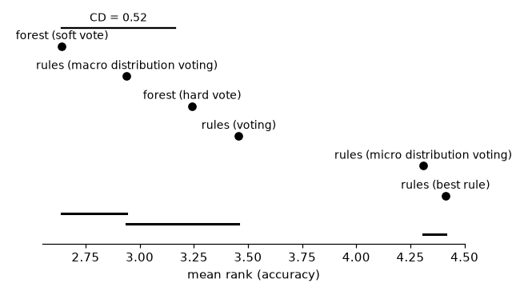

# Base against composite models: a forest's vote against the rule set of its leaves

## Setup

**Full run.** Quick sanity check instead: `python demos/base_vs_composite.py`.

A random forest combines its trees' predictions; but as every tree is a
disjoint rule set, exactly one leaf of each tree covers an example, and the
union of all leaves is a single flat rule set. This demo compares the two
views on the same fitted forests of 100 trees, of depth 4, of depth 8 and
of unlimited depth:

- **forest (soft vote)** -- sklearn's own prediction, the trees' class
  distributions averaged;
- **forest (hard vote)** -- the plurality of the trees' predicted classes;
- **rules (...)** -- the union of the leaves as one rule set, each leaf's
  class distribution measured on the training fold, a conflict resolved by
  **best rule** (the covering leaf with the best Laplace estimate),
  **voting** (one vote per covering leaf), **micro distribution voting**
  (their class counts summed) or **macro distribution voting** (their
  class proportions summed).

The hard vote is the same as voting, and the soft vote as macro
distribution voting, except that sklearn's leaf distributions come from
each tree's bootstrap sample (and ties are broken differently); the
agreement columns give the share of test examples on which each pair
predicts the same class.

Multi-class datasets, with their numbers of classes: `balance-scale` (3), `cmc` (3), `dna` (3), `hayes-roth` (3), `iris` (3), `splice` (3), `wine` (3), `car` (4), `lymph` (4), `vehicle` (4), `anneal` (5), `glass` (6), `solar-flare` (6), `segment` (7), `zoo` (7), `ecoli` (8), `led24` (10), `yeast` (10), `optdigits` (10), `texture` (11), `vowel` (11), `kropt` (18), `soybean` (19), `primary-tumor` (21), `audiology` (24), `letter` (26). Two-class datasets: `SPECT`, `Titanic`, `banknote-authentication`, `blood-transfusion-service-center`, `breast-cancer`, `breast-w`, `churn`, `climate-model-simulation-crashes`, `colic`, `compas-two-years`, `credit-approval`, `credit-g`, `cylinder-bands`, `diabetes`, `dresses-sales`, `heart-c`, `heart-h`, `heart-statlog`, `heloc`, `hepatitis`, `ilpd`, `ionosphere`, `kc1`, `kc2`, `kr-vs-kp`, `mofn-3-7-10`, `molecular-biology_promoters`, `monks-problems-1`, `monks-problems-2`, `monks-problems-3`, `mushroom`, `ozone-level-8hr`, `pc1`, `pc3`, `pc4`, `phoneme`, `qsar-biodeg`, `sick`, `sonar`, `spambase`, `tic-tac-toe`, `vote`, `wdbc`, `wilt`. Protocol:
10-fold stratified cross-validation, one `DataSpec` per training fold
(`TreeDiscretizer(max_intervals=8)`), the forest trained on its Boolean
features. On data with missing values, the equivalences hold only in part:
a missing value satisfies neither a feature nor its negation, whereas a tree
takes it as a false feature, so that an example with a missing value may be
covered by no leaf of a tree. Each fit is capped at 600s (3600s for
`kropt`, `letter`, `heloc`).

Left out, as a fold failed (the whole cross-validation of that forest is then counted as failed): `kropt` (unlimited depth: timeout).

## All datasets

The 70 datasets, multi-class and two-class together, sorted by mean rank (accuracy rank across datasets). Agreement: the share of test examples on which a forest vote and its equivalent combiner predict the same class.

### Depth 4

Rules (leaves) per forest: 1307.8, conditions: 5005.3.

| combination | accuracy | mean rank | agreement |
|---|--:|--:|--:|
| forest (soft vote) | 82.10% | 2.36 | 98.44% with macro distribution voting |
| rules (macro distribution voting) | 81.73% | 2.85 |  |
| forest (hard vote) | 80.93% | 3.37 | 99.07% with voting |
| rules (voting) | 80.63% | 3.72 |  |
| rules (best rule) | 80.48% | 3.81 |  |
| rules (micro distribution voting) | 79.51% | 4.89 |  |

### Depth 8

Rules (leaves) per forest: 6718.9, conditions: 47267.8.

| combination | accuracy | mean rank | agreement |
|---|--:|--:|--:|
| forest (soft vote) | 85.34% | 2.43 | 97.86% with macro distribution voting |
| rules (macro distribution voting) | 85.04% | 2.89 |  |
| forest (hard vote) | 85.01% | 3.25 | 98.85% with voting |
| rules (voting) | 84.66% | 3.35 |  |
| rules (micro distribution voting) | 83.48% | 4.44 |  |
| rules (best rule) | 83.25% | 4.64 |  |

### Unlimited depth

Rules (leaves) per forest: 23417.8, conditions: 294768.4.

| combination | accuracy | mean rank | agreement |
|---|--:|--:|--:|
| rules (macro distribution voting) | 85.75% | 3.08 |  |
| forest (hard vote) | 86.19% | 3.10 | 98.38% with voting |
| forest (soft vote) | 86.21% | 3.14 | 97.21% with macro distribution voting |
| rules (voting) | 85.64% | 3.30 |  |
| rules (micro distribution voting) | 85.55% | 3.59 |  |
| rules (best rule) | 83.83% | 4.79 |  |

### All depths together

Each combination's mean rank, ranked within each depth on each dataset, and its accuracy, averaged over the depths.

| combination | accuracy | mean rank |
|---|--:|--:|
| forest (soft vote) | 84.54% | 2.64 |
| rules (macro distribution voting) | 84.17% | 2.94 |
| forest (hard vote) | 84.03% | 3.24 |
| rules (voting) | 83.64% | 3.46 |
| rules (micro distribution voting) | 82.83% | 4.31 |
| rules (best rule) | 82.52% | 4.41 |

Friedman test over the 209 (dataset, depth) pairs: p = 3e-34 (6 combinations). Nemenyi critical difference at 5%: 0.52. The pairs of one dataset aren't independent of each other, so the test is on the optimistic side.

## Over the number of classes

Per (dataset, depth) pair, the accuracy of a combination minus that of the forest (soft vote), in percentage points (negative: the combination is worse), averaged over the pairs of datasets with the given numbers of classes (their count in parentheses), and Spearman's rank correlation of the difference with the number of classes.

| combination | 2 (132) | 3-5 (33) | 6-9 (15) | 10-26 (29) | correlation |
|---|--:|--:|--:|--:|--:|
| forest (hard vote) | -0.17 | -0.20 | -0.60 | -2.33 | -0.26 (p = 0.00013) |
| rules (best rule) | -0.83 | -3.02 | -5.63 | -4.46 | -0.42 (p = 2.3e-10) |
| rules (voting) | -0.61 | -0.55 | -0.65 | -2.80 | -0.26 (p = 0.00016) |
| rules (micro distribution voting) | -1.21 | -1.43 | -1.47 | -4.40 | -0.25 (p = 0.00027) |
| rules (macro distribution voting) | -0.39 | -0.31 | -0.21 | -0.49 | -0.08 (p = 0.24) |

Mean rank, ranked within each depth on each dataset, on the datasets with two classes and on those with more:

| combination | two classes | more classes |
|---|--:|--:|
| forest (soft vote) | 2.82 | 2.34 |
| forest (hard vote) | 3.17 | 3.36 |
| rules (best rule) | 4.14 | 4.88 |
| rules (voting) | 3.40 | 3.56 |
| rules (micro distribution voting) | 4.38 | 4.18 |
| rules (macro distribution voting) | 3.09 | 2.68 |

## Per dataset (mean across folds)

| dataset | learner | accuracy | n_rules |
|---|---|---|---|
| SPECT | depth 4:forest (hard vote) | 81.62% | 1127.7 |
| SPECT | depth 4:forest (soft vote) | 82.78% | 1127.7 |
| SPECT | depth 4:rules (best rule) | 80.56% | 1127.7 |
| SPECT | depth 4:rules (macro distribution voting) | 82.07% | 1127.7 |
| SPECT | depth 4:rules (micro distribution voting) | 79.39% | 1127.7 |
| SPECT | depth 4:rules (voting) | 80.87% | 1127.7 |
| SPECT | depth 8:forest (hard vote) | 80.50% | 3299.9 |
| SPECT | depth 8:forest (soft vote) | 82.36% | 3299.9 |
| SPECT | depth 8:rules (best rule) | 84.29% | 3299.9 |
| SPECT | depth 8:rules (macro distribution voting) | 82.75% | 3299.9 |
| SPECT | depth 8:rules (micro distribution voting) | 81.62% | 3299.9 |
| SPECT | depth 8:rules (voting) | 80.50% | 3299.9 |
| SPECT | unlimited depth:forest (hard vote) | 80.14% | 4596.1 |
| SPECT | unlimited depth:forest (soft vote) | 81.99% | 4596.1 |
| SPECT | unlimited depth:rules (best rule) | 84.66% | 4596.1 |
| SPECT | unlimited depth:rules (macro distribution voting) | 83.11% | 4596.1 |
| SPECT | unlimited depth:rules (micro distribution voting) | 85.37% | 4596.1 |
| SPECT | unlimited depth:rules (voting) | 80.14% | 4596.1 |
| Titanic | depth 4:forest (hard vote) | 78.30% | 1485.7 |
| Titanic | depth 4:forest (soft vote) | 79.22% | 1485.7 |
| Titanic | depth 4:rules (best rule) | 78.61% | 1485.7 |
| Titanic | depth 4:rules (macro distribution voting) | 78.76% | 1485.7 |
| Titanic | depth 4:rules (micro distribution voting) | 76.24% | 1485.7 |
| Titanic | depth 4:rules (voting) | 78.38% | 1485.7 |
| Titanic | depth 8:forest (hard vote) | 79.53% | 8731.8 |
| Titanic | depth 8:forest (soft vote) | 80.21% | 8731.8 |
| Titanic | depth 8:rules (best rule) | 79.45% | 8731.8 |
| Titanic | depth 8:rules (macro distribution voting) | 79.45% | 8731.8 |
| Titanic | depth 8:rules (micro distribution voting) | 79.83% | 8731.8 |
| Titanic | depth 8:rules (voting) | 78.99% | 8731.8 |
| Titanic | unlimited depth:forest (hard vote) | 78.30% | 17584.6 |
| Titanic | unlimited depth:forest (soft vote) | 78.30% | 17584.6 |
| Titanic | unlimited depth:rules (best rule) | 68.07% | 17584.6 |
| Titanic | unlimited depth:rules (macro distribution voting) | 67.91% | 17584.6 |
| Titanic | unlimited depth:rules (micro distribution voting) | 68.60% | 17584.6 |
| Titanic | unlimited depth:rules (voting) | 68.14% | 17584.6 |
| anneal | depth 4:forest (hard vote) | 92.09% | 966.2 |
| anneal | depth 4:forest (soft vote) | 93.87% | 966.2 |
| anneal | depth 4:rules (best rule) | 89.64% | 966.2 |
| anneal | depth 4:rules (macro distribution voting) | 90.76% | 966.2 |
| anneal | depth 4:rules (micro distribution voting) | 80.18% | 966.2 |
| anneal | depth 4:rules (voting) | 86.86% | 966.2 |
| anneal | depth 8:forest (hard vote) | 99.33% | 2779.5 |
| anneal | depth 8:forest (soft vote) | 99.44% | 2779.5 |
| anneal | depth 8:rules (best rule) | 94.10% | 2779.5 |
| anneal | depth 8:rules (macro distribution voting) | 95.32% | 2779.5 |
| anneal | depth 8:rules (micro distribution voting) | 92.42% | 2779.5 |
| anneal | depth 8:rules (voting) | 94.20% | 2779.5 |
| anneal | unlimited depth:forest (hard vote) | 99.44% | 3935.8 |
| anneal | unlimited depth:forest (soft vote) | 99.44% | 3935.8 |
| anneal | unlimited depth:rules (best rule) | 95.10% | 3935.8 |
| anneal | unlimited depth:rules (macro distribution voting) | 97.21% | 3935.8 |
| anneal | unlimited depth:rules (micro distribution voting) | 96.21% | 3935.8 |
| anneal | unlimited depth:rules (voting) | 96.88% | 3935.8 |
| audiology | depth 4:forest (hard vote) | 65.06% | 1280.2 |
| audiology | depth 4:forest (soft vote) | 70.38% | 1280.2 |
| audiology | depth 4:rules (best rule) | 70.00% | 1280.2 |
| audiology | depth 4:rules (macro distribution voting) | 70.83% | 1280.2 |
| audiology | depth 4:rules (micro distribution voting) | 60.18% | 1280.2 |
| audiology | depth 4:rules (voting) | 65.93% | 1280.2 |
| audiology | depth 8:forest (hard vote) | 79.25% | 4520.3 |
| audiology | depth 8:forest (soft vote) | 80.16% | 4520.3 |
| audiology | depth 8:rules (best rule) | 69.92% | 4520.3 |
| audiology | depth 8:rules (macro distribution voting) | 80.20% | 4520.3 |
| audiology | depth 8:rules (micro distribution voting) | 69.92% | 4520.3 |
| audiology | depth 8:rules (voting) | 79.31% | 4520.3 |
| audiology | unlimited depth:forest (hard vote) | 80.61% | 6716.4 |
| audiology | unlimited depth:forest (soft vote) | 80.61% | 6716.4 |
| audiology | unlimited depth:rules (best rule) | 70.81% | 6716.4 |
| audiology | unlimited depth:rules (macro distribution voting) | 80.18% | 6716.4 |
| audiology | unlimited depth:rules (micro distribution voting) | 78.36% | 6716.4 |
| audiology | unlimited depth:rules (voting) | 80.18% | 6716.4 |
| balance-scale | depth 4:forest (hard vote) | 87.04% | 1537.9 |
| balance-scale | depth 4:forest (soft vote) | 88.16% | 1537.9 |
| balance-scale | depth 4:rules (best rule) | 85.93% | 1537.9 |
| balance-scale | depth 4:rules (macro distribution voting) | 87.20% | 1537.9 |
| balance-scale | depth 4:rules (micro distribution voting) | 86.88% | 1537.9 |
| balance-scale | depth 4:rules (voting) | 87.04% | 1537.9 |
| balance-scale | depth 8:forest (hard vote) | 86.40% | 8266.9 |
| balance-scale | depth 8:forest (soft vote) | 86.72% | 8266.9 |
| balance-scale | depth 8:rules (best rule) | 87.84% | 8266.9 |
| balance-scale | depth 8:rules (macro distribution voting) | 86.88% | 8266.9 |
| balance-scale | depth 8:rules (micro distribution voting) | 89.28% | 8266.9 |
| balance-scale | depth 8:rules (voting) | 86.56% | 8266.9 |
| balance-scale | unlimited depth:forest (hard vote) | 84.49% | 11962.4 |
| balance-scale | unlimited depth:forest (soft vote) | 84.49% | 11962.4 |
| balance-scale | unlimited depth:rules (best rule) | 88.48% | 11962.4 |
| balance-scale | unlimited depth:rules (macro distribution voting) | 85.28% | 11962.4 |
| balance-scale | unlimited depth:rules (micro distribution voting) | 89.76% | 11962.4 |
| balance-scale | unlimited depth:rules (voting) | 85.13% | 11962.4 |
| banknote-authentication | depth 4:forest (hard vote) | 95.26% | 1311.9 |
| banknote-authentication | depth 4:forest (soft vote) | 95.48% | 1311.9 |
| banknote-authentication | depth 4:rules (best rule) | 97.59% | 1311.9 |
| banknote-authentication | depth 4:rules (macro distribution voting) | 95.48% | 1311.9 |
| banknote-authentication | depth 4:rules (micro distribution voting) | 93.15% | 1311.9 |
| banknote-authentication | depth 4:rules (voting) | 95.26% | 1311.9 |
| banknote-authentication | depth 8:forest (hard vote) | 98.76% | 3828.0 |
| banknote-authentication | depth 8:forest (soft vote) | 98.83% | 3828.0 |
| banknote-authentication | depth 8:rules (best rule) | 98.10% | 3828.0 |
| banknote-authentication | depth 8:rules (macro distribution voting) | 98.83% | 3828.0 |
| banknote-authentication | depth 8:rules (micro distribution voting) | 97.96% | 3828.0 |
| banknote-authentication | depth 8:rules (voting) | 98.76% | 3828.0 |
| banknote-authentication | unlimited depth:forest (hard vote) | 99.13% | 4509.4 |
| banknote-authentication | unlimited depth:forest (soft vote) | 99.05% | 4509.4 |
| banknote-authentication | unlimited depth:rules (best rule) | 98.03% | 4509.4 |
| banknote-authentication | unlimited depth:rules (macro distribution voting) | 99.13% | 4509.4 |
| banknote-authentication | unlimited depth:rules (micro distribution voting) | 98.40% | 4509.4 |
| banknote-authentication | unlimited depth:rules (voting) | 99.13% | 4509.4 |
| blood-transfusion-service-center | depth 4:forest (hard vote) | 77.01% | 1307.6 |
| blood-transfusion-service-center | depth 4:forest (soft vote) | 77.67% | 1307.6 |
| blood-transfusion-service-center | depth 4:rules (best rule) | 77.14% | 1307.6 |
| blood-transfusion-service-center | depth 4:rules (macro distribution voting) | 76.87% | 1307.6 |
| blood-transfusion-service-center | depth 4:rules (micro distribution voting) | 76.47% | 1307.6 |
| blood-transfusion-service-center | depth 4:rules (voting) | 77.01% | 1307.6 |
| blood-transfusion-service-center | depth 8:forest (hard vote) | 78.47% | 4389.9 |
| blood-transfusion-service-center | depth 8:forest (soft vote) | 78.20% | 4389.9 |
| blood-transfusion-service-center | depth 8:rules (best rule) | 77.94% | 4389.9 |
| blood-transfusion-service-center | depth 8:rules (macro distribution voting) | 78.20% | 4389.9 |
| blood-transfusion-service-center | depth 8:rules (micro distribution voting) | 78.47% | 4389.9 |
| blood-transfusion-service-center | depth 8:rules (voting) | 78.47% | 4389.9 |
| blood-transfusion-service-center | unlimited depth:forest (hard vote) | 78.47% | 5060.5 |
| blood-transfusion-service-center | unlimited depth:forest (soft vote) | 78.20% | 5060.5 |
| blood-transfusion-service-center | unlimited depth:rules (best rule) | 78.47% | 5060.5 |
| blood-transfusion-service-center | unlimited depth:rules (macro distribution voting) | 77.93% | 5060.5 |
| blood-transfusion-service-center | unlimited depth:rules (micro distribution voting) | 78.20% | 5060.5 |
| blood-transfusion-service-center | unlimited depth:rules (voting) | 78.47% | 5060.5 |
| breast-cancer | depth 4:forest (hard vote) | 75.52% | 1251.2 |
| breast-cancer | depth 4:forest (soft vote) | 75.17% | 1251.2 |
| breast-cancer | depth 4:rules (best rule) | 73.44% | 1251.2 |
| breast-cancer | depth 4:rules (macro distribution voting) | 75.17% | 1251.2 |
| breast-cancer | depth 4:rules (micro distribution voting) | 74.15% | 1251.2 |
| breast-cancer | depth 4:rules (voting) | 75.52% | 1251.2 |
| breast-cancer | depth 8:forest (hard vote) | 76.23% | 4545.9 |
| breast-cancer | depth 8:forest (soft vote) | 74.83% | 4545.9 |
| breast-cancer | depth 8:rules (best rule) | 72.76% | 4545.9 |
| breast-cancer | depth 8:rules (macro distribution voting) | 75.87% | 4545.9 |
| breast-cancer | depth 8:rules (micro distribution voting) | 74.47% | 4545.9 |
| breast-cancer | depth 8:rules (voting) | 76.23% | 4545.9 |
| breast-cancer | unlimited depth:forest (hard vote) | 72.77% | 7789.3 |
| breast-cancer | unlimited depth:forest (soft vote) | 72.77% | 7789.3 |
| breast-cancer | unlimited depth:rules (best rule) | 75.90% | 7789.3 |
| breast-cancer | unlimited depth:rules (macro distribution voting) | 74.52% | 7789.3 |
| breast-cancer | unlimited depth:rules (micro distribution voting) | 73.81% | 7789.3 |
| breast-cancer | unlimited depth:rules (voting) | 72.41% | 7789.3 |
| breast-w | depth 4:forest (hard vote) | 97.14% | 1229.0 |
| breast-w | depth 4:forest (soft vote) | 96.85% | 1229.0 |
| breast-w | depth 4:rules (best rule) | 93.28% | 1229.0 |
| breast-w | depth 4:rules (macro distribution voting) | 97.14% | 1229.0 |
| breast-w | depth 4:rules (micro distribution voting) | 95.42% | 1229.0 |
| breast-w | depth 4:rules (voting) | 97.14% | 1229.0 |
| breast-w | depth 8:forest (hard vote) | 96.13% | 2776.6 |
| breast-w | depth 8:forest (soft vote) | 96.28% | 2776.6 |
| breast-w | depth 8:rules (best rule) | 92.71% | 2776.6 |
| breast-w | depth 8:rules (macro distribution voting) | 96.71% | 2776.6 |
| breast-w | depth 8:rules (micro distribution voting) | 95.14% | 2776.6 |
| breast-w | depth 8:rules (voting) | 96.28% | 2776.6 |
| breast-w | unlimited depth:forest (hard vote) | 96.28% | 3009.0 |
| breast-w | unlimited depth:forest (soft vote) | 96.28% | 3009.0 |
| breast-w | unlimited depth:rules (best rule) | 93.14% | 3009.0 |
| breast-w | unlimited depth:rules (macro distribution voting) | 96.56% | 3009.0 |
| breast-w | unlimited depth:rules (micro distribution voting) | 95.42% | 3009.0 |
| breast-w | unlimited depth:rules (voting) | 96.42% | 3009.0 |
| car | depth 4:forest (hard vote) | 86.11% | 999.0 |
| car | depth 4:forest (soft vote) | 86.05% | 999.0 |
| car | depth 4:rules (best rule) | 77.37% | 999.0 |
| car | depth 4:rules (macro distribution voting) | 86.23% | 999.0 |
| car | depth 4:rules (micro distribution voting) | 85.18% | 999.0 |
| car | depth 4:rules (voting) | 86.11% | 999.0 |
| car | depth 8:forest (hard vote) | 93.87% | 7121.7 |
| car | depth 8:forest (soft vote) | 94.96% | 7121.7 |
| car | depth 8:rules (best rule) | 96.58% | 7121.7 |
| car | depth 8:rules (macro distribution voting) | 94.79% | 7121.7 |
| car | depth 8:rules (micro distribution voting) | 93.75% | 7121.7 |
| car | depth 8:rules (voting) | 93.92% | 7121.7 |
| car | unlimited depth:forest (hard vote) | 97.05% | 17880.0 |
| car | unlimited depth:forest (soft vote) | 97.05% | 17880.0 |
| car | unlimited depth:rules (best rule) | 97.16% | 17880.0 |
| car | unlimited depth:rules (macro distribution voting) | 96.87% | 17880.0 |
| car | unlimited depth:rules (micro distribution voting) | 96.64% | 17880.0 |
| car | unlimited depth:rules (voting) | 97.16% | 17880.0 |
| churn | depth 4:forest (hard vote) | 88.70% | 1421.4 |
| churn | depth 4:forest (soft vote) | 88.68% | 1421.4 |
| churn | depth 4:rules (best rule) | 91.96% | 1421.4 |
| churn | depth 4:rules (macro distribution voting) | 88.62% | 1421.4 |
| churn | depth 4:rules (micro distribution voting) | 87.66% | 1421.4 |
| churn | depth 4:rules (voting) | 88.70% | 1421.4 |
| churn | depth 8:forest (hard vote) | 90.18% | 8789.7 |
| churn | depth 8:forest (soft vote) | 90.54% | 8789.7 |
| churn | depth 8:rules (best rule) | 92.22% | 8789.7 |
| churn | depth 8:rules (macro distribution voting) | 90.48% | 8789.7 |
| churn | depth 8:rules (micro distribution voting) | 88.80% | 8789.7 |
| churn | depth 8:rules (voting) | 90.18% | 8789.7 |
| churn | unlimited depth:forest (hard vote) | 93.60% | 54826.0 |
| churn | unlimited depth:forest (soft vote) | 93.60% | 54826.0 |
| churn | unlimited depth:rules (best rule) | 91.70% | 54826.0 |
| churn | unlimited depth:rules (macro distribution voting) | 93.56% | 54826.0 |
| churn | unlimited depth:rules (micro distribution voting) | 92.52% | 54826.0 |
| churn | unlimited depth:rules (voting) | 93.60% | 54826.0 |
| climate-model-simulation-crashes | depth 4:forest (hard vote) | 92.59% | 1211.1 |
| climate-model-simulation-crashes | depth 4:forest (soft vote) | 92.41% | 1211.1 |
| climate-model-simulation-crashes | depth 4:rules (best rule) | 91.67% | 1211.1 |
| climate-model-simulation-crashes | depth 4:rules (macro distribution voting) | 92.41% | 1211.1 |
| climate-model-simulation-crashes | depth 4:rules (micro distribution voting) | 91.48% | 1211.1 |
| climate-model-simulation-crashes | depth 4:rules (voting) | 92.59% | 1211.1 |
| climate-model-simulation-crashes | depth 8:forest (hard vote) | 93.89% | 3046.8 |
| climate-model-simulation-crashes | depth 8:forest (soft vote) | 93.70% | 3046.8 |
| climate-model-simulation-crashes | depth 8:rules (best rule) | 92.04% | 3046.8 |
| climate-model-simulation-crashes | depth 8:rules (macro distribution voting) | 93.52% | 3046.8 |
| climate-model-simulation-crashes | depth 8:rules (micro distribution voting) | 92.41% | 3046.8 |
| climate-model-simulation-crashes | depth 8:rules (voting) | 93.52% | 3046.8 |
| climate-model-simulation-crashes | unlimited depth:forest (hard vote) | 94.07% | 3430.5 |
| climate-model-simulation-crashes | unlimited depth:forest (soft vote) | 94.07% | 3430.5 |
| climate-model-simulation-crashes | unlimited depth:rules (best rule) | 91.85% | 3430.5 |
| climate-model-simulation-crashes | unlimited depth:rules (macro distribution voting) | 94.07% | 3430.5 |
| climate-model-simulation-crashes | unlimited depth:rules (micro distribution voting) | 92.59% | 3430.5 |
| climate-model-simulation-crashes | unlimited depth:rules (voting) | 94.44% | 3430.5 |
| cmc | depth 4:forest (hard vote) | 54.99% | 1408.4 |
| cmc | depth 4:forest (soft vote) | 55.47% | 1408.4 |
| cmc | depth 4:rules (best rule) | 53.84% | 1408.4 |
| cmc | depth 4:rules (macro distribution voting) | 55.13% | 1408.4 |
| cmc | depth 4:rules (micro distribution voting) | 55.13% | 1408.4 |
| cmc | depth 4:rules (voting) | 55.06% | 1408.4 |
| cmc | depth 8:forest (hard vote) | 54.59% | 10271.4 |
| cmc | depth 8:forest (soft vote) | 54.59% | 10271.4 |
| cmc | depth 8:rules (best rule) | 54.11% | 10271.4 |
| cmc | depth 8:rules (macro distribution voting) | 54.39% | 10271.4 |
| cmc | depth 8:rules (micro distribution voting) | 55.06% | 10271.4 |
| cmc | depth 8:rules (voting) | 54.66% | 10271.4 |
| cmc | unlimited depth:forest (hard vote) | 49.90% | 45018.9 |
| cmc | unlimited depth:forest (soft vote) | 50.51% | 45018.9 |
| cmc | unlimited depth:rules (best rule) | 52.15% | 45018.9 |
| cmc | unlimited depth:rules (macro distribution voting) | 51.06% | 45018.9 |
| cmc | unlimited depth:rules (micro distribution voting) | 51.95% | 45018.9 |
| cmc | unlimited depth:rules (voting) | 50.04% | 45018.9 |
| colic | depth 4:forest (hard vote) | 83.42% | 1373.1 |
| colic | depth 4:forest (soft vote) | 83.16% | 1373.1 |
| colic | depth 4:rules (best rule) | 82.88% | 1373.1 |
| colic | depth 4:rules (macro distribution voting) | 82.34% | 1373.1 |
| colic | depth 4:rules (micro distribution voting) | 82.06% | 1373.1 |
| colic | depth 4:rules (voting) | 82.88% | 1373.1 |
| colic | depth 8:forest (hard vote) | 85.08% | 4743.4 |
| colic | depth 8:forest (soft vote) | 84.80% | 4743.4 |
| colic | depth 8:rules (best rule) | 79.62% | 4743.4 |
| colic | depth 8:rules (macro distribution voting) | 79.90% | 4743.4 |
| colic | depth 8:rules (micro distribution voting) | 79.08% | 4743.4 |
| colic | depth 8:rules (voting) | 79.36% | 4743.4 |
| colic | unlimited depth:forest (hard vote) | 85.08% | 6009.9 |
| colic | unlimited depth:forest (soft vote) | 85.08% | 6009.9 |
| colic | unlimited depth:rules (best rule) | 80.43% | 6009.9 |
| colic | unlimited depth:rules (macro distribution voting) | 80.44% | 6009.9 |
| colic | unlimited depth:rules (micro distribution voting) | 80.71% | 6009.9 |
| colic | unlimited depth:rules (voting) | 80.17% | 6009.9 |
| compas-two-years | depth 4:forest (hard vote) | 67.35% | 1526.3 |
| compas-two-years | depth 4:forest (soft vote) | 67.60% | 1526.3 |
| compas-two-years | depth 4:rules (best rule) | 68.09% | 1526.3 |
| compas-two-years | depth 4:rules (macro distribution voting) | 67.64% | 1526.3 |
| compas-two-years | depth 4:rules (micro distribution voting) | 66.62% | 1526.3 |
| compas-two-years | depth 4:rules (voting) | 67.35% | 1526.3 |
| compas-two-years | depth 8:forest (hard vote) | 67.73% | 12632.8 |
| compas-two-years | depth 8:forest (soft vote) | 67.89% | 12632.8 |
| compas-two-years | depth 8:rules (best rule) | 67.71% | 12632.8 |
| compas-two-years | depth 8:rules (macro distribution voting) | 67.83% | 12632.8 |
| compas-two-years | depth 8:rules (micro distribution voting) | 67.70% | 12632.8 |
| compas-two-years | depth 8:rules (voting) | 67.73% | 12632.8 |
| compas-two-years | unlimited depth:forest (hard vote) | 65.29% | 52015.5 |
| compas-two-years | unlimited depth:forest (soft vote) | 65.35% | 52015.5 |
| compas-two-years | unlimited depth:rules (best rule) | 66.33% | 52015.5 |
| compas-two-years | unlimited depth:rules (macro distribution voting) | 65.84% | 52015.5 |
| compas-two-years | unlimited depth:rules (micro distribution voting) | 65.99% | 52015.5 |
| compas-two-years | unlimited depth:rules (voting) | 65.29% | 52015.5 |
| credit-approval | depth 4:forest (hard vote) | 86.09% | 1414.8 |
| credit-approval | depth 4:forest (soft vote) | 86.23% | 1414.8 |
| credit-approval | depth 4:rules (best rule) | 85.94% | 1414.8 |
| credit-approval | depth 4:rules (macro distribution voting) | 85.94% | 1414.8 |
| credit-approval | depth 4:rules (micro distribution voting) | 83.91% | 1414.8 |
| credit-approval | depth 4:rules (voting) | 85.80% | 1414.8 |
| credit-approval | depth 8:forest (hard vote) | 86.09% | 6157.3 |
| credit-approval | depth 8:forest (soft vote) | 86.96% | 6157.3 |
| credit-approval | depth 8:rules (best rule) | 86.23% | 6157.3 |
| credit-approval | depth 8:rules (macro distribution voting) | 86.81% | 6157.3 |
| credit-approval | depth 8:rules (micro distribution voting) | 86.23% | 6157.3 |
| credit-approval | depth 8:rules (voting) | 86.52% | 6157.3 |
| credit-approval | unlimited depth:forest (hard vote) | 87.25% | 11577.6 |
| credit-approval | unlimited depth:forest (soft vote) | 87.25% | 11577.6 |
| credit-approval | unlimited depth:rules (best rule) | 86.09% | 11577.6 |
| credit-approval | unlimited depth:rules (macro distribution voting) | 86.96% | 11577.6 |
| credit-approval | unlimited depth:rules (micro distribution voting) | 86.38% | 11577.6 |
| credit-approval | unlimited depth:rules (voting) | 87.10% | 11577.6 |
| credit-g | depth 4:forest (hard vote) | 72.60% | 1468.7 |
| credit-g | depth 4:forest (soft vote) | 72.90% | 1468.7 |
| credit-g | depth 4:rules (best rule) | 74.40% | 1468.7 |
| credit-g | depth 4:rules (macro distribution voting) | 72.10% | 1468.7 |
| credit-g | depth 4:rules (micro distribution voting) | 70.00% | 1468.7 |
| credit-g | depth 4:rules (voting) | 72.40% | 1468.7 |
| credit-g | depth 8:forest (hard vote) | 75.00% | 8116.9 |
| credit-g | depth 8:forest (soft vote) | 76.00% | 8116.9 |
| credit-g | depth 8:rules (best rule) | 74.80% | 8116.9 |
| credit-g | depth 8:rules (macro distribution voting) | 75.40% | 8116.9 |
| credit-g | depth 8:rules (micro distribution voting) | 74.00% | 8116.9 |
| credit-g | depth 8:rules (voting) | 75.20% | 8116.9 |
| credit-g | unlimited depth:forest (hard vote) | 74.70% | 20080.6 |
| credit-g | unlimited depth:forest (soft vote) | 74.70% | 20080.6 |
| credit-g | unlimited depth:rules (best rule) | 74.60% | 20080.6 |
| credit-g | unlimited depth:rules (macro distribution voting) | 75.00% | 20080.6 |
| credit-g | unlimited depth:rules (micro distribution voting) | 75.40% | 20080.6 |
| credit-g | unlimited depth:rules (voting) | 75.40% | 20080.6 |
| cylinder-bands | depth 4:forest (hard vote) | 70.19% | 1024.8 |
| cylinder-bands | depth 4:forest (soft vote) | 71.11% | 1024.8 |
| cylinder-bands | depth 4:rules (best rule) | 69.63% | 1024.8 |
| cylinder-bands | depth 4:rules (macro distribution voting) | 66.11% | 1024.8 |
| cylinder-bands | depth 4:rules (micro distribution voting) | 62.78% | 1024.8 |
| cylinder-bands | depth 4:rules (voting) | 65.19% | 1024.8 |
| cylinder-bands | depth 8:forest (hard vote) | 80.74% | 4147.1 |
| cylinder-bands | depth 8:forest (soft vote) | 80.74% | 4147.1 |
| cylinder-bands | depth 8:rules (best rule) | 68.89% | 4147.1 |
| cylinder-bands | depth 8:rules (macro distribution voting) | 72.59% | 4147.1 |
| cylinder-bands | depth 8:rules (micro distribution voting) | 65.00% | 4147.1 |
| cylinder-bands | depth 8:rules (voting) | 73.33% | 4147.1 |
| cylinder-bands | unlimited depth:forest (hard vote) | 82.59% | 9485.0 |
| cylinder-bands | unlimited depth:forest (soft vote) | 82.59% | 9485.0 |
| cylinder-bands | unlimited depth:rules (best rule) | 69.81% | 9485.0 |
| cylinder-bands | unlimited depth:rules (macro distribution voting) | 76.48% | 9485.0 |
| cylinder-bands | unlimited depth:rules (micro distribution voting) | 72.96% | 9485.0 |
| cylinder-bands | unlimited depth:rules (voting) | 77.04% | 9485.0 |
| diabetes | depth 4:forest (hard vote) | 75.78% | 1467.3 |
| diabetes | depth 4:forest (soft vote) | 76.05% | 1467.3 |
| diabetes | depth 4:rules (best rule) | 76.56% | 1467.3 |
| diabetes | depth 4:rules (macro distribution voting) | 75.79% | 1467.3 |
| diabetes | depth 4:rules (micro distribution voting) | 75.01% | 1467.3 |
| diabetes | depth 4:rules (voting) | 75.52% | 1467.3 |
| diabetes | depth 8:forest (hard vote) | 75.39% | 7375.0 |
| diabetes | depth 8:forest (soft vote) | 76.04% | 7375.0 |
| diabetes | depth 8:rules (best rule) | 75.25% | 7375.0 |
| diabetes | depth 8:rules (macro distribution voting) | 75.13% | 7375.0 |
| diabetes | depth 8:rules (micro distribution voting) | 75.00% | 7375.0 |
| diabetes | depth 8:rules (voting) | 75.78% | 7375.0 |
| diabetes | unlimited depth:forest (hard vote) | 75.52% | 17310.6 |
| diabetes | unlimited depth:forest (soft vote) | 75.65% | 17310.6 |
| diabetes | unlimited depth:rules (best rule) | 73.95% | 17310.6 |
| diabetes | unlimited depth:rules (macro distribution voting) | 74.22% | 17310.6 |
| diabetes | unlimited depth:rules (micro distribution voting) | 74.61% | 17310.6 |
| diabetes | unlimited depth:rules (voting) | 73.31% | 17310.6 |
| dna | depth 4:forest (hard vote) | 89.17% | 1494.0 |
| dna | depth 4:forest (soft vote) | 89.55% | 1494.0 |
| dna | depth 4:rules (best rule) | 78.50% | 1494.0 |
| dna | depth 4:rules (macro distribution voting) | 89.30% | 1494.0 |
| dna | depth 4:rules (micro distribution voting) | 89.14% | 1494.0 |
| dna | depth 4:rules (voting) | 89.02% | 1494.0 |
| dna | depth 8:forest (hard vote) | 94.29% | 10883.9 |
| dna | depth 8:forest (soft vote) | 94.85% | 10883.9 |
| dna | depth 8:rules (best rule) | 90.49% | 10883.9 |
| dna | depth 8:rules (macro distribution voting) | 94.73% | 10883.9 |
| dna | depth 8:rules (micro distribution voting) | 90.99% | 10883.9 |
| dna | depth 8:rules (voting) | 94.32% | 10883.9 |
| dna | unlimited depth:forest (hard vote) | 95.23% | 31844.9 |
| dna | unlimited depth:forest (soft vote) | 95.23% | 31844.9 |
| dna | unlimited depth:rules (best rule) | 93.28% | 31844.9 |
| dna | unlimited depth:rules (macro distribution voting) | 95.26% | 31844.9 |
| dna | unlimited depth:rules (micro distribution voting) | 94.95% | 31844.9 |
| dna | unlimited depth:rules (voting) | 95.23% | 31844.9 |
| dresses-sales | depth 4:forest (hard vote) | 59.60% | 1307.4 |
| dresses-sales | depth 4:forest (soft vote) | 60.00% | 1307.4 |
| dresses-sales | depth 4:rules (best rule) | 63.20% | 1307.4 |
| dresses-sales | depth 4:rules (macro distribution voting) | 61.20% | 1307.4 |
| dresses-sales | depth 4:rules (micro distribution voting) | 59.20% | 1307.4 |
| dresses-sales | depth 4:rules (voting) | 59.80% | 1307.4 |
| dresses-sales | depth 8:forest (hard vote) | 60.00% | 5939.6 |
| dresses-sales | depth 8:forest (soft vote) | 61.00% | 5939.6 |
| dresses-sales | depth 8:rules (best rule) | 60.00% | 5939.6 |
| dresses-sales | depth 8:rules (macro distribution voting) | 63.00% | 5939.6 |
| dresses-sales | depth 8:rules (micro distribution voting) | 58.40% | 5939.6 |
| dresses-sales | depth 8:rules (voting) | 61.20% | 5939.6 |
| dresses-sales | unlimited depth:forest (hard vote) | 60.80% | 14336.2 |
| dresses-sales | unlimited depth:forest (soft vote) | 60.80% | 14336.2 |
| dresses-sales | unlimited depth:rules (best rule) | 54.40% | 14336.2 |
| dresses-sales | unlimited depth:rules (macro distribution voting) | 54.40% | 14336.2 |
| dresses-sales | unlimited depth:rules (micro distribution voting) | 56.40% | 14336.2 |
| dresses-sales | unlimited depth:rules (voting) | 55.40% | 14336.2 |
| ecoli | depth 4:forest (hard vote) | 83.68% | 1357.8 |
| ecoli | depth 4:forest (soft vote) | 84.57% | 1357.8 |
| ecoli | depth 4:rules (best rule) | 82.18% | 1357.8 |
| ecoli | depth 4:rules (macro distribution voting) | 84.28% | 1357.8 |
| ecoli | depth 4:rules (micro distribution voting) | 82.49% | 1357.8 |
| ecoli | depth 4:rules (voting) | 83.68% | 1357.8 |
| ecoli | depth 8:forest (hard vote) | 86.97% | 4533.2 |
| ecoli | depth 8:forest (soft vote) | 85.79% | 4533.2 |
| ecoli | depth 8:rules (best rule) | 83.39% | 4533.2 |
| ecoli | depth 8:rules (macro distribution voting) | 85.79% | 4533.2 |
| ecoli | depth 8:rules (micro distribution voting) | 85.18% | 4533.2 |
| ecoli | depth 8:rules (voting) | 86.97% | 4533.2 |
| ecoli | unlimited depth:forest (hard vote) | 85.47% | 6128.7 |
| ecoli | unlimited depth:forest (soft vote) | 85.18% | 6128.7 |
| ecoli | unlimited depth:rules (best rule) | 83.39% | 6128.7 |
| ecoli | unlimited depth:rules (macro distribution voting) | 85.48% | 6128.7 |
| ecoli | unlimited depth:rules (micro distribution voting) | 85.78% | 6128.7 |
| ecoli | unlimited depth:rules (voting) | 85.47% | 6128.7 |
| glass | depth 4:forest (hard vote) | 73.44% | 1219.7 |
| glass | depth 4:forest (soft vote) | 74.37% | 1219.7 |
| glass | depth 4:rules (best rule) | 69.22% | 1219.7 |
| glass | depth 4:rules (macro distribution voting) | 73.01% | 1219.7 |
| glass | depth 4:rules (micro distribution voting) | 68.33% | 1219.7 |
| glass | depth 4:rules (voting) | 73.44% | 1219.7 |
| glass | depth 8:forest (hard vote) | 75.82% | 3876.1 |
| glass | depth 8:forest (soft vote) | 76.23% | 3876.1 |
| glass | depth 8:rules (best rule) | 71.54% | 3876.1 |
| glass | depth 8:rules (macro distribution voting) | 77.23% | 3876.1 |
| glass | depth 8:rules (micro distribution voting) | 73.92% | 3876.1 |
| glass | depth 8:rules (voting) | 75.82% | 3876.1 |
| glass | unlimited depth:forest (hard vote) | 77.14% | 5389.3 |
| glass | unlimited depth:forest (soft vote) | 77.14% | 5389.3 |
| glass | unlimited depth:rules (best rule) | 69.70% | 5389.3 |
| glass | unlimited depth:rules (macro distribution voting) | 77.62% | 5389.3 |
| glass | unlimited depth:rules (micro distribution voting) | 76.26% | 5389.3 |
| glass | unlimited depth:rules (voting) | 76.67% | 5389.3 |
| hayes-roth | depth 4:forest (hard vote) | 86.25% | 815.4 |
| hayes-roth | depth 4:forest (soft vote) | 86.25% | 815.4 |
| hayes-roth | depth 4:rules (best rule) | 79.38% | 815.4 |
| hayes-roth | depth 4:rules (macro distribution voting) | 85.00% | 815.4 |
| hayes-roth | depth 4:rules (micro distribution voting) | 75.00% | 815.4 |
| hayes-roth | depth 4:rules (voting) | 86.25% | 815.4 |
| hayes-roth | depth 8:forest (hard vote) | 83.12% | 2581.2 |
| hayes-roth | depth 8:forest (soft vote) | 81.88% | 2581.2 |
| hayes-roth | depth 8:rules (best rule) | 78.75% | 2581.2 |
| hayes-roth | depth 8:rules (macro distribution voting) | 83.75% | 2581.2 |
| hayes-roth | depth 8:rules (micro distribution voting) | 81.88% | 2581.2 |
| hayes-roth | depth 8:rules (voting) | 83.12% | 2581.2 |
| hayes-roth | unlimited depth:forest (hard vote) | 85.00% | 2946.6 |
| hayes-roth | unlimited depth:forest (soft vote) | 83.75% | 2946.6 |
| hayes-roth | unlimited depth:rules (best rule) | 79.38% | 2946.6 |
| hayes-roth | unlimited depth:rules (macro distribution voting) | 82.50% | 2946.6 |
| hayes-roth | unlimited depth:rules (micro distribution voting) | 82.50% | 2946.6 |
| hayes-roth | unlimited depth:rules (voting) | 85.00% | 2946.6 |
| heart-c | depth 4:forest (hard vote) | 82.57% | 1440.0 |
| heart-c | depth 4:forest (soft vote) | 81.57% | 1440.0 |
| heart-c | depth 4:rules (best rule) | 83.53% | 1440.0 |
| heart-c | depth 4:rules (macro distribution voting) | 82.23% | 1440.0 |
| heart-c | depth 4:rules (micro distribution voting) | 82.57% | 1440.0 |
| heart-c | depth 4:rules (voting) | 82.57% | 1440.0 |
| heart-c | depth 8:forest (hard vote) | 83.20% | 4731.7 |
| heart-c | depth 8:forest (soft vote) | 82.55% | 4731.7 |
| heart-c | depth 8:rules (best rule) | 83.15% | 4731.7 |
| heart-c | depth 8:rules (macro distribution voting) | 82.88% | 4731.7 |
| heart-c | depth 8:rules (micro distribution voting) | 83.20% | 4731.7 |
| heart-c | depth 8:rules (voting) | 83.53% | 4731.7 |
| heart-c | unlimited depth:forest (hard vote) | 82.22% | 5457.5 |
| heart-c | unlimited depth:forest (soft vote) | 82.22% | 5457.5 |
| heart-c | unlimited depth:rules (best rule) | 82.19% | 5457.5 |
| heart-c | unlimited depth:rules (macro distribution voting) | 83.20% | 5457.5 |
| heart-c | unlimited depth:rules (micro distribution voting) | 82.87% | 5457.5 |
| heart-c | unlimited depth:rules (voting) | 82.54% | 5457.5 |
| heart-h | depth 4:forest (hard vote) | 81.29% | 1277.1 |
| heart-h | depth 4:forest (soft vote) | 81.29% | 1277.1 |
| heart-h | depth 4:rules (best rule) | 80.25% | 1277.1 |
| heart-h | depth 4:rules (macro distribution voting) | 81.29% | 1277.1 |
| heart-h | depth 4:rules (micro distribution voting) | 79.93% | 1277.1 |
| heart-h | depth 4:rules (voting) | 81.29% | 1277.1 |
| heart-h | depth 8:forest (hard vote) | 81.67% | 3996.0 |
| heart-h | depth 8:forest (soft vote) | 80.97% | 3996.0 |
| heart-h | depth 8:rules (best rule) | 79.94% | 3996.0 |
| heart-h | depth 8:rules (macro distribution voting) | 81.64% | 3996.0 |
| heart-h | depth 8:rules (micro distribution voting) | 80.97% | 3996.0 |
| heart-h | depth 8:rules (voting) | 81.32% | 3996.0 |
| heart-h | unlimited depth:forest (hard vote) | 81.31% | 5566.2 |
| heart-h | unlimited depth:forest (soft vote) | 81.31% | 5566.2 |
| heart-h | unlimited depth:rules (best rule) | 79.95% | 5566.2 |
| heart-h | unlimited depth:rules (macro distribution voting) | 81.62% | 5566.2 |
| heart-h | unlimited depth:rules (micro distribution voting) | 82.33% | 5566.2 |
| heart-h | unlimited depth:rules (voting) | 81.64% | 5566.2 |
| heart-statlog | depth 4:forest (hard vote) | 84.44% | 1414.0 |
| heart-statlog | depth 4:forest (soft vote) | 83.33% | 1414.0 |
| heart-statlog | depth 4:rules (best rule) | 82.96% | 1414.0 |
| heart-statlog | depth 4:rules (macro distribution voting) | 81.85% | 1414.0 |
| heart-statlog | depth 4:rules (micro distribution voting) | 84.44% | 1414.0 |
| heart-statlog | depth 4:rules (voting) | 84.44% | 1414.0 |
| heart-statlog | depth 8:forest (hard vote) | 81.85% | 4321.2 |
| heart-statlog | depth 8:forest (soft vote) | 81.85% | 4321.2 |
| heart-statlog | depth 8:rules (best rule) | 83.33% | 4321.2 |
| heart-statlog | depth 8:rules (macro distribution voting) | 82.59% | 4321.2 |
| heart-statlog | depth 8:rules (micro distribution voting) | 82.96% | 4321.2 |
| heart-statlog | depth 8:rules (voting) | 81.85% | 4321.2 |
| heart-statlog | unlimited depth:forest (hard vote) | 81.48% | 4995.4 |
| heart-statlog | unlimited depth:forest (soft vote) | 81.48% | 4995.4 |
| heart-statlog | unlimited depth:rules (best rule) | 81.85% | 4995.4 |
| heart-statlog | unlimited depth:rules (macro distribution voting) | 82.22% | 4995.4 |
| heart-statlog | unlimited depth:rules (micro distribution voting) | 82.96% | 4995.4 |
| heart-statlog | unlimited depth:rules (voting) | 81.48% | 4995.4 |
| heloc | depth 4:forest (hard vote) | 70.77% | 1515.6 |
| heloc | depth 4:forest (soft vote) | 70.75% | 1515.6 |
| heloc | depth 4:rules (best rule) | 71.40% | 1515.6 |
| heloc | depth 4:rules (macro distribution voting) | 70.69% | 1515.6 |
| heloc | depth 4:rules (micro distribution voting) | 70.62% | 1515.6 |
| heloc | depth 4:rules (voting) | 70.77% | 1515.6 |
| heloc | depth 8:forest (hard vote) | 71.52% | 16554.7 |
| heloc | depth 8:forest (soft vote) | 71.85% | 16554.7 |
| heloc | depth 8:rules (best rule) | 71.69% | 16554.7 |
| heloc | depth 8:rules (macro distribution voting) | 71.67% | 16554.7 |
| heloc | depth 8:rules (micro distribution voting) | 71.24% | 16554.7 |
| heloc | depth 8:rules (voting) | 71.52% | 16554.7 |
| heloc | unlimited depth:forest (hard vote) | 71.51% | 224002.2 |
| heloc | unlimited depth:forest (soft vote) | 71.51% | 224002.2 |
| heloc | unlimited depth:rules (best rule) | 71.62% | 224002.2 |
| heloc | unlimited depth:rules (macro distribution voting) | 71.67% | 224002.2 |
| heloc | unlimited depth:rules (micro distribution voting) | 71.86% | 224002.2 |
| heloc | unlimited depth:rules (voting) | 71.51% | 224002.2 |
| hepatitis | depth 4:forest (hard vote) | 82.75% | 1094.6 |
| hepatitis | depth 4:forest (soft vote) | 82.75% | 1094.6 |
| hepatitis | depth 4:rules (best rule) | 81.96% | 1094.6 |
| hepatitis | depth 4:rules (macro distribution voting) | 83.33% | 1094.6 |
| hepatitis | depth 4:rules (micro distribution voting) | 83.25% | 1094.6 |
| hepatitis | depth 4:rules (voting) | 82.08% | 1094.6 |
| hepatitis | depth 8:forest (hard vote) | 83.42% | 2117.6 |
| hepatitis | depth 8:forest (soft vote) | 83.42% | 2117.6 |
| hepatitis | depth 8:rules (best rule) | 82.62% | 2117.6 |
| hepatitis | depth 8:rules (macro distribution voting) | 83.38% | 2117.6 |
| hepatitis | depth 8:rules (micro distribution voting) | 83.29% | 2117.6 |
| hepatitis | depth 8:rules (voting) | 82.71% | 2117.6 |
| hepatitis | unlimited depth:forest (hard vote) | 82.79% | 2213.0 |
| hepatitis | unlimited depth:forest (soft vote) | 82.79% | 2213.0 |
| hepatitis | unlimited depth:rules (best rule) | 82.62% | 2213.0 |
| hepatitis | unlimited depth:rules (macro distribution voting) | 82.08% | 2213.0 |
| hepatitis | unlimited depth:rules (micro distribution voting) | 83.96% | 2213.0 |
| hepatitis | unlimited depth:rules (voting) | 82.75% | 2213.0 |
| ilpd | depth 4:forest (hard vote) | 72.39% | 1342.6 |
| ilpd | depth 4:forest (soft vote) | 70.33% | 1342.6 |
| ilpd | depth 4:rules (best rule) | 71.01% | 1342.6 |
| ilpd | depth 4:rules (macro distribution voting) | 71.35% | 1342.6 |
| ilpd | depth 4:rules (micro distribution voting) | 71.36% | 1342.6 |
| ilpd | depth 4:rules (voting) | 72.39% | 1342.6 |
| ilpd | depth 8:forest (hard vote) | 70.16% | 5714.7 |
| ilpd | depth 8:forest (soft vote) | 69.99% | 5714.7 |
| ilpd | depth 8:rules (best rule) | 69.80% | 5714.7 |
| ilpd | depth 8:rules (macro distribution voting) | 69.83% | 5714.7 |
| ilpd | depth 8:rules (micro distribution voting) | 70.32% | 5714.7 |
| ilpd | depth 8:rules (voting) | 70.16% | 5714.7 |
| ilpd | unlimited depth:forest (hard vote) | 70.31% | 14306.0 |
| ilpd | unlimited depth:forest (soft vote) | 70.48% | 14306.0 |
| ilpd | unlimited depth:rules (best rule) | 70.68% | 14306.0 |
| ilpd | unlimited depth:rules (macro distribution voting) | 69.80% | 14306.0 |
| ilpd | unlimited depth:rules (micro distribution voting) | 70.49% | 14306.0 |
| ilpd | unlimited depth:rules (voting) | 70.31% | 14306.0 |
| ionosphere | depth 4:forest (hard vote) | 92.87% | 979.0 |
| ionosphere | depth 4:forest (soft vote) | 93.15% | 979.0 |
| ionosphere | depth 4:rules (best rule) | 92.87% | 979.0 |
| ionosphere | depth 4:rules (macro distribution voting) | 93.44% | 979.0 |
| ionosphere | depth 4:rules (micro distribution voting) | 84.33% | 979.0 |
| ionosphere | depth 4:rules (voting) | 92.58% | 979.0 |
| ionosphere | depth 8:forest (hard vote) | 93.15% | 2156.6 |
| ionosphere | depth 8:forest (soft vote) | 93.15% | 2156.6 |
| ionosphere | depth 8:rules (best rule) | 90.02% | 2156.6 |
| ionosphere | depth 8:rules (macro distribution voting) | 92.87% | 2156.6 |
| ionosphere | depth 8:rules (micro distribution voting) | 91.16% | 2156.6 |
| ionosphere | depth 8:rules (voting) | 93.15% | 2156.6 |
| ionosphere | unlimited depth:forest (hard vote) | 92.30% | 2761.3 |
| ionosphere | unlimited depth:forest (soft vote) | 92.30% | 2761.3 |
| ionosphere | unlimited depth:rules (best rule) | 90.02% | 2761.3 |
| ionosphere | unlimited depth:rules (macro distribution voting) | 92.58% | 2761.3 |
| ionosphere | unlimited depth:rules (micro distribution voting) | 91.73% | 2761.3 |
| ionosphere | unlimited depth:rules (voting) | 92.30% | 2761.3 |
| iris | depth 4:forest (hard vote) | 93.33% | 765.2 |
| iris | depth 4:forest (soft vote) | 94.00% | 765.2 |
| iris | depth 4:rules (best rule) | 96.67% | 765.2 |
| iris | depth 4:rules (macro distribution voting) | 94.67% | 765.2 |
| iris | depth 4:rules (micro distribution voting) | 94.67% | 765.2 |
| iris | depth 4:rules (voting) | 93.33% | 765.2 |
| iris | depth 8:forest (hard vote) | 94.00% | 1050.4 |
| iris | depth 8:forest (soft vote) | 94.67% | 1050.4 |
| iris | depth 8:rules (best rule) | 96.00% | 1050.4 |
| iris | depth 8:rules (macro distribution voting) | 94.67% | 1050.4 |
| iris | depth 8:rules (micro distribution voting) | 96.00% | 1050.4 |
| iris | depth 8:rules (voting) | 94.00% | 1050.4 |
| iris | unlimited depth:forest (hard vote) | 94.00% | 1053.0 |
| iris | unlimited depth:forest (soft vote) | 94.67% | 1053.0 |
| iris | unlimited depth:rules (best rule) | 96.00% | 1053.0 |
| iris | unlimited depth:rules (macro distribution voting) | 94.67% | 1053.0 |
| iris | unlimited depth:rules (micro distribution voting) | 96.00% | 1053.0 |
| iris | unlimited depth:rules (voting) | 94.00% | 1053.0 |
| kc1 | depth 4:forest (hard vote) | 85.49% | 1484.8 |
| kc1 | depth 4:forest (soft vote) | 85.59% | 1484.8 |
| kc1 | depth 4:rules (best rule) | 85.35% | 1484.8 |
| kc1 | depth 4:rules (macro distribution voting) | 85.59% | 1484.8 |
| kc1 | depth 4:rules (micro distribution voting) | 85.35% | 1484.8 |
| kc1 | depth 4:rules (voting) | 85.49% | 1484.8 |
| kc1 | depth 8:forest (hard vote) | 85.63% | 8190.6 |
| kc1 | depth 8:forest (soft vote) | 85.92% | 8190.6 |
| kc1 | depth 8:rules (best rule) | 85.87% | 8190.6 |
| kc1 | depth 8:rules (macro distribution voting) | 86.06% | 8190.6 |
| kc1 | depth 8:rules (micro distribution voting) | 85.59% | 8190.6 |
| kc1 | depth 8:rules (voting) | 85.63% | 8190.6 |
| kc1 | unlimited depth:forest (hard vote) | 85.16% | 31322.1 |
| kc1 | unlimited depth:forest (soft vote) | 84.92% | 31322.1 |
| kc1 | unlimited depth:rules (best rule) | 85.87% | 31322.1 |
| kc1 | unlimited depth:rules (macro distribution voting) | 85.16% | 31322.1 |
| kc1 | unlimited depth:rules (micro distribution voting) | 86.01% | 31322.1 |
| kc1 | unlimited depth:rules (voting) | 85.16% | 31322.1 |
| kc2 | depth 4:forest (hard vote) | 82.92% | 1356.3 |
| kc2 | depth 4:forest (soft vote) | 82.73% | 1356.3 |
| kc2 | depth 4:rules (best rule) | 84.07% | 1356.3 |
| kc2 | depth 4:rules (macro distribution voting) | 82.73% | 1356.3 |
| kc2 | depth 4:rules (micro distribution voting) | 83.69% | 1356.3 |
| kc2 | depth 4:rules (voting) | 82.92% | 1356.3 |
| kc2 | depth 8:forest (hard vote) | 83.12% | 4739.7 |
| kc2 | depth 8:forest (soft vote) | 82.54% | 4739.7 |
| kc2 | depth 8:rules (best rule) | 84.08% | 4739.7 |
| kc2 | depth 8:rules (macro distribution voting) | 82.92% | 4739.7 |
| kc2 | depth 8:rules (micro distribution voting) | 83.30% | 4739.7 |
| kc2 | depth 8:rules (voting) | 83.12% | 4739.7 |
| kc2 | unlimited depth:forest (hard vote) | 81.98% | 8111.5 |
| kc2 | unlimited depth:forest (soft vote) | 81.79% | 8111.5 |
| kc2 | unlimited depth:rules (best rule) | 84.26% | 8111.5 |
| kc2 | unlimited depth:rules (macro distribution voting) | 82.74% | 8111.5 |
| kc2 | unlimited depth:rules (micro distribution voting) | 83.69% | 8111.5 |
| kc2 | unlimited depth:rules (voting) | 81.98% | 8111.5 |
| kr-vs-kp | depth 4:forest (hard vote) | 94.02% | 1197.7 |
| kr-vs-kp | depth 4:forest (soft vote) | 94.21% | 1197.7 |
| kr-vs-kp | depth 4:rules (best rule) | 94.65% | 1197.7 |
| kr-vs-kp | depth 4:rules (macro distribution voting) | 94.21% | 1197.7 |
| kr-vs-kp | depth 4:rules (micro distribution voting) | 90.83% | 1197.7 |
| kr-vs-kp | depth 4:rules (voting) | 93.99% | 1197.7 |
| kr-vs-kp | depth 8:forest (hard vote) | 95.68% | 5622.2 |
| kr-vs-kp | depth 8:forest (soft vote) | 96.43% | 5622.2 |
| kr-vs-kp | depth 8:rules (best rule) | 97.53% | 5622.2 |
| kr-vs-kp | depth 8:rules (macro distribution voting) | 96.18% | 5622.2 |
| kr-vs-kp | depth 8:rules (micro distribution voting) | 94.31% | 5622.2 |
| kr-vs-kp | depth 8:rules (voting) | 95.65% | 5622.2 |
| kr-vs-kp | unlimited depth:forest (hard vote) | 99.34% | 20548.3 |
| kr-vs-kp | unlimited depth:forest (soft vote) | 99.34% | 20548.3 |
| kr-vs-kp | unlimited depth:rules (best rule) | 98.47% | 20548.3 |
| kr-vs-kp | unlimited depth:rules (macro distribution voting) | 99.28% | 20548.3 |
| kr-vs-kp | unlimited depth:rules (micro distribution voting) | 98.53% | 20548.3 |
| kr-vs-kp | unlimited depth:rules (voting) | 99.37% | 20548.3 |
| kropt | depth 4:forest (hard vote) | 26.46% | 1598.3 |
| kropt | depth 4:forest (soft vote) | 28.27% | 1598.3 |
| kropt | depth 4:rules (best rule) | 37.76% | 1598.3 |
| kropt | depth 4:rules (macro distribution voting) | 28.26% | 1598.3 |
| kropt | depth 4:rules (micro distribution voting) | 23.30% | 1598.3 |
| kropt | depth 4:rules (voting) | 26.29% | 1598.3 |
| kropt | depth 8:forest (hard vote) | 38.56% | 21297.7 |
| kropt | depth 8:forest (soft vote) | 44.15% | 21297.7 |
| kropt | depth 8:rules (best rule) | 53.84% | 21297.7 |
| kropt | depth 8:rules (macro distribution voting) | 43.84% | 21297.7 |
| kropt | depth 8:rules (micro distribution voting) | 29.38% | 21297.7 |
| kropt | depth 8:rules (voting) | 38.48% | 21297.7 |
| kropt | unlimited depth:forest (hard vote) | n/a | n/a |
| kropt | unlimited depth:forest (soft vote) | n/a | n/a |
| kropt | unlimited depth:rules (best rule) | n/a | n/a |
| kropt | unlimited depth:rules (macro distribution voting) | n/a | n/a |
| kropt | unlimited depth:rules (micro distribution voting) | n/a | n/a |
| kropt | unlimited depth:rules (voting) | n/a | n/a |
| led24 | depth 4:forest (hard vote) | 67.62% | 1600.0 |
| led24 | depth 4:forest (soft vote) | 72.34% | 1600.0 |
| led24 | depth 4:rules (best rule) | 69.53% | 1600.0 |
| led24 | depth 4:rules (macro distribution voting) | 72.56% | 1600.0 |
| led24 | depth 4:rules (micro distribution voting) | 72.59% | 1600.0 |
| led24 | depth 4:rules (voting) | 67.50% | 1600.0 |
| led24 | depth 8:forest (hard vote) | 71.72% | 22135.4 |
| led24 | depth 8:forest (soft vote) | 72.41% | 22135.4 |
| led24 | depth 8:rules (best rule) | 71.94% | 22135.4 |
| led24 | depth 8:rules (macro distribution voting) | 72.25% | 22135.4 |
| led24 | depth 8:rules (micro distribution voting) | 72.91% | 22135.4 |
| led24 | depth 8:rules (voting) | 71.88% | 22135.4 |
| led24 | unlimited depth:forest (hard vote) | 72.34% | 94309.5 |
| led24 | unlimited depth:forest (soft vote) | 72.34% | 94309.5 |
| led24 | unlimited depth:rules (best rule) | 71.56% | 94309.5 |
| led24 | unlimited depth:rules (macro distribution voting) | 72.81% | 94309.5 |
| led24 | unlimited depth:rules (micro distribution voting) | 72.94% | 94309.5 |
| led24 | unlimited depth:rules (voting) | 72.41% | 94309.5 |
| letter | depth 4:forest (hard vote) | 50.13% | 1560.0 |
| letter | depth 4:forest (soft vote) | 61.98% | 1560.0 |
| letter | depth 4:rules (best rule) | 52.49% | 1560.0 |
| letter | depth 4:rules (macro distribution voting) | 61.94% | 1560.0 |
| letter | depth 4:rules (micro distribution voting) | 60.11% | 1560.0 |
| letter | depth 4:rules (voting) | 50.18% | 1560.0 |
| letter | depth 8:forest (hard vote) | 75.38% | 16631.4 |
| letter | depth 8:forest (soft vote) | 79.66% | 16631.4 |
| letter | depth 8:rules (best rule) | 75.22% | 16631.4 |
| letter | depth 8:rules (macro distribution voting) | 79.54% | 16631.4 |
| letter | depth 8:rules (micro distribution voting) | 69.69% | 16631.4 |
| letter | depth 8:rules (voting) | 75.34% | 16631.4 |
| letter | unlimited depth:forest (hard vote) | 95.47% | 315794.3 |
| letter | unlimited depth:forest (soft vote) | 95.47% | 315794.3 |
| letter | unlimited depth:rules (best rule) | 85.48% | 315794.3 |
| letter | unlimited depth:rules (macro distribution voting) | 95.45% | 315794.3 |
| letter | unlimited depth:rules (micro distribution voting) | 92.84% | 315794.3 |
| letter | unlimited depth:rules (voting) | 95.45% | 315794.3 |
| lymph | depth 4:forest (hard vote) | 81.81% | 1122.7 |
| lymph | depth 4:forest (soft vote) | 81.81% | 1122.7 |
| lymph | depth 4:rules (best rule) | 79.86% | 1122.7 |
| lymph | depth 4:rules (macro distribution voting) | 81.10% | 1122.7 |
| lymph | depth 4:rules (micro distribution voting) | 79.10% | 1122.7 |
| lymph | depth 4:rules (voting) | 81.81% | 1122.7 |
| lymph | depth 8:forest (hard vote) | 83.19% | 2605.4 |
| lymph | depth 8:forest (soft vote) | 82.52% | 2605.4 |
| lymph | depth 8:rules (best rule) | 79.81% | 2605.4 |
| lymph | depth 8:rules (macro distribution voting) | 83.19% | 2605.4 |
| lymph | depth 8:rules (micro distribution voting) | 80.52% | 2605.4 |
| lymph | depth 8:rules (voting) | 83.19% | 2605.4 |
| lymph | unlimited depth:forest (hard vote) | 83.86% | 2858.0 |
| lymph | unlimited depth:forest (soft vote) | 83.86% | 2858.0 |
| lymph | unlimited depth:rules (best rule) | 81.90% | 2858.0 |
| lymph | unlimited depth:rules (macro distribution voting) | 83.86% | 2858.0 |
| lymph | unlimited depth:rules (micro distribution voting) | 81.19% | 2858.0 |
| lymph | unlimited depth:rules (voting) | 83.86% | 2858.0 |
| mofn-3-7-10 | depth 4:forest (hard vote) | 85.95% | 1505.4 |
| mofn-3-7-10 | depth 4:forest (soft vote) | 84.97% | 1505.4 |
| mofn-3-7-10 | depth 4:rules (best rule) | 84.44% | 1505.4 |
| mofn-3-7-10 | depth 4:rules (macro distribution voting) | 84.52% | 1505.4 |
| mofn-3-7-10 | depth 4:rules (micro distribution voting) | 84.67% | 1505.4 |
| mofn-3-7-10 | depth 4:rules (voting) | 85.50% | 1505.4 |
| mofn-3-7-10 | depth 8:forest (hard vote) | 100.00% | 9698.0 |
| mofn-3-7-10 | depth 8:forest (soft vote) | 100.00% | 9698.0 |
| mofn-3-7-10 | depth 8:rules (best rule) | 98.11% | 9698.0 |
| mofn-3-7-10 | depth 8:rules (macro distribution voting) | 100.00% | 9698.0 |
| mofn-3-7-10 | depth 8:rules (micro distribution voting) | 99.24% | 9698.0 |
| mofn-3-7-10 | depth 8:rules (voting) | 100.00% | 9698.0 |
| mofn-3-7-10 | unlimited depth:forest (hard vote) | 100.00% | 13338.0 |
| mofn-3-7-10 | unlimited depth:forest (soft vote) | 100.00% | 13338.0 |
| mofn-3-7-10 | unlimited depth:rules (best rule) | 98.42% | 13338.0 |
| mofn-3-7-10 | unlimited depth:rules (macro distribution voting) | 100.00% | 13338.0 |
| mofn-3-7-10 | unlimited depth:rules (micro distribution voting) | 99.40% | 13338.0 |
| mofn-3-7-10 | unlimited depth:rules (voting) | 100.00% | 13338.0 |
| molecular-biology_promoters | depth 4:forest (hard vote) | 91.55% | 1028.5 |
| molecular-biology_promoters | depth 4:forest (soft vote) | 92.45% | 1028.5 |
| molecular-biology_promoters | depth 4:rules (best rule) | 81.27% | 1028.5 |
| molecular-biology_promoters | depth 4:rules (macro distribution voting) | 92.45% | 1028.5 |
| molecular-biology_promoters | depth 4:rules (micro distribution voting) | 90.73% | 1028.5 |
| molecular-biology_promoters | depth 4:rules (voting) | 90.64% | 1028.5 |
| molecular-biology_promoters | depth 8:forest (hard vote) | 90.64% | 1514.9 |
| molecular-biology_promoters | depth 8:forest (soft vote) | 89.64% | 1514.9 |
| molecular-biology_promoters | depth 8:rules (best rule) | 82.09% | 1514.9 |
| molecular-biology_promoters | depth 8:rules (macro distribution voting) | 89.73% | 1514.9 |
| molecular-biology_promoters | depth 8:rules (micro distribution voting) | 91.64% | 1514.9 |
| molecular-biology_promoters | depth 8:rules (voting) | 90.64% | 1514.9 |
| molecular-biology_promoters | unlimited depth:forest (hard vote) | 90.64% | 1518.3 |
| molecular-biology_promoters | unlimited depth:forest (soft vote) | 90.64% | 1518.3 |
| molecular-biology_promoters | unlimited depth:rules (best rule) | 82.09% | 1518.3 |
| molecular-biology_promoters | unlimited depth:rules (macro distribution voting) | 89.73% | 1518.3 |
| molecular-biology_promoters | unlimited depth:rules (micro distribution voting) | 91.64% | 1518.3 |
| molecular-biology_promoters | unlimited depth:rules (voting) | 90.64% | 1518.3 |
| monks-problems-1 | depth 4:forest (hard vote) | 75.90% | 1197.1 |
| monks-problems-1 | depth 4:forest (soft vote) | 84.89% | 1197.1 |
| monks-problems-1 | depth 4:rules (best rule) | 100.00% | 1197.1 |
| monks-problems-1 | depth 4:rules (macro distribution voting) | 85.97% | 1197.1 |
| monks-problems-1 | depth 4:rules (micro distribution voting) | 78.24% | 1197.1 |
| monks-problems-1 | depth 4:rules (voting) | 75.90% | 1197.1 |
| monks-problems-1 | depth 8:forest (hard vote) | 100.00% | 5059.9 |
| monks-problems-1 | depth 8:forest (soft vote) | 100.00% | 5059.9 |
| monks-problems-1 | depth 8:rules (best rule) | 100.00% | 5059.9 |
| monks-problems-1 | depth 8:rules (macro distribution voting) | 100.00% | 5059.9 |
| monks-problems-1 | depth 8:rules (micro distribution voting) | 100.00% | 5059.9 |
| monks-problems-1 | depth 8:rules (voting) | 100.00% | 5059.9 |
| monks-problems-1 | unlimited depth:forest (hard vote) | 100.00% | 6134.2 |
| monks-problems-1 | unlimited depth:forest (soft vote) | 100.00% | 6134.2 |
| monks-problems-1 | unlimited depth:rules (best rule) | 100.00% | 6134.2 |
| monks-problems-1 | unlimited depth:rules (macro distribution voting) | 100.00% | 6134.2 |
| monks-problems-1 | unlimited depth:rules (micro distribution voting) | 100.00% | 6134.2 |
| monks-problems-1 | unlimited depth:rules (voting) | 100.00% | 6134.2 |
| monks-problems-2 | depth 4:forest (hard vote) | 65.72% | 1565.9 |
| monks-problems-2 | depth 4:forest (soft vote) | 65.72% | 1565.9 |
| monks-problems-2 | depth 4:rules (best rule) | 65.72% | 1565.9 |
| monks-problems-2 | depth 4:rules (macro distribution voting) | 65.72% | 1565.9 |
| monks-problems-2 | depth 4:rules (micro distribution voting) | 65.72% | 1565.9 |
| monks-problems-2 | depth 4:rules (voting) | 65.72% | 1565.9 |
| monks-problems-2 | depth 8:forest (hard vote) | 80.04% | 11784.5 |
| monks-problems-2 | depth 8:forest (soft vote) | 82.37% | 11784.5 |
| monks-problems-2 | depth 8:rules (best rule) | 89.69% | 11784.5 |
| monks-problems-2 | depth 8:rules (macro distribution voting) | 84.19% | 11784.5 |
| monks-problems-2 | depth 8:rules (micro distribution voting) | 84.53% | 11784.5 |
| monks-problems-2 | depth 8:rules (voting) | 80.04% | 11784.5 |
| monks-problems-2 | unlimited depth:forest (hard vote) | 82.53% | 16308.3 |
| monks-problems-2 | unlimited depth:forest (soft vote) | 82.53% | 16308.3 |
| monks-problems-2 | unlimited depth:rules (best rule) | 90.68% | 16308.3 |
| monks-problems-2 | unlimited depth:rules (macro distribution voting) | 84.69% | 16308.3 |
| monks-problems-2 | unlimited depth:rules (micro distribution voting) | 87.19% | 16308.3 |
| monks-problems-2 | unlimited depth:rules (voting) | 82.53% | 16308.3 |
| monks-problems-3 | depth 4:forest (hard vote) | 96.40% | 1082.0 |
| monks-problems-3 | depth 4:forest (soft vote) | 97.66% | 1082.0 |
| monks-problems-3 | depth 4:rules (best rule) | 98.92% | 1082.0 |
| monks-problems-3 | depth 4:rules (macro distribution voting) | 97.48% | 1082.0 |
| monks-problems-3 | depth 4:rules (micro distribution voting) | 96.40% | 1082.0 |
| monks-problems-3 | depth 4:rules (voting) | 96.40% | 1082.0 |
| monks-problems-3 | depth 8:forest (hard vote) | 98.38% | 2835.0 |
| monks-problems-3 | depth 8:forest (soft vote) | 98.38% | 2835.0 |
| monks-problems-3 | depth 8:rules (best rule) | 98.92% | 2835.0 |
| monks-problems-3 | depth 8:rules (macro distribution voting) | 98.92% | 2835.0 |
| monks-problems-3 | depth 8:rules (micro distribution voting) | 98.92% | 2835.0 |
| monks-problems-3 | depth 8:rules (voting) | 98.38% | 2835.0 |
| monks-problems-3 | unlimited depth:forest (hard vote) | 97.84% | 3167.9 |
| monks-problems-3 | unlimited depth:forest (soft vote) | 97.84% | 3167.9 |
| monks-problems-3 | unlimited depth:rules (best rule) | 98.92% | 3167.9 |
| monks-problems-3 | unlimited depth:rules (macro distribution voting) | 98.02% | 3167.9 |
| monks-problems-3 | unlimited depth:rules (micro distribution voting) | 98.92% | 3167.9 |
| monks-problems-3 | unlimited depth:rules (voting) | 97.84% | 3167.9 |
| mushroom | depth 4:forest (hard vote) | 98.71% | 940.6 |
| mushroom | depth 4:forest (soft vote) | 98.98% | 940.6 |
| mushroom | depth 4:rules (best rule) | 99.83% | 940.6 |
| mushroom | depth 4:rules (macro distribution voting) | 98.99% | 940.6 |
| mushroom | depth 4:rules (micro distribution voting) | 93.41% | 940.6 |
| mushroom | depth 4:rules (voting) | 98.71% | 940.6 |
| mushroom | depth 8:forest (hard vote) | 99.99% | 2121.7 |
| mushroom | depth 8:forest (soft vote) | 100.00% | 2121.7 |
| mushroom | depth 8:rules (best rule) | 99.84% | 2121.7 |
| mushroom | depth 8:rules (macro distribution voting) | 100.00% | 2121.7 |
| mushroom | depth 8:rules (micro distribution voting) | 98.93% | 2121.7 |
| mushroom | depth 8:rules (voting) | 99.99% | 2121.7 |
| mushroom | unlimited depth:forest (hard vote) | 100.00% | 2845.6 |
| mushroom | unlimited depth:forest (soft vote) | 100.00% | 2845.6 |
| mushroom | unlimited depth:rules (best rule) | 99.94% | 2845.6 |
| mushroom | unlimited depth:rules (macro distribution voting) | 100.00% | 2845.6 |
| mushroom | unlimited depth:rules (micro distribution voting) | 99.96% | 2845.6 |
| mushroom | unlimited depth:rules (voting) | 100.00% | 2845.6 |
| optdigits | depth 4:forest (hard vote) | 90.37% | 1596.1 |
| optdigits | depth 4:forest (soft vote) | 91.67% | 1596.1 |
| optdigits | depth 4:rules (best rule) | 79.66% | 1596.1 |
| optdigits | depth 4:rules (macro distribution voting) | 91.60% | 1596.1 |
| optdigits | depth 4:rules (micro distribution voting) | 89.61% | 1596.1 |
| optdigits | depth 4:rules (voting) | 90.32% | 1596.1 |
| optdigits | depth 8:forest (hard vote) | 97.15% | 16124.0 |
| optdigits | depth 8:forest (soft vote) | 97.40% | 16124.0 |
| optdigits | depth 8:rules (best rule) | 90.52% | 16124.0 |
| optdigits | depth 8:rules (macro distribution voting) | 97.46% | 16124.0 |
| optdigits | depth 8:rules (micro distribution voting) | 95.02% | 16124.0 |
| optdigits | depth 8:rules (voting) | 97.14% | 16124.0 |
| optdigits | unlimited depth:forest (hard vote) | 98.26% | 45693.8 |
| optdigits | unlimited depth:forest (soft vote) | 98.26% | 45693.8 |
| optdigits | unlimited depth:rules (best rule) | 92.17% | 45693.8 |
| optdigits | unlimited depth:rules (macro distribution voting) | 98.26% | 45693.8 |
| optdigits | unlimited depth:rules (micro distribution voting) | 96.83% | 45693.8 |
| optdigits | unlimited depth:rules (voting) | 98.26% | 45693.8 |
| ozone-level-8hr | depth 4:forest (hard vote) | 93.73% | 1416.6 |
| ozone-level-8hr | depth 4:forest (soft vote) | 93.69% | 1416.6 |
| ozone-level-8hr | depth 4:rules (best rule) | 93.69% | 1416.6 |
| ozone-level-8hr | depth 4:rules (macro distribution voting) | 93.73% | 1416.6 |
| ozone-level-8hr | depth 4:rules (micro distribution voting) | 93.69% | 1416.6 |
| ozone-level-8hr | depth 4:rules (voting) | 93.73% | 1416.6 |
| ozone-level-8hr | depth 8:forest (hard vote) | 93.88% | 7172.0 |
| ozone-level-8hr | depth 8:forest (soft vote) | 93.84% | 7172.0 |
| ozone-level-8hr | depth 8:rules (best rule) | 93.73% | 7172.0 |
| ozone-level-8hr | depth 8:rules (macro distribution voting) | 93.84% | 7172.0 |
| ozone-level-8hr | depth 8:rules (micro distribution voting) | 93.73% | 7172.0 |
| ozone-level-8hr | depth 8:rules (voting) | 93.88% | 7172.0 |
| ozone-level-8hr | unlimited depth:forest (hard vote) | 94.20% | 12694.6 |
| ozone-level-8hr | unlimited depth:forest (soft vote) | 94.20% | 12694.6 |
| ozone-level-8hr | unlimited depth:rules (best rule) | 93.73% | 12694.6 |
| ozone-level-8hr | unlimited depth:rules (macro distribution voting) | 94.08% | 12694.6 |
| ozone-level-8hr | unlimited depth:rules (micro distribution voting) | 93.73% | 12694.6 |
| ozone-level-8hr | unlimited depth:rules (voting) | 94.20% | 12694.6 |
| pc1 | depth 4:forest (hard vote) | 92.88% | 1225.4 |
| pc1 | depth 4:forest (soft vote) | 92.97% | 1225.4 |
| pc1 | depth 4:rules (best rule) | 93.06% | 1225.4 |
| pc1 | depth 4:rules (macro distribution voting) | 93.06% | 1225.4 |
| pc1 | depth 4:rules (micro distribution voting) | 93.06% | 1225.4 |
| pc1 | depth 4:rules (voting) | 92.88% | 1225.4 |
| pc1 | depth 8:forest (hard vote) | 92.79% | 4241.4 |
| pc1 | depth 8:forest (soft vote) | 92.97% | 4241.4 |
| pc1 | depth 8:rules (best rule) | 93.24% | 4241.4 |
| pc1 | depth 8:rules (macro distribution voting) | 92.79% | 4241.4 |
| pc1 | depth 8:rules (micro distribution voting) | 93.15% | 4241.4 |
| pc1 | depth 8:rules (voting) | 92.79% | 4241.4 |
| pc1 | unlimited depth:forest (hard vote) | 91.88% | 10087.5 |
| pc1 | unlimited depth:forest (soft vote) | 91.97% | 10087.5 |
| pc1 | unlimited depth:rules (best rule) | 93.33% | 10087.5 |
| pc1 | unlimited depth:rules (macro distribution voting) | 92.15% | 10087.5 |
| pc1 | unlimited depth:rules (micro distribution voting) | 93.06% | 10087.5 |
| pc1 | unlimited depth:rules (voting) | 91.88% | 10087.5 |
| pc3 | depth 4:forest (hard vote) | 89.76% | 1440.7 |
| pc3 | depth 4:forest (soft vote) | 89.83% | 1440.7 |
| pc3 | depth 4:rules (best rule) | 89.63% | 1440.7 |
| pc3 | depth 4:rules (macro distribution voting) | 89.76% | 1440.7 |
| pc3 | depth 4:rules (micro distribution voting) | 89.76% | 1440.7 |
| pc3 | depth 4:rules (voting) | 89.76% | 1440.7 |
| pc3 | depth 8:forest (hard vote) | 89.83% | 7203.3 |
| pc3 | depth 8:forest (soft vote) | 89.89% | 7203.3 |
| pc3 | depth 8:rules (best rule) | 89.70% | 7203.3 |
| pc3 | depth 8:rules (macro distribution voting) | 89.70% | 7203.3 |
| pc3 | depth 8:rules (micro distribution voting) | 89.76% | 7203.3 |
| pc3 | depth 8:rules (voting) | 89.83% | 7203.3 |
| pc3 | unlimited depth:forest (hard vote) | 89.89% | 16455.2 |
| pc3 | unlimited depth:forest (soft vote) | 89.89% | 16455.2 |
| pc3 | unlimited depth:rules (best rule) | 89.63% | 16455.2 |
| pc3 | unlimited depth:rules (macro distribution voting) | 90.34% | 16455.2 |
| pc3 | unlimited depth:rules (micro distribution voting) | 89.76% | 16455.2 |
| pc3 | unlimited depth:rules (voting) | 89.89% | 16455.2 |
| pc4 | depth 4:forest (hard vote) | 89.23% | 1341.7 |
| pc4 | depth 4:forest (soft vote) | 89.58% | 1341.7 |
| pc4 | depth 4:rules (best rule) | 89.71% | 1341.7 |
| pc4 | depth 4:rules (macro distribution voting) | 89.37% | 1341.7 |
| pc4 | depth 4:rules (micro distribution voting) | 87.86% | 1341.7 |
| pc4 | depth 4:rules (voting) | 89.23% | 1341.7 |
| pc4 | depth 8:forest (hard vote) | 90.12% | 5987.4 |
| pc4 | depth 8:forest (soft vote) | 90.19% | 5987.4 |
| pc4 | depth 8:rules (best rule) | 89.51% | 5987.4 |
| pc4 | depth 8:rules (macro distribution voting) | 90.12% | 5987.4 |
| pc4 | depth 8:rules (micro distribution voting) | 89.78% | 5987.4 |
| pc4 | depth 8:rules (voting) | 90.12% | 5987.4 |
| pc4 | unlimited depth:forest (hard vote) | 90.33% | 13579.4 |
| pc4 | unlimited depth:forest (soft vote) | 90.47% | 13579.4 |
| pc4 | unlimited depth:rules (best rule) | 89.64% | 13579.4 |
| pc4 | unlimited depth:rules (macro distribution voting) | 90.06% | 13579.4 |
| pc4 | unlimited depth:rules (micro distribution voting) | 89.99% | 13579.4 |
| pc4 | unlimited depth:rules (voting) | 90.33% | 13579.4 |
| phoneme | depth 4:forest (hard vote) | 80.68% | 1568.0 |
| phoneme | depth 4:forest (soft vote) | 80.59% | 1568.0 |
| phoneme | depth 4:rules (best rule) | 80.27% | 1568.0 |
| phoneme | depth 4:rules (macro distribution voting) | 80.61% | 1568.0 |
| phoneme | depth 4:rules (micro distribution voting) | 78.61% | 1568.0 |
| phoneme | depth 4:rules (voting) | 80.68% | 1568.0 |
| phoneme | depth 8:forest (hard vote) | 84.94% | 14010.7 |
| phoneme | depth 8:forest (soft vote) | 85.27% | 14010.7 |
| phoneme | depth 8:rules (best rule) | 84.42% | 14010.7 |
| phoneme | depth 8:rules (macro distribution voting) | 85.01% | 14010.7 |
| phoneme | depth 8:rules (micro distribution voting) | 82.83% | 14010.7 |
| phoneme | depth 8:rules (voting) | 84.94% | 14010.7 |
| phoneme | unlimited depth:forest (hard vote) | 85.86% | 58701.8 |
| phoneme | unlimited depth:forest (soft vote) | 85.81% | 58701.8 |
| phoneme | unlimited depth:rules (best rule) | 85.34% | 58701.8 |
| phoneme | unlimited depth:rules (macro distribution voting) | 86.01% | 58701.8 |
| phoneme | unlimited depth:rules (micro distribution voting) | 85.71% | 58701.8 |
| phoneme | unlimited depth:rules (voting) | 85.86% | 58701.8 |
| primary-tumor | depth 4:forest (hard vote) | 43.95% | 1499.5 |
| primary-tumor | depth 4:forest (soft vote) | 46.03% | 1499.5 |
| primary-tumor | depth 4:rules (best rule) | 44.25% | 1499.5 |
| primary-tumor | depth 4:rules (macro distribution voting) | 46.32% | 1499.5 |
| primary-tumor | depth 4:rules (micro distribution voting) | 43.67% | 1499.5 |
| primary-tumor | depth 4:rules (voting) | 44.25% | 1499.5 |
| primary-tumor | depth 8:forest (hard vote) | 46.91% | 7530.8 |
| primary-tumor | depth 8:forest (soft vote) | 47.20% | 7530.8 |
| primary-tumor | depth 8:rules (best rule) | 43.34% | 7530.8 |
| primary-tumor | depth 8:rules (macro distribution voting) | 44.54% | 7530.8 |
| primary-tumor | depth 8:rules (micro distribution voting) | 48.38% | 7530.8 |
| primary-tumor | depth 8:rules (voting) | 45.74% | 7530.8 |
| primary-tumor | unlimited depth:forest (hard vote) | 43.34% | 13273.5 |
| primary-tumor | unlimited depth:forest (soft vote) | 43.33% | 13273.5 |
| primary-tumor | unlimited depth:rules (best rule) | 41.59% | 13273.5 |
| primary-tumor | unlimited depth:rules (macro distribution voting) | 41.58% | 13273.5 |
| primary-tumor | unlimited depth:rules (micro distribution voting) | 43.64% | 13273.5 |
| primary-tumor | unlimited depth:rules (voting) | 40.99% | 13273.5 |
| qsar-biodeg | depth 4:forest (hard vote) | 83.13% | 1485.9 |
| qsar-biodeg | depth 4:forest (soft vote) | 83.98% | 1485.9 |
| qsar-biodeg | depth 4:rules (best rule) | 84.08% | 1485.9 |
| qsar-biodeg | depth 4:rules (macro distribution voting) | 83.60% | 1485.9 |
| qsar-biodeg | depth 4:rules (micro distribution voting) | 81.42% | 1485.9 |
| qsar-biodeg | depth 4:rules (voting) | 83.13% | 1485.9 |
| qsar-biodeg | depth 8:forest (hard vote) | 86.26% | 7637.1 |
| qsar-biodeg | depth 8:forest (soft vote) | 86.74% | 7637.1 |
| qsar-biodeg | depth 8:rules (best rule) | 84.83% | 7637.1 |
| qsar-biodeg | depth 8:rules (macro distribution voting) | 86.07% | 7637.1 |
| qsar-biodeg | depth 8:rules (micro distribution voting) | 84.74% | 7637.1 |
| qsar-biodeg | depth 8:rules (voting) | 86.26% | 7637.1 |
| qsar-biodeg | unlimited depth:forest (hard vote) | 86.74% | 15109.2 |
| qsar-biodeg | unlimited depth:forest (soft vote) | 86.74% | 15109.2 |
| qsar-biodeg | unlimited depth:rules (best rule) | 84.65% | 15109.2 |
| qsar-biodeg | unlimited depth:rules (macro distribution voting) | 86.74% | 15109.2 |
| qsar-biodeg | unlimited depth:rules (micro distribution voting) | 86.16% | 15109.2 |
| qsar-biodeg | unlimited depth:rules (voting) | 86.74% | 15109.2 |
| segment | depth 4:forest (hard vote) | 83.72% | 963.3 |
| segment | depth 4:forest (soft vote) | 91.60% | 963.3 |
| segment | depth 4:rules (best rule) | 89.48% | 963.3 |
| segment | depth 4:rules (macro distribution voting) | 91.52% | 963.3 |
| segment | depth 4:rules (micro distribution voting) | 89.83% | 963.3 |
| segment | depth 4:rules (voting) | 83.72% | 963.3 |
| segment | depth 8:forest (hard vote) | 95.37% | 4883.0 |
| segment | depth 8:forest (soft vote) | 95.67% | 4883.0 |
| segment | depth 8:rules (best rule) | 92.86% | 4883.0 |
| segment | depth 8:rules (macro distribution voting) | 95.54% | 4883.0 |
| segment | depth 8:rules (micro distribution voting) | 93.64% | 4883.0 |
| segment | depth 8:rules (voting) | 95.37% | 4883.0 |
| segment | unlimited depth:forest (hard vote) | 96.97% | 14510.1 |
| segment | unlimited depth:forest (soft vote) | 96.93% | 14510.1 |
| segment | unlimited depth:rules (best rule) | 93.16% | 14510.1 |
| segment | unlimited depth:rules (macro distribution voting) | 97.06% | 14510.1 |
| segment | unlimited depth:rules (micro distribution voting) | 95.11% | 14510.1 |
| segment | unlimited depth:rules (voting) | 96.97% | 14510.1 |
| sick | depth 4:forest (hard vote) | 97.24% | 1422.6 |
| sick | depth 4:forest (soft vote) | 97.24% | 1422.6 |
| sick | depth 4:rules (best rule) | 92.31% | 1422.6 |
| sick | depth 4:rules (macro distribution voting) | 93.77% | 1422.6 |
| sick | depth 4:rules (micro distribution voting) | 92.34% | 1422.6 |
| sick | depth 4:rules (voting) | 93.72% | 1422.6 |
| sick | depth 8:forest (hard vote) | 98.38% | 6125.2 |
| sick | depth 8:forest (soft vote) | 98.41% | 6125.2 |
| sick | depth 8:rules (best rule) | 94.38% | 6125.2 |
| sick | depth 8:rules (macro distribution voting) | 95.44% | 6125.2 |
| sick | depth 8:rules (micro distribution voting) | 94.41% | 6125.2 |
| sick | depth 8:rules (voting) | 95.41% | 6125.2 |
| sick | unlimited depth:forest (hard vote) | 98.54% | 12775.5 |
| sick | unlimited depth:forest (soft vote) | 98.57% | 12775.5 |
| sick | unlimited depth:rules (best rule) | 94.62% | 12775.5 |
| sick | unlimited depth:rules (macro distribution voting) | 95.78% | 12775.5 |
| sick | unlimited depth:rules (micro distribution voting) | 95.04% | 12775.5 |
| sick | unlimited depth:rules (voting) | 95.81% | 12775.5 |
| solar-flare | depth 4:forest (hard vote) | 75.06% | 1016.7 |
| solar-flare | depth 4:forest (soft vote) | 75.15% | 1016.7 |
| solar-flare | depth 4:rules (best rule) | 63.41% | 1016.7 |
| solar-flare | depth 4:rules (macro distribution voting) | 74.96% | 1016.7 |
| solar-flare | depth 4:rules (micro distribution voting) | 73.93% | 1016.7 |
| solar-flare | depth 4:rules (voting) | 74.77% | 1016.7 |
| solar-flare | depth 8:forest (hard vote) | 74.21% | 5593.4 |
| solar-flare | depth 8:forest (soft vote) | 73.55% | 5593.4 |
| solar-flare | depth 8:rules (best rule) | 68.76% | 5593.4 |
| solar-flare | depth 8:rules (macro distribution voting) | 73.83% | 5593.4 |
| solar-flare | depth 8:rules (micro distribution voting) | 74.87% | 5593.4 |
| solar-flare | depth 8:rules (voting) | 74.21% | 5593.4 |
| solar-flare | unlimited depth:forest (hard vote) | 72.42% | 13392.4 |
| solar-flare | unlimited depth:forest (soft vote) | 72.23% | 13392.4 |
| solar-flare | unlimited depth:rules (best rule) | 72.05% | 13392.4 |
| solar-flare | unlimited depth:rules (macro distribution voting) | 72.80% | 13392.4 |
| solar-flare | unlimited depth:rules (micro distribution voting) | 72.99% | 13392.4 |
| solar-flare | unlimited depth:rules (voting) | 72.42% | 13392.4 |
| sonar | depth 4:forest (hard vote) | 81.79% | 1267.0 |
| sonar | depth 4:forest (soft vote) | 82.26% | 1267.0 |
| sonar | depth 4:rules (best rule) | 77.02% | 1267.0 |
| sonar | depth 4:rules (macro distribution voting) | 80.36% | 1267.0 |
| sonar | depth 4:rules (micro distribution voting) | 76.00% | 1267.0 |
| sonar | depth 4:rules (voting) | 81.79% | 1267.0 |
| sonar | depth 8:forest (hard vote) | 84.64% | 2571.7 |
| sonar | depth 8:forest (soft vote) | 85.12% | 2571.7 |
| sonar | depth 8:rules (best rule) | 75.57% | 2571.7 |
| sonar | depth 8:rules (macro distribution voting) | 84.17% | 2571.7 |
| sonar | depth 8:rules (micro distribution voting) | 80.36% | 2571.7 |
| sonar | depth 8:rules (voting) | 84.64% | 2571.7 |
| sonar | unlimited depth:forest (hard vote) | 84.17% | 2650.5 |
| sonar | unlimited depth:forest (soft vote) | 84.17% | 2650.5 |
| sonar | unlimited depth:rules (best rule) | 75.55% | 2650.5 |
| sonar | unlimited depth:rules (macro distribution voting) | 84.17% | 2650.5 |
| sonar | unlimited depth:rules (micro distribution voting) | 80.86% | 2650.5 |
| sonar | unlimited depth:rules (voting) | 84.17% | 2650.5 |
| soybean | depth 4:forest (hard vote) | 76.58% | 1289.5 |
| soybean | depth 4:forest (soft vote) | 86.09% | 1289.5 |
| soybean | depth 4:rules (best rule) | 86.23% | 1289.5 |
| soybean | depth 4:rules (macro distribution voting) | 82.29% | 1289.5 |
| soybean | depth 4:rules (micro distribution voting) | 66.92% | 1289.5 |
| soybean | depth 4:rules (voting) | 72.49% | 1289.5 |
| soybean | depth 8:forest (hard vote) | 91.65% | 3884.6 |
| soybean | depth 8:forest (soft vote) | 93.12% | 3884.6 |
| soybean | depth 8:rules (best rule) | 87.27% | 3884.6 |
| soybean | depth 8:rules (macro distribution voting) | 89.75% | 3884.6 |
| soybean | depth 8:rules (micro distribution voting) | 84.92% | 3884.6 |
| soybean | depth 8:rules (voting) | 88.44% | 3884.6 |
| soybean | unlimited depth:forest (hard vote) | 92.98% | 8544.0 |
| soybean | unlimited depth:forest (soft vote) | 92.83% | 8544.0 |
| soybean | unlimited depth:rules (best rule) | 85.51% | 8544.0 |
| soybean | unlimited depth:rules (macro distribution voting) | 90.19% | 8544.0 |
| soybean | unlimited depth:rules (micro distribution voting) | 89.91% | 8544.0 |
| soybean | unlimited depth:rules (voting) | 89.61% | 8544.0 |
| spambase | depth 4:forest (hard vote) | 91.37% | 1486.6 |
| spambase | depth 4:forest (soft vote) | 91.50% | 1486.6 |
| spambase | depth 4:rules (best rule) | 91.89% | 1486.6 |
| spambase | depth 4:rules (macro distribution voting) | 91.52% | 1486.6 |
| spambase | depth 4:rules (micro distribution voting) | 89.55% | 1486.6 |
| spambase | depth 4:rules (voting) | 91.37% | 1486.6 |
| spambase | depth 8:forest (hard vote) | 93.48% | 7978.0 |
| spambase | depth 8:forest (soft vote) | 93.68% | 7978.0 |
| spambase | depth 8:rules (best rule) | 93.28% | 7978.0 |
| spambase | depth 8:rules (macro distribution voting) | 93.59% | 7978.0 |
| spambase | depth 8:rules (micro distribution voting) | 92.09% | 7978.0 |
| spambase | depth 8:rules (voting) | 93.48% | 7978.0 |
| spambase | unlimited depth:forest (hard vote) | 95.46% | 36816.1 |
| spambase | unlimited depth:forest (soft vote) | 95.41% | 36816.1 |
| spambase | unlimited depth:rules (best rule) | 93.87% | 36816.1 |
| spambase | unlimited depth:rules (macro distribution voting) | 95.33% | 36816.1 |
| spambase | unlimited depth:rules (micro distribution voting) | 94.13% | 36816.1 |
| spambase | unlimited depth:rules (voting) | 95.46% | 36816.1 |
| splice | depth 4:forest (hard vote) | 93.89% | 1480.6 |
| splice | depth 4:forest (soft vote) | 93.67% | 1480.6 |
| splice | depth 4:rules (best rule) | 83.51% | 1480.6 |
| splice | depth 4:rules (macro distribution voting) | 93.64% | 1480.6 |
| splice | depth 4:rules (micro distribution voting) | 93.29% | 1480.6 |
| splice | depth 4:rules (voting) | 93.82% | 1480.6 |
| splice | depth 8:forest (hard vote) | 95.96% | 10570.0 |
| splice | depth 8:forest (soft vote) | 96.08% | 10570.0 |
| splice | depth 8:rules (best rule) | 92.41% | 10570.0 |
| splice | depth 8:rules (macro distribution voting) | 96.05% | 10570.0 |
| splice | depth 8:rules (micro distribution voting) | 94.29% | 10570.0 |
| splice | depth 8:rules (voting) | 96.05% | 10570.0 |
| splice | unlimited depth:forest (hard vote) | 96.55% | 29679.8 |
| splice | unlimited depth:forest (soft vote) | 96.55% | 29679.8 |
| splice | unlimited depth:rules (best rule) | 94.45% | 29679.8 |
| splice | unlimited depth:rules (macro distribution voting) | 96.46% | 29679.8 |
| splice | unlimited depth:rules (micro distribution voting) | 96.05% | 29679.8 |
| splice | unlimited depth:rules (voting) | 96.58% | 29679.8 |
| texture | depth 4:forest (hard vote) | 72.80% | 1487.3 |
| texture | depth 4:forest (soft vote) | 83.84% | 1487.3 |
| texture | depth 4:rules (best rule) | 71.73% | 1487.3 |
| texture | depth 4:rules (macro distribution voting) | 83.78% | 1487.3 |
| texture | depth 4:rules (micro distribution voting) | 78.82% | 1487.3 |
| texture | depth 4:rules (voting) | 72.80% | 1487.3 |
| texture | depth 8:forest (hard vote) | 92.36% | 9075.2 |
| texture | depth 8:forest (soft vote) | 93.09% | 9075.2 |
| texture | depth 8:rules (best rule) | 88.91% | 9075.2 |
| texture | depth 8:rules (macro distribution voting) | 93.09% | 9075.2 |
| texture | depth 8:rules (micro distribution voting) | 88.67% | 9075.2 |
| texture | depth 8:rules (voting) | 92.36% | 9075.2 |
| texture | unlimited depth:forest (hard vote) | 97.55% | 47691.7 |
| texture | unlimited depth:forest (soft vote) | 97.55% | 47691.7 |
| texture | unlimited depth:rules (best rule) | 90.84% | 47691.7 |
| texture | unlimited depth:rules (macro distribution voting) | 97.47% | 47691.7 |
| texture | unlimited depth:rules (micro distribution voting) | 95.29% | 47691.7 |
| texture | unlimited depth:rules (voting) | 97.55% | 47691.7 |
| tic-tac-toe | depth 4:forest (hard vote) | 78.71% | 1540.5 |
| tic-tac-toe | depth 4:forest (soft vote) | 80.06% | 1540.5 |
| tic-tac-toe | depth 4:rules (best rule) | 93.11% | 1540.5 |
| tic-tac-toe | depth 4:rules (macro distribution voting) | 79.54% | 1540.5 |
| tic-tac-toe | depth 4:rules (micro distribution voting) | 77.87% | 1540.5 |
| tic-tac-toe | depth 4:rules (voting) | 78.50% | 1540.5 |
| tic-tac-toe | depth 8:forest (hard vote) | 98.96% | 9439.9 |
| tic-tac-toe | depth 8:forest (soft vote) | 98.75% | 9439.9 |
| tic-tac-toe | depth 8:rules (best rule) | 95.30% | 9439.9 |
| tic-tac-toe | depth 8:rules (macro distribution voting) | 98.64% | 9439.9 |
| tic-tac-toe | depth 8:rules (micro distribution voting) | 98.44% | 9439.9 |
| tic-tac-toe | depth 8:rules (voting) | 99.17% | 9439.9 |
| tic-tac-toe | unlimited depth:forest (hard vote) | 99.06% | 13440.7 |
| tic-tac-toe | unlimited depth:forest (soft vote) | 99.06% | 13440.7 |
| tic-tac-toe | unlimited depth:rules (best rule) | 95.30% | 13440.7 |
| tic-tac-toe | unlimited depth:rules (macro distribution voting) | 99.17% | 13440.7 |
| tic-tac-toe | unlimited depth:rules (micro distribution voting) | 98.54% | 13440.7 |
| tic-tac-toe | unlimited depth:rules (voting) | 99.17% | 13440.7 |
| vehicle | depth 4:forest (hard vote) | 69.04% | 1445.1 |
| vehicle | depth 4:forest (soft vote) | 69.87% | 1445.1 |
| vehicle | depth 4:rules (best rule) | 65.38% | 1445.1 |
| vehicle | depth 4:rules (macro distribution voting) | 69.28% | 1445.1 |
| vehicle | depth 4:rules (micro distribution voting) | 69.27% | 1445.1 |
| vehicle | depth 4:rules (voting) | 69.27% | 1445.1 |
| vehicle | depth 8:forest (hard vote) | 73.06% | 8409.1 |
| vehicle | depth 8:forest (soft vote) | 73.78% | 8409.1 |
| vehicle | depth 8:rules (best rule) | 67.40% | 8409.1 |
| vehicle | depth 8:rules (macro distribution voting) | 74.25% | 8409.1 |
| vehicle | depth 8:rules (micro distribution voting) | 71.64% | 8409.1 |
| vehicle | depth 8:rules (voting) | 72.95% | 8409.1 |
| vehicle | unlimited depth:forest (hard vote) | 73.89% | 20152.0 |
| vehicle | unlimited depth:forest (soft vote) | 73.89% | 20152.0 |
| vehicle | unlimited depth:rules (best rule) | 67.16% | 20152.0 |
| vehicle | unlimited depth:rules (macro distribution voting) | 73.42% | 20152.0 |
| vehicle | unlimited depth:rules (micro distribution voting) | 70.94% | 20152.0 |
| vehicle | unlimited depth:rules (voting) | 73.89% | 20152.0 |
| vote | depth 4:forest (hard vote) | 95.64% | 1276.0 |
| vote | depth 4:forest (soft vote) | 95.41% | 1276.0 |
| vote | depth 4:rules (best rule) | 94.73% | 1276.0 |
| vote | depth 4:rules (macro distribution voting) | 95.42% | 1276.0 |
| vote | depth 4:rules (micro distribution voting) | 94.96% | 1276.0 |
| vote | depth 4:rules (voting) | 95.87% | 1276.0 |
| vote | depth 8:forest (hard vote) | 96.32% | 3020.5 |
| vote | depth 8:forest (soft vote) | 96.32% | 3020.5 |
| vote | depth 8:rules (best rule) | 94.49% | 3020.5 |
| vote | depth 8:rules (macro distribution voting) | 95.87% | 3020.5 |
| vote | depth 8:rules (micro distribution voting) | 95.64% | 3020.5 |
| vote | depth 8:rules (voting) | 96.33% | 3020.5 |
| vote | unlimited depth:forest (hard vote) | 96.09% | 3224.8 |
| vote | unlimited depth:forest (soft vote) | 96.09% | 3224.8 |
| vote | unlimited depth:rules (best rule) | 94.49% | 3224.8 |
| vote | unlimited depth:rules (macro distribution voting) | 96.10% | 3224.8 |
| vote | unlimited depth:rules (micro distribution voting) | 94.95% | 3224.8 |
| vote | unlimited depth:rules (voting) | 96.09% | 3224.8 |
| vowel | depth 4:forest (hard vote) | 60.81% | 1421.7 |
| vowel | depth 4:forest (soft vote) | 64.24% | 1421.7 |
| vowel | depth 4:rules (best rule) | 59.49% | 1421.7 |
| vowel | depth 4:rules (macro distribution voting) | 64.14% | 1421.7 |
| vowel | depth 4:rules (micro distribution voting) | 60.61% | 1421.7 |
| vowel | depth 4:rules (voting) | 60.81% | 1421.7 |
| vowel | depth 8:forest (hard vote) | 86.77% | 8860.6 |
| vowel | depth 8:forest (soft vote) | 88.18% | 8860.6 |
| vowel | depth 8:rules (best rule) | 75.96% | 8860.6 |
| vowel | depth 8:rules (macro distribution voting) | 88.18% | 8860.6 |
| vowel | depth 8:rules (micro distribution voting) | 77.88% | 8860.6 |
| vowel | depth 8:rules (voting) | 86.77% | 8860.6 |
| vowel | unlimited depth:forest (hard vote) | 94.55% | 21045.2 |
| vowel | unlimited depth:forest (soft vote) | 94.65% | 21045.2 |
| vowel | unlimited depth:rules (best rule) | 78.89% | 21045.2 |
| vowel | unlimited depth:rules (macro distribution voting) | 94.75% | 21045.2 |
| vowel | unlimited depth:rules (micro distribution voting) | 90.40% | 21045.2 |
| vowel | unlimited depth:rules (voting) | 94.55% | 21045.2 |
| wdbc | depth 4:forest (hard vote) | 94.90% | 1247.6 |
| wdbc | depth 4:forest (soft vote) | 95.25% | 1247.6 |
| wdbc | depth 4:rules (best rule) | 94.37% | 1247.6 |
| wdbc | depth 4:rules (macro distribution voting) | 94.90% | 1247.6 |
| wdbc | depth 4:rules (micro distribution voting) | 94.56% | 1247.6 |
| wdbc | depth 4:rules (voting) | 94.90% | 1247.6 |
| wdbc | depth 8:forest (hard vote) | 95.96% | 2482.0 |
| wdbc | depth 8:forest (soft vote) | 96.13% | 2482.0 |
| wdbc | depth 8:rules (best rule) | 94.03% | 2482.0 |
| wdbc | depth 8:rules (macro distribution voting) | 96.13% | 2482.0 |
| wdbc | depth 8:rules (micro distribution voting) | 95.26% | 2482.0 |
| wdbc | depth 8:rules (voting) | 95.96% | 2482.0 |
| wdbc | unlimited depth:forest (hard vote) | 96.13% | 2564.3 |
| wdbc | unlimited depth:forest (soft vote) | 96.13% | 2564.3 |
| wdbc | unlimited depth:rules (best rule) | 94.38% | 2564.3 |
| wdbc | unlimited depth:rules (macro distribution voting) | 96.13% | 2564.3 |
| wdbc | unlimited depth:rules (micro distribution voting) | 95.26% | 2564.3 |
| wdbc | unlimited depth:rules (voting) | 96.13% | 2564.3 |
| wilt | depth 4:forest (hard vote) | 97.19% | 1305.6 |
| wilt | depth 4:forest (soft vote) | 97.25% | 1305.6 |
| wilt | depth 4:rules (best rule) | 96.45% | 1305.6 |
| wilt | depth 4:rules (macro distribution voting) | 97.27% | 1305.6 |
| wilt | depth 4:rules (micro distribution voting) | 94.98% | 1305.6 |
| wilt | depth 4:rules (voting) | 97.19% | 1305.6 |
| wilt | depth 8:forest (hard vote) | 97.35% | 5862.1 |
| wilt | depth 8:forest (soft vote) | 97.42% | 5862.1 |
| wilt | depth 8:rules (best rule) | 96.92% | 5862.1 |
| wilt | depth 8:rules (macro distribution voting) | 97.42% | 5862.1 |
| wilt | depth 8:rules (micro distribution voting) | 97.09% | 5862.1 |
| wilt | depth 8:rules (voting) | 97.35% | 5862.1 |
| wilt | unlimited depth:forest (hard vote) | 97.33% | 11310.8 |
| wilt | unlimited depth:forest (soft vote) | 97.27% | 11310.8 |
| wilt | unlimited depth:rules (best rule) | 96.98% | 11310.8 |
| wilt | unlimited depth:rules (macro distribution voting) | 97.35% | 11310.8 |
| wilt | unlimited depth:rules (micro distribution voting) | 97.33% | 11310.8 |
| wilt | unlimited depth:rules (voting) | 97.33% | 11310.8 |
| wine | depth 4:forest (hard vote) | 96.67% | 919.0 |
| wine | depth 4:forest (soft vote) | 96.67% | 919.0 |
| wine | depth 4:rules (best rule) | 93.24% | 919.0 |
| wine | depth 4:rules (macro distribution voting) | 97.22% | 919.0 |
| wine | depth 4:rules (micro distribution voting) | 97.22% | 919.0 |
| wine | depth 4:rules (voting) | 96.67% | 919.0 |
| wine | depth 8:forest (hard vote) | 97.78% | 1202.3 |
| wine | depth 8:forest (soft vote) | 97.78% | 1202.3 |
| wine | depth 8:rules (best rule) | 92.09% | 1202.3 |
| wine | depth 8:rules (macro distribution voting) | 97.78% | 1202.3 |
| wine | depth 8:rules (micro distribution voting) | 97.78% | 1202.3 |
| wine | depth 8:rules (voting) | 97.78% | 1202.3 |
| wine | unlimited depth:forest (hard vote) | 97.78% | 1203.2 |
| wine | unlimited depth:forest (soft vote) | 97.78% | 1203.2 |
| wine | unlimited depth:rules (best rule) | 92.09% | 1203.2 |
| wine | unlimited depth:rules (macro distribution voting) | 97.78% | 1203.2 |
| wine | unlimited depth:rules (micro distribution voting) | 97.78% | 1203.2 |
| wine | unlimited depth:rules (voting) | 97.78% | 1203.2 |
| yeast | depth 4:forest (hard vote) | 58.02% | 1548.8 |
| yeast | depth 4:forest (soft vote) | 58.62% | 1548.8 |
| yeast | depth 4:rules (best rule) | 58.02% | 1548.8 |
| yeast | depth 4:rules (macro distribution voting) | 58.49% | 1548.8 |
| yeast | depth 4:rules (micro distribution voting) | 53.57% | 1548.8 |
| yeast | depth 4:rules (voting) | 58.02% | 1548.8 |
| yeast | depth 8:forest (hard vote) | 61.05% | 11066.1 |
| yeast | depth 8:forest (soft vote) | 60.85% | 11066.1 |
| yeast | depth 8:rules (best rule) | 60.11% | 11066.1 |
| yeast | depth 8:rules (macro distribution voting) | 61.38% | 11066.1 |
| yeast | depth 8:rules (micro distribution voting) | 58.62% | 11066.1 |
| yeast | depth 8:rules (voting) | 61.05% | 11066.1 |
| yeast | unlimited depth:forest (hard vote) | 56.60% | 50014.7 |
| yeast | unlimited depth:forest (soft vote) | 57.28% | 50014.7 |
| yeast | unlimited depth:rules (best rule) | 59.50% | 50014.7 |
| yeast | unlimited depth:rules (macro distribution voting) | 56.74% | 50014.7 |
| yeast | unlimited depth:rules (micro distribution voting) | 59.30% | 50014.7 |
| yeast | unlimited depth:rules (voting) | 56.60% | 50014.7 |
| zoo | depth 4:forest (hard vote) | 96.09% | 780.0 |
| zoo | depth 4:forest (soft vote) | 97.00% | 780.0 |
| zoo | depth 4:rules (best rule) | 83.27% | 780.0 |
| zoo | depth 4:rules (macro distribution voting) | 95.09% | 780.0 |
| zoo | depth 4:rules (micro distribution voting) | 93.09% | 780.0 |
| zoo | depth 4:rules (voting) | 96.09% | 780.0 |
| zoo | depth 8:forest (hard vote) | 97.00% | 1159.8 |
| zoo | depth 8:forest (soft vote) | 97.00% | 1159.8 |
| zoo | depth 8:rules (best rule) | 86.27% | 1159.8 |
| zoo | depth 8:rules (macro distribution voting) | 96.00% | 1159.8 |
| zoo | depth 8:rules (micro distribution voting) | 96.00% | 1159.8 |
| zoo | depth 8:rules (voting) | 97.00% | 1159.8 |
| zoo | unlimited depth:forest (hard vote) | 97.00% | 1162.7 |
| zoo | unlimited depth:forest (soft vote) | 97.00% | 1162.7 |
| zoo | unlimited depth:rules (best rule) | 86.27% | 1162.7 |
| zoo | unlimited depth:rules (macro distribution voting) | 96.00% | 1162.7 |
| zoo | unlimited depth:rules (micro distribution voting) | 96.00% | 1162.7 |
| zoo | unlimited depth:rules (voting) | 97.00% | 1162.7 |

