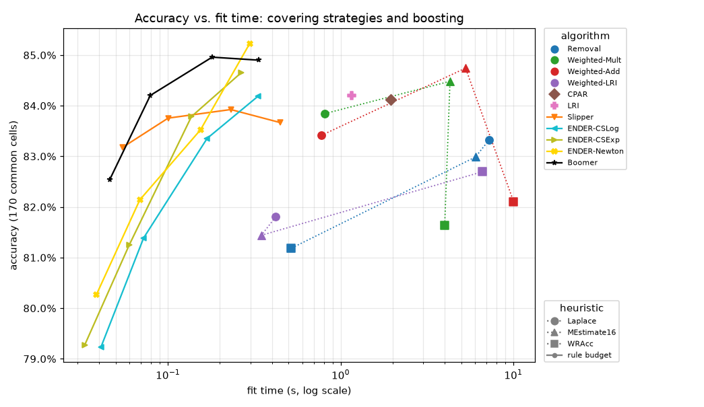

# Covering strategies and boosting

## Setup

**Full run**. Quick sanity check instead: `python demos/covering_boosting.py` with no arguments.

Covering strategies (plain `SeCo`, beam width 5) x heuristics
(`Laplace`, `WRAcc`, m-estimate m=16), plus `CPAR`/`LRI` as complete algorithms, on
molecular-biology_promoters, hepatitis, SPECT, heart-statlog, breast-cancer, heart-h, heart-c, colic, vote, dresses-sales, cylinder-bands, credit-approval, tic-tac-toe, credit-g, kr-vs-kp, sick, mushroom, adult (10-fold; 5-fold for `adult`, the
catalog's one "large" dataset here -- weighted covering and boosting
are no faster on it). Boosting (`Slipper`, `ENDER` x 3 configs,
`Boomer`) on the same datasets/folds, at rule-count budgets
[10, 20, 50, 100].

Protocol: stratified cross-validation (`pyrulearn.experiments.runner.run_cv`), one
`DataSpec` per training fold (`build_dataspec(max_intervals=8)`), the test
fold encoded against that same `DataSpec`, in the library's default representation
(vertical bitmaps (`VerticalBitmapRepresentation`)). Each fit is capped at 300s; a time-out or an error counts
as a failure, not as the end of the run, and is excluded from every
mean it would otherwise enter (a "failures" column reports the count
instead). Every learner runs single-threaded; fits run 10 at a time (`run_cv`'s `n_jobs`), each in its own process and timed there, with the numerical libraries limited to one thread (`OMP_NUM_THREADS=1` and its relatives). A check of the `dense_vs_modular` learners on 11 datasets found the fit times of 5 concurrent fits as close to a sequential run as a second sequential run (per-learner ratios and rankings alike); time ratios between learners are reproducible to about +-10% either way.

A fold that times out fails the whole cross-validation of that learner on that dataset (`run_cv`'s `stop_on_timeout`): its remaining folds are not run, and all its folds count as failures, so no mean rests on just the folds that finished.

Measures: accuracy, rule count, conditions per rule, fit time, and
overlap (mean rules covering a test row, pooled across every concept --
see the module docstring for why this isn't restricted to one
"positive" class).

## Section 1: covering strategies

| name | accuracy (own cells) | accuracy (170 common cells) | n_rules | conditions/rule | fit_time (s) | overlap | failures |
|---|--:|--:|--:|--:|--:|--:|--:|
| Removal+Laplace | 83.47% | 83.47% | 81.7 | 2.9 | 5.60 | 2.4 | 5 |
| Removal+WRAcc | 80.93% | 80.94% | 9.2 | 6.4 | 0.45 | 2.3 | 0 |
| Removal+MEstimate16 | 83.21% | 83.13% | 72.5 | 8.0 | 5.59 | 2.2 | 0 |
| Weighted-Mult+Laplace | 83.69% | 83.72% | 64.4 | 2.7 | 1.14 | 3.2 | 0 |
| Weighted-Mult+WRAcc | 81.70% | 81.74% | 36.7 | 7.0 | 7.43 | 10.6 | 0 |
| Weighted-Mult+MEstimate16 | 84.32% | 84.27% | 90.9 | 5.7 | 5.82 | 7.6 | 0 |
| Weighted-Add+Laplace | 83.36% | 83.41% | 50.0 | 2.7 | 1.14 | 2.9 | 0 |
| Weighted-Add+WRAcc | 82.24% | 82.24% | 39.8 | 8.6 | 10.99 | 14.1 | 5 |
| Weighted-Add+MEstimate16 | 84.67% | 84.71% | 66.8 | 5.5 | 7.60 | 8.2 | 0 |
| Weighted-LRI+Laplace | 81.78% | 81.82% | 24.3 | 3.0 | 0.63 | 2.2 | 0 |
| Weighted-LRI+WRAcc | 82.69% | 82.72% | 74.7 | 7.1 | 10.36 | 17.4 | 0 |
| Weighted-LRI+MEstimate16 | 81.30% | 81.33% | 20.2 | 2.5 | 0.48 | 1.6 | 0 |
| CPAR | 84.09% | 84.14% | 248.5 | 6.5 | 2.98 | 9.4 | 0 |
| LRI | 84.46% | 84.38% | 397.2 | 3.9 | 1.74 | 60.1 | 0 |

*Removal+Laplace missing 5 of 175 cells; Weighted-Add+WRAcc missing 5 of 175 cells (see the "failures" column). "own cells" is each name averaged over whatever (dataset, fold) cells it succeeded on; "170 common cells" restricts every name to the same cells, for a fair comparison.*

### Mean rank

| name | mean rank |
|---|--:|
| Weighted-Add+MEstimate16 | 4.08 |
| Weighted-Mult+MEstimate16 | 4.83 |
| LRI | 5.19 |
| CPAR | 5.72 |
| Removal+MEstimate16 | 6.69 |
| Weighted-LRI+WRAcc | 7.14 |
| Weighted-Mult+Laplace | 7.25 |
| Removal+Laplace | 7.39 |
| Weighted-Add+Laplace | 8.08 |
| Weighted-Add+WRAcc | 9.06 |
| Weighted-LRI+MEstimate16 | 9.19 |
| Weighted-LRI+Laplace | 9.47 |
| Weighted-Mult+WRAcc | 10.17 |
| Removal+WRAcc | 10.72 |

### Per-dataset results (mean across folds)

| dataset | learner | accuracy | n_rules | fit_time | overlap |
|---|---|---|---|---|---|
| SPECT | CPAR | 82.78% | 107.8 | 0.208 | 10.5 |
| SPECT | LRI | 80.81% | 399.8 | 0.625 | 49.6 |
| SPECT | Removal+Laplace | 82.36% | 49.3 | 0.490 | 3.9 |
| SPECT | Removal+MEstimate16 | 81.27% | 19.8 | 0.280 | 2.5 |
| SPECT | Removal+WRAcc | 79.43% | 9.6 | 0.109 | 2.7 |
| SPECT | Weighted-Add+Laplace | 85.00% | 35.2 | 0.699 | 3.8 |
| SPECT | Weighted-Add+MEstimate16 | 84.62% | 50.6 | 1.905 | 8.8 |
| SPECT | Weighted-Add+WRAcc | 84.64% | 29.4 | 0.744 | 8.2 |
| SPECT | Weighted-LRI+Laplace | 79.34% | 33.2 | 0.565 | 2.6 |
| SPECT | Weighted-LRI+MEstimate16 | 77.92% | 28.0 | 0.440 | 2.2 |
| SPECT | Weighted-LRI+WRAcc | 83.18% | 66.7 | 1.062 | 12.5 |
| SPECT | Weighted-Mult+Laplace | 84.63% | 48.1 | 0.979 | 4.8 |
| SPECT | Weighted-Mult+MEstimate16 | 83.86% | 71.7 | 1.388 | 9.5 |
| SPECT | Weighted-Mult+WRAcc | 79.05% | 49.0 | 0.715 | 10.9 |
| adult | CPAR | 82.18% | 2097.0 | 89.499 | 14.1 |
| adult | LRI | 86.93% | 400.0 | 25.731 | 59.7 |
| adult | Removal+Laplace | n/a | n/a | 300.127 | n/a |
| adult | Removal+MEstimate16 | 85.75% | 1525.0 | 173.402 | 4.3 |
| adult | Removal+WRAcc | 80.54% | 16.6 | 4.615 | 5.0 |
| adult | Weighted-Add+Laplace | 81.60% | 87.4 | 17.018 | 1.6 |
| adult | Weighted-Add+MEstimate16 | 83.18% | 132.8 | 94.133 | 5.6 |
| adult | Weighted-Add+WRAcc | n/a | n/a | 300.126 | n/a |
| adult | Weighted-LRI+Laplace | 80.29% | 27.0 | 8.909 | 0.7 |
| adult | Weighted-LRI+MEstimate16 | 80.30% | 19.6 | 5.562 | 0.3 |
| adult | Weighted-LRI+WRAcc | 81.70% | 90.4 | 203.244 | 26.7 |
| adult | Weighted-Mult+Laplace | 82.43% | 172.4 | 17.271 | 1.8 |
| adult | Weighted-Mult+MEstimate16 | 86.06% | 198.6 | 67.896 | 3.3 |
| adult | Weighted-Mult+WRAcc | 80.32% | 73.6 | 188.665 | 26.0 |
| breast-cancer | CPAR | 73.42% | 216.1 | 0.385 | 10.8 |
| breast-cancer | LRI | 70.64% | 395.0 | 0.516 | 60.8 |
| breast-cancer | Removal+Laplace | 67.14% | 85.3 | 0.359 | 1.7 |
| breast-cancer | Removal+MEstimate16 | 68.26% | 32.0 | 0.488 | 1.9 |
| breast-cancer | Removal+WRAcc | 71.66% | 8.9 | 0.191 | 2.4 |
| breast-cancer | Weighted-Add+Laplace | 71.67% | 58.5 | 0.448 | 2.2 |
| breast-cancer | Weighted-Add+MEstimate16 | 74.50% | 100.5 | 3.959 | 10.4 |
| breast-cancer | Weighted-Add+WRAcc | 73.44% | 55.0 | 3.118 | 19.6 |
| breast-cancer | Weighted-LRI+Laplace | 69.22% | 26.3 | 0.327 | 1.3 |
| breast-cancer | Weighted-LRI+MEstimate16 | 68.50% | 21.3 | 0.247 | 0.7 |
| breast-cancer | Weighted-LRI+WRAcc | 72.75% | 96.3 | 2.360 | 22.6 |
| breast-cancer | Weighted-Mult+Laplace | 72.01% | 70.5 | 0.492 | 2.3 |
| breast-cancer | Weighted-Mult+MEstimate16 | 73.45% | 115.1 | 2.893 | 9.2 |
| breast-cancer | Weighted-Mult+WRAcc | 72.04% | 40.2 | 1.072 | 11.7 |
| colic | CPAR | 83.98% | 157.0 | 0.296 | 9.9 |
| colic | LRI | 85.07% | 400.0 | 0.816 | 65.4 |
| colic | Removal+Laplace | 82.91% | 79.2 | 0.260 | 3.2 |
| colic | Removal+MEstimate16 | 84.54% | 26.0 | 0.319 | 2.9 |
| colic | Removal+WRAcc | 86.43% | 10.4 | 0.166 | 2.2 |
| colic | Weighted-Add+Laplace | 81.82% | 70.6 | 0.496 | 4.3 |
| colic | Weighted-Add+MEstimate16 | 86.69% | 72.0 | 3.989 | 11.6 |
| colic | Weighted-Add+WRAcc | 83.69% | 30.9 | 3.680 | 9.2 |
| colic | Weighted-LRI+Laplace | 80.72% | 32.9 | 0.303 | 2.6 |
| colic | Weighted-LRI+MEstimate16 | 80.45% | 21.9 | 0.256 | 1.4 |
| colic | Weighted-LRI+WRAcc | 85.08% | 80.4 | 1.561 | 15.2 |
| colic | Weighted-Mult+Laplace | 81.53% | 70.8 | 0.430 | 3.6 |
| colic | Weighted-Mult+MEstimate16 | 83.71% | 91.3 | 2.333 | 8.2 |
| colic | Weighted-Mult+WRAcc | 83.70% | 42.9 | 1.205 | 9.0 |
| credit-approval | CPAR | 85.22% | 367.5 | 0.606 | 15.6 |
| credit-approval | LRI | 87.25% | 398.7 | 0.864 | 59.3 |
| credit-approval | Removal+Laplace | 82.46% | 120.0 | 0.551 | 2.4 |
| credit-approval | Removal+MEstimate16 | 85.36% | 34.5 | 0.909 | 2.6 |
| credit-approval | Removal+WRAcc | 83.62% | 9.0 | 0.276 | 2.4 |
| credit-approval | Weighted-Add+Laplace | 84.78% | 69.2 | 0.773 | 5.1 |
| credit-approval | Weighted-Add+MEstimate16 | 86.52% | 79.4 | 9.427 | 15.2 |
| credit-approval | Weighted-Add+WRAcc | 85.80% | 44.2 | 9.457 | 18.9 |
| credit-approval | Weighted-LRI+Laplace | 75.94% | 31.2 | 0.488 | 3.4 |
| credit-approval | Weighted-LRI+MEstimate16 | 79.28% | 17.8 | 0.372 | 1.4 |
| credit-approval | Weighted-LRI+WRAcc | 86.38% | 90.7 | 4.150 | 20.6 |
| credit-approval | Weighted-Mult+Laplace | 83.77% | 81.4 | 0.624 | 4.2 |
| credit-approval | Weighted-Mult+MEstimate16 | 86.09% | 134.9 | 6.583 | 12.8 |
| credit-approval | Weighted-Mult+WRAcc | 85.07% | 44.4 | 2.397 | 13.5 |
| credit-g | CPAR | 75.50% | 604.3 | 1.341 | 11.6 |
| credit-g | LRI | 76.40% | 400.0 | 1.065 | 57.8 |
| credit-g | Removal+Laplace | 75.40% | 234.1 | 1.080 | 2.3 |
| credit-g | Removal+MEstimate16 | 72.60% | 77.2 | 1.536 | 1.8 |
| credit-g | Removal+WRAcc | 69.90% | 13.0 | 0.490 | 3.0 |
| credit-g | Weighted-Add+Laplace | 74.30% | 100.8 | 0.746 | 2.2 |
| credit-g | Weighted-Add+MEstimate16 | 75.70% | 162.6 | 5.319 | 7.6 |
| credit-g | Weighted-Add+WRAcc | 70.90% | 118.3 | 9.046 | 37.8 |
| credit-g | Weighted-LRI+Laplace | 72.40% | 24.7 | 0.385 | 0.7 |
| credit-g | Weighted-LRI+MEstimate16 | 74.20% | 21.3 | 0.400 | 0.5 |
| credit-g | Weighted-LRI+WRAcc | 69.90% | 99.7 | 4.605 | 21.4 |
| credit-g | Weighted-Mult+Laplace | 75.60% | 132.3 | 0.803 | 2.6 |
| credit-g | Weighted-Mult+MEstimate16 | 74.90% | 190.3 | 5.506 | 6.1 |
| credit-g | Weighted-Mult+WRAcc | 70.20% | 54.3 | 2.560 | 13.9 |
| cylinder-bands | CPAR | 77.04% | 295.0 | 0.633 | 11.6 |
| cylinder-bands | LRI | 82.22% | 399.5 | 1.082 | 56.3 |
| cylinder-bands | Removal+Laplace | 74.63% | 156.1 | 0.569 | 1.7 |
| cylinder-bands | Removal+MEstimate16 | 73.33% | 48.4 | 2.494 | 1.6 |
| cylinder-bands | Removal+WRAcc | 73.89% | 9.0 | 2.018 | 2.2 |
| cylinder-bands | Weighted-Add+Laplace | 71.85% | 75.7 | 0.464 | 1.4 |
| cylinder-bands | Weighted-Add+MEstimate16 | 75.00% | 103.6 | 17.378 | 6.6 |
| cylinder-bands | Weighted-Add+WRAcc | 73.15% | 69.4 | 25.697 | 27.8 |
| cylinder-bands | Weighted-LRI+Laplace | 65.93% | 21.6 | 0.312 | 0.7 |
| cylinder-bands | Weighted-LRI+MEstimate16 | 65.93% | 17.4 | 0.227 | 0.4 |
| cylinder-bands | Weighted-LRI+WRAcc | 75.00% | 98.3 | 28.927 | 21.2 |
| cylinder-bands | Weighted-Mult+Laplace | 72.41% | 89.0 | 0.470 | 1.4 |
| cylinder-bands | Weighted-Mult+MEstimate16 | 75.37% | 146.0 | 16.996 | 7.6 |
| cylinder-bands | Weighted-Mult+WRAcc | 70.74% | 32.5 | 10.523 | 11.4 |
| dresses-sales | CPAR | 57.00% | 659.0 | 1.169 | 13.0 |
| dresses-sales | LRI | 58.80% | 394.6 | 0.830 | 58.5 |
| dresses-sales | Removal+Laplace | 59.60% | 226.3 | 0.857 | 1.6 |
| dresses-sales | Removal+MEstimate16 | 57.60% | 71.0 | 2.384 | 1.7 |
| dresses-sales | Removal+WRAcc | 56.20% | 12.2 | 0.958 | 2.9 |
| dresses-sales | Weighted-Add+Laplace | 58.60% | 80.3 | 0.321 | 0.7 |
| dresses-sales | Weighted-Add+MEstimate16 | 60.20% | 139.8 | 8.830 | 4.9 |
| dresses-sales | Weighted-Add+WRAcc | 58.40% | 113.6 | 15.992 | 33.6 |
| dresses-sales | Weighted-LRI+Laplace | 62.20% | 28.2 | 0.290 | 0.6 |
| dresses-sales | Weighted-LRI+MEstimate16 | 58.00% | 27.0 | 0.226 | 0.3 |
| dresses-sales | Weighted-LRI+WRAcc | 59.40% | 99.5 | 10.350 | 22.2 |
| dresses-sales | Weighted-Mult+Laplace | 61.40% | 87.0 | 0.344 | 0.7 |
| dresses-sales | Weighted-Mult+MEstimate16 | 59.20% | 165.8 | 9.184 | 4.9 |
| dresses-sales | Weighted-Mult+WRAcc | 56.60% | 49.4 | 5.045 | 12.9 |
| heart-c | CPAR | 81.22% | 164.3 | 0.291 | 12.6 |
| heart-c | LRI | 79.25% | 399.5 | 0.786 | 59.6 |
| heart-c | Removal+Laplace | 82.54% | 58.1 | 0.232 | 2.6 |
| heart-c | Removal+MEstimate16 | 78.59% | 20.2 | 0.283 | 2.0 |
| heart-c | Removal+WRAcc | 76.94% | 8.3 | 0.155 | 2.1 |
| heart-c | Weighted-Add+Laplace | 79.56% | 51.0 | 0.520 | 3.9 |
| heart-c | Weighted-Add+MEstimate16 | 80.27% | 69.0 | 4.503 | 14.3 |
| heart-c | Weighted-Add+WRAcc | 78.26% | 28.2 | 3.422 | 11.2 |
| heart-c | Weighted-LRI+Laplace | 78.23% | 26.0 | 0.349 | 2.6 |
| heart-c | Weighted-LRI+MEstimate16 | 78.54% | 20.4 | 0.367 | 1.7 |
| heart-c | Weighted-LRI+WRAcc | 77.65% | 89.4 | 1.998 | 21.1 |
| heart-c | Weighted-Mult+Laplace | 78.26% | 62.7 | 0.481 | 3.9 |
| heart-c | Weighted-Mult+MEstimate16 | 79.95% | 81.6 | 2.377 | 10.7 |
| heart-c | Weighted-Mult+WRAcc | 81.61% | 34.1 | 0.920 | 12.8 |
| heart-h | CPAR | 79.92% | 174.4 | 0.259 | 11.6 |
| heart-h | LRI | 81.30% | 395.8 | 0.539 | 56.5 |
| heart-h | Removal+Laplace | 79.59% | 58.7 | 0.244 | 2.2 |
| heart-h | Removal+MEstimate16 | 83.68% | 21.4 | 0.283 | 2.0 |
| heart-h | Removal+WRAcc | 76.86% | 8.3 | 0.145 | 2.1 |
| heart-h | Weighted-Add+Laplace | 79.24% | 38.4 | 0.354 | 3.1 |
| heart-h | Weighted-Add+MEstimate16 | 80.28% | 59.0 | 4.315 | 12.2 |
| heart-h | Weighted-Add+WRAcc | 78.92% | 30.2 | 4.660 | 14.5 |
| heart-h | Weighted-LRI+Laplace | 80.25% | 25.6 | 0.311 | 2.5 |
| heart-h | Weighted-LRI+MEstimate16 | 79.92% | 16.9 | 0.188 | 1.3 |
| heart-h | Weighted-LRI+WRAcc | 81.31% | 84.6 | 2.136 | 19.2 |
| heart-h | Weighted-Mult+Laplace | 78.21% | 37.3 | 0.252 | 2.7 |
| heart-h | Weighted-Mult+MEstimate16 | 79.26% | 74.5 | 2.349 | 9.9 |
| heart-h | Weighted-Mult+WRAcc | 77.53% | 35.7 | 0.975 | 12.6 |
| heart-statlog | CPAR | 81.85% | 146.4 | 0.221 | 11.8 |
| heart-statlog | LRI | 77.78% | 399.3 | 0.741 | 59.3 |
| heart-statlog | Removal+Laplace | 78.15% | 50.9 | 0.169 | 2.4 |
| heart-statlog | Removal+MEstimate16 | 80.74% | 18.7 | 0.261 | 2.1 |
| heart-statlog | Removal+WRAcc | 77.04% | 8.4 | 0.131 | 2.2 |
| heart-statlog | Weighted-Add+Laplace | 78.89% | 52.8 | 0.459 | 4.1 |
| heart-statlog | Weighted-Add+MEstimate16 | 79.63% | 64.6 | 4.282 | 13.2 |
| heart-statlog | Weighted-Add+WRAcc | 77.41% | 32.5 | 2.940 | 12.5 |
| heart-statlog | Weighted-LRI+Laplace | 78.15% | 27.2 | 0.310 | 2.9 |
| heart-statlog | Weighted-LRI+MEstimate16 | 78.52% | 22.9 | 0.294 | 1.9 |
| heart-statlog | Weighted-LRI+WRAcc | 81.85% | 88.5 | 1.992 | 20.7 |
| heart-statlog | Weighted-Mult+Laplace | 80.37% | 62.3 | 0.454 | 4.0 |
| heart-statlog | Weighted-Mult+MEstimate16 | 78.15% | 74.2 | 1.982 | 10.5 |
| heart-statlog | Weighted-Mult+WRAcc | 73.70% | 33.6 | 0.890 | 12.4 |
| hepatitis | CPAR | 80.71% | 69.7 | 0.101 | 8.4 |
| hepatitis | LRI | 82.12% | 399.4 | 0.496 | 64.7 |
| hepatitis | Removal+Laplace | 81.38% | 24.5 | 0.062 | 2.6 |
| hepatitis | Removal+MEstimate16 | 76.25% | 14.3 | 0.105 | 2.6 |
| hepatitis | Removal+WRAcc | 81.33% | 7.8 | 0.072 | 2.6 |
| hepatitis | Weighted-Add+Laplace | 82.62% | 23.6 | 0.341 | 3.8 |
| hepatitis | Weighted-Add+MEstimate16 | 83.25% | 38.4 | 1.810 | 10.1 |
| hepatitis | Weighted-Add+WRAcc | 81.33% | 25.0 | 1.104 | 11.8 |
| hepatitis | Weighted-LRI+Laplace | 85.17% | 20.8 | 0.243 | 3.9 |
| hepatitis | Weighted-LRI+MEstimate16 | 83.33% | 17.1 | 0.225 | 2.4 |
| hepatitis | Weighted-LRI+WRAcc | 83.87% | 63.1 | 0.823 | 15.9 |
| hepatitis | Weighted-Mult+Laplace | 84.58% | 29.3 | 0.302 | 4.2 |
| hepatitis | Weighted-Mult+MEstimate16 | 81.92% | 45.8 | 0.598 | 8.9 |
| hepatitis | Weighted-Mult+WRAcc | 80.62% | 30.7 | 0.416 | 10.4 |
| kr-vs-kp | CPAR | 99.28% | 50.6 | 0.363 | 3.8 |
| kr-vs-kp | LRI | 99.12% | 399.7 | 1.547 | 62.6 |
| kr-vs-kp | Removal+Laplace | 99.34% | 68.6 | 0.438 | 2.2 |
| kr-vs-kp | Removal+MEstimate16 | 99.22% | 32.3 | 0.464 | 1.7 |
| kr-vs-kp | Removal+WRAcc | 94.68% | 7.5 | 0.128 | 1.6 |
| kr-vs-kp | Weighted-Add+Laplace | 97.03% | 26.7 | 0.784 | 1.6 |
| kr-vs-kp | Weighted-Add+MEstimate16 | 98.50% | 27.4 | 2.737 | 2.8 |
| kr-vs-kp | Weighted-Add+WRAcc | 92.49% | 11.1 | 3.669 | 4.4 |
| kr-vs-kp | Weighted-LRI+Laplace | 92.34% | 11.9 | 0.338 | 1.2 |
| kr-vs-kp | Weighted-LRI+MEstimate16 | 86.08% | 16.6 | 0.312 | 1.1 |
| kr-vs-kp | Weighted-LRI+WRAcc | 95.90% | 35.0 | 2.017 | 9.2 |
| kr-vs-kp | Weighted-Mult+Laplace | 98.44% | 44.3 | 0.694 | 1.9 |
| kr-vs-kp | Weighted-Mult+MEstimate16 | 99.41% | 56.5 | 3.736 | 4.2 |
| kr-vs-kp | Weighted-Mult+WRAcc | 92.18% | 18.0 | 1.088 | 8.1 |
| molecular-biology_promoters | CPAR | 80.36% | 31.5 | 0.069 | 5.3 |
| molecular-biology_promoters | LRI | 82.91% | 390.5 | 0.618 | 62.1 |
| molecular-biology_promoters | Removal+Laplace | 82.09% | 11.9 | 0.051 | 1.6 |
| molecular-biology_promoters | Removal+MEstimate16 | 79.36% | 6.9 | 0.053 | 1.5 |
| molecular-biology_promoters | Removal+WRAcc | 74.91% | 5.1 | 0.069 | 1.2 |
| molecular-biology_promoters | Weighted-Add+Laplace | 85.00% | 21.8 | 0.722 | 3.3 |
| molecular-biology_promoters | Weighted-Add+MEstimate16 | 84.09% | 19.8 | 0.701 | 5.2 |
| molecular-biology_promoters | Weighted-Add+WRAcc | 85.91% | 16.3 | 0.576 | 5.4 |
| molecular-biology_promoters | Weighted-LRI+Laplace | 86.82% | 25.2 | 0.441 | 4.0 |
| molecular-biology_promoters | Weighted-LRI+MEstimate16 | 85.09% | 27.2 | 0.445 | 4.9 |
| molecular-biology_promoters | Weighted-LRI+WRAcc | 78.45% | 74.2 | 1.468 | 21.0 |
| molecular-biology_promoters | Weighted-Mult+Laplace | 82.18% | 42.5 | 0.607 | 5.3 |
| molecular-biology_promoters | Weighted-Mult+MEstimate16 | 84.09% | 25.9 | 0.267 | 6.3 |
| molecular-biology_promoters | Weighted-Mult+WRAcc | 85.00% | 21.7 | 0.378 | 6.4 |
| mushroom | CPAR | 99.96% | 21.3 | 0.325 | 5.1 |
| mushroom | LRI | 100.00% | 386.9 | 3.545 | 67.7 |
| mushroom | Removal+Laplace | 100.00% | 23.0 | 0.174 | 1.5 |
| mushroom | Removal+MEstimate16 | 100.00% | 18.6 | 0.127 | 1.6 |
| mushroom | Removal+WRAcc | 99.98% | 4.5 | 0.120 | 1.1 |
| mushroom | Weighted-Add+Laplace | 98.98% | 15.1 | 0.816 | 0.9 |
| mushroom | Weighted-Add+MEstimate16 | 98.98% | 19.4 | 1.448 | 2.8 |
| mushroom | Weighted-Add+WRAcc | 99.79% | 6.4 | 4.565 | 2.7 |
| mushroom | Weighted-LRI+Laplace | 95.72% | 9.0 | 0.479 | 0.8 |
| mushroom | Weighted-LRI+MEstimate16 | 95.72% | 9.0 | 0.501 | 0.8 |
| mushroom | Weighted-LRI+WRAcc | 99.94% | 31.6 | 10.028 | 11.5 |
| mushroom | Weighted-Mult+Laplace | 99.75% | 25.1 | 0.976 | 1.7 |
| mushroom | Weighted-Mult+MEstimate16 | 100.00% | 28.2 | 1.835 | 4.0 |
| mushroom | Weighted-Mult+WRAcc | 99.79% | 8.3 | 2.980 | 3.3 |
| sick | CPAR | 98.44% | 143.6 | 0.782 | 7.3 |
| sick | LRI | 98.49% | 392.0 | 2.142 | 69.4 |
| sick | Removal+Laplace | 97.93% | 86.9 | 1.051 | 2.7 |
| sick | Removal+MEstimate16 | 98.04% | 30.1 | 1.056 | 2.9 |
| sick | Removal+WRAcc | 97.19% | 10.6 | 0.397 | 2.2 |
| sick | Weighted-Add+Laplace | 97.93% | 39.5 | 2.488 | 3.1 |
| sick | Weighted-Add+MEstimate16 | 98.12% | 45.1 | 13.457 | 6.8 |
| sick | Weighted-Add+WRAcc | 97.56% | 22.8 | 10.316 | 10.1 |
| sick | Weighted-LRI+Laplace | 97.40% | 23.1 | 0.927 | 2.2 |
| sick | Weighted-LRI+MEstimate16 | 98.04% | 17.3 | 0.590 | 0.7 |
| sick | Weighted-LRI+WRAcc | 96.82% | 60.9 | 5.123 | 10.4 |
| sick | Weighted-Mult+Laplace | 98.04% | 66.9 | 2.255 | 4.7 |
| sick | Weighted-Mult+MEstimate16 | 97.64% | 97.6 | 8.541 | 9.4 |
| sick | Weighted-Mult+WRAcc | 95.68% | 41.5 | 3.885 | 9.8 |
| tic-tac-toe | CPAR | 98.33% | 57.2 | 0.189 | 2.9 |
| tic-tac-toe | LRI | 96.97% | 400.0 | 0.812 | 50.7 |
| tic-tac-toe | Removal+Laplace | 98.33% | 28.6 | 0.100 | 1.3 |
| tic-tac-toe | Removal+MEstimate16 | 98.96% | 20.9 | 0.096 | 1.3 |
| tic-tac-toe | Removal+WRAcc | 81.20% | 12.3 | 0.077 | 2.4 |
| tic-tac-toe | Weighted-Add+Laplace | 96.87% | 52.6 | 0.656 | 2.7 |
| tic-tac-toe | Weighted-Add+MEstimate16 | 97.91% | 35.4 | 0.809 | 2.5 |
| tic-tac-toe | Weighted-Add+WRAcc | 83.92% | 34.4 | 0.674 | 7.3 |
| tic-tac-toe | Weighted-LRI+Laplace | 97.39% | 26.2 | 0.320 | 1.6 |
| tic-tac-toe | Weighted-LRI+MEstimate16 | 97.50% | 24.5 | 0.354 | 1.6 |
| tic-tac-toe | Weighted-LRI+WRAcc | 83.61% | 60.0 | 0.692 | 15.5 |
| tic-tac-toe | Weighted-Mult+Laplace | 97.39% | 57.1 | 0.679 | 2.8 |
| tic-tac-toe | Weighted-Mult+MEstimate16 | 99.69% | 51.0 | 0.751 | 2.9 |
| tic-tac-toe | Weighted-Mult+WRAcc | 90.91% | 38.8 | 0.403 | 6.6 |
| vote | CPAR | 95.41% | 34.6 | 0.078 | 6.5 |
| vote | LRI | 95.41% | 400.0 | 0.565 | 60.9 |
| vote | Removal+Laplace | 95.18% | 28.1 | 0.085 | 4.1 |
| vote | Removal+MEstimate16 | 95.42% | 13.6 | 0.051 | 3.1 |
| vote | Removal+WRAcc | 94.74% | 8.3 | 0.024 | 2.3 |
| vote | Weighted-Add+Laplace | 93.81% | 19.8 | 0.439 | 3.7 |
| vote | Weighted-Add+MEstimate16 | 95.87% | 16.6 | 1.035 | 4.9 |
| vote | Weighted-Add+WRAcc | 92.42% | 9.6 | 0.476 | 4.2 |
| vote | Weighted-LRI+Laplace | 93.81% | 18.1 | 0.259 | 4.0 |
| vote | Weighted-LRI+MEstimate16 | 95.65% | 17.9 | 0.263 | 4.2 |
| vote | Weighted-LRI+WRAcc | 95.20% | 43.5 | 0.454 | 11.7 |
| vote | Weighted-Mult+Laplace | 94.73% | 34.8 | 0.385 | 5.2 |
| vote | Weighted-Mult+MEstimate16 | 95.88% | 41.4 | 0.536 | 6.9 |
| vote | Weighted-Mult+WRAcc | 95.19% | 31.2 | 0.309 | 6.5 |

## Section 2: boosting

| family | budget | accuracy (own cells) | accuracy (170 common cells) | n_rules (actual) | fit_time (s) | failures |
|---|--:|--:|--:|--:|--:|--:|
| Slipper | 10 | 83.15% | 83.08% | 7.6 | 0.08 | 0 |
| Slipper | 20 | 83.78% | 83.71% | 13.7 | 0.16 | 0 |
| Slipper | 50 | 83.90% | 83.82% | 28.5 | 0.33 | 0 |
| Slipper | 100 | 83.65% | 83.56% | 46.9 | 0.67 | 0 |
| ENDER-CSLog | 10 | 79.16% | 79.25% | 9.6 | 0.05 | 0 |
| ENDER-CSLog | 20 | 81.43% | 81.42% | 17.5 | 0.10 | 0 |
| ENDER-CSLog | 50 | 83.40% | 83.37% | 42.0 | 0.22 | 0 |
| ENDER-CSLog | 100 | 84.21% | 84.16% | 83.1 | 0.45 | 0 |
| ENDER-CSExp | 10 | 79.11% | 79.20% | 9.9 | 0.04 | 0 |
| ENDER-CSExp | 20 | 81.28% | 81.28% | 18.3 | 0.08 | 0 |
| ENDER-CSExp | 50 | 83.76% | 83.73% | 43.7 | 0.19 | 0 |
| ENDER-CSExp | 100 | 84.57% | 84.53% | 84.5 | 0.37 | 0 |
| ENDER-Newton | 10 | 80.11% | 80.17% | 9.5 | 0.05 | 0 |
| ENDER-Newton | 20 | 82.04% | 82.10% | 17.2 | 0.09 | 0 |
| ENDER-Newton | 50 | 83.63% | 83.58% | 40.1 | 0.22 | 0 |
| ENDER-Newton | 100 | 85.22% | 85.20% | 76.2 | 0.43 | 0 |
| Boomer | 10 | 82.66% | 82.64% | 9.1 | 0.07 | 0 |
| Boomer | 20 | 84.30% | 84.26% | 16.6 | 0.12 | 0 |
| Boomer | 50 | 85.18% | 85.15% | 35.4 | 0.27 | 0 |
| Boomer | 100 | 85.13% | 85.09% | 60.6 | 0.50 | 0 |

*"own cells" is each name averaged over whatever (dataset, fold) cells it succeeded on; "170 common cells" is the same cell subset section 1's summary table uses, so the two tables' accuracy columns are directly comparable (see the "failures" column).*

### Per-dataset results (mean across folds)

| dataset | learner | accuracy | n_rules | fit_time |
|---|---|---|---|---|
| SPECT | Boomer@10 | 82.81% | 9.2 | 0.013 |
| SPECT | Boomer@100 | 83.49% | 46.6 | 0.094 |
| SPECT | Boomer@20 | 83.90% | 14.6 | 0.021 |
| SPECT | Boomer@50 | 83.50% | 29.0 | 0.048 |
| SPECT | ENDER-CSExp@10 | 79.42% | 9.7 | 0.010 |
| SPECT | ENDER-CSExp@100 | 85.00% | 53.9 | 0.075 |
| SPECT | ENDER-CSExp@20 | 79.42% | 16.2 | 0.017 |
| SPECT | ENDER-CSExp@50 | 83.18% | 32.2 | 0.041 |
| SPECT | ENDER-CSLog@10 | 79.42% | 9.6 | 0.012 |
| SPECT | ENDER-CSLog@100 | 84.26% | 62.3 | 0.091 |
| SPECT | ENDER-CSLog@20 | 79.42% | 15.9 | 0.019 |
| SPECT | ENDER-CSLog@50 | 84.27% | 33.1 | 0.043 |
| SPECT | ENDER-Newton@10 | 79.42% | 10.3 | 0.013 |
| SPECT | ENDER-Newton@100 | 85.01% | 68.3 | 0.094 |
| SPECT | ENDER-Newton@20 | 79.42% | 17.6 | 0.022 |
| SPECT | ENDER-Newton@50 | 83.90% | 38.1 | 0.050 |
| SPECT | Slipper@10 | 84.25% | 5.9 | 0.032 |
| SPECT | Slipper@100 | 81.20% | 44.4 | 0.325 |
| SPECT | Slipper@20 | 83.13% | 11.3 | 0.062 |
| SPECT | Slipper@50 | 81.97% | 26.8 | 0.157 |
| adult | Boomer@10 | 83.26% | 11.0 | 1.197 |
| adult | Boomer@100 | 86.70% | 99.2 | 9.062 |
| adult | Boomer@20 | 85.66% | 20.6 | 2.208 |
| adult | Boomer@50 | 86.31% | 49.6 | 5.175 |
| adult | ENDER-CSExp@10 | 76.07% | 10.8 | 0.635 |
| adult | ENDER-CSExp@100 | 85.82% | 99.4 | 5.778 |
| adult | ENDER-CSExp@20 | 81.10% | 20.8 | 1.270 |
| adult | ENDER-CSExp@50 | 84.82% | 50.2 | 2.947 |
| adult | ENDER-CSLog@10 | 76.07% | 10.6 | 0.812 |
| adult | ENDER-CSLog@100 | 85.71% | 96.2 | 6.935 |
| adult | ENDER-CSLog@20 | 82.01% | 20.2 | 1.635 |
| adult | ENDER-CSLog@50 | 84.60% | 47.4 | 3.367 |
| adult | ENDER-Newton@10 | 78.32% | 10.4 | 0.795 |
| adult | ENDER-Newton@100 | 85.94% | 96.4 | 7.641 |
| adult | ENDER-Newton@20 | 80.17% | 19.8 | 1.599 |
| adult | ENDER-Newton@50 | 85.18% | 48.2 | 3.800 |
| adult | Slipper@10 | 85.45% | 7.2 | 1.098 |
| adult | Slipper@100 | 86.63% | 69.8 | 9.918 |
| adult | Slipper@20 | 86.08% | 14.2 | 2.492 |
| adult | Slipper@50 | 86.68% | 36.2 | 4.784 |
| breast-cancer | Boomer@10 | 72.38% | 9.8 | 0.014 |
| breast-cancer | Boomer@100 | 68.17% | 58.1 | 0.093 |
| breast-cancer | Boomer@20 | 71.35% | 16.5 | 0.028 |
| breast-cancer | Boomer@50 | 69.56% | 34.9 | 0.052 |
| breast-cancer | ENDER-CSExp@10 | 70.30% | 11.0 | 0.011 |
| breast-cancer | ENDER-CSExp@100 | 72.75% | 97.4 | 0.102 |
| breast-cancer | ENDER-CSExp@20 | 70.65% | 20.9 | 0.022 |
| breast-cancer | ENDER-CSExp@50 | 74.48% | 50.0 | 0.053 |
| breast-cancer | ENDER-CSLog@10 | 70.30% | 11.0 | 0.012 |
| breast-cancer | ENDER-CSLog@100 | 72.76% | 97.5 | 0.104 |
| breast-cancer | ENDER-CSLog@20 | 71.00% | 20.7 | 0.027 |
| breast-cancer | ENDER-CSLog@50 | 73.08% | 49.8 | 0.053 |
| breast-cancer | ENDER-Newton@10 | 71.33% | 10.7 | 0.014 |
| breast-cancer | ENDER-Newton@100 | 72.39% | 87.5 | 0.112 |
| breast-cancer | ENDER-Newton@20 | 72.03% | 19.8 | 0.022 |
| breast-cancer | ENDER-Newton@50 | 72.72% | 46.2 | 0.060 |
| breast-cancer | Slipper@10 | 72.72% | 7.3 | 0.025 |
| breast-cancer | Slipper@100 | 70.27% | 47.6 | 0.215 |
| breast-cancer | Slipper@20 | 72.03% | 13.9 | 0.047 |
| breast-cancer | Slipper@50 | 69.57% | 29.4 | 0.105 |
| colic | Boomer@10 | 85.61% | 8.3 | 0.019 |
| colic | Boomer@100 | 84.53% | 72.9 | 0.160 |
| colic | Boomer@20 | 85.61% | 17.0 | 0.033 |
| colic | Boomer@50 | 85.08% | 39.6 | 0.082 |
| colic | ENDER-CSExp@10 | 80.16% | 9.3 | 0.013 |
| colic | ENDER-CSExp@100 | 84.52% | 89.8 | 0.116 |
| colic | ENDER-CSExp@20 | 84.52% | 17.3 | 0.024 |
| colic | ENDER-CSExp@50 | 84.25% | 44.7 | 0.068 |
| colic | ENDER-CSLog@10 | 81.00% | 8.6 | 0.015 |
| colic | ENDER-CSLog@100 | 84.79% | 87.8 | 0.132 |
| colic | ENDER-CSLog@20 | 84.25% | 15.8 | 0.028 |
| colic | ENDER-CSLog@50 | 84.52% | 42.5 | 0.075 |
| colic | ENDER-Newton@10 | 83.98% | 8.5 | 0.016 |
| colic | ENDER-Newton@100 | 85.07% | 85.2 | 0.136 |
| colic | ENDER-Newton@20 | 85.33% | 17.0 | 0.029 |
| colic | ENDER-Newton@50 | 85.07% | 43.3 | 0.067 |
| colic | Slipper@10 | 83.18% | 7.7 | 0.028 |
| colic | Slipper@100 | 80.17% | 47.2 | 0.258 |
| colic | Slipper@20 | 82.88% | 13.9 | 0.058 |
| colic | Slipper@50 | 82.08% | 28.4 | 0.122 |
| credit-approval | Boomer@10 | 86.09% | 9.9 | 0.023 |
| credit-approval | Boomer@100 | 86.38% | 75.6 | 0.187 |
| credit-approval | Boomer@20 | 86.81% | 18.7 | 0.048 |
| credit-approval | Boomer@50 | 86.67% | 43.3 | 0.098 |
| credit-approval | ENDER-CSExp@10 | 84.78% | 10.9 | 0.016 |
| credit-approval | ENDER-CSExp@100 | 86.38% | 98.2 | 0.166 |
| credit-approval | ENDER-CSExp@20 | 85.65% | 20.7 | 0.036 |
| credit-approval | ENDER-CSExp@50 | 86.67% | 49.6 | 0.087 |
| credit-approval | ENDER-CSLog@10 | 84.49% | 10.4 | 0.020 |
| credit-approval | ENDER-CSLog@100 | 86.38% | 95.1 | 0.193 |
| credit-approval | ENDER-CSLog@20 | 85.65% | 19.9 | 0.042 |
| credit-approval | ENDER-CSLog@50 | 86.52% | 47.1 | 0.089 |
| credit-approval | ENDER-Newton@10 | 85.22% | 10.7 | 0.021 |
| credit-approval | ENDER-Newton@100 | 86.52% | 92.8 | 0.182 |
| credit-approval | ENDER-Newton@20 | 85.94% | 20.3 | 0.038 |
| credit-approval | ENDER-Newton@50 | 86.38% | 47.8 | 0.099 |
| credit-approval | Slipper@10 | 84.64% | 7.4 | 0.033 |
| credit-approval | Slipper@100 | 86.09% | 48.1 | 0.295 |
| credit-approval | Slipper@20 | 84.93% | 14.2 | 0.068 |
| credit-approval | Slipper@50 | 86.09% | 29.7 | 0.155 |
| credit-g | Boomer@10 | 73.20% | 11.0 | 0.039 |
| credit-g | Boomer@100 | 75.20% | 91.2 | 0.316 |
| credit-g | Boomer@20 | 73.90% | 20.9 | 0.075 |
| credit-g | Boomer@50 | 74.60% | 49.4 | 0.178 |
| credit-g | ENDER-CSExp@10 | 70.00% | 11.0 | 0.029 |
| credit-g | ENDER-CSExp@100 | 74.40% | 100.8 | 0.269 |
| credit-g | ENDER-CSExp@20 | 70.00% | 21.0 | 0.052 |
| credit-g | ENDER-CSExp@50 | 73.30% | 51.0 | 0.145 |
| credit-g | ENDER-CSLog@10 | 70.00% | 11.0 | 0.032 |
| credit-g | ENDER-CSLog@100 | 74.50% | 100.8 | 0.315 |
| credit-g | ENDER-CSLog@20 | 70.10% | 21.0 | 0.066 |
| credit-g | ENDER-CSLog@50 | 73.30% | 51.0 | 0.155 |
| credit-g | ENDER-Newton@10 | 70.10% | 11.0 | 0.037 |
| credit-g | ENDER-Newton@100 | 75.10% | 100.1 | 0.287 |
| credit-g | ENDER-Newton@20 | 71.80% | 21.0 | 0.066 |
| credit-g | ENDER-Newton@50 | 73.80% | 50.9 | 0.137 |
| credit-g | Slipper@10 | 73.00% | 7.6 | 0.053 |
| credit-g | Slipper@100 | 73.50% | 59.1 | 0.443 |
| credit-g | Slipper@20 | 74.50% | 14.7 | 0.104 |
| credit-g | Slipper@50 | 74.70% | 34.2 | 0.217 |
| cylinder-bands | Boomer@10 | 69.44% | 10.2 | 0.033 |
| cylinder-bands | Boomer@100 | 81.67% | 81.7 | 0.373 |
| cylinder-bands | Boomer@20 | 74.81% | 19.5 | 0.062 |
| cylinder-bands | Boomer@50 | 80.19% | 43.2 | 0.165 |
| cylinder-bands | ENDER-CSExp@10 | 58.52% | 11.0 | 0.037 |
| cylinder-bands | ENDER-CSExp@100 | 75.93% | 100.8 | 0.322 |
| cylinder-bands | ENDER-CSExp@20 | 65.93% | 21.0 | 0.066 |
| cylinder-bands | ENDER-CSExp@50 | 72.41% | 50.9 | 0.146 |
| cylinder-bands | ENDER-CSLog@10 | 58.89% | 11.0 | 0.042 |
| cylinder-bands | ENDER-CSLog@100 | 76.48% | 101.0 | 0.388 |
| cylinder-bands | ENDER-CSLog@20 | 68.33% | 21.0 | 0.079 |
| cylinder-bands | ENDER-CSLog@50 | 74.81% | 51.0 | 0.203 |
| cylinder-bands | ENDER-Newton@10 | 62.41% | 10.0 | 0.027 |
| cylinder-bands | ENDER-Newton@100 | 77.04% | 90.6 | 0.270 |
| cylinder-bands | ENDER-Newton@20 | 62.96% | 18.6 | 0.054 |
| cylinder-bands | ENDER-Newton@50 | 72.04% | 46.4 | 0.137 |
| cylinder-bands | Slipper@10 | 69.44% | 9.5 | 0.032 |
| cylinder-bands | Slipper@100 | 75.74% | 60.5 | 0.315 |
| cylinder-bands | Slipper@20 | 70.56% | 17.4 | 0.069 |
| cylinder-bands | Slipper@50 | 74.07% | 37.8 | 0.165 |
| dresses-sales | Boomer@10 | 62.00% | 10.6 | 0.034 |
| dresses-sales | Boomer@100 | 59.40% | 69.3 | 0.212 |
| dresses-sales | Boomer@20 | 63.40% | 19.8 | 0.058 |
| dresses-sales | Boomer@50 | 60.80% | 41.8 | 0.116 |
| dresses-sales | ENDER-CSExp@10 | 58.20% | 10.9 | 0.024 |
| dresses-sales | ENDER-CSExp@100 | 62.80% | 99.3 | 0.198 |
| dresses-sales | ENDER-CSExp@20 | 59.00% | 20.7 | 0.041 |
| dresses-sales | ENDER-CSExp@50 | 62.80% | 50.2 | 0.096 |
| dresses-sales | ENDER-CSLog@10 | 58.00% | 10.9 | 0.027 |
| dresses-sales | ENDER-CSLog@100 | 62.40% | 100.0 | 0.234 |
| dresses-sales | ENDER-CSLog@20 | 59.40% | 20.8 | 0.054 |
| dresses-sales | ENDER-CSLog@50 | 61.20% | 50.5 | 0.116 |
| dresses-sales | ENDER-Newton@10 | 59.80% | 11.0 | 0.024 |
| dresses-sales | ENDER-Newton@100 | 61.40% | 90.8 | 0.170 |
| dresses-sales | ENDER-Newton@20 | 62.00% | 20.7 | 0.045 |
| dresses-sales | ENDER-Newton@50 | 61.60% | 48.8 | 0.093 |
| dresses-sales | Slipper@10 | 59.20% | 8.6 | 0.032 |
| dresses-sales | Slipper@100 | 58.40% | 52.8 | 0.248 |
| dresses-sales | Slipper@20 | 58.80% | 16.2 | 0.056 |
| dresses-sales | Slipper@50 | 59.40% | 35.0 | 0.142 |
| heart-c | Boomer@10 | 81.87% | 10.9 | 0.015 |
| heart-c | Boomer@100 | 80.60% | 71.8 | 0.136 |
| heart-c | Boomer@20 | 80.91% | 19.8 | 0.031 |
| heart-c | Boomer@50 | 81.59% | 43.0 | 0.074 |
| heart-c | ENDER-CSExp@10 | 78.88% | 11.0 | 0.012 |
| heart-c | ENDER-CSExp@100 | 83.20% | 98.6 | 0.117 |
| heart-c | ENDER-CSExp@20 | 80.56% | 20.6 | 0.023 |
| heart-c | ENDER-CSExp@50 | 81.90% | 49.7 | 0.052 |
| heart-c | ENDER-CSLog@10 | 78.24% | 10.9 | 0.014 |
| heart-c | ENDER-CSLog@100 | 82.55% | 98.6 | 0.138 |
| heart-c | ENDER-CSLog@20 | 81.54% | 20.5 | 0.025 |
| heart-c | ENDER-CSLog@50 | 81.23% | 49.6 | 0.060 |
| heart-c | ENDER-Newton@10 | 79.55% | 10.8 | 0.016 |
| heart-c | ENDER-Newton@100 | 83.88% | 94.8 | 0.123 |
| heart-c | ENDER-Newton@20 | 81.54% | 20.1 | 0.026 |
| heart-c | ENDER-Newton@50 | 82.54% | 49.5 | 0.062 |
| heart-c | Slipper@10 | 78.94% | 7.7 | 0.027 |
| heart-c | Slipper@100 | 77.27% | 45.5 | 0.265 |
| heart-c | Slipper@20 | 78.25% | 13.7 | 0.053 |
| heart-c | Slipper@50 | 78.56% | 28.2 | 0.126 |
| heart-h | Boomer@10 | 79.90% | 9.4 | 0.019 |
| heart-h | Boomer@100 | 80.94% | 53.6 | 0.126 |
| heart-h | Boomer@20 | 80.60% | 17.7 | 0.035 |
| heart-h | Boomer@50 | 80.61% | 33.0 | 0.063 |
| heart-h | ENDER-CSExp@10 | 77.54% | 10.9 | 0.011 |
| heart-h | ENDER-CSExp@100 | 81.98% | 93.3 | 0.114 |
| heart-h | ENDER-CSExp@20 | 81.67% | 20.2 | 0.022 |
| heart-h | ENDER-CSExp@50 | 81.98% | 48.3 | 0.055 |
| heart-h | ENDER-CSLog@10 | 77.86% | 10.8 | 0.014 |
| heart-h | ENDER-CSLog@100 | 81.97% | 95.6 | 0.120 |
| heart-h | ENDER-CSLog@20 | 82.00% | 20.1 | 0.025 |
| heart-h | ENDER-CSLog@50 | 82.67% | 48.5 | 0.062 |
| heart-h | ENDER-Newton@10 | 77.86% | 10.7 | 0.016 |
| heart-h | ENDER-Newton@100 | 81.98% | 87.1 | 0.124 |
| heart-h | ENDER-Newton@20 | 80.26% | 19.9 | 0.029 |
| heart-h | ENDER-Newton@50 | 81.64% | 47.5 | 0.065 |
| heart-h | Slipper@10 | 77.17% | 7.6 | 0.027 |
| heart-h | Slipper@100 | 76.49% | 41.6 | 0.247 |
| heart-h | Slipper@20 | 78.89% | 14.3 | 0.057 |
| heart-h | Slipper@50 | 77.18% | 26.3 | 0.120 |
| heart-statlog | Boomer@10 | 80.74% | 10.4 | 0.016 |
| heart-statlog | Boomer@100 | 79.26% | 68.1 | 0.122 |
| heart-statlog | Boomer@20 | 80.37% | 19.8 | 0.031 |
| heart-statlog | Boomer@50 | 81.11% | 41.7 | 0.066 |
| heart-statlog | ENDER-CSExp@10 | 79.26% | 11.0 | 0.012 |
| heart-statlog | ENDER-CSExp@100 | 82.96% | 98.0 | 0.098 |
| heart-statlog | ENDER-CSExp@20 | 84.44% | 20.9 | 0.022 |
| heart-statlog | ENDER-CSExp@50 | 83.33% | 50.3 | 0.053 |
| heart-statlog | ENDER-CSLog@10 | 80.37% | 10.9 | 0.014 |
| heart-statlog | ENDER-CSLog@100 | 84.07% | 98.4 | 0.112 |
| heart-statlog | ENDER-CSLog@20 | 85.19% | 20.7 | 0.024 |
| heart-statlog | ENDER-CSLog@50 | 84.81% | 50.3 | 0.059 |
| heart-statlog | ENDER-Newton@10 | 79.63% | 10.9 | 0.014 |
| heart-statlog | ENDER-Newton@100 | 83.33% | 93.4 | 0.107 |
| heart-statlog | ENDER-Newton@20 | 82.96% | 20.6 | 0.028 |
| heart-statlog | ENDER-Newton@50 | 83.33% | 49.0 | 0.058 |
| heart-statlog | Slipper@10 | 78.89% | 7.5 | 0.026 |
| heart-statlog | Slipper@100 | 78.52% | 45.5 | 0.229 |
| heart-statlog | Slipper@20 | 81.11% | 13.8 | 0.051 |
| heart-statlog | Slipper@50 | 79.63% | 27.5 | 0.120 |
| hepatitis | Boomer@10 | 81.42% | 8.5 | 0.012 |
| hepatitis | Boomer@100 | 81.46% | 45.1 | 0.094 |
| hepatitis | Boomer@20 | 84.00% | 15.1 | 0.022 |
| hepatitis | Boomer@50 | 83.33% | 30.3 | 0.046 |
| hepatitis | ENDER-CSExp@10 | 79.38% | 10.2 | 0.009 |
| hepatitis | ENDER-CSExp@100 | 82.71% | 81.4 | 0.076 |
| hepatitis | ENDER-CSExp@20 | 79.38% | 18.7 | 0.017 |
| hepatitis | ENDER-CSExp@50 | 82.00% | 43.2 | 0.042 |
| hepatitis | ENDER-CSLog@10 | 79.38% | 10.5 | 0.011 |
| hepatitis | ENDER-CSLog@100 | 82.75% | 85.3 | 0.090 |
| hepatitis | ENDER-CSLog@20 | 80.00% | 19.2 | 0.020 |
| hepatitis | ENDER-CSLog@50 | 80.08% | 45.6 | 0.047 |
| hepatitis | ENDER-Newton@10 | 81.29% | 10.4 | 0.010 |
| hepatitis | ENDER-Newton@100 | 82.04% | 73.6 | 0.079 |
| hepatitis | ENDER-Newton@20 | 82.62% | 19.1 | 0.019 |
| hepatitis | ENDER-Newton@50 | 81.42% | 41.4 | 0.045 |
| hepatitis | Slipper@10 | 81.96% | 7.6 | 0.024 |
| hepatitis | Slipper@100 | 82.71% | 37.8 | 0.195 |
| hepatitis | Slipper@20 | 82.67% | 12.8 | 0.044 |
| hepatitis | Slipper@50 | 82.08% | 24.5 | 0.109 |
| kr-vs-kp | Boomer@10 | 93.59% | 6.0 | 0.036 |
| kr-vs-kp | Boomer@100 | 99.37% | 33.8 | 0.319 |
| kr-vs-kp | Boomer@20 | 94.09% | 11.1 | 0.074 |
| kr-vs-kp | Boomer@50 | 96.72% | 20.2 | 0.158 |
| kr-vs-kp | ENDER-CSExp@10 | 90.43% | 6.2 | 0.027 |
| kr-vs-kp | ENDER-CSExp@100 | 96.81% | 63.3 | 0.317 |
| kr-vs-kp | ENDER-CSExp@20 | 92.24% | 11.7 | 0.051 |
| kr-vs-kp | ENDER-CSExp@50 | 95.78% | 30.6 | 0.156 |
| kr-vs-kp | ENDER-CSLog@10 | 90.43% | 5.8 | 0.041 |
| kr-vs-kp | ENDER-CSLog@100 | 95.68% | 45.3 | 0.385 |
| kr-vs-kp | ENDER-CSLog@20 | 90.43% | 7.8 | 0.064 |
| kr-vs-kp | ENDER-CSLog@50 | 94.24% | 19.3 | 0.172 |
| kr-vs-kp | ENDER-Newton@10 | 90.43% | 4.2 | 0.030 |
| kr-vs-kp | ENDER-Newton@100 | 94.34% | 26.0 | 0.247 |
| kr-vs-kp | ENDER-Newton@20 | 90.43% | 6.5 | 0.056 |
| kr-vs-kp | ENDER-Newton@50 | 94.09% | 16.5 | 0.140 |
| kr-vs-kp | Slipper@10 | 96.90% | 7.6 | 0.070 |
| kr-vs-kp | Slipper@100 | 99.59% | 51.6 | 0.594 |
| kr-vs-kp | Slipper@20 | 97.69% | 14.6 | 0.134 |
| kr-vs-kp | Slipper@50 | 99.25% | 31.5 | 0.321 |
| molecular-biology_promoters | Boomer@10 | 84.09% | 9.2 | 0.014 |
| molecular-biology_promoters | Boomer@100 | 93.45% | 51.5 | 0.126 |
| molecular-biology_promoters | Boomer@20 | 87.91% | 16.8 | 0.031 |
| molecular-biology_promoters | Boomer@50 | 91.64% | 33.2 | 0.071 |
| molecular-biology_promoters | ENDER-CSExp@10 | 85.91% | 10.0 | 0.012 |
| molecular-biology_promoters | ENDER-CSExp@100 | 91.73% | 86.4 | 0.116 |
| molecular-biology_promoters | ENDER-CSExp@20 | 87.09% | 18.9 | 0.022 |
| molecular-biology_promoters | ENDER-CSExp@50 | 88.82% | 45.6 | 0.049 |
| molecular-biology_promoters | ENDER-CSLog@10 | 85.91% | 10.1 | 0.013 |
| molecular-biology_promoters | ENDER-CSLog@100 | 91.64% | 87.8 | 0.110 |
| molecular-biology_promoters | ENDER-CSLog@20 | 88.00% | 19.1 | 0.027 |
| molecular-biology_promoters | ENDER-CSLog@50 | 89.73% | 46.2 | 0.061 |
| molecular-biology_promoters | ENDER-Newton@10 | 81.09% | 10.4 | 0.013 |
| molecular-biology_promoters | ENDER-Newton@100 | 90.73% | 82.8 | 0.117 |
| molecular-biology_promoters | ENDER-Newton@20 | 87.73% | 19.5 | 0.026 |
| molecular-biology_promoters | ENDER-Newton@50 | 87.82% | 44.2 | 0.067 |
| molecular-biology_promoters | Slipper@10 | 81.18% | 7.3 | 0.057 |
| molecular-biology_promoters | Slipper@100 | 89.73% | 48.0 | 0.256 |
| molecular-biology_promoters | Slipper@20 | 86.64% | 12.5 | 0.068 |
| molecular-biology_promoters | Slipper@50 | 89.73% | 27.4 | 0.148 |
| mushroom | Boomer@10 | 98.92% | 6.7 | 0.156 |
| mushroom | Boomer@100 | 99.95% | 25.0 | 0.910 |
| mushroom | Boomer@20 | 98.93% | 10.4 | 0.253 |
| mushroom | Boomer@50 | 99.95% | 16.3 | 0.509 |
| mushroom | ENDER-CSExp@10 | 98.65% | 9.4 | 0.095 |
| mushroom | ENDER-CSExp@100 | 100.00% | 51.9 | 0.751 |
| mushroom | ENDER-CSExp@20 | 99.35% | 15.1 | 0.170 |
| mushroom | ENDER-CSExp@50 | 99.93% | 30.7 | 0.370 |
| mushroom | ENDER-CSLog@10 | 98.52% | 7.2 | 0.127 |
| mushroom | ENDER-CSLog@100 | 99.91% | 40.9 | 0.995 |
| mushroom | ENDER-CSLog@20 | 98.52% | 11.3 | 0.215 |
| mushroom | ENDER-CSLog@50 | 99.51% | 25.5 | 0.512 |
| mushroom | ENDER-Newton@10 | 96.16% | 6.1 | 0.113 |
| mushroom | ENDER-Newton@100 | 99.91% | 25.7 | 0.798 |
| mushroom | ENDER-Newton@20 | 98.88% | 10.0 | 0.213 |
| mushroom | ENDER-Newton@50 | 98.98% | 18.4 | 0.448 |
| mushroom | Slipper@10 | 100.00% | 7.6 | 0.164 |
| mushroom | Slipper@100 | 100.00% | 18.9 | 1.133 |
| mushroom | Slipper@20 | 100.00% | 10.5 | 0.266 |
| mushroom | Slipper@50 | 100.00% | 14.7 | 0.580 |
| sick | Boomer@10 | 98.12% | 9.4 | 0.097 |
| sick | Boomer@100 | 98.28% | 57.3 | 0.650 |
| sick | Boomer@20 | 98.04% | 16.5 | 0.171 |
| sick | Boomer@50 | 98.17% | 34.6 | 0.364 |
| sick | ENDER-CSExp@10 | 93.88% | 9.8 | 0.062 |
| sick | ENDER-CSExp@100 | 97.96% | 83.9 | 0.562 |
| sick | ENDER-CSExp@20 | 94.99% | 18.3 | 0.114 |
| sick | ENDER-CSExp@50 | 97.99% | 43.6 | 0.295 |
| sick | ENDER-CSLog@10 | 93.88% | 10.0 | 0.081 |
| sick | ENDER-CSLog@100 | 98.14% | 87.8 | 0.801 |
| sick | ENDER-CSLog@20 | 97.53% | 17.9 | 0.137 |
| sick | ENDER-CSLog@50 | 98.06% | 42.4 | 0.358 |
| sick | ENDER-Newton@10 | 97.88% | 10.1 | 0.082 |
| sick | ENDER-Newton@100 | 98.28% | 76.8 | 0.636 |
| sick | ENDER-Newton@20 | 97.96% | 17.8 | 0.144 |
| sick | ENDER-Newton@50 | 98.17% | 41.0 | 0.338 |
| sick | Slipper@10 | 97.77% | 7.0 | 0.114 |
| sick | Slipper@100 | 98.33% | 54.4 | 1.164 |
| sick | Slipper@20 | 97.96% | 13.5 | 0.241 |
| sick | Slipper@50 | 98.12% | 30.2 | 0.591 |
| tic-tac-toe | Boomer@10 | 79.12% | 9.0 | 0.017 |
| tic-tac-toe | Boomer@100 | 98.44% | 62.7 | 0.139 |
| tic-tac-toe | Boomer@20 | 92.38% | 15.6 | 0.030 |
| tic-tac-toe | Boomer@50 | 98.33% | 34.0 | 0.077 |
| tic-tac-toe | ENDER-CSExp@10 | 65.87% | 9.2 | 0.013 |
| tic-tac-toe | ENDER-CSExp@100 | 82.04% | 89.7 | 0.126 |
| tic-tac-toe | ENDER-CSExp@20 | 71.50% | 17.9 | 0.022 |
| tic-tac-toe | ENDER-CSExp@50 | 78.91% | 45.1 | 0.064 |
| tic-tac-toe | ENDER-CSLog@10 | 65.34% | 8.9 | 0.016 |
| tic-tac-toe | ENDER-CSLog@100 | 77.04% | 83.3 | 0.144 |
| tic-tac-toe | ENDER-CSLog@20 | 67.33% | 16.4 | 0.030 |
| tic-tac-toe | ENDER-CSLog@50 | 73.80% | 42.0 | 0.083 |
| tic-tac-toe | ENDER-Newton@10 | 72.87% | 8.8 | 0.018 |
| tic-tac-toe | ENDER-Newton@100 | 95.20% | 60.4 | 0.131 |
| tic-tac-toe | ENDER-Newton@20 | 78.60% | 13.7 | 0.026 |
| tic-tac-toe | ENDER-Newton@50 | 81.94% | 29.5 | 0.067 |
| tic-tac-toe | Slipper@10 | 97.71% | 9.0 | 0.027 |
| tic-tac-toe | Slipper@100 | 98.54% | 59.1 | 0.280 |
| tic-tac-toe | Slipper@20 | 98.33% | 15.0 | 0.059 |
| tic-tac-toe | Slipper@50 | 97.71% | 31.1 | 0.157 |
| vote | Boomer@10 | 95.65% | 6.1 | 0.011 |
| vote | Boomer@100 | 95.87% | 46.6 | 0.104 |
| vote | Boomer@20 | 95.42% | 11.2 | 0.020 |
| vote | Boomer@50 | 95.64% | 27.4 | 0.049 |
| vote | ENDER-CSExp@10 | 95.18% | 5.6 | 0.008 |
| vote | ENDER-CSExp@100 | 95.87% | 42.8 | 0.074 |
| vote | ENDER-CSExp@20 | 95.42% | 10.6 | 0.016 |
| vote | ENDER-CSExp@50 | 95.64% | 23.2 | 0.037 |
| vote | ENDER-CSLog@10 | 95.18% | 4.7 | 0.010 |
| vote | ENDER-CSLog@100 | 95.42% | 37.9 | 0.088 |
| vote | ENDER-CSLog@20 | 95.42% | 7.9 | 0.018 |
| vote | ENDER-CSLog@50 | 95.42% | 17.6 | 0.043 |
| vote | ENDER-Newton@10 | 93.80% | 6.1 | 0.009 |
| vote | ENDER-Newton@100 | 96.10% | 48.6 | 0.086 |
| vote | ENDER-Newton@20 | 95.18% | 8.2 | 0.017 |
| vote | ENDER-Newton@50 | 95.42% | 20.0 | 0.040 |
| vote | Slipper@10 | 95.43% | 6.2 | 0.028 |
| vote | Slipper@100 | 94.03% | 23.9 | 0.229 |
| vote | Slipper@20 | 94.73% | 10.9 | 0.054 |
| vote | Slipper@50 | 94.73% | 18.0 | 0.126 |

## Comparative discussion

Section 1's best covering-strategy point is `Weighted-Add+MEstimate16` (mean accuracy 84.71% over the cells every section-1 config completed). Section 2's best boosting point is `ENDER-Newton@100` (85.22%, same restriction). Boosting and weighted covering aren't as separate as they might look. `AdaBoostReweighting` (Slipper's mechanism, and `WeightedCovering`'s rule-weight-assigning option, which plain `SeCo` itself refuses to build into an unweighted set) and `ENDER`'s `ExponentialLoss` configuration are the *same* thing by a classical result (Friedman, Hastie & Tibshirani 2000): AdaBoost **is** gradient boosting on the exponential loss. `ExponentialLoss` here literally defines its per-example quantity as ``w = exp(-y f)`` -- AdaBoost's reweighting formula -- and fits each rule's weight with the identical closed form `AdaBoostReweighting.confidence` uses. At budget 100, `Slipper@100` scores 83.65% and `ENDER-CSExp@100` scores 84.57% -- close, as expected from the theory below. What actually distinguishes the two families: section 1's *other* reweighting schemes (`MultiplicativeReweighting`'s ``gamma**k``, `AdditiveReweighting`'s ``1/(k+1)``, `LRIReweighting`'s ``1 + e**3``) are hand-designed update rules with no loss function behind them, so they can't generalize the way `ENDER`'s pluggable-loss framework does (logistic, exponential, sigmoid, five weight-fitting methods). And weighted covering uses its weights only to steer training -- it still predicts with a heuristic score over an *unweighted* rule set -- while boosting bakes the fitted weight into the model itself (`LinearRuleModel`, summed at predict time): there the weight is part of the answer, not just how training got there.

## Accuracy vs. fit time

Every point here is on the same accuracy basis as the tables above (the 170 common cells), against mean fit time on a log scale, since it spans sub-second boosting fits to multi-minute (and timed-out) covering fits. Color is the algorithm family -- the four covering strategies, `CPAR`/`LRI`, and the five boosting families; for section 1, marker shape is the heuristic, so a covering strategy's three heuristic variants show up as same-color points of different shapes, joined by a dotted line in the order Laplace, m-estimate, WRAcc. A boosting family's four rule-count budgets (10/20/50/100) are connected by a line, tracing out that family's own accuracy-vs-cost curve rather than four unrelated points. `Boomer` and `ENDER-Newton`'s lines nearly overlap at the top right -- both reach similarly high accuracy at a similar cost, a real finding (the two are closely related mechanisms; see the comparative discussion above), not a plotting artifact.

