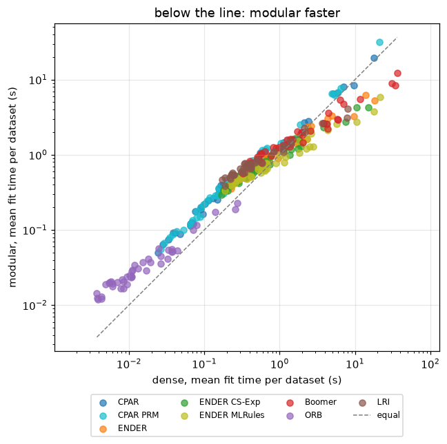
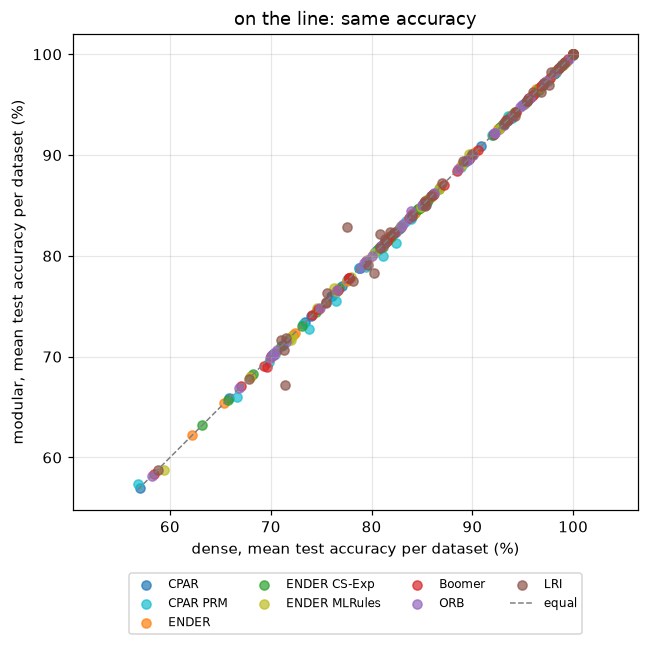
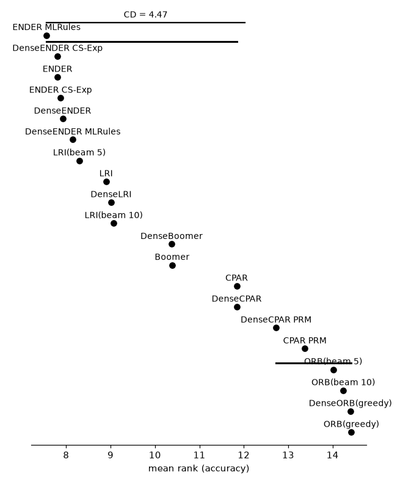

# Dense and modular rule learners compared

## Setup

**Full run** (25 small and 19 medium binary datasets). Quick sanity check instead: `python demos/dense_vs_modular.py` with no arguments.

The same rule-learning algorithms written twice: specialized for speed on a dense
matrix (`Dense...`), and built from the library's exchangeable components -- a
`RuleSearch`, an `Objective`, a covering or boosting loop -- so that they run on every
data representation and take any search. Each dense learner is paired with its
modular twin on the same data -- the dense one on the Boolean matrix it is written for, the
modular one on N-lists, the library's default representation; the modular learners are then
run again on Boolean data; and the modular `ORB` and `LRI` are run
with a beam search of width 5 and 10, which the dense versions don't have.

- **CPAR** -- Classification based on Predictive Association Rules (Yin & Han 2003), built from `GainAscentHillClimbing` with branching and a `WeightedCovering`; `DenseCPAR` is the same learner with a hand-written dense search.
  - **CPAR PRM** -- `gain_similarity=1`: only exact ties branch, which is close to PRM, the variant of the paper without the copies of a rule (`DenseCPAR PRM` on the dense search).
- **ENDER** -- Gradient boosting of rules, constant-step criterion and logistic loss (CS-Log), 500 rules, grown through the representation's own counting; `DenseENDER` is the same learner on a dense float matrix, and each variant has a dense twin too.
  - **ENDER CS-Exp** -- the exponential loss -- the best-ranked setting of the paper.
  - **ENDER MLRules** -- the Newton criterion and half the examples per round -- MLRules (Dembczynski et al. 2008).
- **Boomer** -- BOOMER's single-label case (Newton criterion, L2-regularized, 1000 rules) as an ENDER setting; `DenseBoomer` is the same on a dense float matrix.
- **ORB** -- Optimal rule boosting (10 rules), each rule found by a `RuleSearch` on the XGBoost-style gain. `ORB(greedy)` uses a greedy `HillClimbing`, and `DenseORB(greedy)` is the same learner with a hand-written dense greedy search. The dense version's exhaustive search is checked separately (see below).
  - **ORB(beam 5)** -- a `BeamSearch` of width 5.
  - **ORB(beam 10)** -- a `BeamSearch` of width 10 (`ORB`'s default).
- **LRI** -- Lightweight Rule Induction (50 DNF rules per class): terms by a greedy `HillClimbing` without a local-optimum stop on the weighted error `FP + k*FN`; `DenseLRI` is the same learner with a hand-written dense term search.
  - **LRI(beam 5)** -- terms grown by a `BeamSearch` of width 5 (at most 5 conditions).
  - **LRI(beam 10)** -- terms grown by a `BeamSearch` of width 10.

All learners run with their defaults (listed above) on 44 binary datasets from
`pyrulearn.experiments.catalog` -- every one of the small and medium size classes in the full run, numeric and symbolic attributes alike; `ORB` boosts a binary loss, so no multi-class
datasets. Exhaustive `ORB` was checked separately and left out -- see "Why exhaustive ORB
isn't in the main comparison". On 5 very small datasets (monks-problems-3, mofn-3-7-10, vote, tic-tac-toe, breast-cancer), exhaustive `ORB` reached a mean accuracy of 96.67% against 88.65% for a beam search of width 10 and 88.24% for greedy search (over the fits that finished), in 1.3s per fit against 0.21s and 0.02s -- 6x as long as the beam search; 6 of its 15 fits hit the 120s cap. Branch and bound is exponential in the number of conditions it may combine, so it doesn't scale to the feature spaces of most datasets (dozens to hundreds of binary features after discretizing numeric attributes) -- it is left out of the main comparison.

Protocol: 10-fold stratified cross-validation (5-fold for the medium datasets)
(`pyrulearn.experiments.runner.run_cv`), one `DataSpec` per training fold
(`build_dataspec(max_intervals=8)`), the test fold encoded against that same
`DataSpec` -- every learner sees the identical binary features per fold, the dense learners as a
Boolean matrix and the modular ones as N-lists; the `[Boolean]` rows are the modular learners on
the same data as Boolean matrices. Each fit is capped at
300s; a time-out or an error counts as a failure (and as last in the ranking), not as the end
of the run. Fit times are wall-clock seconds of one fit in a worker process (see below for
how many ran at once).

A fold that times out fails the whole cross-validation of that learner on that dataset (`run_cv`'s `stop_on_timeout`): its remaining folds are not run, and all its folds count as failures, so no mean rests on just the folds that finished.

Measures: test accuracy, number of rules and conditions, fit time, and whether a dense
learner and its modular twin learned the same model (the same rules, whatever their order).

Every learner runs single-threaded. Fits run 10 at a time (`run_cv`'s `n_jobs`), each in its own process and timed there, with the numerical libraries limited to one thread (`OMP_NUM_THREADS=1` and its relatives). A check of the `dense_vs_modular` learners on 11 datasets found the fit times of 5 concurrent fits as close to a sequential run as a second sequential run (per-learner ratios and rankings alike); time ratios between learners are reproducible to about +-10% either way.

## Why exhaustive ORB isn't in the main comparison

On 5 very small datasets (monks-problems-3, mofn-3-7-10, vote, tic-tac-toe, breast-cancer), exhaustive `ORB` reached a mean accuracy of 96.67% against 88.65% for a beam search of width 10 and 88.24% for greedy search (over the fits that finished), in 1.3s per fit against 0.21s and 0.02s -- 6x as long as the beam search; 6 of its 15 fits hit the 120s cap. Branch and bound is exponential in the number of conditions it may combine, so it doesn't scale to the feature spaces of most datasets (dozens to hundreds of binary features after discretizing numeric attributes) -- it is left out of the main comparison.

Accuracy (mean over the folds that finished):

| dataset | ORB(greedy) | ORB(beam 5) | ORB(beam 10) | DenseORB(greedy) | DenseORB(exhaustive) | ORB(exhaustive) |
|---|--:|--:|--:|--:|--:|--:|
| breast-cancer | 69.58% | 69.94% | 67.49% | 69.58% |  |  |
| mofn-3-7-10 | 93.73% | 95.09% | 95.32% | 93.73% | 95.47% | 95.47% |
| monks-problems-3 | 98.92% | 98.92% | 98.92% | 98.92% | 98.92% | 98.92% |
| tic-tac-toe | 83.09% | 87.89% | 85.91% | 83.09% | 83.92% |  |
| vote | 95.86% | 95.86% | 95.63% | 95.86% | 95.63% | 95.63% |

Fit time in seconds (mean over the folds that finished; a blank cell: every fold hit the cap):

| dataset | ORB(greedy) | ORB(beam 5) | ORB(beam 10) | DenseORB(greedy) | DenseORB(exhaustive) | ORB(exhaustive) |
|---|--:|--:|--:|--:|--:|--:|
| breast-cancer | 0.02 | 0.22 | 0.41 | 0.00 |  |  |
| mofn-3-7-10 | 0.02 | 0.07 | 0.11 | 0.01 | 0.27 | 0.66 |
| monks-problems-3 | 0.01 | 0.07 | 0.13 | 0.00 | 0.41 | 0.94 |
| tic-tac-toe | 0.02 | 0.12 | 0.22 | 0.01 | 58.94 |  |
| vote | 0.01 | 0.10 | 0.18 | 0.00 | 1.60 | 2.35 |

## Dense vs. modular

For each pair, over the folds where both fits finished: how often the two learned the same model (the same rules in any order), their mean accuracy, and the ratio of the modular to the dense fit time -- the geometric mean over datasets, so a value below 1 means the modular learner is faster. The dense learner on the Boolean matrix, the modular one on N-lists (its default); the modular learners on Boolean data are compared with N-lists below.

| pair | identical models | accuracy dense | accuracy modular | difference (points) | time modular / dense, small | medium | all |
|---|--:|--:|--:|--:|--:|--:|--:|
| CPAR | 345/345 | 85.63% | 85.63% | +0.00 | 2.01 | 1.40 | 1.72 |
| CPAR PRM | 266/345 | 85.57% | 85.42% | -0.15 | 2.02 | 1.51 | 1.78 |
| ENDER | 335/345 | 85.83% | 85.83% | -0.00 | 1.45 | 0.80 | 1.13 |
| ENDER CS-Exp | 329/345 | 86.04% | 86.04% | +0.00 | 1.52 | 0.80 | 1.16 |
| ENDER MLRules | 317/345 | 86.19% | 86.15% | -0.04 | 1.31 | 0.62 | 0.95 |
| Boomer | 325/345 | 86.43% | 86.41% | -0.02 | 1.41 | 0.66 | 1.02 |
| ORB | 326/345 | 83.50% | 83.48% | -0.02 | 2.81 | 1.48 | 2.13 |
| LRI | 48/345 | 85.03% | 85.04% | +0.01 | 2.06 | 1.08 | 1.56 |

## Summary by learner (mean across the 44 datasets and their folds)

| learner | accuracy | n_rules | n_conditions | conds/rule | fit_time (s) | wins | mean rank | failures |
|---|--:|--:|--:|--:|--:|--:|--:|--:|
| DenseENDER CS-Exp | 86.04% | 396.4 | 1750.1 | 4.2 | 1.12 | 3.7 | 7.78 | 0 |
| ENDER CS-Exp | 86.04% | 396.4 | 1750.1 | 4.2 | 0.86 | 3.7 | 7.81 | 0 |
| DenseENDER | 85.83% | 406.6 | 1906.8 | 4.4 | 1.40 | 2.3 | 7.85 | 0 |
| ENDER | 85.83% | 406.7 | 1907.0 | 4.4 | 1.07 | 2.3 | 7.94 | 0 |
| ENDER MLRules | 86.15% | 346.0 | 1433.1 | 4.1 | 0.90 | 1.2 | 8.09 | 0 |
| DenseENDER MLRules | 86.19% | 346.0 | 1432.3 | 4.0 | 1.55 | 1.2 | 8.12 | 0 |
| LRI(beam 5) | 86.13% | 392.5 | 1365.8 | 3.5 | 3.94 | 4.2 | 8.23 | 0 |
| LRI | 85.04% | 396.3 | 1579.0 | 4.0 | 0.88 | 1.1 | 8.90 | 0 |
| DenseLRI | 85.03% | 396.4 | 1561.4 | 3.9 | 0.75 | 4.0 | 9.01 | 0 |
| LRI(beam 10) | 86.18% | 392.1 | 1405.0 | 3.6 | 7.20 | 3.7 | 9.05 | 0 |
| Boomer | 86.41% | 273.1 | 1793.5 | 5.4 | 1.99 | 4.1 | 10.34 | 0 |
| DenseBoomer | 86.43% | 272.9 | 1792.1 | 5.4 | 3.17 | 5.1 | 10.43 | 0 |
| CPAR | 85.63% | 373.5 | 2431.9 | 4.6 | 1.15 | 1.2 | 11.77 | 0 |
| DenseCPAR | 85.63% | 373.5 | 2431.9 | 4.6 | 0.93 | 1.2 | 11.77 | 0 |
| DenseCPAR PRM | 85.57% | 309.1 | 1941.8 | 4.6 | 0.89 | 2.2 | 12.75 | 0 |
| CPAR PRM | 85.42% | 307.4 | 1937.3 | 4.6 | 1.28 | 0.2 | 13.50 | 0 |
| ORB(beam 5) | 84.06% | 9.8 | 48.5 | 4.9 | 1.49 | 0.2 | 13.80 | 0 |
| ORB(beam 10) | 84.34% | 9.8 | 51.1 | 5.2 | 3.07 | 1.2 | 13.92 | 0 |
| DenseORB(greedy) | 83.50% | 9.7 | 39.6 | 4.0 | 0.02 | 0.1 | 14.36 | 0 |
| ORB(greedy) | 83.48% | 9.7 | 39.6 | 4.1 | 0.04 | 1.1 | 14.57 | 0 |

Sorted by mean rank. `wins` -- datasets where a learner's mean accuracy was (tied-for-)best, a tie split evenly; `mean rank` -- average accuracy rank across datasets, failures tied for last. Means over successful fits only; `failures` counts the fits that timed out or raised. A dense learner and its twin that learn the same models tie for rank, so the ranking separates the algorithms and the searches, not dense from modular.

### Small datasets only (25, fewer than 1,000 examples)

`SPECT`, `blood-transfusion-service-center`, `breast-cancer`, `breast-w`, `climate-model-simulation-crashes`, `colic`, `credit-approval`, `cylinder-bands`, `diabetes`, `dresses-sales`, `heart-c`, `heart-h`, `heart-statlog`, `hepatitis`, `ilpd`, `ionosphere`, `kc2`, `molecular-biology_promoters`, `monks-problems-1`, `monks-problems-2`, `monks-problems-3`, `sonar`, `tic-tac-toe`, `vote`, `wdbc`

| learner | accuracy | n_rules | n_conditions | conds/rule | fit_time (s) | wins | mean rank | failures |
|---|--:|--:|--:|--:|--:|--:|--:|--:|
| ENDER CS-Exp | 84.75% | 396.9 | 1548.8 | 3.7 | 0.56 | 2.1 | 7.28 | 0 |
| DenseENDER CS-Exp | 84.75% | 396.9 | 1549.1 | 3.7 | 0.39 | 2.1 | 7.36 | 0 |
| ENDER | 84.45% | 406.1 | 1660.8 | 3.9 | 0.64 | 1.2 | 8.16 | 0 |
| DenseENDER | 84.45% | 406.0 | 1660.5 | 3.9 | 0.47 | 1.2 | 8.16 | 0 |
| DenseENDER MLRules | 84.95% | 343.1 | 1278.6 | 3.7 | 0.48 | 0.6 | 8.24 | 0 |
| ENDER MLRules | 84.89% | 343.1 | 1279.0 | 3.7 | 0.57 | 0.6 | 8.66 | 0 |
| DenseLRI | 83.66% | 396.3 | 1530.7 | 3.9 | 0.31 | 2.9 | 9.70 | 0 |
| LRI(beam 5) | 84.86% | 391.6 | 1328.7 | 3.4 | 3.35 | 1.1 | 9.70 | 0 |
| LRI | 83.68% | 396.3 | 1551.3 | 3.9 | 0.63 | 1.1 | 9.88 | 0 |
| LRI(beam 10) | 84.94% | 391.6 | 1370.5 | 3.5 | 6.21 | 1.6 | 10.42 | 0 |
| DenseBoomer | 85.42% | 229.2 | 1483.0 | 5.3 | 1.11 | 2.9 | 10.82 | 0 |
| Boomer | 85.40% | 229.4 | 1484.7 | 5.3 | 1.34 | 1.9 | 10.84 | 0 |
| CPAR | 84.42% | 180.7 | 856.5 | 4.2 | 0.31 | 0.7 | 11.22 | 0 |
| DenseCPAR | 84.42% | 180.7 | 856.5 | 4.2 | 0.16 | 0.7 | 11.22 | 0 |
| DenseCPAR PRM | 84.38% | 165.0 | 778.2 | 4.1 | 0.17 | 2.2 | 12.12 | 0 |
| CPAR PRM | 84.21% | 163.6 | 771.7 | 4.1 | 0.33 | 0.2 | 12.68 | 0 |
| ORB(beam 10) | 82.97% | 9.8 | 48.7 | 4.9 | 1.83 | 1.2 | 13.10 | 0 |
| DenseORB(greedy) | 82.05% | 9.7 | 36.5 | 3.7 | 0.01 | 0.1 | 13.22 | 0 |
| ORB(greedy) | 82.03% | 9.7 | 36.6 | 3.7 | 0.02 | 1.1 | 13.46 | 0 |
| ORB(beam 5) | 82.55% | 9.8 | 46.3 | 4.7 | 0.92 | 0.2 | 13.76 | 0 |

### Medium datasets only (19, 1,000 to 10,000 examples)

`Titanic`, `banknote-authentication`, `churn`, `compas-two-years`, `credit-g`, `heloc`, `kc1`, `kr-vs-kp`, `mofn-3-7-10`, `mushroom`, `ozone-level-8hr`, `pc1`, `pc3`, `pc4`, `phoneme`, `qsar-biodeg`, `sick`, `spambase`, `wilt`

| learner | accuracy | n_rules | n_conditions | conds/rule | fit_time (s) | wins | mean rank | failures |
|---|--:|--:|--:|--:|--:|--:|--:|--:|
| LRI(beam 5) | 89.50% | 394.8 | 1463.4 | 3.7 | 5.50 | 3.2 | 6.29 | 0 |
| LRI(beam 10) | 89.44% | 393.4 | 1495.8 | 3.8 | 9.80 | 2.2 | 7.24 | 0 |
| ENDER MLRules | 89.46% | 353.6 | 1838.8 | 4.9 | 1.77 | 0.7 | 7.34 | 0 |
| DenseENDER | 89.47% | 408.1 | 2554.9 | 5.8 | 3.84 | 1.2 | 7.45 | 0 |
| LRI | 88.61% | 396.6 | 1652.0 | 4.2 | 1.52 | 0.1 | 7.61 | 0 |
| ENDER | 89.47% | 408.1 | 2555.0 | 5.8 | 2.18 | 1.2 | 7.66 | 0 |
| DenseENDER MLRules | 89.44% | 353.5 | 1836.6 | 4.9 | 4.38 | 0.7 | 7.97 | 0 |
| DenseLRI | 88.61% | 396.6 | 1642.3 | 4.1 | 1.91 | 1.1 | 8.11 | 0 |
| DenseENDER CS-Exp | 89.43% | 395.3 | 2279.2 | 5.4 | 3.03 | 1.7 | 8.34 | 0 |
| ENDER CS-Exp | 89.43% | 395.3 | 2279.6 | 5.4 | 1.65 | 1.7 | 8.50 | 0 |
| Boomer | 89.09% | 388.3 | 2606.1 | 5.8 | 3.68 | 2.2 | 9.68 | 0 |
| DenseBoomer | 89.08% | 388.2 | 2605.8 | 5.8 | 8.59 | 2.2 | 9.92 | 0 |
| CPAR | 88.80% | 880.9 | 6577.5 | 5.9 | 3.34 | 0.5 | 12.50 | 0 |
| DenseCPAR | 88.80% | 880.9 | 6577.5 | 5.9 | 2.96 | 0.5 | 12.50 | 0 |
| DenseCPAR PRM | 88.69% | 688.3 | 5003.7 | 5.8 | 2.78 | 0.0 | 13.58 | 0 |
| ORB(beam 5) | 88.02% | 9.7 | 54.3 | 5.5 | 2.99 | 0.0 | 13.84 | 0 |
| CPAR PRM | 88.60% | 685.5 | 5004.9 | 5.8 | 3.78 | 0.0 | 14.58 | 0 |
| ORB(beam 10) | 87.92% | 9.7 | 57.4 | 5.9 | 6.32 | 0.0 | 15.00 | 0 |
| DenseORB(greedy) | 87.32% | 9.7 | 47.5 | 4.9 | 0.06 | 0.0 | 15.87 | 0 |
| ORB(greedy) | 87.30% | 9.7 | 47.7 | 4.9 | 0.07 | 0.0 | 16.03 | 0 |

## Beam search for ORB and LRI

The dense `ORB` and `LRI` come with their own greedy (and, for `ORB`, exhaustive) search; the modular ones take any `RuleSearch`. Mean over all datasets:

| learner | accuracy | n_conditions | fit_time (s) |
|---|--:|--:|--:|
| ORB(greedy) | 83.48% | 39.6 | 0.04 |
| ORB(beam 5) | 84.06% | 48.5 | 1.49 |
| ORB(beam 10) | 84.34% | 51.1 | 3.07 |
| LRI | 85.04% | 1579.0 | 0.88 |
| LRI(beam 5) | 86.13% | 1365.8 | 3.94 |
| LRI(beam 10) | 86.18% | 1405.0 | 7.20 |

## The modular learners on Boolean data

The modular learners above run on `NListRepresentation`, the library's default. Here they are run again on `HorizontalBitmapRepresentation`, the matrix the dense learners work on, over the folds where both finished; a time ratio above 1 means the N-list is faster:

| learner | accuracy, N-list | accuracy, Boolean | time Boolean / N-list (geometric mean over datasets) |
|---|--:|--:|--:|
| CPAR | 85.63% | 85.63% | 1.07 |
| CPAR PRM | 85.42% | 85.54% | 1.14 |
| ENDER | 85.83% | 85.84% | 0.97 |
| ENDER CS-Exp | 86.04% | 86.03% | 0.96 |
| ENDER MLRules | 86.15% | 86.19% | 1.01 |
| Boomer | 86.41% | 86.41% | 1.16 |
| ORB(greedy) | 83.48% | 83.52% | 1.13 |
| LRI | 85.04% | 85.04% | 1.17 |
| ORB(beam 5) | 84.06% | 84.04% | 0.96 |
| ORB(beam 10) | 84.34% | 84.22% | 0.95 |
| LRI(beam 5) | 86.13% | 86.13% | 1.05 |
| LRI(beam 10) | 86.18% | 86.18% | 1.04 |

## Per-dataset results

Accuracy (mean over the folds that finished):

| dataset | CPAR | CPAR PRM | ENDER | ENDER CS-Exp | ENDER MLRules | Boomer | ORB(greedy) | LRI | ORB(beam 5) | ORB(beam 10) | LRI(beam 5) | LRI(beam 10) | DenseCPAR | DenseCPAR PRM | DenseENDER | DenseENDER CS-Exp | DenseENDER MLRules | DenseBoomer | DenseORB(greedy) | DenseLRI |
|---|--:|--:|--:|--:|--:|--:|--:|--:|--:|--:|--:|--:|--:|--:|--:|--:|--:|--:|--:|--:|
| SPECT | 82.78% | 82.04% | 84.63% | 84.62% | 83.49% | 82.34% | 83.90% | 80.81% | 82.79% | 82.44% | 83.82% | 83.83% | 82.78% | 82.42% | 84.63% | 84.62% | 83.86% | 82.34% | 83.90% | 80.81% |
| Titanic | 78.84% | 78.61% | 80.98% | 80.75% | 79.45% | 77.77% | 79.45% | 79.07% | 79.68% | 79.45% | 79.68% | 79.14% | 78.84% | 78.76% | 80.98% | 80.75% | 79.45% | 77.77% | 79.45% | 79.68% |
| banknote-authentication | 98.54% | 98.61% | 98.98% | 98.91% | 99.05% | 99.20% | 97.30% | 99.13% | 98.18% | 97.67% | 99.05% | 99.05% | 98.54% | 98.61% | 98.98% | 98.91% | 99.05% | 99.20% | 97.30% | 99.13% |
| blood-transfusion-service-center | 77.67% | 77.67% | 77.53% | 77.80% | 77.93% | 77.80% | 76.60% | 77.54% | 76.20% | 76.86% | 77.53% | 77.40% | 77.67% | 77.67% | 77.53% | 77.80% | 77.93% | 77.80% | 76.60% | 78.20% |
| breast-cancer | 73.42% | 72.72% | 72.39% | 73.09% | 71.69% | 69.66% | 70.65% | 70.64% | 69.58% | 73.07% | 71.69% | 72.77% | 73.42% | 73.76% | 72.39% | 73.09% | 72.03% | 69.66% | 70.65% | 71.33% |
| breast-w | 93.42% | 93.84% | 96.28% | 96.57% | 95.57% | 95.99% | 95.71% | 96.28% | 94.85% | 95.13% | 96.00% | 95.57% | 93.42% | 93.56% | 96.28% | 96.57% | 95.57% | 95.99% | 95.71% | 96.00% |
| churn | 93.02% | 93.32% | 92.58% | 92.02% | 93.38% | 93.44% | 89.56% | 93.24% | 91.08% | 90.92% | 93.28% | 93.64% | 93.02% | 93.42% | 92.58% | 92.02% | 93.36% | 93.38% | 89.56% | 93.20% |
| climate-model-simulation-crashes | 93.52% | 93.70% | 92.96% | 93.15% | 94.07% | 93.52% | 92.41% | 93.89% | 92.78% | 92.78% | 93.89% | 93.70% | 93.52% | 93.89% | 92.96% | 93.15% | 94.07% | 93.52% | 93.15% | 94.26% |
| colic | 83.98% | 83.45% | 84.80% | 84.80% | 84.00% | 83.73% | 82.89% | 85.07% | 84.26% | 82.36% | 84.81% | 85.35% | 83.98% | 83.45% | 84.80% | 84.80% | 84.00% | 83.73% | 82.89% | 85.35% |
| compas-two-years | 65.88% | 65.95% | 68.04% | 68.25% | 67.94% | 67.05% | 66.88% | 67.75% | 67.22% | 67.30% | 67.18% | 67.47% | 65.88% | 66.62% | 68.04% | 68.25% | 67.94% | 67.05% | 66.88% | 67.89% |
| credit-approval | 85.22% | 85.51% | 86.81% | 86.67% | 86.67% | 85.22% | 86.23% | 87.25% | 86.81% | 86.81% | 86.52% | 87.39% | 85.22% | 85.51% | 86.81% | 86.67% | 86.67% | 85.22% | 86.23% | 86.96% |
| credit-g | 74.00% | 73.30% | 76.50% | 76.80% | 76.50% | 74.70% | 70.20% | 75.30% | 71.40% | 71.50% | 76.00% | 76.30% | 74.00% | 73.20% | 76.50% | 76.80% | 76.30% | 74.70% | 70.30% | 75.50% |
| cylinder-bands | 77.04% | 79.44% | 80.93% | 81.30% | 81.11% | 87.22% | 71.48% | 82.22% | 74.26% | 74.07% | 82.96% | 81.85% | 77.04% | 79.44% | 80.93% | 81.11% | 81.11% | 87.22% | 71.48% | 82.22% |
| diabetes | 76.03% | 75.90% | 74.74% | 74.48% | 74.61% | 74.09% | 74.87% | 75.39% | 74.35% | 74.48% | 76.04% | 75.78% | 76.03% | 76.42% | 74.74% | 74.48% | 74.61% | 74.09% | 74.87% | 75.53% |
| dresses-sales | 57.00% | 55.60% | 62.20% | 63.20% | 59.00% | 58.20% | 57.40% | 58.80% | 54.80% | 54.80% | 58.20% | 59.40% | 57.00% | 56.80% | 62.20% | 63.20% | 59.40% | 58.40% | 58.20% | 58.80% |
| heart-c | 80.55% | 77.59% | 82.88% | 81.89% | 81.24% | 76.63% | 81.23% | 78.27% | 80.89% | 77.87% | 78.90% | 80.24% | 80.55% | 77.59% | 82.88% | 81.89% | 81.24% | 76.63% | 81.23% | 80.25% |
| heart-h | 80.98% | 80.60% | 81.63% | 81.62% | 81.31% | 80.99% | 81.24% | 81.64% | 81.26% | 80.59% | 80.61% | 79.95% | 80.98% | 80.60% | 81.63% | 81.62% | 81.31% | 80.99% | 81.24% | 81.31% |
| heart-statlog | 82.22% | 80.00% | 81.48% | 81.11% | 79.63% | 77.78% | 79.26% | 76.30% | 80.00% | 80.37% | 76.67% | 78.15% | 82.22% | 81.11% | 81.48% | 81.11% | 79.63% | 77.78% | 79.26% | 75.56% |
| heloc | 70.23% | 70.00% | 72.19% | 71.79% | 72.06% | 70.05% | 70.35% | 71.88% | 70.25% | 70.14% | 71.72% | 71.72% | 70.23% | 70.42% | 72.19% | 71.79% | 72.06% | 70.05% | 70.35% | 71.55% |
| hepatitis | 80.71% | 78.75% | 79.54% | 80.88% | 80.25% | 81.50% | 84.50% | 82.12% | 80.88% | 78.88% | 82.12% | 79.50% | 80.71% | 78.75% | 79.54% | 80.88% | 80.25% | 81.50% | 83.87% | 80.88% |
| ilpd | 71.17% | 70.32% | 69.98% | 71.02% | 70.15% | 69.29% | 70.15% | 71.68% | 70.49% | 71.86% | 70.13% | 70.13% | 71.17% | 69.81% | 69.98% | 71.02% | 70.49% | 69.29% | 70.15% | 70.99% |
| ionosphere | 90.88% | 89.17% | 94.29% | 93.73% | 94.30% | 94.01% | 90.02% | 93.44% | 91.72% | 91.73% | 93.16% | 92.60% | 90.88% | 89.17% | 94.29% | 93.73% | 94.30% | 94.01% | 90.02% | 93.44% |
| kc1 | 84.21% | 83.97% | 85.63% | 85.49% | 84.87% | 84.12% | 85.02% | 85.44% | 84.97% | 85.16% | 85.63% | 85.40% | 84.21% | 83.88% | 85.63% | 85.59% | 84.87% | 83.97% | 85.02% | 85.30% |
| kc2 | 82.94% | 83.89% | 84.26% | 84.64% | 82.93% | 81.79% | 83.12% | 82.36% | 82.16% | 81.60% | 82.36% | 81.40% | 82.94% | 83.89% | 84.26% | 84.64% | 82.93% | 81.79% | 83.12% | 81.79% |
| kr-vs-kp | 99.19% | 99.28% | 99.03% | 99.09% | 99.53% | 99.50% | 95.18% | 98.91% | 97.47% | 97.22% | 99.00% | 99.09% | 99.19% | 99.28% | 99.03% | 99.09% | 99.53% | 99.50% | 95.18% | 98.91% |
| mofn-3-7-10 | 98.26% | 98.26% | 100.00% | 100.00% | 100.00% | 100.00% | 93.88% | 83.99% | 94.64% | 95.54% | 100.00% | 100.00% | 98.26% | 98.26% | 100.00% | 100.00% | 100.00% | 100.00% | 93.88% | 83.99% |
| molecular-biology_promoters | 80.36% | 85.09% | 92.55% | 93.55% | 93.45% | 90.55% | 85.09% | 82.91% | 81.27% | 86.00% | 80.27% | 82.27% | 80.36% | 84.09% | 92.55% | 93.55% | 93.45% | 90.55% | 85.09% | 77.55% |
| monks-problems-1 | 100.00% | 100.00% | 100.00% | 100.00% | 100.00% | 100.00% | 82.39% | 100.00% | 100.00% | 100.00% | 100.00% | 100.00% | 100.00% | 100.00% | 100.00% | 100.00% | 100.00% | 100.00% | 82.39% | 100.00% |
| monks-problems-2 | 96.17% | 97.17% | 65.40% | 65.73% | 76.54% | 98.84% | 69.88% | 67.21% | 75.70% | 77.53% | 93.35% | 95.35% | 96.17% | 97.50% | 65.40% | 65.73% | 76.54% | 98.84% | 69.88% | 71.39% |
| monks-problems-3 | 98.92% | 98.92% | 98.92% | 98.74% | 97.66% | 97.66% | 98.92% | 98.20% | 98.92% | 98.92% | 97.84% | 97.84% | 98.92% | 98.92% | 98.92% | 98.74% | 97.66% | 97.66% | 98.92% | 97.84% |
| mushroom | 99.95% | 99.95% | 100.00% | 100.00% | 100.00% | 100.00% | 99.54% | 100.00% | 99.48% | 99.84% | 100.00% | 100.00% | 99.95% | 99.95% | 100.00% | 100.00% | 100.00% | 100.00% | 99.54% | 100.00% |
| ozone-level-8hr | 93.73% | 93.73% | 93.92% | 93.96% | 94.28% | 94.28% | 93.01% | 94.24% | 92.98% | 92.94% | 94.28% | 93.96% | 93.73% | 93.80% | 94.00% | 93.96% | 94.20% | 94.28% | 93.09% | 94.20% |
| pc1 | 92.61% | 91.98% | 92.70% | 92.79% | 92.61% | 92.06% | 92.16% | 93.06% | 92.97% | 92.16% | 92.88% | 93.06% | 92.61% | 91.98% | 92.70% | 92.79% | 92.61% | 92.15% | 92.16% | 93.15% |
| pc3 | 89.63% | 88.74% | 88.74% | 89.38% | 89.12% | 88.61% | 89.38% | 89.38% | 89.19% | 89.12% | 89.31% | 88.74% | 89.63% | 88.87% | 88.74% | 89.38% | 88.99% | 88.48% | 89.38% | 89.06% |
| pc4 | 89.99% | 89.57% | 89.78% | 89.64% | 89.78% | 89.64% | 88.41% | 90.12% | 89.30% | 88.89% | 90.19% | 90.12% | 89.99% | 89.57% | 89.78% | 89.71% | 89.71% | 89.64% | 88.61% | 89.92% |
| phoneme | 85.90% | 85.44% | 84.23% | 83.94% | 85.25% | 86.08% | 80.00% | 84.97% | 81.72% | 81.42% | 85.33% | 85.27% | 85.90% | 85.51% | 84.23% | 83.94% | 85.25% | 86.08% | 80.00% | 85.25% |
| qsar-biodeg | 84.45% | 83.70% | 85.88% | 86.16% | 85.31% | 85.21% | 80.95% | 85.97% | 83.51% | 82.94% | 85.88% | 85.40% | 84.45% | 83.89% | 85.88% | 86.16% | 85.31% | 85.21% | 80.95% | 85.88% |
| sick | 98.17% | 98.17% | 98.33% | 98.06% | 98.52% | 98.52% | 98.12% | 98.59% | 98.52% | 98.36% | 98.67% | 98.52% | 98.17% | 98.17% | 98.33% | 98.06% | 98.52% | 98.52% | 98.12% | 98.59% |
| sonar | 76.02% | 75.00% | 84.14% | 82.69% | 85.10% | 85.62% | 79.33% | 81.29% | 74.98% | 79.86% | 82.71% | 81.74% | 76.02% | 76.43% | 84.14% | 82.69% | 85.10% | 86.12% | 78.83% | 81.29% |
| spambase | 93.76% | 94.13% | 95.28% | 95.09% | 95.00% | 95.52% | 92.20% | 95.39% | 92.70% | 92.91% | 95.26% | 95.35% | 93.76% | 94.18% | 95.28% | 95.09% | 95.00% | 95.52% | 92.20% | 95.39% |
| tic-tac-toe | 98.33% | 98.33% | 90.29% | 95.29% | 99.38% | 100.00% | 83.82% | 96.97% | 84.45% | 85.07% | 99.06% | 99.06% | 98.33% | 98.33% | 90.29% | 95.29% | 99.38% | 100.00% | 83.82% | 97.60% |
| vote | 95.41% | 95.41% | 95.87% | 95.64% | 95.63% | 95.63% | 94.95% | 95.41% | 94.95% | 95.64% | 96.09% | 95.86% | 95.41% | 95.41% | 95.87% | 95.64% | 95.63% | 95.63% | 94.95% | 95.41% |
| wdbc | 95.78% | 95.08% | 96.66% | 96.66% | 96.66% | 96.83% | 94.73% | 96.31% | 95.42% | 95.60% | 96.66% | 96.48% | 95.78% | 95.08% | 96.66% | 96.66% | 96.66% | 96.83% | 94.73% | 96.83% |
| wilt | 96.86% | 96.67% | 97.15% | 96.96% | 97.15% | 97.00% | 97.11% | 97.11% | 97.11% | 97.09% | 97.13% | 97.19% | 96.86% | 96.67% | 97.15% | 96.96% | 97.15% | 97.00% | 97.11% | 97.09% |

Fit time in seconds (mean over the folds that finished):

| dataset | CPAR | CPAR PRM | ENDER | ENDER CS-Exp | ENDER MLRules | Boomer | ORB(greedy) | LRI | ORB(beam 5) | ORB(beam 10) | LRI(beam 5) | LRI(beam 10) | DenseCPAR | DenseCPAR PRM | DenseENDER | DenseENDER CS-Exp | DenseENDER MLRules | DenseBoomer | DenseORB(greedy) | DenseLRI |
|---|--:|--:|--:|--:|--:|--:|--:|--:|--:|--:|--:|--:|--:|--:|--:|--:|--:|--:|--:|--:|
| SPECT | 0.18 | 0.18 | 0.40 | 0.33 | 0.40 | 0.76 | 0.01 | 0.54 | 0.14 | 0.26 | 2.23 | 4.11 | 0.08 | 0.08 | 0.22 | 0.18 | 0.22 | 0.38 | 0.00 | 0.23 |
| Titanic | 0.78 | 0.76 | 0.89 | 0.70 | 0.78 | 1.33 | 0.02 | 0.66 | 0.29 | 0.54 | 2.66 | 5.02 | 0.44 | 0.42 | 0.68 | 0.52 | 0.67 | 1.10 | 0.01 | 0.40 |
| banknote-authentication | 0.12 | 0.12 | 0.67 | 0.50 | 0.51 | 0.97 | 0.02 | 0.67 | 0.24 | 0.44 | 2.72 | 4.81 | 0.07 | 0.07 | 0.55 | 0.37 | 0.42 | 0.77 | 0.01 | 0.42 |
| blood-transfusion-service-center | 0.33 | 0.31 | 0.53 | 0.42 | 0.47 | 0.80 | 0.02 | 0.58 | 0.15 | 0.29 | 2.41 | 4.39 | 0.19 | 0.18 | 0.38 | 0.28 | 0.37 | 0.58 | 0.01 | 0.31 |
| breast-cancer | 0.40 | 0.41 | 0.57 | 0.51 | 0.49 | 0.94 | 0.02 | 0.48 | 0.23 | 0.43 | 2.51 | 4.63 | 0.18 | 0.19 | 0.31 | 0.27 | 0.29 | 0.50 | 0.01 | 0.22 |
| breast-w | 0.13 | 0.15 | 0.91 | 0.78 | 0.58 | 1.27 | 0.02 | 0.58 | 0.80 | 1.52 | 3.14 | 5.77 | 0.07 | 0.08 | 0.71 | 0.60 | 0.56 | 1.15 | 0.01 | 0.34 |
| churn | 7.99 | 7.77 | 3.30 | 2.56 | 2.59 | 5.49 | 0.12 | 2.00 | 2.20 | 4.36 | 6.13 | 10.97 | 7.08 | 6.51 | 4.95 | 4.14 | 5.69 | 11.63 | 0.08 | 2.17 |
| climate-model-simulation-crashes | 0.16 | 0.15 | 0.75 | 0.63 | 0.66 | 1.58 | 0.03 | 0.68 | 1.00 | 2.02 | 3.70 | 6.92 | 0.10 | 0.09 | 0.60 | 0.49 | 0.65 | 1.47 | 0.01 | 0.38 |
| colic | 0.26 | 0.28 | 0.56 | 0.51 | 0.52 | 1.24 | 0.02 | 0.75 | 0.42 | 0.84 | 3.21 | 6.03 | 0.13 | 0.14 | 0.39 | 0.33 | 0.42 | 0.89 | 0.01 | 0.34 |
| compas-two-years | 6.63 | 6.83 | 2.44 | 1.62 | 1.91 | 2.65 | 0.05 | 1.40 | 0.56 | 1.06 | 3.64 | 6.16 | 5.79 | 6.01 | 2.61 | 1.79 | 2.61 | 3.82 | 0.04 | 1.41 |
| credit-approval | 0.56 | 0.60 | 0.91 | 0.79 | 0.76 | 1.63 | 0.03 | 0.74 | 0.61 | 1.20 | 3.26 | 6.01 | 0.31 | 0.31 | 0.66 | 0.56 | 0.67 | 1.39 | 0.01 | 0.41 |
| credit-g | 1.07 | 1.19 | 1.11 | 0.93 | 0.96 | 2.00 | 0.04 | 0.82 | 0.58 | 1.13 | 3.56 | 6.48 | 0.58 | 0.66 | 0.92 | 0.75 | 0.99 | 2.00 | 0.02 | 0.48 |
| cylinder-bands | 0.55 | 0.64 | 1.37 | 1.16 | 0.94 | 5.34 | 0.06 | 0.87 | 3.76 | 7.43 | 5.41 | 10.12 | 0.31 | 0.36 | 1.29 | 1.10 | 1.20 | 6.31 | 0.03 | 0.51 |
| diabetes | 1.06 | 1.17 | 0.79 | 0.65 | 0.72 | 1.59 | 0.02 | 0.76 | 0.34 | 0.67 | 2.91 | 5.31 | 0.55 | 0.59 | 0.59 | 0.46 | 0.61 | 1.25 | 0.01 | 0.39 |
| dresses-sales | 1.10 | 1.22 | 0.97 | 0.82 | 0.65 | 1.39 | 0.04 | 0.68 | 1.20 | 2.46 | 3.76 | 7.04 | 0.61 | 0.68 | 0.77 | 0.65 | 0.68 | 1.41 | 0.02 | 0.37 |
| heart-c | 0.22 | 0.24 | 0.54 | 0.50 | 0.52 | 1.10 | 0.02 | 0.57 | 0.32 | 0.62 | 2.80 | 5.19 | 0.10 | 0.11 | 0.32 | 0.28 | 0.33 | 0.63 | 0.01 | 0.24 |
| heart-h | 0.25 | 0.27 | 0.53 | 0.47 | 0.47 | 0.88 | 0.02 | 0.50 | 0.32 | 0.61 | 2.71 | 4.96 | 0.11 | 0.12 | 0.31 | 0.26 | 0.29 | 0.51 | 0.01 | 0.22 |
| heart-statlog | 0.20 | 0.22 | 0.52 | 0.48 | 0.48 | 1.04 | 0.02 | 0.55 | 0.32 | 0.61 | 2.78 | 5.13 | 0.09 | 0.10 | 0.30 | 0.26 | 0.30 | 0.57 | 0.01 | 0.23 |
| heloc | 19.66 | 31.70 | 6.20 | 4.25 | 5.85 | 12.22 | 0.23 | 4.07 | 3.79 | 7.52 | 10.34 | 17.41 | 18.00 | 21.25 | 13.83 | 10.61 | 21.63 | 36.45 | 0.27 | 8.07 |
| hepatitis | 0.09 | 0.10 | 0.37 | 0.34 | 0.34 | 0.82 | 0.01 | 0.47 | 0.22 | 0.45 | 2.57 | 4.78 | 0.04 | 0.04 | 0.20 | 0.18 | 0.19 | 0.40 | 0.00 | 0.17 |
| ilpd | 0.77 | 0.84 | 0.74 | 0.62 | 0.64 | 1.25 | 0.02 | 0.66 | 0.43 | 0.84 | 2.91 | 5.34 | 0.40 | 0.43 | 0.52 | 0.42 | 0.52 | 0.96 | 0.01 | 0.33 |
| ionosphere | 0.12 | 0.13 | 0.63 | 0.59 | 0.62 | 1.37 | 0.03 | 0.73 | 2.22 | 4.50 | 5.07 | 9.41 | 0.06 | 0.07 | 0.49 | 0.46 | 0.61 | 1.25 | 0.01 | 0.36 |
| kc1 | 2.70 | 2.53 | 1.42 | 1.00 | 1.20 | 2.20 | 0.04 | 1.08 | 1.42 | 2.79 | 4.31 | 7.85 | 2.10 | 1.88 | 1.80 | 1.37 | 2.26 | 4.37 | 0.03 | 1.12 |
| kc2 | 0.38 | 0.37 | 0.65 | 0.53 | 0.61 | 1.29 | 0.02 | 0.71 | 1.28 | 2.47 | 3.83 | 7.09 | 0.22 | 0.21 | 0.55 | 0.43 | 0.64 | 1.36 | 0.01 | 0.42 |
| kr-vs-kp | 0.30 | 0.32 | 1.58 | 1.26 | 1.06 | 2.02 | 0.04 | 1.12 | 0.46 | 0.86 | 3.58 | 6.22 | 0.15 | 0.16 | 1.42 | 1.10 | 1.12 | 1.97 | 0.02 | 0.83 |
| mofn-3-7-10 | 0.40 | 0.47 | 0.49 | 0.34 | 0.50 | 0.87 | 0.02 | 0.76 | 0.07 | 0.12 | 2.50 | 4.36 | 0.17 | 0.19 | 0.36 | 0.20 | 0.32 | 0.52 | 0.01 | 0.41 |
| molecular-biology_promoters | 0.05 | 0.05 | 0.42 | 0.40 | 0.42 | 1.05 | 0.02 | 0.50 | 0.82 | 1.60 | 4.02 | 7.39 | 0.02 | 0.03 | 0.23 | 0.21 | 0.26 | 0.57 | 0.00 | 0.19 |
| monks-problems-1 | 0.09 | 0.09 | 0.45 | 0.37 | 0.45 | 0.57 | 0.01 | 0.39 | 0.06 | 0.12 | 2.26 | 4.09 | 0.04 | 0.04 | 0.28 | 0.21 | 0.26 | 0.32 | 0.00 | 0.19 |
| monks-problems-2 | 0.36 | 0.36 | 0.50 | 0.43 | 0.61 | 0.96 | 0.02 | 0.65 | 0.08 | 0.14 | 2.37 | 4.33 | 0.16 | 0.16 | 0.33 | 0.27 | 0.38 | 0.53 | 0.01 | 0.30 |
| monks-problems-3 | 0.06 | 0.07 | 0.45 | 0.37 | 0.46 | 0.78 | 0.01 | 0.54 | 0.07 | 0.13 | 2.21 | 4.05 | 0.03 | 0.03 | 0.28 | 0.21 | 0.26 | 0.41 | 0.00 | 0.25 |
| mushroom | 0.25 | 0.29 | 3.02 | 2.33 | 2.14 | 4.72 | 0.10 | 2.25 | 3.30 | 7.63 | 6.61 | 10.89 | 0.15 | 0.15 | 4.37 | 3.83 | 4.38 | 7.08 | 0.07 | 2.14 |
| ozone-level-8hr | 1.61 | 1.57 | 3.22 | 2.73 | 2.73 | 8.86 | 0.17 | 2.63 | 16.71 | 35.83 | 13.32 | 24.44 | 1.50 | 1.28 | 9.62 | 7.47 | 10.46 | 30.55 | 0.14 | 3.66 |
| pc1 | 0.60 | 0.58 | 0.90 | 0.74 | 0.79 | 1.45 | 0.03 | 0.78 | 1.42 | 2.87 | 3.87 | 7.09 | 0.40 | 0.37 | 0.95 | 0.74 | 1.14 | 2.05 | 0.02 | 0.59 |
| pc3 | 1.46 | 1.42 | 1.60 | 1.29 | 1.27 | 2.94 | 0.06 | 1.27 | 4.37 | 8.68 | 6.14 | 11.47 | 1.12 | 1.03 | 2.32 | 1.92 | 2.80 | 5.91 | 0.04 | 1.14 |
| pc4 | 0.97 | 0.97 | 1.47 | 1.21 | 1.28 | 2.97 | 0.05 | 1.21 | 4.90 | 9.84 | 6.28 | 11.54 | 0.71 | 0.70 | 2.03 | 1.74 | 2.54 | 5.81 | 0.03 | 1.07 |
| phoneme | 6.48 | 6.47 | 2.39 | 1.65 | 2.11 | 3.58 | 0.05 | 1.52 | 0.41 | 0.75 | 3.76 | 6.32 | 5.11 | 4.94 | 2.37 | 1.63 | 2.49 | 4.40 | 0.04 | 1.39 |
| qsar-biodeg | 0.75 | 0.91 | 1.39 | 1.18 | 1.07 | 2.55 | 0.05 | 1.07 | 3.12 | 6.17 | 5.64 | 10.42 | 0.48 | 0.55 | 1.67 | 1.43 | 1.82 | 4.29 | 0.03 | 0.81 |
| sick | 0.48 | 0.52 | 2.15 | 1.59 | 1.62 | 2.63 | 0.05 | 1.23 | 0.86 | 1.65 | 3.74 | 6.46 | 0.35 | 0.36 | 2.32 | 1.78 | 2.29 | 3.86 | 0.04 | 1.11 |
| sonar | 0.11 | 0.12 | 0.70 | 0.67 | 0.66 | 2.05 | 0.03 | 0.77 | 5.53 | 11.32 | 7.62 | 14.79 | 0.06 | 0.07 | 0.50 | 0.47 | 0.59 | 1.73 | 0.01 | 0.35 |
| spambase | 8.43 | 6.25 | 5.29 | 4.28 | 3.73 | 8.38 | 0.19 | 3.09 | 11.71 | 27.08 | 12.33 | 22.48 | 9.68 | 5.39 | 18.38 | 15.02 | 17.75 | 34.05 | 0.26 | 7.89 |
| tic-tac-toe | 0.19 | 0.20 | 0.71 | 0.60 | 0.69 | 1.26 | 0.02 | 0.76 | 0.13 | 0.23 | 2.74 | 4.96 | 0.09 | 0.09 | 0.53 | 0.42 | 0.50 | 0.83 | 0.01 | 0.40 |
| vote | 0.07 | 0.08 | 0.35 | 0.29 | 0.38 | 0.76 | 0.01 | 0.54 | 0.11 | 0.19 | 2.21 | 4.03 | 0.03 | 0.03 | 0.23 | 0.17 | 0.23 | 0.40 | 0.00 | 0.25 |
| wdbc | 0.09 | 0.10 | 0.80 | 0.71 | 0.77 | 1.84 | 0.03 | 0.80 | 2.47 | 4.89 | 5.02 | 9.38 | 0.05 | 0.05 | 0.72 | 0.63 | 0.89 | 1.98 | 0.01 | 0.48 |
| wilt | 2.83 | 1.15 | 1.88 | 1.19 | 1.50 | 2.09 | 0.04 | 1.32 | 0.41 | 0.76 | 3.37 | 5.80 | 2.39 | 0.94 | 1.87 | 1.15 | 1.76 | 2.56 | 0.03 | 1.15 |

