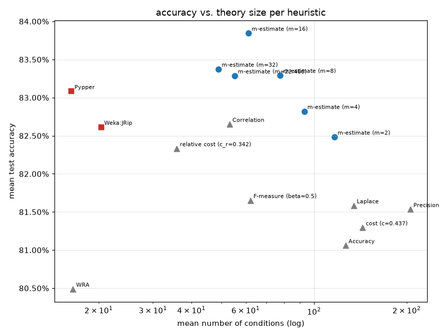
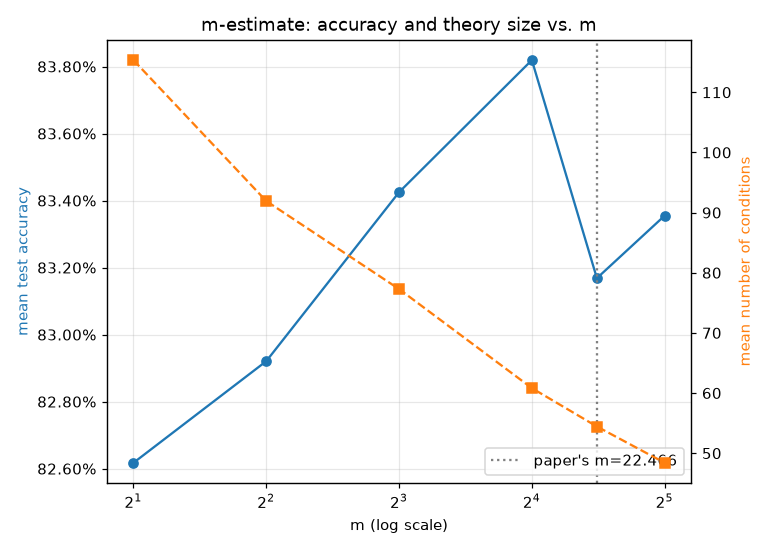

# Rule learning heuristics in separate-and-conquer (after Janssen & Fürnkranz)

## Setup

**Full run** (36 datasets, 10-fold). Quick sanity check instead: `python demos/heuristic_comparison.py` with no arguments.

Rule learning heuristics compared inside one plain separate-and-conquer
learner, after Janssen & Fürnkranz (Machine Learning, 2010). The learner
follows the paper's Algorithms 1 and 2: greedy top-down search that
refines until no refinement is left and returns the best rule
encountered (`BeamSearch(beam_width=1)`), no stopping criterion and no
pruning; covering stops once a new rule covers no more positives than
negatives; multi-class problems use ordered class binarization (least
frequent class first, the largest class as the default rule).

Heuristics: the paper's standard ones (Precision, Laplace, Accuracy,
WRA, Correlation), its tuned parametrized ones (cost c=0.437, relative
cost c_r=0.342, F-measure beta=0.5, m-estimate m=22.466), and an
m-estimate sweep over m in {2, 4, 8, 16, 32}.
Benchmarks: Weka's JRip and pyrulearn's Pypper, both with their own
pruning, and both also use ordered class binarization. What each
heuristic prefers is visualized by its coverage-space isometrics in the
companion demo, [heuristic_isometrics](heuristic_isometrics_report.md).

Datasets: 36 of the paper's datasets that are in
`pyrulearn.experiments.catalog` (20 binary,
16 multi-class). Numeric attributes are discretized per
training fold (`build_dataspec(max_intervals=8)`) instead
of the paper's tests at every midpoint. Each fit is capped at
600s; a timeout counts as a failure.

Measures: test accuracy, number of rules and conditions, fit time.

Every learner runs single-threaded; fits run 10 at a time (`run_cv`'s `n_jobs`), each in its own process and timed there, with the numerical libraries limited to one thread (`OMP_NUM_THREADS=1` and its relatives). A check of the `dense_vs_modular` learners on 11 datasets found the fit times of 5 concurrent fits as close to a sequential run as a second sequential run (per-learner ratios and rankings alike); time ratios between learners are reproducible to about +-10% either way.

## Summary by learner (mean across every dataset and fold)

| learner | accuracy | n_rules | n_conditions | conds/rule | fit_time (s) | wins | mean rank | failures |
|---|--:|--:|--:|--:|--:|--:|--:|--:|
| m-estimate (m=16) | 83.85% | 17.3 | 61.3 | 3.3 | 0.13 | 4.3 | 6.06 | 0 |
| m-estimate (m=32) | 83.37% | 13.1 | 49.0 | 3.6 | 0.12 | 2.3 | 6.81 | 0 |
| m-estimate (m=8) | 83.29% | 22.6 | 77.7 | 3.1 | 0.13 | 1.1 | 7.64 | 0 |
| m-estimate (m=22.466) | 83.29% | 15.1 | 55.3 | 3.4 | 0.13 | 1.3 | 7.07 | 0 |
| Pypper | 83.08% | 6.2 | 16.3 | 2.4 | 0.15 | 9.2 | 6.85 | 0 |
| m-estimate (m=4) | 82.82% | 28.6 | 93.0 | 2.9 | 0.13 | 1.4 | 8.03 | 0 |
| Correlation | 82.65% | 14.7 | 53.1 | 3.3 | 0.10 | 3.1 | 7.92 | 0 |
| Weka:JRip | 82.61% | 7.7 | 20.4 | 2.4 | 1.00 | 5.2 | 7.72 | 0 |
| m-estimate (m=2) | 82.48% | 36.1 | 116.5 | 2.8 | 0.14 | 1.4 | 8.54 | 0 |
| relative cost (c_r=0.342) | 82.33% | 9.6 | 35.8 | 3.4 | 0.10 | 1.0 | 8.68 | 0 |
| F-measure (beta=0.5) | 81.65% | 19.7 | 62.2 | 2.9 | 0.12 | 1.1 | 9.57 | 0 |
| Laplace | 81.58% | 43.9 | 134.6 | 2.7 | 0.15 | 0.4 | 10.28 | 0 |
| Precision | 81.53% | 68.0 | 205.5 | 2.7 | 0.21 | 1.1 | 10.49 | 0 |
| cost (c=0.437) | 81.29% | 44.6 | 143.9 | 2.6 | 0.16 | 1.1 | 10.22 | 0 |
| Accuracy | 81.06% | 39.2 | 126.5 | 2.6 | 0.15 | 0.1 | 10.61 | 0 |
| WRA | 80.49% | 4.7 | 16.5 | 3.3 | 0.08 | 2.0 | 9.53 | 0 |

`wins` -- datasets where a learner's mean accuracy was (tied-for-)best, a tie split evenly; `mean rank` -- average accuracy rank across datasets, failures tied for last.

## Per-dataset results, per learner (mean across folds)

| dataset | learner | accuracy | n_rules | n_conditions | fit_time |
|---|---|---|---|---|---|
| anneal | Accuracy | 94.99% | 17.3 | 32.2 | 0.085 |
| anneal | Correlation | 94.54% | 12.9 | 24.6 | 0.079 |
| anneal | F-measure (beta=0.5) | 97.21% | 17.5 | 37.0 | 0.107 |
| anneal | Laplace | 96.32% | 22.1 | 55.6 | 0.098 |
| anneal | Precision | 96.32% | 26.8 | 73.0 | 0.116 |
| anneal | Pypper | 94.10% | 9.9 | 23.5 | 0.239 |
| anneal | WRA | 91.53% | 6.5 | 16.6 | 0.071 |
| anneal | Weka:JRip | 89.53% | 7.8 | 13.6 | 1.008 |
| anneal | cost (c=0.437) | 94.43% | 17.7 | 32.2 | 0.083 |
| anneal | m-estimate (m=16) | 96.77% | 15.5 | 32.6 | 0.096 |
| anneal | m-estimate (m=2) | 96.99% | 21.8 | 50.9 | 0.113 |
| anneal | m-estimate (m=22.466) | 96.22% | 14.1 | 29.5 | 0.095 |
| anneal | m-estimate (m=32) | 95.32% | 13.1 | 23.3 | 0.084 |
| anneal | m-estimate (m=4) | 97.66% | 20.3 | 46.1 | 0.116 |
| anneal | m-estimate (m=8) | 96.66% | 18.1 | 37.7 | 0.100 |
| anneal | relative cost (c_r=0.342) | 93.32% | 8.9 | 20.4 | 0.073 |
| audiology | Accuracy | 80.99% | 40.4 | 85.1 | 0.216 |
| audiology | Correlation | 84.05% | 34.0 | 72.5 | 0.216 |
| audiology | F-measure (beta=0.5) | 77.49% | 42.3 | 85.5 | 0.188 |
| audiology | Laplace | 74.33% | 55.0 | 105.2 | 0.199 |
| audiology | Precision | 75.22% | 67.0 | 130.3 | 0.235 |
| audiology | Pypper | 75.28% | 10.5 | 16.0 | 0.259 |
| audiology | WRA | 82.77% | 23.2 | 59.1 | 0.242 |
| audiology | Weka:JRip | 74.84% | 14.7 | 26.2 | 0.736 |
| audiology | cost (c=0.437) | 79.17% | 44.0 | 93.3 | 0.203 |
| audiology | m-estimate (m=16) | 83.18% | 31.8 | 70.0 | 0.222 |
| audiology | m-estimate (m=2) | 77.94% | 44.6 | 88.2 | 0.191 |
| audiology | m-estimate (m=22.466) | 83.62% | 29.1 | 68.0 | 0.222 |
| audiology | m-estimate (m=32) | 84.98% | 27.7 | 63.9 | 0.246 |
| audiology | m-estimate (m=4) | 79.66% | 39.0 | 82.7 | 0.200 |
| audiology | m-estimate (m=8) | 80.55% | 34.9 | 75.4 | 0.194 |
| audiology | relative cost (c_r=0.342) | 82.75% | 24.3 | 62.1 | 0.253 |
| balance-scale | Accuracy | 75.82% | 67.6 | 246.0 | 0.148 |
| balance-scale | Correlation | 77.60% | 17.5 | 60.6 | 0.060 |
| balance-scale | F-measure (beta=0.5) | 77.11% | 19.1 | 61.4 | 0.067 |
| balance-scale | Laplace | 78.39% | 96.9 | 338.9 | 0.202 |
| balance-scale | Precision | 77.27% | 125.4 | 425.5 | 0.247 |
| balance-scale | Pypper | 76.29% | 6.8 | 21.8 | 0.119 |
| balance-scale | WRA | 72.95% | 3.8 | 10.7 | 0.023 |
| balance-scale | Weka:JRip | 76.31% | 7.4 | 23.8 | 0.528 |
| balance-scale | cost (c=0.437) | 77.59% | 76.5 | 277.7 | 0.157 |
| balance-scale | m-estimate (m=16) | 79.53% | 12.0 | 45.0 | 0.054 |
| balance-scale | m-estimate (m=2) | 73.59% | 88.7 | 370.8 | 0.216 |
| balance-scale | m-estimate (m=22.466) | 79.20% | 11.2 | 42.3 | 0.052 |
| balance-scale | m-estimate (m=32) | 79.98% | 9.8 | 35.2 | 0.048 |
| balance-scale | m-estimate (m=4) | 76.31% | 35.6 | 114.4 | 0.092 |
| balance-scale | m-estimate (m=8) | 77.91% | 24.0 | 82.7 | 0.081 |
| balance-scale | relative cost (c_r=0.342) | 75.82% | 7.0 | 20.9 | 0.034 |
| breast-cancer | Accuracy | 72.38% | 10.9 | 27.2 | 0.039 |
| breast-cancer | Correlation | 67.49% | 3.3 | 35.9 | 0.048 |
| breast-cancer | F-measure (beta=0.5) | 67.54% | 8.4 | 38.3 | 0.070 |
| breast-cancer | Laplace | 70.58% | 22.7 | 58.4 | 0.048 |
| breast-cancer | Precision | 68.84% | 36.3 | 95.1 | 0.077 |
| breast-cancer | Pypper | 74.84% | 1.0 | 2.0 | 0.025 |
| breast-cancer | WRA | 68.46% | 1.2 | 6.1 | 0.024 |
| breast-cancer | Weka:JRip | 71.37% | 1.3 | 2.5 | 0.489 |
| breast-cancer | cost (c=0.437) | 71.32% | 14.8 | 34.9 | 0.037 |
| breast-cancer | m-estimate (m=16) | 63.26% | 8.9 | 41.3 | 0.076 |
| breast-cancer | m-estimate (m=2) | 70.23% | 24.4 | 69.8 | 0.069 |
| breast-cancer | m-estimate (m=22.466) | 63.24% | 8.9 | 43.1 | 0.075 |
| breast-cancer | m-estimate (m=32) | 66.48% | 6.5 | 35.6 | 0.062 |
| breast-cancer | m-estimate (m=4) | 67.84% | 21.9 | 70.0 | 0.075 |
| breast-cancer | m-estimate (m=8) | 67.78% | 15.8 | 68.2 | 0.084 |
| breast-cancer | relative cost (c_r=0.342) | 66.79% | 10.7 | 38.7 | 0.060 |
| breast-w | Accuracy | 94.42% | 10.6 | 18.5 | 0.028 |
| breast-w | Correlation | 94.42% | 9.3 | 17.1 | 0.028 |
| breast-w | F-measure (beta=0.5) | 93.99% | 15.6 | 30.6 | 0.043 |
| breast-w | Laplace | 94.85% | 22.9 | 36.2 | 0.047 |
| breast-w | Precision | 94.57% | 42.9 | 69.2 | 0.087 |
| breast-w | Pypper | 93.99% | 4.2 | 12.0 | 0.093 |
| breast-w | WRA | 93.85% | 2.5 | 12.2 | 0.042 |
| breast-w | Weka:JRip | 94.84% | 5.1 | 12.9 | 0.957 |
| breast-w | cost (c=0.437) | 95.14% | 11.7 | 19.7 | 0.030 |
| breast-w | m-estimate (m=16) | 95.00% | 14.1 | 32.3 | 0.043 |
| breast-w | m-estimate (m=2) | 95.42% | 20.3 | 34.0 | 0.040 |
| breast-w | m-estimate (m=22.466) | 94.99% | 11.0 | 30.3 | 0.044 |
| breast-w | m-estimate (m=32) | 94.85% | 8.6 | 27.4 | 0.053 |
| breast-w | m-estimate (m=4) | 94.99% | 17.1 | 32.3 | 0.041 |
| breast-w | m-estimate (m=8) | 95.28% | 15.6 | 32.0 | 0.043 |
| breast-w | relative cost (c_r=0.342) | 93.56% | 3.2 | 19.7 | 0.032 |
| colic | Accuracy | 80.18% | 24.7 | 61.0 | 0.065 |
| colic | Correlation | 83.73% | 13.7 | 42.0 | 0.049 |
| colic | F-measure (beta=0.5) | 82.35% | 15.9 | 44.2 | 0.064 |
| colic | Laplace | 76.39% | 37.8 | 98.3 | 0.089 |
| colic | Precision | 76.91% | 61.7 | 158.2 | 0.138 |
| colic | Pypper | 85.08% | 1.8 | 4.0 | 0.051 |
| colic | WRA | 83.72% | 1.4 | 3.5 | 0.018 |
| colic | Weka:JRip | 84.50% | 3.4 | 8.4 | 0.821 |
| colic | cost (c=0.437) | 79.08% | 26.8 | 64.2 | 0.057 |
| colic | m-estimate (m=16) | 79.08% | 10.6 | 39.3 | 0.059 |
| colic | m-estimate (m=2) | 76.12% | 28.4 | 84.5 | 0.085 |
| colic | m-estimate (m=22.466) | 80.46% | 8.5 | 35.3 | 0.063 |
| colic | m-estimate (m=32) | 81.55% | 7.0 | 30.2 | 0.061 |
| colic | m-estimate (m=4) | 77.21% | 22.8 | 72.7 | 0.086 |
| colic | m-estimate (m=8) | 74.47% | 13.8 | 50.4 | 0.070 |
| colic | relative cost (c_r=0.342) | 83.18% | 5.4 | 21.4 | 0.042 |
| credit-approval | Accuracy | 82.32% | 17.7 | 44.3 | 0.057 |
| credit-approval | Correlation | 81.88% | 14.1 | 43.4 | 0.063 |
| credit-approval | F-measure (beta=0.5) | 81.74% | 22.8 | 82.4 | 0.132 |
| credit-approval | Laplace | 80.14% | 49.7 | 144.3 | 0.123 |
| credit-approval | Precision | 80.29% | 97.1 | 273.0 | 0.261 |
| credit-approval | Pypper | 83.91% | 3.8 | 11.0 | 0.109 |
| credit-approval | WRA | 83.62% | 1.0 | 3.4 | 0.025 |
| credit-approval | Weka:JRip | 84.78% | 4.2 | 10.1 | 0.881 |
| credit-approval | cost (c=0.437) | 83.04% | 21.2 | 54.1 | 0.068 |
| credit-approval | m-estimate (m=16) | 83.48% | 14.7 | 81.6 | 0.145 |
| credit-approval | m-estimate (m=2) | 82.46% | 41.8 | 131.5 | 0.141 |
| credit-approval | m-estimate (m=22.466) | 83.33% | 9.1 | 49.5 | 0.128 |
| credit-approval | m-estimate (m=32) | 83.62% | 7.6 | 39.5 | 0.108 |
| credit-approval | m-estimate (m=4) | 82.46% | 37.2 | 130.5 | 0.136 |
| credit-approval | m-estimate (m=8) | 81.59% | 24.8 | 101.0 | 0.167 |
| credit-approval | relative cost (c_r=0.342) | 85.36% | 2.4 | 9.8 | 0.048 |
| credit-g | Accuracy | 67.70% | 140.6 | 459.7 | 0.418 |
| credit-g | Correlation | 69.10% | 29.8 | 184.1 | 0.199 |
| credit-g | F-measure (beta=0.5) | 65.60% | 34.2 | 182.4 | 0.249 |
| credit-g | Laplace | 69.20% | 135.1 | 435.4 | 0.395 |
| credit-g | Precision | 69.40% | 193.0 | 619.1 | 0.556 |
| credit-g | Pypper | 72.00% | 2.5 | 8.9 | 0.111 |
| credit-g | WRA | 69.00% | 1.2 | 9.2 | 0.035 |
| credit-g | Weka:JRip | 71.80% | 3.9 | 15.9 | 1.113 |
| credit-g | cost (c=0.437) | 67.90% | 160.0 | 514.9 | 0.408 |
| credit-g | m-estimate (m=16) | 67.00% | 43.9 | 247.1 | 0.324 |
| credit-g | m-estimate (m=2) | 71.30% | 99.8 | 337.1 | 0.323 |
| credit-g | m-estimate (m=22.466) | 66.60% | 37.6 | 235.6 | 0.323 |
| credit-g | m-estimate (m=32) | 67.40% | 31.0 | 212.6 | 0.327 |
| credit-g | m-estimate (m=4) | 68.50% | 79.1 | 290.8 | 0.265 |
| credit-g | m-estimate (m=8) | 66.60% | 60.5 | 260.4 | 0.263 |
| credit-g | relative cost (c_r=0.342) | 68.30% | 18.3 | 120.2 | 0.198 |
| diabetes | Accuracy | 74.48% | 23.1 | 64.4 | 0.070 |
| diabetes | Correlation | 74.48% | 6.1 | 35.6 | 0.053 |
| diabetes | F-measure (beta=0.5) | 73.05% | 7.0 | 34.1 | 0.062 |
| diabetes | Laplace | 72.53% | 59.7 | 219.4 | 0.155 |
| diabetes | Precision | 72.14% | 101.7 | 375.0 | 0.257 |
| diabetes | Pypper | 75.52% | 3.5 | 11.9 | 0.107 |
| diabetes | WRA | 73.29% | 1.1 | 2.6 | 0.018 |
| diabetes | Weka:JRip | 72.53% | 3.9 | 12.4 | 0.695 |
| diabetes | cost (c=0.437) | 74.62% | 29.5 | 85.7 | 0.073 |
| diabetes | m-estimate (m=16) | 75.26% | 15.1 | 79.7 | 0.112 |
| diabetes | m-estimate (m=2) | 71.48% | 53.8 | 232.3 | 0.185 |
| diabetes | m-estimate (m=22.466) | 72.79% | 10.3 | 52.4 | 0.084 |
| diabetes | m-estimate (m=32) | 73.56% | 8.6 | 44.4 | 0.069 |
| diabetes | m-estimate (m=4) | 71.22% | 38.4 | 172.1 | 0.168 |
| diabetes | m-estimate (m=8) | 73.70% | 24.5 | 115.7 | 0.132 |
| diabetes | relative cost (c_r=0.342) | 73.84% | 6.7 | 23.4 | 0.046 |
| glass | Accuracy | 64.05% | 27.0 | 73.2 | 0.086 |
| glass | Correlation | 63.55% | 20.7 | 62.9 | 0.098 |
| glass | F-measure (beta=0.5) | 65.91% | 28.0 | 81.0 | 0.105 |
| glass | Laplace | 65.04% | 33.7 | 91.9 | 0.098 |
| glass | Precision | 66.97% | 50.0 | 139.7 | 0.126 |
| glass | Pypper | 68.33% | 6.1 | 14.3 | 0.094 |
| glass | WRA | 69.70% | 4.7 | 20.0 | 0.077 |
| glass | Weka:JRip | 66.84% | 6.6 | 16.1 | 0.529 |
| glass | cost (c=0.437) | 62.19% | 30.2 | 81.3 | 0.089 |
| glass | m-estimate (m=16) | 72.03% | 17.9 | 58.0 | 0.099 |
| glass | m-estimate (m=2) | 66.95% | 30.2 | 85.7 | 0.100 |
| glass | m-estimate (m=22.466) | 65.04% | 14.9 | 51.0 | 0.103 |
| glass | m-estimate (m=32) | 64.52% | 12.3 | 44.2 | 0.102 |
| glass | m-estimate (m=4) | 67.40% | 25.4 | 74.7 | 0.104 |
| glass | m-estimate (m=8) | 70.13% | 22.6 | 70.9 | 0.103 |
| glass | relative cost (c_r=0.342) | 68.27% | 13.6 | 47.3 | 0.096 |
| hayes-roth | Accuracy | 76.25% | 6.6 | 10.1 | 0.019 |
| hayes-roth | Correlation | 84.38% | 6.2 | 9.4 | 0.019 |
| hayes-roth | F-measure (beta=0.5) | 82.50% | 7.5 | 12.7 | 0.023 |
| hayes-roth | Laplace | 83.75% | 9.4 | 18.9 | 0.021 |
| hayes-roth | Precision | 83.75% | 11.8 | 24.8 | 0.023 |
| hayes-roth | Pypper | 84.38% | 6.1 | 9.6 | 0.066 |
| hayes-roth | WRA | 75.00% | 5.0 | 6.1 | 0.018 |
| hayes-roth | Weka:JRip | 83.12% | 5.8 | 8.5 | 0.485 |
| hayes-roth | cost (c=0.437) | 84.38% | 8.2 | 15.1 | 0.019 |
| hayes-roth | m-estimate (m=16) | 84.38% | 7.1 | 11.5 | 0.021 |
| hayes-roth | m-estimate (m=2) | 85.00% | 8.9 | 17.0 | 0.024 |
| hayes-roth | m-estimate (m=22.466) | 83.75% | 6.8 | 10.9 | 0.022 |
| hayes-roth | m-estimate (m=32) | 83.75% | 6.6 | 10.3 | 0.019 |
| hayes-roth | m-estimate (m=4) | 85.62% | 7.9 | 14.0 | 0.019 |
| hayes-roth | m-estimate (m=8) | 86.25% | 7.6 | 12.8 | 0.020 |
| hayes-roth | relative cost (c_r=0.342) | 84.38% | 6.8 | 10.6 | 0.018 |
| heart-c | Accuracy | 71.63% | 22.4 | 65.6 | 0.046 |
| heart-c | Correlation | 72.28% | 10.8 | 45.1 | 0.040 |
| heart-c | F-measure (beta=0.5) | 75.59% | 15.9 | 53.6 | 0.055 |
| heart-c | Laplace | 76.30% | 34.5 | 97.2 | 0.060 |
| heart-c | Precision | 74.96% | 59.5 | 154.2 | 0.097 |
| heart-c | Pypper | 81.55% | 3.0 | 7.6 | 0.052 |
| heart-c | WRA | 73.96% | 2.4 | 9.7 | 0.021 |
| heart-c | Weka:JRip | 79.24% | 3.6 | 8.6 | 0.490 |
| heart-c | cost (c=0.437) | 76.26% | 28.3 | 80.8 | 0.055 |
| heart-c | m-estimate (m=16) | 77.58% | 13.3 | 56.1 | 0.057 |
| heart-c | m-estimate (m=2) | 77.24% | 27.1 | 80.9 | 0.058 |
| heart-c | m-estimate (m=22.466) | 76.29% | 9.1 | 38.5 | 0.051 |
| heart-c | m-estimate (m=32) | 77.96% | 8.6 | 38.4 | 0.053 |
| heart-c | m-estimate (m=4) | 76.28% | 22.3 | 71.2 | 0.057 |
| heart-c | m-estimate (m=8) | 74.99% | 17.6 | 64.8 | 0.064 |
| heart-c | relative cost (c_r=0.342) | 73.94% | 7.6 | 26.3 | 0.040 |
| heart-h | Accuracy | 76.87% | 19.6 | 57.7 | 0.056 |
| heart-h | Correlation | 73.13% | 10.0 | 39.8 | 0.057 |
| heart-h | F-measure (beta=0.5) | 76.85% | 13.3 | 53.0 | 0.076 |
| heart-h | Laplace | 75.17% | 31.4 | 83.2 | 0.068 |
| heart-h | Precision | 75.83% | 46.7 | 119.2 | 0.099 |
| heart-h | Pypper | 78.60% | 1.9 | 3.6 | 0.045 |
| heart-h | WRA | 75.87% | 1.7 | 6.5 | 0.031 |
| heart-h | Weka:JRip | 79.56% | 2.0 | 3.3 | 0.567 |
| heart-h | cost (c=0.437) | 75.54% | 22.6 | 65.6 | 0.059 |
| heart-h | m-estimate (m=16) | 77.21% | 9.9 | 37.0 | 0.079 |
| heart-h | m-estimate (m=2) | 75.84% | 24.8 | 70.6 | 0.076 |
| heart-h | m-estimate (m=22.466) | 77.55% | 7.0 | 26.8 | 0.060 |
| heart-h | m-estimate (m=32) | 78.57% | 4.9 | 25.7 | 0.055 |
| heart-h | m-estimate (m=4) | 76.87% | 18.4 | 59.0 | 0.074 |
| heart-h | m-estimate (m=8) | 78.61% | 12.8 | 48.2 | 0.075 |
| heart-h | relative cost (c_r=0.342) | 77.91% | 4.7 | 16.9 | 0.039 |
| heart-statlog | Accuracy | 73.33% | 18.2 | 50.0 | 0.044 |
| heart-statlog | Correlation | 76.67% | 10.8 | 39.3 | 0.043 |
| heart-statlog | F-measure (beta=0.5) | 75.56% | 14.6 | 45.8 | 0.055 |
| heart-statlog | Laplace | 74.07% | 30.0 | 82.1 | 0.058 |
| heart-statlog | Precision | 72.22% | 54.2 | 139.2 | 0.099 |
| heart-statlog | Pypper | 78.52% | 2.4 | 6.1 | 0.048 |
| heart-statlog | WRA | 75.93% | 2.3 | 9.0 | 0.026 |
| heart-statlog | Weka:JRip | 78.89% | 4.3 | 10.4 | 0.525 |
| heart-statlog | cost (c=0.437) | 73.70% | 23.5 | 63.9 | 0.053 |
| heart-statlog | m-estimate (m=16) | 73.70% | 11.6 | 45.5 | 0.055 |
| heart-statlog | m-estimate (m=2) | 73.33% | 23.9 | 68.2 | 0.054 |
| heart-statlog | m-estimate (m=22.466) | 74.07% | 10.0 | 40.5 | 0.053 |
| heart-statlog | m-estimate (m=32) | 76.30% | 8.0 | 34.5 | 0.048 |
| heart-statlog | m-estimate (m=4) | 75.93% | 20.2 | 64.9 | 0.057 |
| heart-statlog | m-estimate (m=8) | 73.70% | 15.5 | 54.3 | 0.065 |
| heart-statlog | relative cost (c_r=0.342) | 76.30% | 8.3 | 30.0 | 0.045 |
| hepatitis | Accuracy | 75.75% | 11.7 | 28.7 | 0.023 |
| hepatitis | Correlation | 73.79% | 6.7 | 20.0 | 0.019 |
| hepatitis | F-measure (beta=0.5) | 73.21% | 8.5 | 22.9 | 0.024 |
| hepatitis | Laplace | 73.83% | 12.6 | 27.5 | 0.020 |
| hepatitis | Precision | 73.21% | 18.2 | 39.6 | 0.029 |
| hepatitis | Pypper | 79.42% | 1.7 | 3.4 | 0.019 |
| hepatitis | WRA | 76.75% | 1.2 | 4.9 | 0.009 |
| hepatitis | Weka:JRip | 78.75% | 2.1 | 4.0 | 0.441 |
| hepatitis | cost (c=0.437) | 75.75% | 11.9 | 27.0 | 0.022 |
| hepatitis | m-estimate (m=16) | 77.75% | 5.6 | 16.5 | 0.021 |
| hepatitis | m-estimate (m=2) | 77.58% | 9.8 | 24.5 | 0.019 |
| hepatitis | m-estimate (m=22.466) | 78.38% | 5.4 | 16.8 | 0.020 |
| hepatitis | m-estimate (m=32) | 78.25% | 4.4 | 13.9 | 0.017 |
| hepatitis | m-estimate (m=4) | 76.42% | 8.1 | 21.6 | 0.019 |
| hepatitis | m-estimate (m=8) | 78.33% | 6.2 | 17.7 | 0.022 |
| hepatitis | relative cost (c_r=0.342) | 78.33% | 3.6 | 11.8 | 0.014 |
| hypothyroid | Accuracy | 98.99% | 13.4 | 35.7 | 0.160 |
| hypothyroid | Correlation | 98.94% | 8.8 | 24.5 | 0.160 |
| hypothyroid | F-measure (beta=0.5) | 98.83% | 13.9 | 42.9 | 0.187 |
| hypothyroid | Laplace | 98.28% | 33.2 | 107.4 | 0.269 |
| hypothyroid | Precision | 98.25% | 82.7 | 267.9 | 0.481 |
| hypothyroid | Pypper | 99.28% | 3.3 | 8.9 | 0.220 |
| hypothyroid | WRA | 97.08% | 2.1 | 7.7 | 0.130 |
| hypothyroid | Weka:JRip | 99.20% | 3.4 | 8.9 | 2.013 |
| hypothyroid | cost (c=0.437) | 98.78% | 17.0 | 48.2 | 0.178 |
| hypothyroid | m-estimate (m=16) | 99.13% | 10.9 | 39.2 | 0.194 |
| hypothyroid | m-estimate (m=2) | 98.67% | 23.0 | 81.0 | 0.209 |
| hypothyroid | m-estimate (m=22.466) | 99.05% | 10.5 | 40.2 | 0.186 |
| hypothyroid | m-estimate (m=32) | 98.91% | 8.3 | 31.4 | 0.182 |
| hypothyroid | m-estimate (m=4) | 98.86% | 18.8 | 71.0 | 0.212 |
| hypothyroid | m-estimate (m=8) | 98.81% | 14.1 | 52.9 | 0.218 |
| hypothyroid | relative cost (c_r=0.342) | 99.20% | 3.8 | 12.5 | 0.147 |
| ionosphere | Accuracy | 86.33% | 14.1 | 24.4 | 0.041 |
| ionosphere | Correlation | 87.47% | 10.2 | 18.8 | 0.036 |
| ionosphere | F-measure (beta=0.5) | 90.90% | 13.0 | 24.0 | 0.057 |
| ionosphere | Laplace | 91.47% | 15.7 | 25.9 | 0.035 |
| ionosphere | Precision | 92.32% | 19.4 | 33.0 | 0.042 |
| ionosphere | Pypper | 89.47% | 3.8 | 6.0 | 0.057 |
| ionosphere | WRA | 89.17% | 2.0 | 2.3 | 0.061 |
| ionosphere | Weka:JRip | 86.88% | 5.8 | 10.0 | 1.090 |
| ionosphere | cost (c=0.437) | 88.90% | 14.6 | 25.4 | 0.036 |
| ionosphere | m-estimate (m=16) | 90.59% | 9.8 | 20.2 | 0.064 |
| ionosphere | m-estimate (m=2) | 92.02% | 14.5 | 24.3 | 0.037 |
| ionosphere | m-estimate (m=22.466) | 90.31% | 9.2 | 20.7 | 0.061 |
| ionosphere | m-estimate (m=32) | 89.17% | 7.6 | 24.6 | 0.082 |
| ionosphere | m-estimate (m=4) | 92.02% | 12.8 | 22.6 | 0.029 |
| ionosphere | m-estimate (m=8) | 92.30% | 11.2 | 20.9 | 0.028 |
| ionosphere | relative cost (c_r=0.342) | 87.18% | 4.6 | 11.8 | 0.087 |
| iris | Accuracy | 92.00% | 4.4 | 9.1 | 0.012 |
| iris | Correlation | 93.33% | 3.7 | 8.9 | 0.014 |
| iris | F-measure (beta=0.5) | 92.00% | 4.8 | 10.3 | 0.014 |
| iris | Laplace | 92.00% | 7.1 | 13.6 | 0.015 |
| iris | Precision | 92.00% | 10.9 | 18.8 | 0.020 |
| iris | Pypper | 93.33% | 2.0 | 2.8 | 0.022 |
| iris | WRA | 93.33% | 2.3 | 3.9 | 0.013 |
| iris | Weka:JRip | 95.33% | 2.5 | 3.9 | 0.447 |
| iris | cost (c=0.437) | 92.00% | 4.6 | 9.6 | 0.012 |
| iris | m-estimate (m=16) | 92.67% | 3.8 | 8.1 | 0.016 |
| iris | m-estimate (m=2) | 92.67% | 5.6 | 11.1 | 0.014 |
| iris | m-estimate (m=22.466) | 92.67% | 3.7 | 8.0 | 0.016 |
| iris | m-estimate (m=32) | 92.67% | 3.7 | 7.9 | 0.016 |
| iris | m-estimate (m=4) | 92.67% | 5.1 | 11.1 | 0.013 |
| iris | m-estimate (m=8) | 92.00% | 3.8 | 7.7 | 0.017 |
| iris | relative cost (c_r=0.342) | 92.67% | 3.7 | 8.0 | 0.015 |
| kr-vs-kp | Accuracy | 96.93% | 41.2 | 192.3 | 0.210 |
| kr-vs-kp | Correlation | 98.25% | 9.7 | 27.0 | 0.062 |
| kr-vs-kp | F-measure (beta=0.5) | 98.12% | 13.4 | 43.7 | 0.089 |
| kr-vs-kp | Laplace | 99.28% | 40.7 | 139.6 | 0.164 |
| kr-vs-kp | Precision | 99.22% | 67.8 | 224.9 | 0.273 |
| kr-vs-kp | Pypper | 99.09% | 13.6 | 44.0 | 0.453 |
| kr-vs-kp | WRA | 94.34% | 3.0 | 8.1 | 0.045 |
| kr-vs-kp | Weka:JRip | 99.31% | 14.6 | 46.2 | 1.445 |
| kr-vs-kp | cost (c=0.437) | 96.75% | 51.1 | 235.4 | 0.250 |
| kr-vs-kp | m-estimate (m=16) | 99.50% | 21.5 | 67.3 | 0.124 |
| kr-vs-kp | m-estimate (m=2) | 99.28% | 32.1 | 108.5 | 0.131 |
| kr-vs-kp | m-estimate (m=22.466) | 99.44% | 20.0 | 64.6 | 0.122 |
| kr-vs-kp | m-estimate (m=32) | 99.47% | 17.6 | 67.6 | 0.112 |
| kr-vs-kp | m-estimate (m=4) | 99.31% | 29.5 | 98.8 | 0.127 |
| kr-vs-kp | m-estimate (m=8) | 99.34% | 26.7 | 95.9 | 0.125 |
| kr-vs-kp | relative cost (c_r=0.342) | 95.21% | 6.0 | 20.0 | 0.052 |
| lymph | Accuracy | 80.24% | 12.7 | 27.1 | 0.036 |
| lymph | Correlation | 86.52% | 8.5 | 21.3 | 0.032 |
| lymph | F-measure (beta=0.5) | 84.52% | 11.1 | 26.2 | 0.031 |
| lymph | Laplace | 75.00% | 20.1 | 42.4 | 0.042 |
| lymph | Precision | 77.81% | 29.3 | 62.4 | 0.059 |
| lymph | Pypper | 73.62% | 2.7 | 5.8 | 0.046 |
| lymph | WRA | 84.38% | 5.2 | 17.6 | 0.041 |
| lymph | Weka:JRip | 82.48% | 4.1 | 8.2 | 0.517 |
| lymph | cost (c=0.437) | 83.67% | 14.9 | 34.4 | 0.037 |
| lymph | m-estimate (m=16) | 84.57% | 8.9 | 22.7 | 0.034 |
| lymph | m-estimate (m=2) | 78.33% | 16.2 | 33.4 | 0.037 |
| lymph | m-estimate (m=22.466) | 83.24% | 8.3 | 21.5 | 0.041 |
| lymph | m-estimate (m=32) | 83.86% | 7.5 | 20.3 | 0.038 |
| lymph | m-estimate (m=4) | 78.52% | 13.8 | 30.6 | 0.037 |
| lymph | m-estimate (m=8) | 78.43% | 9.9 | 24.4 | 0.031 |
| lymph | relative cost (c_r=0.342) | 85.10% | 6.7 | 18.3 | 0.034 |
| molecular-biology_promoters | Accuracy | 83.36% | 4.1 | 9.7 | 0.012 |
| molecular-biology_promoters | Correlation | 81.27% | 3.2 | 9.7 | 0.013 |
| molecular-biology_promoters | F-measure (beta=0.5) | 78.64% | 5.4 | 12.0 | 0.015 |
| molecular-biology_promoters | Laplace | 73.45% | 6.7 | 13.0 | 0.015 |
| molecular-biology_promoters | Precision | 77.36% | 13.9 | 27.5 | 0.032 |
| molecular-biology_promoters | Pypper | 83.18% | 2.1 | 3.8 | 0.027 |
| molecular-biology_promoters | WRA | 80.45% | 2.3 | 9.0 | 0.013 |
| molecular-biology_promoters | Weka:JRip | 77.45% | 2.5 | 5.4 | 0.713 |
| molecular-biology_promoters | cost (c=0.437) | 78.36% | 5.2 | 12.3 | 0.014 |
| molecular-biology_promoters | m-estimate (m=16) | 85.00% | 4.1 | 10.4 | 0.014 |
| molecular-biology_promoters | m-estimate (m=2) | 72.64% | 6.2 | 12.3 | 0.016 |
| molecular-biology_promoters | m-estimate (m=22.466) | 82.27% | 3.7 | 10.6 | 0.014 |
| molecular-biology_promoters | m-estimate (m=32) | 84.09% | 3.6 | 10.6 | 0.013 |
| molecular-biology_promoters | m-estimate (m=4) | 83.09% | 5.3 | 11.5 | 0.015 |
| molecular-biology_promoters | m-estimate (m=8) | 79.27% | 4.6 | 10.7 | 0.015 |
| molecular-biology_promoters | relative cost (c_r=0.342) | 80.18% | 3.0 | 9.5 | 0.014 |
| monks-problems-1 | Accuracy | 80.45% | 1.6 | 2.2 | 0.004 |
| monks-problems-1 | Correlation | 77.00% | 1.4 | 1.8 | 0.005 |
| monks-problems-1 | F-measure (beta=0.5) | 80.78% | 2.4 | 5.3 | 0.008 |
| monks-problems-1 | Laplace | 100.00% | 10.6 | 33.0 | 0.022 |
| monks-problems-1 | Precision | 99.82% | 17.3 | 53.3 | 0.036 |
| monks-problems-1 | Pypper | 95.30% | 3.6 | 10.2 | 0.053 |
| monks-problems-1 | WRA | 77.00% | 1.4 | 1.8 | 0.005 |
| monks-problems-1 | Weka:JRip | 93.04% | 3.7 | 10.4 | 0.414 |
| monks-problems-1 | cost (c=0.437) | 84.60% | 3.3 | 7.8 | 0.007 |
| monks-problems-1 | m-estimate (m=16) | 92.79% | 6.9 | 22.0 | 0.018 |
| monks-problems-1 | m-estimate (m=2) | 100.00% | 11.2 | 36.6 | 0.027 |
| monks-problems-1 | m-estimate (m=22.466) | 92.48% | 5.4 | 19.0 | 0.017 |
| monks-problems-1 | m-estimate (m=32) | 88.17% | 3.8 | 11.6 | 0.013 |
| monks-problems-1 | m-estimate (m=4) | 100.00% | 11.0 | 36.0 | 0.028 |
| monks-problems-1 | m-estimate (m=8) | 98.75% | 10.2 | 34.4 | 0.025 |
| monks-problems-1 | relative cost (c_r=0.342) | 88.87% | 5.0 | 14.8 | 0.014 |
| monks-problems-2 | Accuracy | 65.89% | 90.3 | 513.5 | 0.272 |
| monks-problems-2 | Correlation | 87.19% | 8.5 | 54.8 | 0.039 |
| monks-problems-2 | F-measure (beta=0.5) | 67.24% | 0.9 | 3.9 | 0.009 |
| monks-problems-2 | Laplace | 67.23% | 84.6 | 491.3 | 0.250 |
| monks-problems-2 | Precision | 63.07% | 127.3 | 741.5 | 0.373 |
| monks-problems-2 | Pypper | 70.39% | 2.3 | 13.3 | 0.071 |
| monks-problems-2 | WRA | 65.74% | 0.9 | 3.6 | 0.008 |
| monks-problems-2 | Weka:JRip | 80.57% | 7.6 | 44.6 | 0.510 |
| monks-problems-2 | cost (c=0.437) | 68.39% | 105.2 | 615.8 | 0.302 |
| monks-problems-2 | m-estimate (m=16) | 82.87% | 14.3 | 84.9 | 0.058 |
| monks-problems-2 | m-estimate (m=2) | 74.22% | 58.6 | 357.5 | 0.191 |
| monks-problems-2 | m-estimate (m=22.466) | 77.05% | 11.8 | 69.8 | 0.051 |
| monks-problems-2 | m-estimate (m=32) | 80.37% | 9.3 | 55.6 | 0.040 |
| monks-problems-2 | m-estimate (m=4) | 74.88% | 34.6 | 207.4 | 0.126 |
| monks-problems-2 | m-estimate (m=8) | 81.21% | 21.8 | 132.1 | 0.080 |
| monks-problems-2 | relative cost (c_r=0.342) | 64.58% | 18.0 | 97.1 | 0.067 |
| monks-problems-3 | Accuracy | 95.86% | 2.3 | 3.6 | 0.009 |
| monks-problems-3 | Correlation | 95.68% | 2.4 | 5.4 | 0.011 |
| monks-problems-3 | F-measure (beta=0.5) | 96.40% | 2.8 | 5.7 | 0.011 |
| monks-problems-3 | Laplace | 95.67% | 6.5 | 13.9 | 0.016 |
| monks-problems-3 | Precision | 97.10% | 9.3 | 18.9 | 0.020 |
| monks-problems-3 | Pypper | 98.92% | 3.0 | 5.0 | 0.035 |
| monks-problems-3 | WRA | 96.40% | 2.0 | 2.0 | 0.008 |
| monks-problems-3 | Weka:JRip | 98.92% | 3.0 | 5.0 | 0.464 |
| monks-problems-3 | cost (c=0.437) | 96.04% | 2.2 | 3.2 | 0.008 |
| monks-problems-3 | m-estimate (m=16) | 98.92% | 3.0 | 5.0 | 0.011 |
| monks-problems-3 | m-estimate (m=2) | 97.48% | 5.9 | 13.3 | 0.017 |
| monks-problems-3 | m-estimate (m=22.466) | 98.92% | 3.0 | 5.0 | 0.010 |
| monks-problems-3 | m-estimate (m=32) | 98.92% | 3.0 | 5.0 | 0.010 |
| monks-problems-3 | m-estimate (m=4) | 98.38% | 4.5 | 9.3 | 0.014 |
| monks-problems-3 | m-estimate (m=8) | 98.56% | 3.2 | 6.0 | 0.011 |
| monks-problems-3 | relative cost (c_r=0.342) | 96.40% | 2.0 | 2.0 | 0.008 |
| mushroom | Accuracy | 100.00% | 7.8 | 13.6 | 0.116 |
| mushroom | Correlation | 100.00% | 6.9 | 10.9 | 0.111 |
| mushroom | F-measure (beta=0.5) | 100.00% | 10.9 | 12.9 | 0.161 |
| mushroom | Laplace | 100.00% | 10.9 | 12.9 | 0.161 |
| mushroom | Precision | 100.00% | 15.0 | 18.0 | 0.177 |
| mushroom | Pypper | 99.96% | 5.2 | 10.6 | 0.319 |
| mushroom | WRA | 99.96% | 3.0 | 11.1 | 0.096 |
| mushroom | Weka:JRip | 99.98% | 6.0 | 10.1 | 6.415 |
| mushroom | cost (c=0.437) | 100.00% | 7.8 | 13.6 | 0.114 |
| mushroom | m-estimate (m=16) | 100.00% | 10.9 | 12.9 | 0.138 |
| mushroom | m-estimate (m=2) | 100.00% | 10.9 | 12.9 | 0.151 |
| mushroom | m-estimate (m=22.466) | 100.00% | 10.9 | 12.9 | 0.141 |
| mushroom | m-estimate (m=32) | 100.00% | 10.9 | 12.9 | 0.144 |
| mushroom | m-estimate (m=4) | 100.00% | 10.9 | 12.9 | 0.151 |
| mushroom | m-estimate (m=8) | 100.00% | 10.9 | 12.9 | 0.159 |
| mushroom | relative cost (c_r=0.342) | 99.89% | 4.0 | 12.1 | 0.124 |
| primary-tumor | Accuracy | 33.90% | 73.3 | 264.2 | 0.335 |
| primary-tumor | Correlation | 40.41% | 59.7 | 295.7 | 0.334 |
| primary-tumor | F-measure (beta=0.5) | 39.53% | 67.9 | 279.9 | 0.349 |
| primary-tumor | Laplace | 34.81% | 89.3 | 351.5 | 0.351 |
| primary-tumor | Precision | 35.98% | 117.2 | 455.9 | 0.404 |
| primary-tumor | Pypper | 39.25% | 7.3 | 20.5 | 0.211 |
| primary-tumor | WRA | 41.91% | 9.9 | 40.2 | 0.168 |
| primary-tumor | Weka:JRip | 36.00% | 6.4 | 21.9 | 0.574 |
| primary-tumor | cost (c=0.437) | 32.74% | 76.2 | 273.3 | 0.291 |
| primary-tumor | m-estimate (m=16) | 41.90% | 39.5 | 179.3 | 0.292 |
| primary-tumor | m-estimate (m=2) | 38.05% | 77.8 | 323.1 | 0.365 |
| primary-tumor | m-estimate (m=22.466) | 43.97% | 34.6 | 151.8 | 0.287 |
| primary-tumor | m-estimate (m=32) | 41.31% | 28.3 | 127.0 | 0.241 |
| primary-tumor | m-estimate (m=4) | 36.58% | 62.8 | 269.5 | 0.352 |
| primary-tumor | m-estimate (m=8) | 41.02% | 49.1 | 215.5 | 0.330 |
| primary-tumor | relative cost (c_r=0.342) | 43.09% | 20.3 | 84.8 | 0.218 |
| segment | Accuracy | 90.30% | 164.4 | 560.4 | 0.956 |
| segment | Correlation | 95.32% | 26.5 | 104.9 | 0.518 |
| segment | F-measure (beta=0.5) | 93.98% | 39.6 | 144.8 | 0.679 |
| segment | Laplace | 93.81% | 90.9 | 298.9 | 0.732 |
| segment | Precision | 93.16% | 170.1 | 536.4 | 1.021 |
| segment | Pypper | 94.72% | 14.5 | 45.6 | 0.643 |
| segment | WRA | 90.69% | 7.8 | 29.8 | 0.395 |
| segment | Weka:JRip | 94.98% | 20.2 | 58.8 | 3.062 |
| segment | cost (c=0.437) | 90.35% | 173.5 | 588.3 | 1.009 |
| segment | m-estimate (m=16) | 93.85% | 38.7 | 138.5 | 0.628 |
| segment | m-estimate (m=2) | 94.20% | 70.5 | 234.4 | 0.595 |
| segment | m-estimate (m=22.466) | 94.29% | 35.9 | 133.0 | 0.550 |
| segment | m-estimate (m=32) | 94.03% | 31.5 | 114.4 | 0.575 |
| segment | m-estimate (m=4) | 93.94% | 57.9 | 203.4 | 0.582 |
| segment | m-estimate (m=8) | 93.72% | 49.4 | 181.8 | 0.544 |
| segment | relative cost (c_r=0.342) | 91.65% | 17.9 | 63.7 | 0.530 |
| solar-flare | Accuracy | 74.20% | 20.2 | 47.9 | 0.099 |
| solar-flare | Correlation | 74.49% | 5.2 | 13.8 | 0.102 |
| solar-flare | F-measure (beta=0.5) | 71.58% | 12.0 | 48.9 | 0.151 |
| solar-flare | Laplace | 74.39% | 43.4 | 136.4 | 0.180 |
| solar-flare | Precision | 74.48% | 67.9 | 215.4 | 0.231 |
| solar-flare | Pypper | 74.77% | 4.9 | 8.3 | 0.153 |
| solar-flare | WRA | 73.46% | 3.0 | 4.2 | 0.077 |
| solar-flare | Weka:JRip | 71.21% | 6.5 | 16.9 | 0.831 |
| solar-flare | cost (c=0.437) | 73.83% | 20.7 | 48.7 | 0.092 |
| solar-flare | m-estimate (m=16) | 73.17% | 10.9 | 38.4 | 0.146 |
| solar-flare | m-estimate (m=2) | 73.45% | 38.3 | 141.3 | 0.231 |
| solar-flare | m-estimate (m=22.466) | 73.27% | 9.4 | 34.5 | 0.133 |
| solar-flare | m-estimate (m=32) | 73.64% | 7.3 | 29.8 | 0.117 |
| solar-flare | m-estimate (m=4) | 72.70% | 28.0 | 112.9 | 0.214 |
| solar-flare | m-estimate (m=8) | 73.17% | 19.9 | 70.8 | 0.180 |
| solar-flare | relative cost (c_r=0.342) | 72.99% | 3.0 | 5.8 | 0.077 |
| sonar | Accuracy | 72.62% | 14.8 | 31.4 | 0.078 |
| sonar | Correlation | 72.64% | 8.3 | 22.6 | 0.067 |
| sonar | F-measure (beta=0.5) | 74.05% | 11.8 | 26.7 | 0.061 |
| sonar | Laplace | 64.93% | 25.3 | 42.7 | 0.072 |
| sonar | Precision | 61.02% | 49.4 | 87.3 | 0.141 |
| sonar | Pypper | 77.43% | 2.8 | 5.6 | 0.058 |
| sonar | WRA | 75.57% | 3.5 | 24.7 | 0.122 |
| sonar | Weka:JRip | 72.60% | 4.7 | 10.1 | 1.266 |
| sonar | cost (c=0.437) | 66.33% | 18.5 | 36.3 | 0.076 |
| sonar | m-estimate (m=16) | 74.50% | 8.6 | 22.6 | 0.039 |
| sonar | m-estimate (m=2) | 67.81% | 19.5 | 33.6 | 0.061 |
| sonar | m-estimate (m=22.466) | 73.00% | 7.8 | 21.7 | 0.040 |
| sonar | m-estimate (m=32) | 68.79% | 6.3 | 20.9 | 0.052 |
| sonar | m-estimate (m=4) | 65.31% | 14.0 | 26.4 | 0.052 |
| sonar | m-estimate (m=8) | 75.00% | 11.4 | 24.5 | 0.048 |
| sonar | relative cost (c_r=0.342) | 74.57% | 5.8 | 29.5 | 0.069 |
| soybean | Accuracy | 90.05% | 55.0 | 124.3 | 0.344 |
| soybean | Correlation | 93.13% | 33.4 | 73.4 | 0.283 |
| soybean | F-measure (beta=0.5) | 91.38% | 46.6 | 101.3 | 0.331 |
| soybean | Laplace | 89.76% | 62.6 | 142.5 | 0.347 |
| soybean | Precision | 88.45% | 96.4 | 213.7 | 0.409 |
| soybean | Pypper | 90.93% | 23.9 | 45.9 | 0.433 |
| soybean | WRA | 93.86% | 20.5 | 52.7 | 0.288 |
| soybean | Weka:JRip | 77.77% | 25.5 | 46.0 | 0.985 |
| soybean | cost (c=0.437) | 89.77% | 60.1 | 139.1 | 0.348 |
| soybean | m-estimate (m=16) | 92.99% | 37.5 | 81.3 | 0.315 |
| soybean | m-estimate (m=2) | 90.78% | 52.7 | 119.7 | 0.314 |
| soybean | m-estimate (m=22.466) | 92.84% | 34.9 | 73.9 | 0.311 |
| soybean | m-estimate (m=32) | 92.11% | 32.9 | 71.4 | 0.317 |
| soybean | m-estimate (m=4) | 91.96% | 47.8 | 108.7 | 0.316 |
| soybean | m-estimate (m=8) | 90.93% | 42.7 | 95.6 | 0.326 |
| soybean | relative cost (c_r=0.342) | 93.27% | 26.4 | 64.7 | 0.317 |
| tic-tac-toe | Accuracy | 87.48% | 76.8 | 320.9 | 0.216 |
| tic-tac-toe | Correlation | 88.85% | 12.8 | 62.7 | 0.049 |
| tic-tac-toe | F-measure (beta=0.5) | 82.46% | 10.8 | 38.6 | 0.035 |
| tic-tac-toe | Laplace | 96.97% | 20.9 | 78.0 | 0.060 |
| tic-tac-toe | Precision | 97.39% | 25.5 | 95.3 | 0.071 |
| tic-tac-toe | Pypper | 96.25% | 7.5 | 23.1 | 0.136 |
| tic-tac-toe | WRA | 69.00% | 1.5 | 3.0 | 0.011 |
| tic-tac-toe | Weka:JRip | 98.12% | 8.4 | 26.6 | 0.738 |
| tic-tac-toe | cost (c=0.437) | 86.02% | 94.6 | 393.4 | 0.265 |
| tic-tac-toe | m-estimate (m=16) | 97.29% | 11.4 | 40.5 | 0.042 |
| tic-tac-toe | m-estimate (m=2) | 96.45% | 15.6 | 60.7 | 0.050 |
| tic-tac-toe | m-estimate (m=22.466) | 97.60% | 10.2 | 34.8 | 0.037 |
| tic-tac-toe | m-estimate (m=32) | 97.50% | 9.9 | 33.0 | 0.039 |
| tic-tac-toe | m-estimate (m=4) | 96.97% | 15.0 | 59.2 | 0.046 |
| tic-tac-toe | m-estimate (m=8) | 96.66% | 13.5 | 49.5 | 0.047 |
| tic-tac-toe | relative cost (c_r=0.342) | 92.48% | 8.1 | 25.2 | 0.028 |
| vehicle | Accuracy | 66.79% | 157.3 | 499.2 | 0.590 |
| vehicle | Correlation | 70.45% | 26.3 | 125.6 | 0.333 |
| vehicle | F-measure (beta=0.5) | 70.58% | 43.2 | 168.5 | 0.459 |
| vehicle | Laplace | 70.71% | 137.0 | 411.8 | 0.408 |
| vehicle | Precision | 72.36% | 219.6 | 633.1 | 0.586 |
| vehicle | Pypper | 68.21% | 11.8 | 32.9 | 0.307 |
| vehicle | WRA | 60.04% | 5.4 | 31.5 | 0.210 |
| vehicle | Weka:JRip | 68.45% | 13.9 | 38.4 | 1.382 |
| vehicle | cost (c=0.437) | 66.90% | 179.2 | 556.1 | 0.571 |
| vehicle | m-estimate (m=16) | 72.46% | 37.8 | 169.0 | 0.592 |
| vehicle | m-estimate (m=2) | 71.53% | 102.2 | 325.9 | 0.367 |
| vehicle | m-estimate (m=22.466) | 69.87% | 31.3 | 174.1 | 0.580 |
| vehicle | m-estimate (m=32) | 69.51% | 24.6 | 137.7 | 0.499 |
| vehicle | m-estimate (m=4) | 71.52% | 81.2 | 278.1 | 0.421 |
| vehicle | m-estimate (m=8) | 70.35% | 60.1 | 272.6 | 0.604 |
| vehicle | relative cost (c_r=0.342) | 70.70% | 16.8 | 93.5 | 0.411 |
| vote | Accuracy | 94.50% | 3.7 | 10.7 | 0.011 |
| vote | Correlation | 93.81% | 3.4 | 10.2 | 0.012 |
| vote | F-measure (beta=0.5) | 94.71% | 4.6 | 13.8 | 0.020 |
| vote | Laplace | 94.02% | 10.4 | 38.5 | 0.030 |
| vote | Precision | 94.25% | 17.6 | 63.0 | 0.047 |
| vote | Pypper | 95.18% | 1.7 | 3.3 | 0.038 |
| vote | WRA | 94.04% | 2.7 | 8.5 | 0.011 |
| vote | Weka:JRip | 95.42% | 3.1 | 7.6 | 0.440 |
| vote | cost (c=0.437) | 94.50% | 3.7 | 10.7 | 0.011 |
| vote | m-estimate (m=16) | 93.57% | 5.6 | 18.3 | 0.019 |
| vote | m-estimate (m=2) | 94.03% | 8.5 | 31.1 | 0.029 |
| vote | m-estimate (m=22.466) | 94.95% | 4.9 | 16.3 | 0.017 |
| vote | m-estimate (m=32) | 94.73% | 4.9 | 16.0 | 0.018 |
| vote | m-estimate (m=4) | 93.80% | 6.5 | 24.6 | 0.025 |
| vote | m-estimate (m=8) | 94.03% | 5.1 | 17.4 | 0.020 |
| vote | relative cost (c_r=0.342) | 93.81% | 2.9 | 9.2 | 0.012 |
| vowel | Accuracy | 80.10% | 181.8 | 508.3 | 0.548 |
| vowel | Correlation | 81.62% | 72.0 | 262.7 | 0.407 |
| vowel | F-measure (beta=0.5) | 82.32% | 108.7 | 333.8 | 0.464 |
| vowel | Laplace | 80.10% | 195.3 | 528.2 | 0.591 |
| vowel | Precision | 79.09% | 277.4 | 749.7 | 0.712 |
| vowel | Pypper | 69.70% | 33.1 | 123.4 | 0.753 |
| vowel | WRA | 62.12% | 23.3 | 132.3 | 0.377 |
| vowel | Weka:JRip | 76.06% | 49.4 | 162.8 | 1.594 |
| vowel | cost (c=0.437) | 79.90% | 212.7 | 585.4 | 0.587 |
| vowel | m-estimate (m=16) | 80.10% | 93.0 | 303.9 | 0.464 |
| vowel | m-estimate (m=2) | 81.11% | 165.4 | 458.1 | 0.523 |
| vowel | m-estimate (m=22.466) | 81.21% | 82.7 | 282.3 | 0.467 |
| vowel | m-estimate (m=32) | 79.80% | 72.4 | 261.8 | 0.458 |
| vowel | m-estimate (m=4) | 82.02% | 142.5 | 406.2 | 0.465 |
| vowel | m-estimate (m=8) | 81.11% | 117.3 | 350.5 | 0.444 |
| vowel | relative cost (c_r=0.342) | 72.12% | 45.9 | 202.9 | 0.439 |
| wine | Accuracy | 95.00% | 4.2 | 8.4 | 0.017 |
| wine | Correlation | 94.97% | 4.3 | 8.6 | 0.017 |
| wine | F-measure (beta=0.5) | 92.75% | 5.7 | 10.2 | 0.019 |
| wine | Laplace | 92.19% | 6.7 | 11.3 | 0.018 |
| wine | Precision | 92.19% | 11.1 | 19.1 | 0.026 |
| wine | Pypper | 92.09% | 2.7 | 4.1 | 0.035 |
| wine | WRA | 96.63% | 3.5 | 7.3 | 0.016 |
| wine | Weka:JRip | 94.41% | 2.7 | 5.1 | 0.554 |
| wine | cost (c=0.437) | 96.67% | 4.8 | 9.4 | 0.016 |
| wine | m-estimate (m=16) | 94.38% | 5.7 | 10.0 | 0.018 |
| wine | m-estimate (m=2) | 92.19% | 6.4 | 11.0 | 0.020 |
| wine | m-estimate (m=22.466) | 94.38% | 5.1 | 9.3 | 0.016 |
| wine | m-estimate (m=32) | 94.38% | 4.9 | 9.0 | 0.017 |
| wine | m-estimate (m=4) | 91.63% | 6.2 | 10.7 | 0.019 |
| wine | m-estimate (m=8) | 94.38% | 5.9 | 10.3 | 0.019 |
| wine | relative cost (c_r=0.342) | 94.97% | 4.0 | 8.2 | 0.018 |
| zoo | Accuracy | 92.00% | 9.8 | 22.8 | 0.025 |
| zoo | Correlation | 93.00% | 7.7 | 16.7 | 0.023 |
| zoo | F-measure (beta=0.5) | 93.00% | 8.8 | 19.5 | 0.027 |
| zoo | Laplace | 92.00% | 9.4 | 21.1 | 0.026 |
| zoo | Precision | 92.00% | 12.4 | 27.9 | 0.029 |
| zoo | Pypper | 88.09% | 5.4 | 8.0 | 0.055 |
| zoo | WRA | 96.00% | 6.2 | 13.2 | 0.023 |
| zoo | Weka:JRip | 89.00% | 5.8 | 9.2 | 0.455 |
| zoo | cost (c=0.437) | 92.00% | 9.8 | 22.8 | 0.024 |
| zoo | m-estimate (m=16) | 93.00% | 8.2 | 18.4 | 0.025 |
| zoo | m-estimate (m=2) | 93.00% | 8.7 | 19.4 | 0.027 |
| zoo | m-estimate (m=22.466) | 92.00% | 7.7 | 16.7 | 0.024 |
| zoo | m-estimate (m=32) | 93.00% | 7.5 | 16.2 | 0.023 |
| zoo | m-estimate (m=4) | 93.00% | 8.5 | 19.2 | 0.025 |
| zoo | m-estimate (m=8) | 93.00% | 8.3 | 18.6 | 0.025 |
| zoo | relative cost (c_r=0.342) | 93.00% | 7.9 | 17.3 | 0.025 |

