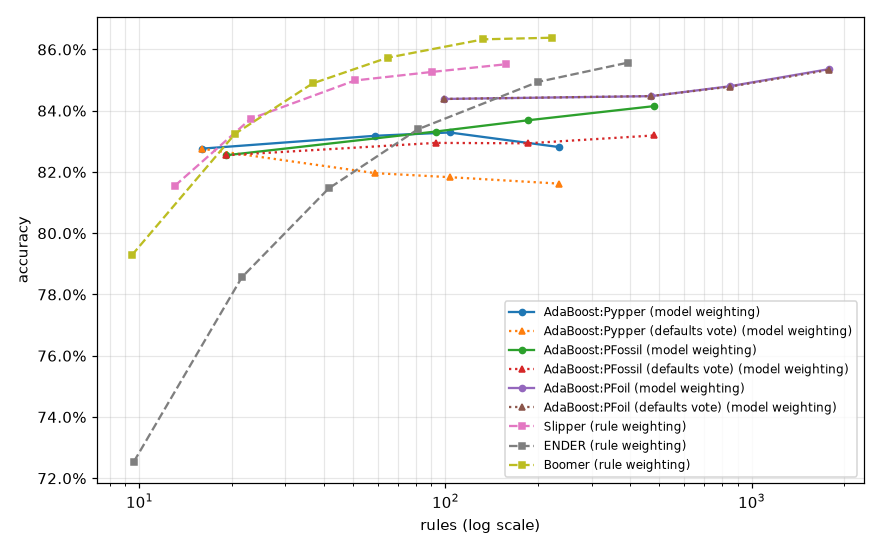

# Weighting models against weighting rules

## Setup

**Full run.** Quick sanity check instead: `python demos/model_vs_rule_weighting.py`.

Two strategies for a weighted ensemble of rules:

- **model weighting** -- AdaBoost (SAMME) over concept sets learned
  one-vs-rest by Pypper, PFossil or PFoil: every member is a whole rule set,
  learned from the examples reweighted by its predecessors' errors, and the
  members vote with weights. This works with any learner. Every fit is
  scored with two votes. **AdaBoost:...**: as in
  `demos/base_vs_composite.py`, the concept sets vote without their defaults:
  a member whose rules don't cover an example abstains, and examples no
  member covers go to the majority class. **AdaBoost:... (defaults vote)**: such a
  member votes for its default class, with its full weight. The members are
  the same; a member's training error counts its default in both.
- **rule weighting** -- Slipper, ENDER and Boomer: every round adds one rule
  with a weight, and the weights of the covering rules are summed. This is
  unique to rule learning, as a rule abstains where it doesn't cover an
  example.

Slipper reweights the examples as AdaBoost does, but after every rule;
ENDER (logistic loss) and Boomer (logistic loss, Newton steps) fit every
rule's weight to the gradient of the loss. The two strategies don't learn
the same rules, so they are compared by accuracy against the number of
rules.

Each learner is fit once per fold at its largest size and scored after each
number of rounds (its first rounds are the model a fit with fewer rounds
builds): AdaBoost:Pypper: 1, 5, 10, 25; AdaBoost:PFossil: 1, 5, 10, 25; AdaBoost:PFoil: 1, 5, 10, 25; Slipper: 5, 10, 25, 50, 100; ENDER: 10, 25, 50, 100, 250, 500; Boomer: 10, 25, 50, 100, 250, 500. A round is a member for AdaBoost, a rule for ENDER and
Boomer, and a rule per class for Slipper. Where SAMME would stop boosting --
at a member no better than random guessing (left out) or one without training
errors (kept) -- the example weights are reset to those of a bootstrap
sample, and boosting goes on.

Datasets, with their numbers of classes: `balance-scale` (3), `cmc` (3), `dna` (3), `hayes-roth` (3), `iris` (3), `splice` (3), `wine` (3), `car` (4), `lymph` (4), `vehicle` (4), `anneal` (5), `glass` (6), `solar-flare` (6), `segment` (7), `zoo` (7), `ecoli` (8), `led24` (10), `yeast` (10), `optdigits` (10), `texture` (11), `vowel` (11), `soybean` (19), `primary-tumor` (21), `audiology` (24), `letter` (26). Two-class datasets: `SPECT`, `Titanic`, `banknote-authentication`, `blood-transfusion-service-center`, `breast-cancer`, `breast-w`, `churn`, `climate-model-simulation-crashes`, `colic`, `compas-two-years`, `credit-approval`, `credit-g`, `cylinder-bands`, `diabetes`, `dresses-sales`, `heart-c`, `heart-h`, `heart-statlog`, `heloc`, `hepatitis`, `ilpd`, `ionosphere`, `kc1`, `kc2`, `kr-vs-kp`, `mofn-3-7-10`, `molecular-biology_promoters`, `monks-problems-1`, `monks-problems-2`, `monks-problems-3`, `mushroom`, `ozone-level-8hr`, `pc1`, `pc3`, `pc4`, `phoneme`, `qsar-biodeg`, `sick`, `sonar`, `spambase`, `tic-tac-toe`, `vote`, `wdbc`, `wilt`. Protocol:
10-fold stratified cross-validation, one `DataSpec` per training fold
(`TreeDiscretizer(max_intervals=8)`). Each fit is capped at
1800s (3600s for `letter`).

## Accuracy against the number of rules

| strategy | learner | rounds | members | rules | accuracy |
|---|---|--:|--:|--:|--:|
| model weighting | AdaBoost:Pypper | 1 | 1.0 | 16.0 | 82.76% |
| model weighting | AdaBoost:Pypper | 5 | 5.0 | 58.9 | 83.18% |
| model weighting | AdaBoost:Pypper | 10 | 10.0 | 103.1 | 83.29% |
| model weighting | AdaBoost:Pypper | 25 | 25.0 | 234.1 | 82.81% |
| model weighting | AdaBoost:Pypper (defaults vote) | 1 | 1.0 | 16.0 | 82.76% |
| model weighting | AdaBoost:Pypper (defaults vote) | 5 | 5.0 | 58.9 | 81.96% |
| model weighting | AdaBoost:Pypper (defaults vote) | 10 | 10.0 | 103.1 | 81.83% |
| model weighting | AdaBoost:Pypper (defaults vote) | 25 | 25.0 | 234.1 | 81.62% |
| model weighting | AdaBoost:PFossil | 1 | 1.0 | 19.2 | 82.55% |
| model weighting | AdaBoost:PFossil | 5 | 5.0 | 92.8 | 83.32% |
| model weighting | AdaBoost:PFossil | 10 | 10.0 | 185.9 | 83.69% |
| model weighting | AdaBoost:PFossil | 25 | 25.0 | 479.5 | 84.15% |
| model weighting | AdaBoost:PFossil (defaults vote) | 1 | 1.0 | 19.2 | 82.55% |
| model weighting | AdaBoost:PFossil (defaults vote) | 5 | 5.0 | 92.8 | 82.95% |
| model weighting | AdaBoost:PFossil (defaults vote) | 10 | 10.0 | 185.9 | 82.94% |
| model weighting | AdaBoost:PFossil (defaults vote) | 25 | 25.0 | 479.5 | 83.19% |
| model weighting | AdaBoost:PFoil | 1 | 1.0 | 99.0 | 84.38% |
| model weighting | AdaBoost:PFoil | 5 | 5.0 | 469.5 | 84.47% |
| model weighting | AdaBoost:PFoil | 10 | 10.0 | 847.7 | 84.80% |
| model weighting | AdaBoost:PFoil | 25 | 25.0 | 1786.4 | 85.36% |
| model weighting | AdaBoost:PFoil (defaults vote) | 1 | 1.0 | 99.0 | 84.38% |
| model weighting | AdaBoost:PFoil (defaults vote) | 5 | 5.0 | 469.5 | 84.48% |
| model weighting | AdaBoost:PFoil (defaults vote) | 10 | 10.0 | 847.7 | 84.78% |
| model weighting | AdaBoost:PFoil (defaults vote) | 25 | 25.0 | 1786.4 | 85.33% |
| rule weighting | Slipper | 5 |  | 13.0 | 81.54% |
| rule weighting | Slipper | 10 |  | 23.1 | 83.74% |
| rule weighting | Slipper | 25 |  | 50.6 | 84.99% |
| rule weighting | Slipper | 50 |  | 90.5 | 85.27% |
| rule weighting | Slipper | 100 |  | 157.5 | 85.52% |
| rule weighting | ENDER | 10 |  | 9.6 | 72.54% |
| rule weighting | ENDER | 25 |  | 21.6 | 78.56% |
| rule weighting | ENDER | 50 |  | 41.5 | 81.46% |
| rule weighting | ENDER | 100 |  | 81.2 | 83.39% |
| rule weighting | ENDER | 250 |  | 200.8 | 84.94% |
| rule weighting | ENDER | 500 |  | 394.9 | 85.57% |
| rule weighting | Boomer | 10 |  | 9.4 | 79.28% |
| rule weighting | Boomer | 25 |  | 20.5 | 83.25% |
| rule weighting | Boomer | 50 |  | 36.8 | 84.89% |
| rule weighting | Boomer | 100 |  | 64.6 | 85.73% |
| rule weighting | Boomer | 250 |  | 133.0 | 86.33% |
| rule weighting | Boomer | 500 |  | 223.4 | 86.38% |

Members: the AdaBoost members, on average -- fewer than the rounds only where even twice as many rounds didn't give members better than random guessing.

## At the largest size

Every learner after its last round, sorted by mean rank (accuracy rank across datasets).

| learner | strategy | rules | accuracy | mean rank |
|---|---|--:|--:|--:|
| Boomer | rule weighting | 223.4 | 86.38% | 3.51 |
| ENDER | rule weighting | 394.9 | 85.57% | 3.66 |
| Slipper | rule weighting | 157.5 | 85.52% | 4.76 |
| AdaBoost:PFoil | model weighting | 1786.4 | 85.36% | 4.95 |
| AdaBoost:Pypper (defaults vote) | model weighting | 234.1 | 81.62% | 5.02 |
| AdaBoost:PFoil (defaults vote) | model weighting | 1786.4 | 85.33% | 5.12 |
| AdaBoost:PFossil (defaults vote) | model weighting | 479.5 | 83.19% | 5.59 |
| AdaBoost:PFossil | model weighting | 479.5 | 84.15% | 5.59 |
| AdaBoost:Pypper | model weighting | 234.1 | 82.81% | 6.79 |

## Per dataset (mean across folds)

| dataset | learner | accuracy | n_rules |
|---|---|---|---|
| SPECT | AdaBoost:PFoil (defaults vote)@1 | 82.05% | 25.8 |
| SPECT | AdaBoost:PFoil (defaults vote)@10 | 82.38% | 230.0 |
| SPECT | AdaBoost:PFoil (defaults vote)@25 | 82.02% | 434.2 |
| SPECT | AdaBoost:PFoil (defaults vote)@5 | 81.64% | 135.5 |
| SPECT | AdaBoost:PFoil@1 | 82.05% | 25.8 |
| SPECT | AdaBoost:PFoil@10 | 82.38% | 230.0 |
| SPECT | AdaBoost:PFoil@25 | 82.02% | 434.2 |
| SPECT | AdaBoost:PFoil@5 | 81.64% | 135.5 |
| SPECT | AdaBoost:PFossil (defaults vote)@1 | 78.68% | 9.7 |
| SPECT | AdaBoost:PFossil (defaults vote)@10 | 81.67% | 49.4 |
| SPECT | AdaBoost:PFossil (defaults vote)@25 | 83.50% | 140.9 |
| SPECT | AdaBoost:PFossil (defaults vote)@5 | 83.13% | 23.4 |
| SPECT | AdaBoost:PFossil@1 | 78.68% | 9.7 |
| SPECT | AdaBoost:PFossil@10 | 77.92% | 49.4 |
| SPECT | AdaBoost:PFossil@25 | 77.92% | 140.9 |
| SPECT | AdaBoost:PFossil@5 | 79.03% | 23.4 |
| SPECT | AdaBoost:Pypper (defaults vote)@1 | 79.02% | 4.0 |
| SPECT | AdaBoost:Pypper (defaults vote)@10 | 83.15% | 35.4 |
| SPECT | AdaBoost:Pypper (defaults vote)@25 | 81.64% | 85.6 |
| SPECT | AdaBoost:Pypper (defaults vote)@5 | 85.01% | 18.1 |
| SPECT | AdaBoost:Pypper@1 | 79.02% | 4.0 |
| SPECT | AdaBoost:Pypper@10 | 77.93% | 35.4 |
| SPECT | AdaBoost:Pypper@25 | 79.39% | 85.6 |
| SPECT | AdaBoost:Pypper@5 | 75.70% | 18.1 |
| SPECT | Boomer@10 | 82.81% | 9.2 |
| SPECT | Boomer@100 | 83.49% | 46.6 |
| SPECT | Boomer@25 | 83.90% | 17.1 |
| SPECT | Boomer@250 | 81.99% | 78.5 |
| SPECT | Boomer@50 | 83.50% | 29.0 |
| SPECT | Boomer@500 | 83.11% | 106.0 |
| SPECT | ENDER@10 | 79.42% | 9.6 |
| SPECT | ENDER@100 | 84.26% | 62.3 |
| SPECT | ENDER@25 | 79.42% | 19.1 |
| SPECT | ENDER@250 | 83.89% | 159.5 |
| SPECT | ENDER@50 | 84.27% | 33.1 |
| SPECT | ENDER@500 | 84.63% | 320.3 |
| SPECT | Slipper@10 | 84.25% | 5.9 |
| SPECT | Slipper@100 | 81.20% | 44.4 |
| SPECT | Slipper@25 | 81.99% | 14.4 |
| SPECT | Slipper@5 | 84.25% | 3.4 |
| SPECT | Slipper@50 | 81.97% | 26.8 |
| Titanic | AdaBoost:PFoil (defaults vote)@1 | 78.76% | 107.7 |
| Titanic | AdaBoost:PFoil (defaults vote)@10 | 77.84% | 881.9 |
| Titanic | AdaBoost:PFoil (defaults vote)@25 | 78.46% | 1729.2 |
| Titanic | AdaBoost:PFoil (defaults vote)@5 | 78.00% | 506.4 |
| Titanic | AdaBoost:PFoil@1 | 78.76% | 107.7 |
| Titanic | AdaBoost:PFoil@10 | 77.84% | 881.9 |
| Titanic | AdaBoost:PFoil@25 | 78.38% | 1729.2 |
| Titanic | AdaBoost:PFoil@5 | 77.92% | 506.4 |
| Titanic | AdaBoost:PFossil (defaults vote)@1 | 77.77% | 5.1 |
| Titanic | AdaBoost:PFossil (defaults vote)@10 | 78.23% | 45.8 |
| Titanic | AdaBoost:PFossil (defaults vote)@25 | 77.84% | 116.6 |
| Titanic | AdaBoost:PFossil (defaults vote)@5 | 77.84% | 21.8 |
| Titanic | AdaBoost:PFossil@1 | 77.77% | 5.1 |
| Titanic | AdaBoost:PFossil@10 | 78.61% | 45.8 |
| Titanic | AdaBoost:PFossil@25 | 78.38% | 116.6 |
| Titanic | AdaBoost:PFossil@5 | 78.00% | 21.8 |
| Titanic | AdaBoost:Pypper (defaults vote)@1 | 79.22% | 7.2 |
| Titanic | AdaBoost:Pypper (defaults vote)@10 | 78.91% | 49.9 |
| Titanic | AdaBoost:Pypper (defaults vote)@25 | 78.92% | 122.1 |
| Titanic | AdaBoost:Pypper (defaults vote)@5 | 78.99% | 26.0 |
| Titanic | AdaBoost:Pypper@1 | 79.22% | 7.2 |
| Titanic | AdaBoost:Pypper@10 | 77.23% | 49.9 |
| Titanic | AdaBoost:Pypper@25 | 78.30% | 122.1 |
| Titanic | AdaBoost:Pypper@5 | 77.69% | 26.0 |
| Titanic | Boomer@10 | 79.76% | 8.0 |
| Titanic | Boomer@100 | 78.76% | 65.7 |
| Titanic | Boomer@25 | 80.44% | 18.9 |
| Titanic | Boomer@250 | 77.31% | 136.7 |
| Titanic | Boomer@50 | 79.98% | 37.1 |
| Titanic | Boomer@500 | 77.84% | 223.2 |
| Titanic | ENDER@10 | 78.38% | 10.5 |
| Titanic | ENDER@100 | 78.84% | 87.6 |
| Titanic | ENDER@25 | 78.99% | 22.5 |
| Titanic | ENDER@250 | 79.91% | 220.8 |
| Titanic | ENDER@50 | 79.14% | 42.9 |
| Titanic | ENDER@500 | 80.14% | 433.6 |
| Titanic | Slipper@10 | 79.68% | 7.3 |
| Titanic | Slipper@100 | 78.23% | 45.4 |
| Titanic | Slipper@25 | 79.68% | 15.8 |
| Titanic | Slipper@5 | 78.99% | 4.0 |
| Titanic | Slipper@50 | 79.52% | 27.1 |
| anneal | AdaBoost:PFoil (defaults vote)@1 | 97.21% | 25.9 |
| anneal | AdaBoost:PFoil (defaults vote)@10 | 99.33% | 264.2 |
| anneal | AdaBoost:PFoil (defaults vote)@25 | 99.33% | 629.1 |
| anneal | AdaBoost:PFoil (defaults vote)@5 | 98.88% | 137.2 |
| anneal | AdaBoost:PFoil@1 | 97.21% | 25.9 |
| anneal | AdaBoost:PFoil@10 | 99.66% | 264.2 |
| anneal | AdaBoost:PFoil@25 | 99.33% | 629.1 |
| anneal | AdaBoost:PFoil@5 | 99.11% | 137.2 |
| anneal | AdaBoost:PFossil (defaults vote)@1 | 99.22% | 17.8 |
| anneal | AdaBoost:PFossil (defaults vote)@10 | 99.55% | 196.3 |
| anneal | AdaBoost:PFossil (defaults vote)@25 | 99.22% | 478.2 |
| anneal | AdaBoost:PFossil (defaults vote)@5 | 99.66% | 99.4 |
| anneal | AdaBoost:PFossil@1 | 99.22% | 17.8 |
| anneal | AdaBoost:PFossil@10 | 99.66% | 196.3 |
| anneal | AdaBoost:PFossil@25 | 99.55% | 478.2 |
| anneal | AdaBoost:PFossil@5 | 99.66% | 99.4 |
| anneal | AdaBoost:Pypper (defaults vote)@1 | 96.10% | 13.7 |
| anneal | AdaBoost:Pypper (defaults vote)@10 | 99.22% | 99.8 |
| anneal | AdaBoost:Pypper (defaults vote)@25 | 99.66% | 225.3 |
| anneal | AdaBoost:Pypper (defaults vote)@5 | 98.66% | 53.3 |
| anneal | AdaBoost:Pypper@1 | 96.10% | 13.7 |
| anneal | AdaBoost:Pypper@10 | 97.88% | 99.8 |
| anneal | AdaBoost:Pypper@25 | 94.10% | 225.3 |
| anneal | AdaBoost:Pypper@5 | 99.00% | 53.3 |
| anneal | Boomer@10 | 96.55% | 9.7 |
| anneal | Boomer@100 | 98.44% | 35.2 |
| anneal | Boomer@25 | 97.88% | 15.6 |
| anneal | Boomer@250 | 99.00% | 55.4 |
| anneal | Boomer@50 | 98.44% | 23.4 |
| anneal | Boomer@500 | 99.55% | 69.7 |
| anneal | ENDER@10 | 76.17% | 9.6 |
| anneal | ENDER@100 | 96.99% | 52.8 |
| anneal | ENDER@25 | 86.52% | 18.1 |
| anneal | ENDER@250 | 98.66% | 136.4 |
| anneal | ENDER@50 | 96.66% | 30.2 |
| anneal | ENDER@500 | 99.44% | 260.2 |
| anneal | Slipper@10 | 98.44% | 27.6 |
| anneal | Slipper@100 | 99.44% | 95.4 |
| anneal | Slipper@25 | 99.66% | 46.4 |
| anneal | Slipper@5 | 98.22% | 18.7 |
| anneal | Slipper@50 | 99.55% | 65.7 |
| audiology | AdaBoost:PFoil (defaults vote)@1 | 77.04% | 42.3 |
| audiology | AdaBoost:PFoil (defaults vote)@10 | 76.66% | 318.2 |
| audiology | AdaBoost:PFoil (defaults vote)@25 | 81.48% | 788.5 |
| audiology | AdaBoost:PFoil (defaults vote)@5 | 75.30% | 162.3 |
| audiology | AdaBoost:PFoil@1 | 77.04% | 42.3 |
| audiology | AdaBoost:PFoil@10 | 78.40% | 318.2 |
| audiology | AdaBoost:PFoil@25 | 82.83% | 788.5 |
| audiology | AdaBoost:PFoil@5 | 77.92% | 162.3 |
| audiology | AdaBoost:PFossil (defaults vote)@1 | 77.89% | 43.3 |
| audiology | AdaBoost:PFossil (defaults vote)@10 | 77.91% | 466.3 |
| audiology | AdaBoost:PFossil (defaults vote)@25 | 80.14% | 1085.6 |
| audiology | AdaBoost:PFossil (defaults vote)@5 | 78.77% | 243.7 |
| audiology | AdaBoost:PFossil@1 | 77.89% | 43.3 |
| audiology | AdaBoost:PFossil@10 | 78.77% | 466.3 |
| audiology | AdaBoost:PFossil@25 | 81.40% | 1085.6 |
| audiology | AdaBoost:PFossil@5 | 79.66% | 243.7 |
| audiology | AdaBoost:Pypper (defaults vote)@1 | 64.64% | 11.2 |
| audiology | AdaBoost:Pypper (defaults vote)@10 | 37.15% | 65.7 |
| audiology | AdaBoost:Pypper (defaults vote)@25 | 32.81% | 162.4 |
| audiology | AdaBoost:Pypper (defaults vote)@5 | 51.26% | 36.6 |
| audiology | AdaBoost:Pypper@1 | 64.64% | 11.2 |
| audiology | AdaBoost:Pypper@10 | 73.50% | 65.7 |
| audiology | AdaBoost:Pypper@25 | 74.74% | 162.4 |
| audiology | AdaBoost:Pypper@5 | 74.37% | 36.6 |
| audiology | Boomer@10 | 69.92% | 9.9 |
| audiology | Boomer@100 | 79.21% | 34.3 |
| audiology | Boomer@25 | 77.43% | 15.4 |
| audiology | Boomer@250 | 83.24% | 55.9 |
| audiology | Boomer@50 | 78.34% | 24.4 |
| audiology | Boomer@500 | 84.11% | 70.0 |
| audiology | ENDER@10 | 55.85% | 10.9 |
| audiology | ENDER@100 | 75.28% | 89.9 |
| audiology | ENDER@25 | 61.11% | 25.4 |
| audiology | ENDER@250 | 77.45% | 206.9 |
| audiology | ENDER@50 | 71.76% | 47.7 |
| audiology | ENDER@500 | 80.55% | 374.3 |
| audiology | Slipper@10 | 80.08% | 105.5 |
| audiology | Slipper@100 | 81.44% | 414.8 |
| audiology | Slipper@25 | 78.36% | 192.1 |
| audiology | Slipper@5 | 75.26% | 65.2 |
| audiology | Slipper@50 | 80.55% | 289.9 |
| balance-scale | AdaBoost:PFoil (defaults vote)@1 | 82.87% | 72.7 |
| balance-scale | AdaBoost:PFoil (defaults vote)@10 | 81.92% | 814.5 |
| balance-scale | AdaBoost:PFoil (defaults vote)@25 | 80.15% | 2169.7 |
| balance-scale | AdaBoost:PFoil (defaults vote)@5 | 82.23% | 381.1 |
| balance-scale | AdaBoost:PFoil@1 | 82.87% | 72.7 |
| balance-scale | AdaBoost:PFoil@10 | 82.24% | 814.5 |
| balance-scale | AdaBoost:PFoil@25 | 80.30% | 2169.7 |
| balance-scale | AdaBoost:PFoil@5 | 82.55% | 381.1 |
| balance-scale | AdaBoost:PFossil (defaults vote)@1 | 81.60% | 26.0 |
| balance-scale | AdaBoost:PFossil (defaults vote)@10 | 83.36% | 260.0 |
| balance-scale | AdaBoost:PFossil (defaults vote)@25 | 84.47% | 719.1 |
| balance-scale | AdaBoost:PFossil (defaults vote)@5 | 83.35% | 112.6 |
| balance-scale | AdaBoost:PFossil@1 | 81.60% | 26.0 |
| balance-scale | AdaBoost:PFossil@10 | 84.81% | 260.0 |
| balance-scale | AdaBoost:PFossil@25 | 84.80% | 719.1 |
| balance-scale | AdaBoost:PFossil@5 | 84.48% | 112.6 |
| balance-scale | AdaBoost:Pypper (defaults vote)@1 | 80.95% | 14.2 |
| balance-scale | AdaBoost:Pypper (defaults vote)@10 | 80.78% | 85.4 |
| balance-scale | AdaBoost:Pypper (defaults vote)@25 | 82.07% | 202.6 |
| balance-scale | AdaBoost:Pypper (defaults vote)@5 | 80.15% | 49.1 |
| balance-scale | AdaBoost:Pypper@1 | 80.95% | 14.2 |
| balance-scale | AdaBoost:Pypper@10 | 80.77% | 85.4 |
| balance-scale | AdaBoost:Pypper@25 | 82.71% | 202.6 |
| balance-scale | AdaBoost:Pypper@5 | 80.79% | 49.1 |
| balance-scale | Boomer@10 | 81.90% | 11.0 |
| balance-scale | Boomer@100 | 88.62% | 76.1 |
| balance-scale | Boomer@25 | 87.35% | 25.5 |
| balance-scale | Boomer@250 | 90.07% | 137.8 |
| balance-scale | Boomer@50 | 87.98% | 45.4 |
| balance-scale | Boomer@500 | 90.23% | 212.8 |
| balance-scale | ENDER@10 | 79.68% | 10.3 |
| balance-scale | ENDER@100 | 91.05% | 80.5 |
| balance-scale | ENDER@25 | 85.11% | 23.3 |
| balance-scale | ENDER@250 | 91.84% | 193.4 |
| balance-scale | ENDER@50 | 88.96% | 42.2 |
| balance-scale | ENDER@500 | 92.00% | 379.1 |
| balance-scale | Slipper@10 | 80.14% | 23.9 |
| balance-scale | Slipper@100 | 88.16% | 160.2 |
| balance-scale | Slipper@25 | 86.72% | 51.9 |
| balance-scale | Slipper@5 | 74.55% | 13.8 |
| balance-scale | Slipper@50 | 88.16% | 95.7 |
| banknote-authentication | AdaBoost:PFoil (defaults vote)@1 | 98.40% | 25.7 |
| banknote-authentication | AdaBoost:PFoil (defaults vote)@10 | 98.98% | 226.6 |
| banknote-authentication | AdaBoost:PFoil (defaults vote)@25 | 98.98% | 476.5 |
| banknote-authentication | AdaBoost:PFoil (defaults vote)@5 | 98.98% | 123.1 |
| banknote-authentication | AdaBoost:PFoil@1 | 98.40% | 25.7 |
| banknote-authentication | AdaBoost:PFoil@10 | 98.98% | 226.6 |
| banknote-authentication | AdaBoost:PFoil@25 | 98.98% | 476.5 |
| banknote-authentication | AdaBoost:PFoil@5 | 98.98% | 123.1 |
| banknote-authentication | AdaBoost:PFossil (defaults vote)@1 | 99.20% | 14.0 |
| banknote-authentication | AdaBoost:PFossil (defaults vote)@10 | 99.05% | 101.5 |
| banknote-authentication | AdaBoost:PFossil (defaults vote)@25 | 99.05% | 252.2 |
| banknote-authentication | AdaBoost:PFossil (defaults vote)@5 | 99.20% | 53.2 |
| banknote-authentication | AdaBoost:PFossil@1 | 99.20% | 14.0 |
| banknote-authentication | AdaBoost:PFossil@10 | 99.05% | 101.5 |
| banknote-authentication | AdaBoost:PFossil@25 | 99.13% | 252.2 |
| banknote-authentication | AdaBoost:PFossil@5 | 99.13% | 53.2 |
| banknote-authentication | AdaBoost:Pypper (defaults vote)@1 | 98.54% | 9.5 |
| banknote-authentication | AdaBoost:Pypper (defaults vote)@10 | 99.13% | 75.0 |
| banknote-authentication | AdaBoost:Pypper (defaults vote)@25 | 98.98% | 179.0 |
| banknote-authentication | AdaBoost:Pypper (defaults vote)@5 | 99.20% | 42.1 |
| banknote-authentication | AdaBoost:Pypper@1 | 98.54% | 9.5 |
| banknote-authentication | AdaBoost:Pypper@10 | 98.98% | 75.0 |
| banknote-authentication | AdaBoost:Pypper@25 | 98.69% | 179.0 |
| banknote-authentication | AdaBoost:Pypper@5 | 98.98% | 42.1 |
| banknote-authentication | Boomer@10 | 92.57% | 7.2 |
| banknote-authentication | Boomer@100 | 98.69% | 35.7 |
| banknote-authentication | Boomer@25 | 97.38% | 13.1 |
| banknote-authentication | Boomer@250 | 99.13% | 55.6 |
| banknote-authentication | Boomer@50 | 98.40% | 22.0 |
| banknote-authentication | Boomer@500 | 99.13% | 64.1 |
| banknote-authentication | ENDER@10 | 90.46% | 7.4 |
| banknote-authentication | ENDER@100 | 97.52% | 40.8 |
| banknote-authentication | ENDER@25 | 91.99% | 12.6 |
| banknote-authentication | ENDER@250 | 98.69% | 104.8 |
| banknote-authentication | ENDER@50 | 94.53% | 22.9 |
| banknote-authentication | ENDER@500 | 98.76% | 206.2 |
| banknote-authentication | Slipper@10 | 96.65% | 7.5 |
| banknote-authentication | Slipper@100 | 99.20% | 41.4 |
| banknote-authentication | Slipper@25 | 98.54% | 16.7 |
| banknote-authentication | Slipper@5 | 93.00% | 4.6 |
| banknote-authentication | Slipper@50 | 99.20% | 28.9 |
| blood-transfusion-service-center | AdaBoost:PFoil (defaults vote)@1 | 76.07% | 57.4 |
| blood-transfusion-service-center | AdaBoost:PFoil (defaults vote)@10 | 78.21% | 496.8 |
| blood-transfusion-service-center | AdaBoost:PFoil (defaults vote)@25 | 78.20% | 1050.1 |
| blood-transfusion-service-center | AdaBoost:PFoil (defaults vote)@5 | 77.67% | 273.8 |
| blood-transfusion-service-center | AdaBoost:PFoil@1 | 76.07% | 57.4 |
| blood-transfusion-service-center | AdaBoost:PFoil@10 | 78.21% | 496.8 |
| blood-transfusion-service-center | AdaBoost:PFoil@25 | 78.20% | 1050.1 |
| blood-transfusion-service-center | AdaBoost:PFoil@5 | 77.67% | 273.8 |
| blood-transfusion-service-center | AdaBoost:PFossil (defaults vote)@1 | 76.86% | 1.9 |
| blood-transfusion-service-center | AdaBoost:PFossil (defaults vote)@10 | 77.94% | 10.8 |
| blood-transfusion-service-center | AdaBoost:PFossil (defaults vote)@25 | 79.00% | 27.6 |
| blood-transfusion-service-center | AdaBoost:PFossil (defaults vote)@5 | 78.20% | 5.7 |
| blood-transfusion-service-center | AdaBoost:PFossil@1 | 76.86% | 1.9 |
| blood-transfusion-service-center | AdaBoost:PFossil@10 | 69.80% | 10.8 |
| blood-transfusion-service-center | AdaBoost:PFossil@25 | 69.40% | 27.6 |
| blood-transfusion-service-center | AdaBoost:PFossil@5 | 72.73% | 5.7 |
| blood-transfusion-service-center | AdaBoost:Pypper (defaults vote)@1 | 78.60% | 5.0 |
| blood-transfusion-service-center | AdaBoost:Pypper (defaults vote)@10 | 78.07% | 35.3 |
| blood-transfusion-service-center | AdaBoost:Pypper (defaults vote)@25 | 78.87% | 83.3 |
| blood-transfusion-service-center | AdaBoost:Pypper (defaults vote)@5 | 78.07% | 18.5 |
| blood-transfusion-service-center | AdaBoost:Pypper@1 | 78.60% | 5.0 |
| blood-transfusion-service-center | AdaBoost:Pypper@10 | 78.20% | 35.3 |
| blood-transfusion-service-center | AdaBoost:Pypper@25 | 77.80% | 83.3 |
| blood-transfusion-service-center | AdaBoost:Pypper@5 | 77.00% | 18.5 |
| blood-transfusion-service-center | Boomer@10 | 75.94% | 8.6 |
| blood-transfusion-service-center | Boomer@100 | 78.20% | 39.2 |
| blood-transfusion-service-center | Boomer@25 | 76.86% | 17.3 |
| blood-transfusion-service-center | Boomer@250 | 78.07% | 60.7 |
| blood-transfusion-service-center | Boomer@50 | 77.80% | 27.7 |
| blood-transfusion-service-center | Boomer@500 | 77.67% | 77.9 |
| blood-transfusion-service-center | ENDER@10 | 76.21% | 7.9 |
| blood-transfusion-service-center | ENDER@100 | 76.74% | 63.3 |
| blood-transfusion-service-center | ENDER@25 | 76.21% | 18.0 |
| blood-transfusion-service-center | ENDER@250 | 78.20% | 144.4 |
| blood-transfusion-service-center | ENDER@50 | 75.81% | 33.0 |
| blood-transfusion-service-center | ENDER@500 | 77.53% | 262.2 |
| blood-transfusion-service-center | Slipper@10 | 78.33% | 6.6 |
| blood-transfusion-service-center | Slipper@100 | 77.93% | 36.9 |
| blood-transfusion-service-center | Slipper@25 | 78.20% | 14.6 |
| blood-transfusion-service-center | Slipper@5 | 76.73% | 3.8 |
| blood-transfusion-service-center | Slipper@50 | 77.66% | 22.7 |
| breast-cancer | AdaBoost:PFoil (defaults vote)@1 | 72.02% | 43.2 |
| breast-cancer | AdaBoost:PFoil (defaults vote)@10 | 70.62% | 359.3 |
| breast-cancer | AdaBoost:PFoil (defaults vote)@25 | 69.58% | 613.6 |
| breast-cancer | AdaBoost:PFoil (defaults vote)@5 | 70.27% | 215.7 |
| breast-cancer | AdaBoost:PFoil@1 | 72.02% | 43.2 |
| breast-cancer | AdaBoost:PFoil@10 | 70.27% | 359.3 |
| breast-cancer | AdaBoost:PFoil@25 | 69.94% | 613.6 |
| breast-cancer | AdaBoost:PFoil@5 | 70.62% | 215.7 |
| breast-cancer | AdaBoost:PFossil (defaults vote)@1 | 69.26% | 7.4 |
| breast-cancer | AdaBoost:PFossil (defaults vote)@10 | 71.66% | 75.7 |
| breast-cancer | AdaBoost:PFossil (defaults vote)@25 | 72.40% | 215.3 |
| breast-cancer | AdaBoost:PFossil (defaults vote)@5 | 69.22% | 35.0 |
| breast-cancer | AdaBoost:PFossil@1 | 69.26% | 7.4 |
| breast-cancer | AdaBoost:PFossil@10 | 71.31% | 75.7 |
| breast-cancer | AdaBoost:PFossil@25 | 68.53% | 215.3 |
| breast-cancer | AdaBoost:PFossil@5 | 68.17% | 35.0 |
| breast-cancer | AdaBoost:Pypper (defaults vote)@1 | 74.84% | 2.5 |
| breast-cancer | AdaBoost:Pypper (defaults vote)@10 | 73.42% | 37.5 |
| breast-cancer | AdaBoost:Pypper (defaults vote)@25 | 72.39% | 97.8 |
| breast-cancer | AdaBoost:Pypper (defaults vote)@5 | 74.14% | 18.0 |
| breast-cancer | AdaBoost:Pypper@1 | 74.84% | 2.5 |
| breast-cancer | AdaBoost:Pypper@10 | 69.22% | 37.5 |
| breast-cancer | AdaBoost:Pypper@25 | 67.43% | 97.8 |
| breast-cancer | AdaBoost:Pypper@5 | 68.12% | 18.0 |
| breast-cancer | Boomer@10 | 72.38% | 9.8 |
| breast-cancer | Boomer@100 | 68.17% | 58.1 |
| breast-cancer | Boomer@25 | 72.39% | 20.5 |
| breast-cancer | Boomer@250 | 70.30% | 108.9 |
| breast-cancer | Boomer@50 | 69.56% | 34.9 |
| breast-cancer | Boomer@500 | 68.93% | 184.0 |
| breast-cancer | ENDER@10 | 70.30% | 11.0 |
| breast-cancer | ENDER@100 | 72.76% | 97.5 |
| breast-cancer | ENDER@25 | 71.70% | 25.4 |
| breast-cancer | ENDER@250 | 72.03% | 238.0 |
| breast-cancer | ENDER@50 | 73.08% | 49.8 |
| breast-cancer | ENDER@500 | 72.39% | 459.4 |
| breast-cancer | Slipper@10 | 72.72% | 7.3 |
| breast-cancer | Slipper@100 | 70.27% | 47.6 |
| breast-cancer | Slipper@25 | 72.72% | 16.6 |
| breast-cancer | Slipper@5 | 73.78% | 3.6 |
| breast-cancer | Slipper@50 | 69.57% | 29.4 |
| breast-w | AdaBoost:PFoil (defaults vote)@1 | 95.85% | 17.1 |
| breast-w | AdaBoost:PFoil (defaults vote)@10 | 96.42% | 193.9 |
| breast-w | AdaBoost:PFoil (defaults vote)@25 | 95.71% | 477.0 |
| breast-w | AdaBoost:PFoil (defaults vote)@5 | 96.57% | 103.0 |
| breast-w | AdaBoost:PFoil@1 | 95.85% | 17.1 |
| breast-w | AdaBoost:PFoil@10 | 96.42% | 193.9 |
| breast-w | AdaBoost:PFoil@25 | 96.42% | 477.0 |
| breast-w | AdaBoost:PFoil@5 | 96.57% | 103.0 |
| breast-w | AdaBoost:PFossil (defaults vote)@1 | 94.13% | 15.6 |
| breast-w | AdaBoost:PFossil (defaults vote)@10 | 95.85% | 196.5 |
| breast-w | AdaBoost:PFossil (defaults vote)@25 | 95.71% | 454.1 |
| breast-w | AdaBoost:PFossil (defaults vote)@5 | 95.56% | 104.3 |
| breast-w | AdaBoost:PFossil@1 | 94.13% | 15.6 |
| breast-w | AdaBoost:PFossil@10 | 96.13% | 196.5 |
| breast-w | AdaBoost:PFossil@25 | 96.13% | 454.1 |
| breast-w | AdaBoost:PFossil@5 | 95.84% | 104.3 |
| breast-w | AdaBoost:Pypper (defaults vote)@1 | 94.57% | 6.2 |
| breast-w | AdaBoost:Pypper (defaults vote)@10 | 94.99% | 59.0 |
| breast-w | AdaBoost:Pypper (defaults vote)@25 | 95.71% | 139.6 |
| breast-w | AdaBoost:Pypper (defaults vote)@5 | 94.57% | 30.1 |
| breast-w | AdaBoost:Pypper@1 | 94.57% | 6.2 |
| breast-w | AdaBoost:Pypper@10 | 95.85% | 59.0 |
| breast-w | AdaBoost:Pypper@25 | 96.13% | 139.6 |
| breast-w | AdaBoost:Pypper@5 | 95.85% | 30.1 |
| breast-w | Boomer@10 | 94.85% | 10.3 |
| breast-w | Boomer@100 | 96.57% | 58.0 |
| breast-w | Boomer@25 | 95.71% | 22.5 |
| breast-w | Boomer@250 | 96.57% | 97.6 |
| breast-w | Boomer@50 | 96.42% | 37.5 |
| breast-w | Boomer@500 | 96.42% | 144.4 |
| breast-w | ENDER@10 | 90.99% | 10.9 |
| breast-w | ENDER@100 | 96.57% | 97.8 |
| breast-w | ENDER@25 | 95.42% | 25.6 |
| breast-w | ENDER@250 | 96.71% | 235.1 |
| breast-w | ENDER@50 | 96.57% | 49.9 |
| breast-w | ENDER@500 | 96.85% | 431.7 |
| breast-w | Slipper@10 | 95.00% | 7.2 |
| breast-w | Slipper@100 | 96.14% | 47.8 |
| breast-w | Slipper@25 | 96.42% | 17.3 |
| breast-w | Slipper@5 | 95.57% | 4.0 |
| breast-w | Slipper@50 | 95.99% | 30.1 |
| car | AdaBoost:PFoil (defaults vote)@1 | 96.70% | 75.4 |
| car | AdaBoost:PFoil (defaults vote)@10 | 98.03% | 744.1 |
| car | AdaBoost:PFoil (defaults vote)@25 | 98.50% | 1912.5 |
| car | AdaBoost:PFoil (defaults vote)@5 | 97.40% | 365.0 |
| car | AdaBoost:PFoil@1 | 96.70% | 75.4 |
| car | AdaBoost:PFoil@10 | 98.15% | 744.1 |
| car | AdaBoost:PFoil@25 | 98.50% | 1912.5 |
| car | AdaBoost:PFoil@5 | 97.51% | 365.0 |
| car | AdaBoost:PFossil (defaults vote)@1 | 93.87% | 16.2 |
| car | AdaBoost:PFossil (defaults vote)@10 | 97.74% | 288.6 |
| car | AdaBoost:PFossil (defaults vote)@25 | 97.80% | 814.0 |
| car | AdaBoost:PFossil (defaults vote)@5 | 97.40% | 135.2 |
| car | AdaBoost:PFossil@1 | 93.87% | 16.2 |
| car | AdaBoost:PFossil@10 | 98.21% | 288.6 |
| car | AdaBoost:PFossil@25 | 98.15% | 814.0 |
| car | AdaBoost:PFossil@5 | 98.15% | 135.2 |
| car | AdaBoost:Pypper (defaults vote)@1 | 91.32% | 24.1 |
| car | AdaBoost:Pypper (defaults vote)@10 | 96.01% | 176.8 |
| car | AdaBoost:Pypper (defaults vote)@25 | 97.10% | 388.9 |
| car | AdaBoost:Pypper (defaults vote)@5 | 92.71% | 99.4 |
| car | AdaBoost:Pypper@1 | 91.32% | 24.1 |
| car | AdaBoost:Pypper@10 | 96.93% | 176.8 |
| car | AdaBoost:Pypper@25 | 95.14% | 388.9 |
| car | AdaBoost:Pypper@5 | 97.11% | 99.4 |
| car | Boomer@10 | 75.40% | 6.0 |
| car | Boomer@100 | 95.31% | 58.3 |
| car | Boomer@25 | 87.79% | 15.4 |
| car | Boomer@250 | 98.32% | 136.3 |
| car | Boomer@50 | 92.13% | 28.8 |
| car | Boomer@500 | 99.19% | 228.8 |
| car | ENDER@10 | 70.02% | 4.9 |
| car | ENDER@100 | 88.54% | 43.3 |
| car | ENDER@25 | 70.02% | 8.9 |
| car | ENDER@250 | 93.00% | 119.2 |
| car | ENDER@50 | 82.46% | 21.4 |
| car | ENDER@500 | 94.79% | 250.0 |
| car | Slipper@10 | 92.59% | 26.9 |
| car | Slipper@100 | 98.49% | 227.3 |
| car | Slipper@25 | 96.30% | 64.7 |
| car | Slipper@5 | 82.58% | 15.5 |
| car | Slipper@50 | 98.32% | 124.3 |
| churn | AdaBoost:PFoil (defaults vote)@1 | 92.36% | 178.2 |
| churn | AdaBoost:PFoil (defaults vote)@10 | 93.04% | 1969.1 |
| churn | AdaBoost:PFoil (defaults vote)@25 | 93.12% | 3909.8 |
| churn | AdaBoost:PFoil (defaults vote)@5 | 92.74% | 1068.5 |
| churn | AdaBoost:PFoil@1 | 92.36% | 178.2 |
| churn | AdaBoost:PFoil@10 | 93.06% | 1969.1 |
| churn | AdaBoost:PFoil@25 | 93.08% | 3909.8 |
| churn | AdaBoost:PFoil@5 | 92.72% | 1068.5 |
| churn | AdaBoost:PFossil (defaults vote)@1 | 90.00% | 9.2 |
| churn | AdaBoost:PFossil (defaults vote)@10 | 90.32% | 93.2 |
| churn | AdaBoost:PFossil (defaults vote)@25 | 90.30% | 232.2 |
| churn | AdaBoost:PFossil (defaults vote)@5 | 90.24% | 49.0 |
| churn | AdaBoost:PFossil@1 | 90.00% | 9.2 |
| churn | AdaBoost:PFossil@10 | 92.32% | 93.2 |
| churn | AdaBoost:PFossil@25 | 92.66% | 232.2 |
| churn | AdaBoost:PFossil@5 | 92.12% | 49.0 |
| churn | AdaBoost:Pypper (defaults vote)@1 | 93.42% | 17.5 |
| churn | AdaBoost:Pypper (defaults vote)@10 | 93.42% | 106.4 |
| churn | AdaBoost:Pypper (defaults vote)@25 | 93.40% | 224.0 |
| churn | AdaBoost:Pypper (defaults vote)@5 | 93.36% | 62.3 |
| churn | AdaBoost:Pypper@1 | 93.42% | 17.5 |
| churn | AdaBoost:Pypper@10 | 92.84% | 106.4 |
| churn | AdaBoost:Pypper@25 | 91.28% | 224.0 |
| churn | AdaBoost:Pypper@5 | 93.26% | 62.3 |
| churn | Boomer@10 | 90.44% | 10.6 |
| churn | Boomer@100 | 94.06% | 78.7 |
| churn | Boomer@25 | 93.04% | 24.0 |
| churn | Boomer@250 | 93.96% | 171.7 |
| churn | Boomer@50 | 93.38% | 43.1 |
| churn | Boomer@500 | 93.88% | 330.5 |
| churn | ENDER@10 | 85.86% | 10.9 |
| churn | ENDER@100 | 90.26% | 96.2 |
| churn | ENDER@25 | 87.42% | 25.9 |
| churn | ENDER@250 | 92.62% | 240.1 |
| churn | ENDER@50 | 88.86% | 50.0 |
| churn | ENDER@500 | 93.04% | 484.8 |
| churn | Slipper@10 | 92.58% | 8.1 |
| churn | Slipper@100 | 93.24% | 64.2 |
| churn | Slipper@25 | 93.46% | 19.9 |
| churn | Slipper@5 | 91.12% | 4.2 |
| churn | Slipper@50 | 93.30% | 36.2 |
| climate-model-simulation-crashes | AdaBoost:PFoil (defaults vote)@1 | 93.33% | 19.2 |
| climate-model-simulation-crashes | AdaBoost:PFoil (defaults vote)@10 | 92.78% | 197.1 |
| climate-model-simulation-crashes | AdaBoost:PFoil (defaults vote)@25 | 93.33% | 492.3 |
| climate-model-simulation-crashes | AdaBoost:PFoil (defaults vote)@5 | 93.33% | 100.5 |
| climate-model-simulation-crashes | AdaBoost:PFoil@1 | 93.33% | 19.2 |
| climate-model-simulation-crashes | AdaBoost:PFoil@10 | 92.59% | 197.1 |
| climate-model-simulation-crashes | AdaBoost:PFoil@25 | 93.33% | 492.3 |
| climate-model-simulation-crashes | AdaBoost:PFoil@5 | 93.33% | 100.5 |
| climate-model-simulation-crashes | AdaBoost:PFossil (defaults vote)@1 | 92.78% | 8.9 |
| climate-model-simulation-crashes | AdaBoost:PFossil (defaults vote)@10 | 92.59% | 175.2 |
| climate-model-simulation-crashes | AdaBoost:PFossil (defaults vote)@25 | 92.22% | 437.4 |
| climate-model-simulation-crashes | AdaBoost:PFossil (defaults vote)@5 | 92.96% | 76.4 |
| climate-model-simulation-crashes | AdaBoost:PFossil@1 | 92.78% | 8.9 |
| climate-model-simulation-crashes | AdaBoost:PFossil@10 | 93.15% | 175.2 |
| climate-model-simulation-crashes | AdaBoost:PFossil@25 | 92.41% | 437.4 |
| climate-model-simulation-crashes | AdaBoost:PFossil@5 | 93.52% | 76.4 |
| climate-model-simulation-crashes | AdaBoost:Pypper (defaults vote)@1 | 94.81% | 5.6 |
| climate-model-simulation-crashes | AdaBoost:Pypper (defaults vote)@10 | 93.70% | 58.0 |
| climate-model-simulation-crashes | AdaBoost:Pypper (defaults vote)@25 | 93.70% | 141.4 |
| climate-model-simulation-crashes | AdaBoost:Pypper (defaults vote)@5 | 93.33% | 28.7 |
| climate-model-simulation-crashes | AdaBoost:Pypper@1 | 94.81% | 5.6 |
| climate-model-simulation-crashes | AdaBoost:Pypper@10 | 92.22% | 58.0 |
| climate-model-simulation-crashes | AdaBoost:Pypper@25 | 93.52% | 141.4 |
| climate-model-simulation-crashes | AdaBoost:Pypper@5 | 92.59% | 28.7 |
| climate-model-simulation-crashes | Boomer@10 | 93.52% | 9.0 |
| climate-model-simulation-crashes | Boomer@100 | 94.07% | 59.5 |
| climate-model-simulation-crashes | Boomer@25 | 93.52% | 21.1 |
| climate-model-simulation-crashes | Boomer@250 | 94.44% | 97.3 |
| climate-model-simulation-crashes | Boomer@50 | 93.33% | 37.9 |
| climate-model-simulation-crashes | Boomer@500 | 93.89% | 122.4 |
| climate-model-simulation-crashes | ENDER@10 | 91.48% | 10.5 |
| climate-model-simulation-crashes | ENDER@100 | 92.41% | 90.9 |
| climate-model-simulation-crashes | ENDER@25 | 91.48% | 24.1 |
| climate-model-simulation-crashes | ENDER@250 | 93.15% | 226.0 |
| climate-model-simulation-crashes | ENDER@50 | 92.41% | 46.6 |
| climate-model-simulation-crashes | ENDER@500 | 92.96% | 449.9 |
| climate-model-simulation-crashes | Slipper@10 | 92.22% | 7.6 |
| climate-model-simulation-crashes | Slipper@100 | 93.33% | 56.2 |
| climate-model-simulation-crashes | Slipper@25 | 93.15% | 17.0 |
| climate-model-simulation-crashes | Slipper@5 | 92.41% | 3.7 |
| climate-model-simulation-crashes | Slipper@50 | 93.33% | 31.4 |
| cmc | AdaBoost:PFoil (defaults vote)@1 | 51.40% | 211.0 |
| cmc | AdaBoost:PFoil (defaults vote)@10 | 49.50% | 1980.0 |
| cmc | AdaBoost:PFoil (defaults vote)@25 | 50.45% | 3840.6 |
| cmc | AdaBoost:PFoil (defaults vote)@5 | 49.91% | 1115.7 |
| cmc | AdaBoost:PFoil@1 | 51.40% | 211.0 |
| cmc | AdaBoost:PFoil@10 | 49.50% | 1980.0 |
| cmc | AdaBoost:PFoil@25 | 50.45% | 3840.6 |
| cmc | AdaBoost:PFoil@5 | 49.91% | 1115.7 |
| cmc | AdaBoost:PFossil (defaults vote)@1 | 52.61% | 2.1 |
| cmc | AdaBoost:PFossil (defaults vote)@10 | 52.21% | 22.6 |
| cmc | AdaBoost:PFossil (defaults vote)@25 | 53.16% | 57.4 |
| cmc | AdaBoost:PFossil (defaults vote)@5 | 52.41% | 12.2 |
| cmc | AdaBoost:PFossil@1 | 52.61% | 2.1 |
| cmc | AdaBoost:PFossil@10 | 51.80% | 22.6 |
| cmc | AdaBoost:PFossil@25 | 52.00% | 57.4 |
| cmc | AdaBoost:PFossil@5 | 52.14% | 12.2 |
| cmc | AdaBoost:Pypper (defaults vote)@1 | 52.41% | 6.5 |
| cmc | AdaBoost:Pypper (defaults vote)@10 | 51.60% | 66.1 |
| cmc | AdaBoost:Pypper (defaults vote)@25 | 51.94% | 166.0 |
| cmc | AdaBoost:Pypper (defaults vote)@5 | 51.46% | 30.0 |
| cmc | AdaBoost:Pypper@1 | 52.41% | 6.5 |
| cmc | AdaBoost:Pypper@10 | 55.61% | 66.1 |
| cmc | AdaBoost:Pypper@25 | 54.93% | 166.0 |
| cmc | AdaBoost:Pypper@5 | 54.45% | 30.0 |
| cmc | Boomer@10 | 51.46% | 10.1 |
| cmc | Boomer@100 | 54.32% | 88.1 |
| cmc | Boomer@25 | 55.74% | 22.9 |
| cmc | Boomer@250 | 53.64% | 210.9 |
| cmc | Boomer@50 | 55.14% | 45.0 |
| cmc | Boomer@500 | 52.29% | 391.5 |
| cmc | ENDER@10 | 42.70% | 10.2 |
| cmc | ENDER@100 | 54.04% | 93.3 |
| cmc | ENDER@25 | 49.83% | 23.9 |
| cmc | ENDER@250 | 55.47% | 236.3 |
| cmc | ENDER@50 | 52.14% | 46.6 |
| cmc | ENDER@500 | 55.40% | 471.9 |
| cmc | Slipper@10 | 55.13% | 21.5 |
| cmc | Slipper@100 | 53.64% | 139.1 |
| cmc | Slipper@25 | 54.72% | 47.8 |
| cmc | Slipper@5 | 53.77% | 11.5 |
| cmc | Slipper@50 | 53.84% | 83.9 |
| colic | AdaBoost:PFoil (defaults vote)@1 | 84.52% | 38.5 |
| colic | AdaBoost:PFoil (defaults vote)@10 | 81.01% | 351.8 |
| colic | AdaBoost:PFoil (defaults vote)@25 | 82.09% | 856.5 |
| colic | AdaBoost:PFoil (defaults vote)@5 | 81.82% | 182.5 |
| colic | AdaBoost:PFoil@1 | 84.52% | 38.5 |
| colic | AdaBoost:PFoil@10 | 80.74% | 351.8 |
| colic | AdaBoost:PFoil@25 | 82.36% | 856.5 |
| colic | AdaBoost:PFoil@5 | 81.55% | 182.5 |
| colic | AdaBoost:PFossil (defaults vote)@1 | 82.89% | 19.8 |
| colic | AdaBoost:PFossil (defaults vote)@10 | 82.09% | 134.9 |
| colic | AdaBoost:PFossil (defaults vote)@25 | 84.53% | 366.9 |
| colic | AdaBoost:PFossil (defaults vote)@5 | 83.17% | 70.7 |
| colic | AdaBoost:PFossil@1 | 82.89% | 19.8 |
| colic | AdaBoost:PFossil@10 | 83.73% | 134.9 |
| colic | AdaBoost:PFossil@25 | 86.44% | 366.9 |
| colic | AdaBoost:PFossil@5 | 83.46% | 70.7 |
| colic | AdaBoost:Pypper (defaults vote)@1 | 85.88% | 3.9 |
| colic | AdaBoost:Pypper (defaults vote)@10 | 82.62% | 59.5 |
| colic | AdaBoost:Pypper (defaults vote)@25 | 83.71% | 145.2 |
| colic | AdaBoost:Pypper (defaults vote)@5 | 81.56% | 31.9 |
| colic | AdaBoost:Pypper@1 | 85.88% | 3.9 |
| colic | AdaBoost:Pypper@10 | 81.27% | 59.5 |
| colic | AdaBoost:Pypper@25 | 81.01% | 145.2 |
| colic | AdaBoost:Pypper@5 | 81.55% | 31.9 |
| colic | Boomer@10 | 85.61% | 8.3 |
| colic | Boomer@100 | 84.53% | 72.9 |
| colic | Boomer@25 | 85.07% | 21.1 |
| colic | Boomer@250 | 84.53% | 148.8 |
| colic | Boomer@50 | 85.08% | 39.6 |
| colic | Boomer@500 | 83.73% | 225.5 |
| colic | ENDER@10 | 81.00% | 8.6 |
| colic | ENDER@100 | 84.79% | 87.8 |
| colic | ENDER@25 | 84.25% | 20.1 |
| colic | ENDER@250 | 84.79% | 225.7 |
| colic | ENDER@50 | 84.52% | 42.5 |
| colic | ENDER@500 | 84.80% | 444.7 |
| colic | Slipper@10 | 83.18% | 7.7 |
| colic | Slipper@100 | 80.17% | 47.2 |
| colic | Slipper@25 | 83.99% | 16.9 |
| colic | Slipper@5 | 83.72% | 4.0 |
| colic | Slipper@50 | 82.08% | 28.4 |
| compas-two-years | AdaBoost:PFoil (defaults vote)@1 | 66.65% | 330.8 |
| compas-two-years | AdaBoost:PFoil (defaults vote)@10 | 65.35% | 2779.9 |
| compas-two-years | AdaBoost:PFoil (defaults vote)@25 | 65.25% | 5508.3 |
| compas-two-years | AdaBoost:PFoil (defaults vote)@5 | 65.50% | 1579.0 |
| compas-two-years | AdaBoost:PFoil@1 | 66.65% | 330.8 |
| compas-two-years | AdaBoost:PFoil@10 | 65.35% | 2779.9 |
| compas-two-years | AdaBoost:PFoil@25 | 65.25% | 5508.3 |
| compas-two-years | AdaBoost:PFoil@5 | 65.50% | 1579.0 |
| compas-two-years | AdaBoost:PFossil (defaults vote)@1 | 52.96% | 1.0 |
| compas-two-years | AdaBoost:PFossil (defaults vote)@10 | 62.47% | 11.8 |
| compas-two-years | AdaBoost:PFossil (defaults vote)@25 | 63.22% | 31.2 |
| compas-two-years | AdaBoost:PFossil (defaults vote)@5 | 61.39% | 5.8 |
| compas-two-years | AdaBoost:PFossil@1 | 52.96% | 1.0 |
| compas-two-years | AdaBoost:PFossil@10 | 64.95% | 11.8 |
| compas-two-years | AdaBoost:PFossil@25 | 64.68% | 31.2 |
| compas-two-years | AdaBoost:PFossil@5 | 62.14% | 5.8 |
| compas-two-years | AdaBoost:Pypper (defaults vote)@1 | 67.05% | 8.1 |
| compas-two-years | AdaBoost:Pypper (defaults vote)@10 | 67.24% | 57.1 |
| compas-two-years | AdaBoost:Pypper (defaults vote)@25 | 68.06% | 140.8 |
| compas-two-years | AdaBoost:Pypper (defaults vote)@5 | 67.11% | 31.3 |
| compas-two-years | AdaBoost:Pypper@1 | 67.05% | 8.1 |
| compas-two-years | AdaBoost:Pypper@10 | 67.64% | 57.1 |
| compas-two-years | AdaBoost:Pypper@25 | 67.83% | 140.8 |
| compas-two-years | AdaBoost:Pypper@5 | 67.51% | 31.3 |
| compas-two-years | Boomer@10 | 66.81% | 11.0 |
| compas-two-years | Boomer@100 | 68.25% | 72.3 |
| compas-two-years | Boomer@25 | 67.98% | 25.0 |
| compas-two-years | Boomer@250 | 67.96% | 132.1 |
| compas-two-years | Boomer@50 | 68.11% | 42.9 |
| compas-two-years | Boomer@500 | 67.70% | 228.2 |
| compas-two-years | ENDER@10 | 64.97% | 10.9 |
| compas-two-years | ENDER@100 | 68.09% | 97.5 |
| compas-two-years | ENDER@25 | 66.05% | 25.5 |
| compas-two-years | ENDER@250 | 68.09% | 232.0 |
| compas-two-years | ENDER@50 | 67.45% | 49.7 |
| compas-two-years | ENDER@500 | 67.96% | 445.4 |
| compas-two-years | Slipper@10 | 67.28% | 8.2 |
| compas-two-years | Slipper@100 | 67.75% | 40.8 |
| compas-two-years | Slipper@25 | 67.89% | 17.1 |
| compas-two-years | Slipper@5 | 65.40% | 4.4 |
| compas-two-years | Slipper@50 | 67.64% | 29.0 |
| credit-approval | AdaBoost:PFoil (defaults vote)@1 | 84.49% | 57.5 |
| credit-approval | AdaBoost:PFoil (defaults vote)@10 | 84.06% | 454.3 |
| credit-approval | AdaBoost:PFoil (defaults vote)@25 | 84.49% | 709.6 |
| credit-approval | AdaBoost:PFoil (defaults vote)@5 | 84.78% | 284.8 |
| credit-approval | AdaBoost:PFoil@1 | 84.49% | 57.5 |
| credit-approval | AdaBoost:PFoil@10 | 83.91% | 454.3 |
| credit-approval | AdaBoost:PFoil@25 | 83.91% | 709.6 |
| credit-approval | AdaBoost:PFoil@5 | 84.35% | 284.8 |
| credit-approval | AdaBoost:PFossil (defaults vote)@1 | 82.17% | 8.8 |
| credit-approval | AdaBoost:PFossil (defaults vote)@10 | 85.22% | 113.6 |
| credit-approval | AdaBoost:PFossil (defaults vote)@25 | 86.23% | 296.8 |
| credit-approval | AdaBoost:PFossil (defaults vote)@5 | 84.35% | 54.2 |
| credit-approval | AdaBoost:PFossil@1 | 82.17% | 8.8 |
| credit-approval | AdaBoost:PFossil@10 | 85.22% | 113.6 |
| credit-approval | AdaBoost:PFossil@25 | 85.94% | 296.8 |
| credit-approval | AdaBoost:PFossil@5 | 84.93% | 54.2 |
| credit-approval | AdaBoost:Pypper (defaults vote)@1 | 84.20% | 6.4 |
| credit-approval | AdaBoost:Pypper (defaults vote)@10 | 85.94% | 62.2 |
| credit-approval | AdaBoost:Pypper (defaults vote)@25 | 86.67% | 145.3 |
| credit-approval | AdaBoost:Pypper (defaults vote)@5 | 84.49% | 33.8 |
| credit-approval | AdaBoost:Pypper@1 | 84.20% | 6.4 |
| credit-approval | AdaBoost:Pypper@10 | 85.22% | 62.2 |
| credit-approval | AdaBoost:Pypper@25 | 84.49% | 145.3 |
| credit-approval | AdaBoost:Pypper@5 | 84.64% | 33.8 |
| credit-approval | Boomer@10 | 86.09% | 9.9 |
| credit-approval | Boomer@100 | 86.38% | 75.6 |
| credit-approval | Boomer@25 | 86.23% | 22.5 |
| credit-approval | Boomer@250 | 85.36% | 146.6 |
| credit-approval | Boomer@50 | 86.67% | 43.3 |
| credit-approval | Boomer@500 | 85.94% | 251.3 |
| credit-approval | ENDER@10 | 84.49% | 10.4 |
| credit-approval | ENDER@100 | 86.38% | 95.1 |
| credit-approval | ENDER@25 | 85.94% | 24.6 |
| credit-approval | ENDER@250 | 86.38% | 240.2 |
| credit-approval | ENDER@50 | 86.52% | 47.1 |
| credit-approval | ENDER@500 | 86.81% | 474.3 |
| credit-approval | Slipper@10 | 84.64% | 7.4 |
| credit-approval | Slipper@100 | 86.09% | 48.1 |
| credit-approval | Slipper@25 | 85.65% | 17.0 |
| credit-approval | Slipper@5 | 83.19% | 4.0 |
| credit-approval | Slipper@50 | 86.09% | 29.7 |
| credit-g | AdaBoost:PFoil (defaults vote)@1 | 73.10% | 94.4 |
| credit-g | AdaBoost:PFoil (defaults vote)@10 | 74.50% | 904.3 |
| credit-g | AdaBoost:PFoil (defaults vote)@25 | 75.20% | 2209.5 |
| credit-g | AdaBoost:PFoil (defaults vote)@5 | 74.40% | 458.7 |
| credit-g | AdaBoost:PFoil@1 | 73.10% | 94.4 |
| credit-g | AdaBoost:PFoil@10 | 74.30% | 904.3 |
| credit-g | AdaBoost:PFoil@25 | 75.00% | 2209.5 |
| credit-g | AdaBoost:PFoil@5 | 73.80% | 458.7 |
| credit-g | AdaBoost:PFossil (defaults vote)@1 | 73.20% | 3.4 |
| credit-g | AdaBoost:PFossil (defaults vote)@10 | 75.30% | 60.9 |
| credit-g | AdaBoost:PFossil (defaults vote)@25 | 76.00% | 166.6 |
| credit-g | AdaBoost:PFossil (defaults vote)@5 | 74.20% | 28.5 |
| credit-g | AdaBoost:PFossil@1 | 73.20% | 3.4 |
| credit-g | AdaBoost:PFossil@10 | 70.80% | 60.9 |
| credit-g | AdaBoost:PFossil@25 | 73.50% | 166.6 |
| credit-g | AdaBoost:PFossil@5 | 69.90% | 28.5 |
| credit-g | AdaBoost:Pypper (defaults vote)@1 | 71.40% | 5.1 |
| credit-g | AdaBoost:Pypper (defaults vote)@10 | 74.10% | 60.8 |
| credit-g | AdaBoost:Pypper (defaults vote)@25 | 74.10% | 161.0 |
| credit-g | AdaBoost:Pypper (defaults vote)@5 | 73.80% | 28.1 |
| credit-g | AdaBoost:Pypper@1 | 71.40% | 5.1 |
| credit-g | AdaBoost:Pypper@10 | 68.50% | 60.8 |
| credit-g | AdaBoost:Pypper@25 | 67.90% | 161.0 |
| credit-g | AdaBoost:Pypper@5 | 68.50% | 28.1 |
| credit-g | Boomer@10 | 73.20% | 11.0 |
| credit-g | Boomer@100 | 75.20% | 91.2 |
| credit-g | Boomer@25 | 73.70% | 25.8 |
| credit-g | Boomer@250 | 76.00% | 200.9 |
| credit-g | Boomer@50 | 74.60% | 49.4 |
| credit-g | Boomer@500 | 75.70% | 359.2 |
| credit-g | ENDER@10 | 70.00% | 11.0 |
| credit-g | ENDER@100 | 74.50% | 100.8 |
| credit-g | ENDER@25 | 70.60% | 26.0 |
| credit-g | ENDER@250 | 75.40% | 250.0 |
| credit-g | ENDER@50 | 73.30% | 51.0 |
| credit-g | ENDER@500 | 76.00% | 496.2 |
| credit-g | Slipper@10 | 73.00% | 7.6 |
| credit-g | Slipper@100 | 73.50% | 59.1 |
| credit-g | Slipper@25 | 74.90% | 18.5 |
| credit-g | Slipper@5 | 71.60% | 4.0 |
| credit-g | Slipper@50 | 74.70% | 34.2 |
| cylinder-bands | AdaBoost:PFoil (defaults vote)@1 | 75.00% | 48.8 |
| cylinder-bands | AdaBoost:PFoil (defaults vote)@10 | 75.93% | 432.2 |
| cylinder-bands | AdaBoost:PFoil (defaults vote)@25 | 82.22% | 1052.9 |
| cylinder-bands | AdaBoost:PFoil (defaults vote)@5 | 76.30% | 217.8 |
| cylinder-bands | AdaBoost:PFoil@1 | 75.00% | 48.8 |
| cylinder-bands | AdaBoost:PFoil@10 | 77.96% | 432.2 |
| cylinder-bands | AdaBoost:PFoil@25 | 82.41% | 1052.9 |
| cylinder-bands | AdaBoost:PFoil@5 | 77.41% | 217.8 |
| cylinder-bands | AdaBoost:PFossil (defaults vote)@1 | 70.19% | 9.4 |
| cylinder-bands | AdaBoost:PFossil (defaults vote)@10 | 78.89% | 125.5 |
| cylinder-bands | AdaBoost:PFossil (defaults vote)@25 | 76.67% | 406.5 |
| cylinder-bands | AdaBoost:PFossil (defaults vote)@5 | 75.37% | 51.8 |
| cylinder-bands | AdaBoost:PFossil@1 | 70.19% | 9.4 |
| cylinder-bands | AdaBoost:PFossil@10 | 78.70% | 125.5 |
| cylinder-bands | AdaBoost:PFossil@25 | 77.41% | 406.5 |
| cylinder-bands | AdaBoost:PFossil@5 | 78.33% | 51.8 |
| cylinder-bands | AdaBoost:Pypper (defaults vote)@1 | 68.33% | 9.0 |
| cylinder-bands | AdaBoost:Pypper (defaults vote)@10 | 75.00% | 74.2 |
| cylinder-bands | AdaBoost:Pypper (defaults vote)@25 | 77.41% | 176.2 |
| cylinder-bands | AdaBoost:Pypper (defaults vote)@5 | 73.33% | 39.6 |
| cylinder-bands | AdaBoost:Pypper@1 | 68.33% | 9.0 |
| cylinder-bands | AdaBoost:Pypper@10 | 74.63% | 74.2 |
| cylinder-bands | AdaBoost:Pypper@25 | 74.26% | 176.2 |
| cylinder-bands | AdaBoost:Pypper@5 | 72.96% | 39.6 |
| cylinder-bands | Boomer@10 | 69.44% | 10.2 |
| cylinder-bands | Boomer@100 | 81.67% | 81.7 |
| cylinder-bands | Boomer@25 | 77.22% | 23.6 |
| cylinder-bands | Boomer@250 | 84.44% | 202.6 |
| cylinder-bands | Boomer@50 | 80.19% | 43.2 |
| cylinder-bands | Boomer@500 | 86.11% | 396.2 |
| cylinder-bands | ENDER@10 | 58.89% | 11.0 |
| cylinder-bands | ENDER@100 | 76.48% | 101.0 |
| cylinder-bands | ENDER@25 | 70.19% | 26.0 |
| cylinder-bands | ENDER@250 | 78.70% | 250.9 |
| cylinder-bands | ENDER@50 | 74.81% | 51.0 |
| cylinder-bands | ENDER@500 | 80.19% | 499.3 |
| cylinder-bands | Slipper@10 | 69.44% | 9.5 |
| cylinder-bands | Slipper@100 | 75.74% | 60.5 |
| cylinder-bands | Slipper@25 | 72.04% | 21.2 |
| cylinder-bands | Slipper@5 | 65.19% | 5.0 |
| cylinder-bands | Slipper@50 | 74.07% | 37.8 |
| diabetes | AdaBoost:PFoil (defaults vote)@1 | 75.77% | 81.1 |
| diabetes | AdaBoost:PFoil (defaults vote)@10 | 74.34% | 799.1 |
| diabetes | AdaBoost:PFoil (defaults vote)@25 | 74.99% | 1323.8 |
| diabetes | AdaBoost:PFoil (defaults vote)@5 | 76.42% | 454.8 |
| diabetes | AdaBoost:PFoil@1 | 75.77% | 81.1 |
| diabetes | AdaBoost:PFoil@10 | 74.21% | 799.1 |
| diabetes | AdaBoost:PFoil@25 | 75.00% | 1323.8 |
| diabetes | AdaBoost:PFoil@5 | 76.42% | 454.8 |
| diabetes | AdaBoost:PFossil (defaults vote)@1 | 74.61% | 9.1 |
| diabetes | AdaBoost:PFossil (defaults vote)@10 | 74.87% | 75.9 |
| diabetes | AdaBoost:PFossil (defaults vote)@25 | 75.52% | 189.1 |
| diabetes | AdaBoost:PFossil (defaults vote)@5 | 74.61% | 39.4 |
| diabetes | AdaBoost:PFossil@1 | 74.61% | 9.1 |
| diabetes | AdaBoost:PFossil@10 | 75.26% | 75.9 |
| diabetes | AdaBoost:PFossil@25 | 75.92% | 189.1 |
| diabetes | AdaBoost:PFossil@5 | 74.49% | 39.4 |
| diabetes | AdaBoost:Pypper (defaults vote)@1 | 76.04% | 7.1 |
| diabetes | AdaBoost:Pypper (defaults vote)@10 | 75.78% | 59.1 |
| diabetes | AdaBoost:Pypper (defaults vote)@25 | 76.17% | 142.7 |
| diabetes | AdaBoost:Pypper (defaults vote)@5 | 74.87% | 31.3 |
| diabetes | AdaBoost:Pypper@1 | 76.04% | 7.1 |
| diabetes | AdaBoost:Pypper@10 | 73.57% | 59.1 |
| diabetes | AdaBoost:Pypper@25 | 75.13% | 142.7 |
| diabetes | AdaBoost:Pypper@5 | 72.78% | 31.3 |
| diabetes | Boomer@10 | 73.44% | 10.3 |
| diabetes | Boomer@100 | 75.38% | 78.0 |
| diabetes | Boomer@25 | 74.74% | 23.0 |
| diabetes | Boomer@250 | 74.48% | 170.0 |
| diabetes | Boomer@50 | 74.74% | 43.9 |
| diabetes | Boomer@500 | 74.22% | 296.3 |
| diabetes | ENDER@10 | 67.83% | 10.6 |
| diabetes | ENDER@100 | 74.99% | 97.8 |
| diabetes | ENDER@25 | 74.61% | 25.3 |
| diabetes | ENDER@250 | 74.99% | 237.8 |
| diabetes | ENDER@50 | 76.17% | 49.5 |
| diabetes | ENDER@500 | 74.74% | 463.8 |
| diabetes | Slipper@10 | 77.74% | 6.8 |
| diabetes | Slipper@100 | 76.44% | 41.7 |
| diabetes | Slipper@25 | 77.48% | 16.4 |
| diabetes | Slipper@5 | 74.35% | 3.4 |
| diabetes | Slipper@50 | 77.09% | 27.9 |
| dna | AdaBoost:PFoil (defaults vote)@1 | 92.50% | 89.0 |
| dna | AdaBoost:PFoil (defaults vote)@10 | 94.76% | 676.5 |
| dna | AdaBoost:PFoil (defaults vote)@25 | 95.29% | 1191.8 |
| dna | AdaBoost:PFoil (defaults vote)@5 | 94.38% | 412.8 |
| dna | AdaBoost:PFoil@1 | 92.50% | 89.0 |
| dna | AdaBoost:PFoil@10 | 94.73% | 676.5 |
| dna | AdaBoost:PFoil@25 | 95.17% | 1191.8 |
| dna | AdaBoost:PFoil@5 | 94.51% | 412.8 |
| dna | AdaBoost:PFossil (defaults vote)@1 | 93.69% | 27.8 |
| dna | AdaBoost:PFossil (defaults vote)@10 | 95.35% | 410.4 |
| dna | AdaBoost:PFossil (defaults vote)@25 | 95.42% | 1142.1 |
| dna | AdaBoost:PFossil (defaults vote)@5 | 94.13% | 227.3 |
| dna | AdaBoost:PFossil@1 | 93.69% | 27.8 |
| dna | AdaBoost:PFossil@10 | 95.26% | 410.4 |
| dna | AdaBoost:PFossil@25 | 94.85% | 1142.1 |
| dna | AdaBoost:PFossil@5 | 94.35% | 227.3 |
| dna | AdaBoost:Pypper (defaults vote)@1 | 93.75% | 22.6 |
| dna | AdaBoost:Pypper (defaults vote)@10 | 92.56% | 171.0 |
| dna | AdaBoost:Pypper (defaults vote)@25 | 93.28% | 395.5 |
| dna | AdaBoost:Pypper (defaults vote)@5 | 92.03% | 93.9 |
| dna | AdaBoost:Pypper@1 | 93.75% | 22.6 |
| dna | AdaBoost:Pypper@10 | 92.56% | 171.0 |
| dna | AdaBoost:Pypper@25 | 89.01% | 395.5 |
| dna | AdaBoost:Pypper@5 | 93.44% | 93.9 |
| dna | Boomer@10 | 90.99% | 9.6 |
| dna | Boomer@100 | 96.20% | 90.8 |
| dna | Boomer@25 | 94.51% | 19.3 |
| dna | Boomer@250 | 96.33% | 237.4 |
| dna | Boomer@50 | 96.04% | 41.2 |
| dna | Boomer@500 | 96.33% | 468.7 |
| dna | ENDER@10 | 62.65% | 5.4 |
| dna | ENDER@100 | 95.13% | 50.6 |
| dna | ENDER@25 | 92.37% | 12.5 |
| dna | ENDER@250 | 95.92% | 185.5 |
| dna | ENDER@50 | 94.22% | 23.9 |
| dna | ENDER@500 | 96.30% | 431.1 |
| dna | Slipper@10 | 94.04% | 20.7 |
| dna | Slipper@100 | 95.26% | 188.4 |
| dna | Slipper@25 | 94.29% | 50.3 |
| dna | Slipper@5 | 93.13% | 11.6 |
| dna | Slipper@50 | 94.76% | 99.5 |
| dresses-sales | AdaBoost:PFoil (defaults vote)@1 | 58.20% | 67.1 |
| dresses-sales | AdaBoost:PFoil (defaults vote)@10 | 56.20% | 617.9 |
| dresses-sales | AdaBoost:PFoil (defaults vote)@25 | 57.60% | 1110.6 |
| dresses-sales | AdaBoost:PFoil (defaults vote)@5 | 56.60% | 334.7 |
| dresses-sales | AdaBoost:PFoil@1 | 58.20% | 67.1 |
| dresses-sales | AdaBoost:PFoil@10 | 55.20% | 617.9 |
| dresses-sales | AdaBoost:PFoil@25 | 57.20% | 1110.6 |
| dresses-sales | AdaBoost:PFoil@5 | 55.60% | 334.7 |
| dresses-sales | AdaBoost:PFossil (defaults vote)@1 | 59.40% | 2.2 |
| dresses-sales | AdaBoost:PFossil (defaults vote)@10 | 60.80% | 41.4 |
| dresses-sales | AdaBoost:PFossil (defaults vote)@25 | 61.00% | 120.0 |
| dresses-sales | AdaBoost:PFossil (defaults vote)@5 | 59.20% | 19.9 |
| dresses-sales | AdaBoost:PFossil@1 | 59.40% | 2.2 |
| dresses-sales | AdaBoost:PFossil@10 | 62.80% | 41.4 |
| dresses-sales | AdaBoost:PFossil@25 | 63.40% | 120.0 |
| dresses-sales | AdaBoost:PFossil@5 | 61.40% | 19.9 |
| dresses-sales | AdaBoost:Pypper (defaults vote)@1 | 60.40% | 2.1 |
| dresses-sales | AdaBoost:Pypper (defaults vote)@10 | 60.00% | 41.9 |
| dresses-sales | AdaBoost:Pypper (defaults vote)@25 | 59.60% | 97.8 |
| dresses-sales | AdaBoost:Pypper (defaults vote)@5 | 61.60% | 17.4 |
| dresses-sales | AdaBoost:Pypper@1 | 60.40% | 2.1 |
| dresses-sales | AdaBoost:Pypper@10 | 59.60% | 41.9 |
| dresses-sales | AdaBoost:Pypper@25 | 58.80% | 97.8 |
| dresses-sales | AdaBoost:Pypper@5 | 61.00% | 17.4 |
| dresses-sales | Boomer@10 | 62.00% | 10.6 |
| dresses-sales | Boomer@100 | 59.40% | 69.3 |
| dresses-sales | Boomer@25 | 62.80% | 23.7 |
| dresses-sales | Boomer@250 | 58.20% | 134.5 |
| dresses-sales | Boomer@50 | 60.80% | 41.8 |
| dresses-sales | Boomer@500 | 56.80% | 212.6 |
| dresses-sales | ENDER@10 | 58.00% | 10.9 |
| dresses-sales | ENDER@100 | 62.40% | 100.0 |
| dresses-sales | ENDER@25 | 60.40% | 25.8 |
| dresses-sales | ENDER@250 | 62.40% | 247.6 |
| dresses-sales | ENDER@50 | 61.20% | 50.5 |
| dresses-sales | ENDER@500 | 62.20% | 491.0 |
| dresses-sales | Slipper@10 | 59.20% | 8.6 |
| dresses-sales | Slipper@100 | 58.40% | 52.8 |
| dresses-sales | Slipper@25 | 57.60% | 19.8 |
| dresses-sales | Slipper@5 | 59.80% | 4.3 |
| dresses-sales | Slipper@50 | 59.40% | 35.0 |
| ecoli | AdaBoost:PFoil (defaults vote)@1 | 82.51% | 42.6 |
| ecoli | AdaBoost:PFoil (defaults vote)@10 | 78.61% | 369.2 |
| ecoli | AdaBoost:PFoil (defaults vote)@25 | 80.41% | 856.4 |
| ecoli | AdaBoost:PFoil (defaults vote)@5 | 82.79% | 201.5 |
| ecoli | AdaBoost:PFoil@1 | 82.51% | 42.6 |
| ecoli | AdaBoost:PFoil@10 | 78.61% | 369.2 |
| ecoli | AdaBoost:PFoil@25 | 80.12% | 856.4 |
| ecoli | AdaBoost:PFoil@5 | 82.79% | 201.5 |
| ecoli | AdaBoost:PFossil (defaults vote)@1 | 81.92% | 30.0 |
| ecoli | AdaBoost:PFossil (defaults vote)@10 | 76.21% | 260.1 |
| ecoli | AdaBoost:PFossil (defaults vote)@25 | 79.50% | 564.6 |
| ecoli | AdaBoost:PFossil (defaults vote)@5 | 80.41% | 144.9 |
| ecoli | AdaBoost:PFossil@1 | 81.92% | 30.0 |
| ecoli | AdaBoost:PFossil@10 | 78.61% | 260.1 |
| ecoli | AdaBoost:PFossil@25 | 81.61% | 564.6 |
| ecoli | AdaBoost:PFossil@5 | 83.10% | 144.9 |
| ecoli | AdaBoost:Pypper (defaults vote)@1 | 81.91% | 10.4 |
| ecoli | AdaBoost:Pypper (defaults vote)@10 | 80.11% | 64.7 |
| ecoli | AdaBoost:Pypper (defaults vote)@25 | 79.74% | 152.3 |
| ecoli | AdaBoost:Pypper (defaults vote)@5 | 77.75% | 35.8 |
| ecoli | AdaBoost:Pypper@1 | 81.91% | 10.4 |
| ecoli | AdaBoost:Pypper@10 | 83.06% | 64.7 |
| ecoli | AdaBoost:Pypper@25 | 79.19% | 152.3 |
| ecoli | AdaBoost:Pypper@5 | 83.38% | 35.8 |
| ecoli | Boomer@10 | 81.92% | 10.5 |
| ecoli | Boomer@100 | 84.30% | 64.8 |
| ecoli | Boomer@25 | 81.64% | 21.8 |
| ecoli | Boomer@250 | 83.41% | 127.0 |
| ecoli | Boomer@50 | 83.73% | 37.7 |
| ecoli | Boomer@500 | 84.30% | 184.8 |
| ecoli | ENDER@10 | 59.53% | 9.9 |
| ecoli | ENDER@100 | 81.30% | 85.8 |
| ecoli | ENDER@25 | 72.95% | 22.5 |
| ecoli | ENDER@250 | 83.98% | 208.1 |
| ecoli | ENDER@50 | 78.61% | 43.5 |
| ecoli | ENDER@500 | 85.76% | 394.2 |
| ecoli | Slipper@10 | 84.87% | 48.5 |
| ecoli | Slipper@100 | 82.19% | 250.5 |
| ecoli | Slipper@25 | 83.98% | 97.7 |
| ecoli | Slipper@5 | 82.53% | 27.6 |
| ecoli | Slipper@50 | 82.80% | 157.2 |
| glass | AdaBoost:PFoil (defaults vote)@1 | 72.94% | 34.6 |
| glass | AdaBoost:PFoil (defaults vote)@10 | 71.95% | 269.8 |
| glass | AdaBoost:PFoil (defaults vote)@25 | 73.40% | 568.8 |
| glass | AdaBoost:PFoil (defaults vote)@5 | 71.52% | 151.8 |
| glass | AdaBoost:PFoil@1 | 72.94% | 34.6 |
| glass | AdaBoost:PFoil@10 | 71.95% | 269.8 |
| glass | AdaBoost:PFoil@25 | 73.85% | 568.8 |
| glass | AdaBoost:PFoil@5 | 71.06% | 151.8 |
| glass | AdaBoost:PFossil (defaults vote)@1 | 71.97% | 31.2 |
| glass | AdaBoost:PFossil (defaults vote)@10 | 68.25% | 271.8 |
| glass | AdaBoost:PFossil (defaults vote)@25 | 67.32% | 633.4 |
| glass | AdaBoost:PFossil (defaults vote)@5 | 72.45% | 151.2 |
| glass | AdaBoost:PFossil@1 | 71.97% | 31.2 |
| glass | AdaBoost:PFossil@10 | 69.68% | 271.8 |
| glass | AdaBoost:PFossil@25 | 70.58% | 633.4 |
| glass | AdaBoost:PFossil@5 | 72.92% | 151.2 |
| glass | AdaBoost:Pypper (defaults vote)@1 | 64.55% | 9.1 |
| glass | AdaBoost:Pypper (defaults vote)@10 | 66.41% | 63.5 |
| glass | AdaBoost:Pypper (defaults vote)@25 | 68.20% | 141.2 |
| glass | AdaBoost:Pypper (defaults vote)@5 | 62.14% | 34.5 |
| glass | AdaBoost:Pypper@1 | 64.55% | 9.1 |
| glass | AdaBoost:Pypper@10 | 63.92% | 63.5 |
| glass | AdaBoost:Pypper@25 | 55.61% | 141.2 |
| glass | AdaBoost:Pypper@5 | 61.17% | 34.5 |
| glass | Boomer@10 | 63.14% | 9.1 |
| glass | Boomer@100 | 73.44% | 70.9 |
| glass | Boomer@25 | 68.27% | 21.1 |
| glass | Boomer@250 | 75.30% | 137.6 |
| glass | Boomer@50 | 71.08% | 38.7 |
| glass | Boomer@500 | 75.76% | 206.1 |
| glass | ENDER@10 | 52.81% | 10.8 |
| glass | ENDER@100 | 65.89% | 96.3 |
| glass | ENDER@25 | 61.23% | 25.4 |
| glass | ENDER@250 | 72.45% | 231.9 |
| glass | ENDER@50 | 62.68% | 49.5 |
| glass | ENDER@500 | 72.45% | 448.5 |
| glass | Slipper@10 | 72.38% | 39.1 |
| glass | Slipper@100 | 70.58% | 241.4 |
| glass | Slipper@25 | 70.09% | 83.7 |
| glass | Slipper@5 | 69.20% | 22.1 |
| glass | Slipper@50 | 72.92% | 145.0 |
| hayes-roth | AdaBoost:PFoil (defaults vote)@1 | 77.50% | 25.8 |
| hayes-roth | AdaBoost:PFoil (defaults vote)@10 | 82.50% | 187.2 |
| hayes-roth | AdaBoost:PFoil (defaults vote)@25 | 80.62% | 431.9 |
| hayes-roth | AdaBoost:PFoil (defaults vote)@5 | 78.75% | 105.4 |
| hayes-roth | AdaBoost:PFoil@1 | 77.50% | 25.8 |
| hayes-roth | AdaBoost:PFoil@10 | 83.12% | 187.2 |
| hayes-roth | AdaBoost:PFoil@25 | 80.00% | 431.9 |
| hayes-roth | AdaBoost:PFoil@5 | 78.75% | 105.4 |
| hayes-roth | AdaBoost:PFossil (defaults vote)@1 | 82.50% | 13.5 |
| hayes-roth | AdaBoost:PFossil (defaults vote)@10 | 86.25% | 91.7 |
| hayes-roth | AdaBoost:PFossil (defaults vote)@25 | 84.38% | 198.1 |
| hayes-roth | AdaBoost:PFossil (defaults vote)@5 | 83.75% | 50.7 |
| hayes-roth | AdaBoost:PFossil@1 | 82.50% | 13.5 |
| hayes-roth | AdaBoost:PFossil@10 | 83.75% | 91.7 |
| hayes-roth | AdaBoost:PFossil@25 | 84.38% | 198.1 |
| hayes-roth | AdaBoost:PFossil@5 | 85.62% | 50.7 |
| hayes-roth | AdaBoost:Pypper (defaults vote)@1 | 79.38% | 9.4 |
| hayes-roth | AdaBoost:Pypper (defaults vote)@10 | 83.75% | 59.0 |
| hayes-roth | AdaBoost:Pypper (defaults vote)@25 | 83.12% | 132.5 |
| hayes-roth | AdaBoost:Pypper (defaults vote)@5 | 81.88% | 32.9 |
| hayes-roth | AdaBoost:Pypper@1 | 79.38% | 9.4 |
| hayes-roth | AdaBoost:Pypper@10 | 85.00% | 59.0 |
| hayes-roth | AdaBoost:Pypper@25 | 86.25% | 132.5 |
| hayes-roth | AdaBoost:Pypper@5 | 83.75% | 32.9 |
| hayes-roth | Boomer@10 | 83.12% | 10.7 |
| hayes-roth | Boomer@100 | 83.75% | 28.8 |
| hayes-roth | Boomer@25 | 86.25% | 18.3 |
| hayes-roth | Boomer@250 | 83.75% | 42.0 |
| hayes-roth | Boomer@50 | 85.00% | 22.8 |
| hayes-roth | Boomer@500 | 83.75% | 47.6 |
| hayes-roth | ENDER@10 | 61.88% | 10.4 |
| hayes-roth | ENDER@100 | 79.38% | 65.4 |
| hayes-roth | ENDER@25 | 70.00% | 23.0 |
| hayes-roth | ENDER@250 | 81.25% | 139.9 |
| hayes-roth | ENDER@50 | 75.00% | 38.7 |
| hayes-roth | ENDER@500 | 81.25% | 253.9 |
| hayes-roth | Slipper@10 | 81.25% | 19.7 |
| hayes-roth | Slipper@100 | 85.00% | 65.3 |
| hayes-roth | Slipper@25 | 86.25% | 34.4 |
| hayes-roth | Slipper@5 | 77.50% | 12.6 |
| hayes-roth | Slipper@50 | 83.75% | 47.0 |
| heart-c | AdaBoost:PFoil (defaults vote)@1 | 78.92% | 29.6 |
| heart-c | AdaBoost:PFoil (defaults vote)@10 | 78.60% | 296.4 |
| heart-c | AdaBoost:PFoil (defaults vote)@25 | 78.61% | 733.5 |
| heart-c | AdaBoost:PFoil (defaults vote)@5 | 76.62% | 150.0 |
| heart-c | AdaBoost:PFoil@1 | 78.92% | 29.6 |
| heart-c | AdaBoost:PFoil@10 | 77.60% | 296.4 |
| heart-c | AdaBoost:PFoil@25 | 77.97% | 733.5 |
| heart-c | AdaBoost:PFoil@5 | 75.63% | 150.0 |
| heart-c | AdaBoost:PFossil (defaults vote)@1 | 79.54% | 18.2 |
| heart-c | AdaBoost:PFossil (defaults vote)@10 | 78.60% | 198.1 |
| heart-c | AdaBoost:PFossil (defaults vote)@25 | 79.92% | 503.6 |
| heart-c | AdaBoost:PFossil (defaults vote)@5 | 79.86% | 97.3 |
| heart-c | AdaBoost:PFossil@1 | 79.54% | 18.2 |
| heart-c | AdaBoost:PFossil@10 | 78.94% | 198.1 |
| heart-c | AdaBoost:PFossil@25 | 77.95% | 503.6 |
| heart-c | AdaBoost:PFossil@5 | 78.24% | 97.3 |
| heart-c | AdaBoost:Pypper (defaults vote)@1 | 82.55% | 5.7 |
| heart-c | AdaBoost:Pypper (defaults vote)@10 | 81.23% | 49.7 |
| heart-c | AdaBoost:Pypper (defaults vote)@25 | 80.23% | 122.7 |
| heart-c | AdaBoost:Pypper (defaults vote)@5 | 82.20% | 26.7 |
| heart-c | AdaBoost:Pypper@1 | 82.55% | 5.7 |
| heart-c | AdaBoost:Pypper@10 | 78.57% | 49.7 |
| heart-c | AdaBoost:Pypper@25 | 78.60% | 122.7 |
| heart-c | AdaBoost:Pypper@5 | 83.52% | 26.7 |
| heart-c | Boomer@10 | 81.87% | 10.9 |
| heart-c | Boomer@100 | 80.60% | 71.8 |
| heart-c | Boomer@25 | 80.27% | 24.5 |
| heart-c | Boomer@250 | 80.27% | 130.8 |
| heart-c | Boomer@50 | 81.59% | 43.0 |
| heart-c | Boomer@500 | 78.62% | 193.7 |
| heart-c | ENDER@10 | 78.24% | 10.9 |
| heart-c | ENDER@100 | 82.55% | 98.6 |
| heart-c | ENDER@25 | 79.90% | 25.3 |
| heart-c | ENDER@250 | 83.86% | 240.2 |
| heart-c | ENDER@50 | 81.23% | 49.6 |
| heart-c | ENDER@500 | 82.87% | 468.8 |
| heart-c | Slipper@10 | 78.94% | 7.7 |
| heart-c | Slipper@100 | 77.27% | 45.5 |
| heart-c | Slipper@25 | 77.58% | 16.7 |
| heart-c | Slipper@5 | 79.59% | 4.4 |
| heart-c | Slipper@50 | 78.56% | 28.2 |
| heart-h | AdaBoost:PFoil (defaults vote)@1 | 78.93% | 30.4 |
| heart-h | AdaBoost:PFoil (defaults vote)@10 | 79.61% | 284.4 |
| heart-h | AdaBoost:PFoil (defaults vote)@25 | 79.26% | 580.7 |
| heart-h | AdaBoost:PFoil (defaults vote)@5 | 79.60% | 163.7 |
| heart-h | AdaBoost:PFoil@1 | 78.93% | 30.4 |
| heart-h | AdaBoost:PFoil@10 | 79.61% | 284.4 |
| heart-h | AdaBoost:PFoil@25 | 79.94% | 580.7 |
| heart-h | AdaBoost:PFoil@5 | 79.60% | 163.7 |
| heart-h | AdaBoost:PFossil (defaults vote)@1 | 81.28% | 17.2 |
| heart-h | AdaBoost:PFossil (defaults vote)@10 | 79.25% | 118.6 |
| heart-h | AdaBoost:PFossil (defaults vote)@25 | 80.62% | 337.1 |
| heart-h | AdaBoost:PFossil (defaults vote)@5 | 80.26% | 53.4 |
| heart-h | AdaBoost:PFossil@1 | 81.28% | 17.2 |
| heart-h | AdaBoost:PFossil@10 | 77.53% | 118.6 |
| heart-h | AdaBoost:PFossil@25 | 80.25% | 337.1 |
| heart-h | AdaBoost:PFossil@5 | 80.57% | 53.4 |
| heart-h | AdaBoost:Pypper (defaults vote)@1 | 78.20% | 4.4 |
| heart-h | AdaBoost:Pypper (defaults vote)@10 | 82.67% | 46.4 |
| heart-h | AdaBoost:Pypper (defaults vote)@25 | 81.63% | 118.7 |
| heart-h | AdaBoost:Pypper (defaults vote)@5 | 80.93% | 24.2 |
| heart-h | AdaBoost:Pypper@1 | 78.20% | 4.4 |
| heart-h | AdaBoost:Pypper@10 | 78.84% | 46.4 |
| heart-h | AdaBoost:Pypper@25 | 76.13% | 118.7 |
| heart-h | AdaBoost:Pypper@5 | 76.20% | 24.2 |
| heart-h | Boomer@10 | 79.90% | 9.4 |
| heart-h | Boomer@100 | 80.94% | 53.6 |
| heart-h | Boomer@25 | 80.94% | 21.3 |
| heart-h | Boomer@250 | 81.66% | 93.7 |
| heart-h | Boomer@50 | 80.61% | 33.0 |
| heart-h | Boomer@500 | 80.64% | 137.0 |
| heart-h | ENDER@10 | 77.86% | 10.8 |
| heart-h | ENDER@100 | 81.97% | 95.6 |
| heart-h | ENDER@25 | 82.33% | 24.9 |
| heart-h | ENDER@250 | 80.94% | 229.4 |
| heart-h | ENDER@50 | 82.67% | 48.5 |
| heart-h | ENDER@500 | 81.28% | 442.8 |
| heart-h | Slipper@10 | 77.17% | 7.6 |
| heart-h | Slipper@100 | 76.49% | 41.6 |
| heart-h | Slipper@25 | 77.20% | 16.6 |
| heart-h | Slipper@5 | 77.55% | 4.0 |
| heart-h | Slipper@50 | 77.18% | 26.3 |
| heart-statlog | AdaBoost:PFoil (defaults vote)@1 | 77.04% | 26.5 |
| heart-statlog | AdaBoost:PFoil (defaults vote)@10 | 78.52% | 268.5 |
| heart-statlog | AdaBoost:PFoil (defaults vote)@25 | 78.52% | 661.9 |
| heart-statlog | AdaBoost:PFoil (defaults vote)@5 | 78.15% | 135.4 |
| heart-statlog | AdaBoost:PFoil@1 | 77.04% | 26.5 |
| heart-statlog | AdaBoost:PFoil@10 | 78.89% | 268.5 |
| heart-statlog | AdaBoost:PFoil@25 | 78.15% | 661.9 |
| heart-statlog | AdaBoost:PFoil@5 | 78.52% | 135.4 |
| heart-statlog | AdaBoost:PFossil (defaults vote)@1 | 80.74% | 17.6 |
| heart-statlog | AdaBoost:PFossil (defaults vote)@10 | 75.93% | 187.2 |
| heart-statlog | AdaBoost:PFossil (defaults vote)@25 | 75.56% | 477.4 |
| heart-statlog | AdaBoost:PFossil (defaults vote)@5 | 78.15% | 88.7 |
| heart-statlog | AdaBoost:PFossil@1 | 80.74% | 17.6 |
| heart-statlog | AdaBoost:PFossil@10 | 77.41% | 187.2 |
| heart-statlog | AdaBoost:PFossil@25 | 74.81% | 477.4 |
| heart-statlog | AdaBoost:PFossil@5 | 75.93% | 88.7 |
| heart-statlog | AdaBoost:Pypper (defaults vote)@1 | 79.26% | 5.0 |
| heart-statlog | AdaBoost:Pypper (defaults vote)@10 | 80.00% | 50.9 |
| heart-statlog | AdaBoost:Pypper (defaults vote)@25 | 81.85% | 119.5 |
| heart-statlog | AdaBoost:Pypper (defaults vote)@5 | 81.48% | 26.5 |
| heart-statlog | AdaBoost:Pypper@1 | 79.26% | 5.0 |
| heart-statlog | AdaBoost:Pypper@10 | 81.48% | 50.9 |
| heart-statlog | AdaBoost:Pypper@25 | 77.78% | 119.5 |
| heart-statlog | AdaBoost:Pypper@5 | 80.74% | 26.5 |
| heart-statlog | Boomer@10 | 80.74% | 10.4 |
| heart-statlog | Boomer@100 | 79.26% | 68.1 |
| heart-statlog | Boomer@25 | 81.48% | 24.1 |
| heart-statlog | Boomer@250 | 78.89% | 124.3 |
| heart-statlog | Boomer@50 | 81.11% | 41.7 |
| heart-statlog | Boomer@500 | 78.15% | 176.2 |
| heart-statlog | ENDER@10 | 80.37% | 10.9 |
| heart-statlog | ENDER@100 | 84.07% | 98.4 |
| heart-statlog | ENDER@25 | 84.44% | 25.7 |
| heart-statlog | ENDER@250 | 83.70% | 240.5 |
| heart-statlog | ENDER@50 | 84.81% | 50.3 |
| heart-statlog | ENDER@500 | 81.48% | 467.5 |
| heart-statlog | Slipper@10 | 78.89% | 7.5 |
| heart-statlog | Slipper@100 | 78.52% | 45.5 |
| heart-statlog | Slipper@25 | 82.96% | 16.1 |
| heart-statlog | Slipper@5 | 78.89% | 4.3 |
| heart-statlog | Slipper@50 | 79.63% | 27.5 |
| heloc | AdaBoost:PFoil (defaults vote)@1 | 67.84% | 739.2 |
| heloc | AdaBoost:PFoil (defaults vote)@10 | 68.04% | 5027.2 |
| heloc | AdaBoost:PFoil (defaults vote)@25 | 68.55% | 7719.4 |
| heloc | AdaBoost:PFoil (defaults vote)@5 | 68.05% | 3278.7 |
| heloc | AdaBoost:PFoil@1 | 67.84% | 739.2 |
| heloc | AdaBoost:PFoil@10 | 68.09% | 5027.2 |
| heloc | AdaBoost:PFoil@25 | 68.64% | 7719.4 |
| heloc | AdaBoost:PFoil@5 | 68.16% | 3278.7 |
| heloc | AdaBoost:PFossil (defaults vote)@1 | 68.83% | 2.0 |
| heloc | AdaBoost:PFossil (defaults vote)@10 | 68.78% | 20.3 |
| heloc | AdaBoost:PFossil (defaults vote)@25 | 68.86% | 50.8 |
| heloc | AdaBoost:PFossil (defaults vote)@5 | 68.79% | 10.1 |
| heloc | AdaBoost:PFossil@1 | 68.83% | 2.0 |
| heloc | AdaBoost:PFossil@10 | 69.22% | 20.3 |
| heloc | AdaBoost:PFossil@25 | 69.42% | 50.8 |
| heloc | AdaBoost:PFossil@5 | 69.23% | 10.1 |
| heloc | AdaBoost:Pypper (defaults vote)@1 | 70.45% | 14.1 |
| heloc | AdaBoost:Pypper (defaults vote)@10 | 71.19% | 106.1 |
| heloc | AdaBoost:Pypper (defaults vote)@25 | 71.21% | 241.1 |
| heloc | AdaBoost:Pypper (defaults vote)@5 | 70.94% | 53.2 |
| heloc | AdaBoost:Pypper@1 | 70.45% | 14.1 |
| heloc | AdaBoost:Pypper@10 | 70.71% | 106.1 |
| heloc | AdaBoost:Pypper@25 | 70.85% | 241.1 |
| heloc | AdaBoost:Pypper@5 | 71.07% | 53.2 |
| heloc | Boomer@10 | 69.54% | 11.0 |
| heloc | Boomer@100 | 71.42% | 98.0 |
| heloc | Boomer@25 | 71.11% | 26.0 |
| heloc | Boomer@250 | 71.19% | 227.9 |
| heloc | Boomer@50 | 71.41% | 50.9 |
| heloc | Boomer@500 | 70.85% | 438.6 |
| heloc | ENDER@10 | 70.13% | 11.0 |
| heloc | ENDER@100 | 71.95% | 101.0 |
| heloc | ENDER@25 | 70.24% | 26.0 |
| heloc | ENDER@250 | 72.23% | 250.8 |
| heloc | ENDER@50 | 71.39% | 51.0 |
| heloc | ENDER@500 | 72.35% | 497.9 |
| heloc | Slipper@10 | 69.87% | 7.6 |
| heloc | Slipper@100 | 71.33% | 59.9 |
| heloc | Slipper@25 | 70.54% | 17.7 |
| heloc | Slipper@5 | 68.83% | 4.0 |
| heloc | Slipper@50 | 71.06% | 34.9 |
| hepatitis | AdaBoost:PFoil (defaults vote)@1 | 77.58% | 17.1 |
| hepatitis | AdaBoost:PFoil (defaults vote)@10 | 82.17% | 154.2 |
| hepatitis | AdaBoost:PFoil (defaults vote)@25 | 82.21% | 365.2 |
| hepatitis | AdaBoost:PFoil (defaults vote)@5 | 80.83% | 80.7 |
| hepatitis | AdaBoost:PFoil@1 | 77.58% | 17.1 |
| hepatitis | AdaBoost:PFoil@10 | 80.21% | 154.2 |
| hepatitis | AdaBoost:PFoil@25 | 82.12% | 365.2 |
| hepatitis | AdaBoost:PFoil@5 | 80.21% | 80.7 |
| hepatitis | AdaBoost:PFossil (defaults vote)@1 | 78.75% | 15.0 |
| hepatitis | AdaBoost:PFossil (defaults vote)@10 | 82.04% | 156.8 |
| hepatitis | AdaBoost:PFossil (defaults vote)@25 | 81.46% | 364.3 |
| hepatitis | AdaBoost:PFossil (defaults vote)@5 | 82.08% | 78.6 |
| hepatitis | AdaBoost:PFossil@1 | 78.75% | 15.0 |
| hepatitis | AdaBoost:PFossil@10 | 84.04% | 156.8 |
| hepatitis | AdaBoost:PFossil@25 | 78.92% | 364.3 |
| hepatitis | AdaBoost:PFossil@5 | 82.12% | 78.6 |
| hepatitis | AdaBoost:Pypper (defaults vote)@1 | 80.04% | 3.8 |
| hepatitis | AdaBoost:Pypper (defaults vote)@10 | 81.42% | 42.7 |
| hepatitis | AdaBoost:Pypper (defaults vote)@25 | 80.79% | 110.1 |
| hepatitis | AdaBoost:Pypper (defaults vote)@5 | 79.54% | 21.4 |
| hepatitis | AdaBoost:Pypper@1 | 80.04% | 3.8 |
| hepatitis | AdaBoost:Pypper@10 | 74.92% | 42.7 |
| hepatitis | AdaBoost:Pypper@25 | 78.96% | 110.1 |
| hepatitis | AdaBoost:Pypper@5 | 75.67% | 21.4 |
| hepatitis | Boomer@10 | 81.42% | 8.5 |
| hepatitis | Boomer@100 | 81.46% | 45.1 |
| hepatitis | Boomer@25 | 84.62% | 18.1 |
| hepatitis | Boomer@250 | 80.25% | 72.1 |
| hepatitis | Boomer@50 | 83.33% | 30.3 |
| hepatitis | Boomer@500 | 80.25% | 94.5 |
| hepatitis | ENDER@10 | 79.38% | 10.5 |
| hepatitis | ENDER@100 | 82.75% | 85.3 |
| hepatitis | ENDER@25 | 79.38% | 23.6 |
| hepatitis | ENDER@250 | 81.46% | 196.1 |
| hepatitis | ENDER@50 | 80.08% | 45.6 |
| hepatitis | ENDER@500 | 79.54% | 351.7 |
| hepatitis | Slipper@10 | 81.96% | 7.6 |
| hepatitis | Slipper@100 | 82.71% | 37.8 |
| hepatitis | Slipper@25 | 81.33% | 14.9 |
| hepatitis | Slipper@5 | 84.50% | 4.1 |
| hepatitis | Slipper@50 | 82.08% | 24.5 |
| ilpd | AdaBoost:PFoil (defaults vote)@1 | 68.94% | 64.2 |
| ilpd | AdaBoost:PFoil (defaults vote)@10 | 70.13% | 598.1 |
| ilpd | AdaBoost:PFoil (defaults vote)@25 | 69.27% | 965.6 |
| ilpd | AdaBoost:PFoil (defaults vote)@5 | 70.99% | 340.3 |
| ilpd | AdaBoost:PFoil@1 | 68.94% | 64.2 |
| ilpd | AdaBoost:PFoil@10 | 69.78% | 598.1 |
| ilpd | AdaBoost:PFoil@25 | 68.92% | 965.6 |
| ilpd | AdaBoost:PFoil@5 | 70.82% | 340.3 |
| ilpd | AdaBoost:PFossil (defaults vote)@1 | 63.28% | 2.8 |
| ilpd | AdaBoost:PFossil (defaults vote)@10 | 68.60% | 41.3 |
| ilpd | AdaBoost:PFossil (defaults vote)@25 | 72.90% | 106.5 |
| ilpd | AdaBoost:PFossil (defaults vote)@5 | 69.63% | 18.6 |
| ilpd | AdaBoost:PFossil@1 | 63.28% | 2.8 |
| ilpd | AdaBoost:PFossil@10 | 63.95% | 41.3 |
| ilpd | AdaBoost:PFossil@25 | 64.97% | 106.5 |
| ilpd | AdaBoost:PFossil@5 | 63.46% | 18.6 |
| ilpd | AdaBoost:Pypper (defaults vote)@1 | 69.66% | 3.3 |
| ilpd | AdaBoost:Pypper (defaults vote)@10 | 70.32% | 42.8 |
| ilpd | AdaBoost:Pypper (defaults vote)@25 | 70.83% | 115.8 |
| ilpd | AdaBoost:Pypper (defaults vote)@5 | 67.57% | 20.2 |
| ilpd | AdaBoost:Pypper@1 | 69.66% | 3.3 |
| ilpd | AdaBoost:Pypper@10 | 65.70% | 42.8 |
| ilpd | AdaBoost:Pypper@25 | 65.34% | 115.8 |
| ilpd | AdaBoost:Pypper@5 | 63.63% | 20.2 |
| ilpd | Boomer@10 | 71.53% | 10.4 |
| ilpd | Boomer@100 | 71.87% | 59.0 |
| ilpd | Boomer@25 | 72.22% | 21.4 |
| ilpd | Boomer@250 | 69.97% | 127.9 |
| ilpd | Boomer@50 | 72.40% | 33.1 |
| ilpd | Boomer@500 | 70.65% | 215.8 |
| ilpd | ENDER@10 | 71.36% | 10.9 |
| ilpd | ENDER@100 | 70.68% | 98.4 |
| ilpd | ENDER@25 | 71.36% | 25.6 |
| ilpd | ENDER@250 | 70.50% | 241.7 |
| ilpd | ENDER@50 | 71.54% | 50.2 |
| ilpd | ENDER@500 | 69.98% | 480.1 |
| ilpd | Slipper@10 | 71.53% | 7.6 |
| ilpd | Slipper@100 | 69.11% | 46.3 |
| ilpd | Slipper@25 | 69.64% | 15.7 |
| ilpd | Slipper@5 | 71.53% | 4.1 |
| ilpd | Slipper@50 | 68.60% | 27.4 |
| ionosphere | AdaBoost:PFoil (defaults vote)@1 | 90.87% | 18.1 |
| ionosphere | AdaBoost:PFoil (defaults vote)@10 | 92.02% | 153.5 |
| ionosphere | AdaBoost:PFoil (defaults vote)@25 | 92.02% | 374.3 |
| ionosphere | AdaBoost:PFoil (defaults vote)@5 | 91.44% | 78.9 |
| ionosphere | AdaBoost:PFoil@1 | 90.87% | 18.1 |
| ionosphere | AdaBoost:PFoil@10 | 91.73% | 153.5 |
| ionosphere | AdaBoost:PFoil@25 | 92.60% | 374.3 |
| ionosphere | AdaBoost:PFoil@5 | 90.59% | 78.9 |
| ionosphere | AdaBoost:PFossil (defaults vote)@1 | 89.75% | 13.6 |
| ionosphere | AdaBoost:PFossil (defaults vote)@10 | 93.16% | 148.8 |
| ionosphere | AdaBoost:PFossil (defaults vote)@25 | 93.44% | 347.8 |
| ionosphere | AdaBoost:PFossil (defaults vote)@5 | 93.44% | 73.0 |
| ionosphere | AdaBoost:PFossil@1 | 89.75% | 13.6 |
| ionosphere | AdaBoost:PFossil@10 | 92.02% | 148.8 |
| ionosphere | AdaBoost:PFossil@25 | 92.87% | 347.8 |
| ionosphere | AdaBoost:PFossil@5 | 92.87% | 73.0 |
| ionosphere | AdaBoost:Pypper (defaults vote)@1 | 90.61% | 6.4 |
| ionosphere | AdaBoost:Pypper (defaults vote)@10 | 92.03% | 66.9 |
| ionosphere | AdaBoost:Pypper (defaults vote)@25 | 92.31% | 157.4 |
| ionosphere | AdaBoost:Pypper (defaults vote)@5 | 90.04% | 35.0 |
| ionosphere | AdaBoost:Pypper@1 | 90.61% | 6.4 |
| ionosphere | AdaBoost:Pypper@10 | 91.18% | 66.9 |
| ionosphere | AdaBoost:Pypper@25 | 90.60% | 157.4 |
| ionosphere | AdaBoost:Pypper@5 | 90.05% | 35.0 |
| ionosphere | Boomer@10 | 90.59% | 8.4 |
| ionosphere | Boomer@100 | 93.16% | 56.8 |
| ionosphere | Boomer@25 | 91.72% | 17.9 |
| ionosphere | Boomer@250 | 94.00% | 105.8 |
| ionosphere | Boomer@50 | 93.44% | 31.6 |
| ionosphere | Boomer@500 | 94.01% | 145.7 |
| ionosphere | ENDER@10 | 79.21% | 9.6 |
| ionosphere | ENDER@100 | 92.87% | 87.6 |
| ionosphere | ENDER@25 | 88.87% | 21.6 |
| ionosphere | ENDER@250 | 93.44% | 227.2 |
| ionosphere | ENDER@50 | 92.01% | 42.2 |
| ionosphere | ENDER@500 | 94.29% | 461.8 |
| ionosphere | Slipper@10 | 92.01% | 8.4 |
| ionosphere | Slipper@100 | 93.73% | 41.0 |
| ionosphere | Slipper@25 | 93.44% | 17.2 |
| ionosphere | Slipper@5 | 89.16% | 4.7 |
| ionosphere | Slipper@50 | 93.73% | 26.5 |
| iris | AdaBoost:PFoil (defaults vote)@1 | 92.67% | 8.9 |
| iris | AdaBoost:PFoil (defaults vote)@10 | 91.33% | 72.2 |
| iris | AdaBoost:PFoil (defaults vote)@25 | 92.67% | 174.2 |
| iris | AdaBoost:PFoil (defaults vote)@5 | 92.00% | 38.9 |
| iris | AdaBoost:PFoil@1 | 92.67% | 8.9 |
| iris | AdaBoost:PFoil@10 | 91.33% | 72.2 |
| iris | AdaBoost:PFoil@25 | 92.67% | 174.2 |
| iris | AdaBoost:PFoil@5 | 92.00% | 38.9 |
| iris | AdaBoost:PFossil (defaults vote)@1 | 92.00% | 5.8 |
| iris | AdaBoost:PFossil (defaults vote)@10 | 93.33% | 73.5 |
| iris | AdaBoost:PFossil (defaults vote)@25 | 93.33% | 172.2 |
| iris | AdaBoost:PFossil (defaults vote)@5 | 94.00% | 38.2 |
| iris | AdaBoost:PFossil@1 | 92.00% | 5.8 |
| iris | AdaBoost:PFossil@10 | 93.33% | 73.5 |
| iris | AdaBoost:PFossil@25 | 93.33% | 172.2 |
| iris | AdaBoost:PFossil@5 | 94.00% | 38.2 |
| iris | AdaBoost:Pypper (defaults vote)@1 | 92.00% | 3.7 |
| iris | AdaBoost:Pypper (defaults vote)@10 | 92.67% | 34.0 |
| iris | AdaBoost:Pypper (defaults vote)@25 | 95.33% | 76.3 |
| iris | AdaBoost:Pypper (defaults vote)@5 | 92.00% | 18.0 |
| iris | AdaBoost:Pypper@1 | 92.00% | 3.7 |
| iris | AdaBoost:Pypper@10 | 93.33% | 34.0 |
| iris | AdaBoost:Pypper@25 | 92.00% | 76.3 |
| iris | AdaBoost:Pypper@5 | 93.33% | 18.0 |
| iris | Boomer@10 | 92.67% | 6.5 |
| iris | Boomer@100 | 94.67% | 28.1 |
| iris | Boomer@25 | 94.67% | 10.6 |
| iris | Boomer@250 | 94.67% | 33.1 |
| iris | Boomer@50 | 94.67% | 18.4 |
| iris | Boomer@500 | 94.67% | 35.0 |
| iris | ENDER@10 | 94.67% | 7.8 |
| iris | ENDER@100 | 96.00% | 36.3 |
| iris | ENDER@25 | 96.00% | 12.7 |
| iris | ENDER@250 | 94.67% | 77.6 |
| iris | ENDER@50 | 95.33% | 22.1 |
| iris | ENDER@500 | 94.67% | 119.9 |
| iris | Slipper@10 | 94.67% | 15.1 |
| iris | Slipper@100 | 93.33% | 63.3 |
| iris | Slipper@25 | 93.33% | 27.6 |
| iris | Slipper@5 | 94.67% | 9.6 |
| iris | Slipper@50 | 93.33% | 42.0 |
| kc1 | AdaBoost:PFoil (defaults vote)@1 | 85.87% | 130.9 |
| kc1 | AdaBoost:PFoil (defaults vote)@10 | 84.50% | 1170.3 |
| kc1 | AdaBoost:PFoil (defaults vote)@25 | 84.50% | 2087.2 |
| kc1 | AdaBoost:PFoil (defaults vote)@5 | 83.88% | 706.2 |
| kc1 | AdaBoost:PFoil@1 | 85.87% | 130.9 |
| kc1 | AdaBoost:PFoil@10 | 84.45% | 1170.3 |
| kc1 | AdaBoost:PFoil@25 | 84.50% | 2087.2 |
| kc1 | AdaBoost:PFoil@5 | 83.88% | 706.2 |
| kc1 | AdaBoost:PFossil (defaults vote)@1 | 83.31% | 3.5 |
| kc1 | AdaBoost:PFossil (defaults vote)@10 | 85.25% | 24.5 |
| kc1 | AdaBoost:PFossil (defaults vote)@25 | 85.54% | 64.2 |
| kc1 | AdaBoost:PFossil (defaults vote)@5 | 85.40% | 12.8 |
| kc1 | AdaBoost:PFossil@1 | 83.31% | 3.5 |
| kc1 | AdaBoost:PFossil@10 | 81.65% | 24.5 |
| kc1 | AdaBoost:PFossil@25 | 82.46% | 64.2 |
| kc1 | AdaBoost:PFossil@5 | 79.99% | 12.8 |
| kc1 | AdaBoost:Pypper (defaults vote)@1 | 84.64% | 3.0 |
| kc1 | AdaBoost:Pypper (defaults vote)@10 | 85.44% | 54.6 |
| kc1 | AdaBoost:Pypper (defaults vote)@25 | 85.68% | 136.0 |
| kc1 | AdaBoost:Pypper (defaults vote)@5 | 84.16% | 28.2 |
| kc1 | AdaBoost:Pypper@1 | 84.64% | 3.0 |
| kc1 | AdaBoost:Pypper@10 | 74.07% | 54.6 |
| kc1 | AdaBoost:Pypper@25 | 75.49% | 136.0 |
| kc1 | AdaBoost:Pypper@5 | 70.89% | 28.2 |
| kc1 | Boomer@10 | 85.16% | 9.1 |
| kc1 | Boomer@100 | 85.25% | 78.8 |
| kc1 | Boomer@25 | 85.35% | 22.0 |
| kc1 | Boomer@250 | 85.11% | 171.5 |
| kc1 | Boomer@50 | 85.68% | 41.7 |
| kc1 | Boomer@500 | 85.78% | 292.7 |
| kc1 | ENDER@10 | 84.54% | 11.0 |
| kc1 | ENDER@100 | 85.21% | 99.2 |
| kc1 | ENDER@25 | 84.54% | 25.9 |
| kc1 | ENDER@250 | 85.78% | 244.9 |
| kc1 | ENDER@50 | 84.54% | 50.5 |
| kc1 | ENDER@500 | 85.92% | 484.2 |
| kc1 | Slipper@10 | 85.16% | 6.8 |
| kc1 | Slipper@100 | 84.02% | 55.2 |
| kc1 | Slipper@25 | 84.26% | 16.0 |
| kc1 | Slipper@5 | 84.54% | 3.0 |
| kc1 | Slipper@50 | 84.16% | 29.4 |
| kc2 | AdaBoost:PFoil (defaults vote)@1 | 82.55% | 41.0 |
| kc2 | AdaBoost:PFoil (defaults vote)@10 | 82.75% | 300.9 |
| kc2 | AdaBoost:PFoil (defaults vote)@25 | 82.74% | 533.3 |
| kc2 | AdaBoost:PFoil (defaults vote)@5 | 83.32% | 187.4 |
| kc2 | AdaBoost:PFoil@1 | 82.55% | 41.0 |
| kc2 | AdaBoost:PFoil@10 | 82.37% | 300.9 |
| kc2 | AdaBoost:PFoil@25 | 82.55% | 533.3 |
| kc2 | AdaBoost:PFoil@5 | 83.13% | 187.4 |
| kc2 | AdaBoost:PFossil (defaults vote)@1 | 82.74% | 7.4 |
| kc2 | AdaBoost:PFossil (defaults vote)@10 | 84.86% | 77.7 |
| kc2 | AdaBoost:PFossil (defaults vote)@25 | 82.94% | 220.2 |
| kc2 | AdaBoost:PFossil (defaults vote)@5 | 81.98% | 35.3 |
| kc2 | AdaBoost:PFossil@1 | 82.74% | 7.4 |
| kc2 | AdaBoost:PFossil@10 | 83.32% | 77.7 |
| kc2 | AdaBoost:PFossil@25 | 82.93% | 220.2 |
| kc2 | AdaBoost:PFossil@5 | 82.75% | 35.3 |
| kc2 | AdaBoost:Pypper (defaults vote)@1 | 83.69% | 3.3 |
| kc2 | AdaBoost:Pypper (defaults vote)@10 | 85.99% | 40.5 |
| kc2 | AdaBoost:Pypper (defaults vote)@25 | 84.84% | 99.7 |
| kc2 | AdaBoost:Pypper (defaults vote)@5 | 83.88% | 20.6 |
| kc2 | AdaBoost:Pypper@1 | 83.69% | 3.3 |
| kc2 | AdaBoost:Pypper@10 | 80.63% | 40.5 |
| kc2 | AdaBoost:Pypper@25 | 81.21% | 99.7 |
| kc2 | AdaBoost:Pypper@5 | 81.22% | 20.6 |
| kc2 | Boomer@10 | 83.70% | 9.4 |
| kc2 | Boomer@100 | 82.36% | 68.2 |
| kc2 | Boomer@25 | 84.08% | 20.1 |
| kc2 | Boomer@250 | 81.02% | 128.2 |
| kc2 | Boomer@50 | 83.32% | 37.9 |
| kc2 | Boomer@500 | 81.40% | 196.2 |
| kc2 | ENDER@10 | 79.50% | 10.7 |
| kc2 | ENDER@100 | 84.07% | 96.3 |
| kc2 | ENDER@25 | 82.18% | 25.2 |
| kc2 | ENDER@250 | 83.88% | 234.9 |
| kc2 | ENDER@50 | 84.27% | 49.4 |
| kc2 | ENDER@500 | 84.26% | 460.4 |
| kc2 | Slipper@10 | 83.12% | 7.1 |
| kc2 | Slipper@100 | 82.17% | 49.6 |
| kc2 | Slipper@25 | 82.94% | 15.9 |
| kc2 | Slipper@5 | 83.51% | 3.9 |
| kc2 | Slipper@50 | 81.39% | 29.4 |
| kr-vs-kp | AdaBoost:PFoil (defaults vote)@1 | 99.34% | 40.8 |
| kr-vs-kp | AdaBoost:PFoil (defaults vote)@10 | 99.44% | 462.5 |
| kr-vs-kp | AdaBoost:PFoil (defaults vote)@25 | 99.56% | 1263.4 |
| kr-vs-kp | AdaBoost:PFoil (defaults vote)@5 | 99.41% | 215.5 |
| kr-vs-kp | AdaBoost:PFoil@1 | 99.34% | 40.8 |
| kr-vs-kp | AdaBoost:PFoil@10 | 99.50% | 462.5 |
| kr-vs-kp | AdaBoost:PFoil@25 | 99.66% | 1263.4 |
| kr-vs-kp | AdaBoost:PFoil@5 | 99.50% | 215.5 |
| kr-vs-kp | AdaBoost:PFossil (defaults vote)@1 | 99.37% | 14.5 |
| kr-vs-kp | AdaBoost:PFossil (defaults vote)@10 | 99.50% | 175.0 |
| kr-vs-kp | AdaBoost:PFossil (defaults vote)@25 | 99.56% | 421.4 |
| kr-vs-kp | AdaBoost:PFossil (defaults vote)@5 | 99.50% | 86.7 |
| kr-vs-kp | AdaBoost:PFossil@1 | 99.37% | 14.5 |
| kr-vs-kp | AdaBoost:PFossil@10 | 99.56% | 175.0 |
| kr-vs-kp | AdaBoost:PFossil@25 | 99.66% | 421.4 |
| kr-vs-kp | AdaBoost:PFossil@5 | 99.53% | 86.7 |
| kr-vs-kp | AdaBoost:Pypper (defaults vote)@1 | 99.16% | 22.6 |
| kr-vs-kp | AdaBoost:Pypper (defaults vote)@10 | 99.53% | 149.3 |
| kr-vs-kp | AdaBoost:Pypper (defaults vote)@25 | 99.66% | 332.2 |
| kr-vs-kp | AdaBoost:Pypper (defaults vote)@5 | 99.59% | 79.4 |
| kr-vs-kp | AdaBoost:Pypper@1 | 99.16% | 22.6 |
| kr-vs-kp | AdaBoost:Pypper@10 | 99.25% | 149.3 |
| kr-vs-kp | AdaBoost:Pypper@25 | 98.75% | 332.2 |
| kr-vs-kp | AdaBoost:Pypper@5 | 99.25% | 79.4 |
| kr-vs-kp | Boomer@10 | 93.59% | 6.0 |
| kr-vs-kp | Boomer@100 | 99.37% | 33.8 |
| kr-vs-kp | Boomer@25 | 94.09% | 12.0 |
| kr-vs-kp | Boomer@250 | 99.56% | 68.4 |
| kr-vs-kp | Boomer@50 | 96.72% | 20.2 |
| kr-vs-kp | Boomer@500 | 99.62% | 97.6 |
| kr-vs-kp | ENDER@10 | 90.43% | 5.8 |
| kr-vs-kp | ENDER@100 | 95.68% | 45.3 |
| kr-vs-kp | ENDER@25 | 90.43% | 9.3 |
| kr-vs-kp | ENDER@250 | 97.84% | 142.3 |
| kr-vs-kp | ENDER@50 | 94.24% | 19.3 |
| kr-vs-kp | ENDER@500 | 99.06% | 327.9 |
| kr-vs-kp | Slipper@10 | 96.90% | 7.6 |
| kr-vs-kp | Slipper@100 | 99.59% | 51.6 |
| kr-vs-kp | Slipper@25 | 98.09% | 17.7 |
| kr-vs-kp | Slipper@5 | 93.74% | 4.0 |
| kr-vs-kp | Slipper@50 | 99.25% | 31.5 |
| led24 | AdaBoost:PFoil (defaults vote)@1 | 61.81% | 444.2 |
| led24 | AdaBoost:PFoil (defaults vote)@10 | 68.47% | 3363.2 |
| led24 | AdaBoost:PFoil (defaults vote)@25 | 69.88% | 8220.2 |
| led24 | AdaBoost:PFoil (defaults vote)@5 | 66.12% | 1731.8 |
| led24 | AdaBoost:PFoil@1 | 61.81% | 444.2 |
| led24 | AdaBoost:PFoil@10 | 68.41% | 3363.2 |
| led24 | AdaBoost:PFoil@25 | 69.88% | 8220.2 |
| led24 | AdaBoost:PFoil@5 | 66.12% | 1731.8 |
| led24 | AdaBoost:PFossil (defaults vote)@1 | 70.00% | 45.4 |
| led24 | AdaBoost:PFossil (defaults vote)@10 | 67.12% | 567.5 |
| led24 | AdaBoost:PFossil (defaults vote)@25 | 68.88% | 2146.5 |
| led24 | AdaBoost:PFossil (defaults vote)@5 | 63.09% | 212.4 |
| led24 | AdaBoost:PFossil@1 | 70.00% | 45.4 |
| led24 | AdaBoost:PFossil@10 | 69.41% | 567.5 |
| led24 | AdaBoost:PFossil@25 | 70.31% | 2146.5 |
| led24 | AdaBoost:PFossil@5 | 67.12% | 212.4 |
| led24 | AdaBoost:Pypper (defaults vote)@1 | 68.00% | 25.4 |
| led24 | AdaBoost:Pypper (defaults vote)@10 | 64.94% | 178.0 |
| led24 | AdaBoost:Pypper (defaults vote)@25 | 63.78% | 424.9 |
| led24 | AdaBoost:Pypper (defaults vote)@5 | 65.69% | 96.1 |
| led24 | AdaBoost:Pypper@1 | 68.00% | 25.4 |
| led24 | AdaBoost:Pypper@10 | 71.44% | 178.0 |
| led24 | AdaBoost:Pypper@25 | 72.06% | 424.9 |
| led24 | AdaBoost:Pypper@5 | 70.16% | 96.1 |
| led24 | Boomer@10 | 66.88% | 11.0 |
| led24 | Boomer@100 | 72.44% | 89.5 |
| led24 | Boomer@25 | 71.00% | 25.9 |
| led24 | Boomer@250 | 72.47% | 226.2 |
| led24 | Boomer@50 | 72.22% | 48.0 |
| led24 | Boomer@500 | 71.94% | 462.4 |
| led24 | ENDER@10 | 48.84% | 9.5 |
| led24 | ENDER@100 | 72.72% | 57.8 |
| led24 | ENDER@25 | 63.62% | 19.3 |
| led24 | ENDER@250 | 73.12% | 117.9 |
| led24 | ENDER@50 | 71.88% | 34.5 |
| led24 | ENDER@500 | 73.00% | 257.8 |
| led24 | Slipper@10 | 71.56% | 62.2 |
| led24 | Slipper@100 | 70.25% | 473.5 |
| led24 | Slipper@25 | 72.19% | 137.6 |
| led24 | Slipper@5 | 71.25% | 31.4 |
| led24 | Slipper@50 | 71.34% | 254.9 |
| letter | AdaBoost:PFoil (defaults vote)@1 | 88.78% | 1083.6 |
| letter | AdaBoost:PFoil (defaults vote)@10 | 92.20% | 8731.6 |
| letter | AdaBoost:PFoil (defaults vote)@25 | 93.51% | 20420.0 |
| letter | AdaBoost:PFoil (defaults vote)@5 | 90.74% | 4595.7 |
| letter | AdaBoost:PFoil@1 | 88.78% | 1083.6 |
| letter | AdaBoost:PFoil@10 | 92.20% | 8731.6 |
| letter | AdaBoost:PFoil@25 | 93.51% | 20420.0 |
| letter | AdaBoost:PFoil@5 | 90.74% | 4595.7 |
| letter | AdaBoost:PFossil (defaults vote)@1 | 76.22% | 142.3 |
| letter | AdaBoost:PFossil (defaults vote)@10 | 27.77% | 798.6 |
| letter | AdaBoost:PFossil (defaults vote)@25 | 10.61% | 1855.0 |
| letter | AdaBoost:PFossil (defaults vote)@5 | 44.51% | 457.5 |
| letter | AdaBoost:PFossil@1 | 76.22% | 142.3 |
| letter | AdaBoost:PFossil@10 | 87.45% | 798.6 |
| letter | AdaBoost:PFossil@25 | 90.15% | 1855.0 |
| letter | AdaBoost:PFossil@5 | 84.97% | 457.5 |
| letter | AdaBoost:Pypper (defaults vote)@1 | 77.53% | 266.8 |
| letter | AdaBoost:Pypper (defaults vote)@10 | 20.35% | 864.2 |
| letter | AdaBoost:Pypper (defaults vote)@25 | 13.27% | 1772.9 |
| letter | AdaBoost:Pypper (defaults vote)@5 | 50.79% | 644.4 |
| letter | AdaBoost:Pypper@1 | 77.53% | 266.8 |
| letter | AdaBoost:Pypper@10 | 88.27% | 864.2 |
| letter | AdaBoost:Pypper@25 | 90.41% | 1772.9 |
| letter | AdaBoost:Pypper@5 | 86.93% | 644.4 |
| letter | Boomer@10 | 23.44% | 11.0 |
| letter | Boomer@100 | 75.52% | 100.9 |
| letter | Boomer@25 | 45.70% | 26.0 |
| letter | Boomer@250 | 84.01% | 250.1 |
| letter | Boomer@50 | 63.81% | 51.0 |
| letter | Boomer@500 | 87.14% | 497.1 |
| letter | ENDER@10 | 29.37% | 11.0 |
| letter | ENDER@100 | 67.55% | 101.0 |
| letter | ENDER@25 | 48.11% | 26.0 |
| letter | ENDER@250 | 73.21% | 250.7 |
| letter | ENDER@50 | 59.33% | 51.0 |
| letter | ENDER@500 | 76.49% | 499.9 |
| letter | Slipper@10 | 80.55% | 180.6 |
| letter | Slipper@100 | 92.96% | 1781.0 |
| letter | Slipper@25 | 87.26% | 451.0 |
| letter | Slipper@5 | 74.34% | 95.5 |
| letter | Slipper@50 | 91.03% | 910.4 |
| lymph | AdaBoost:PFoil (defaults vote)@1 | 82.57% | 17.1 |
| lymph | AdaBoost:PFoil (defaults vote)@10 | 83.19% | 136.4 |
| lymph | AdaBoost:PFoil (defaults vote)@25 | 82.48% | 333.4 |
| lymph | AdaBoost:PFoil (defaults vote)@5 | 79.90% | 70.6 |
| lymph | AdaBoost:PFoil@1 | 82.57% | 17.1 |
| lymph | AdaBoost:PFoil@10 | 81.14% | 136.4 |
| lymph | AdaBoost:PFoil@25 | 83.24% | 333.4 |
| lymph | AdaBoost:PFoil@5 | 77.90% | 70.6 |
| lymph | AdaBoost:PFossil (defaults vote)@1 | 81.71% | 16.2 |
| lymph | AdaBoost:PFossil (defaults vote)@10 | 81.86% | 189.5 |
| lymph | AdaBoost:PFossil (defaults vote)@25 | 81.14% | 447.2 |
| lymph | AdaBoost:PFossil (defaults vote)@5 | 82.48% | 88.2 |
| lymph | AdaBoost:PFossil@1 | 81.71% | 16.2 |
| lymph | AdaBoost:PFossil@10 | 83.19% | 189.5 |
| lymph | AdaBoost:PFossil@25 | 83.86% | 447.2 |
| lymph | AdaBoost:PFossil@5 | 83.14% | 88.2 |
| lymph | AdaBoost:Pypper (defaults vote)@1 | 80.52% | 5.6 |
| lymph | AdaBoost:Pypper (defaults vote)@10 | 83.90% | 49.3 |
| lymph | AdaBoost:Pypper (defaults vote)@25 | 83.81% | 117.8 |
| lymph | AdaBoost:Pypper (defaults vote)@5 | 83.24% | 27.5 |
| lymph | AdaBoost:Pypper@1 | 80.52% | 5.6 |
| lymph | AdaBoost:Pypper@10 | 79.14% | 49.3 |
| lymph | AdaBoost:Pypper@25 | 73.76% | 117.8 |
| lymph | AdaBoost:Pypper@5 | 77.86% | 27.5 |
| lymph | Boomer@10 | 79.71% | 9.4 |
| lymph | Boomer@100 | 85.86% | 55.2 |
| lymph | Boomer@25 | 81.81% | 20.5 |
| lymph | Boomer@250 | 86.52% | 95.3 |
| lymph | Boomer@50 | 83.19% | 34.9 |
| lymph | Boomer@500 | 86.52% | 118.5 |
| lymph | ENDER@10 | 66.86% | 10.8 |
| lymph | ENDER@100 | 81.81% | 91.7 |
| lymph | ENDER@25 | 79.05% | 24.9 |
| lymph | ENDER@250 | 84.52% | 219.9 |
| lymph | ENDER@50 | 81.81% | 48.2 |
| lymph | ENDER@500 | 87.90% | 404.3 |
| lymph | Slipper@10 | 81.76% | 22.0 |
| lymph | Slipper@100 | 87.14% | 92.1 |
| lymph | Slipper@25 | 83.81% | 39.6 |
| lymph | Slipper@5 | 82.48% | 14.2 |
| lymph | Slipper@50 | 87.19% | 60.6 |
| mofn-3-7-10 | AdaBoost:PFoil (defaults vote)@1 | 100.00% | 56.0 |
| mofn-3-7-10 | AdaBoost:PFoil (defaults vote)@10 | 99.85% | 611.1 |
| mofn-3-7-10 | AdaBoost:PFoil (defaults vote)@25 | 99.77% | 1503.9 |
| mofn-3-7-10 | AdaBoost:PFoil (defaults vote)@5 | 99.85% | 302.7 |
| mofn-3-7-10 | AdaBoost:PFoil@1 | 100.00% | 56.0 |
| mofn-3-7-10 | AdaBoost:PFoil@10 | 99.85% | 611.1 |
| mofn-3-7-10 | AdaBoost:PFoil@25 | 99.77% | 1503.9 |
| mofn-3-7-10 | AdaBoost:PFoil@5 | 99.85% | 302.7 |
| mofn-3-7-10 | AdaBoost:PFossil (defaults vote)@1 | 83.68% | 6.4 |
| mofn-3-7-10 | AdaBoost:PFossil (defaults vote)@10 | 100.00% | 141.2 |
| mofn-3-7-10 | AdaBoost:PFossil (defaults vote)@25 | 100.00% | 402.8 |
| mofn-3-7-10 | AdaBoost:PFossil (defaults vote)@5 | 99.55% | 51.8 |
| mofn-3-7-10 | AdaBoost:PFossil@1 | 83.68% | 6.4 |
| mofn-3-7-10 | AdaBoost:PFossil@10 | 96.62% | 141.2 |
| mofn-3-7-10 | AdaBoost:PFossil@25 | 99.70% | 402.8 |
| mofn-3-7-10 | AdaBoost:PFossil@5 | 90.88% | 51.8 |
| mofn-3-7-10 | AdaBoost:Pypper (defaults vote)@1 | 97.21% | 38.3 |
| mofn-3-7-10 | AdaBoost:Pypper (defaults vote)@10 | 100.00% | 239.0 |
| mofn-3-7-10 | AdaBoost:Pypper (defaults vote)@25 | 100.00% | 522.6 |
| mofn-3-7-10 | AdaBoost:Pypper (defaults vote)@5 | 100.00% | 135.9 |
| mofn-3-7-10 | AdaBoost:Pypper@1 | 97.21% | 38.3 |
| mofn-3-7-10 | AdaBoost:Pypper@10 | 100.00% | 239.0 |
| mofn-3-7-10 | AdaBoost:Pypper@25 | 100.00% | 522.6 |
| mofn-3-7-10 | AdaBoost:Pypper@5 | 99.77% | 135.9 |
| mofn-3-7-10 | Boomer@10 | 83.99% | 10.4 |
| mofn-3-7-10 | Boomer@100 | 100.00% | 49.1 |
| mofn-3-7-10 | Boomer@25 | 90.11% | 22.7 |
| mofn-3-7-10 | Boomer@250 | 100.00% | 56.4 |
| mofn-3-7-10 | Boomer@50 | 99.92% | 36.5 |
| mofn-3-7-10 | Boomer@500 | 100.00% | 64.9 |
| mofn-3-7-10 | ENDER@10 | 77.95% | 9.5 |
| mofn-3-7-10 | ENDER@100 | 87.69% | 28.7 |
| mofn-3-7-10 | ENDER@25 | 78.78% | 16.7 |
| mofn-3-7-10 | ENDER@250 | 100.00% | 38.4 |
| mofn-3-7-10 | ENDER@50 | 83.99% | 23.3 |
| mofn-3-7-10 | ENDER@500 | 100.00% | 60.2 |
| mofn-3-7-10 | Slipper@10 | 88.97% | 7.2 |
| mofn-3-7-10 | Slipper@100 | 100.00% | 70.8 |
| mofn-3-7-10 | Slipper@25 | 98.71% | 17.8 |
| mofn-3-7-10 | Slipper@5 | 83.23% | 4.0 |
| mofn-3-7-10 | Slipper@50 | 100.00% | 35.2 |
| molecular-biology_promoters | AdaBoost:PFoil (defaults vote)@1 | 86.09% | 9.0 |
| molecular-biology_promoters | AdaBoost:PFoil (defaults vote)@10 | 93.27% | 72.1 |
| molecular-biology_promoters | AdaBoost:PFoil (defaults vote)@25 | 94.36% | 166.7 |
| molecular-biology_promoters | AdaBoost:PFoil (defaults vote)@5 | 89.64% | 37.4 |
| molecular-biology_promoters | AdaBoost:PFoil@1 | 86.09% | 9.0 |
| molecular-biology_promoters | AdaBoost:PFoil@10 | 88.64% | 72.1 |
| molecular-biology_promoters | AdaBoost:PFoil@25 | 90.55% | 166.7 |
| molecular-biology_promoters | AdaBoost:PFoil@5 | 85.82% | 37.4 |
| molecular-biology_promoters | AdaBoost:PFossil (defaults vote)@1 | 82.27% | 7.4 |
| molecular-biology_promoters | AdaBoost:PFossil (defaults vote)@10 | 85.09% | 70.6 |
| molecular-biology_promoters | AdaBoost:PFossil (defaults vote)@25 | 94.36% | 173.5 |
| molecular-biology_promoters | AdaBoost:PFossil (defaults vote)@5 | 82.09% | 36.4 |
| molecular-biology_promoters | AdaBoost:PFossil@1 | 82.27% | 7.4 |
| molecular-biology_promoters | AdaBoost:PFossil@10 | 87.82% | 70.6 |
| molecular-biology_promoters | AdaBoost:PFossil@25 | 92.55% | 173.5 |
| molecular-biology_promoters | AdaBoost:PFossil@5 | 85.91% | 36.4 |
| molecular-biology_promoters | AdaBoost:Pypper (defaults vote)@1 | 81.36% | 4.4 |
| molecular-biology_promoters | AdaBoost:Pypper (defaults vote)@10 | 87.73% | 41.5 |
| molecular-biology_promoters | AdaBoost:Pypper (defaults vote)@25 | 88.64% | 95.9 |
| molecular-biology_promoters | AdaBoost:Pypper (defaults vote)@5 | 84.18% | 20.8 |
| molecular-biology_promoters | AdaBoost:Pypper@1 | 81.36% | 4.4 |
| molecular-biology_promoters | AdaBoost:Pypper@10 | 85.09% | 41.5 |
| molecular-biology_promoters | AdaBoost:Pypper@25 | 83.82% | 95.9 |
| molecular-biology_promoters | AdaBoost:Pypper@5 | 87.09% | 20.8 |
| molecular-biology_promoters | Boomer@10 | 84.09% | 9.6 |
| molecular-biology_promoters | Boomer@100 | 93.45% | 51.9 |
| molecular-biology_promoters | Boomer@25 | 88.82% | 20.7 |
| molecular-biology_promoters | Boomer@250 | 93.36% | 75.2 |
| molecular-biology_promoters | Boomer@50 | 91.64% | 33.6 |
| molecular-biology_promoters | Boomer@500 | 90.55% | 85.2 |
| molecular-biology_promoters | ENDER@10 | 85.91% | 10.5 |
| molecular-biology_promoters | ENDER@100 | 91.64% | 88.2 |
| molecular-biology_promoters | ENDER@25 | 88.00% | 23.7 |
| molecular-biology_promoters | ENDER@250 | 92.55% | 215.4 |
| molecular-biology_promoters | ENDER@50 | 89.73% | 46.6 |
| molecular-biology_promoters | ENDER@500 | 92.55% | 428.6 |
| molecular-biology_promoters | Slipper@10 | 81.18% | 7.3 |
| molecular-biology_promoters | Slipper@100 | 89.73% | 48.0 |
| molecular-biology_promoters | Slipper@25 | 85.73% | 14.7 |
| molecular-biology_promoters | Slipper@5 | 76.64% | 4.5 |
| molecular-biology_promoters | Slipper@50 | 89.73% | 27.4 |
| monks-problems-1 | AdaBoost:PFoil (defaults vote)@1 | 100.00% | 12.0 |
| monks-problems-1 | AdaBoost:PFoil (defaults vote)@10 | 100.00% | 126.6 |
| monks-problems-1 | AdaBoost:PFoil (defaults vote)@25 | 100.00% | 315.6 |
| monks-problems-1 | AdaBoost:PFoil (defaults vote)@5 | 100.00% | 63.6 |
| monks-problems-1 | AdaBoost:PFoil@1 | 100.00% | 12.0 |
| monks-problems-1 | AdaBoost:PFoil@10 | 100.00% | 126.6 |
| monks-problems-1 | AdaBoost:PFoil@25 | 100.00% | 315.6 |
| monks-problems-1 | AdaBoost:PFoil@5 | 100.00% | 63.6 |
| monks-problems-1 | AdaBoost:PFossil (defaults vote)@1 | 80.41% | 4.0 |
| monks-problems-1 | AdaBoost:PFossil (defaults vote)@10 | 87.20% | 35.1 |
| monks-problems-1 | AdaBoost:PFossil (defaults vote)@25 | 93.17% | 89.1 |
| monks-problems-1 | AdaBoost:PFossil (defaults vote)@5 | 87.23% | 19.3 |
| monks-problems-1 | AdaBoost:PFossil@1 | 80.41% | 4.0 |
| monks-problems-1 | AdaBoost:PFossil@10 | 87.20% | 35.1 |
| monks-problems-1 | AdaBoost:PFossil@25 | 93.17% | 89.1 |
| monks-problems-1 | AdaBoost:PFossil@5 | 86.68% | 19.3 |
| monks-problems-1 | AdaBoost:Pypper (defaults vote)@1 | 94.76% | 7.0 |
| monks-problems-1 | AdaBoost:Pypper (defaults vote)@10 | 100.00% | 65.3 |
| monks-problems-1 | AdaBoost:Pypper (defaults vote)@25 | 100.00% | 163.0 |
| monks-problems-1 | AdaBoost:Pypper (defaults vote)@5 | 100.00% | 34.2 |
| monks-problems-1 | AdaBoost:Pypper@1 | 94.76% | 7.0 |
| monks-problems-1 | AdaBoost:Pypper@10 | 100.00% | 65.3 |
| monks-problems-1 | AdaBoost:Pypper@25 | 100.00% | 163.0 |
| monks-problems-1 | AdaBoost:Pypper@5 | 100.00% | 34.2 |
| monks-problems-1 | Boomer@10 | 74.64% | 3.5 |
| monks-problems-1 | Boomer@100 | 100.00% | 23.2 |
| monks-problems-1 | Boomer@25 | 89.78% | 9.4 |
| monks-problems-1 | Boomer@250 | 100.00% | 28.4 |
| monks-problems-1 | Boomer@50 | 98.57% | 16.7 |
| monks-problems-1 | Boomer@500 | 100.00% | 32.4 |
| monks-problems-1 | ENDER@10 | 74.64% | 4.0 |
| monks-problems-1 | ENDER@100 | 91.38% | 54.5 |
| monks-problems-1 | ENDER@25 | 74.64% | 10.3 |
| monks-problems-1 | ENDER@250 | 100.00% | 121.2 |
| monks-problems-1 | ENDER@50 | 74.82% | 24.2 |
| monks-problems-1 | ENDER@500 | 100.00% | 205.3 |
| monks-problems-1 | Slipper@10 | 95.33% | 7.2 |
| monks-problems-1 | Slipper@100 | 100.00% | 38.4 |
| monks-problems-1 | Slipper@25 | 100.00% | 15.3 |
| monks-problems-1 | Slipper@5 | 80.72% | 3.8 |
| monks-problems-1 | Slipper@50 | 100.00% | 25.6 |
| monks-problems-2 | AdaBoost:PFoil (defaults vote)@1 | 97.50% | 49.3 |
| monks-problems-2 | AdaBoost:PFoil (defaults vote)@10 | 92.34% | 579.6 |
| monks-problems-2 | AdaBoost:PFoil (defaults vote)@25 | 91.18% | 1585.5 |
| monks-problems-2 | AdaBoost:PFoil (defaults vote)@5 | 93.51% | 263.7 |
| monks-problems-2 | AdaBoost:PFoil@1 | 97.50% | 49.3 |
| monks-problems-2 | AdaBoost:PFoil@10 | 93.17% | 579.6 |
| monks-problems-2 | AdaBoost:PFoil@25 | 92.01% | 1585.5 |
| monks-problems-2 | AdaBoost:PFoil@5 | 94.84% | 263.7 |
| monks-problems-2 | AdaBoost:PFossil (defaults vote)@1 | 66.72% | 0.4 |
| monks-problems-2 | AdaBoost:PFossil (defaults vote)@10 | 65.72% | 1.9 |
| monks-problems-2 | AdaBoost:PFossil (defaults vote)@25 | 65.72% | 4.9 |
| monks-problems-2 | AdaBoost:PFossil (defaults vote)@5 | 65.72% | 1.0 |
| monks-problems-2 | AdaBoost:PFossil@1 | 66.72% | 0.4 |
| monks-problems-2 | AdaBoost:PFossil@10 | 66.72% | 1.9 |
| monks-problems-2 | AdaBoost:PFossil@25 | 65.72% | 4.9 |
| monks-problems-2 | AdaBoost:PFossil@5 | 67.72% | 1.0 |
| monks-problems-2 | AdaBoost:Pypper (defaults vote)@1 | 72.03% | 13.0 |
| monks-problems-2 | AdaBoost:Pypper (defaults vote)@10 | 91.18% | 95.4 |
| monks-problems-2 | AdaBoost:Pypper (defaults vote)@25 | 89.35% | 197.0 |
| monks-problems-2 | AdaBoost:Pypper (defaults vote)@5 | 85.35% | 55.7 |
| monks-problems-2 | AdaBoost:Pypper@1 | 72.03% | 13.0 |
| monks-problems-2 | AdaBoost:Pypper@10 | 81.35% | 95.4 |
| monks-problems-2 | AdaBoost:Pypper@25 | 79.20% | 197.0 |
| monks-problems-2 | AdaBoost:Pypper@5 | 81.85% | 55.7 |
| monks-problems-2 | Boomer@10 | 70.23% | 10.6 |
| monks-problems-2 | Boomer@100 | 85.87% | 65.0 |
| monks-problems-2 | Boomer@25 | 69.90% | 22.9 |
| monks-problems-2 | Boomer@250 | 94.84% | 107.1 |
| monks-problems-2 | Boomer@50 | 77.21% | 41.4 |
| monks-problems-2 | Boomer@500 | 97.67% | 146.2 |
| monks-problems-2 | ENDER@10 | 65.72% | 10.7 |
| monks-problems-2 | ENDER@100 | 65.72% | 86.0 |
| monks-problems-2 | ENDER@25 | 65.72% | 24.3 |
| monks-problems-2 | ENDER@250 | 64.40% | 190.6 |
| monks-problems-2 | ENDER@50 | 65.72% | 45.9 |
| monks-problems-2 | ENDER@500 | 65.40% | 332.0 |
| monks-problems-2 | Slipper@10 | 66.90% | 7.1 |
| monks-problems-2 | Slipper@100 | 89.03% | 52.9 |
| monks-problems-2 | Slipper@25 | 75.55% | 16.0 |
| monks-problems-2 | Slipper@5 | 64.57% | 3.7 |
| monks-problems-2 | Slipper@50 | 79.05% | 29.1 |
| monks-problems-3 | AdaBoost:PFoil (defaults vote)@1 | 97.66% | 20.8 |
| monks-problems-3 | AdaBoost:PFoil (defaults vote)@10 | 97.30% | 197.7 |
| monks-problems-3 | AdaBoost:PFoil (defaults vote)@25 | 97.66% | 425.2 |
| monks-problems-3 | AdaBoost:PFoil (defaults vote)@5 | 97.66% | 107.2 |
| monks-problems-3 | AdaBoost:PFoil@1 | 97.66% | 20.8 |
| monks-problems-3 | AdaBoost:PFoil@10 | 97.30% | 197.7 |
| monks-problems-3 | AdaBoost:PFoil@25 | 97.66% | 425.2 |
| monks-problems-3 | AdaBoost:PFoil@5 | 97.66% | 107.2 |
| monks-problems-3 | AdaBoost:PFossil (defaults vote)@1 | 98.92% | 6.8 |
| monks-problems-3 | AdaBoost:PFossil (defaults vote)@10 | 98.38% | 86.8 |
| monks-problems-3 | AdaBoost:PFossil (defaults vote)@25 | 98.74% | 209.3 |
| monks-problems-3 | AdaBoost:PFossil (defaults vote)@5 | 98.38% | 43.9 |
| monks-problems-3 | AdaBoost:PFossil@1 | 98.92% | 6.8 |
| monks-problems-3 | AdaBoost:PFossil@10 | 98.20% | 86.8 |
| monks-problems-3 | AdaBoost:PFossil@25 | 98.74% | 209.3 |
| monks-problems-3 | AdaBoost:PFossil@5 | 98.20% | 43.9 |
| monks-problems-3 | AdaBoost:Pypper (defaults vote)@1 | 98.92% | 5.0 |
| monks-problems-3 | AdaBoost:Pypper (defaults vote)@10 | 98.20% | 55.1 |
| monks-problems-3 | AdaBoost:Pypper (defaults vote)@25 | 98.74% | 133.9 |
| monks-problems-3 | AdaBoost:Pypper (defaults vote)@5 | 98.38% | 29.6 |
| monks-problems-3 | AdaBoost:Pypper@1 | 98.92% | 5.0 |
| monks-problems-3 | AdaBoost:Pypper@10 | 97.48% | 55.1 |
| monks-problems-3 | AdaBoost:Pypper@25 | 98.38% | 133.9 |
| monks-problems-3 | AdaBoost:Pypper@5 | 97.66% | 29.6 |
| monks-problems-3 | Boomer@10 | 97.48% | 5.4 |
| monks-problems-3 | Boomer@100 | 98.92% | 29.0 |
| monks-problems-3 | Boomer@25 | 97.48% | 7.7 |
| monks-problems-3 | Boomer@250 | 98.20% | 47.1 |
| monks-problems-3 | Boomer@50 | 98.92% | 16.6 |
| monks-problems-3 | Boomer@500 | 97.66% | 59.7 |
| monks-problems-3 | ENDER@10 | 96.40% | 4.2 |
| monks-problems-3 | ENDER@100 | 98.19% | 29.1 |
| monks-problems-3 | ENDER@25 | 96.40% | 5.4 |
| monks-problems-3 | ENDER@250 | 98.92% | 101.6 |
| monks-problems-3 | ENDER@50 | 96.40% | 9.5 |
| monks-problems-3 | ENDER@500 | 98.92% | 202.5 |
| monks-problems-3 | Slipper@10 | 98.92% | 6.9 |
| monks-problems-3 | Slipper@100 | 97.84% | 35.4 |
| monks-problems-3 | Slipper@25 | 98.92% | 12.7 |
| monks-problems-3 | Slipper@5 | 98.20% | 4.8 |
| monks-problems-3 | Slipper@50 | 98.38% | 22.7 |
| mushroom | AdaBoost:PFoil (defaults vote)@1 | 100.00% | 11.5 |
| mushroom | AdaBoost:PFoil (defaults vote)@10 | 100.00% | 121.2 |
| mushroom | AdaBoost:PFoil (defaults vote)@25 | 100.00% | 303.8 |
| mushroom | AdaBoost:PFoil (defaults vote)@5 | 100.00% | 60.1 |
| mushroom | AdaBoost:PFoil@1 | 100.00% | 11.5 |
| mushroom | AdaBoost:PFoil@10 | 100.00% | 121.2 |
| mushroom | AdaBoost:PFoil@25 | 100.00% | 303.8 |
| mushroom | AdaBoost:PFoil@5 | 100.00% | 60.1 |
| mushroom | AdaBoost:PFossil (defaults vote)@1 | 99.95% | 12.3 |
| mushroom | AdaBoost:PFossil (defaults vote)@10 | 100.00% | 135.2 |
| mushroom | AdaBoost:PFossil (defaults vote)@25 | 99.99% | 335.9 |
| mushroom | AdaBoost:PFossil (defaults vote)@5 | 99.98% | 66.5 |
| mushroom | AdaBoost:PFossil@1 | 99.95% | 12.3 |
| mushroom | AdaBoost:PFossil@10 | 100.00% | 135.2 |
| mushroom | AdaBoost:PFossil@25 | 99.99% | 335.9 |
| mushroom | AdaBoost:PFossil@5 | 99.98% | 66.5 |
| mushroom | AdaBoost:Pypper (defaults vote)@1 | 99.94% | 9.7 |
| mushroom | AdaBoost:Pypper (defaults vote)@10 | 100.00% | 107.7 |
| mushroom | AdaBoost:Pypper (defaults vote)@25 | 100.00% | 271.7 |
| mushroom | AdaBoost:Pypper (defaults vote)@5 | 100.00% | 53.8 |
| mushroom | AdaBoost:Pypper@1 | 99.94% | 9.7 |
| mushroom | AdaBoost:Pypper@10 | 100.00% | 107.7 |
| mushroom | AdaBoost:Pypper@25 | 100.00% | 271.7 |
| mushroom | AdaBoost:Pypper@5 | 100.00% | 53.8 |
| mushroom | Boomer@10 | 98.92% | 6.7 |
| mushroom | Boomer@100 | 99.95% | 25.0 |
| mushroom | Boomer@25 | 98.97% | 12.4 |
| mushroom | Boomer@250 | 100.00% | 35.3 |
| mushroom | Boomer@50 | 99.95% | 16.3 |
| mushroom | Boomer@500 | 100.00% | 39.7 |
| mushroom | ENDER@10 | 98.52% | 7.2 |
| mushroom | ENDER@100 | 99.91% | 40.9 |
| mushroom | ENDER@25 | 98.62% | 13.9 |
| mushroom | ENDER@250 | 99.98% | 79.1 |
| mushroom | ENDER@50 | 99.51% | 25.5 |
| mushroom | ENDER@500 | 100.00% | 144.5 |
| mushroom | Slipper@10 | 100.00% | 7.6 |
| mushroom | Slipper@100 | 100.00% | 18.9 |
| mushroom | Slipper@25 | 100.00% | 11.1 |
| mushroom | Slipper@5 | 98.08% | 4.6 |
| mushroom | Slipper@50 | 100.00% | 14.7 |
| optdigits | AdaBoost:PFoil (defaults vote)@1 | 93.35% | 138.8 |
| optdigits | AdaBoost:PFoil (defaults vote)@10 | 96.99% | 1264.6 |
| optdigits | AdaBoost:PFoil (defaults vote)@25 | 97.78% | 3315.5 |
| optdigits | AdaBoost:PFoil (defaults vote)@5 | 95.94% | 611.0 |
| optdigits | AdaBoost:PFoil@1 | 93.35% | 138.8 |
| optdigits | AdaBoost:PFoil@10 | 97.05% | 1264.6 |
| optdigits | AdaBoost:PFoil@25 | 97.83% | 3315.5 |
| optdigits | AdaBoost:PFoil@5 | 96.26% | 611.0 |
| optdigits | AdaBoost:PFossil (defaults vote)@1 | 90.30% | 81.3 |
| optdigits | AdaBoost:PFossil (defaults vote)@10 | 89.34% | 645.1 |
| optdigits | AdaBoost:PFossil (defaults vote)@25 | 87.94% | 1770.1 |
| optdigits | AdaBoost:PFossil (defaults vote)@5 | 89.29% | 319.6 |
| optdigits | AdaBoost:PFossil@1 | 90.30% | 81.3 |
| optdigits | AdaBoost:PFossil@10 | 96.48% | 645.1 |
| optdigits | AdaBoost:PFossil@25 | 96.60% | 1770.1 |
| optdigits | AdaBoost:PFossil@5 | 95.41% | 319.6 |
| optdigits | AdaBoost:Pypper (defaults vote)@1 | 90.18% | 62.1 |
| optdigits | AdaBoost:Pypper (defaults vote)@10 | 88.97% | 437.5 |
| optdigits | AdaBoost:Pypper (defaults vote)@25 | 88.02% | 977.1 |
| optdigits | AdaBoost:Pypper (defaults vote)@5 | 88.79% | 237.7 |
| optdigits | AdaBoost:Pypper@1 | 90.18% | 62.1 |
| optdigits | AdaBoost:Pypper@10 | 95.80% | 437.5 |
| optdigits | AdaBoost:Pypper@25 | 93.06% | 977.1 |
| optdigits | AdaBoost:Pypper@5 | 95.36% | 237.7 |
| optdigits | Boomer@10 | 67.58% | 11.0 |
| optdigits | Boomer@100 | 95.48% | 100.3 |
| optdigits | Boomer@25 | 86.96% | 26.0 |
| optdigits | Boomer@250 | 96.98% | 248.4 |
| optdigits | Boomer@50 | 92.70% | 50.8 |
| optdigits | Boomer@500 | 97.72% | 489.5 |
| optdigits | ENDER@10 | 64.96% | 11.0 |
| optdigits | ENDER@100 | 91.85% | 101.0 |
| optdigits | ENDER@25 | 83.67% | 26.0 |
| optdigits | ENDER@250 | 94.32% | 251.0 |
| optdigits | ENDER@50 | 89.34% | 51.0 |
| optdigits | ENDER@500 | 95.96% | 501.0 |
| optdigits | Slipper@10 | 93.65% | 66.0 |
| optdigits | Slipper@100 | 97.78% | 640.8 |
| optdigits | Slipper@25 | 96.46% | 163.4 |
| optdigits | Slipper@5 | 87.30% | 34.4 |
| optdigits | Slipper@50 | 97.33% | 324.7 |
| ozone-level-8hr | AdaBoost:PFoil (defaults vote)@1 | 93.29% | 56.6 |
| ozone-level-8hr | AdaBoost:PFoil (defaults vote)@10 | 93.92% | 553.6 |
| ozone-level-8hr | AdaBoost:PFoil (defaults vote)@25 | 94.00% | 1374.3 |
| ozone-level-8hr | AdaBoost:PFoil (defaults vote)@5 | 93.57% | 283.3 |
| ozone-level-8hr | AdaBoost:PFoil@1 | 93.29% | 56.6 |
| ozone-level-8hr | AdaBoost:PFoil@10 | 94.20% | 553.6 |
| ozone-level-8hr | AdaBoost:PFoil@25 | 94.00% | 1374.3 |
| ozone-level-8hr | AdaBoost:PFoil@5 | 93.61% | 283.3 |
| ozone-level-8hr | AdaBoost:PFossil (defaults vote)@1 | 93.33% | 2.9 |
| ozone-level-8hr | AdaBoost:PFossil (defaults vote)@10 | 93.45% | 118.4 |
| ozone-level-8hr | AdaBoost:PFossil (defaults vote)@25 | 93.96% | 418.0 |
| ozone-level-8hr | AdaBoost:PFossil (defaults vote)@5 | 92.70% | 45.0 |
| ozone-level-8hr | AdaBoost:PFossil@1 | 93.33% | 2.9 |
| ozone-level-8hr | AdaBoost:PFossil@10 | 91.24% | 118.4 |
| ozone-level-8hr | AdaBoost:PFossil@25 | 92.97% | 418.0 |
| ozone-level-8hr | AdaBoost:PFossil@5 | 87.96% | 45.0 |
| ozone-level-8hr | AdaBoost:Pypper (defaults vote)@1 | 93.33% | 6.1 |
| ozone-level-8hr | AdaBoost:Pypper (defaults vote)@10 | 93.80% | 77.3 |
| ozone-level-8hr | AdaBoost:Pypper (defaults vote)@25 | 93.65% | 186.3 |
| ozone-level-8hr | AdaBoost:Pypper (defaults vote)@5 | 93.33% | 41.8 |
| ozone-level-8hr | AdaBoost:Pypper@1 | 93.33% | 6.1 |
| ozone-level-8hr | AdaBoost:Pypper@10 | 88.32% | 77.3 |
| ozone-level-8hr | AdaBoost:Pypper@25 | 84.77% | 186.3 |
| ozone-level-8hr | AdaBoost:Pypper@5 | 88.79% | 41.8 |
| ozone-level-8hr | Boomer@10 | 93.76% | 10.4 |
| ozone-level-8hr | Boomer@100 | 93.88% | 89.4 |
| ozone-level-8hr | Boomer@25 | 93.76% | 24.4 |
| ozone-level-8hr | Boomer@250 | 93.92% | 209.8 |
| ozone-level-8hr | Boomer@50 | 93.88% | 46.9 |
| ozone-level-8hr | Boomer@500 | 93.96% | 388.0 |
| ozone-level-8hr | ENDER@10 | 93.69% | 11.0 |
| ozone-level-8hr | ENDER@100 | 93.77% | 101.0 |
| ozone-level-8hr | ENDER@25 | 93.65% | 26.0 |
| ozone-level-8hr | ENDER@250 | 93.92% | 250.8 |
| ozone-level-8hr | ENDER@50 | 93.69% | 51.0 |
| ozone-level-8hr | ENDER@500 | 93.80% | 498.5 |
| ozone-level-8hr | Slipper@10 | 93.45% | 7.1 |
| ozone-level-8hr | Slipper@100 | 93.53% | 64.2 |
| ozone-level-8hr | Slipper@25 | 93.33% | 17.2 |
| ozone-level-8hr | Slipper@5 | 93.61% | 3.6 |
| ozone-level-8hr | Slipper@50 | 93.21% | 34.4 |
| pc1 | AdaBoost:PFoil (defaults vote)@1 | 93.06% | 48.8 |
| pc1 | AdaBoost:PFoil (defaults vote)@10 | 91.34% | 439.9 |
| pc1 | AdaBoost:PFoil (defaults vote)@25 | 91.70% | 794.6 |
| pc1 | AdaBoost:PFoil (defaults vote)@5 | 91.07% | 263.9 |
| pc1 | AdaBoost:PFoil@1 | 93.06% | 48.8 |
| pc1 | AdaBoost:PFoil@10 | 91.43% | 439.9 |
| pc1 | AdaBoost:PFoil@25 | 91.52% | 794.6 |
| pc1 | AdaBoost:PFoil@5 | 91.07% | 263.9 |
| pc1 | AdaBoost:PFossil (defaults vote)@1 | 92.88% | 7.2 |
| pc1 | AdaBoost:PFossil (defaults vote)@10 | 92.97% | 64.3 |
| pc1 | AdaBoost:PFossil (defaults vote)@25 | 92.97% | 167.0 |
| pc1 | AdaBoost:PFossil (defaults vote)@5 | 92.88% | 35.5 |
| pc1 | AdaBoost:PFossil@1 | 92.88% | 7.2 |
| pc1 | AdaBoost:PFossil@10 | 92.70% | 64.3 |
| pc1 | AdaBoost:PFossil@25 | 92.70% | 167.0 |
| pc1 | AdaBoost:PFossil@5 | 92.61% | 35.5 |
| pc1 | AdaBoost:Pypper (defaults vote)@1 | 92.61% | 4.1 |
| pc1 | AdaBoost:Pypper (defaults vote)@10 | 92.70% | 53.7 |
| pc1 | AdaBoost:Pypper (defaults vote)@25 | 93.06% | 124.1 |
| pc1 | AdaBoost:Pypper (defaults vote)@5 | 92.34% | 31.7 |
| pc1 | AdaBoost:Pypper@1 | 92.61% | 4.1 |
| pc1 | AdaBoost:Pypper@10 | 84.12% | 53.7 |
| pc1 | AdaBoost:Pypper@25 | 87.83% | 124.1 |
| pc1 | AdaBoost:Pypper@5 | 83.04% | 31.7 |
| pc1 | Boomer@10 | 93.15% | 9.4 |
| pc1 | Boomer@100 | 93.06% | 55.8 |
| pc1 | Boomer@25 | 92.88% | 18.6 |
| pc1 | Boomer@250 | 92.69% | 112.7 |
| pc1 | Boomer@50 | 93.24% | 33.2 |
| pc1 | Boomer@500 | 92.51% | 174.7 |
| pc1 | ENDER@10 | 93.06% | 10.5 |
| pc1 | ENDER@100 | 93.06% | 92.8 |
| pc1 | ENDER@25 | 93.06% | 24.3 |
| pc1 | ENDER@250 | 93.15% | 229.3 |
| pc1 | ENDER@50 | 93.06% | 47.1 |
| pc1 | ENDER@500 | 93.06% | 444.9 |
| pc1 | Slipper@10 | 93.15% | 7.1 |
| pc1 | Slipper@100 | 92.69% | 51.3 |
| pc1 | Slipper@25 | 92.70% | 16.6 |
| pc1 | Slipper@5 | 92.88% | 4.0 |
| pc1 | Slipper@50 | 92.88% | 29.7 |
| pc3 | AdaBoost:PFoil (defaults vote)@1 | 87.78% | 72.1 |
| pc3 | AdaBoost:PFoil (defaults vote)@10 | 89.06% | 621.5 |
| pc3 | AdaBoost:PFoil (defaults vote)@25 | 89.00% | 1055.3 |
| pc3 | AdaBoost:PFoil (defaults vote)@5 | 89.25% | 382.7 |
| pc3 | AdaBoost:PFoil@1 | 87.78% | 72.1 |
| pc3 | AdaBoost:PFoil@10 | 88.87% | 621.5 |
| pc3 | AdaBoost:PFoil@25 | 88.74% | 1055.3 |
| pc3 | AdaBoost:PFoil@5 | 89.12% | 382.7 |
| pc3 | AdaBoost:PFossil (defaults vote)@1 | 85.09% | 2.1 |
| pc3 | AdaBoost:PFossil (defaults vote)@10 | 88.49% | 61.0 |
| pc3 | AdaBoost:PFossil (defaults vote)@25 | 88.68% | 166.4 |
| pc3 | AdaBoost:PFossil (defaults vote)@5 | 87.91% | 24.6 |
| pc3 | AdaBoost:PFossil@1 | 85.09% | 2.1 |
| pc3 | AdaBoost:PFossil@10 | 86.24% | 61.0 |
| pc3 | AdaBoost:PFossil@25 | 87.33% | 166.4 |
| pc3 | AdaBoost:PFossil@5 | 85.86% | 24.6 |
| pc3 | AdaBoost:Pypper (defaults vote)@1 | 88.93% | 4.1 |
| pc3 | AdaBoost:Pypper (defaults vote)@10 | 87.01% | 66.5 |
| pc3 | AdaBoost:Pypper (defaults vote)@25 | 88.48% | 153.5 |
| pc3 | AdaBoost:Pypper (defaults vote)@5 | 87.72% | 35.9 |
| pc3 | AdaBoost:Pypper@1 | 88.93% | 4.1 |
| pc3 | AdaBoost:Pypper@10 | 79.65% | 66.5 |
| pc3 | AdaBoost:Pypper@25 | 81.76% | 153.5 |
| pc3 | AdaBoost:Pypper@5 | 80.48% | 35.9 |
| pc3 | Boomer@10 | 89.57% | 10.3 |
| pc3 | Boomer@100 | 89.51% | 77.7 |
| pc3 | Boomer@25 | 89.63% | 21.9 |
| pc3 | Boomer@250 | 89.63% | 181.5 |
| pc3 | Boomer@50 | 89.31% | 40.1 |
| pc3 | Boomer@500 | 89.38% | 317.9 |
| pc3 | ENDER@10 | 89.76% | 11.0 |
| pc3 | ENDER@100 | 89.25% | 100.5 |
| pc3 | ENDER@25 | 89.76% | 25.8 |
| pc3 | ENDER@250 | 89.25% | 248.6 |
| pc3 | ENDER@50 | 89.64% | 50.7 |
| pc3 | ENDER@500 | 89.25% | 492.4 |
| pc3 | Slipper@10 | 89.00% | 7.0 |
| pc3 | Slipper@100 | 88.16% | 57.8 |
| pc3 | Slipper@25 | 88.36% | 16.6 |
| pc3 | Slipper@5 | 88.68% | 3.9 |
| pc3 | Slipper@50 | 88.42% | 32.1 |
| pc4 | AdaBoost:PFoil (defaults vote)@1 | 89.85% | 52.3 |
| pc4 | AdaBoost:PFoil (defaults vote)@10 | 89.98% | 497.3 |
| pc4 | AdaBoost:PFoil (defaults vote)@25 | 90.40% | 885.4 |
| pc4 | AdaBoost:PFoil (defaults vote)@5 | 90.33% | 285.4 |
| pc4 | AdaBoost:PFoil@1 | 89.85% | 52.3 |
| pc4 | AdaBoost:PFoil@10 | 90.05% | 497.3 |
| pc4 | AdaBoost:PFoil@25 | 90.60% | 885.4 |
| pc4 | AdaBoost:PFoil@5 | 90.26% | 285.4 |
| pc4 | AdaBoost:PFossil (defaults vote)@1 | 89.51% | 13.8 |
| pc4 | AdaBoost:PFossil (defaults vote)@10 | 89.71% | 114.3 |
| pc4 | AdaBoost:PFossil (defaults vote)@25 | 90.33% | 333.2 |
| pc4 | AdaBoost:PFossil (defaults vote)@5 | 89.85% | 51.9 |
| pc4 | AdaBoost:PFossil@1 | 89.51% | 13.8 |
| pc4 | AdaBoost:PFossil@10 | 89.71% | 114.3 |
| pc4 | AdaBoost:PFossil@25 | 90.19% | 333.2 |
| pc4 | AdaBoost:PFossil@5 | 88.96% | 51.9 |
| pc4 | AdaBoost:Pypper (defaults vote)@1 | 87.79% | 7.6 |
| pc4 | AdaBoost:Pypper (defaults vote)@10 | 89.03% | 76.5 |
| pc4 | AdaBoost:Pypper (defaults vote)@25 | 89.44% | 168.6 |
| pc4 | AdaBoost:Pypper (defaults vote)@5 | 88.96% | 41.0 |
| pc4 | AdaBoost:Pypper@1 | 87.79% | 7.6 |
| pc4 | AdaBoost:Pypper@10 | 86.49% | 76.5 |
| pc4 | AdaBoost:Pypper@25 | 86.07% | 168.6 |
| pc4 | AdaBoost:Pypper@5 | 86.83% | 41.0 |
| pc4 | Boomer@10 | 89.99% | 7.9 |
| pc4 | Boomer@100 | 90.19% | 78.8 |
| pc4 | Boomer@25 | 89.99% | 21.7 |
| pc4 | Boomer@250 | 90.40% | 176.9 |
| pc4 | Boomer@50 | 89.85% | 41.3 |
| pc4 | Boomer@500 | 90.95% | 307.5 |
| pc4 | ENDER@10 | 87.79% | 8.7 |
| pc4 | ENDER@100 | 90.19% | 91.3 |
| pc4 | ENDER@25 | 88.00% | 21.2 |
| pc4 | ENDER@250 | 89.78% | 238.5 |
| pc4 | ENDER@50 | 89.57% | 43.3 |
| pc4 | ENDER@500 | 89.85% | 483.2 |
| pc4 | Slipper@10 | 89.65% | 6.3 |
| pc4 | Slipper@100 | 89.57% | 55.0 |
| pc4 | Slipper@25 | 89.85% | 15.6 |
| pc4 | Slipper@5 | 88.68% | 3.8 |
| pc4 | Slipper@50 | 89.37% | 30.2 |
| phoneme | AdaBoost:PFoil (defaults vote)@1 | 85.33% | 394.7 |
| phoneme | AdaBoost:PFoil (defaults vote)@10 | 86.03% | 3583.6 |
| phoneme | AdaBoost:PFoil (defaults vote)@25 | 85.68% | 7051.4 |
| phoneme | AdaBoost:PFoil (defaults vote)@5 | 85.60% | 2037.5 |
| phoneme | AdaBoost:PFoil@1 | 85.33% | 394.7 |
| phoneme | AdaBoost:PFoil@10 | 86.03% | 3583.6 |
| phoneme | AdaBoost:PFoil@25 | 85.68% | 7051.4 |
| phoneme | AdaBoost:PFoil@5 | 85.62% | 2037.5 |
| phoneme | AdaBoost:PFossil (defaults vote)@1 | 78.35% | 4.4 |
| phoneme | AdaBoost:PFossil (defaults vote)@10 | 79.85% | 29.8 |
| phoneme | AdaBoost:PFossil (defaults vote)@25 | 80.35% | 76.3 |
| phoneme | AdaBoost:PFossil (defaults vote)@5 | 79.66% | 15.2 |
| phoneme | AdaBoost:PFossil@1 | 78.35% | 4.4 |
| phoneme | AdaBoost:PFossil@10 | 78.13% | 29.8 |
| phoneme | AdaBoost:PFossil@25 | 78.31% | 76.3 |
| phoneme | AdaBoost:PFossil@5 | 78.15% | 15.2 |
| phoneme | AdaBoost:Pypper (defaults vote)@1 | 83.53% | 26.9 |
| phoneme | AdaBoost:Pypper (defaults vote)@10 | 84.09% | 141.4 |
| phoneme | AdaBoost:Pypper (defaults vote)@25 | 84.42% | 294.9 |
| phoneme | AdaBoost:Pypper (defaults vote)@5 | 83.86% | 97.7 |
| phoneme | AdaBoost:Pypper@1 | 83.53% | 26.9 |
| phoneme | AdaBoost:Pypper@10 | 80.79% | 141.4 |
| phoneme | AdaBoost:Pypper@25 | 80.79% | 294.9 |
| phoneme | AdaBoost:Pypper@5 | 82.46% | 97.7 |
| phoneme | Boomer@10 | 78.35% | 10.7 |
| phoneme | Boomer@100 | 84.84% | 86.4 |
| phoneme | Boomer@25 | 81.09% | 24.1 |
| phoneme | Boomer@250 | 85.62% | 191.7 |
| phoneme | Boomer@50 | 82.66% | 45.8 |
| phoneme | Boomer@500 | 85.97% | 335.5 |
| phoneme | ENDER@10 | 70.65% | 10.6 |
| phoneme | ENDER@100 | 81.64% | 92.0 |
| phoneme | ENDER@25 | 78.00% | 24.4 |
| phoneme | ENDER@250 | 83.29% | 226.1 |
| phoneme | ENDER@50 | 79.81% | 47.7 |
| phoneme | ENDER@500 | 84.31% | 450.1 |
| phoneme | Slipper@10 | 80.96% | 7.5 |
| phoneme | Slipper@100 | 84.49% | 63.0 |
| phoneme | Slipper@25 | 82.90% | 18.0 |
| phoneme | Slipper@5 | 79.03% | 4.0 |
| phoneme | Slipper@50 | 83.72% | 34.9 |
| primary-tumor | AdaBoost:PFoil (defaults vote)@1 | 43.35% | 99.1 |
| primary-tumor | AdaBoost:PFoil (defaults vote)@10 | 36.59% | 982.1 |
| primary-tumor | AdaBoost:PFoil (defaults vote)@25 | 38.05% | 2333.5 |
| primary-tumor | AdaBoost:PFoil (defaults vote)@5 | 34.22% | 513.0 |
| primary-tumor | AdaBoost:PFoil@1 | 43.35% | 99.1 |
| primary-tumor | AdaBoost:PFoil@10 | 36.59% | 982.1 |
| primary-tumor | AdaBoost:PFoil@25 | 38.05% | 2333.5 |
| primary-tumor | AdaBoost:PFoil@5 | 34.22% | 513.0 |
| primary-tumor | AdaBoost:PFossil (defaults vote)@1 | 43.38% | 66.3 |
| primary-tumor | AdaBoost:PFossil (defaults vote)@10 | 39.80% | 576.5 |
| primary-tumor | AdaBoost:PFossil (defaults vote)@25 | 37.18% | 1256.9 |
| primary-tumor | AdaBoost:PFossil (defaults vote)@5 | 39.80% | 309.8 |
| primary-tumor | AdaBoost:PFossil@1 | 43.38% | 66.3 |
| primary-tumor | AdaBoost:PFossil@10 | 36.86% | 576.5 |
| primary-tumor | AdaBoost:PFossil@25 | 33.64% | 1256.9 |
| primary-tumor | AdaBoost:PFossil@5 | 37.46% | 309.8 |
| primary-tumor | AdaBoost:Pypper (defaults vote)@1 | 38.65% | 7.3 |
| primary-tumor | AdaBoost:Pypper (defaults vote)@10 | 38.34% | 46.8 |
| primary-tumor | AdaBoost:Pypper (defaults vote)@25 | 36.86% | 111.9 |
| primary-tumor | AdaBoost:Pypper (defaults vote)@5 | 38.34% | 25.7 |
| primary-tumor | AdaBoost:Pypper@1 | 38.65% | 7.3 |
| primary-tumor | AdaBoost:Pypper@10 | 43.10% | 46.8 |
| primary-tumor | AdaBoost:Pypper@25 | 43.67% | 111.9 |
| primary-tumor | AdaBoost:Pypper@5 | 42.51% | 25.7 |
| primary-tumor | Boomer@10 | 38.65% | 11.0 |
| primary-tumor | Boomer@100 | 45.45% | 85.8 |
| primary-tumor | Boomer@25 | 42.20% | 25.6 |
| primary-tumor | Boomer@250 | 44.85% | 179.8 |
| primary-tumor | Boomer@50 | 43.38% | 48.6 |
| primary-tumor | Boomer@500 | 43.36% | 294.0 |
| primary-tumor | ENDER@10 | 27.44% | 10.3 |
| primary-tumor | ENDER@100 | 44.23% | 90.6 |
| primary-tumor | ENDER@25 | 31.28% | 23.8 |
| primary-tumor | ENDER@250 | 48.36% | 220.5 |
| primary-tumor | ENDER@50 | 37.76% | 46.0 |
| primary-tumor | ENDER@500 | 48.07% | 426.4 |
| primary-tumor | Slipper@10 | 43.08% | 128.4 |
| primary-tumor | Slipper@100 | 41.60% | 757.1 |
| primary-tumor | Slipper@25 | 41.90% | 270.3 |
| primary-tumor | Slipper@5 | 41.59% | 71.6 |
| primary-tumor | Slipper@50 | 41.89% | 468.3 |
| qsar-biodeg | AdaBoost:PFoil (defaults vote)@1 | 84.55% | 62.7 |
| qsar-biodeg | AdaBoost:PFoil (defaults vote)@10 | 84.46% | 527.6 |
| qsar-biodeg | AdaBoost:PFoil (defaults vote)@25 | 84.93% | 850.2 |
| qsar-biodeg | AdaBoost:PFoil (defaults vote)@5 | 84.17% | 323.2 |
| qsar-biodeg | AdaBoost:PFoil@1 | 84.55% | 62.7 |
| qsar-biodeg | AdaBoost:PFoil@10 | 84.65% | 527.6 |
| qsar-biodeg | AdaBoost:PFoil@25 | 85.03% | 850.2 |
| qsar-biodeg | AdaBoost:PFoil@5 | 83.89% | 323.2 |
| qsar-biodeg | AdaBoost:PFossil (defaults vote)@1 | 84.65% | 12.7 |
| qsar-biodeg | AdaBoost:PFossil (defaults vote)@10 | 84.55% | 100.2 |
| qsar-biodeg | AdaBoost:PFossil (defaults vote)@25 | 85.79% | 275.7 |
| qsar-biodeg | AdaBoost:PFossil (defaults vote)@5 | 85.22% | 46.4 |
| qsar-biodeg | AdaBoost:PFossil@1 | 84.65% | 12.7 |
| qsar-biodeg | AdaBoost:PFossil@10 | 84.46% | 100.2 |
| qsar-biodeg | AdaBoost:PFossil@25 | 85.70% | 275.7 |
| qsar-biodeg | AdaBoost:PFossil@5 | 83.71% | 46.4 |
| qsar-biodeg | AdaBoost:Pypper (defaults vote)@1 | 85.03% | 12.6 |
| qsar-biodeg | AdaBoost:Pypper (defaults vote)@10 | 83.98% | 82.9 |
| qsar-biodeg | AdaBoost:Pypper (defaults vote)@25 | 85.78% | 191.9 |
| qsar-biodeg | AdaBoost:Pypper (defaults vote)@5 | 83.98% | 49.7 |
| qsar-biodeg | AdaBoost:Pypper@1 | 85.03% | 12.6 |
| qsar-biodeg | AdaBoost:Pypper@10 | 79.25% | 82.9 |
| qsar-biodeg | AdaBoost:Pypper@25 | 80.48% | 191.9 |
| qsar-biodeg | AdaBoost:Pypper@5 | 82.47% | 49.7 |
| qsar-biodeg | Boomer@10 | 80.95% | 11.0 |
| qsar-biodeg | Boomer@100 | 85.41% | 86.6 |
| qsar-biodeg | Boomer@25 | 84.64% | 25.3 |
| qsar-biodeg | Boomer@250 | 86.26% | 187.5 |
| qsar-biodeg | Boomer@50 | 85.60% | 47.5 |
| qsar-biodeg | Boomer@500 | 85.50% | 332.1 |
| qsar-biodeg | ENDER@10 | 77.44% | 11.0 |
| qsar-biodeg | ENDER@100 | 85.50% | 100.9 |
| qsar-biodeg | ENDER@25 | 82.18% | 25.9 |
| qsar-biodeg | ENDER@250 | 86.27% | 250.0 |
| qsar-biodeg | ENDER@50 | 84.54% | 50.9 |
| qsar-biodeg | ENDER@500 | 86.55% | 497.2 |
| qsar-biodeg | Slipper@10 | 82.95% | 7.0 |
| qsar-biodeg | Slipper@100 | 84.47% | 58.8 |
| qsar-biodeg | Slipper@25 | 82.95% | 17.6 |
| qsar-biodeg | Slipper@5 | 80.96% | 3.6 |
| qsar-biodeg | Slipper@50 | 83.13% | 32.6 |
| segment | AdaBoost:PFoil (defaults vote)@1 | 95.19% | 68.8 |
| segment | AdaBoost:PFoil (defaults vote)@10 | 94.94% | 510.6 |
| segment | AdaBoost:PFoil (defaults vote)@25 | 96.75% | 1058.6 |
| segment | AdaBoost:PFoil (defaults vote)@5 | 96.19% | 302.3 |
| segment | AdaBoost:PFoil@1 | 95.19% | 68.8 |
| segment | AdaBoost:PFoil@10 | 94.98% | 510.6 |
| segment | AdaBoost:PFoil@25 | 96.71% | 1058.6 |
| segment | AdaBoost:PFoil@5 | 96.28% | 302.3 |
| segment | AdaBoost:PFossil (defaults vote)@1 | 93.33% | 30.5 |
| segment | AdaBoost:PFossil (defaults vote)@10 | 94.11% | 319.3 |
| segment | AdaBoost:PFossil (defaults vote)@25 | 94.94% | 753.8 |
| segment | AdaBoost:PFossil (defaults vote)@5 | 94.85% | 174.3 |
| segment | AdaBoost:PFossil@1 | 93.33% | 30.5 |
| segment | AdaBoost:PFossil@10 | 95.45% | 319.3 |
| segment | AdaBoost:PFossil@25 | 96.49% | 753.8 |
| segment | AdaBoost:PFossil@5 | 96.06% | 174.3 |
| segment | AdaBoost:Pypper (defaults vote)@1 | 93.46% | 21.9 |
| segment | AdaBoost:Pypper (defaults vote)@10 | 90.95% | 148.0 |
| segment | AdaBoost:Pypper (defaults vote)@25 | 92.51% | 320.3 |
| segment | AdaBoost:Pypper (defaults vote)@5 | 90.95% | 86.2 |
| segment | AdaBoost:Pypper@1 | 93.46% | 21.9 |
| segment | AdaBoost:Pypper@10 | 94.98% | 148.0 |
| segment | AdaBoost:Pypper@25 | 93.42% | 320.3 |
| segment | AdaBoost:Pypper@5 | 94.76% | 86.2 |
| segment | Boomer@10 | 85.02% | 9.0 |
| segment | Boomer@100 | 95.45% | 65.8 |
| segment | Boomer@25 | 93.20% | 18.9 |
| segment | Boomer@250 | 96.45% | 172.5 |
| segment | Boomer@50 | 94.20% | 33.2 |
| segment | Boomer@500 | 96.54% | 312.9 |
| segment | ENDER@10 | 65.76% | 7.2 |
| segment | ENDER@100 | 93.33% | 64.4 |
| segment | ENDER@25 | 90.91% | 16.9 |
| segment | ENDER@250 | 94.29% | 179.1 |
| segment | ENDER@50 | 92.81% | 32.1 |
| segment | ENDER@500 | 95.02% | 406.5 |
| segment | Slipper@10 | 94.24% | 39.8 |
| segment | Slipper@100 | 96.71% | 281.5 |
| segment | Slipper@25 | 95.84% | 86.0 |
| segment | Slipper@5 | 92.90% | 23.5 |
| segment | Slipper@50 | 96.49% | 156.8 |
| sick | AdaBoost:PFoil (defaults vote)@1 | 97.99% | 63.5 |
| sick | AdaBoost:PFoil (defaults vote)@10 | 97.96% | 575.5 |
| sick | AdaBoost:PFoil (defaults vote)@25 | 97.93% | 1111.3 |
| sick | AdaBoost:PFoil (defaults vote)@5 | 97.91% | 321.9 |
| sick | AdaBoost:PFoil@1 | 97.99% | 63.5 |
| sick | AdaBoost:PFoil@10 | 97.99% | 575.5 |
| sick | AdaBoost:PFoil@25 | 97.96% | 1111.3 |
| sick | AdaBoost:PFoil@5 | 97.93% | 321.9 |
| sick | AdaBoost:PFossil (defaults vote)@1 | 98.30% | 16.4 |
| sick | AdaBoost:PFossil (defaults vote)@10 | 98.25% | 121.9 |
| sick | AdaBoost:PFossil (defaults vote)@25 | 98.33% | 317.3 |
| sick | AdaBoost:PFossil (defaults vote)@5 | 98.17% | 59.5 |
| sick | AdaBoost:PFossil@1 | 98.30% | 16.4 |
| sick | AdaBoost:PFossil@10 | 98.30% | 121.9 |
| sick | AdaBoost:PFossil@25 | 98.33% | 317.3 |
| sick | AdaBoost:PFossil@5 | 97.93% | 59.5 |
| sick | AdaBoost:Pypper (defaults vote)@1 | 98.20% | 8.9 |
| sick | AdaBoost:Pypper (defaults vote)@10 | 98.01% | 75.3 |
| sick | AdaBoost:Pypper (defaults vote)@25 | 98.20% | 172.5 |
| sick | AdaBoost:Pypper (defaults vote)@5 | 98.20% | 44.0 |
| sick | AdaBoost:Pypper@1 | 98.20% | 8.9 |
| sick | AdaBoost:Pypper@10 | 97.88% | 75.3 |
| sick | AdaBoost:Pypper@25 | 97.96% | 172.5 |
| sick | AdaBoost:Pypper@5 | 98.12% | 44.0 |
| sick | Boomer@10 | 98.12% | 9.4 |
| sick | Boomer@100 | 98.28% | 57.3 |
| sick | Boomer@25 | 98.06% | 20.1 |
| sick | Boomer@250 | 98.33% | 111.8 |
| sick | Boomer@50 | 98.17% | 34.6 |
| sick | Boomer@500 | 98.20% | 178.3 |
| sick | ENDER@10 | 93.88% | 10.0 |
| sick | ENDER@100 | 98.14% | 87.8 |
| sick | ENDER@25 | 97.75% | 21.6 |
| sick | ENDER@250 | 98.06% | 224.4 |
| sick | ENDER@50 | 98.06% | 42.4 |
| sick | ENDER@500 | 98.06% | 446.2 |
| sick | Slipper@10 | 97.77% | 7.0 |
| sick | Slipper@100 | 98.33% | 54.4 |
| sick | Slipper@25 | 98.17% | 16.5 |
| sick | Slipper@5 | 97.59% | 4.0 |
| sick | Slipper@50 | 98.12% | 30.2 |
| solar-flare | AdaBoost:PFoil (defaults vote)@1 | 73.73% | 85.2 |
| solar-flare | AdaBoost:PFoil (defaults vote)@10 | 72.24% | 833.1 |
| solar-flare | AdaBoost:PFoil (defaults vote)@25 | 70.18% | 1579.1 |
| solar-flare | AdaBoost:PFoil (defaults vote)@5 | 71.76% | 491.2 |
| solar-flare | AdaBoost:PFoil@1 | 73.73% | 85.2 |
| solar-flare | AdaBoost:PFoil@10 | 72.24% | 833.1 |
| solar-flare | AdaBoost:PFoil@25 | 70.18% | 1579.1 |
| solar-flare | AdaBoost:PFoil@5 | 71.76% | 491.2 |
| solar-flare | AdaBoost:PFossil (defaults vote)@1 | 74.02% | 14.5 |
| solar-flare | AdaBoost:PFossil (defaults vote)@10 | 71.10% | 137.9 |
| solar-flare | AdaBoost:PFossil (defaults vote)@25 | 71.86% | 356.2 |
| solar-flare | AdaBoost:PFossil (defaults vote)@5 | 72.14% | 69.6 |
| solar-flare | AdaBoost:PFossil@1 | 74.02% | 14.5 |
| solar-flare | AdaBoost:PFossil@10 | 72.04% | 137.9 |
| solar-flare | AdaBoost:PFossil@25 | 72.70% | 356.2 |
| solar-flare | AdaBoost:PFossil@5 | 72.79% | 69.6 |
| solar-flare | AdaBoost:Pypper (defaults vote)@1 | 69.43% | 7.6 |
| solar-flare | AdaBoost:Pypper (defaults vote)@10 | 67.08% | 71.1 |
| solar-flare | AdaBoost:Pypper (defaults vote)@25 | 66.89% | 175.3 |
| solar-flare | AdaBoost:Pypper (defaults vote)@5 | 68.67% | 37.2 |
| solar-flare | AdaBoost:Pypper@1 | 69.43% | 7.6 |
| solar-flare | AdaBoost:Pypper@10 | 75.43% | 71.1 |
| solar-flare | AdaBoost:Pypper@25 | 75.24% | 175.3 |
| solar-flare | AdaBoost:Pypper@5 | 73.93% | 37.2 |
| solar-flare | Boomer@10 | 72.98% | 7.0 |
| solar-flare | Boomer@100 | 74.11% | 58.9 |
| solar-flare | Boomer@25 | 74.11% | 14.6 |
| solar-flare | Boomer@250 | 72.89% | 165.3 |
| solar-flare | Boomer@50 | 75.05% | 30.7 |
| solar-flare | Boomer@500 | 73.45% | 331.1 |
| solar-flare | ENDER@10 | 41.93% | 5.5 |
| solar-flare | ENDER@100 | 75.05% | 68.6 |
| solar-flare | ENDER@25 | 71.48% | 14.2 |
| solar-flare | ENDER@250 | 74.58% | 203.5 |
| solar-flare | ENDER@50 | 74.02% | 29.9 |
| solar-flare | ENDER@500 | 74.67% | 441.1 |
| solar-flare | Slipper@10 | 73.83% | 33.2 |
| solar-flare | Slipper@100 | 73.27% | 179.3 |
| solar-flare | Slipper@25 | 74.02% | 72.0 |
| solar-flare | Slipper@5 | 73.17% | 18.4 |
| solar-flare | Slipper@50 | 73.36% | 117.4 |
| sonar | AdaBoost:PFoil (defaults vote)@1 | 77.90% | 14.8 |
| sonar | AdaBoost:PFoil (defaults vote)@10 | 78.40% | 113.7 |
| sonar | AdaBoost:PFoil (defaults vote)@25 | 83.69% | 263.9 |
| sonar | AdaBoost:PFoil (defaults vote)@5 | 76.50% | 59.6 |
| sonar | AdaBoost:PFoil@1 | 77.90% | 14.8 |
| sonar | AdaBoost:PFoil@10 | 82.26% | 113.7 |
| sonar | AdaBoost:PFoil@25 | 83.64% | 263.9 |
| sonar | AdaBoost:PFoil@5 | 76.50% | 59.6 |
| sonar | AdaBoost:PFossil (defaults vote)@1 | 73.55% | 16.7 |
| sonar | AdaBoost:PFossil (defaults vote)@10 | 79.40% | 144.5 |
| sonar | AdaBoost:PFossil (defaults vote)@25 | 79.43% | 343.9 |
| sonar | AdaBoost:PFossil (defaults vote)@5 | 75.50% | 75.9 |
| sonar | AdaBoost:PFossil@1 | 73.55% | 16.7 |
| sonar | AdaBoost:PFossil@10 | 80.36% | 144.5 |
| sonar | AdaBoost:PFossil@25 | 80.36% | 343.9 |
| sonar | AdaBoost:PFossil@5 | 78.38% | 75.9 |
| sonar | AdaBoost:Pypper (defaults vote)@1 | 76.48% | 6.0 |
| sonar | AdaBoost:Pypper (defaults vote)@10 | 79.36% | 57.7 |
| sonar | AdaBoost:Pypper (defaults vote)@25 | 82.24% | 133.3 |
| sonar | AdaBoost:Pypper (defaults vote)@5 | 78.90% | 29.0 |
| sonar | AdaBoost:Pypper@1 | 76.48% | 6.0 |
| sonar | AdaBoost:Pypper@10 | 76.95% | 57.7 |
| sonar | AdaBoost:Pypper@25 | 81.31% | 133.3 |
| sonar | AdaBoost:Pypper@5 | 79.43% | 29.0 |
| sonar | Boomer@10 | 76.48% | 11.0 |
| sonar | Boomer@100 | 85.62% | 73.7 |
| sonar | Boomer@25 | 80.86% | 24.0 |
| sonar | Boomer@250 | 86.10% | 126.1 |
| sonar | Boomer@50 | 82.26% | 42.5 |
| sonar | Boomer@500 | 86.10% | 158.3 |
| sonar | ENDER@10 | 72.62% | 11.0 |
| sonar | ENDER@100 | 79.83% | 100.6 |
| sonar | ENDER@25 | 75.50% | 26.0 |
| sonar | ENDER@250 | 83.69% | 249.7 |
| sonar | ENDER@50 | 78.38% | 50.9 |
| sonar | ENDER@500 | 84.14% | 496.0 |
| sonar | Slipper@10 | 71.60% | 8.2 |
| sonar | Slipper@100 | 79.38% | 52.7 |
| sonar | Slipper@25 | 72.62% | 18.9 |
| sonar | Slipper@5 | 70.64% | 4.4 |
| sonar | Slipper@50 | 73.60% | 32.1 |
| soybean | AdaBoost:PFoil (defaults vote)@1 | 90.92% | 53.1 |
| soybean | AdaBoost:PFoil (defaults vote)@10 | 91.95% | 457.8 |
| soybean | AdaBoost:PFoil (defaults vote)@25 | 92.83% | 1113.3 |
| soybean | AdaBoost:PFoil (defaults vote)@5 | 91.51% | 243.4 |
| soybean | AdaBoost:PFoil@1 | 90.92% | 53.1 |
| soybean | AdaBoost:PFoil@10 | 91.95% | 457.8 |
| soybean | AdaBoost:PFoil@25 | 92.83% | 1113.3 |
| soybean | AdaBoost:PFoil@5 | 91.22% | 243.4 |
| soybean | AdaBoost:PFossil (defaults vote)@1 | 92.24% | 42.1 |
| soybean | AdaBoost:PFossil (defaults vote)@10 | 91.66% | 444.0 |
| soybean | AdaBoost:PFossil (defaults vote)@25 | 90.78% | 1080.3 |
| soybean | AdaBoost:PFossil (defaults vote)@5 | 92.10% | 222.5 |
| soybean | AdaBoost:PFossil@1 | 92.24% | 42.1 |
| soybean | AdaBoost:PFossil@10 | 92.55% | 444.0 |
| soybean | AdaBoost:PFossil@25 | 91.80% | 1080.3 |
| soybean | AdaBoost:PFossil@5 | 92.39% | 222.5 |
| soybean | AdaBoost:Pypper (defaults vote)@1 | 89.91% | 26.0 |
| soybean | AdaBoost:Pypper (defaults vote)@10 | 70.72% | 142.3 |
| soybean | AdaBoost:Pypper (defaults vote)@25 | 63.96% | 323.1 |
| soybean | AdaBoost:Pypper (defaults vote)@5 | 69.53% | 71.9 |
| soybean | AdaBoost:Pypper@1 | 89.91% | 26.0 |
| soybean | AdaBoost:Pypper@10 | 85.21% | 142.3 |
| soybean | AdaBoost:Pypper@25 | 84.33% | 323.1 |
| soybean | AdaBoost:Pypper@5 | 87.86% | 71.9 |
| soybean | Boomer@10 | 67.65% | 11.0 |
| soybean | Boomer@100 | 93.42% | 45.7 |
| soybean | Boomer@25 | 90.93% | 25.7 |
| soybean | Boomer@250 | 95.03% | 84.5 |
| soybean | Boomer@50 | 91.36% | 34.4 |
| soybean | Boomer@500 | 94.29% | 148.7 |
| soybean | ENDER@10 | 49.36% | 10.7 |
| soybean | ENDER@100 | 88.74% | 77.8 |
| soybean | ENDER@25 | 56.66% | 23.7 |
| soybean | ENDER@250 | 91.81% | 165.2 |
| soybean | ENDER@50 | 67.07% | 41.9 |
| soybean | ENDER@500 | 92.39% | 324.6 |
| soybean | Slipper@10 | 92.40% | 76.5 |
| soybean | Slipper@100 | 93.85% | 392.6 |
| soybean | Slipper@25 | 93.56% | 146.5 |
| soybean | Slipper@5 | 90.05% | 51.3 |
| soybean | Slipper@50 | 93.71% | 241.8 |
| spambase | AdaBoost:PFoil (defaults vote)@1 | 93.87% | 126.1 |
| spambase | AdaBoost:PFoil (defaults vote)@10 | 94.76% | 1136.2 |
| spambase | AdaBoost:PFoil (defaults vote)@25 | 94.74% | 1931.2 |
| spambase | AdaBoost:PFoil (defaults vote)@5 | 94.57% | 698.3 |
| spambase | AdaBoost:PFoil@1 | 93.87% | 126.1 |
| spambase | AdaBoost:PFoil@10 | 94.83% | 1136.2 |
| spambase | AdaBoost:PFoil@25 | 94.78% | 1931.2 |
| spambase | AdaBoost:PFoil@5 | 94.63% | 698.3 |
| spambase | AdaBoost:PFossil (defaults vote)@1 | 92.81% | 12.1 |
| spambase | AdaBoost:PFossil (defaults vote)@10 | 93.85% | 90.5 |
| spambase | AdaBoost:PFossil (defaults vote)@25 | 94.13% | 221.5 |
| spambase | AdaBoost:PFossil (defaults vote)@5 | 93.54% | 45.2 |
| spambase | AdaBoost:PFossil@1 | 92.81% | 12.1 |
| spambase | AdaBoost:PFossil@10 | 94.26% | 90.5 |
| spambase | AdaBoost:PFossil@25 | 94.59% | 221.5 |
| spambase | AdaBoost:PFossil@5 | 93.76% | 45.2 |
| spambase | AdaBoost:Pypper (defaults vote)@1 | 92.96% | 25.7 |
| spambase | AdaBoost:Pypper (defaults vote)@10 | 93.85% | 131.8 |
| spambase | AdaBoost:Pypper (defaults vote)@25 | 94.68% | 267.1 |
| spambase | AdaBoost:Pypper (defaults vote)@5 | 93.50% | 81.7 |
| spambase | AdaBoost:Pypper@1 | 92.96% | 25.7 |
| spambase | AdaBoost:Pypper@10 | 90.65% | 131.8 |
| spambase | AdaBoost:Pypper@25 | 89.41% | 267.1 |
| spambase | AdaBoost:Pypper@5 | 92.81% | 81.7 |
| spambase | Boomer@10 | 91.33% | 11.0 |
| spambase | Boomer@100 | 94.91% | 85.4 |
| spambase | Boomer@25 | 93.15% | 25.6 |
| spambase | Boomer@250 | 95.52% | 179.1 |
| spambase | Boomer@50 | 94.37% | 47.1 |
| spambase | Boomer@500 | 95.74% | 303.8 |
| spambase | ENDER@10 | 86.92% | 11.0 |
| spambase | ENDER@100 | 94.41% | 100.3 |
| spambase | ENDER@25 | 91.68% | 26.0 |
| spambase | ENDER@250 | 95.13% | 248.4 |
| spambase | ENDER@50 | 93.44% | 51.0 |
| spambase | ENDER@500 | 95.31% | 497.3 |
| spambase | Slipper@10 | 91.18% | 7.8 |
| spambase | Slipper@100 | 93.83% | 64.3 |
| spambase | Slipper@25 | 92.78% | 19.0 |
| spambase | Slipper@5 | 88.09% | 4.0 |
| spambase | Slipper@50 | 93.65% | 35.3 |
| splice | AdaBoost:PFoil (defaults vote)@1 | 92.76% | 78.2 |
| splice | AdaBoost:PFoil (defaults vote)@10 | 95.92% | 591.3 |
| splice | AdaBoost:PFoil (defaults vote)@25 | 96.18% | 1034.8 |
| splice | AdaBoost:PFoil (defaults vote)@5 | 95.33% | 367.7 |
| splice | AdaBoost:PFoil@1 | 92.76% | 78.2 |
| splice | AdaBoost:PFoil@10 | 96.05% | 591.3 |
| splice | AdaBoost:PFoil@25 | 96.08% | 1034.8 |
| splice | AdaBoost:PFoil@5 | 95.58% | 367.7 |
| splice | AdaBoost:PFossil (defaults vote)@1 | 94.23% | 23.7 |
| splice | AdaBoost:PFossil (defaults vote)@10 | 94.73% | 321.9 |
| splice | AdaBoost:PFossil (defaults vote)@25 | 95.14% | 869.7 |
| splice | AdaBoost:PFossil (defaults vote)@5 | 93.73% | 153.5 |
| splice | AdaBoost:PFossil@1 | 94.23% | 23.7 |
| splice | AdaBoost:PFossil@10 | 94.86% | 321.9 |
| splice | AdaBoost:PFossil@25 | 94.61% | 869.7 |
| splice | AdaBoost:PFossil@5 | 94.83% | 153.5 |
| splice | AdaBoost:Pypper (defaults vote)@1 | 93.45% | 21.1 |
| splice | AdaBoost:Pypper (defaults vote)@10 | 93.73% | 172.2 |
| splice | AdaBoost:Pypper (defaults vote)@25 | 94.01% | 375.6 |
| splice | AdaBoost:Pypper (defaults vote)@5 | 92.35% | 91.2 |
| splice | AdaBoost:Pypper@1 | 93.45% | 21.1 |
| splice | AdaBoost:Pypper@10 | 92.88% | 172.2 |
| splice | AdaBoost:Pypper@25 | 88.46% | 375.6 |
| splice | AdaBoost:Pypper@5 | 94.17% | 91.2 |
| splice | Boomer@10 | 91.66% | 10.9 |
| splice | Boomer@100 | 96.30% | 93.9 |
| splice | Boomer@25 | 95.20% | 22.8 |
| splice | Boomer@250 | 96.52% | 235.6 |
| splice | Boomer@50 | 96.24% | 44.7 |
| splice | Boomer@500 | 96.55% | 452.3 |
| splice | ENDER@10 | 61.88% | 6.8 |
| splice | ENDER@100 | 95.08% | 67.9 |
| splice | ENDER@25 | 92.66% | 16.8 |
| splice | ENDER@250 | 96.08% | 207.9 |
| splice | ENDER@50 | 94.73% | 32.0 |
| splice | ENDER@500 | 96.30% | 453.9 |
| splice | Slipper@10 | 94.20% | 20.5 |
| splice | Slipper@100 | 95.67% | 190.3 |
| splice | Slipper@25 | 94.89% | 50.6 |
| splice | Slipper@5 | 92.23% | 10.2 |
| splice | Slipper@50 | 95.71% | 100.0 |
| texture | AdaBoost:PFoil (defaults vote)@1 | 94.51% | 156.3 |
| texture | AdaBoost:PFoil (defaults vote)@10 | 97.02% | 1281.6 |
| texture | AdaBoost:PFoil (defaults vote)@25 | 97.78% | 3147.1 |
| texture | AdaBoost:PFoil (defaults vote)@5 | 96.16% | 649.3 |
| texture | AdaBoost:PFoil@1 | 94.51% | 156.3 |
| texture | AdaBoost:PFoil@10 | 97.04% | 1281.6 |
| texture | AdaBoost:PFoil@25 | 97.78% | 3147.1 |
| texture | AdaBoost:PFoil@5 | 96.31% | 649.3 |
| texture | AdaBoost:PFossil (defaults vote)@1 | 92.22% | 77.9 |
| texture | AdaBoost:PFossil (defaults vote)@10 | 95.15% | 692.8 |
| texture | AdaBoost:PFossil (defaults vote)@25 | 95.93% | 1674.7 |
| texture | AdaBoost:PFossil (defaults vote)@5 | 94.82% | 379.1 |
| texture | AdaBoost:PFossil@1 | 92.22% | 77.9 |
| texture | AdaBoost:PFossil@10 | 96.40% | 692.8 |
| texture | AdaBoost:PFossil@25 | 96.27% | 1674.7 |
| texture | AdaBoost:PFossil@5 | 95.89% | 379.1 |
| texture | AdaBoost:Pypper (defaults vote)@1 | 91.78% | 66.7 |
| texture | AdaBoost:Pypper (defaults vote)@10 | 92.16% | 390.8 |
| texture | AdaBoost:Pypper (defaults vote)@25 | 91.20% | 847.0 |
| texture | AdaBoost:Pypper (defaults vote)@5 | 91.00% | 227.0 |
| texture | AdaBoost:Pypper@1 | 91.78% | 66.7 |
| texture | AdaBoost:Pypper@10 | 94.44% | 390.8 |
| texture | AdaBoost:Pypper@25 | 91.78% | 847.0 |
| texture | AdaBoost:Pypper@5 | 94.76% | 227.0 |
| texture | Boomer@10 | 71.31% | 11.0 |
| texture | Boomer@100 | 93.80% | 90.4 |
| texture | Boomer@25 | 86.24% | 25.9 |
| texture | Boomer@250 | 96.47% | 224.3 |
| texture | Boomer@50 | 90.96% | 47.4 |
| texture | Boomer@500 | 97.38% | 431.3 |
| texture | ENDER@10 | 56.25% | 10.4 |
| texture | ENDER@100 | 87.65% | 89.1 |
| texture | ENDER@25 | 79.51% | 23.9 |
| texture | ENDER@250 | 90.76% | 222.6 |
| texture | ENDER@50 | 84.44% | 46.0 |
| texture | ENDER@500 | 93.60% | 452.9 |
| texture | Slipper@10 | 93.53% | 71.5 |
| texture | Slipper@100 | 97.55% | 617.5 |
| texture | Slipper@25 | 96.15% | 169.6 |
| texture | Slipper@5 | 87.93% | 37.5 |
| texture | Slipper@50 | 96.98% | 326.9 |
| tic-tac-toe | AdaBoost:PFoil (defaults vote)@1 | 99.06% | 23.2 |
| tic-tac-toe | AdaBoost:PFoil (defaults vote)@10 | 98.64% | 237.0 |
| tic-tac-toe | AdaBoost:PFoil (defaults vote)@25 | 98.85% | 611.1 |
| tic-tac-toe | AdaBoost:PFoil (defaults vote)@5 | 98.75% | 118.5 |
| tic-tac-toe | AdaBoost:PFoil@1 | 99.06% | 23.2 |
| tic-tac-toe | AdaBoost:PFoil@10 | 99.48% | 237.0 |
| tic-tac-toe | AdaBoost:PFoil@25 | 99.79% | 611.1 |
| tic-tac-toe | AdaBoost:PFoil@5 | 99.48% | 118.5 |
| tic-tac-toe | AdaBoost:PFossil (defaults vote)@1 | 97.71% | 14.7 |
| tic-tac-toe | AdaBoost:PFossil (defaults vote)@10 | 98.85% | 187.2 |
| tic-tac-toe | AdaBoost:PFossil (defaults vote)@25 | 98.54% | 588.3 |
| tic-tac-toe | AdaBoost:PFossil (defaults vote)@5 | 97.50% | 75.4 |
| tic-tac-toe | AdaBoost:PFossil@1 | 97.71% | 14.7 |
| tic-tac-toe | AdaBoost:PFossil@10 | 99.06% | 187.2 |
| tic-tac-toe | AdaBoost:PFossil@25 | 98.85% | 588.3 |
| tic-tac-toe | AdaBoost:PFossil@5 | 97.92% | 75.4 |
| tic-tac-toe | AdaBoost:Pypper (defaults vote)@1 | 96.25% | 15.5 |
| tic-tac-toe | AdaBoost:Pypper (defaults vote)@10 | 98.64% | 144.6 |
| tic-tac-toe | AdaBoost:Pypper (defaults vote)@25 | 99.06% | 329.8 |
| tic-tac-toe | AdaBoost:Pypper (defaults vote)@5 | 97.81% | 77.8 |
| tic-tac-toe | AdaBoost:Pypper@1 | 96.25% | 15.5 |
| tic-tac-toe | AdaBoost:Pypper@10 | 99.16% | 144.6 |
| tic-tac-toe | AdaBoost:Pypper@25 | 99.37% | 329.8 |
| tic-tac-toe | AdaBoost:Pypper@5 | 98.85% | 77.8 |
| tic-tac-toe | Boomer@10 | 79.12% | 9.0 |
| tic-tac-toe | Boomer@100 | 98.44% | 62.7 |
| tic-tac-toe | Boomer@25 | 93.31% | 19.2 |
| tic-tac-toe | Boomer@250 | 99.48% | 118.7 |
| tic-tac-toe | Boomer@50 | 98.33% | 34.0 |
| tic-tac-toe | Boomer@500 | 100.00% | 184.7 |
| tic-tac-toe | ENDER@10 | 65.34% | 8.9 |
| tic-tac-toe | ENDER@100 | 77.04% | 83.3 |
| tic-tac-toe | ENDER@25 | 71.30% | 20.9 |
| tic-tac-toe | ENDER@250 | 82.67% | 208.5 |
| tic-tac-toe | ENDER@50 | 73.80% | 42.0 |
| tic-tac-toe | ENDER@500 | 90.29% | 406.9 |
| tic-tac-toe | Slipper@10 | 97.71% | 9.0 |
| tic-tac-toe | Slipper@100 | 98.54% | 59.1 |
| tic-tac-toe | Slipper@25 | 98.44% | 17.9 |
| tic-tac-toe | Slipper@5 | 83.61% | 5.0 |
| tic-tac-toe | Slipper@50 | 97.71% | 31.1 |
| vehicle | AdaBoost:PFoil (defaults vote)@1 | 71.87% | 87.8 |
| vehicle | AdaBoost:PFoil (defaults vote)@10 | 74.59% | 792.6 |
| vehicle | AdaBoost:PFoil (defaults vote)@25 | 75.55% | 1897.4 |
| vehicle | AdaBoost:PFoil (defaults vote)@5 | 74.60% | 404.4 |
| vehicle | AdaBoost:PFoil@1 | 71.87% | 87.8 |
| vehicle | AdaBoost:PFoil@10 | 74.59% | 792.6 |
| vehicle | AdaBoost:PFoil@25 | 75.43% | 1897.4 |
| vehicle | AdaBoost:PFoil@5 | 74.71% | 404.4 |
| vehicle | AdaBoost:PFossil (defaults vote)@1 | 71.64% | 26.1 |
| vehicle | AdaBoost:PFossil (defaults vote)@10 | 71.40% | 216.8 |
| vehicle | AdaBoost:PFossil (defaults vote)@25 | 70.93% | 537.6 |
| vehicle | AdaBoost:PFossil (defaults vote)@5 | 70.81% | 110.9 |
| vehicle | AdaBoost:PFossil@1 | 71.64% | 26.1 |
| vehicle | AdaBoost:PFossil@10 | 75.54% | 216.8 |
| vehicle | AdaBoost:PFossil@25 | 76.25% | 537.6 |
| vehicle | AdaBoost:PFossil@5 | 75.19% | 110.9 |
| vehicle | AdaBoost:Pypper (defaults vote)@1 | 63.84% | 13.1 |
| vehicle | AdaBoost:Pypper (defaults vote)@10 | 66.56% | 104.3 |
| vehicle | AdaBoost:Pypper (defaults vote)@25 | 65.50% | 242.4 |
| vehicle | AdaBoost:Pypper (defaults vote)@5 | 63.36% | 57.9 |
| vehicle | AdaBoost:Pypper@1 | 63.84% | 13.1 |
| vehicle | AdaBoost:Pypper@10 | 72.59% | 104.3 |
| vehicle | AdaBoost:Pypper@25 | 73.77% | 242.4 |
| vehicle | AdaBoost:Pypper@5 | 71.64% | 57.9 |
| vehicle | Boomer@10 | 65.62% | 11.0 |
| vehicle | Boomer@100 | 76.02% | 92.9 |
| vehicle | Boomer@25 | 70.11% | 25.5 |
| vehicle | Boomer@250 | 76.37% | 218.9 |
| vehicle | Boomer@50 | 74.72% | 48.1 |
| vehicle | Boomer@500 | 76.61% | 402.3 |
| vehicle | ENDER@10 | 61.46% | 11.0 |
| vehicle | ENDER@100 | 70.69% | 100.6 |
| vehicle | ENDER@25 | 67.86% | 25.9 |
| vehicle | ENDER@250 | 74.01% | 248.6 |
| vehicle | ENDER@50 | 69.27% | 50.8 |
| vehicle | ENDER@500 | 74.60% | 497.0 |
| vehicle | Slipper@10 | 71.28% | 28.2 |
| vehicle | Slipper@100 | 73.05% | 213.5 |
| vehicle | Slipper@25 | 73.65% | 65.9 |
| vehicle | Slipper@5 | 67.37% | 16.0 |
| vehicle | Slipper@50 | 73.29% | 119.2 |
| vote | AdaBoost:PFoil (defaults vote)@1 | 94.71% | 23.3 |
| vote | AdaBoost:PFoil (defaults vote)@10 | 95.18% | 173.3 |
| vote | AdaBoost:PFoil (defaults vote)@25 | 94.72% | 436.1 |
| vote | AdaBoost:PFoil (defaults vote)@5 | 94.95% | 91.9 |
| vote | AdaBoost:PFoil@1 | 94.71% | 23.3 |
| vote | AdaBoost:PFoil@10 | 95.41% | 173.3 |
| vote | AdaBoost:PFoil@25 | 94.95% | 436.1 |
| vote | AdaBoost:PFoil@5 | 95.42% | 91.9 |
| vote | AdaBoost:PFossil (defaults vote)@1 | 95.18% | 10.2 |
| vote | AdaBoost:PFossil (defaults vote)@10 | 95.42% | 96.1 |
| vote | AdaBoost:PFossil (defaults vote)@25 | 94.95% | 252.1 |
| vote | AdaBoost:PFossil (defaults vote)@5 | 95.18% | 48.8 |
| vote | AdaBoost:PFossil@1 | 95.18% | 10.2 |
| vote | AdaBoost:PFossil@10 | 95.88% | 96.1 |
| vote | AdaBoost:PFossil@25 | 95.18% | 252.1 |
| vote | AdaBoost:PFossil@5 | 95.41% | 48.8 |
| vote | AdaBoost:Pypper (defaults vote)@1 | 95.18% | 3.9 |
| vote | AdaBoost:Pypper (defaults vote)@10 | 94.96% | 45.9 |
| vote | AdaBoost:Pypper (defaults vote)@25 | 95.18% | 111.0 |
| vote | AdaBoost:Pypper (defaults vote)@5 | 95.18% | 22.5 |
| vote | AdaBoost:Pypper@1 | 95.18% | 3.9 |
| vote | AdaBoost:Pypper@10 | 94.95% | 45.9 |
| vote | AdaBoost:Pypper@25 | 95.42% | 111.0 |
| vote | AdaBoost:Pypper@5 | 95.18% | 22.5 |
| vote | Boomer@10 | 95.65% | 6.1 |
| vote | Boomer@100 | 95.87% | 46.6 |
| vote | Boomer@25 | 95.87% | 14.1 |
| vote | Boomer@250 | 95.86% | 75.8 |
| vote | Boomer@50 | 95.64% | 27.4 |
| vote | Boomer@500 | 95.86% | 93.5 |
| vote | ENDER@10 | 95.18% | 4.7 |
| vote | ENDER@100 | 95.42% | 37.9 |
| vote | ENDER@25 | 95.42% | 9.7 |
| vote | ENDER@250 | 96.33% | 93.8 |
| vote | ENDER@50 | 95.42% | 17.6 |
| vote | ENDER@500 | 95.87% | 170.9 |
| vote | Slipper@10 | 95.43% | 6.2 |
| vote | Slipper@100 | 94.03% | 23.9 |
| vote | Slipper@25 | 94.50% | 12.5 |
| vote | Slipper@5 | 95.42% | 3.9 |
| vote | Slipper@50 | 94.73% | 18.0 |
| vowel | AdaBoost:PFoil (defaults vote)@1 | 81.82% | 115.8 |
| vowel | AdaBoost:PFoil (defaults vote)@10 | 87.68% | 962.8 |
| vowel | AdaBoost:PFoil (defaults vote)@25 | 90.91% | 2360.8 |
| vowel | AdaBoost:PFoil (defaults vote)@5 | 85.96% | 483.6 |
| vowel | AdaBoost:PFoil@1 | 81.82% | 115.8 |
| vowel | AdaBoost:PFoil@10 | 87.78% | 962.8 |
| vowel | AdaBoost:PFoil@25 | 90.91% | 2360.8 |
| vowel | AdaBoost:PFoil@5 | 86.26% | 483.6 |
| vowel | AdaBoost:PFossil (defaults vote)@1 | 77.27% | 94.9 |
| vowel | AdaBoost:PFossil (defaults vote)@10 | 79.49% | 797.6 |
| vowel | AdaBoost:PFossil (defaults vote)@25 | 80.51% | 1974.5 |
| vowel | AdaBoost:PFossil (defaults vote)@5 | 78.28% | 411.9 |
| vowel | AdaBoost:PFossil@1 | 77.27% | 94.9 |
| vowel | AdaBoost:PFossil@10 | 90.81% | 797.6 |
| vowel | AdaBoost:PFossil@25 | 91.41% | 1974.5 |
| vowel | AdaBoost:PFossil@5 | 87.68% | 411.9 |
| vowel | AdaBoost:Pypper (defaults vote)@1 | 63.84% | 41.5 |
| vowel | AdaBoost:Pypper (defaults vote)@10 | 42.63% | 244.9 |
| vowel | AdaBoost:Pypper (defaults vote)@25 | 32.32% | 554.4 |
| vowel | AdaBoost:Pypper (defaults vote)@5 | 48.79% | 140.5 |
| vowel | AdaBoost:Pypper@1 | 63.84% | 41.5 |
| vowel | AdaBoost:Pypper@10 | 81.31% | 244.9 |
| vowel | AdaBoost:Pypper@25 | 80.81% | 554.4 |
| vowel | AdaBoost:Pypper@5 | 76.57% | 140.5 |
| vowel | Boomer@10 | 46.06% | 11.0 |
| vowel | Boomer@100 | 79.49% | 94.6 |
| vowel | Boomer@25 | 61.92% | 26.0 |
| vowel | Boomer@250 | 87.47% | 218.2 |
| vowel | Boomer@50 | 70.10% | 49.4 |
| vowel | Boomer@500 | 89.70% | 393.9 |
| vowel | ENDER@10 | 35.66% | 11.0 |
| vowel | ENDER@100 | 62.73% | 100.4 |
| vowel | ENDER@25 | 49.49% | 26.0 |
| vowel | ENDER@250 | 70.91% | 248.5 |
| vowel | ENDER@50 | 55.45% | 50.8 |
| vowel | ENDER@500 | 79.09% | 496.7 |
| vowel | Slipper@10 | 75.76% | 80.3 |
| vowel | Slipper@100 | 92.02% | 624.5 |
| vowel | Slipper@25 | 87.37% | 186.9 |
| vowel | Slipper@5 | 65.86% | 43.0 |
| vowel | Slipper@50 | 89.29% | 352.1 |
| wdbc | AdaBoost:PFoil (defaults vote)@1 | 94.38% | 15.4 |
| wdbc | AdaBoost:PFoil (defaults vote)@10 | 95.78% | 135.7 |
| wdbc | AdaBoost:PFoil (defaults vote)@25 | 95.78% | 317.4 |
| wdbc | AdaBoost:PFoil (defaults vote)@5 | 95.60% | 70.5 |
| wdbc | AdaBoost:PFoil@1 | 94.38% | 15.4 |
| wdbc | AdaBoost:PFoil@10 | 95.96% | 135.7 |
| wdbc | AdaBoost:PFoil@25 | 95.96% | 317.4 |
| wdbc | AdaBoost:PFoil@5 | 95.60% | 70.5 |
| wdbc | AdaBoost:PFossil (defaults vote)@1 | 94.56% | 11.7 |
| wdbc | AdaBoost:PFossil (defaults vote)@10 | 95.43% | 168.3 |
| wdbc | AdaBoost:PFossil (defaults vote)@25 | 95.78% | 385.5 |
| wdbc | AdaBoost:PFossil (defaults vote)@5 | 95.78% | 79.7 |
| wdbc | AdaBoost:PFossil@1 | 94.56% | 11.7 |
| wdbc | AdaBoost:PFossil@10 | 95.25% | 168.3 |
| wdbc | AdaBoost:PFossil@25 | 96.48% | 385.5 |
| wdbc | AdaBoost:PFossil@5 | 95.96% | 79.7 |
| wdbc | AdaBoost:Pypper (defaults vote)@1 | 94.91% | 6.2 |
| wdbc | AdaBoost:Pypper (defaults vote)@10 | 95.61% | 60.9 |
| wdbc | AdaBoost:Pypper (defaults vote)@25 | 96.84% | 150.7 |
| wdbc | AdaBoost:Pypper (defaults vote)@5 | 96.84% | 29.3 |
| wdbc | AdaBoost:Pypper@1 | 94.91% | 6.2 |
| wdbc | AdaBoost:Pypper@10 | 95.43% | 60.9 |
| wdbc | AdaBoost:Pypper@25 | 95.96% | 150.7 |
| wdbc | AdaBoost:Pypper@5 | 94.90% | 29.3 |
| wdbc | Boomer@10 | 92.45% | 10.4 |
| wdbc | Boomer@100 | 96.30% | 66.8 |
| wdbc | Boomer@25 | 95.43% | 22.3 |
| wdbc | Boomer@250 | 96.48% | 109.0 |
| wdbc | Boomer@50 | 96.31% | 41.0 |
| wdbc | Boomer@500 | 96.83% | 135.5 |
| wdbc | ENDER@10 | 93.33% | 10.9 |
| wdbc | ENDER@100 | 95.43% | 97.6 |
| wdbc | ENDER@25 | 94.90% | 25.5 |
| wdbc | ENDER@250 | 96.31% | 240.8 |
| wdbc | ENDER@50 | 95.08% | 49.0 |
| wdbc | ENDER@500 | 96.66% | 464.4 |
| wdbc | Slipper@10 | 94.38% | 7.2 |
| wdbc | Slipper@100 | 96.48% | 53.9 |
| wdbc | Slipper@25 | 96.13% | 16.6 |
| wdbc | Slipper@5 | 93.50% | 4.0 |
| wdbc | Slipper@50 | 95.96% | 30.9 |
| wilt | AdaBoost:PFoil (defaults vote)@1 | 96.55% | 101.2 |
| wilt | AdaBoost:PFoil (defaults vote)@10 | 97.19% | 1044.1 |
| wilt | AdaBoost:PFoil (defaults vote)@25 | 97.21% | 2196.8 |
| wilt | AdaBoost:PFoil (defaults vote)@5 | 97.09% | 565.2 |
| wilt | AdaBoost:PFoil@1 | 96.55% | 101.2 |
| wilt | AdaBoost:PFoil@10 | 97.19% | 1044.1 |
| wilt | AdaBoost:PFoil@25 | 97.21% | 2196.8 |
| wilt | AdaBoost:PFoil@5 | 97.09% | 565.2 |
| wilt | AdaBoost:PFossil (defaults vote)@1 | 97.02% | 1.0 |
| wilt | AdaBoost:PFossil (defaults vote)@10 | 97.07% | 35.6 |
| wilt | AdaBoost:PFossil (defaults vote)@25 | 97.21% | 94.9 |
| wilt | AdaBoost:PFossil (defaults vote)@5 | 97.07% | 19.1 |
| wilt | AdaBoost:PFossil@1 | 97.02% | 1.0 |
| wilt | AdaBoost:PFossil@10 | 70.57% | 35.6 |
| wilt | AdaBoost:PFossil@25 | 71.75% | 94.9 |
| wilt | AdaBoost:PFossil@5 | 71.32% | 19.1 |
| wilt | AdaBoost:Pypper (defaults vote)@1 | 97.42% | 6.1 |
| wilt | AdaBoost:Pypper (defaults vote)@10 | 97.33% | 63.5 |
| wilt | AdaBoost:Pypper (defaults vote)@25 | 97.33% | 134.5 |
| wilt | AdaBoost:Pypper (defaults vote)@5 | 97.31% | 35.9 |
| wilt | AdaBoost:Pypper@1 | 97.42% | 6.1 |
| wilt | AdaBoost:Pypper@10 | 97.02% | 63.5 |
| wilt | AdaBoost:Pypper@25 | 96.88% | 134.5 |
| wilt | AdaBoost:Pypper@5 | 97.35% | 35.9 |
| wilt | Boomer@10 | 97.07% | 8.1 |
| wilt | Boomer@100 | 97.36% | 49.7 |
| wilt | Boomer@25 | 97.25% | 16.4 |
| wilt | Boomer@250 | 97.33% | 95.3 |
| wilt | Boomer@50 | 97.31% | 29.4 |
| wilt | Boomer@500 | 97.21% | 142.8 |
| wilt | ENDER@10 | 94.61% | 9.5 |
| wilt | ENDER@100 | 97.17% | 65.9 |
| wilt | ENDER@25 | 95.33% | 18.8 |
| wilt | ENDER@250 | 97.27% | 173.7 |
| wilt | ENDER@50 | 96.98% | 35.2 |
| wilt | ENDER@500 | 97.35% | 343.2 |
| wilt | Slipper@10 | 97.23% | 6.7 |
| wilt | Slipper@100 | 97.23% | 43.5 |
| wilt | Slipper@25 | 97.23% | 15.2 |
| wilt | Slipper@5 | 96.38% | 3.5 |
| wilt | Slipper@50 | 97.23% | 26.2 |
| wine | AdaBoost:PFoil (defaults vote)@1 | 90.98% | 8.6 |
| wine | AdaBoost:PFoil (defaults vote)@10 | 93.79% | 75.1 |
| wine | AdaBoost:PFoil (defaults vote)@25 | 96.60% | 187.6 |
| wine | AdaBoost:PFoil (defaults vote)@5 | 92.09% | 38.0 |
| wine | AdaBoost:PFoil@1 | 90.98% | 8.6 |
| wine | AdaBoost:PFoil@10 | 94.35% | 75.1 |
| wine | AdaBoost:PFoil@25 | 96.60% | 187.6 |
| wine | AdaBoost:PFoil@5 | 92.68% | 38.0 |
| wine | AdaBoost:PFossil (defaults vote)@1 | 92.75% | 9.4 |
| wine | AdaBoost:PFossil (defaults vote)@10 | 93.76% | 78.8 |
| wine | AdaBoost:PFossil (defaults vote)@25 | 96.05% | 199.0 |
| wine | AdaBoost:PFossil (defaults vote)@5 | 93.24% | 39.9 |
| wine | AdaBoost:PFossil@1 | 92.75% | 9.4 |
| wine | AdaBoost:PFossil@10 | 96.05% | 78.8 |
| wine | AdaBoost:PFossil@25 | 96.05% | 199.0 |
| wine | AdaBoost:PFossil@5 | 94.38% | 39.9 |
| wine | AdaBoost:Pypper (defaults vote)@1 | 92.09% | 5.2 |
| wine | AdaBoost:Pypper (defaults vote)@10 | 96.63% | 41.2 |
| wine | AdaBoost:Pypper (defaults vote)@25 | 96.60% | 91.2 |
| wine | AdaBoost:Pypper (defaults vote)@5 | 95.49% | 22.6 |
| wine | AdaBoost:Pypper@1 | 92.09% | 5.2 |
| wine | AdaBoost:Pypper@10 | 94.97% | 41.2 |
| wine | AdaBoost:Pypper@25 | 95.00% | 91.2 |
| wine | AdaBoost:Pypper@5 | 94.97% | 22.6 |
| wine | Boomer@10 | 95.49% | 8.8 |
| wine | Boomer@100 | 97.19% | 30.7 |
| wine | Boomer@25 | 96.11% | 14.7 |
| wine | Boomer@250 | 97.19% | 38.6 |
| wine | Boomer@50 | 97.22% | 22.7 |
| wine | Boomer@500 | 97.19% | 42.9 |
| wine | ENDER@10 | 92.09% | 9.8 |
| wine | ENDER@100 | 97.19% | 67.5 |
| wine | ENDER@25 | 94.38% | 21.3 |
| wine | ENDER@250 | 97.19% | 144.2 |
| wine | ENDER@50 | 96.67% | 36.7 |
| wine | ENDER@500 | 97.78% | 249.0 |
| wine | Slipper@10 | 97.22% | 18.6 |
| wine | Slipper@100 | 96.08% | 81.3 |
| wine | Slipper@25 | 96.67% | 35.2 |
| wine | Slipper@5 | 95.00% | 11.9 |
| wine | Slipper@50 | 97.19% | 54.7 |
| yeast | AdaBoost:PFoil (defaults vote)@1 | 57.41% | 216.0 |
| yeast | AdaBoost:PFoil (defaults vote)@10 | 52.96% | 1766.7 |
| yeast | AdaBoost:PFoil (defaults vote)@25 | 53.84% | 3064.0 |
| yeast | AdaBoost:PFoil (defaults vote)@5 | 53.97% | 1069.1 |
| yeast | AdaBoost:PFoil@1 | 57.41% | 216.0 |
| yeast | AdaBoost:PFoil@10 | 53.03% | 1766.7 |
| yeast | AdaBoost:PFoil@25 | 53.91% | 3064.0 |
| yeast | AdaBoost:PFoil@5 | 54.11% | 1069.1 |
| yeast | AdaBoost:PFossil (defaults vote)@1 | 57.48% | 31.2 |
| yeast | AdaBoost:PFossil (defaults vote)@10 | 54.51% | 350.2 |
| yeast | AdaBoost:PFossil (defaults vote)@25 | 52.22% | 882.8 |
| yeast | AdaBoost:PFossil (defaults vote)@5 | 52.36% | 158.4 |
| yeast | AdaBoost:PFossil@1 | 57.48% | 31.2 |
| yeast | AdaBoost:PFossil@10 | 57.34% | 350.2 |
| yeast | AdaBoost:PFossil@25 | 58.76% | 882.8 |
| yeast | AdaBoost:PFossil@5 | 56.40% | 158.4 |
| yeast | AdaBoost:Pypper (defaults vote)@1 | 59.30% | 17.5 |
| yeast | AdaBoost:Pypper (defaults vote)@10 | 45.28% | 94.3 |
| yeast | AdaBoost:Pypper (defaults vote)@25 | 46.36% | 235.2 |
| yeast | AdaBoost:Pypper (defaults vote)@5 | 50.52% | 52.9 |
| yeast | AdaBoost:Pypper@1 | 59.30% | 17.5 |
| yeast | AdaBoost:Pypper@10 | 57.95% | 94.3 |
| yeast | AdaBoost:Pypper@25 | 58.69% | 235.2 |
| yeast | AdaBoost:Pypper@5 | 57.81% | 52.9 |
| yeast | Boomer@10 | 55.93% | 10.9 |
| yeast | Boomer@100 | 59.17% | 92.4 |
| yeast | Boomer@25 | 58.16% | 25.7 |
| yeast | Boomer@250 | 60.18% | 217.8 |
| yeast | Boomer@50 | 58.43% | 49.1 |
| yeast | Boomer@500 | 59.77% | 421.2 |
| yeast | ENDER@10 | 34.31% | 11.0 |
| yeast | ENDER@100 | 54.72% | 99.4 |
| yeast | ENDER@25 | 44.75% | 25.9 |
| yeast | ENDER@250 | 57.56% | 247.0 |
| yeast | ENDER@50 | 54.31% | 50.5 |
| yeast | ENDER@500 | 59.44% | 492.2 |
| yeast | Slipper@10 | 59.03% | 63.6 |
| yeast | Slipper@100 | 60.24% | 431.8 |
| yeast | Slipper@25 | 60.04% | 142.9 |
| yeast | Slipper@5 | 58.02% | 34.1 |
| yeast | Slipper@50 | 59.50% | 252.7 |
| zoo | AdaBoost:PFoil (defaults vote)@1 | 96.00% | 9.5 |
| zoo | AdaBoost:PFoil (defaults vote)@10 | 94.00% | 86.1 |
| zoo | AdaBoost:PFoil (defaults vote)@25 | 95.00% | 215.5 |
| zoo | AdaBoost:PFoil (defaults vote)@5 | 94.00% | 43.9 |
| zoo | AdaBoost:PFoil@1 | 96.00% | 9.5 |
| zoo | AdaBoost:PFoil@10 | 95.00% | 86.1 |
| zoo | AdaBoost:PFoil@25 | 97.00% | 215.5 |
| zoo | AdaBoost:PFoil@5 | 96.00% | 43.9 |
| zoo | AdaBoost:PFossil (defaults vote)@1 | 95.00% | 8.9 |
| zoo | AdaBoost:PFossil (defaults vote)@10 | 94.00% | 85.4 |
| zoo | AdaBoost:PFossil (defaults vote)@25 | 95.00% | 215.1 |
| zoo | AdaBoost:PFossil (defaults vote)@5 | 94.00% | 43.0 |
| zoo | AdaBoost:PFossil@1 | 95.00% | 8.9 |
| zoo | AdaBoost:PFossil@10 | 96.00% | 85.4 |
| zoo | AdaBoost:PFossil@25 | 98.00% | 215.1 |
| zoo | AdaBoost:PFossil@5 | 96.00% | 43.0 |
| zoo | AdaBoost:Pypper (defaults vote)@1 | 90.09% | 6.1 |
| zoo | AdaBoost:Pypper (defaults vote)@10 | 93.00% | 43.0 |
| zoo | AdaBoost:Pypper (defaults vote)@25 | 90.00% | 104.6 |
| zoo | AdaBoost:Pypper (defaults vote)@5 | 88.18% | 22.2 |
| zoo | AdaBoost:Pypper@1 | 90.09% | 6.1 |
| zoo | AdaBoost:Pypper@10 | 94.00% | 43.0 |
| zoo | AdaBoost:Pypper@25 | 91.00% | 104.6 |
| zoo | AdaBoost:Pypper@5 | 92.00% | 22.2 |
| zoo | Boomer@10 | 73.27% | 6.0 |
| zoo | Boomer@100 | 97.00% | 12.3 |
| zoo | Boomer@25 | 91.09% | 7.3 |
| zoo | Boomer@250 | 97.00% | 12.9 |
| zoo | Boomer@50 | 96.00% | 10.6 |
| zoo | Boomer@500 | 97.00% | 13.1 |
| zoo | ENDER@10 | 60.36% | 6.0 |
| zoo | ENDER@100 | 93.00% | 31.0 |
| zoo | ENDER@25 | 75.27% | 11.1 |
| zoo | ENDER@250 | 95.00% | 62.1 |
| zoo | ENDER@50 | 87.09% | 18.1 |
| zoo | ENDER@500 | 96.00% | 90.0 |
| zoo | Slipper@10 | 95.00% | 27.9 |
| zoo | Slipper@100 | 95.00% | 88.3 |
| zoo | Slipper@25 | 96.00% | 45.3 |
| zoo | Slipper@5 | 94.00% | 19.6 |
| zoo | Slipper@50 | 95.00% | 63.9 |

