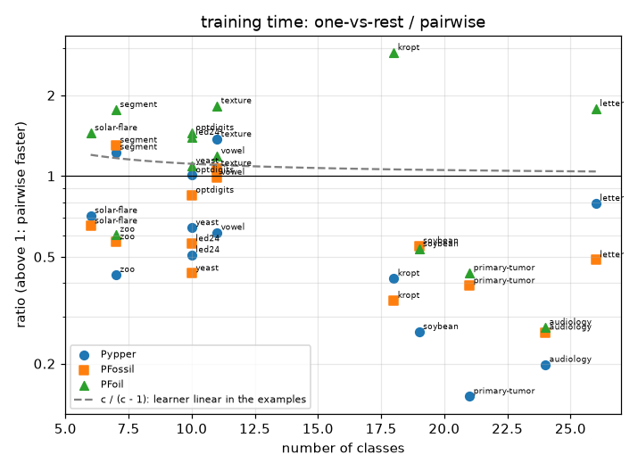
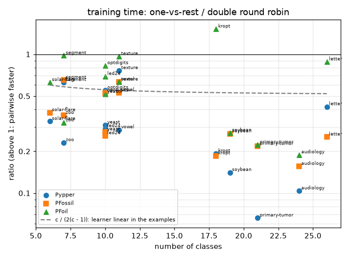
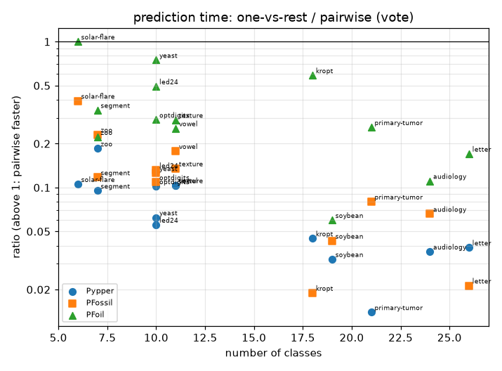
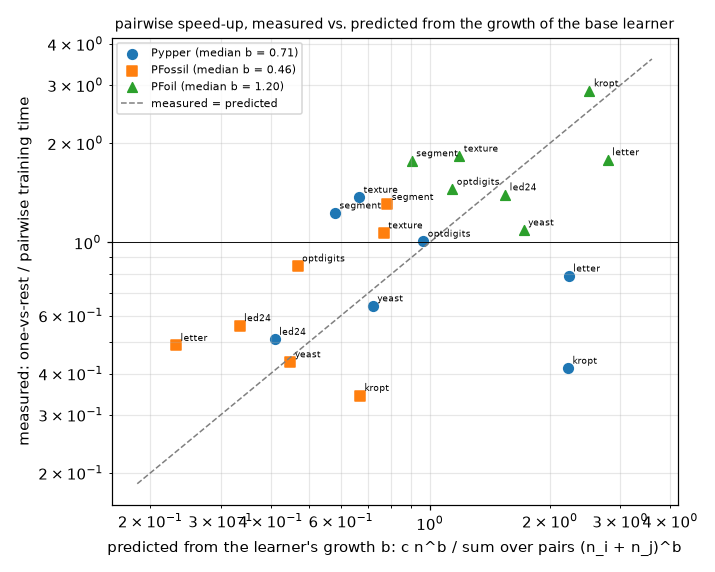

# Multi-class decomposition: one-vs-rest vs. pairwise

## Setup

**Full run.** Quick sanity check instead: `python demos/multiclass_decomposition.py`.

A rule learner that learns rules for one class against the rest has to
decompose a problem with several classes into two-class problems. This
demo compares the ways of doing that in pyrulearn, with Pypper
(pyrulearn's RIPPER), PFossil and PFoil as base learners -- in essence the
experiments of Fürnkranz, *Round Robin Classification* (JMLR 2002), with
Pypper standing in for Ripper. The paper's argument for pairwise
classification is its cost: a pairwise decomposition trains on about
(c - 1) times the examples in all, one-vs-rest on c times as many, but in many
small problems -- a large gain for a learner whose cost grows faster than
linearly with the examples. Of the three, PFossil grows at most linearly with
the examples, PFoil clearly faster (on `adult`, from 2,000 to 16,000 examples,
about n^1.6, with a rule count growing almost in proportion), Pypper in
between, depending on the data (n^1.0-1.8). CN2 would be another superlinear
learner, but its Laplace heuristic takes the number of classes of the whole
problem into every sub-problem (26 in a pair of `letter`'s classes), which
changes its searches and its results; it is left out until that is settled
(see ROADMAP.md):

- **ovr** -- one-vs-rest: one model per class, "this class vs. all
  others", every model trained on all examples; conflicts resolved by the
  best rule.
- **ordered** -- ordered one-vs-rest: classes from least to most frequent,
  each learned against the classes not yet handled; the most frequent
  class is the default. This is Ripper's (and Pypper's) own strategy.
- **pw_smaller / pw_larger** -- pairwise (round robin): one model per pair
  of classes, trained on those two classes' examples only, with the
  pair's smaller (larger) class as the target.
- **pw_both** -- the double round robin: for every pair, a model for each
  of its two classes.

A pairwise model is scored with three vote schemes on the same fitted
model: **vote** (each pair model votes for one class), **weighted_vote**
(the vote is split by the reliability of the rule that decided it) and
**accuracy_vote** (the vote is split by the pair model's accuracy on its
own two classes). Only prediction changes, so the three share their
training.

**Why training time is interesting.** Pairwise learns many more models --
c(c-1)/2 for c classes -- but each on few examples: every example is used
in c - 1 pair models, so pairwise learns from (c - 1) * n examples in
total, against c * n for one-vs-rest. For a learner whose time grows
linearly with the examples, one-vs-rest therefore takes about c / (c - 1)
times as long; for one that grows faster, pairwise gains more with every
class. Prediction goes the other way: every pair model has to be asked.

Datasets, with their numbers of classes: `letter` (26), `audiology` (24), `primary-tumor` (21), `soybean` (19), `kropt` (18), `vowel` (11), `texture` (11), `yeast` (10), `led24` (10), `optdigits` (10), `zoo` (7), `segment` (7), `solar-flare` (6). Protocol: 10-fold stratified cross-validation (5-fold for the large kropt, letter), one
`DataSpec` per training fold (`build_dataspec(max_intervals=8)`).
Each fit is capped at 300s; a time-out counts as a failure, and it fails the whole
cross-validation of that learner on that dataset (`run_cv`'s `stop_on_timeout`): its remaining folds are
not run, and all its folds count as failures.
Training time is measured inside the worker process, so it excludes
shipping data and models between processes. Every learner runs single-threaded.
Fits run 10 at a time (`run_cv`'s `n_jobs`), each in its own process and timed there, with the numerical libraries limited to one thread (`OMP_NUM_THREADS=1` and its relatives). A check of the `dense_vs_modular` learners on 11 datasets found the fit times of 5 concurrent fits as close to a sequential run as a second sequential run (per-learner ratios and rankings alike); time ratios between learners are reproducible to about +-10% either way.

## Pypper

| variant | accuracy | mean rank | rules | conditions | train (s) | predict (s) | failures |
|---|--:|--:|--:|--:|--:|--:|--:|
| pw_both:accuracy_vote | 79.11% | 2.27 | 431.0 | 1143.6 | 4.60 | 0.457 | 0 |
| pw_both:vote | 77.90% | 2.96 | 431.0 | 1143.6 | 4.60 | 0.370 | 0 |
| pw_smaller:accuracy_vote | 77.95% | 4.27 | 209.2 | 547.5 | 2.29 | 0.222 | 0 |
| pw_larger:accuracy_vote | 78.09% | 4.81 | 221.1 | 597.7 | 2.45 | 0.232 | 0 |
| pw_smaller:vote | 78.10% | 5.19 | 209.2 | 547.5 | 2.29 | 0.171 | 0 |
| pw_both:weighted_vote | 70.92% | 6.12 | 431.0 | 1143.6 | 4.60 | 3.549 | 0 |
| ordered | 76.14% | 6.35 | 39.1 | 172.4 | 1.10 | 0.000 | 0 |
| pw_larger:vote | 69.05% | 6.92 | 221.1 | 597.7 | 2.45 | 0.186 | 0 |
| ovr | 72.88% | 7.81 | 40.6 | 215.5 | 1.40 | 0.008 | 0 |
| pw_smaller:weighted_vote | 51.36% | 8.69 | 209.2 | 547.5 | 2.29 | 1.707 | 0 |
| pw_larger:weighted_vote | 40.11% | 10.62 | 221.1 | 597.7 | 2.45 | 2.011 | 0 |

Sorted by mean rank (accuracy rank across datasets, failures last). Rules and conditions: all of a decomposition's models together. The three vote schemes of a pairwise decomposition share its models and training time.

## PFossil

| variant | accuracy | mean rank | rules | conditions | train (s) | predict (s) | failures |
|---|--:|--:|--:|--:|--:|--:|--:|
| pw_both:accuracy_vote | 79.15% | 2.77 | 569.5 | 1376.2 | 1.08 | 0.427 | 0 |
| pw_both:vote | 78.26% | 3.62 | 569.5 | 1376.2 | 1.08 | 0.362 | 0 |
| pw_smaller:accuracy_vote | 77.47% | 4.96 | 283.7 | 716.2 | 0.59 | 0.239 | 0 |
| pw_larger:accuracy_vote | 77.44% | 5.19 | 283.2 | 659.0 | 0.57 | 0.227 | 0 |
| pw_both:weighted_vote | 71.55% | 5.27 | 569.5 | 1376.2 | 1.08 | 3.741 | 0 |
| pw_smaller:vote | 77.12% | 5.65 | 283.7 | 716.2 | 0.59 | 0.192 | 0 |
| pw_larger:vote | 76.21% | 6.35 | 283.2 | 659.0 | 0.57 | 0.171 | 0 |
| ovr | 76.12% | 6.46 | 52.4 | 274.4 | 0.33 | 0.006 | 0 |
| ordered | 76.00% | 6.92 | 46.6 | 214.8 | 0.25 | 0.001 | 0 |
| pw_smaller:weighted_vote | 50.76% | 8.04 | 283.7 | 716.2 | 0.59 | 1.745 | 0 |
| pw_larger:weighted_vote | 38.56% | 10.77 | 283.2 | 659.0 | 0.57 | 1.962 | 0 |

Sorted by mean rank (accuracy rank across datasets, failures last). Rules and conditions: all of a decomposition's models together. The three vote schemes of a pairwise decomposition share its models and training time.

## PFoil

| variant | accuracy | mean rank | rules | conditions | train (s) | predict (s) | failures |
|---|--:|--:|--:|--:|--:|--:|--:|
| pw_both:accuracy_vote | 79.06% | 2.65 | 1107.7 | 3894.9 | 2.82 | 0.648 | 0 |
| pw_both:vote | 78.06% | 3.12 | 1107.7 | 3894.9 | 2.82 | 0.499 | 0 |
| ovr | 78.83% | 3.77 | 326.6 | 2262.8 | 3.37 | 0.118 | 0 |
| pw_both:weighted_vote | 73.43% | 4.81 | 1107.7 | 3894.9 | 2.82 | 4.195 | 0 |
| pw_larger:accuracy_vote | 76.16% | 5.08 | 564.1 | 1998.5 | 1.45 | 0.306 | 0 |
| pw_larger:vote | 74.22% | 5.85 | 564.1 | 1998.5 | 1.45 | 0.285 | 0 |
| pw_smaller:accuracy_vote | 74.11% | 6.19 | 541.5 | 1895.4 | 1.47 | 0.322 | 0 |
| pw_smaller:vote | 73.77% | 6.50 | 541.5 | 1895.4 | 1.47 | 0.287 | 0 |
| pw_smaller:weighted_vote | 51.59% | 8.35 | 541.5 | 1895.4 | 1.47 | 1.953 | 0 |
| ordered | 64.22% | 9.08 | 217.6 | 1214.0 | 1.63 | 0.003 | 0 |
| pw_larger:weighted_vote | 39.20% | 10.62 | 564.1 | 1998.5 | 1.45 | 2.354 | 0 |

Sorted by mean rank (accuracy rank across datasets, failures last). Rules and conditions: all of a decomposition's models together. The three vote schemes of a pairwise decomposition share its models and training time.

## Training and prediction time over the number of classes

One point per dataset and base learner: the mean one-vs-rest time divided by the mean pairwise time. Above 1, pairwise is faster. The dashed line is what a learner whose time grows linearly with the number of examples would give.

## Growth of the base learners and the pairwise speed-up

The argument for pairwise classification is about cost: if a learner's training time grows like n^b with the number of examples n, one-vs-rest costs c n^b for c classes, pairwise the sum over the pairs of (n_i + n_j)^b -- about (c - 1) n examples in all, but in many small problems, so the larger b, the more pairwise gains. Here b is measured for each base learner on each dataset with at least 1,000 training rows: one-vs-rest is fitted on nested, stratified subsamples of the first training fold (25%, 50%, 100% of it, outside the cross-validation, each with its own discretization; a learner that times out on one is not tried on the larger ones), and b is the least-squares slope of log time over log rows. The predicted ratio uses the fold's real class counts; the measured one is the cross-validation's one-vs-rest / pairwise (`pw_smaller`) training time. Pairwise also has costs per pair the model leaves out -- building each pair's data, evaluating its model for the vote weights -- which weigh most with many classes and few examples.

Run times of rule learners are noisy in a way their results are not: one rule more or less can change a fit's time a lot and its quality hardly at all, so b from three subsamples, and the ratios, scatter. The points follow the line only roughly; a controlled experiment, varying the training-set size on a single dataset, would separate the growth from the noise better.

| dataset | classes | training rows | base | b | ovr / pairwise, measured | predicted (b) | predicted (b = 1) |
|---|--:|--:|---|--:|--:|--:|--:|
| yeast | 10 | 1,335 | PFoil | 1.35 | 1.09 | 1.72 | 1.11 |
| yeast | 10 | 1,335 | PFossil | 0.38 | 0.43 | 0.45 | 1.11 |
| yeast | 10 | 1,335 | Pypper | 0.69 | 0.64 | 0.72 | 1.11 |
| segment | 7 | 2,079 | PFoil | 0.79 | 1.77 | 0.90 | 1.17 |
| segment | 7 | 2,079 | PFossil | 0.68 | 1.30 | 0.78 | 1.17 |
| segment | 7 | 2,079 | Pypper | 0.44 | 1.23 | 0.58 | 1.17 |
| led24 | 10 | 2,880 | PFoil | 1.20 | 1.39 | 1.54 | 1.11 |
| led24 | 10 | 2,880 | PFossil | 0.25 | 0.56 | 0.33 | 1.11 |
| led24 | 10 | 2,880 | Pypper | 0.38 | 0.51 | 0.41 | 1.11 |
| texture | 11 | 4,950 | PFoil | 1.04 | 1.83 | 1.19 | 1.10 |
| texture | 11 | 4,950 | PFossil | 0.79 | 1.07 | 0.77 | 1.10 |
| texture | 11 | 4,950 | Pypper | 0.71 | 1.37 | 0.67 | 1.10 |
| optdigits | 10 | 5,058 | PFoil | 1.02 | 1.45 | 1.14 | 1.11 |
| optdigits | 10 | 5,058 | PFossil | 0.46 | 0.85 | 0.47 | 1.11 |
| optdigits | 10 | 5,058 | Pypper | 0.91 | 1.01 | 0.96 | 1.11 |
| letter | 26 | 16,000 | PFoil | 1.38 | 1.78 | 2.79 | 1.04 |
| letter | 26 | 16,000 | PFossil | 0.41 | 0.49 | 0.23 | 1.04 |
| letter | 26 | 16,000 | Pypper | 1.30 | 0.79 | 2.23 | 1.04 |
| kropt | 18 | 22,444 | PFoil | 1.45 | 2.88 | 2.51 | 1.06 |
| kropt | 18 | 22,444 | PFossil | 0.77 | 0.34 | 0.67 | 1.06 |
| kropt | 18 | 22,444 | Pypper | 1.39 | 0.41 | 2.22 | 1.06 |

Median b: PFoil 1.20, PFossil 0.46, Pypper 0.71.

## Per dataset (mean across folds)

| dataset | learner | accuracy | n_conditions | train_time | predict_time |
|---|---|---|---|---|---|
| audiology | PFoil:ordered | 62.91% | 57.1 | 0.046 | 0.000 |
| audiology | PFoil:ovr | 77.04% | 94.3 | 0.061 | 0.001 |
| audiology | PFoil:pw_both:accuracy_vote | 67.27% | 284.8 | 0.325 | 0.024 |
| audiology | PFoil:pw_both:vote | 61.52% | 284.8 | 0.325 | 0.017 |
| audiology | PFoil:pw_both:weighted_vote | 46.46% | 284.8 | 0.325 | 0.142 |
| audiology | PFoil:pw_larger:accuracy_vote | 70.42% | 139.0 | 0.205 | 0.014 |
| audiology | PFoil:pw_larger:vote | 58.46% | 139.0 | 0.205 | 0.009 |
| audiology | PFoil:pw_larger:weighted_vote | 46.46% | 139.0 | 0.205 | 0.070 |
| audiology | PFoil:pw_smaller:accuracy_vote | 65.08% | 145.8 | 0.225 | 0.012 |
| audiology | PFoil:pw_smaller:vote | 71.23% | 145.8 | 0.225 | 0.008 |
| audiology | PFoil:pw_smaller:weighted_vote | 54.80% | 145.8 | 0.225 | 0.076 |
| audiology | PFossil:ordered | 84.05% | 72.5 | 0.055 | 0.000 |
| audiology | PFossil:ovr | 77.89% | 115.2 | 0.066 | 0.001 |
| audiology | PFossil:pw_both:accuracy_vote | 81.40% | 586.0 | 0.424 | 0.030 |
| audiology | PFossil:pw_both:vote | 81.40% | 586.0 | 0.424 | 0.021 |
| audiology | PFossil:pw_both:weighted_vote | 46.46% | 586.0 | 0.424 | 0.180 |
| audiology | PFossil:pw_larger:accuracy_vote | 80.53% | 292.0 | 0.243 | 0.014 |
| audiology | PFossil:pw_larger:vote | 81.40% | 292.0 | 0.243 | 0.011 |
| audiology | PFossil:pw_larger:weighted_vote | 46.46% | 292.0 | 0.243 | 0.100 |
| audiology | PFossil:pw_smaller:accuracy_vote | 80.95% | 294.0 | 0.252 | 0.014 |
| audiology | PFossil:pw_smaller:vote | 81.38% | 294.0 | 0.252 | 0.011 |
| audiology | PFossil:pw_smaller:weighted_vote | 54.86% | 294.0 | 0.252 | 0.075 |
| audiology | Pypper:ordered | 75.28% | 16.0 | 0.115 | 0.000 |
| audiology | Pypper:ovr | 64.64% | 26.9 | 0.127 | 0.000 |
| audiology | Pypper:pw_both:accuracy_vote | 68.18% | 142.9 | 1.225 | 0.021 |
| audiology | Pypper:pw_both:vote | 57.04% | 142.9 | 1.225 | 0.015 |
| audiology | Pypper:pw_both:weighted_vote | 46.46% | 142.9 | 1.225 | 0.109 |
| audiology | Pypper:pw_larger:accuracy_vote | 69.51% | 87.7 | 0.827 | 0.012 |
| audiology | Pypper:pw_larger:vote | 7.92% | 87.7 | 0.827 | 0.009 |
| audiology | Pypper:pw_larger:weighted_vote | 46.46% | 87.7 | 0.827 | 0.063 |
| audiology | Pypper:pw_smaller:accuracy_vote | 65.51% | 55.4 | 0.641 | 0.015 |
| audiology | Pypper:pw_smaller:vote | 70.83% | 55.4 | 0.641 | 0.008 |
| audiology | Pypper:pw_smaller:weighted_vote | 48.64% | 55.4 | 0.641 | 0.091 |
| kropt | PFoil:ordered | 69.80% | 15119.2 | 26.062 | 0.033 |
| kropt | PFoil:ovr | 75.41% | 31233.6 | 58.672 | 2.236 |
| kropt | PFoil:pw_both:accuracy_vote | 82.10% | 47380.2 | 38.639 | 8.199 |
| kropt | PFoil:pw_both:vote | 81.88% | 47380.2 | 38.639 | 6.382 |
| kropt | PFoil:pw_both:weighted_vote | 64.03% | 47380.2 | 38.639 | 40.759 |
| kropt | PFoil:pw_larger:accuracy_vote | 75.46% | 24408.4 | 19.693 | 3.738 |
| kropt | PFoil:pw_larger:vote | 75.29% | 24408.4 | 19.693 | 3.825 |
| kropt | PFoil:pw_larger:weighted_vote | 32.70% | 24408.4 | 19.693 | 26.139 |
| kropt | PFoil:pw_smaller:accuracy_vote | 75.78% | 22971.8 | 20.383 | 3.529 |
| kropt | PFoil:pw_smaller:vote | 78.50% | 22971.8 | 20.383 | 3.805 |
| kropt | PFoil:pw_smaller:weighted_vote | 72.94% | 22971.8 | 20.383 | 15.519 |
| kropt | PFossil:ordered | 35.48% | 420.6 | 1.288 | 0.002 |
| kropt | PFossil:ovr | 24.99% | 342.6 | 1.066 | 0.032 |
| kropt | PFossil:pw_both:accuracy_vote | 40.70% | 5670.4 | 5.744 | 3.544 |
| kropt | PFossil:pw_both:vote | 39.41% | 5670.4 | 5.744 | 2.891 |
| kropt | PFossil:pw_both:weighted_vote | 32.21% | 5670.4 | 5.744 | 29.534 |
| kropt | PFossil:pw_larger:accuracy_vote | 36.74% | 2446.2 | 2.733 | 2.126 |
| kropt | PFossil:pw_larger:vote | 34.82% | 2446.2 | 2.733 | 1.440 |
| kropt | PFossil:pw_larger:weighted_vote | 22.80% | 2446.2 | 2.733 | 18.195 |
| kropt | PFossil:pw_smaller:accuracy_vote | 39.58% | 3224.2 | 3.106 | 2.112 |
| kropt | PFossil:pw_smaller:vote | 36.35% | 3224.2 | 3.106 | 1.711 |
| kropt | PFossil:pw_smaller:weighted_vote | 39.95% | 3224.2 | 3.106 | 12.718 |
| kropt | Pypper:ordered | 54.59% | 1299.2 | 11.306 | 0.004 |
| kropt | Pypper:ovr | 33.63% | 1130.0 | 9.538 | 0.070 |
| kropt | Pypper:pw_both:accuracy_vote | 66.17% | 11866.4 | 49.476 | 4.454 |
| kropt | Pypper:pw_both:vote | 67.00% | 11866.4 | 49.476 | 4.069 |
| kropt | Pypper:pw_both:weighted_vote | 50.76% | 11866.4 | 49.476 | 33.442 |
| kropt | Pypper:pw_larger:accuracy_vote | 62.95% | 6464.0 | 26.942 | 2.289 |
| kropt | Pypper:pw_larger:vote | 63.52% | 6464.0 | 26.942 | 1.977 |
| kropt | Pypper:pw_larger:weighted_vote | 30.84% | 6464.0 | 26.942 | 21.787 |
| kropt | Pypper:pw_smaller:accuracy_vote | 62.28% | 5402.4 | 22.985 | 1.930 |
| kropt | Pypper:pw_smaller:vote | 62.10% | 5402.4 | 22.985 | 1.568 |
| kropt | Pypper:pw_smaller:weighted_vote | 60.03% | 5402.4 | 22.985 | 12.689 |
| led24 | PFoil:ordered | 47.06% | 2042.6 | 0.845 | 0.003 |
| led24 | PFoil:ovr | 61.81% | 3508.9 | 1.443 | 0.023 |
| led24 | PFoil:pw_both:accuracy_vote | 64.12% | 5456.2 | 2.082 | 0.103 |
| led24 | PFoil:pw_both:vote | 63.56% | 5456.2 | 2.082 | 0.090 |
| led24 | PFoil:pw_both:weighted_vote | 69.28% | 5456.2 | 2.082 | 0.761 |
| led24 | PFoil:pw_larger:accuracy_vote | 58.09% | 2730.4 | 0.975 | 0.051 |
| led24 | PFoil:pw_larger:vote | 55.44% | 2730.4 | 0.975 | 0.044 |
| led24 | PFoil:pw_larger:weighted_vote | 29.87% | 2730.4 | 0.975 | 0.342 |
| led24 | PFoil:pw_smaller:accuracy_vote | 54.34% | 2723.0 | 1.036 | 0.055 |
| led24 | PFoil:pw_smaller:vote | 53.88% | 2723.0 | 1.036 | 0.046 |
| led24 | PFoil:pw_smaller:weighted_vote | 30.91% | 2723.0 | 1.036 | 0.437 |
| led24 | PFossil:ordered | 70.03% | 250.2 | 0.156 | 0.000 |
| led24 | PFossil:ovr | 70.00% | 272.8 | 0.213 | 0.003 |
| led24 | PFossil:pw_both:accuracy_vote | 70.88% | 1698.1 | 0.823 | 0.065 |
| led24 | PFossil:pw_both:vote | 71.47% | 1698.1 | 0.823 | 0.053 |
| led24 | PFossil:pw_both:weighted_vote | 71.41% | 1698.1 | 0.823 | 0.544 |
| led24 | PFossil:pw_larger:accuracy_vote | 66.44% | 891.4 | 0.401 | 0.043 |
| led24 | PFossil:pw_larger:vote | 66.84% | 891.4 | 0.401 | 0.024 |
| led24 | PFossil:pw_larger:weighted_vote | 28.56% | 891.4 | 0.401 | 0.299 |
| led24 | PFossil:pw_smaller:accuracy_vote | 67.31% | 812.8 | 0.382 | 0.031 |
| led24 | PFossil:pw_smaller:vote | 67.34% | 812.8 | 0.382 | 0.026 |
| led24 | PFossil:pw_smaller:weighted_vote | 30.75% | 812.8 | 0.382 | 0.248 |
| led24 | Pypper:ordered | 71.50% | 88.7 | 0.399 | 0.000 |
| led24 | Pypper:ovr | 68.00% | 124.0 | 0.521 | 0.001 |
| led24 | Pypper:pw_both:accuracy_vote | 72.31% | 500.9 | 1.785 | 0.055 |
| led24 | Pypper:pw_both:vote | 72.19% | 500.9 | 1.785 | 0.047 |
| led24 | Pypper:pw_both:weighted_vote | 72.28% | 500.9 | 1.785 | 0.502 |
| led24 | Pypper:pw_larger:accuracy_vote | 71.47% | 250.7 | 0.955 | 0.033 |
| led24 | Pypper:pw_larger:vote | 71.22% | 250.7 | 0.955 | 0.027 |
| led24 | Pypper:pw_larger:weighted_vote | 31.87% | 250.7 | 0.955 | 0.277 |
| led24 | Pypper:pw_smaller:accuracy_vote | 72.09% | 251.5 | 1.025 | 0.028 |
| led24 | Pypper:pw_smaller:vote | 71.97% | 251.5 | 1.025 | 0.023 |
| led24 | Pypper:pw_smaller:weighted_vote | 34.38% | 251.5 | 1.025 | 0.234 |
| letter | PFoil:ordered | 59.28% | 4562.0 | 7.109 | 0.009 |
| letter | PFoil:ovr | 88.14% | 7100.6 | 12.233 | 0.451 |
| letter | PFoil:pw_both:accuracy_vote | 91.88% | 18456.8 | 13.876 | 6.257 |
| letter | PFoil:pw_both:vote | 92.01% | 18456.8 | 13.876 | 4.707 |
| letter | PFoil:pw_both:weighted_vote | 92.34% | 18456.8 | 13.876 | 51.364 |
| letter | PFoil:pw_larger:accuracy_vote | 89.43% | 9317.6 | 6.991 | 3.038 |
| letter | PFoil:pw_larger:vote | 89.75% | 9317.6 | 6.991 | 2.568 |
| letter | PFoil:pw_larger:weighted_vote | 26.68% | 9317.6 | 6.991 | 26.172 |
| letter | PFoil:pw_smaller:accuracy_vote | 89.16% | 9141.8 | 6.875 | 3.625 |
| letter | PFoil:pw_smaller:vote | 89.12% | 9141.8 | 6.875 | 2.650 |
| letter | PFoil:pw_smaller:weighted_vote | 19.82% | 9141.8 | 6.875 | 27.063 |
| letter | PFossil:ordered | 77.29% | 1170.6 | 1.768 | 0.002 |
| letter | PFossil:ovr | 75.67% | 1249.6 | 2.343 | 0.053 |
| letter | PFossil:pw_both:accuracy_vote | 86.04% | 11414.6 | 9.246 | 5.688 |
| letter | PFossil:pw_both:vote | 85.99% | 11414.6 | 9.246 | 4.945 |
| letter | PFossil:pw_both:weighted_vote | 86.30% | 11414.6 | 9.246 | 52.227 |
| letter | PFossil:pw_larger:accuracy_vote | 84.05% | 5755.2 | 4.909 | 2.779 |
| letter | PFossil:pw_larger:vote | 83.32% | 5755.2 | 4.909 | 2.229 |
| letter | PFossil:pw_larger:weighted_vote | 26.63% | 5755.2 | 4.909 | 24.493 |
| letter | PFossil:pw_smaller:accuracy_vote | 83.11% | 5675.0 | 4.813 | 3.033 |
| letter | PFossil:pw_smaller:vote | 82.84% | 5675.0 | 4.813 | 2.470 |
| letter | PFossil:pw_smaller:weighted_vote | 20.05% | 5675.0 | 4.813 | 25.139 |
| letter | Pypper:ordered | 81.39% | 1272.4 | 7.300 | 0.003 |
| letter | Pypper:ovr | 77.00% | 1662.0 | 12.154 | 0.084 |
| letter | Pypper:pw_both:accuracy_vote | 90.03% | 8894.4 | 29.006 | 5.557 |
| letter | Pypper:pw_both:vote | 89.98% | 8894.4 | 29.006 | 4.119 |
| letter | Pypper:pw_both:weighted_vote | 89.71% | 8894.4 | 29.006 | 44.631 |
| letter | Pypper:pw_larger:accuracy_vote | 88.29% | 4482.0 | 14.200 | 2.763 |
| letter | Pypper:pw_larger:vote | 88.28% | 4482.0 | 14.200 | 2.047 |
| letter | Pypper:pw_larger:weighted_vote | 27.89% | 4482.0 | 14.200 | 22.570 |
| letter | Pypper:pw_smaller:accuracy_vote | 87.93% | 4411.2 | 15.379 | 2.851 |
| letter | Pypper:pw_smaller:vote | 87.93% | 4411.2 | 15.379 | 2.173 |
| letter | Pypper:pw_smaller:weighted_vote | 22.22% | 4411.2 | 15.379 | 24.511 |
| optdigits | PFoil:ordered | 88.74% | 423.3 | 0.605 | 0.001 |
| optdigits | PFoil:ovr | 93.35% | 692.6 | 1.091 | 0.015 |
| optdigits | PFoil:pw_both:accuracy_vote | 96.62% | 1076.3 | 1.317 | 0.124 |
| optdigits | PFoil:pw_both:vote | 96.55% | 1076.3 | 1.317 | 0.092 |
| optdigits | PFoil:pw_both:weighted_vote | 96.78% | 1076.3 | 1.317 | 1.111 |
| optdigits | PFoil:pw_larger:accuracy_vote | 94.57% | 537.7 | 0.723 | 0.062 |
| optdigits | PFoil:pw_larger:vote | 94.59% | 537.7 | 0.723 | 0.053 |
| optdigits | PFoil:pw_larger:weighted_vote | 32.03% | 537.7 | 0.723 | 0.509 |
| optdigits | PFoil:pw_smaller:accuracy_vote | 94.18% | 539.5 | 0.753 | 0.069 |
| optdigits | PFoil:pw_smaller:vote | 94.40% | 539.5 | 0.753 | 0.050 |
| optdigits | PFoil:pw_smaller:weighted_vote | 43.43% | 539.5 | 0.753 | 0.573 |
| optdigits | PFossil:ordered | 90.73% | 300.1 | 0.415 | 0.002 |
| optdigits | PFossil:ovr | 90.28% | 460.0 | 0.674 | 0.007 |
| optdigits | PFossil:pw_both:accuracy_vote | 95.66% | 1097.1 | 1.282 | 0.139 |
| optdigits | PFossil:pw_both:vote | 95.50% | 1097.1 | 1.282 | 0.113 |
| optdigits | PFossil:pw_both:weighted_vote | 95.85% | 1097.1 | 1.282 | 1.182 |
| optdigits | PFossil:pw_larger:accuracy_vote | 93.91% | 540.3 | 0.757 | 0.067 |
| optdigits | PFossil:pw_larger:vote | 93.91% | 540.3 | 0.757 | 0.054 |
| optdigits | PFossil:pw_larger:weighted_vote | 33.01% | 540.3 | 0.757 | 0.567 |
| optdigits | PFossil:pw_smaller:accuracy_vote | 93.91% | 558.9 | 0.795 | 0.068 |
| optdigits | PFossil:pw_smaller:vote | 93.99% | 558.9 | 0.795 | 0.060 |
| optdigits | PFossil:pw_smaller:weighted_vote | 40.18% | 558.9 | 0.795 | 0.582 |
| optdigits | Pypper:ordered | 90.91% | 199.5 | 1.154 | 0.001 |
| optdigits | Pypper:ovr | 90.18% | 301.1 | 1.872 | 0.005 |
| optdigits | Pypper:pw_both:accuracy_vote | 95.89% | 625.8 | 3.402 | 0.124 |
| optdigits | Pypper:pw_both:vote | 96.00% | 625.8 | 3.402 | 0.091 |
| optdigits | Pypper:pw_both:weighted_vote | 95.78% | 625.8 | 3.402 | 1.030 |
| optdigits | Pypper:pw_larger:accuracy_vote | 94.40% | 310.0 | 1.727 | 0.064 |
| optdigits | Pypper:pw_larger:vote | 94.07% | 310.0 | 1.727 | 0.069 |
| optdigits | Pypper:pw_larger:weighted_vote | 33.02% | 310.0 | 1.727 | 0.535 |
| optdigits | Pypper:pw_smaller:accuracy_vote | 94.64% | 315.9 | 1.858 | 0.067 |
| optdigits | Pypper:pw_smaller:vote | 94.54% | 315.9 | 1.858 | 0.047 |
| optdigits | Pypper:pw_smaller:weighted_vote | 44.31% | 315.9 | 1.858 | 0.526 |
| primary-tumor | PFoil:ordered | 9.45% | 223.8 | 0.122 | 0.001 |
| primary-tumor | PFoil:ovr | 43.35% | 329.0 | 0.144 | 0.003 |
| primary-tumor | PFoil:pw_both:accuracy_vote | 42.79% | 1259.7 | 0.647 | 0.036 |
| primary-tumor | PFoil:pw_both:vote | 44.25% | 1259.7 | 0.647 | 0.026 |
| primary-tumor | PFoil:pw_both:weighted_vote | 33.62% | 1259.7 | 0.647 | 0.225 |
| primary-tumor | PFoil:pw_larger:accuracy_vote | 41.32% | 637.6 | 0.369 | 0.018 |
| primary-tumor | PFoil:pw_larger:vote | 35.12% | 637.6 | 0.369 | 0.014 |
| primary-tumor | PFoil:pw_larger:weighted_vote | 24.78% | 637.6 | 0.369 | 0.162 |
| primary-tumor | PFoil:pw_smaller:accuracy_vote | 42.17% | 620.8 | 0.332 | 0.018 |
| primary-tumor | PFoil:pw_smaller:vote | 36.28% | 620.8 | 0.332 | 0.013 |
| primary-tumor | PFoil:pw_smaller:weighted_vote | 41.86% | 620.8 | 0.332 | 0.100 |
| primary-tumor | PFossil:ordered | 32.44% | 330.7 | 0.113 | 0.001 |
| primary-tumor | PFossil:ovr | 43.38% | 341.1 | 0.143 | 0.001 |
| primary-tumor | PFossil:pw_both:accuracy_vote | 46.02% | 1464.9 | 0.659 | 0.037 |
| primary-tumor | PFossil:pw_both:vote | 37.16% | 1464.9 | 0.659 | 0.059 |
| primary-tumor | PFossil:pw_both:weighted_vote | 35.08% | 1464.9 | 0.659 | 0.267 |
| primary-tumor | PFossil:pw_larger:accuracy_vote | 39.84% | 652.7 | 0.382 | 0.019 |
| primary-tumor | PFossil:pw_larger:vote | 28.61% | 652.7 | 0.382 | 0.014 |
| primary-tumor | PFossil:pw_larger:weighted_vote | 24.78% | 652.7 | 0.382 | 0.188 |
| primary-tumor | PFossil:pw_smaller:accuracy_vote | 39.22% | 813.1 | 0.367 | 0.025 |
| primary-tumor | PFossil:pw_smaller:vote | 38.62% | 813.1 | 0.367 | 0.015 |
| primary-tumor | PFossil:pw_smaller:weighted_vote | 41.59% | 813.1 | 0.367 | 0.131 |
| primary-tumor | Pypper:ordered | 39.25% | 20.5 | 0.131 | 0.000 |
| primary-tumor | Pypper:ovr | 38.65% | 21.9 | 0.129 | 0.000 |
| primary-tumor | Pypper:pw_both:accuracy_vote | 47.20% | 260.0 | 1.944 | 0.046 |
| primary-tumor | Pypper:pw_both:vote | 44.55% | 260.0 | 1.944 | 0.019 |
| primary-tumor | Pypper:pw_both:weighted_vote | 27.15% | 260.0 | 1.944 | 0.154 |
| primary-tumor | Pypper:pw_larger:accuracy_vote | 43.97% | 139.7 | 1.115 | 0.016 |
| primary-tumor | Pypper:pw_larger:vote | 0.00% | 139.7 | 1.115 | 0.011 |
| primary-tumor | Pypper:pw_larger:weighted_vote | 24.78% | 139.7 | 1.115 | 0.077 |
| primary-tumor | Pypper:pw_smaller:accuracy_vote | 43.97% | 120.9 | 0.852 | 0.017 |
| primary-tumor | Pypper:pw_smaller:vote | 43.07% | 120.9 | 0.852 | 0.011 |
| primary-tumor | Pypper:pw_smaller:weighted_vote | 33.07% | 120.9 | 0.852 | 0.098 |
| segment | PFoil:ordered | 84.29% | 134.7 | 0.108 | 0.000 |
| segment | PFoil:ovr | 95.24% | 292.8 | 0.197 | 0.003 |
| segment | PFoil:pw_both:accuracy_vote | 94.29% | 296.6 | 0.202 | 0.020 |
| segment | PFoil:pw_both:vote | 93.29% | 296.6 | 0.202 | 0.017 |
| segment | PFoil:pw_both:weighted_vote | 96.32% | 296.6 | 0.202 | 0.140 |
| segment | PFoil:pw_larger:accuracy_vote | 90.35% | 135.0 | 0.099 | 0.012 |
| segment | PFoil:pw_larger:vote | 88.74% | 135.0 | 0.099 | 0.008 |
| segment | PFoil:pw_larger:weighted_vote | 44.16% | 135.0 | 0.099 | 0.081 |
| segment | PFoil:pw_smaller:accuracy_vote | 90.35% | 135.0 | 0.112 | 0.010 |
| segment | PFoil:pw_smaller:vote | 88.74% | 135.0 | 0.112 | 0.008 |
| segment | PFoil:pw_smaller:weighted_vote | 44.16% | 135.0 | 0.112 | 0.072 |
| segment | PFossil:ordered | 94.85% | 75.5 | 0.072 | 0.000 |
| segment | PFossil:ovr | 93.33% | 121.8 | 0.114 | 0.001 |
| segment | PFossil:pw_both:accuracy_vote | 95.15% | 180.8 | 0.175 | 0.019 |
| segment | PFossil:pw_both:vote | 95.32% | 180.8 | 0.175 | 0.015 |
| segment | PFossil:pw_both:weighted_vote | 95.54% | 180.8 | 0.175 | 0.140 |
| segment | PFossil:pw_larger:accuracy_vote | 94.81% | 103.4 | 0.098 | 0.011 |
| segment | PFossil:pw_larger:vote | 94.46% | 103.4 | 0.098 | 0.009 |
| segment | PFossil:pw_larger:weighted_vote | 47.06% | 103.4 | 0.098 | 0.065 |
| segment | PFossil:pw_smaller:accuracy_vote | 94.81% | 103.4 | 0.088 | 0.012 |
| segment | PFossil:pw_smaller:vote | 94.46% | 103.4 | 0.088 | 0.010 |
| segment | PFossil:pw_smaller:weighted_vote | 47.06% | 103.4 | 0.088 | 0.073 |
| segment | Pypper:ordered | 94.72% | 45.6 | 0.172 | 0.000 |
| segment | Pypper:ovr | 93.46% | 77.9 | 0.315 | 0.001 |
| segment | Pypper:pw_both:accuracy_vote | 95.41% | 127.3 | 0.503 | 0.018 |
| segment | Pypper:pw_both:vote | 95.54% | 127.3 | 0.503 | 0.013 |
| segment | Pypper:pw_both:weighted_vote | 95.37% | 127.3 | 0.503 | 0.117 |
| segment | Pypper:pw_larger:accuracy_vote | 94.76% | 62.8 | 0.270 | 0.010 |
| segment | Pypper:pw_larger:vote | 94.68% | 62.8 | 0.270 | 0.008 |
| segment | Pypper:pw_larger:weighted_vote | 52.73% | 62.8 | 0.270 | 0.062 |
| segment | Pypper:pw_smaller:accuracy_vote | 94.76% | 62.8 | 0.257 | 0.011 |
| segment | Pypper:pw_smaller:vote | 94.68% | 62.8 | 0.257 | 0.008 |
| segment | Pypper:pw_smaller:weighted_vote | 52.73% | 62.8 | 0.257 | 0.067 |
| solar-flare | PFoil:ordered | 58.72% | 241.1 | 0.099 | 0.001 |
| solar-flare | PFoil:ovr | 73.73% | 403.4 | 0.169 | 0.004 |
| solar-flare | PFoil:pw_both:accuracy_vote | 72.51% | 694.9 | 0.270 | 0.009 |
| solar-flare | PFoil:pw_both:vote | 68.01% | 694.9 | 0.270 | 0.009 |
| solar-flare | PFoil:pw_both:weighted_vote | 73.45% | 694.9 | 0.270 | 0.061 |
| solar-flare | PFoil:pw_larger:accuracy_vote | 68.11% | 411.2 | 0.160 | 0.005 |
| solar-flare | PFoil:pw_larger:vote | 67.64% | 411.2 | 0.160 | 0.005 |
| solar-flare | PFoil:pw_larger:weighted_vote | 56.66% | 411.2 | 0.160 | 0.036 |
| solar-flare | PFoil:pw_smaller:accuracy_vote | 59.19% | 283.7 | 0.117 | 0.007 |
| solar-flare | PFoil:pw_smaller:vote | 60.60% | 283.7 | 0.117 | 0.004 |
| solar-flare | PFoil:pw_smaller:weighted_vote | 62.11% | 283.7 | 0.117 | 0.029 |
| solar-flare | PFossil:ordered | 70.64% | 50.0 | 0.030 | 0.000 |
| solar-flare | PFossil:ovr | 74.02% | 62.5 | 0.037 | 0.001 |
| solar-flare | PFossil:pw_both:accuracy_vote | 73.83% | 161.9 | 0.099 | 0.008 |
| solar-flare | PFossil:pw_both:vote | 74.30% | 161.9 | 0.099 | 0.005 |
| solar-flare | PFossil:pw_both:weighted_vote | 74.77% | 161.9 | 0.099 | 0.047 |
| solar-flare | PFossil:pw_larger:accuracy_vote | 74.77% | 73.0 | 0.046 | 0.004 |
| solar-flare | PFossil:pw_larger:vote | 73.93% | 73.0 | 0.046 | 0.003 |
| solar-flare | PFossil:pw_larger:weighted_vote | 58.82% | 73.0 | 0.046 | 0.024 |
| solar-flare | PFossil:pw_smaller:accuracy_vote | 72.23% | 88.9 | 0.058 | 0.005 |
| solar-flare | PFossil:pw_smaller:vote | 72.33% | 88.9 | 0.058 | 0.003 |
| solar-flare | PFossil:pw_smaller:weighted_vote | 71.39% | 88.9 | 0.058 | 0.031 |
| solar-flare | Pypper:ordered | 74.77% | 8.3 | 0.079 | 0.000 |
| solar-flare | Pypper:ovr | 69.43% | 21.4 | 0.116 | 0.000 |
| solar-flare | Pypper:pw_both:accuracy_vote | 73.92% | 54.3 | 0.354 | 0.007 |
| solar-flare | Pypper:pw_both:vote | 74.40% | 54.3 | 0.354 | 0.005 |
| solar-flare | Pypper:pw_both:weighted_vote | 74.40% | 54.3 | 0.354 | 0.043 |
| solar-flare | Pypper:pw_larger:accuracy_vote | 72.89% | 27.5 | 0.205 | 0.003 |
| solar-flare | Pypper:pw_larger:vote | 72.70% | 27.5 | 0.205 | 0.003 |
| solar-flare | Pypper:pw_larger:weighted_vote | 55.90% | 27.5 | 0.205 | 0.024 |
| solar-flare | Pypper:pw_smaller:accuracy_vote | 74.68% | 26.8 | 0.164 | 0.003 |
| solar-flare | Pypper:pw_smaller:vote | 74.77% | 26.8 | 0.164 | 0.002 |
| solar-flare | Pypper:pw_smaller:weighted_vote | 71.11% | 26.8 | 0.164 | 0.018 |
| soybean | PFoil:ordered | 85.65% | 83.5 | 0.058 | 0.000 |
| soybean | PFoil:ovr | 90.92% | 153.8 | 0.084 | 0.001 |
| soybean | PFoil:pw_both:accuracy_vote | 92.97% | 446.2 | 0.310 | 0.046 |
| soybean | PFoil:pw_both:vote | 93.41% | 446.2 | 0.310 | 0.030 |
| soybean | PFoil:pw_both:weighted_vote | 62.22% | 446.2 | 0.310 | 0.262 |
| soybean | PFoil:pw_larger:accuracy_vote | 92.68% | 223.6 | 0.172 | 0.022 |
| soybean | PFoil:pw_larger:vote | 92.83% | 223.6 | 0.172 | 0.015 |
| soybean | PFoil:pw_larger:weighted_vote | 40.12% | 223.6 | 0.172 | 0.138 |
| soybean | PFoil:pw_smaller:accuracy_vote | 91.80% | 230.8 | 0.158 | 0.021 |
| soybean | PFoil:pw_smaller:vote | 90.92% | 230.8 | 0.158 | 0.014 |
| soybean | PFoil:pw_smaller:weighted_vote | 74.81% | 230.8 | 0.158 | 0.151 |
| soybean | PFossil:ordered | 92.98% | 70.2 | 0.048 | 0.000 |
| soybean | PFossil:ovr | 92.24% | 135.4 | 0.084 | 0.001 |
| soybean | PFossil:pw_both:accuracy_vote | 92.39% | 418.9 | 0.314 | 0.042 |
| soybean | PFossil:pw_both:vote | 93.12% | 418.9 | 0.314 | 0.029 |
| soybean | PFossil:pw_both:weighted_vote | 61.65% | 418.9 | 0.314 | 0.286 |
| soybean | PFossil:pw_larger:accuracy_vote | 93.26% | 207.0 | 0.172 | 0.023 |
| soybean | PFossil:pw_larger:vote | 93.70% | 207.0 | 0.172 | 0.018 |
| soybean | PFossil:pw_larger:weighted_vote | 37.02% | 207.0 | 0.172 | 0.174 |
| soybean | PFossil:pw_smaller:accuracy_vote | 93.41% | 201.5 | 0.153 | 0.024 |
| soybean | PFossil:pw_smaller:vote | 93.27% | 201.5 | 0.153 | 0.014 |
| soybean | PFossil:pw_smaller:weighted_vote | 75.25% | 201.5 | 0.153 | 0.140 |
| soybean | Pypper:ordered | 90.93% | 45.9 | 0.181 | 0.000 |
| soybean | Pypper:ovr | 89.91% | 58.8 | 0.212 | 0.000 |
| soybean | Pypper:pw_both:accuracy_vote | 93.12% | 373.4 | 1.503 | 0.041 |
| soybean | Pypper:pw_both:vote | 92.83% | 373.4 | 1.503 | 0.032 |
| soybean | Pypper:pw_both:weighted_vote | 61.79% | 373.4 | 1.503 | 0.277 |
| soybean | Pypper:pw_larger:accuracy_vote | 93.42% | 185.4 | 0.780 | 0.023 |
| soybean | Pypper:pw_larger:vote | 90.94% | 185.4 | 0.780 | 0.017 |
| soybean | Pypper:pw_larger:weighted_vote | 40.56% | 185.4 | 0.780 | 0.142 |
| soybean | Pypper:pw_smaller:accuracy_vote | 91.95% | 188.0 | 0.806 | 0.024 |
| soybean | Pypper:pw_smaller:vote | 91.80% | 188.0 | 0.806 | 0.014 |
| soybean | Pypper:pw_smaller:weighted_vote | 73.79% | 188.0 | 0.806 | 0.169 |
| texture | PFoil:ordered | 84.27% | 469.9 | 0.581 | 0.001 |
| texture | PFoil:ovr | 94.51% | 777.3 | 0.967 | 0.014 |
| texture | PFoil:pw_both:accuracy_vote | 94.95% | 903.5 | 1.002 | 0.118 |
| texture | PFoil:pw_both:vote | 94.87% | 903.5 | 1.002 | 0.098 |
| texture | PFoil:pw_both:weighted_vote | 96.04% | 903.5 | 1.002 | 1.043 |
| texture | PFoil:pw_larger:accuracy_vote | 92.85% | 460.8 | 0.596 | 0.064 |
| texture | PFoil:pw_larger:vote | 91.95% | 460.8 | 0.596 | 0.046 |
| texture | PFoil:pw_larger:weighted_vote | 31.51% | 460.8 | 0.596 | 0.480 |
| texture | PFoil:pw_smaller:accuracy_vote | 92.85% | 460.8 | 0.530 | 0.065 |
| texture | PFoil:pw_smaller:vote | 91.95% | 460.8 | 0.530 | 0.049 |
| texture | PFoil:pw_smaller:weighted_vote | 31.51% | 460.8 | 0.530 | 0.500 |
| texture | PFossil:ordered | 90.45% | 219.7 | 0.345 | 0.001 |
| texture | PFossil:ovr | 92.22% | 385.6 | 0.536 | 0.008 |
| texture | PFossil:pw_both:accuracy_vote | 94.05% | 674.9 | 0.850 | 0.117 |
| texture | PFossil:pw_both:vote | 93.58% | 674.9 | 0.850 | 0.092 |
| texture | PFossil:pw_both:weighted_vote | 94.58% | 674.9 | 0.850 | 0.974 |
| texture | PFossil:pw_larger:accuracy_vote | 92.35% | 315.6 | 0.428 | 0.069 |
| texture | PFossil:pw_larger:vote | 91.71% | 315.6 | 0.428 | 0.059 |
| texture | PFossil:pw_larger:weighted_vote | 30.64% | 315.6 | 0.428 | 0.537 |
| texture | PFossil:pw_smaller:accuracy_vote | 92.35% | 315.6 | 0.502 | 0.084 |
| texture | PFossil:pw_smaller:vote | 91.71% | 315.6 | 0.502 | 0.056 |
| texture | PFossil:pw_smaller:weighted_vote | 30.64% | 315.6 | 0.502 | 0.542 |
| texture | Pypper:ordered | 91.56% | 188.5 | 1.061 | 0.001 |
| texture | Pypper:ovr | 91.78% | 309.9 | 1.804 | 0.005 |
| texture | Pypper:pw_both:accuracy_vote | 95.33% | 486.8 | 2.364 | 0.119 |
| texture | Pypper:pw_both:vote | 94.91% | 486.8 | 2.364 | 0.091 |
| texture | Pypper:pw_both:weighted_vote | 95.15% | 486.8 | 2.364 | 0.979 |
| texture | Pypper:pw_larger:accuracy_vote | 94.53% | 252.7 | 1.377 | 0.072 |
| texture | Pypper:pw_larger:vote | 94.38% | 252.7 | 1.377 | 0.057 |
| texture | Pypper:pw_larger:weighted_vote | 32.73% | 252.7 | 1.377 | 0.562 |
| texture | Pypper:pw_smaller:accuracy_vote | 94.53% | 252.7 | 1.318 | 0.079 |
| texture | Pypper:pw_smaller:vote | 94.38% | 252.7 | 1.318 | 0.043 |
| texture | Pypper:pw_smaller:weighted_vote | 32.73% | 252.7 | 1.318 | 0.500 |
| vowel | PFoil:ordered | 68.99% | 278.7 | 0.141 | 0.001 |
| vowel | PFoil:ovr | 81.82% | 465.9 | 0.240 | 0.002 |
| vowel | PFoil:pw_both:accuracy_vote | 87.27% | 790.4 | 0.380 | 0.027 |
| vowel | PFoil:pw_both:vote | 86.57% | 790.4 | 0.380 | 0.021 |
| vowel | PFoil:pw_both:weighted_vote | 87.47% | 790.4 | 0.380 | 0.199 |
| vowel | PFoil:pw_larger:accuracy_vote | 81.01% | 390.2 | 0.201 | 0.014 |
| vowel | PFoil:pw_larger:vote | 81.41% | 390.2 | 0.201 | 0.009 |
| vowel | PFoil:pw_larger:weighted_vote | 38.89% | 390.2 | 0.201 | 0.094 |
| vowel | PFoil:pw_smaller:accuracy_vote | 81.01% | 390.2 | 0.203 | 0.014 |
| vowel | PFoil:pw_smaller:vote | 81.41% | 390.2 | 0.203 | 0.009 |
| vowel | PFoil:pw_smaller:weighted_vote | 38.89% | 390.2 | 0.203 | 0.100 |
| vowel | PFossil:ordered | 80.40% | 247.7 | 0.127 | 0.001 |
| vowel | PFossil:ovr | 77.27% | 401.3 | 0.206 | 0.002 |
| vowel | PFossil:pw_both:accuracy_vote | 83.54% | 744.6 | 0.389 | 0.025 |
| vowel | PFossil:pw_both:vote | 81.82% | 744.6 | 0.389 | 0.019 |
| vowel | PFossil:pw_both:weighted_vote | 82.22% | 744.6 | 0.389 | 0.169 |
| vowel | PFossil:pw_larger:accuracy_vote | 82.73% | 372.1 | 0.222 | 0.013 |
| vowel | PFossil:pw_larger:vote | 81.31% | 372.1 | 0.222 | 0.009 |
| vowel | PFossil:pw_larger:weighted_vote | 35.96% | 372.1 | 0.222 | 0.100 |
| vowel | PFossil:pw_smaller:accuracy_vote | 82.73% | 372.1 | 0.209 | 0.013 |
| vowel | PFossil:pw_smaller:vote | 81.31% | 372.1 | 0.209 | 0.009 |
| vowel | PFossil:pw_smaller:weighted_vote | 35.96% | 372.1 | 0.209 | 0.080 |
| vowel | Pypper:ordered | 69.70% | 123.4 | 0.321 | 0.000 |
| vowel | Pypper:ovr | 63.84% | 171.5 | 0.407 | 0.001 |
| vowel | Pypper:pw_both:accuracy_vote | 79.70% | 509.1 | 1.424 | 0.024 |
| vowel | Pypper:pw_both:vote | 78.99% | 509.1 | 1.424 | 0.018 |
| vowel | Pypper:pw_both:weighted_vote | 78.48% | 509.1 | 1.424 | 0.150 |
| vowel | Pypper:pw_larger:accuracy_vote | 77.88% | 254.8 | 0.679 | 0.013 |
| vowel | Pypper:pw_larger:vote | 78.59% | 254.8 | 0.679 | 0.009 |
| vowel | Pypper:pw_larger:weighted_vote | 37.07% | 254.8 | 0.679 | 0.098 |
| vowel | Pypper:pw_smaller:accuracy_vote | 77.88% | 254.8 | 0.660 | 0.012 |
| vowel | Pypper:pw_smaller:vote | 78.59% | 254.8 | 0.660 | 0.010 |
| vowel | Pypper:pw_smaller:weighted_vote | 37.07% | 254.8 | 0.660 | 0.081 |
| yeast | PFoil:ordered | 23.99% | 756.7 | 0.325 | 0.001 |
| yeast | PFoil:ovr | 56.47% | 1247.8 | 0.533 | 0.011 |
| yeast | PFoil:pw_both:accuracy_vote | 54.99% | 2567.3 | 1.035 | 0.040 |
| yeast | PFoil:pw_both:vote | 52.70% | 2567.3 | 1.035 | 0.036 |
| yeast | PFoil:pw_both:weighted_vote | 52.30% | 2567.3 | 1.035 | 0.330 |
| yeast | PFoil:pw_larger:accuracy_vote | 48.05% | 1431.1 | 0.575 | 0.020 |
| yeast | PFoil:pw_larger:vote | 46.90% | 1431.1 | 0.575 | 0.017 |
| yeast | PFoil:pw_larger:weighted_vote | 35.92% | 1431.1 | 0.575 | 0.182 |
| yeast | PFoil:pw_smaller:accuracy_vote | 42.79% | 1136.2 | 0.489 | 0.018 |
| yeast | PFoil:pw_smaller:vote | 38.89% | 1136.2 | 0.489 | 0.015 |
| yeast | PFoil:pw_smaller:weighted_vote | 57.14% | 1136.2 | 0.489 | 0.107 |
| yeast | PFossil:ordered | 56.06% | 148.8 | 0.105 | 0.000 |
| yeast | PFossil:ovr | 57.48% | 180.5 | 0.117 | 0.002 |
| yeast | PFossil:pw_both:accuracy_vote | 59.57% | 898.5 | 0.425 | 0.030 |
| yeast | PFossil:pw_both:vote | 59.77% | 898.5 | 0.425 | 0.025 |
| yeast | PFossil:pw_both:weighted_vote | 51.76% | 898.5 | 0.425 | 0.220 |
| yeast | PFossil:pw_larger:accuracy_vote | 57.28% | 337.3 | 0.208 | 0.015 |
| yeast | PFossil:pw_larger:vote | 56.54% | 337.3 | 0.208 | 0.012 |
| yeast | PFossil:pw_larger:weighted_vote | 35.37% | 337.3 | 0.208 | 0.140 |
| yeast | PFossil:pw_smaller:accuracy_vote | 57.34% | 561.2 | 0.270 | 0.017 |
| yeast | PFossil:pw_smaller:vote | 57.48% | 561.2 | 0.270 | 0.012 |
| yeast | PFossil:pw_smaller:weighted_vote | 58.49% | 561.2 | 0.270 | 0.111 |
| yeast | Pypper:ordered | 58.96% | 38.7 | 0.264 | 0.000 |
| yeast | Pypper:ovr | 59.30% | 66.8 | 0.377 | 0.001 |
| yeast | Pypper:pw_both:accuracy_vote | 59.16% | 222.1 | 1.219 | 0.028 |
| yeast | Pypper:pw_both:vote | 58.89% | 222.1 | 1.219 | 0.017 |
| yeast | Pypper:pw_both:weighted_vote | 49.73% | 222.1 | 1.219 | 0.178 |
| yeast | Pypper:pw_larger:accuracy_vote | 57.68% | 108.3 | 0.742 | 0.014 |
| yeast | Pypper:pw_larger:vote | 58.15% | 108.3 | 0.742 | 0.010 |
| yeast | Pypper:pw_larger:weighted_vote | 36.45% | 108.3 | 0.742 | 0.114 |
| yeast | Pypper:pw_smaller:accuracy_vote | 59.23% | 113.8 | 0.588 | 0.013 |
| yeast | Pypper:pw_smaller:vote | 58.42% | 113.8 | 0.588 | 0.009 |
| yeast | Pypper:pw_smaller:weighted_vote | 59.30% | 113.8 | 0.588 | 0.093 |
| zoo | PFoil:ordered | 92.00% | 15.8 | 0.008 | 0.000 |
| zoo | PFoil:ovr | 96.00% | 20.3 | 0.010 | 0.000 |
| zoo | PFoil:pw_both:accuracy_vote | 94.00% | 43.9 | 0.033 | 0.002 |
| zoo | PFoil:pw_both:vote | 95.00% | 43.9 | 0.033 | 0.001 |
| zoo | PFoil:pw_both:weighted_vote | 89.00% | 43.9 | 0.033 | 0.007 |
| zoo | PFoil:pw_larger:accuracy_vote | 94.00% | 21.9 | 0.016 | 0.001 |
| zoo | PFoil:pw_larger:vote | 95.00% | 21.9 | 0.016 | 0.001 |
| zoo | PFoil:pw_larger:weighted_vote | 60.36% | 21.9 | 0.016 | 0.003 |
| zoo | PFoil:pw_smaller:accuracy_vote | 93.09% | 22.0 | 0.017 | 0.001 |
| zoo | PFoil:pw_smaller:vote | 93.09% | 22.0 | 0.017 | 0.001 |
| zoo | PFoil:pw_smaller:weighted_vote | 93.09% | 22.0 | 0.017 | 0.004 |
| zoo | PFossil:ordered | 93.00% | 16.7 | 0.009 | 0.000 |
| zoo | PFossil:ovr | 95.00% | 21.0 | 0.011 | 0.000 |
| zoo | PFossil:pw_both:accuracy_vote | 94.00% | 45.6 | 0.030 | 0.002 |
| zoo | PFossil:pw_both:vote | 93.00% | 45.6 | 0.030 | 0.001 |
| zoo | PFossil:pw_both:weighted_vote | 90.00% | 45.6 | 0.030 | 0.008 |
| zoo | PFossil:pw_larger:accuracy_vote | 93.00% | 22.7 | 0.019 | 0.001 |
| zoo | PFossil:pw_larger:vote | 93.00% | 22.7 | 0.019 | 0.001 |
| zoo | PFossil:pw_larger:weighted_vote | 60.36% | 22.7 | 0.019 | 0.003 |
| zoo | PFossil:pw_smaller:accuracy_vote | 94.00% | 22.9 | 0.019 | 0.001 |
| zoo | PFossil:pw_smaller:vote | 94.00% | 22.9 | 0.019 | 0.001 |
| zoo | PFossil:pw_smaller:weighted_vote | 93.00% | 22.9 | 0.019 | 0.003 |
| zoo | Pypper:ordered | 88.09% | 8.0 | 0.038 | 0.000 |
| zoo | Pypper:ovr | 90.09% | 10.3 | 0.041 | 0.000 |
| zoo | Pypper:pw_both:accuracy_vote | 91.00% | 39.8 | 0.179 | 0.001 |
| zoo | Pypper:pw_both:vote | 91.00% | 39.8 | 0.179 | 0.001 |
| zoo | Pypper:pw_both:weighted_vote | 84.18% | 39.8 | 0.179 | 0.007 |
| zoo | Pypper:pw_larger:accuracy_vote | 91.00% | 19.8 | 0.101 | 0.001 |
| zoo | Pypper:pw_larger:vote | 90.09% | 19.8 | 0.101 | 0.001 |
| zoo | Pypper:pw_larger:weighted_vote | 60.36% | 19.8 | 0.101 | 0.003 |
| zoo | Pypper:pw_smaller:accuracy_vote | 91.00% | 20.0 | 0.096 | 0.001 |
| zoo | Pypper:pw_smaller:vote | 89.09% | 20.0 | 0.096 | 0.001 |
| zoo | Pypper:pw_smaller:weighted_vote | 88.09% | 20.0 | 0.096 | 0.003 |

## Why the weighted vote does poorly

The weighted vote is clearly worse than the plain vote here, and much slower to predict. Both have the same cause in how it works: a pair model's vote is weighted by the Laplace estimate of the rule that decided it, and split -- weight `p` to the class it predicts, `1 - p` to the other class of its pair. Prediction is slower because it has to find, for every example and every pair model, the deciding rule among all covering rules, instead of just taking each model's prediction.

Most of a pair model's decisions are made by its default rule: of the c(c-1)/2 pair models, only c - 1 have the example's own class as one of theirs, so most of them see an example of neither of their classes, and their rules rarely fire. pyrulearn annotates every rule with the training examples its body covers, independently of the other rules -- so a rule means the same in every model it is part of, and the counts don't change when a rule set is reordered or turned into a decision list. The default rule's body is empty ("true"), so it is counted over all of its pair's examples, and its Laplace estimate is simply its class's share of the pair. For a balanced pair that is about 0.5: the default votes are almost neutral, while a rule that fires -- rightly or wrongly -- votes with a weight near 1. With the larger class as the pair's target, the default is the smaller class and its share is below 0.5, so the split gives most of the default's vote to the *other* class, against the model's own prediction.

To check that this is the cause, the default rules' counts are swapped, for prediction only, for counts over the examples each default actually decides (those no rule covers), on 4 small datasets (`primary-tumor`, `soybean`, `vowel`, `segment`; the first two with very unbalanced, the last two with balanced classes), 3-fold. Mean accuracy:

| base learner | pair target | vote | accuracy-weighted | weighted (default over all rows) | weighted (default over the rows it decides) |
|---|---|--:|--:|--:|--:|
| PFoil | larger | 74.07% | 75.50% | 37.95% | 76.69% |
| PFoil | smaller | 74.47% | 74.68% | 51.64% | 77.28% |
| PFossil | larger | 73.94% | 76.25% | 36.04% | 76.02% |
| PFossil | smaller | 76.66% | 77.54% | 50.08% | 77.32% |
| Pypper | larger | 63.75% | 75.36% | 36.22% | 74.39% |
| Pypper | smaller | 74.84% | 74.74% | 47.51% | 72.74% |

Counted over the examples it decides, the default rule gets a weight near its real reliability, and the weighted vote comes up to the level of the other two -- but not above it. The two ways of counting the default are two different meanings of a rule's counts (a statement in its own right vs. its role in this particular model); pyrulearn keeps the first, so the weighted vote stays as it is. The result: when most decisions come from default rules, rule-based vote weights add little, and the plain or the accuracy-weighted vote is the better choice.

Per dataset:

| dataset | base learner | pair target | vote | accuracy-weighted | weighted (default over all rows) | weighted (default over the rows it decides) |
|---|---|---|--:|--:|--:|--:|
| primary-tumor | PFoil | larger | 36.28% | 40.71% | 24.78% | 41.59% |
| primary-tumor | PFoil | smaller | 36.87% | 35.99% | 44.25% | 46.90% |
| primary-tumor | PFossil | larger | 30.09% | 37.46% | 24.78% | 38.35% |
| primary-tumor | PFossil | smaller | 40.41% | 42.48% | 40.71% | 44.25% |
| primary-tumor | Pypper | larger | 0.29% | 44.25% | 24.78% | 40.71% |
| primary-tumor | Pypper | smaller | 41.89% | 42.48% | 32.15% | 38.05% |
| segment | PFoil | larger | 89.61% | 90.30% | 48.27% | 93.46% |
| segment | PFoil | smaller | 89.61% | 90.30% | 48.27% | 93.46% |
| segment | PFossil | larger | 92.60% | 92.81% | 44.50% | 93.42% |
| segment | PFossil | smaller | 92.60% | 92.81% | 44.50% | 93.42% |
| segment | Pypper | larger | 94.63% | 94.50% | 46.41% | 94.37% |
| segment | Pypper | smaller | 94.63% | 94.50% | 46.41% | 94.37% |
| soybean | PFoil | larger | 90.49% | 91.07% | 39.97% | 90.78% |
| soybean | PFoil | smaller | 91.51% | 92.53% | 75.25% | 87.85% |
| soybean | PFossil | larger | 91.95% | 92.39% | 37.19% | 91.22% |
| soybean | PFossil | smaller | 92.53% | 92.54% | 77.45% | 90.48% |
| soybean | Pypper | larger | 88.44% | 92.10% | 38.95% | 91.36% |
| soybean | Pypper | smaller | 91.22% | 91.37% | 76.72% | 87.41% |
| vowel | PFoil | larger | 79.90% | 79.90% | 38.79% | 80.91% |
| vowel | PFoil | smaller | 79.90% | 79.90% | 38.79% | 80.91% |
| vowel | PFossil | larger | 81.11% | 82.32% | 37.68% | 81.11% |
| vowel | PFossil | smaller | 81.11% | 82.32% | 37.68% | 81.11% |
| vowel | Pypper | larger | 71.62% | 70.61% | 34.75% | 71.11% |
| vowel | Pypper | smaller | 71.62% | 70.61% | 34.75% | 71.11% |

