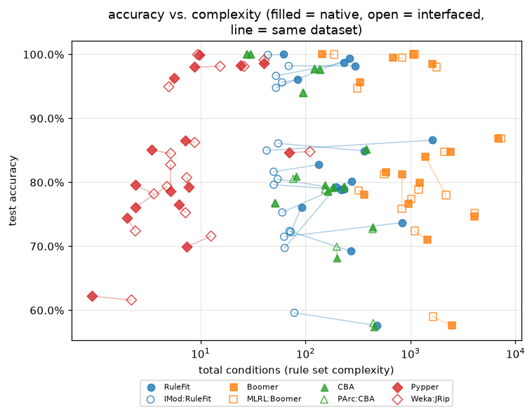
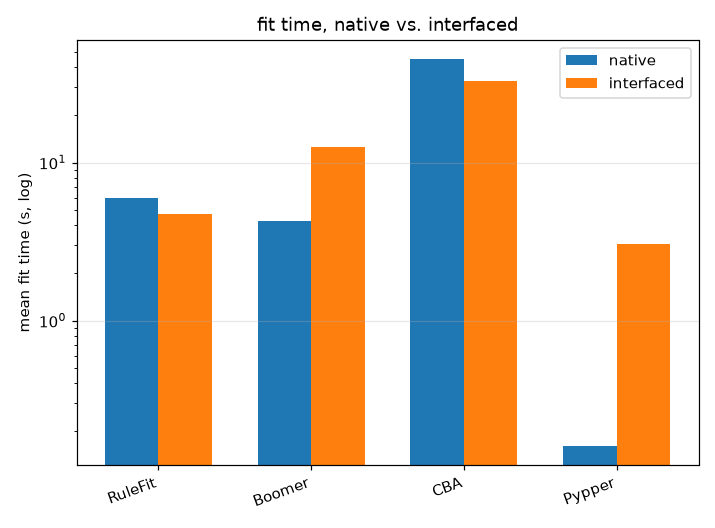

# Native rule learners vs. their external references

## Setup

**Full run** (16 datasets). Quick sanity check instead: `python demos/native_vs_interfaced.py` with no arguments.

Four native rule learners against the external reference implementations
they are modeled on, on 15 small/medium and
1 large binary datasets from `pyrulearn.experiments.catalog`.
Two more pairs are covered by their own demos instead: Slipper vs.
IMod:Slipper (`ripper_comparison.py`'s own preliminary check), and PyLORD
vs. the reference JavaLORD (`demos/seco_learners_comparison.py`). A
fifth pair, ORB vs. RKD:RuleBoosting, is checked
separately below instead of in the main comparison -- see "Why optimal
rule boosting isn't in the main comparison". Across 2 small datasets (3-fold), ORB and RKD:RuleBoosting agreed closely on accuracy (mean 89.78% vs. 89.89%, 0.11 points apart; mean fit time 54.79s vs. 8.94s) -- but neither's exhaustive search scales to the main comparison's wider, one-hot-encoded feature counts within the 300s cap, a limit of the exhaustive-search approach itself rather than of either implementation, so the pair is checked here instead of in the main table below.

- **RuleFit** -- A sparse (L1) logistic regression over a random forest's leaves (100 trees, depth 4) -- the candidate pool native RuleFit doesn't yet grow itself (see the module docstring). Its own sparsity knob is a plain regularization strength (`C`, optionally `cv`-selected by predictive score) with no cap on the final rule count -- unlike IMod:RuleFit (right), it ends up keeping noticeably more, smaller rules for similar accuracy (measured: 70.8 rules/268.7 conditions vs. 25.3/59.6, mean). Neither a smaller fixed `C` nor `cv=` reproduces IMod:RuleFit's rule count reliably across datasets (tested: `cv=5` went from 67->28 rules on one dataset but 29->39, the wrong way, on another) -- it's a different sparsity *mechanism*, not a mismatched default, so left unmatched here.
  **IMod:RuleFit** -- imodels' RuleFit: gradient-boosted trees as the rule pool, then a sparse regression over their leaves, deliberately capped at `max_rules=30` -- it searches the regularization path for the sparsest fit under that ceiling (`get_best_alpha_under_max_rules`), rather than picking strength by predictive score alone.
- **Boomer** -- ENDER configured as BOOMER's single-label case: logistic loss, L2-regularized Newton steps, up to 1,000 rules.
  **MLRL:Boomer** -- The reference BOOMER implementation (`mlrl-boomer`), with its instance/feature sampling turned off to match native Boomer's full-data search (see PAIRS above), and, in this demo only, run on a single thread: by default it uses every core of the machine, which the native learners (all single-threaded) don't.
- **CBA** -- Classification Based on Associations: mine class association rules (here capped at max_len=3, see ROADMAP.md), sort by precedence, select by database coverage (CBA-CB, "M1").
  **PArc:CBA** -- The reference CBA implementation (`pyarc`), mining with Borgelt's `fim`; its defaults mirror the native CBA's.
- **Pypper** -- IREP* growth-and-pruning plus `ReplaceReviseOptimization`, run per class -- a re-implementation of RIPPER, not a port.
  **Weka:JRip** -- Weka's reference RIPPER implementation, via a subprocess (`pyrulearn.interfaces.weka.WekaJRip`); also compared at a larger scale, and against wittgenstein's RIPPER too, in `demos/ripper_comparison.py`.

Protocol: 5-fold stratified cross-validation (3-fold for the large adult) (`pyrulearn.experiments.runner.run_cv`), one
`DataSpec` per training fold (`build_dataspec(max_intervals=8)`),
the test fold binarized against that same `DataSpec`. Each fit is capped
at 300s; a time-out or an error counts as a failure (and
as last in the ranking), not as the end of the run -- CBA/PArc:CBA's
itemset mining is the likeliest to hit this on wider data.

A fold that times out fails the whole cross-validation of that learner on that dataset (`run_cv`'s `stop_on_timeout`): its remaining folds are not run, and all its folds count as failures, so no mean rests on just the folds that finished.

Measures: test accuracy, number of rules and conditions, fit time.

Threads: every learner here runs on one thread. `mlrl-boomer` would use every core of the machine by
default (about 70 for a single fit on the machine these results were measured on), which no native
learner does, so `MLRL:Boomer` is limited to one thread
(`parallel_rule_refinement`, `parallel_statistic_update` and `parallel_prediction` set to `false`)
to compare like with like. This limit is set by this demo only: `MLRLBoomer` itself keeps MLRL's
default and uses every core, and with that it would be faster than reported here.
Fits run 10 at a time (`run_cv`'s `n_jobs`), each in its own process and timed there, with the numerical libraries limited to one thread (`OMP_NUM_THREADS=1` and its relatives). A check of the `dense_vs_modular` learners on 11 datasets found the fit times of 5 concurrent fits as close to a sequential run as a second sequential run (per-learner ratios and rankings alike); time ratios between learners are reproducible to about +-10% either way.

## Why optimal rule boosting isn't in the main comparison

Across 2 small datasets (3-fold), ORB and RKD:RuleBoosting agreed closely on accuracy (mean 89.78% vs. 89.89%, 0.11 points apart; mean fit time 54.79s vs. 8.94s) -- but neither's exhaustive search scales to the main comparison's wider, one-hot-encoded feature counts within the 300s cap, a limit of the exhaustive-search approach itself rather than of either implementation, so the pair is checked here instead of in the main table below.

| learner | accuracy | fit_time |
|---|---|---|
| ORB | 89.78% | 54.785 |
| RKD:RuleBoosting | 89.89% | 8.936 |

## Native vs. interfaced, pair by pair (mean across the 15 small/medium datasets and their folds)

| pair | learner | accuracy | n_rules | n_conditions | fit_time (s) | failures |
|---|---|--:|--:|--:|--:|--:|
| RuleFit | RuleFit | 83.60% | 70.8 | 268.7 | 2.12 | 0 |
| RuleFit | IMod:RuleFit | 82.25% | 25.3 | 59.6 | 2.15 | 0 |
| Boomer | Boomer | 84.19% | 231.7 | 1300.1 | 1.54 | 0 |
| Boomer | MLRL:Boomer | 83.58% | 232.6 | 1282.0 | 3.83 | 0 |
| CBA | CBA | 83.18% | 63.6 | 182.7 | 37.17 | 0 |
| CBA | PArc:CBA | 83.21% | 63.4 | 182.1 | 17.47 | 0 |
| Pypper | Pypper | 83.97% | 3.4 | 8.9 | 0.04 | 0 |
| Pypper | Weka:JRip | 84.20% | 4.0 | 10.4 | 0.60 | 0 |

## Summary by learner (mean rank across the same datasets)

| learner | accuracy | n_rules | n_conditions | fit_time (s) | wins | mean rank | failures |
|---|--:|--:|--:|--:|--:|--:|--:|
| Boomer | 84.19% | 231.7 | 1300.1 | 1.54 | 3.0 | 3.63 | 0 |
| Weka:JRip | 84.20% | 4.0 | 10.4 | 0.60 | 2.5 | 3.80 | 0 |
| Pypper | 83.97% | 3.4 | 8.9 | 0.04 | 5.0 | 4.27 | 0 |
| RuleFit | 83.60% | 70.8 | 268.7 | 2.12 | 0.7 | 4.30 | 0 |
| MLRL:Boomer | 83.58% | 232.6 | 1282.0 | 3.83 | 1.9 | 4.47 | 0 |
| CBA | 83.18% | 63.6 | 182.7 | 37.17 | 0.5 | 5.10 | 0 |
| PArc:CBA | 83.21% | 63.4 | 182.1 | 17.47 | 0.5 | 5.20 | 0 |
| IMod:RuleFit | 82.25% | 25.3 | 59.6 | 2.15 | 1.0 | 5.23 | 0 |

Sorted by mean rank. `wins` -- datasets where a learner's mean accuracy was (tied-for-)best, a tie split evenly; `mean rank` -- average accuracy rank across datasets, failures tied for last.

## The large dataset: adult

3-fold cross-validation, same 300s cap. `folds` counts the folds that finished; the other columns are means over those folds only.

| learner | folds | accuracy | n_rules | n_conditions | fit_time (s) |
|---|--:|--:|--:|--:|--:|
| Boomer | 3/3 | 86.81% | 751.0 | 6815.0 | 47.23 |
| CBA | 0/3 | -- | -- | -- | -- |
| IMod:RuleFit | 3/3 | 84.97% | 26.0 | 42.7 | 41.75 |
| MLRL:Boomer | 3/3 | 86.88% | 768.7 | 7241.0 | 170.31 |
| PArc:CBA | 0/3 | -- | -- | -- | -- |
| Pypper | 3/3 | 84.65% | 12.7 | 70.3 | 2.07 |
| RuleFit | 3/3 | 86.59% | 405.3 | 1612.0 | 69.28 |
| Weka:JRip | 3/3 | 84.80% | 19.3 | 110.3 | 53.72 |

## Per-dataset results, per learner (mean across folds)

| dataset | learner | accuracy | n_rules | n_conditions | fit_time |
|---|---|---|---|---|---|
| SPECT | Boomer | 81.63% | 128.2 | 581.0 | 0.653 |
| SPECT | CBA | 80.92% | 33.8 | 81.8 | 1.548 |
| SPECT | IMod:RuleFit | 81.66% | 21.2 | 49.8 | 1.302 |
| SPECT | MLRL:Boomer | 81.25% | 126.8 | 563.2 | 0.525 |
| SPECT | PArc:CBA | 80.54% | 31.8 | 76.6 | 0.446 |
| SPECT | Pypper | 78.67% | 1.0 | 5.2 | 0.016 |
| SPECT | RuleFit | 82.77% | 35.2 | 132.8 | 0.778 |
| SPECT | Weka:JRip | 82.77% | 1.0 | 5.2 | 0.385 |
| breast-cancer | Boomer | 70.99% | 263.8 | 1445.8 | 0.845 |
| breast-cancer | CBA | 68.19% | 69.2 | 199.6 | 4.021 |
| breast-cancer | IMod:RuleFit | 72.37% | 27.2 | 70.4 | 1.637 |
| breast-cancer | MLRL:Boomer | 72.40% | 229.0 | 1095.0 | 0.800 |
| breast-cancer | PArc:CBA | 69.93% | 68.8 | 198.6 | 1.704 |
| breast-cancer | Pypper | 74.45% | 1.2 | 2.0 | 0.016 |
| breast-cancer | RuleFit | 69.24% | 68.8 | 269.2 | 0.964 |
| breast-cancer | Weka:JRip | 72.40% | 1.2 | 2.4 | 0.417 |
| colic | Boomer | 83.98% | 290.2 | 1406.4 | 1.109 |
| colic | CBA | 79.34% | 79.0 | 232.4 | 73.648 |
| colic | IMod:RuleFit | 75.29% | 28.6 | 60.2 | 1.449 |
| colic | MLRL:Boomer | 78.01% | 342.6 | 2178.2 | 2.934 |
| colic | PArc:CBA | 79.07% | 80.0 | 235.4 | 29.797 |
| colic | Pypper | 85.06% | 1.6 | 3.4 | 0.028 |
| colic | RuleFit | 80.17% | 73.8 | 277.2 | 0.972 |
| colic | Weka:JRip | 84.52% | 2.6 | 5.2 | 0.421 |
| credit-approval | Boomer | 84.78% | 374.4 | 2420.4 | 1.620 |
| credit-approval | CBA | 85.22% | 130.2 | 379.6 | 33.257 |
| credit-approval | IMod:RuleFit | 86.09% | 24.2 | 55.0 | 1.767 |
| credit-approval | MLRL:Boomer | 84.78% | 356.6 | 2114.8 | 2.877 |
| credit-approval | PArc:CBA | 85.07% | 129.4 | 377.4 | 13.510 |
| credit-approval | Pypper | 86.52% | 2.8 | 7.2 | 0.044 |
| credit-approval | RuleFit | 84.93% | 92.8 | 362.0 | 1.903 |
| credit-approval | Weka:JRip | 86.23% | 4.2 | 8.8 | 0.594 |
| credit-g | Boomer | 74.70% | 578.2 | 4055.8 | 1.746 |
| credit-g | CBA | 73.00% | 147.0 | 436.4 | 73.478 |
| credit-g | IMod:RuleFit | 71.50% | 26.2 | 62.6 | 1.653 |
| credit-g | MLRL:Boomer | 75.20% | 582.6 | 4079.4 | 3.833 |
| credit-g | PArc:CBA | 72.70% | 146.8 | 435.8 | 49.681 |
| credit-g | Pypper | 69.90% | 2.4 | 7.4 | 0.043 |
| credit-g | RuleFit | 73.70% | 211.8 | 834.6 | 2.050 |
| credit-g | Weka:JRip | 71.60% | 3.4 | 12.6 | 0.636 |
| dresses-sales | Boomer | 57.20% | 356.8 | 2385.0 | 1.375 |
| dresses-sales | CBA | 57.40% | 155.2 | 448.4 | 155.007 |
| dresses-sales | IMod:RuleFit | 59.60% | 28.2 | 78.4 | 1.703 |
| dresses-sales | MLRL:Boomer | 59.00% | 296.4 | 1635.6 | 2.876 |
| dresses-sales | PArc:CBA | 58.00% | 153.2 | 442.8 | 58.127 |
| dresses-sales | Pypper | 62.20% | 1.2 | 1.4 | 0.023 |
| dresses-sales | RuleFit | 57.60% | 125.6 | 480.2 | 1.382 |
| dresses-sales | Weka:JRip | 61.60% | 1.6 | 2.2 | 0.527 |
| heart-c | Boomer | 79.89% | 240.8 | 1231.8 | 0.927 |
| heart-c | CBA | 79.22% | 62.2 | 182.4 | 12.106 |
| heart-c | IMod:RuleFit | 80.51% | 26.6 | 54.4 | 1.231 |
| heart-c | MLRL:Boomer | 78.90% | 242.4 | 1197.2 | 1.047 |
| heart-c | PArc:CBA | 79.22% | 62.8 | 184.2 | 4.661 |
| heart-c | Pypper | 76.56% | 2.4 | 6.2 | 0.020 |
| heart-c | RuleFit | 78.89% | 61.4 | 232.8 | 0.844 |
| heart-c | Weka:JRip | 75.25% | 3.2 | 7.2 | 0.441 |
| heart-h | Boomer | 81.29% | 167.6 | 832.0 | 0.743 |
| heart-h | CBA | 78.56% | 59.4 | 164.0 | 7.718 |
| heart-h | IMod:RuleFit | 69.74% | 26.0 | 63.4 | 1.256 |
| heart-h | MLRL:Boomer | 75.84% | 168.0 | 827.8 | 0.778 |
| heart-h | PArc:CBA | 78.56% | 59.4 | 164.0 | 2.784 |
| heart-h | Pypper | 79.56% | 1.6 | 2.4 | 0.019 |
| heart-h | RuleFit | 79.25% | 53.8 | 195.0 | 0.828 |
| heart-h | Weka:JRip | 78.20% | 2.2 | 3.6 | 0.413 |
| heart-statlog | Boomer | 76.67% | 198.4 | 952.0 | 0.898 |
| heart-statlog | CBA | 79.63% | 52.2 | 152.8 | 11.380 |
| heart-statlog | IMod:RuleFit | 79.63% | 24.2 | 50.0 | 1.259 |
| heart-statlog | MLRL:Boomer | 77.41% | 215.6 | 1017.2 | 0.954 |
| heart-statlog | PArc:CBA | 78.89% | 52.6 | 154.0 | 4.864 |
| heart-statlog | Pypper | 79.26% | 3.6 | 7.8 | 0.034 |
| heart-statlog | RuleFit | 78.89% | 57.8 | 220.0 | 0.998 |
| heart-statlog | Weka:JRip | 80.74% | 3.4 | 7.4 | 0.397 |
| hepatitis | Boomer | 78.06% | 94.0 | 361.8 | 0.760 |
| hepatitis | CBA | 76.77% | 18.8 | 51.2 | 13.302 |
| hepatitis | IMod:RuleFit | 72.26% | 30.6 | 72.6 | 1.609 |
| hepatitis | MLRL:Boomer | 78.71% | 86.0 | 321.4 | 0.711 |
| hepatitis | PArc:CBA | 76.77% | 18.8 | 51.2 | 4.678 |
| hepatitis | Pypper | 76.13% | 1.8 | 2.4 | 0.018 |
| hepatitis | RuleFit | 76.13% | 28.8 | 91.6 | 0.665 |
| hepatitis | Weka:JRip | 79.35% | 2.2 | 4.8 | 0.456 |
| kr-vs-kp | Boomer | 99.50% | 121.4 | 684.2 | 1.822 |
| kr-vs-kp | CBA | 97.75% | 41.8 | 122.0 | 5.003 |
| kr-vs-kp | IMod:RuleFit | 96.65% | 19.2 | 52.4 | 1.977 |
| kr-vs-kp | MLRL:Boomer | 99.50% | 150.4 | 831.2 | 3.920 |
| kr-vs-kp | PArc:CBA | 97.75% | 41.8 | 122.0 | 2.652 |
| kr-vs-kp | Pypper | 98.56% | 11.8 | 40.2 | 0.127 |
| kr-vs-kp | RuleFit | 98.69% | 61.4 | 231.6 | 4.223 |
| kr-vs-kp | Weka:JRip | 99.12% | 13.4 | 40.4 | 0.776 |
| mushroom | Boomer | 100.00% | 41.6 | 144.4 | 5.691 |
| mushroom | CBA | 100.00% | 9.2 | 27.6 | 132.999 |
| mushroom | IMod:RuleFit | 99.91% | 20.6 | 43.8 | 7.913 |
| mushroom | MLRL:Boomer | 100.00% | 56.0 | 187.0 | 25.385 |
| mushroom | PArc:CBA | 100.00% | 9.2 | 27.6 | 68.218 |
| mushroom | Pypper | 99.96% | 6.6 | 9.8 | 0.100 |
| mushroom | RuleFit | 100.00% | 16.8 | 61.4 | 7.466 |
| mushroom | Weka:JRip | 99.98% | 6.0 | 9.4 | 1.711 |
| sick | Boomer | 98.52% | 274.6 | 1610.8 | 3.219 |
| sick | CBA | 97.67% | 52.0 | 138.0 | 31.157 |
| sick | IMod:RuleFit | 98.20% | 28.6 | 69.2 | 3.958 |
| sick | MLRL:Boomer | 98.01% | 291.4 | 1779.0 | 8.876 |
| sick | PArc:CBA | 97.69% | 51.6 | 136.8 | 19.996 |
| sick | Pypper | 98.01% | 2.8 | 8.8 | 0.057 |
| sick | RuleFit | 98.22% | 77.0 | 296.2 | 5.452 |
| sick | Weka:JRip | 98.14% | 4.8 | 15.4 | 0.924 |
| tic-tac-toe | Boomer | 100.00% | 245.8 | 1059.8 | 1.003 |
| tic-tac-toe | CBA | 100.00% | 10.0 | 30.0 | 2.405 |
| tic-tac-toe | IMod:RuleFit | 94.78% | 20.4 | 52.4 | 1.646 |
| tic-tac-toe | MLRL:Boomer | 100.00% | 253.8 | 1093.4 | 1.439 |
| tic-tac-toe | PArc:CBA | 100.00% | 10.0 | 30.0 | 0.817 |
| tic-tac-toe | Pypper | 98.33% | 8.0 | 24.2 | 0.059 |
| tic-tac-toe | RuleFit | 99.37% | 68.8 | 262.4 | 2.115 |
| tic-tac-toe | Weka:JRip | 98.12% | 8.4 | 26.0 | 0.542 |
| vote | Boomer | 95.63% | 99.8 | 329.8 | 0.618 |
| vote | CBA | 94.02% | 34.4 | 94.6 | 0.569 |
| vote | IMod:RuleFit | 95.63% | 27.0 | 59.8 | 1.869 |
| vote | MLRL:Boomer | 94.71% | 91.2 | 309.6 | 0.568 |
| vote | PArc:CBA | 94.02% | 34.4 | 94.6 | 0.156 |
| vote | Pypper | 96.32% | 2.6 | 5.6 | 0.039 |
| vote | RuleFit | 96.09% | 28.4 | 84.2 | 1.148 |
| vote | Weka:JRip | 94.94% | 2.2 | 5.0 | 0.368 |

