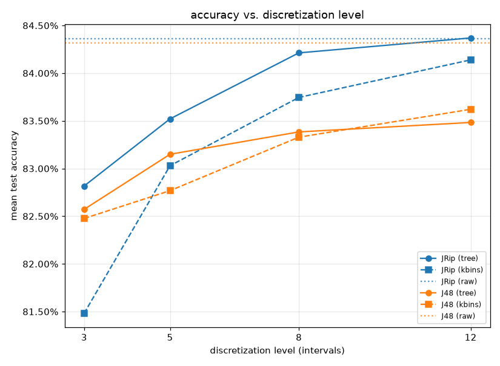

# Numeric attributes: intrinsic handling vs. discretization (JRip / J48)

## Setup

**Full run** (27 small and medium-sized datasets, all attributes numeric, 10-fold). For a quick sanity check instead (5 small datasets, 3-fold): `python demos/numeric_discretization.py` with no arguments -- its output isn't checked in (see `numeric_discretization_quick_report.md` after running it).

Weka's JRip and J48 compared across 9 data preparations per dataset: `raw`
(Weka's own intrinsic numeric thresholding), our own decision-tree-based
discretization (`build_dataspec`/`tree_thresholds`) and `sklearn.preprocessing.
KBinsDiscretizer` (`strategy='quantile'`, unsupervised), each of the
latter two at 3, 5, 8, 12 intervals. Both discretizers
are fit on the training fold only, per fold; the test fold is binarized
against that same fold's thresholds.

Measures: test accuracy, rule count, condition count, and (for the discretized
preps) the number of binary features that discretization produced. Fit time
is recorded but secondary here -- every fit is a single bounded Weka
subprocess call regardless of preparation. Each fit is capped at
120s; a timeout or an exception is recorded as a failure, not
fatal to the run.

Missing values: in the discretized preps a missing value makes both a
threshold feature and its negation false (e.g. neither `plas>=154.5` nor
`plas<154.5`), so a rule never covers it through that attribute. Weka's
own `raw` handling differs, which can hurt the discretized preps on
datasets with many missing values -- here mainly `diabetes` (376 of 768
rows with a missing value; `breast-w` has 16 of 699).

## Binary features produced per discretization level

| prep | mean binary features |
|---|--:|
| tree@3 | 91.5 |
| tree@5 | 164.0 |
| tree@8 | 271.8 |
| tree@12 | 412.1 |
| kbins@3 | 69.7 |
| kbins@5 | 136.3 |
| kbins@8 | 231.6 |
| kbins@12 | 350.0 |

## Summary by variant (mean across every dataset and fold)

| variant | accuracy | n_rules | conds/rule | fit_time (s) | wins | mean rank |
|---|--:|--:|--:|--:|--:|--:|
| JRip:raw | 84.36% | 7.5 | 2.6 | 0.60 | 0.0 | 6.83 |
| J48:raw | 84.32% | 40.7 | 6.3 | 0.49 | 5.0 | 7.41 |
| J48:kbins@12 | 83.62% | 47.3 | 7.5 | 1.35 | 4.0 | 7.52 |
| JRip:tree@8 | 83.98% | 7.4 | 2.8 | 1.36 | 3.0 | 8.24 |
| JRip:tree@12 | 84.03% | 7.7 | 2.8 | 1.86 | 0.0 | 8.30 |
| JRip:kbins@12 | 84.14% | 8.0 | 3.0 | 1.65 | 1.5 | 8.89 |
| J48:kbins@8 | 83.33% | 43.0 | 7.0 | 1.04 | 4.0 | 9.02 |
| J48:tree@8 | 83.28% | 38.0 | 7.3 | 1.15 | 3.0 | 9.11 |
| J48:tree@12 | 83.37% | 41.9 | 7.9 | 1.53 | 0.0 | 9.11 |
| JRip:kbins@8 | 83.75% | 7.7 | 3.1 | 1.23 | 0.5 | 9.24 |
| J48:tree@5 | 83.17% | 30.5 | 6.5 | 0.85 | 2.0 | 9.46 |
| JRip:tree@5 | 83.18% | 6.9 | 2.8 | 0.98 | 0.0 | 9.87 |
| JRip:kbins@5 | 83.03% | 7.0 | 3.0 | 0.89 | 0.0 | 10.33 |
| J48:tree@3 | 82.57% | 23.3 | 5.4 | 0.65 | 1.0 | 10.65 |
| JRip:tree@3 | 82.74% | 6.1 | 2.7 | 0.72 | 0.0 | 10.67 |
| J48:kbins@5 | 82.77% | 36.6 | 6.0 | 0.78 | 0.0 | 10.76 |
| J48:kbins@3 | 82.48% | 27.5 | 4.8 | 0.59 | 2.0 | 12.06 |
| JRip:kbins@3 | 81.48% | 6.1 | 3.2 | 0.65 | 1.0 | 13.54 |

`wins` -- datasets where a variant's mean accuracy was (tied-for-)best, a tie split evenly; `mean rank` -- average accuracy rank across datasets, failures tied for last.

## Per-dataset results, per variant (mean across folds)

| dataset | algorithm | prep | accuracy | n_rules | n_conditions | conds_per_rule | fit_time |
|---|---|---|---|---|---|---|---|
| analcatdata_authorship | J48 | kbins@12 | 95.48% | 21.3 | 123.3 | 5.7 | 2.980 |
| analcatdata_authorship | J48 | kbins@3 | 92.39% | 26.2 | 145.9 | 5.5 | 1.001 |
| analcatdata_authorship | J48 | kbins@5 | 90.61% | 25.5 | 140.2 | 5.5 | 1.572 |
| analcatdata_authorship | J48 | kbins@8 | 93.58% | 25.3 | 148.7 | 5.9 | 2.264 |
| analcatdata_authorship | J48 | raw | 95.12% | 20.2 | 97.5 | 4.8 | 0.563 |
| analcatdata_authorship | J48 | tree@12 | 95.13% | 18.6 | 98.4 | 5.3 | 3.656 |
| analcatdata_authorship | J48 | tree@3 | 93.46% | 20.6 | 107.0 | 5.2 | 1.121 |
| analcatdata_authorship | J48 | tree@5 | 93.46% | 19.7 | 100.6 | 5.1 | 1.691 |
| analcatdata_authorship | J48 | tree@8 | 94.53% | 18.3 | 91.4 | 5.0 | 2.556 |
| analcatdata_authorship | JRip | kbins@12 | 92.51% | 9.4 | 19.9 | 2.1 | 3.501 |
| analcatdata_authorship | JRip | kbins@3 | 92.74% | 11.2 | 31.5 | 2.8 | 1.108 |
| analcatdata_authorship | JRip | kbins@5 | 93.46% | 10.0 | 25.4 | 2.6 | 1.826 |
| analcatdata_authorship | JRip | kbins@8 | 93.34% | 8.7 | 21.1 | 2.4 | 2.590 |
| analcatdata_authorship | JRip | raw | 94.65% | 9.8 | 18.7 | 1.9 | 0.785 |
| analcatdata_authorship | JRip | tree@12 | 94.29% | 9.9 | 19.6 | 2.0 | 4.350 |
| analcatdata_authorship | JRip | tree@3 | 95.13% | 10.8 | 21.6 | 2.0 | 1.254 |
| analcatdata_authorship | JRip | tree@5 | 93.57% | 10.1 | 19.8 | 2.0 | 1.951 |
| analcatdata_authorship | JRip | tree@8 | 93.70% | 10.0 | 19.7 | 2.0 | 3.119 |
| balance-scale | J48 | kbins@12 | 78.86% | 34.5 | 223.9 | 6.4 | 0.395 |
| balance-scale | J48 | kbins@3 | 78.23% | 24.4 | 128.1 | 5.2 | 0.391 |
| balance-scale | J48 | kbins@5 | 79.34% | 24.0 | 134.7 | 5.5 | 0.390 |
| balance-scale | J48 | kbins@8 | 78.86% | 34.5 | 223.9 | 6.4 | 0.408 |
| balance-scale | J48 | raw | 78.23% | 42.9 | 278.0 | 6.5 | 0.379 |
| balance-scale | J48 | tree@12 | 77.58% | 40.2 | 309.3 | 7.7 | 0.464 |
| balance-scale | J48 | tree@3 | 77.58% | 40.2 | 309.3 | 7.7 | 0.445 |
| balance-scale | J48 | tree@5 | 77.58% | 40.2 | 309.3 | 7.7 | 0.444 |
| balance-scale | J48 | tree@8 | 77.58% | 40.2 | 309.3 | 7.7 | 0.434 |
| balance-scale | JRip | kbins@12 | 82.71% | 9.5 | 30.6 | 3.2 | 0.455 |
| balance-scale | JRip | kbins@3 | 78.69% | 8.1 | 25.6 | 3.1 | 0.427 |
| balance-scale | JRip | kbins@5 | 79.98% | 7.4 | 21.9 | 2.9 | 0.432 |
| balance-scale | JRip | kbins@8 | 82.71% | 9.5 | 30.6 | 3.2 | 0.464 |
| balance-scale | JRip | raw | 79.35% | 10.0 | 29.9 | 3.0 | 0.416 |
| balance-scale | JRip | tree@12 | 76.31% | 7.4 | 23.8 | 3.2 | 0.483 |
| balance-scale | JRip | tree@3 | 76.31% | 7.4 | 23.8 | 3.2 | 0.489 |
| balance-scale | JRip | tree@5 | 76.31% | 7.4 | 23.8 | 3.2 | 0.506 |
| balance-scale | JRip | tree@8 | 76.31% | 7.4 | 23.8 | 3.2 | 0.490 |
| banknote-authentication | J48 | kbins@12 | 98.32% | 17.8 | 88.7 | 4.9 | 0.720 |
| banknote-authentication | J48 | kbins@3 | 94.39% | 15.1 | 74.3 | 4.9 | 0.441 |
| banknote-authentication | J48 | kbins@5 | 98.47% | 20.1 | 99.4 | 4.9 | 0.502 |
| banknote-authentication | J48 | kbins@8 | 99.27% | 17.7 | 88.8 | 5.0 | 0.606 |
| banknote-authentication | J48 | raw | 98.69% | 15.6 | 71.0 | 4.5 | 0.412 |
| banknote-authentication | J48 | tree@12 | 98.69% | 13.1 | 56.1 | 4.2 | 0.702 |
| banknote-authentication | J48 | tree@3 | 91.26% | 4.9 | 12.4 | 2.5 | 0.434 |
| banknote-authentication | J48 | tree@5 | 97.01% | 9.4 | 33.5 | 3.5 | 0.491 |
| banknote-authentication | J48 | tree@8 | 98.69% | 11.3 | 44.3 | 3.9 | 0.595 |
| banknote-authentication | JRip | kbins@12 | 99.13% | 7.6 | 20.2 | 2.7 | 0.798 |
| banknote-authentication | JRip | kbins@3 | 93.66% | 5.4 | 16.8 | 3.1 | 0.493 |
| banknote-authentication | JRip | kbins@5 | 98.32% | 7.7 | 23.8 | 3.1 | 0.568 |
| banknote-authentication | JRip | kbins@8 | 99.12% | 8.3 | 24.4 | 2.9 | 0.681 |
| banknote-authentication | JRip | raw | 97.96% | 7.1 | 16.0 | 2.3 | 0.476 |
| banknote-authentication | JRip | tree@12 | 98.76% | 6.2 | 15.1 | 2.4 | 0.780 |
| banknote-authentication | JRip | tree@3 | 91.04% | 2.4 | 5.2 | 2.1 | 0.481 |
| banknote-authentication | JRip | tree@5 | 97.23% | 4.7 | 10.4 | 2.2 | 0.543 |
| banknote-authentication | JRip | tree@8 | 98.91% | 5.3 | 12.0 | 2.3 | 0.640 |
| blood-transfusion-service-center | J48 | kbins@12 | 79.40% | 8.7 | 38.1 | 4.1 | 0.504 |
| blood-transfusion-service-center | J48 | kbins@3 | 77.81% | 4.0 | 9.0 | 2.2 | 0.399 |
| blood-transfusion-service-center | J48 | kbins@5 | 77.00% | 6.1 | 20.9 | 3.4 | 0.412 |
| blood-transfusion-service-center | J48 | kbins@8 | 78.33% | 6.5 | 24.3 | 3.5 | 0.455 |
| blood-transfusion-service-center | J48 | raw | 78.99% | 6.8 | 26.9 | 3.6 | 0.373 |
| blood-transfusion-service-center | J48 | tree@12 | 78.74% | 8.2 | 32.5 | 3.8 | 0.560 |
| blood-transfusion-service-center | J48 | tree@3 | 79.27% | 5.0 | 14.0 | 2.8 | 0.391 |
| blood-transfusion-service-center | J48 | tree@5 | 79.40% | 5.4 | 16.2 | 3.0 | 0.425 |
| blood-transfusion-service-center | J48 | tree@8 | 78.74% | 6.6 | 22.3 | 3.3 | 0.478 |
| blood-transfusion-service-center | JRip | kbins@12 | 78.87% | 2.5 | 7.1 | 2.8 | 0.545 |
| blood-transfusion-service-center | JRip | kbins@3 | 76.60% | 1.0 | 3.1 | 3.1 | 0.373 |
| blood-transfusion-service-center | JRip | kbins@5 | 77.40% | 1.2 | 3.7 | 3.0 | 0.411 |
| blood-transfusion-service-center | JRip | kbins@8 | 78.47% | 1.2 | 4.1 | 3.4 | 0.504 |
| blood-transfusion-service-center | JRip | raw | 78.34% | 1.9 | 5.2 | 2.8 | 0.378 |
| blood-transfusion-service-center | JRip | tree@12 | 78.47% | 2.2 | 5.9 | 2.6 | 0.554 |
| blood-transfusion-service-center | JRip | tree@3 | 79.27% | 2.0 | 5.1 | 2.5 | 0.382 |
| blood-transfusion-service-center | JRip | tree@5 | 79.00% | 2.1 | 5.4 | 2.5 | 0.428 |
| blood-transfusion-service-center | JRip | tree@8 | 79.14% | 2.0 | 5.1 | 2.5 | 0.482 |
| breast-w | J48 | kbins@12 | 93.85% | 10.8 | 43.4 | 3.9 | 0.502 |
| breast-w | J48 | kbins@3 | 93.42% | 11.5 | 45.1 | 3.9 | 0.404 |
| breast-w | J48 | kbins@5 | 94.42% | 8.6 | 29.4 | 3.4 | 0.451 |
| breast-w | J48 | kbins@8 | 94.14% | 10.3 | 39.8 | 3.8 | 0.465 |
| breast-w | J48 | raw | 92.99% | 12.2 | 52.1 | 4.2 | 0.370 |
| breast-w | J48 | tree@12 | 92.56% | 12.4 | 61.9 | 4.8 | 0.726 |
| breast-w | J48 | tree@3 | 92.56% | 12.4 | 61.9 | 4.8 | 0.704 |
| breast-w | J48 | tree@5 | 92.56% | 12.4 | 61.9 | 4.8 | 0.730 |
| breast-w | J48 | tree@8 | 92.56% | 12.4 | 61.9 | 4.8 | 0.702 |
| breast-w | JRip | kbins@12 | 96.42% | 4.8 | 10.3 | 2.1 | 0.511 |
| breast-w | JRip | kbins@3 | 96.14% | 3.6 | 8.7 | 2.4 | 0.421 |
| breast-w | JRip | kbins@5 | 94.85% | 4.2 | 8.6 | 2.0 | 0.439 |
| breast-w | JRip | kbins@8 | 95.13% | 4.4 | 9.2 | 2.1 | 0.505 |
| breast-w | JRip | raw | 95.42% | 5.0 | 10.1 | 2.0 | 0.422 |
| breast-w | JRip | tree@12 | 94.84% | 5.1 | 12.9 | 2.5 | 0.780 |
| breast-w | JRip | tree@3 | 94.84% | 5.1 | 12.9 | 2.5 | 0.775 |
| breast-w | JRip | tree@5 | 94.84% | 5.1 | 12.9 | 2.5 | 0.763 |
| breast-w | JRip | tree@8 | 94.84% | 5.1 | 12.9 | 2.5 | 0.764 |
| climate-model-simulation-crashes | J48 | kbins@12 | 90.93% | 16.7 | 92.1 | 5.4 | 0.974 |
| climate-model-simulation-crashes | J48 | kbins@3 | 89.81% | 14.8 | 82.9 | 5.6 | 0.479 |
| climate-model-simulation-crashes | J48 | kbins@5 | 91.85% | 15.2 | 89.3 | 5.8 | 0.601 |
| climate-model-simulation-crashes | J48 | kbins@8 | 90.19% | 15.7 | 101.1 | 6.3 | 0.740 |
| climate-model-simulation-crashes | J48 | raw | 91.85% | 12.1 | 59.6 | 4.9 | 0.415 |
| climate-model-simulation-crashes | J48 | tree@12 | 91.67% | 9.7 | 42.6 | 4.2 | 1.031 |
| climate-model-simulation-crashes | J48 | tree@3 | 93.70% | 8.8 | 31.8 | 3.5 | 0.500 |
| climate-model-simulation-crashes | J48 | tree@5 | 93.15% | 10.0 | 42.2 | 4.1 | 0.607 |
| climate-model-simulation-crashes | J48 | tree@8 | 93.33% | 10.6 | 45.8 | 4.2 | 0.777 |
| climate-model-simulation-crashes | JRip | kbins@12 | 93.33% | 2.4 | 8.2 | 3.4 | 1.092 |
| climate-model-simulation-crashes | JRip | kbins@3 | 91.85% | 2.6 | 10.6 | 4.1 | 0.510 |
| climate-model-simulation-crashes | JRip | kbins@5 | 94.07% | 2.6 | 9.3 | 3.5 | 0.617 |
| climate-model-simulation-crashes | JRip | kbins@8 | 90.93% | 2.9 | 11.4 | 4.0 | 0.806 |
| climate-model-simulation-crashes | JRip | raw | 93.15% | 2.0 | 6.6 | 3.3 | 0.453 |
| climate-model-simulation-crashes | JRip | tree@12 | 93.33% | 3.0 | 9.7 | 3.2 | 1.049 |
| climate-model-simulation-crashes | JRip | tree@3 | 91.48% | 2.5 | 7.5 | 3.0 | 0.492 |
| climate-model-simulation-crashes | JRip | tree@5 | 93.89% | 2.7 | 8.4 | 3.1 | 0.622 |
| climate-model-simulation-crashes | JRip | tree@8 | 94.81% | 2.7 | 8.1 | 3.0 | 0.815 |
| diabetes | J48 | kbins@12 | 54.80% | 58.6 | 634.8 | 10.7 | 0.772 |
| diabetes | J48 | kbins@3 | 64.45% | 22.7 | 138.8 | 6.0 | 0.443 |
| diabetes | J48 | kbins@5 | 55.34% | 57.3 | 512.2 | 8.9 | 0.545 |
| diabetes | J48 | kbins@8 | 53.88% | 52.5 | 564.4 | 10.5 | 0.655 |
| diabetes | J48 | raw | 69.91% | 16.1 | 83.0 | 5.1 | 0.416 |
| diabetes | J48 | tree@12 | 55.73% | 50.4 | 617.8 | 12.0 | 0.853 |
| diabetes | J48 | tree@3 | 58.06% | 27.8 | 190.1 | 6.7 | 0.456 |
| diabetes | J48 | tree@5 | 59.38% | 36.2 | 310.6 | 8.5 | 0.560 |
| diabetes | J48 | tree@8 | 56.63% | 43.0 | 438.7 | 10.1 | 0.709 |
| diabetes | JRip | kbins@12 | 75.39% | 3.1 | 9.8 | 3.1 | 0.813 |
| diabetes | JRip | kbins@3 | 76.30% | 1.9 | 5.9 | 2.9 | 0.451 |
| diabetes | JRip | kbins@5 | 75.26% | 3.1 | 9.3 | 2.9 | 0.549 |
| diabetes | JRip | kbins@8 | 75.52% | 3.5 | 11.2 | 3.1 | 0.669 |
| diabetes | JRip | raw | 75.65% | 2.6 | 6.4 | 2.4 | 0.408 |
| diabetes | JRip | tree@12 | 74.09% | 3.1 | 9.5 | 3.0 | 0.808 |
| diabetes | JRip | tree@3 | 73.95% | 3.1 | 8.9 | 2.9 | 0.469 |
| diabetes | JRip | tree@5 | 71.88% | 4.0 | 13.5 | 3.3 | 0.534 |
| diabetes | JRip | tree@8 | 72.53% | 3.9 | 12.4 | 3.1 | 0.665 |
| ecoli | J48 | kbins@12 | 81.60% | 15.9 | 78.8 | 4.8 | 0.477 |
| ecoli | J48 | kbins@3 | 80.94% | 12.3 | 50.6 | 4.1 | 0.356 |
| ecoli | J48 | kbins@5 | 80.65% | 15.6 | 69.7 | 4.4 | 0.380 |
| ecoli | J48 | kbins@8 | 82.76% | 13.9 | 59.3 | 4.1 | 0.416 |
| ecoli | J48 | raw | 80.70% | 18.8 | 95.2 | 5.0 | 0.366 |
| ecoli | J48 | tree@12 | 80.40% | 16.3 | 80.3 | 4.9 | 0.486 |
| ecoli | J48 | tree@3 | 80.10% | 11.7 | 46.6 | 3.9 | 0.372 |
| ecoli | J48 | tree@5 | 81.58% | 14.0 | 63.9 | 4.4 | 0.400 |
| ecoli | J48 | tree@8 | 80.12% | 15.6 | 75.3 | 4.8 | 0.442 |
| ecoli | JRip | kbins@12 | 81.00% | 7.7 | 20.1 | 2.6 | 0.523 |
| ecoli | JRip | kbins@3 | 79.47% | 5.5 | 14.1 | 2.6 | 0.397 |
| ecoli | JRip | kbins@5 | 80.93% | 7.7 | 20.1 | 2.6 | 0.423 |
| ecoli | JRip | kbins@8 | 82.48% | 6.0 | 14.4 | 2.4 | 0.473 |
| ecoli | JRip | raw | 81.56% | 8.1 | 17.0 | 2.1 | 0.385 |
| ecoli | JRip | tree@12 | 82.46% | 8.3 | 18.6 | 2.2 | 0.544 |
| ecoli | JRip | tree@3 | 82.78% | 6.7 | 14.5 | 2.2 | 0.379 |
| ecoli | JRip | tree@5 | 81.60% | 7.5 | 16.4 | 2.2 | 0.430 |
| ecoli | JRip | tree@8 | 83.39% | 7.2 | 16.2 | 2.3 | 0.468 |
| glass | J48 | kbins@12 | 69.61% | 28.1 | 199.7 | 7.1 | 0.506 |
| glass | J48 | kbins@3 | 69.13% | 21.9 | 109.4 | 5.0 | 0.372 |
| glass | J48 | kbins@5 | 67.32% | 28.0 | 176.1 | 6.2 | 0.411 |
| glass | J48 | kbins@8 | 75.76% | 26.1 | 169.3 | 6.4 | 0.450 |
| glass | J48 | raw | 66.47% | 23.6 | 140.9 | 5.9 | 0.364 |
| glass | J48 | tree@12 | 70.15% | 23.2 | 149.0 | 6.4 | 0.556 |
| glass | J48 | tree@3 | 67.77% | 14.4 | 71.0 | 4.9 | 0.378 |
| glass | J48 | tree@5 | 66.41% | 20.0 | 116.5 | 5.8 | 0.421 |
| glass | J48 | tree@8 | 67.81% | 22.7 | 141.2 | 6.2 | 0.488 |
| glass | JRip | kbins@12 | 69.20% | 8.2 | 22.1 | 2.7 | 0.541 |
| glass | JRip | kbins@3 | 61.23% | 5.5 | 18.0 | 3.3 | 0.372 |
| glass | JRip | kbins@5 | 69.68% | 7.4 | 21.9 | 2.9 | 0.425 |
| glass | JRip | kbins@8 | 63.03% | 8.3 | 22.1 | 2.7 | 0.478 |
| glass | JRip | raw | 66.36% | 6.7 | 15.1 | 2.2 | 0.338 |
| glass | JRip | tree@12 | 67.40% | 7.1 | 16.2 | 2.3 | 0.567 |
| glass | JRip | tree@3 | 65.91% | 6.6 | 17.4 | 2.7 | 0.355 |
| glass | JRip | tree@5 | 65.97% | 6.4 | 15.4 | 2.4 | 0.398 |
| glass | JRip | tree@8 | 66.84% | 6.6 | 16.1 | 2.4 | 0.484 |
| ionosphere | J48 | kbins@12 | 90.30% | 12.2 | 70.7 | 5.7 | 1.106 |
| ionosphere | J48 | kbins@3 | 87.44% | 19.2 | 94.3 | 4.9 | 0.512 |
| ionosphere | J48 | kbins@5 | 88.31% | 16.6 | 93.2 | 5.6 | 0.656 |
| ionosphere | J48 | kbins@8 | 88.30% | 16.4 | 86.4 | 5.2 | 0.843 |
| ionosphere | J48 | raw | 89.17% | 13.2 | 70.9 | 5.3 | 0.412 |
| ionosphere | J48 | tree@12 | 93.44% | 8.1 | 36.3 | 4.4 | 1.210 |
| ionosphere | J48 | tree@3 | 92.29% | 10.1 | 52.4 | 5.0 | 0.512 |
| ionosphere | J48 | tree@5 | 92.01% | 9.6 | 49.5 | 5.0 | 0.669 |
| ionosphere | J48 | tree@8 | 93.72% | 8.2 | 37.2 | 4.5 | 0.903 |
| ionosphere | JRip | kbins@12 | 88.87% | 5.8 | 9.7 | 1.7 | 1.141 |
| ionosphere | JRip | kbins@3 | 87.74% | 6.2 | 14.1 | 2.2 | 0.538 |
| ionosphere | JRip | kbins@5 | 88.33% | 6.2 | 12.0 | 1.9 | 0.684 |
| ionosphere | JRip | kbins@8 | 85.75% | 5.8 | 11.4 | 1.9 | 0.894 |
| ionosphere | JRip | raw | 88.60% | 4.0 | 5.7 | 1.4 | 0.444 |
| ionosphere | JRip | tree@12 | 88.02% | 5.5 | 9.0 | 1.6 | 1.269 |
| ionosphere | JRip | tree@3 | 89.72% | 4.7 | 6.5 | 1.3 | 0.524 |
| ionosphere | JRip | tree@5 | 86.33% | 4.7 | 7.5 | 1.5 | 0.716 |
| ionosphere | JRip | tree@8 | 86.88% | 5.8 | 10.0 | 1.6 | 0.933 |
| iris | J48 | kbins@12 | 93.33% | 3.8 | 8.2 | 2.1 | 0.386 |
| iris | J48 | kbins@3 | 93.33% | 4.6 | 12.2 | 2.6 | 0.333 |
| iris | J48 | kbins@5 | 90.67% | 8.0 | 28.4 | 3.5 | 0.351 |
| iris | J48 | kbins@8 | 96.00% | 4.1 | 9.3 | 2.2 | 0.366 |
| iris | J48 | raw | 92.67% | 4.5 | 11.6 | 2.5 | 0.317 |
| iris | J48 | tree@12 | 94.00% | 4.9 | 14.0 | 2.7 | 0.387 |
| iris | J48 | tree@3 | 92.00% | 3.0 | 5.0 | 1.7 | 0.327 |
| iris | J48 | tree@5 | 93.33% | 3.8 | 8.2 | 2.1 | 0.342 |
| iris | J48 | tree@8 | 94.00% | 4.7 | 12.9 | 2.6 | 0.371 |
| iris | JRip | kbins@12 | 92.00% | 2.5 | 3.6 | 1.4 | 0.387 |
| iris | JRip | kbins@3 | 92.00% | 2.6 | 4.2 | 1.6 | 0.330 |
| iris | JRip | kbins@5 | 92.00% | 4.0 | 8.3 | 2.1 | 0.352 |
| iris | JRip | kbins@8 | 95.33% | 2.7 | 3.9 | 1.4 | 0.367 |
| iris | JRip | raw | 92.67% | 2.6 | 4.3 | 1.7 | 0.312 |
| iris | JRip | tree@12 | 93.33% | 2.5 | 4.3 | 1.7 | 0.390 |
| iris | JRip | tree@3 | 92.00% | 2.1 | 3.1 | 1.4 | 0.334 |
| iris | JRip | tree@5 | 91.33% | 2.7 | 3.2 | 1.1 | 0.356 |
| iris | JRip | tree@8 | 95.33% | 2.5 | 3.9 | 1.6 | 0.370 |
| kc1 | J48 | kbins@12 | 84.40% | 51.2 | 537.8 | 10.5 | 2.060 |
| kc1 | J48 | kbins@3 | 84.54% | 1.0 | 0.0 | 0.0 | 0.726 |
| kc1 | J48 | kbins@5 | 83.97% | 11.7 | 59.9 | 4.5 | 1.064 |
| kc1 | J48 | kbins@8 | 85.11% | 17.7 | 125.9 | 6.7 | 1.467 |
| kc1 | J48 | raw | 84.50% | 55.4 | 520.0 | 9.1 | 0.597 |
| kc1 | J48 | tree@12 | 84.07% | 52.1 | 577.4 | 11.0 | 2.795 |
| kc1 | J48 | tree@3 | 85.44% | 18.7 | 129.7 | 6.7 | 0.889 |
| kc1 | J48 | tree@5 | 83.93% | 32.8 | 268.9 | 7.6 | 1.309 |
| kc1 | J48 | tree@8 | 84.88% | 51.1 | 553.6 | 10.7 | 1.981 |
| kc1 | JRip | kbins@12 | 84.12% | 2.3 | 8.3 | 3.5 | 2.085 |
| kc1 | JRip | kbins@3 | 84.54% | 0.0 | 0.0 | n/a | 0.707 |
| kc1 | JRip | kbins@5 | 84.16% | 1.2 | 4.1 | 3.3 | 1.096 |
| kc1 | JRip | kbins@8 | 84.92% | 1.9 | 6.8 | 3.5 | 1.595 |
| kc1 | JRip | raw | 84.73% | 2.3 | 6.9 | 2.8 | 0.735 |
| kc1 | JRip | tree@12 | 84.92% | 3.5 | 13.0 | 3.7 | 3.154 |
| kc1 | JRip | tree@3 | 85.06% | 2.4 | 7.8 | 3.1 | 0.963 |
| kc1 | JRip | tree@5 | 84.83% | 2.9 | 10.5 | 3.4 | 1.485 |
| kc1 | JRip | tree@8 | 85.16% | 3.0 | 11.2 | 3.6 | 2.220 |
| kc2 | J48 | kbins@12 | 83.31% | 20.1 | 148.3 | 6.9 | 0.915 |
| kc2 | J48 | kbins@3 | 81.21% | 9.0 | 40.2 | 4.1 | 0.470 |
| kc2 | J48 | kbins@5 | 82.17% | 7.2 | 28.2 | 3.2 | 0.586 |
| kc2 | J48 | kbins@8 | 80.82% | 14.6 | 95.7 | 5.6 | 0.740 |
| kc2 | J48 | raw | 82.36% | 18.9 | 106.9 | 5.2 | 0.438 |
| kc2 | J48 | tree@12 | 81.58% | 25.8 | 223.2 | 8.4 | 1.114 |
| kc2 | J48 | tree@3 | 83.69% | 11.3 | 57.0 | 4.6 | 0.535 |
| kc2 | J48 | tree@5 | 84.07% | 15.3 | 102.4 | 5.9 | 0.653 |
| kc2 | J48 | tree@8 | 84.08% | 20.3 | 155.9 | 7.2 | 0.840 |
| kc2 | JRip | kbins@12 | 82.16% | 1.8 | 4.6 | 2.4 | 0.904 |
| kc2 | JRip | kbins@3 | 81.98% | 1.1 | 4.1 | 3.8 | 0.468 |
| kc2 | JRip | kbins@5 | 82.55% | 1.3 | 2.4 | 1.8 | 0.566 |
| kc2 | JRip | kbins@8 | 82.55% | 1.6 | 4.0 | 2.3 | 0.726 |
| kc2 | JRip | raw | 82.35% | 1.6 | 3.1 | 1.8 | 0.441 |
| kc2 | JRip | tree@12 | 82.73% | 1.8 | 4.3 | 1.9 | 1.086 |
| kc2 | JRip | tree@3 | 83.12% | 2.1 | 5.9 | 2.5 | 0.547 |
| kc2 | JRip | tree@5 | 82.16% | 1.9 | 4.0 | 1.8 | 0.683 |
| kc2 | JRip | tree@8 | 82.93% | 2.4 | 6.0 | 2.3 | 0.857 |
| mfeat-morphological | J48 | kbins@12 | 69.40% | 47.9 | 375.9 | 7.8 | 0.877 |
| mfeat-morphological | J48 | kbins@3 | 66.00% | 13.0 | 55.7 | 4.3 | 0.550 |
| mfeat-morphological | J48 | kbins@5 | 65.65% | 24.1 | 147.6 | 6.1 | 0.635 |
| mfeat-morphological | J48 | kbins@8 | 69.80% | 32.0 | 219.5 | 6.8 | 0.762 |
| mfeat-morphological | J48 | raw | 72.35% | 80.1 | 704.3 | 8.8 | 0.543 |
| mfeat-morphological | J48 | tree@12 | 71.35% | 34.5 | 246.9 | 7.2 | 0.969 |
| mfeat-morphological | J48 | tree@3 | 67.35% | 16.8 | 81.7 | 4.8 | 0.662 |
| mfeat-morphological | J48 | tree@5 | 66.80% | 22.1 | 123.8 | 5.6 | 0.745 |
| mfeat-morphological | J48 | tree@8 | 69.50% | 28.0 | 177.6 | 6.3 | 0.836 |
| mfeat-morphological | JRip | kbins@12 | 68.35% | 18.4 | 52.7 | 2.8 | 1.130 |
| mfeat-morphological | JRip | kbins@3 | 56.50% | 9.1 | 22.8 | 2.5 | 0.631 |
| mfeat-morphological | JRip | kbins@5 | 56.70% | 10.6 | 28.9 | 2.7 | 0.747 |
| mfeat-morphological | JRip | kbins@8 | 68.15% | 16.4 | 44.4 | 2.7 | 0.928 |
| mfeat-morphological | JRip | raw | 69.55% | 20.4 | 48.7 | 2.4 | 0.760 |
| mfeat-morphological | JRip | tree@12 | 68.00% | 15.8 | 41.6 | 2.6 | 1.244 |
| mfeat-morphological | JRip | tree@3 | 61.85% | 10.9 | 24.6 | 2.3 | 0.786 |
| mfeat-morphological | JRip | tree@5 | 57.90% | 12.0 | 31.7 | 2.6 | 0.932 |
| mfeat-morphological | JRip | tree@8 | 65.75% | 14.8 | 39.8 | 2.7 | 1.033 |
| pc1 | J48 | kbins@12 | 92.61% | 11.1 | 60.2 | 4.5 | 1.457 |
| pc1 | J48 | kbins@3 | 93.06% | 1.0 | 0.0 | 0.0 | 0.595 |
| pc1 | J48 | kbins@5 | 93.06% | 1.0 | 0.0 | 0.0 | 0.784 |
| pc1 | J48 | kbins@8 | 93.42% | 3.5 | 7.7 | 1.9 | 1.060 |
| pc1 | J48 | raw | 93.60% | 11.6 | 49.4 | 3.9 | 0.475 |
| pc1 | J48 | tree@12 | 93.06% | 8.5 | 33.3 | 3.8 | 1.714 |
| pc1 | J48 | tree@3 | 92.79% | 4.8 | 12.8 | 2.5 | 0.622 |
| pc1 | J48 | tree@5 | 92.79% | 6.4 | 20.7 | 3.1 | 0.848 |
| pc1 | J48 | tree@8 | 93.06% | 7.3 | 26.1 | 3.3 | 1.197 |
| pc1 | JRip | kbins@12 | 92.70% | 0.5 | 1.9 | 3.9 | 1.494 |
| pc1 | JRip | kbins@3 | 93.06% | 0.0 | 0.0 | n/a | 0.601 |
| pc1 | JRip | kbins@5 | 93.06% | 0.0 | 0.0 | n/a | 0.823 |
| pc1 | JRip | kbins@8 | 92.79% | 0.4 | 2.0 | 5.0 | 1.116 |
| pc1 | JRip | raw | 93.60% | 2.2 | 5.9 | 2.7 | 0.535 |
| pc1 | JRip | tree@12 | 93.06% | 2.3 | 6.0 | 2.5 | 1.832 |
| pc1 | JRip | tree@3 | 92.97% | 1.8 | 5.0 | 2.7 | 0.671 |
| pc1 | JRip | tree@5 | 93.15% | 2.4 | 6.8 | 2.9 | 0.910 |
| pc1 | JRip | tree@8 | 92.97% | 2.6 | 7.4 | 2.7 | 1.317 |
| pc3 | J48 | kbins@12 | 87.46% | 45.6 | 575.6 | 12.3 | 2.682 |
| pc3 | J48 | kbins@3 | 89.44% | 7.8 | 62.1 | 2.5 | 0.912 |
| pc3 | J48 | kbins@5 | 88.80% | 35.9 | 380.8 | 10.3 | 1.335 |
| pc3 | J48 | kbins@8 | 87.97% | 40.4 | 444.6 | 10.7 | 2.002 |
| pc3 | J48 | raw | 86.88% | 37.5 | 343.0 | 8.2 | 0.608 |
| pc3 | J48 | tree@12 | 88.68% | 49.5 | 658.9 | 13.3 | 3.442 |
| pc3 | J48 | tree@3 | 88.55% | 24.8 | 193.0 | 7.3 | 1.026 |
| pc3 | J48 | tree@5 | 89.06% | 39.6 | 426.0 | 10.4 | 1.622 |
| pc3 | J48 | tree@8 | 88.03% | 53.5 | 698.0 | 13.1 | 2.398 |
| pc3 | JRip | kbins@12 | 88.61% | 2.6 | 11.0 | 4.3 | 2.932 |
| pc3 | JRip | kbins@3 | 89.12% | 0.5 | 2.6 | 5.2 | 0.913 |
| pc3 | JRip | kbins@5 | 88.61% | 1.8 | 8.0 | 4.4 | 1.403 |
| pc3 | JRip | kbins@8 | 89.12% | 2.5 | 11.5 | 4.5 | 2.208 |
| pc3 | JRip | raw | 89.44% | 1.9 | 7.6 | 4.1 | 0.693 |
| pc3 | JRip | tree@12 | 88.54% | 2.7 | 10.2 | 4.0 | 3.899 |
| pc3 | JRip | tree@3 | 88.10% | 2.9 | 12.8 | 4.5 | 1.097 |
| pc3 | JRip | tree@5 | 88.29% | 3.3 | 13.7 | 4.1 | 1.693 |
| pc3 | JRip | tree@8 | 88.16% | 2.7 | 11.6 | 4.2 | 2.590 |
| pc4 | J48 | kbins@12 | 89.23% | 61.3 | 925.5 | 15.0 | 2.489 |
| pc4 | J48 | kbins@3 | 88.13% | 42.6 | 420.3 | 9.8 | 0.844 |
| pc4 | J48 | kbins@5 | 89.16% | 31.2 | 312.7 | 9.9 | 1.205 |
| pc4 | J48 | kbins@8 | 88.27% | 59.5 | 888.2 | 14.9 | 1.847 |
| pc4 | J48 | raw | 89.30% | 39.1 | 378.9 | 9.2 | 0.575 |
| pc4 | J48 | tree@12 | 88.48% | 60.1 | 1349.5 | 22.3 | 3.163 |
| pc4 | J48 | tree@3 | 88.68% | 34.0 | 348.4 | 10.0 | 1.013 |
| pc4 | J48 | tree@5 | 89.71% | 49.9 | 731.2 | 14.4 | 1.537 |
| pc4 | J48 | tree@8 | 87.31% | 57.0 | 1008.7 | 17.4 | 2.195 |
| pc4 | JRip | kbins@12 | 88.34% | 5.1 | 25.1 | 4.9 | 2.811 |
| pc4 | JRip | kbins@3 | 87.11% | 3.0 | 13.8 | 4.5 | 0.913 |
| pc4 | JRip | kbins@5 | 88.41% | 2.6 | 12.1 | 4.6 | 1.371 |
| pc4 | JRip | kbins@8 | 88.21% | 4.9 | 25.6 | 5.2 | 2.078 |
| pc4 | JRip | raw | 89.16% | 3.4 | 14.1 | 4.1 | 0.713 |
| pc4 | JRip | tree@12 | 88.55% | 3.6 | 16.3 | 4.5 | 3.642 |
| pc4 | JRip | tree@3 | 89.09% | 3.5 | 14.8 | 4.1 | 1.081 |
| pc4 | JRip | tree@5 | 89.03% | 4.5 | 22.3 | 4.9 | 1.701 |
| pc4 | JRip | tree@8 | 88.48% | 4.2 | 19.7 | 4.6 | 2.569 |
| phoneme | J48 | kbins@12 | 87.31% | 175.8 | 1801.3 | 10.2 | 2.302 |
| phoneme | J48 | kbins@3 | 81.38% | 25.1 | 129.1 | 5.1 | 0.829 |
| phoneme | J48 | kbins@5 | 84.20% | 88.5 | 741.5 | 8.3 | 1.223 |
| phoneme | J48 | kbins@8 | 86.07% | 155.8 | 1579.1 | 10.1 | 1.787 |
| phoneme | J48 | raw | 86.86% | 116.0 | 1046.1 | 9.0 | 0.748 |
| phoneme | J48 | tree@12 | 85.86% | 152.6 | 1578.8 | 10.3 | 2.212 |
| phoneme | J48 | tree@3 | 80.51% | 28.2 | 154.1 | 5.5 | 0.840 |
| phoneme | J48 | tree@5 | 82.49% | 60.3 | 438.2 | 7.2 | 1.169 |
| phoneme | J48 | tree@8 | 85.38% | 116.2 | 1057.5 | 9.0 | 1.663 |
| phoneme | JRip | kbins@12 | 86.07% | 20.3 | 110.4 | 5.4 | 4.025 |
| phoneme | JRip | kbins@3 | 81.46% | 7.9 | 33.2 | 4.2 | 1.029 |
| phoneme | JRip | kbins@5 | 83.33% | 14.2 | 73.9 | 5.2 | 1.800 |
| phoneme | JRip | kbins@8 | 84.71% | 20.5 | 107.9 | 5.2 | 2.879 |
| phoneme | JRip | raw | 85.27% | 17.7 | 79.3 | 4.4 | 1.369 |
| phoneme | JRip | tree@12 | 84.47% | 21.5 | 113.7 | 5.3 | 4.115 |
| phoneme | JRip | tree@3 | 80.20% | 7.8 | 33.2 | 4.2 | 1.005 |
| phoneme | JRip | tree@5 | 82.20% | 12.1 | 59.4 | 4.9 | 1.601 |
| phoneme | JRip | tree@8 | 83.81% | 16.7 | 86.5 | 5.2 | 2.687 |
| qsar-biodeg | J48 | kbins@12 | 82.18% | 53.1 | 537.6 | 10.1 | 1.625 |
| qsar-biodeg | J48 | kbins@3 | 81.42% | 51.5 | 382.6 | 7.4 | 0.664 |
| qsar-biodeg | J48 | kbins@5 | 83.33% | 54.7 | 449.5 | 8.2 | 0.878 |
| qsar-biodeg | J48 | kbins@8 | 82.37% | 54.0 | 557.2 | 10.3 | 1.210 |
| qsar-biodeg | J48 | raw | 82.85% | 56.7 | 490.9 | 8.7 | 0.550 |
| qsar-biodeg | J48 | tree@12 | 82.94% | 47.7 | 481.9 | 10.0 | 2.081 |
| qsar-biodeg | J48 | tree@3 | 82.56% | 48.1 | 474.5 | 9.8 | 1.022 |
| qsar-biodeg | J48 | tree@5 | 83.33% | 52.1 | 545.0 | 10.5 | 1.312 |
| qsar-biodeg | J48 | tree@8 | 84.18% | 45.6 | 452.6 | 9.8 | 1.669 |
| qsar-biodeg | JRip | kbins@12 | 82.18% | 7.6 | 31.1 | 4.1 | 1.939 |
| qsar-biodeg | JRip | kbins@3 | 81.23% | 6.7 | 27.3 | 4.1 | 0.723 |
| qsar-biodeg | JRip | kbins@5 | 83.41% | 6.4 | 25.7 | 4.0 | 0.948 |
| qsar-biodeg | JRip | kbins@8 | 82.75% | 7.8 | 32.9 | 4.2 | 1.406 |
| qsar-biodeg | JRip | raw | 83.32% | 5.8 | 20.0 | 3.4 | 0.691 |
| qsar-biodeg | JRip | tree@12 | 81.42% | 7.4 | 29.3 | 4.0 | 2.566 |
| qsar-biodeg | JRip | tree@3 | 82.85% | 6.1 | 24.5 | 4.0 | 1.127 |
| qsar-biodeg | JRip | tree@5 | 83.98% | 6.8 | 26.7 | 3.9 | 1.529 |
| qsar-biodeg | JRip | tree@8 | 81.62% | 7.0 | 27.3 | 3.9 | 2.030 |
| segment | J48 | kbins@12 | 95.58% | 51.9 | 440.1 | 8.5 | 2.203 |
| segment | J48 | kbins@3 | 91.90% | 54.5 | 372.3 | 6.8 | 0.847 |
| segment | J48 | kbins@5 | 93.55% | 60.7 | 494.3 | 8.1 | 1.178 |
| segment | J48 | kbins@8 | 94.55% | 53.8 | 512.5 | 9.5 | 1.666 |
| segment | J48 | raw | 96.58% | 40.9 | 319.0 | 7.8 | 0.636 |
| segment | J48 | tree@12 | 95.67% | 44.6 | 434.7 | 9.7 | 2.227 |
| segment | J48 | tree@3 | 90.48% | 36.5 | 310.0 | 8.4 | 0.889 |
| segment | J48 | tree@5 | 94.89% | 34.7 | 284.0 | 8.1 | 1.191 |
| segment | J48 | tree@8 | 95.37% | 41.3 | 389.4 | 9.4 | 1.654 |
| segment | JRip | kbins@12 | 94.50% | 22.9 | 67.3 | 2.9 | 3.225 |
| segment | JRip | kbins@3 | 90.82% | 22.8 | 80.7 | 3.5 | 1.061 |
| segment | JRip | kbins@5 | 91.95% | 24.0 | 80.2 | 3.3 | 1.606 |
| segment | JRip | kbins@8 | 94.42% | 22.6 | 65.1 | 2.9 | 2.186 |
| segment | JRip | raw | 95.06% | 18.1 | 52.1 | 2.9 | 0.927 |
| segment | JRip | tree@12 | 93.55% | 20.3 | 60.2 | 3.0 | 3.265 |
| segment | JRip | tree@3 | 89.65% | 15.6 | 43.0 | 2.7 | 1.119 |
| segment | JRip | tree@5 | 94.29% | 19.3 | 55.8 | 2.9 | 1.581 |
| segment | JRip | tree@8 | 94.98% | 20.2 | 58.8 | 2.9 | 2.241 |
| sonar | J48 | kbins@12 | 74.60% | 18.9 | 115.6 | 6.1 | 1.479 |
| sonar | J48 | kbins@3 | 79.33% | 18.1 | 89.1 | 4.9 | 0.551 |
| sonar | J48 | kbins@5 | 75.57% | 18.9 | 107.0 | 5.6 | 0.762 |
| sonar | J48 | kbins@8 | 72.14% | 18.0 | 94.6 | 5.2 | 1.049 |
| sonar | J48 | raw | 76.88% | 14.7 | 68.6 | 4.7 | 0.418 |
| sonar | J48 | tree@12 | 67.86% | 18.2 | 123.6 | 6.7 | 1.510 |
| sonar | J48 | tree@3 | 70.67% | 16.7 | 93.6 | 5.5 | 0.554 |
| sonar | J48 | tree@5 | 69.76% | 19.0 | 132.0 | 6.8 | 0.784 |
| sonar | J48 | tree@8 | 70.14% | 18.1 | 119.8 | 6.5 | 1.084 |
| sonar | JRip | kbins@12 | 75.57% | 4.4 | 9.8 | 2.2 | 1.520 |
| sonar | JRip | kbins@3 | 70.19% | 4.1 | 9.9 | 2.4 | 0.557 |
| sonar | JRip | kbins@5 | 75.57% | 4.3 | 9.3 | 2.1 | 0.766 |
| sonar | JRip | kbins@8 | 72.52% | 4.2 | 9.2 | 2.1 | 1.095 |
| sonar | JRip | raw | 73.62% | 3.2 | 6.7 | 2.1 | 0.444 |
| sonar | JRip | tree@12 | 72.60% | 4.9 | 9.7 | 2.0 | 1.492 |
| sonar | JRip | tree@3 | 73.64% | 4.8 | 11.7 | 2.5 | 0.574 |
| sonar | JRip | tree@5 | 73.07% | 4.7 | 10.5 | 2.2 | 0.773 |
| sonar | JRip | tree@8 | 72.60% | 4.7 | 10.1 | 2.1 | 1.086 |
| steel-plates-fault | J48 | kbins@12 | 71.41% | 204.6 | 2788.7 | 13.6 | 2.972 |
| steel-plates-fault | J48 | kbins@3 | 66.36% | 206.4 | 1990.2 | 9.6 | 1.116 |
| steel-plates-fault | J48 | kbins@5 | 70.79% | 198.2 | 2219.1 | 11.2 | 1.501 |
| steel-plates-fault | J48 | kbins@8 | 72.13% | 193.4 | 2332.1 | 12.0 | 2.133 |
| steel-plates-fault | J48 | raw | 75.02% | 162.0 | 1923.9 | 11.9 | 0.745 |
| steel-plates-fault | J48 | tree@12 | 72.59% | 189.7 | 2983.7 | 15.7 | 3.149 |
| steel-plates-fault | J48 | tree@3 | 71.15% | 127.8 | 1360.4 | 10.6 | 1.064 |
| steel-plates-fault | J48 | tree@5 | 73.31% | 156.4 | 1979.8 | 12.6 | 1.523 |
| steel-plates-fault | J48 | tree@8 | 70.58% | 178.9 | 2551.8 | 14.2 | 2.251 |
| steel-plates-fault | JRip | kbins@12 | 71.41% | 25.8 | 104.7 | 4.1 | 5.056 |
| steel-plates-fault | JRip | kbins@3 | 67.23% | 26.2 | 126.4 | 4.8 | 1.455 |
| steel-plates-fault | JRip | kbins@5 | 69.04% | 23.3 | 101.7 | 4.4 | 2.245 |
| steel-plates-fault | JRip | kbins@8 | 71.46% | 24.1 | 97.1 | 4.0 | 3.371 |
| steel-plates-fault | JRip | raw | 72.02% | 21.3 | 70.4 | 3.3 | 1.219 |
| steel-plates-fault | JRip | tree@12 | 73.31% | 25.7 | 96.3 | 3.7 | 5.384 |
| steel-plates-fault | JRip | tree@3 | 70.17% | 22.4 | 94.5 | 4.2 | 1.519 |
| steel-plates-fault | JRip | tree@5 | 73.93% | 23.4 | 91.9 | 3.9 | 2.331 |
| steel-plates-fault | JRip | tree@8 | 73.31% | 24.5 | 95.5 | 3.9 | 3.734 |
| vehicle | J48 | kbins@12 | 70.21% | 94.1 | 1017.7 | 10.8 | 1.336 |
| vehicle | J48 | kbins@3 | 67.39% | 61.6 | 489.9 | 7.9 | 0.596 |
| vehicle | J48 | kbins@5 | 68.46% | 87.6 | 861.8 | 9.8 | 0.771 |
| vehicle | J48 | kbins@8 | 70.10% | 91.7 | 964.3 | 10.5 | 1.047 |
| vehicle | J48 | raw | 73.07% | 68.4 | 549.2 | 8.0 | 0.457 |
| vehicle | J48 | tree@12 | 71.41% | 90.0 | 1066.5 | 11.8 | 1.377 |
| vehicle | J48 | tree@3 | 69.04% | 48.7 | 344.6 | 7.0 | 0.578 |
| vehicle | J48 | tree@5 | 67.26% | 66.4 | 612.2 | 9.1 | 0.760 |
| vehicle | J48 | tree@8 | 68.44% | 83.6 | 933.4 | 11.1 | 1.031 |
| vehicle | JRip | kbins@12 | 66.44% | 13.9 | 39.6 | 2.8 | 1.565 |
| vehicle | JRip | kbins@3 | 64.67% | 9.5 | 25.8 | 2.7 | 0.645 |
| vehicle | JRip | kbins@5 | 64.54% | 12.6 | 34.7 | 2.7 | 0.866 |
| vehicle | JRip | kbins@8 | 68.09% | 14.5 | 40.5 | 2.8 | 1.199 |
| vehicle | JRip | raw | 69.99% | 15.0 | 38.4 | 2.6 | 0.569 |
| vehicle | JRip | tree@12 | 69.99% | 13.4 | 33.6 | 2.5 | 1.592 |
| vehicle | JRip | tree@3 | 62.77% | 10.3 | 30.8 | 3.0 | 0.638 |
| vehicle | JRip | tree@5 | 68.57% | 12.6 | 34.0 | 2.7 | 0.860 |
| vehicle | JRip | tree@8 | 68.45% | 13.9 | 38.4 | 2.8 | 1.197 |
| wdbc | J48 | kbins@12 | 95.78% | 11.4 | 45.6 | 3.9 | 1.430 |
| wdbc | J48 | kbins@3 | 95.43% | 9.2 | 34.1 | 3.7 | 0.558 |
| wdbc | J48 | kbins@5 | 93.85% | 13.3 | 57.3 | 4.3 | 0.727 |
| wdbc | J48 | kbins@8 | 94.02% | 13.5 | 58.6 | 4.3 | 1.012 |
| wdbc | J48 | raw | 93.86% | 11.3 | 45.9 | 4.0 | 0.446 |
| wdbc | J48 | tree@12 | 95.08% | 11.4 | 49.3 | 4.3 | 1.479 |
| wdbc | J48 | tree@3 | 95.60% | 11.8 | 50.2 | 4.2 | 0.570 |
| wdbc | J48 | tree@5 | 95.44% | 11.6 | 52.0 | 4.4 | 0.767 |
| wdbc | J48 | tree@8 | 95.44% | 10.9 | 45.4 | 4.1 | 1.074 |
| wdbc | JRip | kbins@12 | 95.25% | 4.1 | 8.7 | 2.1 | 1.512 |
| wdbc | JRip | kbins@3 | 94.02% | 4.4 | 10.3 | 2.3 | 0.581 |
| wdbc | JRip | kbins@5 | 93.33% | 5.3 | 13.0 | 2.4 | 0.790 |
| wdbc | JRip | kbins@8 | 95.26% | 5.1 | 11.9 | 2.4 | 1.089 |
| wdbc | JRip | raw | 94.91% | 3.6 | 7.3 | 2.0 | 0.503 |
| wdbc | JRip | tree@12 | 95.60% | 5.1 | 10.9 | 2.1 | 1.497 |
| wdbc | JRip | tree@3 | 95.25% | 4.6 | 10.5 | 2.3 | 0.585 |
| wdbc | JRip | tree@5 | 93.85% | 4.8 | 10.8 | 2.3 | 0.802 |
| wdbc | JRip | tree@8 | 94.55% | 4.8 | 10.7 | 2.2 | 1.093 |
| wilt | J48 | kbins@12 | 98.28% | 27.6 | 185.7 | 6.7 | 1.721 |
| wilt | J48 | kbins@3 | 96.09% | 10.9 | 58.0 | 5.2 | 0.733 |
| wilt | J48 | kbins@5 | 97.66% | 12.7 | 58.9 | 4.5 | 0.952 |
| wilt | J48 | kbins@8 | 98.31% | 23.1 | 146.0 | 6.3 | 1.291 |
| wilt | J48 | raw | 98.10% | 27.1 | 162.5 | 5.9 | 0.632 |
| wilt | J48 | tree@12 | 97.40% | 7.4 | 29.6 | 3.9 | 1.651 |
| wilt | J48 | tree@3 | 96.94% | 3.4 | 6.6 | 1.9 | 0.704 |
| wilt | J48 | tree@5 | 97.00% | 7.1 | 28.5 | 3.8 | 0.932 |
| wilt | J48 | tree@8 | 97.40% | 7.4 | 28.9 | 3.7 | 1.235 |
| wilt | JRip | kbins@12 | 98.00% | 6.1 | 20.3 | 3.3 | 2.025 |
| wilt | JRip | kbins@3 | 95.89% | 3.3 | 12.6 | 3.7 | 0.808 |
| wilt | JRip | kbins@5 | 97.54% | 3.8 | 12.0 | 3.1 | 1.071 |
| wilt | JRip | kbins@8 | 98.02% | 5.1 | 16.1 | 3.1 | 1.487 |
| wilt | JRip | raw | 98.22% | 7.0 | 17.7 | 2.5 | 0.828 |
| wilt | JRip | tree@12 | 97.35% | 2.1 | 5.9 | 2.8 | 1.780 |
| wilt | JRip | tree@3 | 97.00% | 1.1 | 2.3 | 2.0 | 0.750 |
| wilt | JRip | tree@5 | 97.11% | 1.9 | 6.0 | 3.0 | 1.043 |
| wilt | JRip | tree@8 | 97.35% | 2.2 | 6.1 | 2.8 | 1.355 |
| wine | J48 | kbins@12 | 96.11% | 5.5 | 14.5 | 2.6 | 0.553 |
| wine | J48 | kbins@3 | 94.41% | 7.1 | 22.5 | 3.1 | 0.363 |
| wine | J48 | kbins@5 | 93.27% | 6.0 | 16.6 | 2.7 | 0.414 |
| wine | J48 | kbins@8 | 90.42% | 7.0 | 23.5 | 3.2 | 0.479 |
| wine | J48 | raw | 93.14% | 5.1 | 12.5 | 2.4 | 0.319 |
| wine | J48 | tree@12 | 91.01% | 6.4 | 19.4 | 2.9 | 0.571 |
| wine | J48 | tree@3 | 89.25% | 5.8 | 15.7 | 2.6 | 0.357 |
| wine | J48 | tree@5 | 92.12% | 6.3 | 19.1 | 2.9 | 0.397 |
| wine | J48 | tree@8 | 91.57% | 6.5 | 19.9 | 3.0 | 0.457 |
| wine | JRip | kbins@12 | 92.06% | 2.8 | 5.3 | 1.9 | 0.577 |
| wine | JRip | kbins@3 | 90.95% | 3.1 | 6.8 | 2.2 | 0.371 |
| wine | JRip | kbins@5 | 89.25% | 3.4 | 6.1 | 1.8 | 0.410 |
| wine | JRip | kbins@8 | 90.42% | 3.0 | 5.7 | 1.9 | 0.482 |
| wine | JRip | raw | 95.49% | 2.9 | 5.4 | 1.9 | 0.355 |
| wine | JRip | tree@12 | 94.44% | 2.7 | 5.2 | 1.9 | 0.581 |
| wine | JRip | tree@3 | 90.46% | 2.9 | 5.7 | 1.9 | 0.379 |
| wine | JRip | tree@5 | 92.22% | 2.8 | 5.3 | 1.9 | 0.430 |
| wine | JRip | tree@8 | 94.41% | 2.7 | 5.1 | 1.9 | 0.501 |
| yeast | J48 | kbins@12 | 53.43% | 168.8 | 2045.8 | 12.0 | 1.033 |
| yeast | J48 | kbins@3 | 49.40% | 48.2 | 314.7 | 6.5 | 0.559 |
| yeast | J48 | kbins@5 | 57.27% | 110.7 | 1014.4 | 9.1 | 0.733 |
| yeast | J48 | kbins@8 | 53.30% | 159.2 | 1785.8 | 11.2 | 0.880 |
| yeast | J48 | raw | 56.46% | 167.5 | 1734.7 | 10.3 | 0.544 |
| yeast | J48 | tree@12 | 55.93% | 127.0 | 1612.1 | 12.7 | 1.131 |
| yeast | J48 | tree@3 | 58.49% | 31.6 | 195.9 | 6.1 | 0.579 |
| yeast | J48 | tree@5 | 57.82% | 63.8 | 559.2 | 8.7 | 0.716 |
| yeast | J48 | tree@8 | 55.52% | 106.6 | 1233.8 | 11.5 | 0.909 |
| yeast | JRip | kbins@12 | 56.60% | 14.0 | 46.7 | 3.3 | 1.343 |
| yeast | JRip | kbins@3 | 44.81% | 9.3 | 39.0 | 4.2 | 0.647 |
| yeast | JRip | kbins@5 | 56.06% | 13.4 | 47.7 | 3.6 | 0.790 |
| yeast | JRip | kbins@8 | 55.93% | 13.3 | 44.9 | 3.4 | 0.965 |
| yeast | JRip | raw | 57.28% | 15.2 | 38.4 | 2.5 | 0.658 |
| yeast | JRip | tree@12 | 59.09% | 16.1 | 44.6 | 2.7 | 1.435 |
| yeast | JRip | tree@3 | 59.43% | 12.1 | 29.3 | 2.4 | 0.675 |
| yeast | JRip | tree@5 | 59.44% | 14.6 | 38.0 | 2.6 | 0.861 |
| yeast | JRip | tree@8 | 60.31% | 14.0 | 36.9 | 2.6 | 1.098 |

