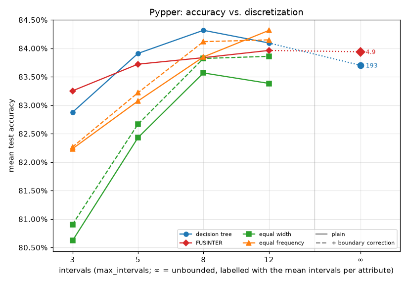
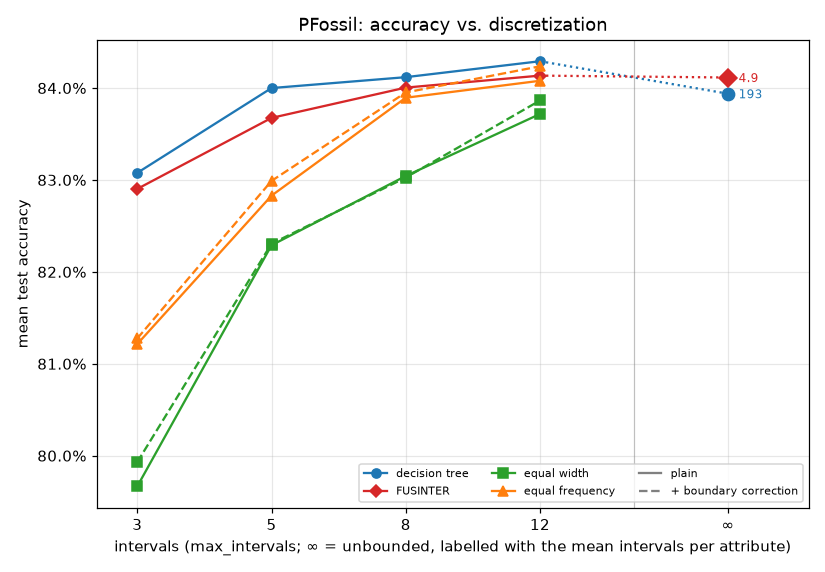
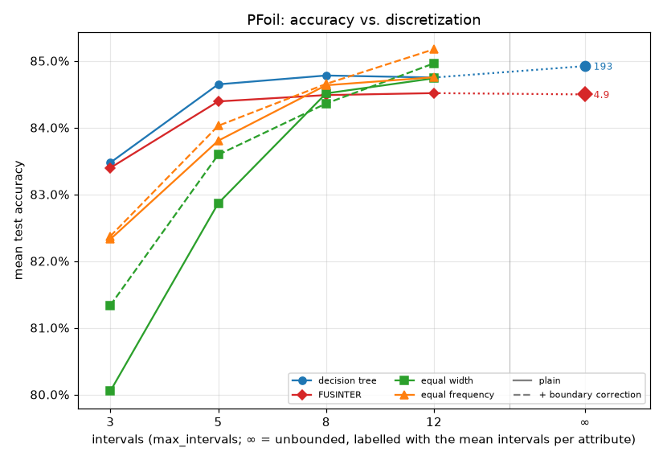
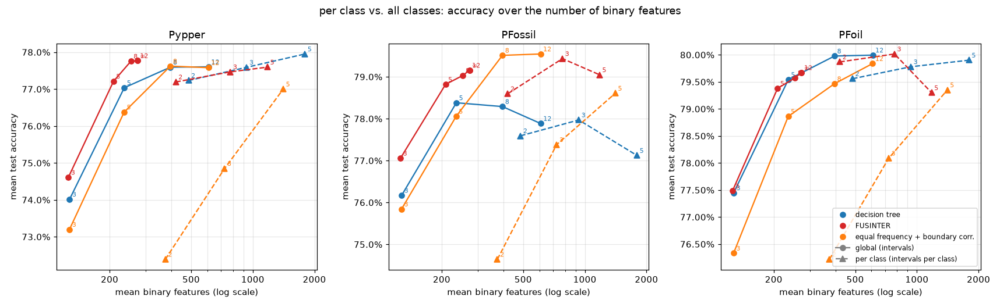
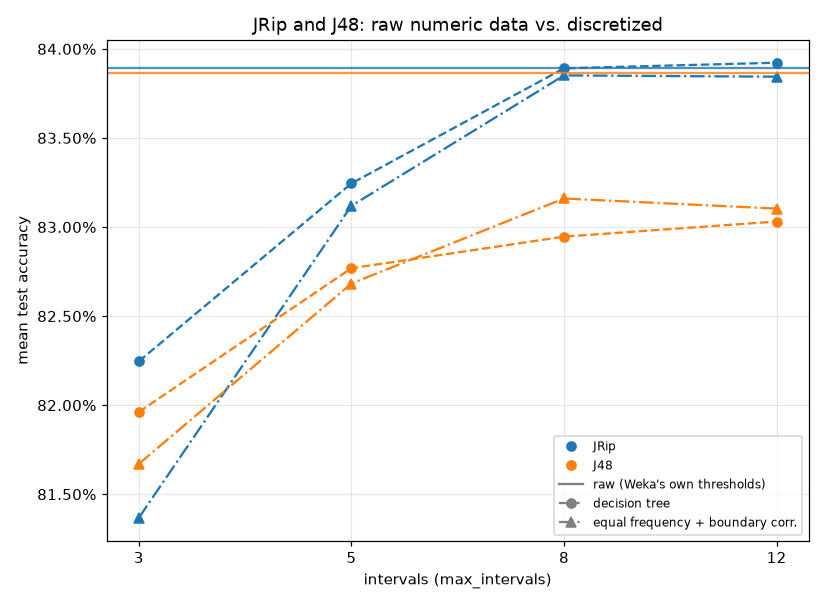

# Numeric attributes: discretizers for rule learning

## Setup

**Full run** (10-fold). Quick sanity check instead: `python demos/numeric_discretization.py` with no arguments.

How to discretize numeric attributes for rule learning: the discretizers of
`pyrulearn.data.discretization` with three fast native rule learners --
Pypper (RIPPER), PFossil and PFoil -- at their defaults (sections 1 and 2),
and the most promising of them against Weka's JRip and J48 on the raw
numeric data (section 3).

Every column with at least three distinct values is discretized (none is
made ordinal); each training fold is discretized on its own, and the test
fold is binarized against that fold's thresholds. Each threshold `t` gives
two binary features, `x>=t` and `x<t`. Each fit is capped at
300s; a timeout counts as a failure. Fits run one at a time.

## 1. Discretizers and interval counts

Datasets: every catalog dataset that is small or medium-sized in the catalog (fewer than 1,000 rows, or 1,000 to 10,000), has only numeric attributes, and has at most 60,000 rows times attributes -- which predicts the cost of a fold far better than the row count alone; the catalog has a natural gap there (57,831 to 83,160): 27 datasets -- analcatdata_authorship, balance-scale, banknote-authentication, blood-transfusion-service-center, breast-w, climate-model-simulation-crashes, diabetes, ecoli, glass, ionosphere, iris, kc1, kc2, mfeat-morphological, pc1, pc3, pc4, phoneme, qsar-biodeg, segment, sonar, steel-plates-fault, vehicle, wdbc, wilt, wine, yeast.

Discretizers, each at 3, 5, 8, 12 intervals: `tree` -- tree; `fusinter` -- FUSINTER; `ew` -- equal width; `ew+bc` -- equal width + boundary correction; `ef` -- equal frequency; `ef+bc` -- equal frequency + boundary correction. `tree` and `fusinter` also unbounded (`∞`): the full tree, which places a threshold at every point where the class changes, and FUSINTER deciding the number of intervals itself.

Mean accuracy over all datasets and folds, and mean rank among the 26 preparations (per learner; 1 = best):

| prep | Pypper acc. | Pypper rank | PFossil acc. | PFossil rank | PFoil acc. | PFoil rank | features | rules (mean) |
|---|--:|--:|--:|--:|--:|--:|--:|--:|
| tree@3 | 82.88% | 14.63 | 83.08% | 14.02 | 83.47% | 14.78 | 78.7 | 30.0 |
| tree@5 | 83.91% | 11.72 | 84.00% | 11.02 | 84.65% | 11.17 | 155.1 | 31.9 |
| tree@8 | 84.32% | 9.39 | 84.12% | 11.54 | 84.78% | 11.31 | 266.3 | 32.8 |
| tree@12 | 84.09% | 11.09 | 84.29% | 9.30 | 84.75% | 11.41 | 407.7 | 32.4 |
| tree@∞ | 83.70% | 14.41 | 83.94% | 11.56 | 84.92% | 10.67 | 5167.9 | 26.1 |
| fusinter@3 | 83.25% | 13.61 | 82.90% | 15.31 | 83.40% | 16.44 | 71.4 | 30.6 |
| fusinter@5 | 83.72% | 12.76 | 83.68% | 13.07 | 84.39% | 11.69 | 116.5 | 33.2 |
| fusinter@8 | 83.84% | 12.85 | 84.00% | 11.69 | 84.49% | 12.46 | 146.8 | 33.5 |
| fusinter@12 | 83.96% | 11.85 | 84.14% | 10.57 | 84.52% | 11.78 | 156.4 | 32.9 |
| fusinter@∞ | 83.94% | 12.22 | 84.11% | 10.78 | 84.50% | 11.80 | 157.4 | 32.8 |
| ew@3 | 80.62% | 19.80 | 79.67% | 19.63 | 80.05% | 20.19 | 77.9 | 25.7 |
| ew@5 | 82.43% | 15.63 | 82.29% | 15.48 | 82.86% | 15.13 | 147.6 | 29.1 |
| ew@8 | 83.57% | 12.80 | 83.04% | 13.87 | 84.51% | 12.11 | 243.6 | 31.6 |
| ew@12 | 83.38% | 13.98 | 83.72% | 11.17 | 84.74% | 11.69 | 360.6 | 32.5 |
| ew+bc@3 | 80.91% | 18.43 | 79.93% | 19.89 | 81.34% | 20.04 | 73.1 | 25.8 |
| ew+bc@5 | 82.67% | 15.04 | 82.31% | 15.30 | 83.59% | 13.44 | 132.4 | 28.9 |
| ew+bc@8 | 83.82% | 12.50 | 83.03% | 13.93 | 84.36% | 11.89 | 212.4 | 31.5 |
| ew+bc@12 | 83.86% | 12.15 | 83.86% | 10.59 | 84.96% | 10.52 | 307.6 | 32.9 |
| ef@3 | 82.23% | 17.17 | 81.21% | 18.91 | 82.33% | 18.56 | 78.8 | 34.9 |
| ef@5 | 83.07% | 15.61 | 82.83% | 16.91 | 83.80% | 15.69 | 155.7 | 36.7 |
| ef@8 | 83.85% | 11.07 | 83.89% | 10.91 | 84.63% | 11.46 | 268.8 | 34.4 |
| ef@12 | 84.31% | 9.74 | 84.08% | 10.52 | 84.75% | 11.37 | 415.3 | 33.2 |
| ef+bc@3 | 82.27% | 17.09 | 81.28% | 19.11 | 82.37% | 18.61 | 78.6 | 34.8 |
| ef+bc@5 | 83.22% | 14.13 | 82.99% | 15.39 | 84.03% | 15.22 | 154.5 | 36.5 |
| ef+bc@8 | 84.12% | 10.65 | 83.95% | 10.24 | 84.65% | 12.11 | 263.8 | 34.3 |
| ef+bc@12 | 84.15% | 10.69 | 84.24% | 10.31 | 85.17% | 9.48 | 400.1 | 33.2 |

`features` -- mean number of binary features per fold; `rules` -- mean over the three learners.

- Pypper: Friedman p = 5.4e-08 over 27 datasets; critical difference of the mean ranks 7.66 (26 preparations).
- PFossil: Friedman p = 3.1e-15 over 27 datasets; critical difference of the mean ranks 7.66 (26 preparations).
- PFoil: Friedman p = 1e-12 over 27 datasets; critical difference of the mean ranks 7.66 (26 preparations).

## 2. Per class vs. all classes

Datasets: every catalog dataset that is small or medium-sized in the catalog (fewer than 1,000 rows, or 1,000 to 10,000), has numeric attributes (only, or together with nominal ones), at least 5 classes, and at most 250,000 rows times attributes -- which leaves out only the three largest candidates (first-order-theorem-proving, GesturePhaseSegmentationProcessed, optdigits): 16 datasets -- MiceProtein, anneal, ecoli, eucalyptus, glass, mfeat-fourier, mfeat-karhunen, mfeat-morphological, mfeat-zernike, satimage, segment, steel-plates-fault, texture, vowel, yeast, zoo.

`PerClass` (`pc-`) runs a discretizer once per class, on that class against all others, and keeps the union of the thresholds (one per gap between observed values). `tree`, `fusinter`, `ef+bc` globally at 3, 5, 8, 12 intervals (`fusinter` also unbounded, `∞`; the full tree, which cuts at nearly every distinct value of a continuous many-class column, is left out here), and per class at 2, 3, 5 intervals per class. Plotted over the number of binary features they produce, so a per-class and a global discretization of the same size can be compared directly.

| prep | scope | Pypper acc. | Pypper rank | PFossil acc. | PFossil rank | PFoil acc. | PFoil rank | features | rules (mean) |
|---|---|--:|--:|--:|--:|--:|--:|--:|--:|
| tree@3 | global | 74.02% | 16.44 | 76.17% | 14.41 | 77.45% | 14.62 | 127.5 | 70.0 |
| tree@5 | global | 77.04% | 11.59 | 78.38% | 10.69 | 79.54% | 10.62 | 235.8 | 64.1 |
| tree@8 | global | 77.59% | 9.28 | 78.29% | 11.72 | 79.98% | 8.34 | 396.0 | 60.2 |
| tree@12 | global | 77.60% | 9.31 | 77.89% | 12.78 | 79.99% | 8.31 | 608.4 | 58.2 |
| pc-tree@2 | per class | 77.23% | 11.34 | 77.59% | 14.16 | 79.56% | 11.12 | 485.5 | 60.2 |
| pc-tree@3 | per class | 77.59% | 9.19 | 77.97% | 11.34 | 79.78% | 9.44 | 933.9 | 57.0 |
| pc-tree@5 | per class | 77.95% | 6.66 | 77.12% | 14.72 | 79.90% | 8.75 | 1797.7 | 53.9 |
| fusinter@3 | global | 74.61% | 16.81 | 77.06% | 13.44 | 77.48% | 17.88 | 125.7 | 71.2 |
| fusinter@5 | global | 77.21% | 11.22 | 78.82% | 10.16 | 79.38% | 11.53 | 208.9 | 65.9 |
| fusinter@8 | global | 77.75% | 7.91 | 79.03% | 9.00 | 79.57% | 9.81 | 253.9 | 63.5 |
| fusinter@12 | global | 77.77% | 7.72 | 79.16% | 8.12 | 79.67% | 8.81 | 273.3 | 63.2 |
| fusinter@∞ | global | 77.77% | 7.72 | 79.16% | 8.12 | 79.67% | 8.81 | 273.3 | 63.2 |
| pc-fusinter@2 | per class | 77.19% | 9.69 | 78.60% | 10.59 | 79.87% | 8.88 | 420.6 | 62.3 |
| pc-fusinter@3 | per class | 77.47% | 10.19 | 79.43% | 8.41 | 80.02% | 8.19 | 777.5 | 60.6 |
| pc-fusinter@5 | per class | 77.60% | 8.56 | 79.05% | 8.97 | 79.30% | 11.38 | 1180.2 | 58.7 |
| ef+bc@3 | global | 73.20% | 18.31 | 75.84% | 15.00 | 76.33% | 18.25 | 127.3 | 72.9 |
| ef+bc@5 | global | 76.38% | 13.75 | 78.06% | 12.69 | 78.86% | 14.66 | 235.4 | 66.4 |
| ef+bc@8 | global | 77.62% | 9.41 | 79.51% | 7.03 | 79.47% | 10.78 | 396.0 | 62.3 |
| ef+bc@12 | global | 77.58% | 9.31 | 79.54% | 7.38 | 79.84% | 10.41 | 607.5 | 61.8 |
| pc-ef+bc@2 | per class | 72.39% | 19.41 | 74.64% | 18.22 | 76.22% | 16.78 | 374.0 | 66.9 |
| pc-ef+bc@3 | per class | 74.85% | 16.59 | 77.38% | 15.06 | 78.09% | 14.44 | 728.5 | 64.0 |
| pc-ef+bc@5 | per class | 77.00% | 12.59 | 78.61% | 11.00 | 79.35% | 11.19 | 1408.8 | 59.1 |

- Pypper: Friedman p = 6.2e-15 over 16 datasets; critical difference of the mean ranks 8.25 (22 preparations).
- PFossil: Friedman p = 5.9e-08 over 16 datasets; critical difference of the mean ranks 8.25 (22 preparations).
- PFoil: Friedman p = 7.2e-10 over 16 datasets; critical difference of the mean ranks 8.25 (22 preparations).

**Reading.** For equal frequency, per class does not pay off. It is unsupervised: per class, only the boundary correction depends on the class, so every class's cuts start from the same equal-frequency positions and end up close together -- with two intervals per class, all near the median. That gives more thresholds in about the same places, and lower accuracy than a global discretization with as many features. The decision tree and FUSINTER place their cuts for each class, and there per class is competitive and sometimes the best preparation, mostly at small numbers of intervals per class -- though not significantly, and at several times the features of a global discretization of similar accuracy.

**Tentative conclusion.** Pooling the per-class thresholds may dilute their gain: a learner working on one class searches every class's cuts, most of them placed for other classes. Separate feature sets per class -- a learner with a dedicated target class seeing only the thresholds placed for it -- might pay off more. Not tested here; see *Per-class feature sets* in `ROADMAP.md`.

## 3. Against JRip and J48 on the raw data

Datasets: every catalog dataset that is small or medium-sized in the catalog (fewer than 1,000 rows, or 1,000 to 10,000), has only numeric attributes, and has at most 250,000 rows times attributes -- section 1's selection with section 2's larger size limit: 37 datasets -- MiceProtein, analcatdata_authorship, balance-scale, banknote-authentication, blood-transfusion-service-center, breast-w, climate-model-simulation-crashes, diabetes, ecoli, glass, heloc, ionosphere, iris, kc1, kc2, mfeat-fourier, mfeat-karhunen, mfeat-morphological, mfeat-zernike, ozone-level-8hr, pc1, pc3, pc4, phoneme, qsar-biodeg, satimage, segment, sonar, steel-plates-fault, texture, vehicle, wall-robot-navigation, waveform-5000, wdbc, wilt, wine, yeast.

Weka's JRip and J48 handle numeric attributes themselves: `raw` gives them the original numeric columns, and they choose their own thresholds while learning. Against that, the same data discretized per training fold by `tree` (decision tree) and by `ef+bc` (equal frequency + boundary correction) -- the strongest supervised and unsupervised discretizers of section 1 -- at 3, 5, 8, 12 intervals, then binarized. Weka's models of `raw` are evaluated by binarizing the test fold against the thresholds they use. A missing value: Weka handles it its own way when learning; at test time it covers no threshold feature.

| prep | Weka:JRip acc. | Weka:JRip rank | Weka:J48 acc. | Weka:J48 rank | features | rules (mean) |
|---|--:|--:|--:|--:|--:|--:|
| raw | 83.89% | 3.96 | 83.87% | 4.22 | -- | 48.7 |
| tree@3 | 82.25% | 5.92 | 81.96% | 5.32 | 111.2 | 39.2 |
| tree@5 | 83.24% | 5.47 | 82.77% | 5.12 | 220.9 | 44.9 |
| tree@8 | 83.89% | 4.20 | 82.95% | 4.59 | 382.8 | 49.5 |
| tree@12 | 83.92% | 4.18 | 83.03% | 4.69 | 593.5 | 51.3 |
| ef+bc@3 | 81.37% | 6.70 | 81.67% | 6.14 | 111.2 | 46.4 |
| ef+bc@5 | 83.12% | 5.80 | 82.68% | 5.57 | 220.4 | 50.9 |
| ef+bc@8 | 83.85% | 4.50 | 83.16% | 4.72 | 380.6 | 53.7 |
| ef+bc@12 | 83.84% | 4.27 | 83.10% | 4.64 | 586.1 | 55.6 |

`features` -- mean number of binary features per fold (`--` for `raw`); `rules` -- mean over both learners (for J48, its tree's leaves).

- Weka:JRip: Friedman p = 5.3e-06 over 37 datasets; critical difference of the mean ranks 1.97 (9 preparations).
- Weka:J48: Friedman p = 0.08 over 37 datasets; critical difference of the mean ranks 1.97 (9 preparations).
