# Data representations: same rules, different speed

**Full run.** Quick sanity check instead: `python demos/representations.py`.

pyrulearn's learners never look at the data directly. They ask it two things -- which examples a rule covers (`coverage(rule)`) and which features an example has (`features_of(row)`) -- so the data can be stored in any structure that answers these questions. Four such representations are implemented:

- **HBitmap** (horizontal bitmap) -- a bit matrix packed by example, one bit per example and feature. Covering a rule checks every example's row against the rule's features, whatever the density.
- **VBitmap** (vertical bitmap) -- the same bit matrix packed by feature: one bit-vector over the examples per feature. Covering a rule ANDs its features' bit-vectors, and counting is a popcount; same memory as HBitmap.
- **NList** -- LORD's vertical index (Huynh, Fürnkranz & Beck, 2023): examples are inserted into a prefix tree of their true features, and each feature keeps the list of tree nodes it occurs in (its N-list). Covering a rule intersects these lists; the work grows with how often the features are true, not with the number of examples.
- **Sparse** -- `scipy` sparse matrices: per-feature example lists without the prefix tree.

All four must lead to exactly the same rules, so the only thing that differs is time. This demo measures that time for five learners -- CN2, PFossil, Pypper, PyLORD and ENDER, each with its default settings -- and checks the rules and the test-set predictions against HBitmap at every point. Each fit runs in a separate process and is capped at 300s; after a time-out, the larger points of that curve are skipped. The learners ran side by side, one worker process each, every learner's fits one after another; building the representations, timing `coverage()` and measuring memory came first, with nothing else running. The numerical libraries were limited to one thread (`OMP_NUM_THREADS=1` and its relatives), so each fit used one core.

**Equality check:** at 147 points where HBitmap and at least one other representation finished, 147 gave identical rules and predictions for every representation.

## 1. Training-set size

Training sets of doubling size, drawn from one shuffled pool of the `adult` dataset (48,842 examples, 14 attributes, 8 of them nominal), each evaluated on the same 20% test set. Numeric attributes are discretized per training set (`max_intervals=8`). Two encodings: **with negation** (pyrulearn's default -- every test comes with its negation, so exactly half the features are true in every example) and **without negation** (positive tests only, far sparser). The first is the bitmaps' best case and the list-based representations' worst; the second is where those should gain.

At the largest training set: with negation 278 binary features, density 0.493; without negation 140 binary features, density 0.136 (density = share of features that are true).

One pair of plots per learner: left with a logarithmic time axis (ratios -- a constant factor between two representations is a constant gap), right with a linear one (absolute seconds saved).

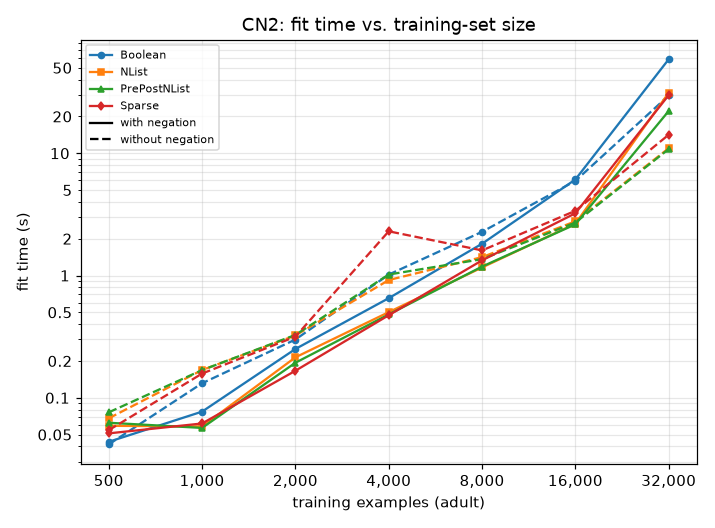 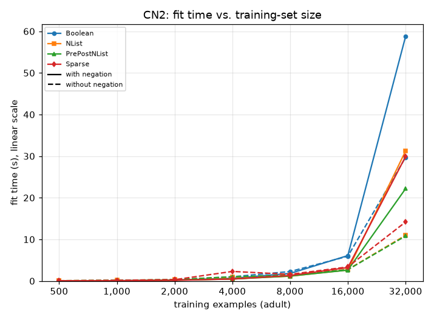

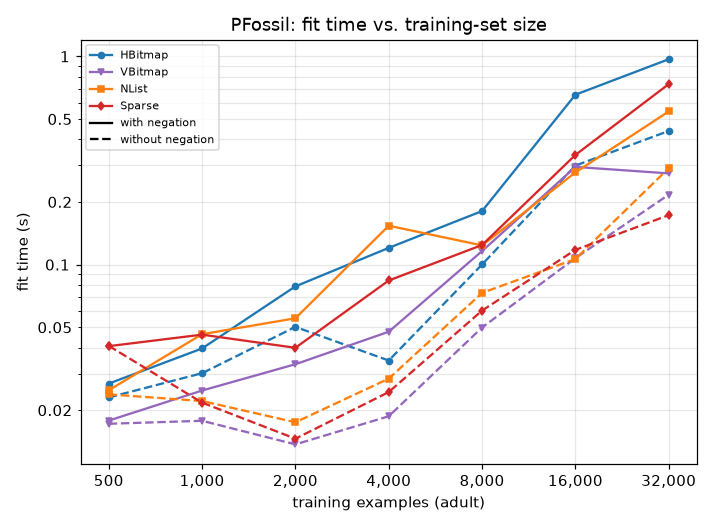 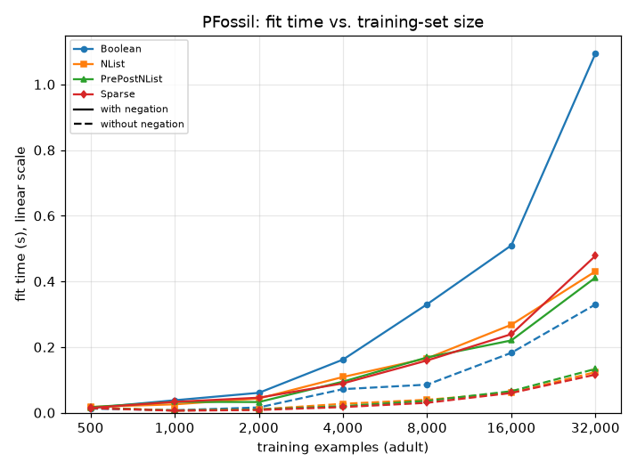

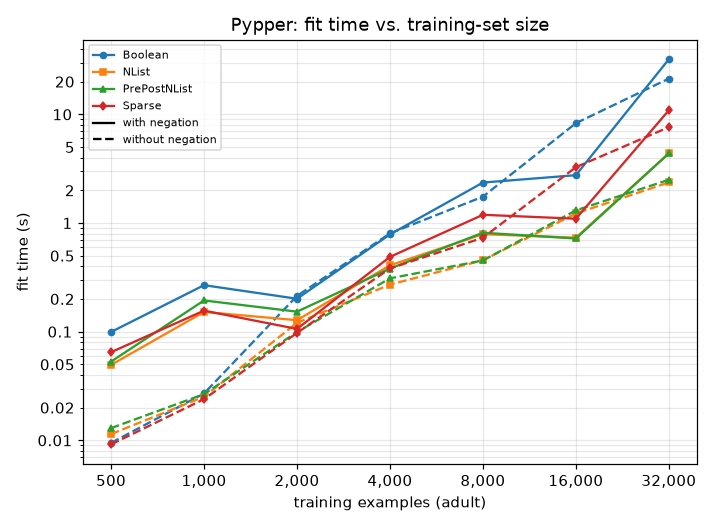 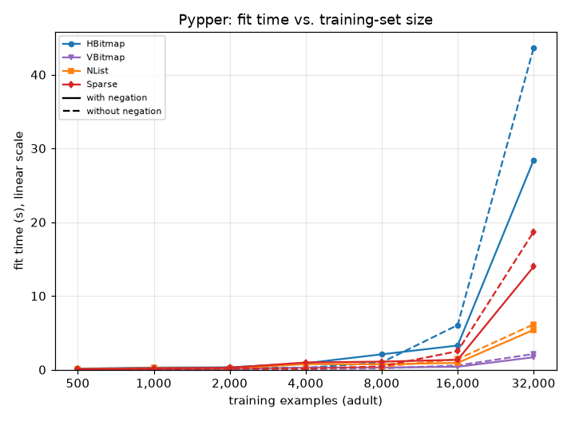

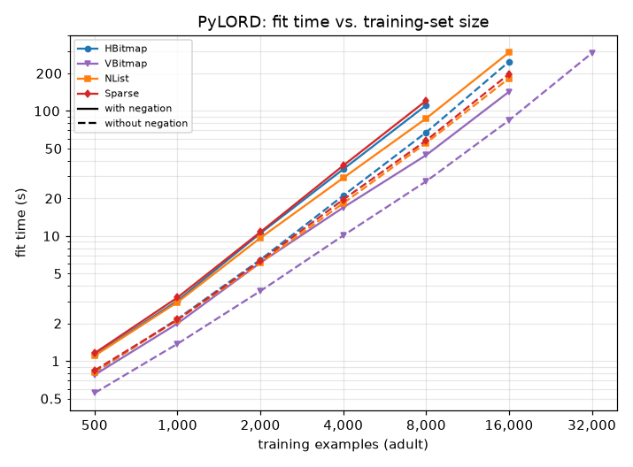 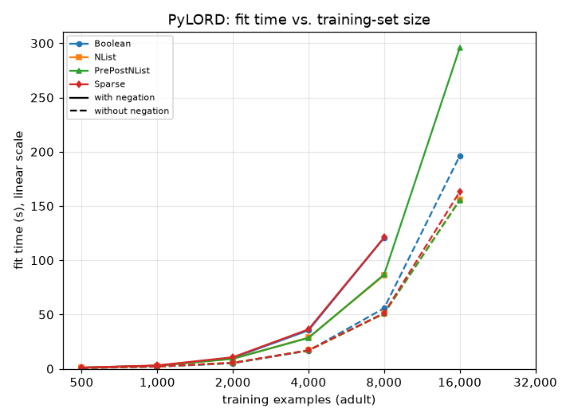

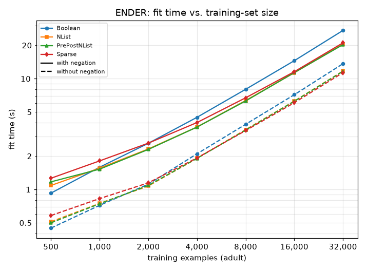 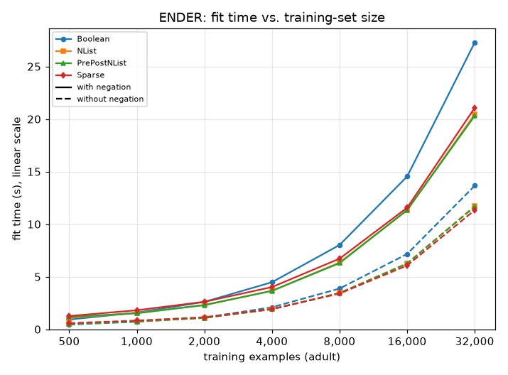

Fit time in seconds, with negation:

| learner | representation | n=500 | n=1000 | n=2000 | n=4000 | n=8000 | n=16000 | n=32000 |
|---|---|--:|--:|--:|--:|--:|--:|--:|
| CN2 | HBitmap | 0.07 | 0.07 | 0.26 | 0.74 | 1.79 | 7.64 | 59.85 |
| CN2 | VBitmap | 0.06 (82%) | 0.05 (67%) | 0.14 (53%) | 0.58 (79%) | 0.83 (47%) | 3.03 (40%) | 16.37 (27%) |
| CN2 | NList | 0.08 (110%) | 0.07 (95%) | 0.21 (82%) | 0.45 (62%) | 1.13 (63%) | 3.27 (43%) | 25.14 (42%) |
| CN2 | Sparse | 0.10 (137%) | 0.06 (90%) | 0.33 (129%) | 0.52 (71%) | 1.20 (67%) | 4.05 (53%) | 34.10 (57%) |
| PFossil | HBitmap | 0.03 | 0.04 | 0.08 | 0.12 | 0.18 | 0.65 | 0.97 |
| PFossil | VBitmap | 0.02 (66%) | 0.02 (63%) | 0.03 (42%) | 0.05 (40%) | 0.12 (64%) | 0.29 (45%) | 0.27 (28%) |
| PFossil | NList | 0.02 (93%) | 0.05 (117%) | 0.06 (70%) | 0.15 (128%) | 0.12 (68%) | 0.28 (42%) | 0.54 (56%) |
| PFossil | Sparse | 0.04 (151%) | 0.05 (117%) | 0.04 (51%) | 0.08 (70%) | 0.12 (69%) | 0.34 (51%) | 0.74 (76%) |
| Pypper | HBitmap | 0.13 | 0.30 | 0.24 | 0.73 | 2.53 | 3.58 | 33.95 |
| Pypper | VBitmap | 0.04 (32%) | 0.13 (45%) | 0.07 (27%) | 0.31 (42%) | 0.29 (12%) | 0.41 (11%) | 2.29 (7%) |
| Pypper | NList | 0.08 (62%) | 0.24 (79%) | 0.17 (70%) | 0.45 (61%) | 0.78 (31%) | 1.12 (31%) | 6.07 (18%) |
| Pypper | Sparse | 0.08 (60%) | 0.22 (72%) | 0.12 (50%) | 0.51 (69%) | 1.15 (45%) | 1.53 (43%) | 14.78 (44%) |
| PyLORD | HBitmap | 1.29 | 3.51 | 11.89 | 46.67 | 147.11 | time-out |  |
| PyLORD | VBitmap | 0.93 (72%) | 2.17 (62%) | 6.83 (57%) | 20.82 (45%) | 50.44 (34%) | 177.79 | time-out |
| PyLORD | NList | 1.62 (125%) | 3.64 (104%) | 10.72 (90%) | 34.03 (73%) | 109.18 (74%) | time-out |  |
| PyLORD | Sparse | 1.35 (104%) | 3.80 (108%) | 13.74 (116%) | 43.86 (94%) | 150.53 (102%) | time-out |  |
| ENDER | HBitmap | 1.14 | 2.27 | 3.14 | 4.94 | 11.19 | 18.62 | 35.14 |
| ENDER | VBitmap | 0.91 (80%) | 1.67 (73%) | 2.89 (92%) | 4.84 (98%) | 7.85 (70%) | 15.98 (86%) | 25.94 (74%) |
| ENDER | NList | 1.61 (141%) | 1.93 (85%) | 2.97 (95%) | 4.42 (90%) | 7.52 (67%) | 13.10 (70%) | 23.42 (67%) |
| ENDER | Sparse | 1.30 (114%) | 2.27 (100%) | 3.05 (97%) | 4.37 (88%) | 8.39 (75%) | 14.68 (79%) | 26.08 (74%) |

Without negation:

| learner | representation | n=500 | n=1000 | n=2000 | n=4000 | n=8000 | n=16000 | n=32000 |
|---|---|--:|--:|--:|--:|--:|--:|--:|
| CN2 | HBitmap | 0.10 | 0.21 | 0.37 | 0.89 | 3.59 | 8.16 | 36.92 |
| CN2 | VBitmap | 0.07 (65%) | 0.18 (86%) | 0.35 (97%) | 0.72 (81%) | 1.32 (37%) | 3.29 (40%) | 12.83 (35%) |
| CN2 | NList | 0.09 (93%) | 0.25 (120%) | 0.44 (121%) | 0.84 (95%) | 2.16 (60%) | 5.78 (71%) | 17.72 (48%) |
| CN2 | Sparse | 0.16 (161%) | 0.29 (137%) | 0.47 (130%) | 0.96 (108%) | 1.81 (50%) | 5.13 (63%) | 20.18 (55%) |
| PFossil | HBitmap | 0.02 | 0.03 | 0.05 | 0.03 | 0.10 | 0.30 | 0.44 |
| PFossil | VBitmap | 0.02 (75%) | 0.02 (59%) | 0.01 (27%) | 0.02 (54%) | 0.05 (50%) | 0.11 (36%) | 0.22 (49%) |
| PFossil | NList | 0.02 (103%) | 0.02 (74%) | 0.02 (35%) | 0.03 (82%) | 0.07 (73%) | 0.11 (36%) | 0.29 (66%) |
| PFossil | Sparse | 0.04 (177%) | 0.02 (72%) | 0.01 (29%) | 0.02 (71%) | 0.06 (60%) | 0.12 (39%) | 0.17 (39%) |
| Pypper | HBitmap | 0.02 | 0.10 | 0.30 | 0.80 | 2.00 | 13.04 | 33.02 |
| Pypper | VBitmap | 0.02 (90%) | 0.06 (60%) | 0.08 (28%) | 0.15 (19%) | 0.33 (16%) | 0.99 (8%) | 1.83 (6%) |
| Pypper | NList | 0.02 (121%) | 0.05 (54%) | 0.18 (61%) | 0.33 (42%) | 0.73 (36%) | 2.76 (21%) | 4.61 (14%) |
| Pypper | Sparse | 0.04 (212%) | 0.04 (40%) | 0.16 (53%) | 0.41 (52%) | 0.85 (42%) | 5.30 (41%) | 13.21 (40%) |
| PyLORD | HBitmap | 0.83 | 2.09 | 5.21 | 20.58 | 67.31 | 216.82 | time-out |
| PyLORD | VBitmap | 0.59 (71%) | 1.49 (71%) | 3.45 (66%) | 10.41 (51%) | 29.86 (44%) | 83.31 (38%) | 249.31 |
| PyLORD | NList | 0.89 (108%) | 2.20 (105%) | 8.24 (158%) | 18.36 (89%) | 56.31 (84%) | 165.26 (76%) | time-out |
| PyLORD | Sparse | 0.89 (107%) | 2.26 (108%) | 6.02 (116%) | 18.32 (89%) | 56.68 (84%) | 169.58 (78%) | time-out |
| ENDER | HBitmap | 0.73 | 0.92 | 1.63 | 2.19 | 4.39 | 8.15 | 16.29 |
| ENDER | VBitmap | 0.65 (88%) | 0.79 (85%) | 1.10 (67%) | 2.00 (91%) | 3.87 (88%) | 7.77 (95%) | 15.20 (93%) |
| ENDER | NList | 0.58 (78%) | 0.80 (87%) | 1.30 (79%) | 2.20 (101%) | 4.49 (102%) | 7.85 (96%) | 14.75 (91%) |
| ENDER | Sparse | 0.68 (92%) | 1.13 (123%) | 1.53 (94%) | 2.33 (107%) | 3.71 (85%) | 7.17 (88%) | 14.10 (87%) |

**Growth.** How fast each learner's fit time grows with the training-set size: the exponent *b* of time ~ n^*b*, fitted by least squares to log time over log n from n=2,000 on (below that, a fit's fixed costs still dominate). 1 is linear, 2 quadratic; a curve cut short by a time-out is fitted on the points that finished. This is what decides, for example, how much a learner gains from splitting a problem into smaller ones (`demos/multiclass_decomposition.py`):

| learner | representation | with negation | without negation |
|---|---|--:|--:|
| CN2 | HBitmap | 1.91 | 1.65 |
| CN2 | VBitmap | 1.62 | 1.26 |
| CN2 | NList | 1.67 | 1.34 |
| CN2 | Sparse | 1.63 | 1.32 |
| PFossil | HBitmap | 0.97 | 0.94 |
| PFossil | VBitmap | 0.87 | 1.05 |
| PFossil | NList | 0.74 | 1.00 |
| PFossil | Sparse | 1.04 | 0.94 |
| Pypper | HBitmap | 1.65 | 1.76 |
| Pypper | VBitmap | 1.06 | 1.16 |
| Pypper | NList | 1.16 | 1.23 |
| Pypper | Sparse | 1.55 | 1.64 |
| PyLORD | HBitmap | 1.81 (3 points) | 1.78 (4 points) |
| PyLORD | VBitmap | 1.54 (4 points) | 1.53 |
| PyLORD | NList | 1.67 (3 points) | 1.46 (4 points) |
| PyLORD | Sparse | 1.73 (3 points) | 1.61 (4 points) |
| ENDER | HBitmap | 0.89 | 0.85 |
| ENDER | VBitmap | 0.81 | 0.95 |
| ENDER | NList | 0.75 | 0.89 |
| ENDER | Sparse | 0.79 | 0.80 |

Building a vertical index is paid once per fit, on top of the fit itself:

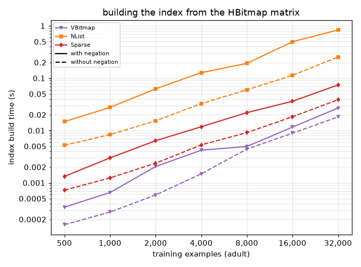

**Memory.** What each representation holds once built, measured with `tracemalloc` (the input matrix and the HBitmap matrix the others are built from don't count), and in parentheses its share of HBitmap's memory; the last row is the unpacked `n x k` bool matrix that `data.X` builds on demand, which any learner or external library working on a plain array pays on top.

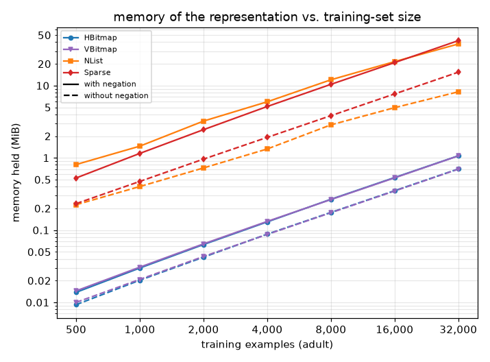

With negation:

| representation | n=500 | n=1000 | n=2000 | n=4000 | n=8000 | n=16000 | n=32000 |
|---|--:|--:|--:|--:|--:|--:|--:|
| HBitmap | 14 KiB | 31 KiB | 65 KiB | 133 KiB | 274 KiB | 547 KiB | 1.1 MiB |
| VBitmap | 15 KiB (105%) | 31 KiB (103%) | 66 KiB (102%) | 135 KiB (102%) | 271 KiB (99%) | 542 KiB (99%) | 1.1 MiB (100%) |
| NList | 828 KiB (5869%) | 1.5 MiB (4858%) | 3.2 MiB (5109%) | 6.0 MiB (4592%) | 12.0 MiB (4505%) | 21.5 MiB (4020%) | 37.7 MiB (3528%) |
| Sparse | 539 KiB (3823%) | 1.2 MiB (3858%) | 2.5 MiB (3887%) | 5.1 MiB (3953%) | 10.4 MiB (3896%) | 20.8 MiB (3897%) | 41.9 MiB (3925%) |
| unpacked `X` | 108 KiB | 238 KiB | 508 KiB | 1.0 MiB | 2.1 MiB | 4.2 MiB | 8.5 MiB |

Without negation:

| representation | n=500 | n=1000 | n=2000 | n=4000 | n=8000 | n=16000 | n=32000 |
|---|--:|--:|--:|--:|--:|--:|--:|
| HBitmap | 7 KiB | 16 KiB | 33 KiB | 71 KiB | 141 KiB | 281 KiB | 563 KiB |
| VBitmap | 8 KiB (109%) | 16 KiB (102%) | 34 KiB (101%) | 69 KiB (97%) | 137 KiB (98%) | 274 KiB (97%) | 551 KiB (98%) |
| NList | 91 KiB (1293%) | 163 KiB (1026%) | 361 KiB (1079%) | 688 KiB (975%) | 1.4 MiB (985%) | 2.4 MiB (858%) | 4.2 MiB (763%) |
| Sparse | 99 KiB (1405%) | 207 KiB (1307%) | 344 KiB (1030%) | 794 KiB (1126%) | 1.7 MiB (1234%) | 3.3 MiB (1202%) | 5.9 MiB (1080%) |
| unpacked `X` | 55 KiB | 120 KiB | 256 KiB | 535 KiB | 1.1 MiB | 2.1 MiB | 4.3 MiB |

Memory a fit costs in total -- what the representation holds plus the peak the fit allocates on top of it, caches the representation builds during the fit included (`tracemalloc`, a separate untimed pass), with negation:

| learner | representation | n=500 | n=1000 | n=2000 | n=4000 | n=8000 | n=16000 | n=32000 |
|---|---|--:|--:|--:|--:|--:|--:|--:|
| CN2 | HBitmap | 1.2 MiB | 2.4 MiB | 5.2 MiB | 10.8 MiB | 21.8 MiB | 43.5 MiB | 87.7 MiB |
| CN2 | VBitmap | 337 KiB (28%) | 404 KiB (16%) | 564 KiB (11%) | 891 KiB (8%) | 1.3 MiB (6%) | 2.4 MiB (6%) | 4.5 MiB (5%) |
| CN2 | NList | 1.9 MiB (165%) | 3.8 MiB (155%) | 6.2 MiB (120%) | 10.8 MiB (100%) | 21.8 MiB (100%) | 39.9 MiB (92%) | 72.1 MiB (82%) |
| CN2 | Sparse | 1.3 MiB (111%) | 2.8 MiB (112%) | 5.8 MiB (113%) | 12.1 MiB (112%) | 24.4 MiB (112%) | 48.9 MiB (112%) | 98.4 MiB (112%) |
| PFossil | HBitmap | 1.1 MiB | 2.4 MiB | 5.1 MiB | 10.7 MiB | 21.7 MiB | 43.4 MiB | 87.3 MiB |
| PFossil | VBitmap | 136 KiB (12%) | 216 KiB (9%) | 384 KiB (7%) | 636 KiB (6%) | 1.1 MiB (5%) | 2.1 MiB (5%) | 4.0 MiB (5%) |
| PFossil | NList | 1.9 MiB (170%) | 3.8 MiB (155%) | 6.2 MiB (120%) | 10.8 MiB (101%) | 21.8 MiB (101%) | 39.9 MiB (92%) | 72.1 MiB (83%) |
| PFossil | Sparse | 1.3 MiB (112%) | 2.7 MiB (112%) | 5.8 MiB (112%) | 12.0 MiB (112%) | 24.4 MiB (112%) | 48.7 MiB (112%) | 98.0 MiB (112%) |
| Pypper | HBitmap | 869 KiB | 1.8 MiB | 3.7 MiB | 7.6 MiB | 15.4 MiB | 30.7 MiB | 61.7 MiB |
| Pypper | VBitmap | 149 KiB (17%) | 210 KiB (12%) | 368 KiB (10%) | 627 KiB (8%) | 1.1 MiB (7%) | 2.1 MiB (7%) | 4.2 MiB (7%) |
| Pypper | NList | 1.7 MiB (199%) | 3.1 MiB (178%) | 6.1 MiB (168%) | 10.8 MiB (142%) | 21.8 MiB (142%) | 39.7 MiB (130%) | 71.9 MiB (116%) |
| Pypper | Sparse | 1.1 MiB (126%) | 2.3 MiB (128%) | 4.7 MiB (129%) | 9.8 MiB (129%) | 19.8 MiB (129%) | 39.6 MiB (129%) | 79.6 MiB (129%) |
| PyLORD | HBitmap | 744 KiB | 1.6 MiB | 4.5 MiB | 14.8 MiB |  |  |  |
| PyLORD | VBitmap | 353 KiB (47%) | 1.1 MiB (67%) | 3.7 MiB (83%) | 13.8 MiB (93%) | 54.0 MiB |  |  |
| PyLORD | NList | 2.0 MiB (274%) | 4.0 MiB (254%) | 7.4 MiB (164%) | 20.6 MiB (139%) |  |  |  |
| PyLORD | Sparse | 1.4 MiB (188%) | 2.9 MiB (188%) | 6.2 MiB (138%) | 18.8 MiB (127%) |  |  |  |
| ENDER | HBitmap | 1014 KiB | 1.3 MiB | 2.0 MiB | 4.1 MiB | 8.2 MiB | 16.3 MiB | 32.7 MiB |
| ENDER | VBitmap | 881 KiB (87%) | 1002 KiB (78%) | 1.5 MiB (75%) | 3.0 MiB (75%) | 6.1 MiB (74%) | 11.6 MiB (71%) | 14.1 MiB (43%) |
| ENDER | NList | 1.8 MiB (181%) | 2.8 MiB (219%) | 5.8 MiB (291%) | 11.1 MiB (273%) | 22.4 MiB (274%) | 41.0 MiB (252%) | 74.5 MiB (227%) |
| ENDER | Sparse | 1.4 MiB (141%) | 2.1 MiB (170%) | 3.6 MiB (181%) | 7.4 MiB (182%) | 15.0 MiB (183%) | 29.8 MiB (183%) | 59.9 MiB (183%) |

Without negation:

| learner | representation | n=500 | n=1000 | n=2000 | n=4000 | n=8000 | n=16000 | n=32000 |
|---|---|--:|--:|--:|--:|--:|--:|--:|
| CN2 | HBitmap | 620 KiB | 1.3 MiB | 2.7 MiB | 5.6 MiB | 11.2 MiB | 22.4 MiB | 45.0 MiB |
| CN2 | VBitmap | 162 KiB (26%) | 225 KiB (17%) | 324 KiB (12%) | 568 KiB (10%) | 851 KiB (7%) | 1.5 MiB (7%) | 2.8 MiB (6%) |
| CN2 | NList | 718 KiB (116%) | 1.4 MiB (111%) | 2.9 MiB (108%) | 3.9 MiB (69%) | 5.4 MiB (48%) | 8.1 MiB (36%) | 12.9 MiB (29%) |
| CN2 | Sparse | 302 KiB (49%) | 594 KiB (45%) | 977 KiB (35%) | 2.1 MiB (38%) | 4.4 MiB (39%) | 8.6 MiB (38%) | 15.5 MiB (35%) |
| PFossil | HBitmap | 598 KiB | 1.3 MiB | 2.6 MiB | 5.5 MiB | 11.1 MiB | 22.2 MiB | 44.6 MiB |
| PFossil | VBitmap | 76 KiB (13%) | 118 KiB (9%) | 211 KiB (8%) | 391 KiB (7%) | 672 KiB (6%) | 1.2 MiB (5%) | 2.3 MiB (5%) |
| PFossil | NList | 696 KiB (116%) | 1.4 MiB (111%) | 2.9 MiB (108%) | 3.8 MiB (69%) | 5.3 MiB (48%) | 7.8 MiB (35%) | 12.6 MiB (28%) |
| PFossil | Sparse | 274 KiB (46%) | 546 KiB (43%) | 909 KiB (34%) | 2.0 MiB (36%) | 4.3 MiB (39%) | 8.4 MiB (38%) | 15.2 MiB (34%) |
| Pypper | HBitmap | 438 KiB | 928 KiB | 1.9 MiB | 3.9 MiB | 7.9 MiB | 15.8 MiB | 31.7 MiB |
| Pypper | VBitmap | 82 KiB (19%) | 138 KiB (15%) | 260 KiB (13%) | 493 KiB (12%) | 954 KiB (12%) | 1.8 MiB (12%) | 3.6 MiB (11%) |
| Pypper | NList | 531 KiB (121%) | 1.1 MiB (116%) | 2.2 MiB (115%) | 3.7 MiB (95%) | 5.2 MiB (66%) | 7.6 MiB (48%) | 12.1 MiB (38%) |
| Pypper | Sparse | 233 KiB (53%) | 459 KiB (49%) | 768 KiB (40%) | 1.7 MiB (42%) | 3.5 MiB (45%) | 6.9 MiB (44%) | 12.4 MiB (39%) |
| PyLORD | HBitmap | 435 KiB | 1.3 MiB | 3.9 MiB | 12.5 MiB | 44.6 MiB |  |  |
| PyLORD | VBitmap | 375 KiB (86%) | 1.1 MiB (90%) | 3.5 MiB (91%) | 12.0 MiB (96%) | 43.1 MiB (97%) |  |  |
| PyLORD | NList | 782 KiB (180%) | 1.6 MiB (124%) | 4.1 MiB (106%) | 13.1 MiB (105%) | 45.4 MiB (102%) |  |  |
| PyLORD | Sparse | 505 KiB (116%) | 1.4 MiB (109%) | 3.9 MiB (100%) | 12.7 MiB (102%) | 44.8 MiB (100%) |  |  |
| ENDER | HBitmap | 579 KiB | 729 KiB | 1.1 MiB | 2.3 MiB | 4.6 MiB | 9.2 MiB | 18.5 MiB |
| ENDER | VBitmap | 512 KiB (88%) | 649 KiB (89%) | 921 KiB (78%) | 1.8 MiB (77%) | 3.6 MiB (77%) | 7.1 MiB (77%) | 13.6 MiB (73%) |
| ENDER | NList | 667 KiB (115%) | 875 KiB (120%) | 1.5 MiB (129%) | 2.9 MiB (125%) | 5.7 MiB (124%) | 8.7 MiB (94%) | 14.3 MiB (77%) |
| ENDER | Sparse | 636 KiB (110%) | 816 KiB (112%) | 979 KiB (83%) | 1.6 MiB (71%) | 3.4 MiB (73%) | 6.6 MiB (71%) | 12.2 MiB (66%) |

Peak memory while building (with negation) -- the vertical indexes need more than they keep:

| representation | n=500 | n=1000 | n=2000 | n=4000 | n=8000 | n=16000 | n=32000 |
|---|--:|--:|--:|--:|--:|--:|--:|
| HBitmap | 19 KiB | 36 KiB | 70 KiB | 138 KiB | 279 KiB | 552 KiB | 1.1 MiB |
| VBitmap | 143 KiB (742%) | 306 KiB (856%) | 645 KiB (924%) | 1.3 MiB (970%) | 2.6 MiB (972%) | 5.2 MiB (972%) | 9.5 MiB (889%) |
| NList | 4.4 MiB (23384%) | 8.5 MiB (24321%) | 17.7 MiB (26016%) | 34.5 MiB (25571%) | 69.8 MiB (25629%) | 130.9 MiB (24267%) | 255.7 MiB (23823%) |
| Sparse | 698 KiB (3625%) | 1.2 MiB (3304%) | 2.5 MiB (3601%) | 5.1 MiB (3806%) | 10.4 MiB (3825%) | 20.8 MiB (3860%) | 41.9 MiB (3907%) |
| unpacked `X` | 108 KiB | 238 KiB | 508 KiB | 1.0 MiB | 2.1 MiB | 4.2 MiB | 8.5 MiB |

## 2. Density

Synthetic data, 1000 training and 1000 test examples with 500 features: 4 of them carry a fixed learnable concept (true with probability 0.4, class = f0 and not f1, 5% label noise); every other feature is noise, true with the probability on the x-axis. Size and feature count stay fixed, so this isolates density.

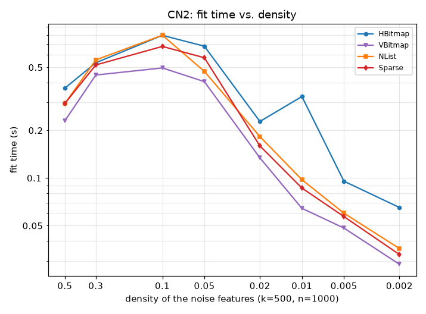

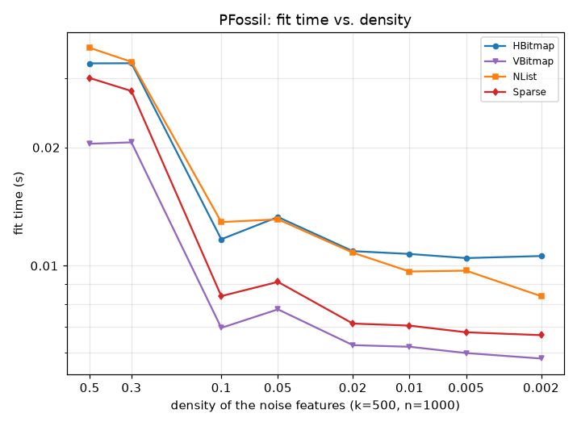

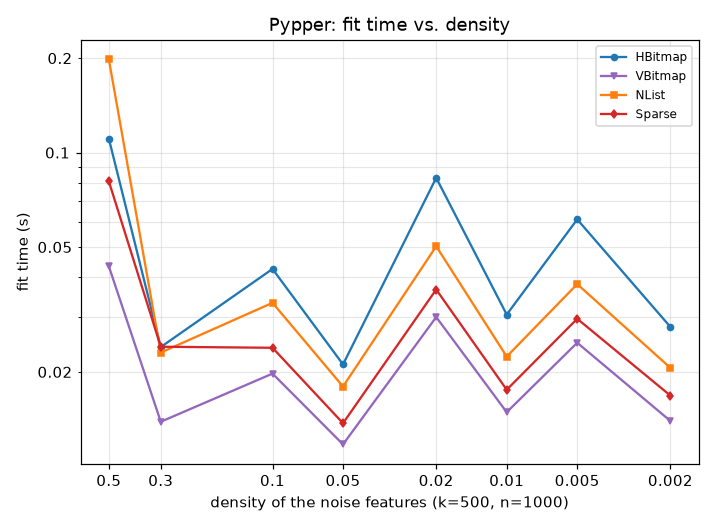

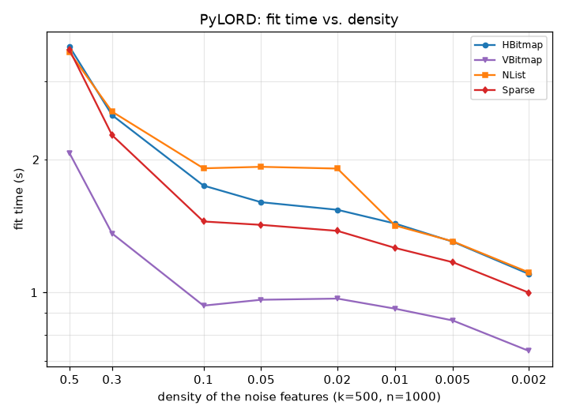

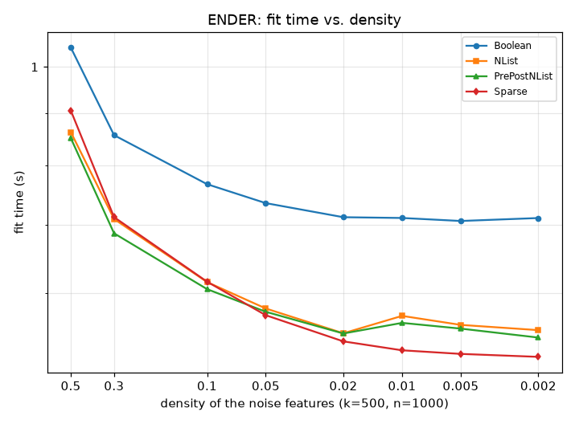

The pure data operation, 800 `coverage()` calls for random rules of 1-4 conditions, without any search around it:

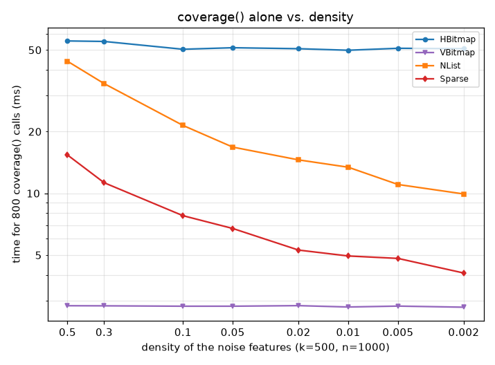

Fit time in seconds:

| learner | representation | p=0.5 | p=0.3 | p=0.1 | p=0.05 | p=0.02 | p=0.01 | p=0.005 | p=0.002 |
|---|---|--:|--:|--:|--:|--:|--:|--:|--:|
| CN2 | HBitmap | 0.37 | 0.53 | 0.80 | 0.68 | 0.23 | 0.33 | 0.10 | 0.07 |
| CN2 | VBitmap | 0.23 (62%) | 0.45 (84%) | 0.50 (62%) | 0.41 (60%) | 0.13 (59%) | 0.06 (20%) | 0.05 (51%) | 0.03 (44%) |
| CN2 | NList | 0.30 (80%) | 0.56 (104%) | 0.80 (100%) | 0.47 (69%) | 0.18 (80%) | 0.10 (30%) | 0.06 (63%) | 0.04 (55%) |
| CN2 | Sparse | 0.30 (80%) | 0.52 (97%) | 0.68 (85%) | 0.58 (85%) | 0.16 (70%) | 0.09 (26%) | 0.06 (60%) | 0.03 (50%) |
| PFossil | HBitmap | 0.04 | 0.06 | 0.02 | 0.02 | 0.02 | 0.03 | 0.03 | 0.03 |
| PFossil | VBitmap | 0.02 (53%) | 0.03 (53%) | 0.01 (44%) | 0.01 (46%) | 0.01 (69%) | 0.01 (40%) | 0.01 (40%) | 0.01 (41%) |
| PFossil | NList | 0.04 (95%) | 0.05 (80%) | 0.01 (80%) | 0.02 (82%) | 0.02 (122%) | 0.02 (66%) | 0.02 (62%) | 0.02 (60%) |
| PFossil | Sparse | 0.04 (103%) | 0.04 (67%) | 0.01 (57%) | 0.01 (55%) | 0.01 (78%) | 0.01 (47%) | 0.01 (51%) | 0.01 (28%) |
| Pypper | HBitmap | 0.11 | 0.02 | 0.04 | 0.02 | 0.08 | 0.03 | 0.06 | 0.03 |
| Pypper | VBitmap | 0.04 (39%) | 0.01 (58%) | 0.02 (46%) | 0.01 (56%) | 0.03 (36%) | 0.01 (49%) | 0.02 (40%) | 0.01 (50%) |
| Pypper | NList | 0.20 (179%) | 0.02 (96%) | 0.03 (78%) | 0.02 (85%) | 0.05 (61%) | 0.02 (73%) | 0.04 (62%) | 0.02 (74%) |
| Pypper | Sparse | 0.08 (73%) | 0.02 (100%) | 0.02 (56%) | 0.01 (65%) | 0.04 (44%) | 0.02 (58%) | 0.03 (48%) | 0.02 (60%) |
| PyLORD | HBitmap | 4.05 | 2.62 | 1.58 | 1.55 | 1.45 | 1.32 | 1.26 | 1.07 |
| PyLORD | VBitmap | 2.15 (53%) | 1.41 (54%) | 0.96 (61%) | 0.98 (63%) | 1.07 (74%) | 0.95 (73%) | 0.89 (71%) | 0.78 (73%) |
| PyLORD | NList | 3.71 (91%) | 2.62 (100%) | 1.98 (125%) | 1.97 (127%) | 2.03 (140%) | 1.47 (111%) | 1.32 (105%) | 1.17 (109%) |
| PyLORD | Sparse | 3.66 (90%) | 2.56 (98%) | 1.50 (95%) | 1.43 (92%) | 1.45 (100%) | 1.32 (101%) | 1.25 (99%) | 1.04 (98%) |
| ENDER | HBitmap | 1.17 | 1.01 | 0.90 | 0.80 | 0.89 | 0.74 | 0.82 | 0.79 |
| ENDER | VBitmap | 1.19 (101%) | 0.76 (75%) | 0.87 (96%) | 0.72 (90%) | 0.58 (65%) | 0.64 (87%) | 0.61 (75%) | 0.61 (77%) |
| ENDER | NList | 0.91 (78%) | 1.07 (106%) | 0.65 (72%) | 0.74 (93%) | 0.60 (68%) | 0.63 (86%) | 0.62 (75%) | 0.66 (83%) |
| ENDER | Sparse | 1.11 (95%) | 0.77 (76%) | 0.66 (74%) | 0.63 (79%) | 0.56 (63%) | 0.58 (79%) | 0.55 (67%) | 0.62 (79%) |

Memory held by each representation (share of HBitmap in parentheses; the last row is the unpacked bool matrix):

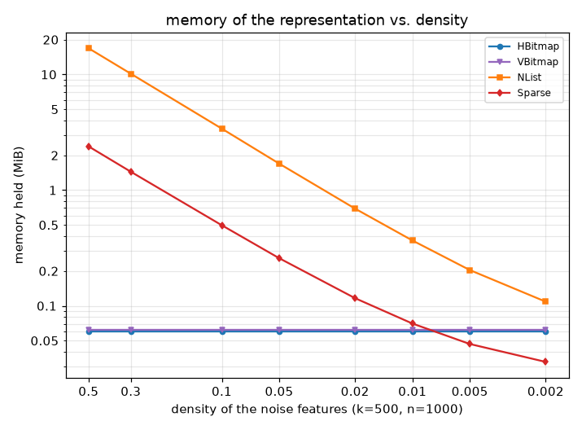

| representation | p=0.5 | p=0.3 | p=0.1 | p=0.05 | p=0.02 | p=0.01 | p=0.005 | p=0.002 |
|---|--:|--:|--:|--:|--:|--:|--:|--:|
| HBitmap | 62 KiB | 62 KiB | 62 KiB | 62 KiB | 62 KiB | 62 KiB | 62 KiB | 62 KiB |
| VBitmap | 63 KiB (102%) | 63 KiB (102%) | 63 KiB (102%) | 63 KiB (102%) | 63 KiB (102%) | 63 KiB (102%) | 63 KiB (102%) | 63 KiB (102%) |
| NList | 16.9 MiB (27943%) | 10.1 MiB (16816%) | 3.4 MiB (5637%) | 1.7 MiB (2809%) | 709 KiB (1148%) | 376 KiB (609%) | 209 KiB (338%) | 111 KiB (180%) |
| Sparse | 2.4 MiB (3962%) | 1.4 MiB (2390%) | 509 KiB (824%) | 264 KiB (427%) | 119 KiB (193%) | 72 KiB (117%) | 48 KiB (77%) | 34 KiB (54%) |
| unpacked `X` | 488 KiB | 488 KiB | 488 KiB | 488 KiB | 488 KiB | 488 KiB | 488 KiB | 488 KiB |

Memory a fit costs in total -- what the representation holds plus the peak the fit allocates on top of it, caches the representation builds during the fit included (`tracemalloc`, a separate untimed pass):

| learner | representation | p=0.5 | p=0.3 | p=0.1 | p=0.05 | p=0.02 | p=0.01 | p=0.005 | p=0.002 |
|---|---|--:|--:|--:|--:|--:|--:|--:|--:|
| CN2 | HBitmap | 4.9 MiB | 4.9 MiB | 5.0 MiB | 5.0 MiB | 4.9 MiB | 4.9 MiB | 4.9 MiB | 4.9 MiB |
| CN2 | VBitmap | 1.1 MiB (23%) | 1.1 MiB (23%) | 1.1 MiB (22%) | 1.0 MiB (20%) | 795 KiB (16%) | 678 KiB (13%) | 587 KiB (12%) | 469 KiB (9%) |
| CN2 | NList | 20.3 MiB (410%) | 13.1 MiB (264%) | 6.3 MiB (128%) | 4.6 MiB (93%) | 3.6 MiB (73%) | 1.1 MiB (22%) | 742 KiB (15%) | 484 KiB (10%) |
| CN2 | Sparse | 5.6 MiB (114%) | 3.5 MiB (70%) | 1.5 MiB (31%) | 1.2 MiB (25%) | 857 KiB (17%) | 693 KiB (14%) | 523 KiB (10%) | 372 KiB (7%) |
| PFossil | HBitmap | 4.9 MiB | 4.9 MiB | 4.9 MiB | 4.9 MiB | 4.9 MiB | 4.9 MiB | 4.9 MiB | 4.9 MiB |
| PFossil | VBitmap | 405 KiB (8%) | 403 KiB (8%) | 402 KiB (8%) | 402 KiB (8%) | 402 KiB (8%) | 400 KiB (8%) | 395 KiB (8%) | 357 KiB (7%) |
| PFossil | NList | 19.7 MiB (400%) | 13.0 MiB (264%) | 6.3 MiB (127%) | 4.6 MiB (93%) | 3.6 MiB (73%) | 701 KiB (14%) | 482 KiB (10%) | 369 KiB (7%) |
| PFossil | Sparse | 5.6 MiB (114%) | 3.4 MiB (69%) | 1.2 MiB (25%) | 713 KiB (14%) | 380 KiB (8%) | 271 KiB (5%) | 243 KiB (5%) | 207 KiB (4%) |
| Pypper | HBitmap | 3.5 MiB | 3.5 MiB | 3.5 MiB | 3.5 MiB | 3.5 MiB | 3.5 MiB | 3.5 MiB | 3.5 MiB |
| Pypper | VBitmap | 413 KiB (12%) | 408 KiB (11%) | 410 KiB (11%) | 408 KiB (11%) | 408 KiB (11%) | 379 KiB (11%) | 352 KiB (10%) | 351 KiB (10%) |
| Pypper | NList | 19.7 MiB (564%) | 13.0 MiB (372%) | 6.3 MiB (179%) | 4.6 MiB (131%) | 3.6 MiB (102%) | 663 KiB (19%) | 476 KiB (13%) | 363 KiB (10%) |
| Pypper | Sparse | 4.6 MiB (131%) | 2.8 MiB (80%) | 1.0 MiB (30%) | 597 KiB (17%) | 334 KiB (9%) | 256 KiB (7%) | 214 KiB (6%) | 209 KiB (6%) |
| PyLORD | HBitmap | 3.3 MiB | 2.3 MiB | 1.8 MiB | 1.9 MiB | 2.0 MiB | 2.0 MiB | 2.0 MiB | 1.7 MiB |
| PyLORD | VBitmap | 1.1 MiB (34%) | 1.1 MiB (48%) | 1.1 MiB (64%) | 1.4 MiB (75%) | 1.6 MiB (77%) | 1.6 MiB (77%) | 1.5 MiB (76%) | 1.2 MiB (71%) |
| PyLORD | NList | 20.0 MiB (613%) | 13.2 MiB (576%) | 6.4 MiB (362%) | 4.8 MiB (255%) | 3.8 MiB (186%) | 2.0 MiB (99%) | 1.8 MiB (89%) | 1.3 MiB (78%) |
| PyLORD | Sparse | 5.9 MiB (180%) | 3.6 MiB (158%) | 1.6 MiB (91%) | 1.6 MiB (88%) | 1.7 MiB (81%) | 1.6 MiB (80%) | 1.5 MiB (77%) | 1.2 MiB (72%) |
| ENDER | HBitmap | 1.8 MiB | 1.8 MiB | 1.8 MiB | 1.8 MiB | 1.8 MiB | 1.8 MiB | 1.8 MiB | 1.8 MiB |
| ENDER | VBitmap | 1.4 MiB (75%) | 1.4 MiB (75%) | 1.4 MiB (75%) | 1.4 MiB (75%) | 1.4 MiB (75%) | 1.4 MiB (75%) | 1.4 MiB (75%) | 1.4 MiB (75%) |
| ENDER | NList | 19.4 MiB (1069%) | 11.9 MiB (653%) | 5.2 MiB (284%) | 3.5 MiB (190%) | 2.5 MiB (136%) | 816 KiB (44%) | 606 KiB (32%) | 478 KiB (26%) |
| ENDER | Sparse | 3.4 MiB (188%) | 2.2 MiB (118%) | 1.0 MiB (55%) | 715 KiB (38%) | 506 KiB (27%) | 422 KiB (23%) | 387 KiB (21%) | 365 KiB (20%) |

## 3. Width

Synthetic data again, 1000 training and 1000 test examples, the same concept on 4 signal features -- but now the number of *true* features per example stays fixed (on average 16 noise features, plus the signal ones) while the number of features grows. That is how sparse data usually looks: one-hot encodings of attributes with many values, or words in a text. The bitmaps grow with the number of features (one bit per cell); a sparse representation with the number of true cells, which stays the same. `Sparse` keeps two copies of a 4-byte index plus a 1-byte value per true cell, about 10 bytes against 1/8 byte per cell for the bitmaps, so it should take less memory below a density of about 1/80 -- here from about 1,408 features on.

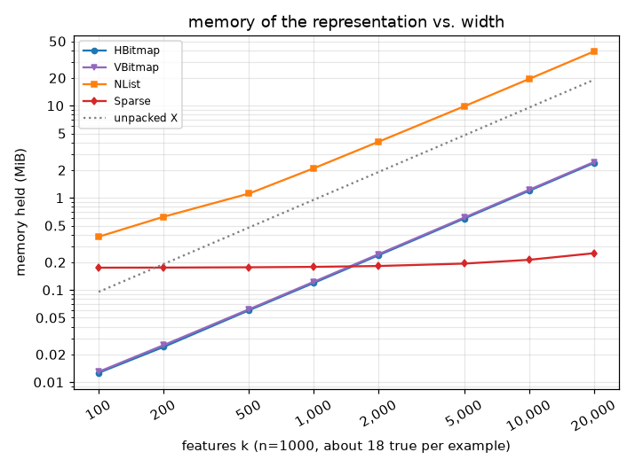

Memory held by each representation (share of HBitmap in parentheses; the last row is the unpacked bool matrix):

| representation | k=100 | k=200 | k=500 | k=1000 | k=2000 | k=5000 | k=10000 | k=20000 |
|---|--:|--:|--:|--:|--:|--:|--:|--:|
| HBitmap | 13 KiB | 25 KiB | 62 KiB | 122 KiB | 244 KiB | 611 KiB | 1.2 MiB | 2.4 MiB |
| VBitmap | 13 KiB (103%) | 26 KiB (105%) | 63 KiB (102%) | 126 KiB (103%) | 251 KiB (103%) | 626 KiB (102%) | 1.2 MiB (102%) | 2.4 MiB (102%) |
| NList | 387 KiB (2997%) | 637 KiB (2586%) | 1.1 MiB (1846%) | 2.1 MiB (1754%) | 4.1 MiB (1703%) | 9.9 MiB (1652%) | 19.5 MiB (1634%) | 38.7 MiB (1624%) |
| Sparse | 179 KiB (1383%) | 179 KiB (727%) | 181 KiB (292%) | 183 KiB (149%) | 187 KiB (76%) | 198 KiB (32%) | 218 KiB (18%) | 257 KiB (11%) |
| unpacked `X` | 98 KiB | 195 KiB | 488 KiB | 977 KiB | 1.9 MiB | 4.8 MiB | 9.5 MiB | 19.1 MiB |

800 `coverage()` calls for random rules of 1-4 conditions:

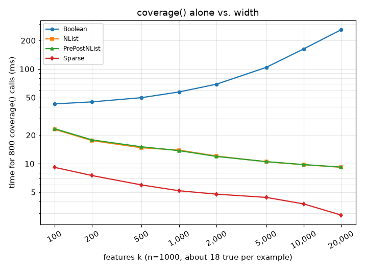

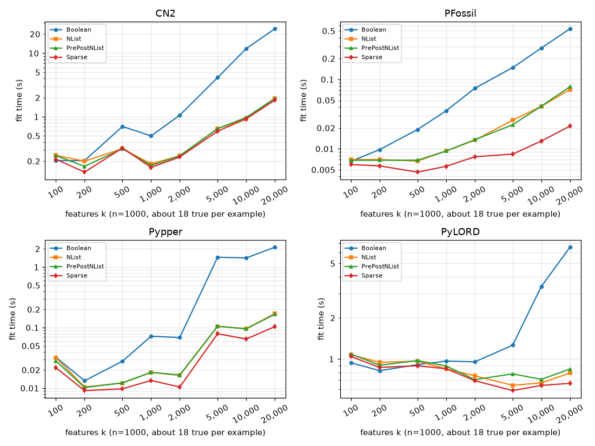

Fit time in seconds:

| learner | representation | k=100 | k=200 | k=500 | k=1000 | k=2000 | k=5000 | k=10000 | k=20000 |
|---|---|--:|--:|--:|--:|--:|--:|--:|--:|
| CN2 | HBitmap | 0.34 | 0.28 | 0.73 | 0.42 | 1.13 | 3.48 | 10.89 | 22.24 |
| CN2 | VBitmap | 0.25 (73%) | 0.19 (70%) | 0.41 (57%) | 0.52 (123%) | 0.36 (32%) | 1.38 (40%) | 1.47 (13%) | 2.77 (12%) |
| CN2 | NList | 0.38 (113%) | 0.27 (97%) | 0.51 (70%) | 0.34 (81%) | 0.40 (36%) | 0.91 (26%) | 1.30 (12%) | 2.63 (12%) |
| CN2 | Sparse | 0.39 (114%) | 0.25 (89%) | 0.67 (92%) | 0.30 (72%) | 0.36 (32%) | 1.04 (30%) | 1.44 (13%) | 2.32 (10%) |
| PFossil | HBitmap | 0.01 | 0.01 | 0.01 | 0.05 | 0.06 | 0.09 | 0.22 | 0.42 |
| PFossil | VBitmap | 0.01 (72%) | 0.01 (62%) | 0.01 (44%) | 0.01 (28%) | 0.01 (21%) | 0.01 (15%) | 0.02 (10%) | 0.03 (8%) |
| PFossil | NList | 0.01 (100%) | 0.01 (91%) | 0.03 (198%) | 0.02 (46%) | 0.02 (35%) | 0.03 (34%) | 0.06 (26%) | 0.11 (27%) |
| PFossil | Sparse | 0.01 (93%) | 0.01 (77%) | 0.02 (114%) | 0.01 (18%) | 0.01 (18%) | 0.01 (14%) | 0.02 (8%) | 0.02 (6%) |
| Pypper | HBitmap | 0.05 | 0.02 | 0.04 | 0.05 | 0.05 | 0.68 | 0.88 | 1.42 |
| Pypper | VBitmap | 0.02 (45%) | 0.02 (102%) | 0.02 (42%) | 0.02 (35%) | 0.02 (36%) | 0.14 (20%) | 0.18 (21%) | 0.21 (15%) |
| Pypper | NList | 0.04 (79%) | 0.03 (143%) | 0.02 (62%) | 0.03 (55%) | 0.03 (55%) | 0.15 (23%) | 0.20 (23%) | 0.26 (18%) |
| Pypper | Sparse | 0.03 (63%) | 0.03 (121%) | 0.02 (43%) | 0.02 (39%) | 0.02 (34%) | 0.12 (17%) | 0.08 (10%) | 0.14 (10%) |
| PyLORD | HBitmap | 1.56 | 1.38 | 1.47 | 1.40 | 1.19 | 1.27 | 1.79 | 2.42 |
| PyLORD | VBitmap | 1.11 (71%) | 0.94 (68%) | 1.01 (68%) | 0.92 (66%) | 0.81 (68%) | 0.78 (61%) | 0.85 (48%) | 1.08 (45%) |
| PyLORD | NList | 1.73 (111%) | 1.57 (114%) | 2.01 (137%) | 1.49 (107%) | 1.21 (102%) | 1.10 (87%) | 1.15 (64%) | 1.26 (52%) |
| PyLORD | Sparse | 1.65 (106%) | 1.41 (102%) | 1.44 (98%) | 1.34 (96%) | 1.08 (90%) | 0.98 (77%) | 0.99 (55%) | 1.08 (45%) |
| ENDER | HBitmap | 0.53 | 0.57 | 0.86 | 1.31 | 2.53 | 5.59 | 8.49 | 32.98 |
| ENDER | VBitmap | 0.47 (88%) | 0.50 (88%) | 0.77 (89%) | 0.81 (62%) | 1.61 (64%) | 3.40 (61%) | 5.67 (67%) | 9.20 (28%) |
| ENDER | NList | 0.50 (93%) | 0.54 (94%) | 0.62 (72%) | 0.71 (54%) | 0.84 (33%) | 0.84 (15%) | 1.13 (13%) | 2.02 (6%) |
| ENDER | Sparse | 0.55 (103%) | 0.60 (105%) | 0.76 (89%) | 0.61 (47%) | 0.77 (31%) | 0.81 (14%) | 1.54 (18%) | 2.43 (7%) |

Memory a fit costs in total -- what the representation holds plus the peak the fit allocates on top of it, caches the representation builds during the fit included (`tracemalloc`, a separate untimed pass):

| learner | representation | k=100 | k=200 | k=500 | k=1000 | k=2000 | k=5000 | k=10000 | k=20000 |
|---|---|--:|--:|--:|--:|--:|--:|--:|--:|
| CN2 | HBitmap | 1.1 MiB | 2.0 MiB | 5.0 MiB | 9.8 MiB | 19.7 MiB | 49.2 MiB | 97.7 MiB | 196.2 MiB |
| CN2 | VBitmap | 293 KiB (27%) | 436 KiB (21%) | 922 KiB (18%) | 1.4 MiB (14%) | 3.2 MiB (16%) | 7.4 MiB (15%) | 12.1 MiB (12%) | 23.9 MiB (12%) |
| CN2 | NList | 1.5 MiB (140%) | 2.7 MiB (133%) | 4.1 MiB (82%) | 3.6 MiB (36%) | 7.2 MiB (37%) | 16.8 MiB (34%) | 30.6 MiB (31%) | 60.5 MiB (31%) |
| CN2 | Sparse | 521 KiB (48%) | 609 KiB (29%) | 1.0 MiB (21%) | 1.4 MiB (15%) | 3.1 MiB (16%) | 6.9 MiB (14%) | 11.1 MiB (11%) | 21.7 MiB (11%) |
| PFossil | HBitmap | 1.0 MiB | 2.0 MiB | 4.9 MiB | 9.8 MiB | 19.6 MiB | 49.1 MiB | 97.6 MiB | 196.2 MiB |
| PFossil | VBitmap | 129 KiB (12%) | 174 KiB (9%) | 402 KiB (8%) | 688 KiB (7%) | 1.3 MiB (7%) | 3.5 MiB (7%) | 5.7 MiB (6%) | 11.1 MiB (6%) |
| PFossil | NList | 1.4 MiB (141%) | 2.6 MiB (133%) | 4.0 MiB (81%) | 2.7 MiB (28%) | 5.0 MiB (26%) | 11.9 MiB (24%) | 22.8 MiB (23%) | 45.3 MiB (23%) |
| PFossil | Sparse | 476 KiB (45%) | 479 KiB (23%) | 521 KiB (10%) | 554 KiB (6%) | 925 KiB (5%) | 2.0 MiB (4%) | 3.2 MiB (3%) | 6.6 MiB (3%) |
| Pypper | HBitmap | 759 KiB | 1.4 MiB | 3.5 MiB | 6.9 MiB | 13.8 MiB | 34.8 MiB | 69.0 MiB | 138.9 MiB |
| Pypper | VBitmap | 136 KiB (18%) | 179 KiB (12%) | 409 KiB (11%) | 684 KiB (10%) | 1.2 MiB (9%) | 2.9 MiB (8%) | 5.1 MiB (7%) | 11.1 MiB (8%) |
| Pypper | NList | 1.1 MiB (155%) | 2.1 MiB (145%) | 4.0 MiB (114%) | 2.6 MiB (38%) | 4.9 MiB (35%) | 11.7 MiB (34%) | 22.4 MiB (32%) | 45.7 MiB (33%) |
| Pypper | Sparse | 402 KiB (53%) | 399 KiB (27%) | 443 KiB (12%) | 487 KiB (7%) | 804 KiB (6%) | 1.8 MiB (5%) | 2.9 MiB (4%) | 7.0 MiB (5%) |
| PyLORD | HBitmap | 1.4 MiB | 1.4 MiB | 2.0 MiB | 2.4 MiB | 4.1 MiB | 10.1 MiB | 20.3 MiB | 40.5 MiB |
| PyLORD | VBitmap | 1.4 MiB (93%) | 1.2 MiB (86%) | 1.5 MiB (76%) | 1.5 MiB (61%) | 1.5 MiB (38%) | 2.0 MiB (20%) | 2.9 MiB (14%) | 4.6 MiB (11%) |
| PyLORD | NList | 1.8 MiB (127%) | 2.8 MiB (202%) | 4.2 MiB (213%) | 3.7 MiB (153%) | 5.6 MiB (138%) | 11.5 MiB (114%) | 21.4 MiB (106%) | 41.1 MiB (101%) |
| PyLORD | Sparse | 1.6 MiB (108%) | 1.4 MiB (101%) | 1.7 MiB (85%) | 1.6 MiB (65%) | 1.5 MiB (37%) | 1.6 MiB (16%) | 1.9 MiB (9%) | 2.4 MiB (6%) |
| ENDER | HBitmap | 509 KiB | 842 KiB | 1.8 MiB | 3.5 MiB | 6.8 MiB | 17.1 MiB | 33.5 MiB | 67.7 MiB |
| ENDER | VBitmap | 414 KiB (81%) | 654 KiB (78%) | 1.4 MiB (75%) | 2.5 MiB (73%) | 5.0 MiB (73%) | 10.7 MiB (63%) | 12.1 MiB (36%) | 25.0 MiB (37%) |
| ENDER | NList | 901 KiB (177%) | 1.4 MiB (175%) | 2.9 MiB (159%) | 2.7 MiB (79%) | 4.9 MiB (71%) | 11.6 MiB (68%) | 22.0 MiB (66%) | 44.4 MiB (66%) |
| ENDER | Sparse | 547 KiB (108%) | 564 KiB (67%) | 598 KiB (32%) | 602 KiB (17%) | 792 KiB (11%) | 1.7 MiB (10%) | 2.5 MiB (8%) | 5.7 MiB (8%) |

