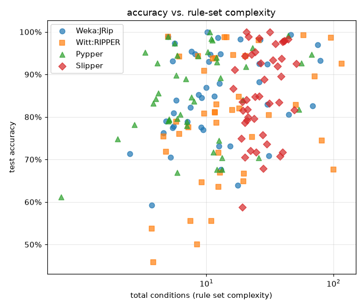
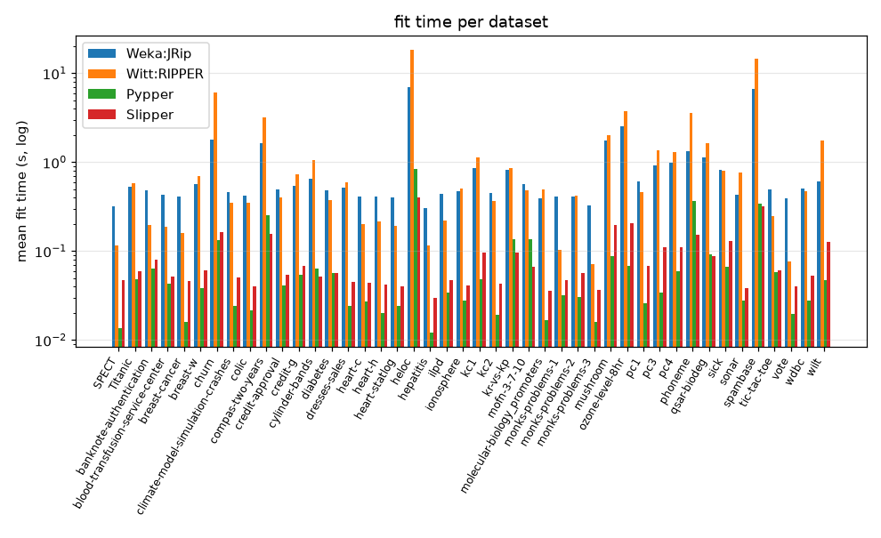
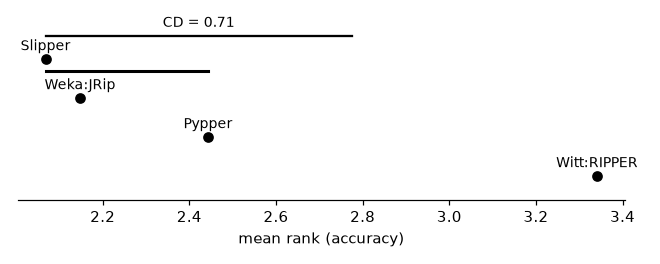
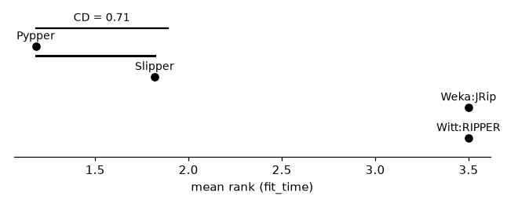

# RIPPER-family comparison: Weka:JRip / Witt:RIPPER / Pypper / Slipper

## Setup

**Full run** (44 binary datasets). For a quick sanity check instead (10 small datasets, 3-fold, well under a minute): `python demos/ripper_comparison.py` with no arguments -- its output isn't checked in (see `ripper_comparison_quick_report.md` after running it).

Four RIPPER-family rule learners -- Weka:JRip, Witt:RIPPER,
Pypper, Slipper -- compared on 44 binary datasets from
`pyrulearn.experiments.catalog`.

A fifth, IMod:Slipper (`imodels`' SlipperClassifier), is checked
separately first against the native Slipper on a handful of small,
low-feature-count datasets, then left out of the main comparison below --
see "Why IMod:Slipper isn't in the main comparison". Across 4 datasets (3-fold), IMod:Slipper was no more accurate than Slipper (mean accuracy 68.95% vs. 81.40%) while taking 130x as long per fit (6.38s vs. 0.05s, mean) -- not worth its cost at the scale of the main comparison below.

Protocol: `10`-fold stratified cross-validation
(`pyrulearn.experiments.runner.run_cv`), one `DataSpec` per training fold
(`build_dataspec(max_intervals=6)`), the test fold binarized
against that same `DataSpec` -- every learner sees the identical
binary features per fold (as vertical bitmaps, the library's default representation;
the Weka learners convert them to the matrix they need), so differences
reflect the algorithms, not the data preparation. Each fit is capped at 180s; a
timeout or an exception is recorded as a failure, not fatal to the run.

A fold that times out fails the whole cross-validation of that learner on that dataset (`run_cv`'s `stop_on_timeout`): its remaining folds are not run, and all its folds count as failures, so no mean rests on just the folds that finished.

Measures: test accuracy, rule count, total condition count, fit time
(seconds, JVM startup included for Weka:JRip). Witt:RIPPER auto-dispatches
one-vs-rest for multi-class (see the module docstring); every other
learner handles multi-class natively.

Every learner runs single-threaded; fits run 10 at a time (`run_cv`'s `n_jobs`), each in its own process and timed there, with the numerical libraries limited to one thread (`OMP_NUM_THREADS=1` and its relatives). A check of the `dense_vs_modular` learners on 11 datasets found the fit times of 5 concurrent fits as close to a sequential run as a second sequential run (per-learner ratios and rankings alike); time ratios between learners are reproducible to about +-10% either way.

The same for fit time, rank 1 the fastest:

## Why IMod:Slipper isn't in the main comparison

Across 4 datasets (3-fold), IMod:Slipper was no more accurate than Slipper (mean accuracy 68.95% vs. 81.40%) while taking 130x as long per fit (6.38s vs. 0.05s, mean) -- not worth its cost at the scale of the main comparison below.

| learner | accuracy | fit_time |
|---|---|---|
| IMod:Slipper | 68.95% | 6.384 |
| Slipper | 81.40% | 0.049 |

## Summary by learner (mean across every dataset and fold)

| learner | accuracy | n_rules | conds/rule | fit_time (s) | wins | mean rank |
|---|--:|--:|--:|--:|--:|--:|
| Weka:JRip | 84.99% | 5.1 | 3.0 | 0.97 | 13.2 | 2.12 |
| Slipper | 85.58% | 13.6 | 2.1 | 0.09 | 18.2 | 2.14 |
| Pypper | 84.91% | 3.9 | 2.9 | 0.08 | 8.2 | 2.44 |
| Witt:RIPPER | 79.76% | 6.4 | 3.1 | 1.63 | 4.2 | 3.30 |

`wins` -- datasets where a learner's mean accuracy was (tied-for-)best, a tie split evenly (`pyrulearn.experiments.stats.win_counts`); `mean rank` -- average accuracy rank across datasets, failures tied for last (`stats.mean_rank`).

## Per-dataset results, per learner (mean across folds)

| dataset | learner | accuracy | n_rules | n_conditions | conds_per_rule | fit_time |
|---|---|---|---|---|---|---|
| SPECT | Pypper | 79.00% | 0.9 | 5.0 | 5.6 | 0.013 |
| SPECT | Slipper | 83.13% | 11.3 | 31.8 | 2.8 | 0.047 |
| SPECT | Weka:JRip | 80.87% | 1.0 | 5.5 | 5.5 | 0.318 |
| SPECT | Witt:RIPPER | 78.68% | 1.6 | 12.0 | 7.5 | 0.116 |
| Titanic | Pypper | 79.68% | 2.2 | 5.1 | 2.3 | 0.049 |
| Titanic | Slipper | 80.21% | 12.9 | 22.6 | 1.7 | 0.059 |
| Titanic | Weka:JRip | 78.23% | 3.1 | 7.2 | 2.3 | 0.526 |
| Titanic | Witt:RIPPER | 75.70% | 5.4 | 19.4 | 3.2 | 0.588 |
| banknote-authentication | Pypper | 98.40% | 4.6 | 10.9 | 2.4 | 0.063 |
| banknote-authentication | Slipper | 98.47% | 12.9 | 26.1 | 2.0 | 0.081 |
| banknote-authentication | Weka:JRip | 98.69% | 5.2 | 12.3 | 2.4 | 0.485 |
| banknote-authentication | Witt:RIPPER | 98.76% | 5.8 | 14.4 | 2.4 | 0.198 |
| blood-transfusion-service-center | Pypper | 79.54% | 1.9 | 5.1 | 2.7 | 0.043 |
| blood-transfusion-service-center | Slipper | 78.60% | 11.6 | 20.1 | 1.7 | 0.051 |
| blood-transfusion-service-center | Weka:JRip | 79.00% | 1.9 | 4.8 | 2.5 | 0.430 |
| blood-transfusion-service-center | Witt:RIPPER | 64.57% | 3.9 | 9.2 | 2.4 | 0.190 |
| breast-cancer | Pypper | 74.84% | 1.0 | 2.0 | 2.0 | 0.016 |
| breast-cancer | Slipper | 72.03% | 13.9 | 22.3 | 1.6 | 0.046 |
| breast-cancer | Weka:JRip | 71.37% | 1.3 | 2.5 | 1.9 | 0.412 |
| breast-cancer | Witt:RIPPER | 53.72% | 1.5 | 3.7 | 2.7 | 0.159 |
| breast-w | Pypper | 95.42% | 3.6 | 7.9 | 2.2 | 0.039 |
| breast-w | Slipper | 96.14% | 14.4 | 17.6 | 1.2 | 0.061 |
| breast-w | Weka:JRip | 95.42% | 4.5 | 8.5 | 1.9 | 0.569 |
| breast-w | Witt:RIPPER | 93.99% | 3.1 | 7.8 | 2.5 | 0.706 |
| churn | Pypper | 91.78% | 6.9 | 20.4 | 3.0 | 0.133 |
| churn | Slipper | 91.88% | 15.9 | 36.2 | 2.3 | 0.164 |
| churn | Weka:JRip | 92.40% | 10.1 | 30.1 | 3.0 | 1.812 |
| churn | Witt:RIPPER | 89.50% | 12.7 | 70.8 | 5.6 | 6.110 |
| climate-model-simulation-crashes | Pypper | 94.44% | 1.8 | 5.9 | 3.3 | 0.024 |
| climate-model-simulation-crashes | Slipper | 93.33% | 13.9 | 33.3 | 2.4 | 0.051 |
| climate-model-simulation-crashes | Weka:JRip | 94.81% | 2.7 | 8.1 | 3.0 | 0.464 |
| climate-model-simulation-crashes | Witt:RIPPER | 93.70% | 3.5 | 11.2 | 3.2 | 0.353 |
| colic | Pypper | 85.62% | 1.8 | 4.2 | 2.3 | 0.022 |
| colic | Slipper | 81.81% | 13.9 | 21.0 | 1.5 | 0.040 |
| colic | Weka:JRip | 84.52% | 3.9 | 9.2 | 2.3 | 0.426 |
| colic | Witt:RIPPER | 80.98% | 3.9 | 11.7 | 3.0 | 0.349 |
| compas-two-years | Pypper | 66.96% | 3.6 | 10.4 | 2.7 | 0.256 |
| compas-two-years | Slipper | 67.70% | 14.3 | 27.4 | 1.9 | 0.156 |
| compas-two-years | Weka:JRip | 68.00% | 5.1 | 13.5 | 2.6 | 1.621 |
| compas-two-years | Witt:RIPPER | 64.93% | 4.7 | 19.2 | 3.7 | 3.205 |
| credit-approval | Pypper | 83.62% | 3.2 | 8.0 | 2.2 | 0.041 |
| credit-approval | Slipper | 84.78% | 13.3 | 24.2 | 1.8 | 0.055 |
| credit-approval | Weka:JRip | 85.22% | 4.0 | 8.7 | 2.1 | 0.496 |
| credit-approval | Witt:RIPPER | 84.78% | 6.3 | 17.9 | 2.8 | 0.404 |
| credit-g | Pypper | 70.60% | 2.9 | 11.3 | 3.8 | 0.054 |
| credit-g | Slipper | 74.30% | 15.0 | 33.9 | 2.3 | 0.069 |
| credit-g | Weka:JRip | 70.60% | 2.1 | 7.7 | 3.5 | 0.542 |
| credit-g | Witt:RIPPER | 72.00% | 3.0 | 14.6 | 4.9 | 0.729 |
| cylinder-bands | Pypper | 64.63% | 3.7 | 11.0 | 3.0 | 0.063 |
| cylinder-bands | Slipper | 70.56% | 17.4 | 20.1 | 1.2 | 0.051 |
| cylinder-bands | Weka:JRip | 65.93% | 6.5 | 17.1 | 2.6 | 0.647 |
| cylinder-bands | Witt:RIPPER | 62.59% | 4.6 | 10.8 | 2.4 | 1.055 |
| diabetes | Pypper | 74.49% | 3.7 | 12.5 | 3.3 | 0.056 |
| diabetes | Slipper | 75.78% | 13.3 | 27.7 | 2.1 | 0.057 |
| diabetes | Weka:JRip | 73.17% | 3.8 | 12.5 | 3.2 | 0.482 |
| diabetes | Witt:RIPPER | 66.66% | 5.8 | 19.8 | 3.4 | 0.372 |
| dresses-sales | Pypper | 61.20% | 1.1 | 1.2 | 1.1 | 0.024 |
| dresses-sales | Slipper | 58.80% | 16.2 | 19.2 | 1.2 | 0.045 |
| dresses-sales | Weka:JRip | 59.20% | 2.1 | 3.7 | 1.7 | 0.519 |
| dresses-sales | Witt:RIPPER | 45.80% | 1.3 | 3.8 | 3.2 | 0.589 |
| heart-c | Pypper | 80.56% | 2.6 | 6.2 | 2.4 | 0.027 |
| heart-c | Slipper | 78.92% | 13.7 | 21.8 | 1.6 | 0.044 |
| heart-c | Weka:JRip | 79.54% | 3.2 | 7.6 | 2.3 | 0.411 |
| heart-c | Witt:RIPPER | 81.83% | 4.5 | 12.5 | 2.8 | 0.203 |
| heart-h | Pypper | 78.21% | 2.0 | 4.7 | 2.2 | 0.020 |
| heart-h | Slipper | 79.91% | 14.2 | 22.1 | 1.6 | 0.042 |
| heart-h | Weka:JRip | 78.25% | 2.2 | 4.1 | 1.8 | 0.416 |
| heart-h | Witt:RIPPER | 56.53% | 3.6 | 9.2 | 2.6 | 0.217 |
| heart-statlog | Pypper | 79.63% | 2.4 | 5.9 | 2.4 | 0.024 |
| heart-statlog | Slipper | 80.37% | 13.7 | 20.2 | 1.5 | 0.040 |
| heart-statlog | Weka:JRip | 82.22% | 3.5 | 7.8 | 2.2 | 0.402 |
| heart-statlog | Witt:RIPPER | 80.74% | 3.6 | 9.6 | 2.6 | 0.192 |
| heloc | Pypper | 70.46% | 8.8 | 35.9 | 4.0 | 0.844 |
| heloc | Slipper | 70.51% | 14.4 | 37.9 | 2.6 | 0.398 |
| heloc | Weka:JRip | 70.79% | 10.0 | 40.5 | 4.0 | 7.057 |
| heloc | Witt:RIPPER | 66.99% | 15.7 | 100.7 | 6.4 | 18.438 |
| hepatitis | Pypper | 78.12% | 1.7 | 2.7 | 1.5 | 0.012 |
| hepatitis | Slipper | 84.00% | 13.1 | 20.6 | 1.6 | 0.030 |
| hepatitis | Weka:JRip | 76.29% | 2.1 | 4.6 | 2.1 | 0.306 |
| hepatitis | Witt:RIPPER | 78.92% | 2.6 | 5.8 | 2.1 | 0.116 |
| ilpd | Pypper | 66.91% | 1.7 | 5.9 | 3.4 | 0.034 |
| ilpd | Slipper | 71.69% | 12.5 | 24.5 | 2.0 | 0.047 |
| ilpd | Weka:JRip | 70.50% | 1.6 | 5.2 | 3.3 | 0.442 |
| ilpd | Witt:RIPPER | 55.57% | 2.7 | 7.5 | 2.8 | 0.223 |
| ionosphere | Pypper | 89.75% | 3.8 | 5.8 | 1.5 | 0.028 |
| ionosphere | Slipper | 91.15% | 14.4 | 16.7 | 1.2 | 0.041 |
| ionosphere | Weka:JRip | 86.89% | 5.8 | 10.0 | 1.6 | 0.476 |
| ionosphere | Witt:RIPPER | 90.89% | 5.7 | 9.6 | 1.7 | 0.503 |
| kc1 | Pypper | 84.73% | 1.9 | 6.6 | 3.4 | 0.048 |
| kc1 | Slipper | 84.87% | 13.3 | 25.6 | 1.9 | 0.097 |
| kc1 | Weka:JRip | 84.83% | 3.2 | 12.5 | 3.7 | 0.869 |
| kc1 | Witt:RIPPER | 55.48% | 3.0 | 10.9 | 3.5 | 1.143 |
| kc2 | Pypper | 84.27% | 1.6 | 4.0 | 2.3 | 0.019 |
| kc2 | Slipper | 83.51% | 13.4 | 20.5 | 1.5 | 0.044 |
| kc2 | Weka:JRip | 83.90% | 2.7 | 7.9 | 2.8 | 0.450 |
| kc2 | Witt:RIPPER | 76.02% | 2.7 | 6.1 | 2.3 | 0.364 |
| kr-vs-kp | Pypper | 99.09% | 13.6 | 44.0 | 3.2 | 0.135 |
| kr-vs-kp | Slipper | 97.69% | 14.6 | 39.7 | 2.7 | 0.096 |
| kr-vs-kp | Weka:JRip | 99.31% | 14.6 | 46.2 | 3.2 | 0.823 |
| kr-vs-kp | Witt:RIPPER | 99.28% | 17.5 | 57.8 | 3.3 | 0.862 |
| mofn-3-7-10 | Pypper | 94.71% | 14.0 | 67.0 | 4.7 | 0.136 |
| mofn-3-7-10 | Slipper | 97.89% | 14.1 | 41.3 | 2.9 | 0.066 |
| mofn-3-7-10 | Weka:JRip | 96.97% | 15.6 | 75.2 | 4.8 | 0.563 |
| mofn-3-7-10 | Witt:RIPPER | 98.64% | 19.3 | 95.6 | 4.9 | 0.482 |
| molecular-biology_promoters | Pypper | 83.18% | 2.1 | 3.8 | 1.8 | 0.017 |
| molecular-biology_promoters | Slipper | 86.64% | 12.5 | 16.3 | 1.3 | 0.036 |
| molecular-biology_promoters | Weka:JRip | 77.45% | 2.5 | 5.4 | 2.1 | 0.393 |
| molecular-biology_promoters | Witt:RIPPER | 75.45% | 2.3 | 4.6 | 2.0 | 0.492 |
| monks-problems-1 | Pypper | 95.30% | 3.6 | 10.2 | 2.7 | 0.032 |
| monks-problems-1 | Slipper | 100.00% | 12.8 | 31.6 | 2.4 | 0.047 |
| monks-problems-1 | Weka:JRip | 93.04% | 3.7 | 10.4 | 2.5 | 0.413 |
| monks-problems-1 | Witt:RIPPER | 94.57% | 4.6 | 16.2 | 3.4 | 0.103 |
| monks-problems-2 | Pypper | 70.39% | 2.3 | 13.3 | 5.9 | 0.030 |
| monks-problems-2 | Slipper | 71.73% | 12.9 | 39.8 | 3.1 | 0.057 |
| monks-problems-2 | Weka:JRip | 80.57% | 7.6 | 44.6 | 5.8 | 0.409 |
| monks-problems-2 | Witt:RIPPER | 82.85% | 14.2 | 50.7 | 3.5 | 0.419 |
| monks-problems-3 | Pypper | 98.92% | 3.0 | 5.0 | 1.7 | 0.016 |
| monks-problems-3 | Slipper | 98.92% | 10.4 | 21.5 | 2.1 | 0.036 |
| monks-problems-3 | Weka:JRip | 98.92% | 3.0 | 5.0 | 1.7 | 0.325 |
| monks-problems-3 | Witt:RIPPER | 98.92% | 3.0 | 5.0 | 1.7 | 0.072 |
| mushroom | Pypper | 99.96% | 5.2 | 10.6 | 2.1 | 0.088 |
| mushroom | Slipper | 100.00% | 10.5 | 20.6 | 2.0 | 0.199 |
| mushroom | Weka:JRip | 99.98% | 6.0 | 10.1 | 1.7 | 1.745 |
| mushroom | Witt:RIPPER | 98.71% | 6.9 | 13.9 | 2.0 | 2.034 |
| ozone-level-8hr | Pypper | 92.90% | 2.9 | 12.1 | 4.3 | 0.069 |
| ozone-level-8hr | Slipper | 93.73% | 13.6 | 39.2 | 2.9 | 0.207 |
| ozone-level-8hr | Weka:JRip | 92.58% | 5.8 | 25.9 | 4.4 | 2.521 |
| ozone-level-8hr | Witt:RIPPER | 81.69% | 5.9 | 16.0 | 2.7 | 3.757 |
| pc1 | Pypper | 92.61% | 1.5 | 4.1 | 2.6 | 0.026 |
| pc1 | Slipper | 92.61% | 13.6 | 26.7 | 2.0 | 0.068 |
| pc1 | Weka:JRip | 93.15% | 1.9 | 5.4 | 2.8 | 0.603 |
| pc1 | Witt:RIPPER | 71.78% | 1.8 | 4.8 | 2.7 | 0.463 |
| pc3 | Pypper | 88.93% | 1.8 | 7.6 | 4.2 | 0.035 |
| pc3 | Slipper | 88.35% | 13.4 | 28.0 | 2.1 | 0.110 |
| pc3 | Weka:JRip | 88.29% | 3.3 | 14.7 | 4.3 | 0.917 |
| pc3 | Witt:RIPPER | 67.32% | 3.9 | 12.1 | 3.1 | 1.350 |
| pc4 | Pypper | 89.16% | 3.0 | 13.5 | 4.4 | 0.060 |
| pc4 | Slipper | 90.40% | 12.4 | 35.8 | 2.9 | 0.111 |
| pc4 | Weka:JRip | 87.58% | 4.4 | 20.5 | 4.6 | 0.997 |
| pc4 | Witt:RIPPER | 83.05% | 5.3 | 12.3 | 2.3 | 1.292 |
| phoneme | Pypper | 81.72% | 10.0 | 53.5 | 5.2 | 0.364 |
| phoneme | Slipper | 81.61% | 14.3 | 49.0 | 3.4 | 0.153 |
| phoneme | Weka:JRip | 82.62% | 12.9 | 68.7 | 5.3 | 1.339 |
| phoneme | Witt:RIPPER | 74.46% | 15.8 | 81.0 | 5.2 | 3.588 |
| qsar-biodeg | Pypper | 84.46% | 5.2 | 19.1 | 3.8 | 0.093 |
| qsar-biodeg | Slipper | 82.85% | 14.4 | 35.3 | 2.5 | 0.087 |
| qsar-biodeg | Weka:JRip | 84.36% | 7.6 | 32.5 | 4.3 | 1.131 |
| qsar-biodeg | Witt:RIPPER | 80.58% | 10.8 | 31.7 | 3.0 | 1.643 |
| sick | Pypper | 98.09% | 3.4 | 11.1 | 3.2 | 0.067 |
| sick | Slipper | 97.80% | 13.8 | 40.0 | 2.9 | 0.130 |
| sick | Weka:JRip | 98.28% | 5.3 | 18.4 | 3.4 | 0.815 |
| sick | Witt:RIPPER | 82.03% | 7.0 | 18.2 | 2.6 | 0.804 |
| sonar | Pypper | 77.88% | 3.5 | 7.0 | 2.0 | 0.028 |
| sonar | Slipper | 74.93% | 15.2 | 18.8 | 1.2 | 0.039 |
| sonar | Weka:JRip | 76.98% | 4.5 | 9.4 | 2.1 | 0.433 |
| sonar | Witt:RIPPER | 77.52% | 3.2 | 7.2 | 2.3 | 0.759 |
| spambase | Pypper | 92.70% | 12.0 | 55.9 | 4.6 | 0.341 |
| spambase | Slipper | 92.50% | 15.1 | 50.8 | 3.4 | 0.320 |
| spambase | Weka:JRip | 93.22% | 17.4 | 78.6 | 4.5 | 6.686 |
| spambase | Witt:RIPPER | 92.59% | 24.1 | 115.9 | 4.8 | 14.747 |
| tic-tac-toe | Pypper | 96.25% | 7.5 | 23.1 | 3.1 | 0.059 |
| tic-tac-toe | Slipper | 98.33% | 15.0 | 43.9 | 2.9 | 0.061 |
| tic-tac-toe | Weka:JRip | 98.12% | 8.4 | 26.6 | 3.1 | 0.497 |
| tic-tac-toe | Witt:RIPPER | 98.02% | 8.4 | 25.7 | 3.1 | 0.249 |
| vote | Pypper | 95.18% | 1.7 | 3.3 | 1.6 | 0.020 |
| vote | Slipper | 94.73% | 10.9 | 22.6 | 2.1 | 0.040 |
| vote | Weka:JRip | 95.42% | 3.1 | 7.6 | 2.2 | 0.389 |
| vote | Witt:RIPPER | 94.26% | 3.0 | 6.1 | 2.0 | 0.077 |
| wdbc | Pypper | 94.37% | 3.8 | 8.6 | 2.3 | 0.028 |
| wdbc | Slipper | 95.25% | 13.8 | 24.1 | 1.7 | 0.053 |
| wdbc | Weka:JRip | 94.73% | 4.8 | 10.7 | 2.2 | 0.503 |
| wdbc | Witt:RIPPER | 93.84% | 4.9 | 11.8 | 2.4 | 0.470 |
| wilt | Pypper | 97.27% | 1.9 | 5.6 | 2.9 | 0.048 |
| wilt | Slipper | 97.17% | 12.2 | 34.9 | 2.9 | 0.126 |
| wilt | Weka:JRip | 97.33% | 2.1 | 5.6 | 2.7 | 0.605 |
| wilt | Witt:RIPPER | 94.33% | 8.6 | 20.3 | 2.0 | 1.743 |

