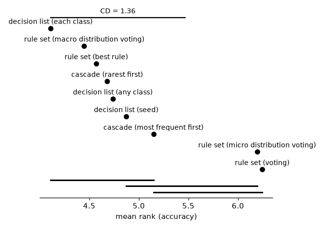
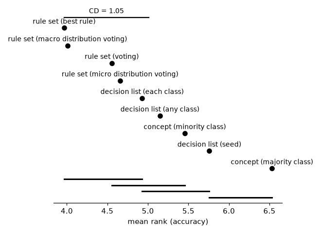

# Rule models: rule sets, cascades, decision lists

## Setup

**Full run.** Quick sanity check instead: `python demos/rule_models.py`.

A rule learner's covering loop can build different kinds of models from
the same search. This demo compares them, for CN2, PFossil and Pypper as
base learners:

- **rule set** -- one-vs-rest: a rule set per class, each learned against
  all other classes; a conflict between covering rules of different
  classes resolved by **best rule** (the covering rule with the best
  Laplace estimate, i.e. the rules sorted by it, an ordered rule set),
  **voting** (one vote per covering rule), **micro distribution voting**
  (their class counts summed, CN2's own) or **macro distribution voting**
  (their class proportions summed, every rule weighing the same) -- four
  ways of predicting with the same rules.
- **cascade** -- ordered one-vs-rest: the classes one after the other,
  each against those not yet handled, from the **rarest** class (Ripper's
  order) or the **most frequent** one; the last class is the default.
- **decision list** -- one covering loop over all classes, first match
  wins, the default the majority of what no rule covers. Each rule the
  best of **any class** (its head chosen by the heuristic, CN2's ordered
  mode), the best of one search for **each class**, or explaining a random
  uncovered example, the **seed**: generalizing it and predicting its class
  (AQ's seed covering).

On two-class data (the second part), a cascade is a concept for one class
with the other as the default; the configurations there are a concept for
the **minority** class and one for the **majority** class, the **rule set**
of both classes with its four combiners, and the three **decision lists** of rules of either class.

Multi-class datasets, with their numbers of classes: `balance-scale` (3), `cmc` (3), `dna` (3), `hayes-roth` (3), `iris` (3), `splice` (3), `wine` (3), `car` (4), `lymph` (4), `vehicle` (4), `anneal` (5), `glass` (6), `solar-flare` (6), `segment` (7), `zoo` (7), `ecoli` (8), `led24` (10), `yeast` (10), `optdigits` (10), `texture` (11), `vowel` (11), `kropt` (18), `soybean` (19), `primary-tumor` (21), `audiology` (24), `letter` (26). Two-class datasets: `SPECT`, `Titanic`, `banknote-authentication`, `blood-transfusion-service-center`, `breast-cancer`, `breast-w`, `churn`, `climate-model-simulation-crashes`, `colic`, `compas-two-years`, `credit-approval`, `credit-g`, `cylinder-bands`, `diabetes`, `dresses-sales`, `heart-c`, `heart-h`, `heart-statlog`, `heloc`, `hepatitis`, `ilpd`, `ionosphere`, `kc1`, `kc2`, `kr-vs-kp`, `mofn-3-7-10`, `molecular-biology_promoters`, `monks-problems-1`, `monks-problems-2`, `monks-problems-3`, `mushroom`, `ozone-level-8hr`, `pc1`, `pc3`, `pc4`, `phoneme`, `qsar-biodeg`, `sick`, `sonar`, `spambase`, `tic-tac-toe`, `vote`, `wdbc`, `wilt`. Protocol:
10-fold stratified cross-validation, one `DataSpec` per training fold
(`TreeDiscretizer(max_intervals=8)`). Each fit is capped at
300s (1800s for the large `kropt` and `letter`); a time-out fails the whole cross-validation of that
learner on that dataset. Training time is measured inside the worker process.

## Multi-class datasets

Sorted by mean rank (accuracy rank across datasets, failures last). Rules and conditions: all of a model's rules together; the four rule-set variants share their rules and training time.

### CN2

| model | accuracy | mean rank | rules | conditions | train (s) | failures |
|---|--:|--:|--:|--:|--:|--:|
| decision list (each class) | 80.53% | 2.54 | 89.2 | 575.1 | 20.41 | 0 |
| decision list (seed) | 78.83% | 3.75 | 68.0 | 458.3 | 1.61 | 0 |
| decision list (any class) | 78.66% | 4.37 | 88.5 | 552.4 | 7.91 | 0 |
| rule set (macro distribution voting) | 76.21% | 4.85 | 135.3 | 916.3 | 2.57 | 0 |
| rule set (best rule) | 76.28% | 5.02 | 135.3 | 916.3 | 2.57 | 0 |
| cascade (rarest first) | 72.29% | 5.65 | 81.6 | 459.1 | 1.34 | 0 |
| cascade (most frequent first) | 72.59% | 5.65 | 87.4 | 532.2 | 1.44 | 0 |
| rule set (micro distribution voting) | 72.23% | 6.52 | 135.3 | 916.3 | 2.57 | 0 |
| rule set (voting) | 73.31% | 6.65 | 135.3 | 916.3 | 2.57 | 0 |

### PFossil

| model | accuracy | mean rank | rules | conditions | train (s) | failures |
|---|--:|--:|--:|--:|--:|--:|
| rule set (best rule) | 78.99% | 4.00 | 37.3 | 194.4 | 0.20 | 0 |
| rule set (macro distribution voting) | 78.85% | 4.02 | 37.3 | 194.4 | 0.20 | 0 |
| decision list (each class) | 78.59% | 4.42 | 33.6 | 162.4 | 1.03 | 0 |
| decision list (any class) | 78.32% | 4.48 | 23.3 | 81.6 | 0.22 | 0 |
| cascade (rarest first) | 78.01% | 4.69 | 32.0 | 153.2 | 0.16 | 0 |
| cascade (most frequent first) | 76.29% | 5.48 | 32.0 | 142.2 | 0.13 | 0 |
| rule set (micro distribution voting) | 77.54% | 5.62 | 37.3 | 194.4 | 0.20 | 0 |
| rule set (voting) | 77.68% | 5.67 | 37.3 | 194.4 | 0.20 | 0 |
| decision list (seed) | 75.79% | 6.62 | 28.8 | 149.4 | 0.30 | 0 |

### Pypper

| model | accuracy | mean rank | rules | conditions | train (s) | failures |
|---|--:|--:|--:|--:|--:|--:|
| cascade (rarest first) | 78.98% | 3.69 | 32.3 | 150.2 | 0.83 | 0 |
| decision list (seed) | 78.30% | 4.25 | 79.3 | 678.3 | 1.57 | 0 |
| cascade (most frequent first) | 77.43% | 4.31 | 32.6 | 163.7 | 0.76 | 0 |
| rule set (macro distribution voting) | 76.66% | 4.48 | 33.1 | 180.4 | 1.04 | 0 |
| rule set (best rule) | 76.67% | 4.69 | 33.1 | 180.4 | 1.04 | 0 |
| decision list (any class) | 75.28% | 5.37 | 22.0 | 99.7 | 0.45 | 0 |
| decision list (each class) | 75.51% | 5.37 | 17.0 | 61.1 | 1.45 | 0 |
| rule set (voting) | 75.83% | 6.40 | 33.1 | 180.4 | 1.04 | 0 |
| rule set (micro distribution voting) | 75.90% | 6.44 | 33.1 | 180.4 | 1.04 | 0 |

### All base learners together

Each kind of model's mean rank, averaged over the 3 base learners (ranked within each base learner on each dataset, as in the tables above), and its accuracy averaged over them.

| model | accuracy | mean rank |
|---|--:|--:|
| decision list (each class) | 78.21% | 4.11 |
| rule set (macro distribution voting) | 77.24% | 4.45 |
| rule set (best rule) | 77.31% | 4.57 |
| cascade (rarest first) | 76.43% | 4.68 |
| decision list (any class) | 77.42% | 4.74 |
| decision list (seed) | 77.64% | 4.87 |
| cascade (most frequent first) | 75.44% | 5.15 |
| rule set (micro distribution voting) | 75.22% | 6.19 |
| rule set (voting) | 75.61% | 6.24 |

Friedman test over the 78 (dataset, base learner) pairs: p = 1.5e-07 (9 kinds of model). Nemenyi critical difference at 5%: 1.36 -- two kinds whose mean ranks differ by less are not significantly different; the diagram joins them by a bar. The pairs of one dataset aren't independent of each other, so the test is on the optimistic side.

## Two-class datasets

A concept for one class, the other the default; the rule set of both classes; the decision lists of rules of either class.

### CN2

| model | accuracy | mean rank | rules | conditions | train (s) | failures |
|---|--:|--:|--:|--:|--:|--:|
| rule set (best rule) | 82.56% | 4.03 | 24.7 | 71.6 | 0.15 | 0 |
| rule set (macro distribution voting) | 82.56% | 4.24 | 24.7 | 71.6 | 0.15 | 0 |
| decision list (each class) | 82.35% | 4.47 | 18.6 | 49.2 | 0.17 | 0 |
| rule set (micro distribution voting) | 82.22% | 4.58 | 24.7 | 71.6 | 0.15 | 0 |
| rule set (voting) | 82.09% | 4.69 | 24.7 | 71.6 | 0.15 | 0 |
| decision list (any class) | 81.36% | 5.14 | 16.4 | 43.2 | 0.21 | 0 |
| decision list (seed) | 82.57% | 5.24 | 23.8 | 78.2 | 0.24 | 0 |
| concept (minority class) | 81.30% | 5.52 | 11.9 | 34.4 | 0.06 | 0 |
| concept (majority class) | 74.07% | 7.09 | 12.8 | 37.3 | 0.09 | 0 |

### PFossil

| model | accuracy | mean rank | rules | conditions | train (s) | failures |
|---|--:|--:|--:|--:|--:|--:|
| rule set (best rule) | 83.33% | 3.66 | 9.1 | 34.3 | 0.02 | 0 |
| rule set (macro distribution voting) | 83.17% | 3.76 | 9.1 | 34.3 | 0.02 | 0 |
| rule set (voting) | 82.65% | 4.45 | 9.1 | 34.3 | 0.02 | 0 |
| rule set (micro distribution voting) | 82.47% | 4.82 | 9.1 | 34.3 | 0.02 | 0 |
| decision list (each class) | 82.28% | 5.43 | 4.2 | 18.7 | 0.02 | 0 |
| decision list (any class) | 82.00% | 5.48 | 3.9 | 15.9 | 0.02 | 0 |
| concept (minority class) | 81.58% | 5.49 | 4.3 | 17.5 | 0.01 | 0 |
| decision list (seed) | 81.07% | 5.75 | 6.3 | 24.7 | 0.50 | 0 |
| concept (majority class) | 75.52% | 6.16 | 4.8 | 16.8 | 0.01 | 0 |

### Pypper

| model | accuracy | mean rank | rules | conditions | train (s) | failures |
|---|--:|--:|--:|--:|--:|--:|
| rule set (macro distribution voting) | 85.26% | 4.02 | 8.7 | 27.2 | 0.16 | 0 |
| rule set (best rule) | 85.26% | 4.20 | 8.7 | 27.2 | 0.16 | 0 |
| rule set (voting) | 85.08% | 4.51 | 8.7 | 27.2 | 0.16 | 0 |
| rule set (micro distribution voting) | 85.13% | 4.57 | 8.7 | 27.2 | 0.16 | 0 |
| decision list (any class) | 85.13% | 4.83 | 6.4 | 25.3 | 0.06 | 0 |
| decision list (each class) | 85.25% | 4.89 | 9.2 | 28.7 | 0.07 | 0 |
| concept (minority class) | 84.98% | 5.35 | 4.0 | 13.3 | 0.07 | 0 |
| decision list (seed) | 84.06% | 6.28 | 14.0 | 51.3 | 0.07 | 0 |
| concept (majority class) | 82.48% | 6.34 | 4.7 | 13.9 | 0.09 | 0 |

### All base learners together

Each kind of model's mean rank, averaged over the 3 base learners (ranked within each base learner on each dataset, as in the tables above), and its accuracy averaged over them.

| model | accuracy | mean rank |
|---|--:|--:|
| rule set (best rule) | 83.72% | 3.97 |
| rule set (macro distribution voting) | 83.66% | 4.01 |
| rule set (voting) | 83.27% | 4.55 |
| rule set (micro distribution voting) | 83.27% | 4.66 |
| decision list (each class) | 83.29% | 4.93 |
| decision list (any class) | 82.83% | 5.15 |
| concept (minority class) | 82.62% | 5.45 |
| decision list (seed) | 82.57% | 5.76 |
| concept (majority class) | 77.36% | 6.53 |

Friedman test over the 132 (dataset, base learner) pairs: p = 6e-19 (9 kinds of model). Nemenyi critical difference at 5%: 1.05 -- two kinds whose mean ranks differ by less are not significantly different; the diagram joins them by a bar. The pairs of one dataset aren't independent of each other, so the test is on the optimistic side.

## Decision lists against rule sets, over the number of classes

Per dataset and base learner, the accuracy of a decision list minus that of the rule set resolved by the best rule, in percentage points (positive: the decision list is better), and of the best decision list minus the best rule set, averaged over the datasets with the given numbers of classes and the three base learners.

| classes | pairs | list (any class) | list (each class) | list (seed) | best list - best set |
|---|--:|--:|--:|--:|--:|
| 2 | 132 | -0.89 | -0.42 | -1.15 | +0.60 |
| 3 | 21 | +0.21 | +1.01 | -1.28 | +1.71 |
| 4-5 | 12 | +0.25 | +1.54 | +0.45 | +2.89 |
| 6-9 | 15 | +1.46 | +1.04 | +0.07 | +2.12 |
| 10-26 | 30 | -0.70 | +0.49 | +1.52 | +3.47 |

Share of the pairs on which the decision list is better, and Spearman's rank correlation of the difference with the number of classes:

| | ahead, two classes | ahead, more classes | correlation, all | correlation, more classes |
|---|--:|--:|--:|--:|
| decision list (any class) | 36% | 50% | +0.06 (p = 0.39) | -0.06 (p = 0.59) |
| decision list (each class) | 39% | 54% | +0.15 (p = 0.026) | +0.02 (p = 0.89) |
| decision list (seed) | 31% | 54% | +0.13 (p = 0.061) | +0.19 (p = 0.1) |
| best decision list - best rule set | 51% | 73% | +0.26 (p = 0.00011) | +0.20 (p = 0.079) |

## Per dataset (mean across folds)

| dataset | learner | accuracy | n_rules | train_time |
|---|---|---|---|---|
| SPECT | CN2:concept (majority class) | 71.51% | 6.4 | 0.012 |
| SPECT | CN2:concept (minority class) | 71.95% | 1.9 | 0.006 |
| SPECT | CN2:decision list (any class) | 75.67% | 6.3 | 0.024 |
| SPECT | CN2:decision list (each class) | 75.67% | 6.5 | 0.018 |
| SPECT | CN2:decision list (seed) | 81.31% | 9.3 | 0.053 |
| SPECT | CN2:rule set (best rule) | 80.90% | 8.3 | 0.018 |
| SPECT | CN2:rule set (macro distribution voting) | 80.90% | 8.3 | 0.018 |
| SPECT | CN2:rule set (micro distribution voting) | 80.90% | 8.3 | 0.018 |
| SPECT | CN2:rule set (voting) | 78.29% | 8.3 | 0.018 |
| SPECT | PFossil:concept (majority class) | 70.81% | 3.5 | 0.004 |
| SPECT | PFossil:concept (minority class) | 73.76% | 6.2 | 0.010 |
| SPECT | PFossil:decision list (any class) | 74.50% | 4.5 | 0.014 |
| SPECT | PFossil:decision list (each class) | 73.76% | 6.2 | 0.014 |
| SPECT | PFossil:decision list (seed) | 78.29% | 6.4 | 0.015 |
| SPECT | PFossil:rule set (best rule) | 78.68% | 9.7 | 0.014 |
| SPECT | PFossil:rule set (macro distribution voting) | 77.55% | 9.7 | 0.014 |
| SPECT | PFossil:rule set (micro distribution voting) | 78.68% | 9.7 | 0.014 |
| SPECT | PFossil:rule set (voting) | 77.55% | 9.7 | 0.014 |
| SPECT | Pypper:concept (majority class) | 70.81% | 3.1 | 0.040 |
| SPECT | Pypper:concept (minority class) | 79.00% | 0.9 | 0.023 |
| SPECT | Pypper:decision list (any class) | 82.38% | 1.0 | 0.021 |
| SPECT | Pypper:decision list (each class) | 82.38% | 1.3 | 0.023 |
| SPECT | Pypper:decision list (seed) | 82.04% | 8.7 | 0.044 |
| SPECT | Pypper:rule set (best rule) | 79.02% | 4.0 | 0.072 |
| SPECT | Pypper:rule set (macro distribution voting) | 79.02% | 4.0 | 0.072 |
| SPECT | Pypper:rule set (micro distribution voting) | 79.02% | 4.0 | 0.072 |
| SPECT | Pypper:rule set (voting) | 79.02% | 4.0 | 0.072 |
| Titanic | CN2:concept (majority class) | 56.69% | 9.3 | 0.064 |
| Titanic | CN2:concept (minority class) | 73.41% | 17.8 | 0.096 |
| Titanic | CN2:decision list (any class) | 65.01% | 9.1 | 0.127 |
| Titanic | CN2:decision list (each class) | 74.03% | 17.9 | 0.167 |
| Titanic | CN2:decision list (seed) | 76.55% | 19.5 | 0.215 |
| Titanic | CN2:rule set (best rule) | 75.02% | 27.1 | 0.163 |
| Titanic | CN2:rule set (macro distribution voting) | 74.87% | 27.1 | 0.163 |
| Titanic | CN2:rule set (micro distribution voting) | 73.41% | 27.1 | 0.163 |
| Titanic | CN2:rule set (voting) | 74.64% | 27.1 | 0.163 |
| Titanic | PFossil:concept (majority class) | 76.93% | 3.1 | 0.006 |
| Titanic | PFossil:concept (minority class) | 78.46% | 2.0 | 0.005 |
| Titanic | PFossil:decision list (any class) | 78.46% | 2.0 | 0.009 |
| Titanic | PFossil:decision list (each class) | 77.54% | 1.9 | 0.008 |
| Titanic | PFossil:decision list (seed) | 70.73% | 6.7 | 0.112 |
| Titanic | PFossil:rule set (best rule) | 77.77% | 5.1 | 0.014 |
| Titanic | PFossil:rule set (macro distribution voting) | 77.85% | 5.1 | 0.014 |
| Titanic | PFossil:rule set (micro distribution voting) | 76.78% | 5.1 | 0.014 |
| Titanic | PFossil:rule set (voting) | 78.15% | 5.1 | 0.014 |
| Titanic | Pypper:concept (majority class) | 77.54% | 4.6 | 0.071 |
| Titanic | Pypper:concept (minority class) | 79.22% | 2.6 | 0.048 |
| Titanic | Pypper:decision list (any class) | 79.22% | 7.6 | 0.038 |
| Titanic | Pypper:decision list (each class) | 78.08% | 11.5 | 0.064 |
| Titanic | Pypper:decision list (seed) | 76.78% | 15.8 | 0.071 |
| Titanic | Pypper:rule set (best rule) | 79.22% | 7.2 | 0.124 |
| Titanic | Pypper:rule set (macro distribution voting) | 79.30% | 7.2 | 0.124 |
| Titanic | Pypper:rule set (micro distribution voting) | 78.84% | 7.2 | 0.124 |
| Titanic | Pypper:rule set (voting) | 78.84% | 7.2 | 0.124 |
| anneal | CN2:cascade (most frequent first) | 99.33% | 13.3 | 0.022 |
| anneal | CN2:cascade (rarest first) | 85.85% | 16.9 | 0.074 |
| anneal | CN2:decision list (any class) | 98.22% | 12.3 | 0.059 |
| anneal | CN2:decision list (each class) | 98.89% | 14.8 | 0.107 |
| anneal | CN2:decision list (seed) | 98.99% | 12.5 | 0.047 |
| anneal | CN2:rule set (best rule) | 98.33% | 27.2 | 0.096 |
| anneal | CN2:rule set (macro distribution voting) | 98.44% | 27.2 | 0.096 |
| anneal | CN2:rule set (micro distribution voting) | 98.33% | 27.2 | 0.096 |
| anneal | CN2:rule set (voting) | 97.44% | 27.2 | 0.096 |
| anneal | PFossil:cascade (most frequent first) | 99.67% | 11.8 | 0.014 |
| anneal | PFossil:cascade (rarest first) | 93.99% | 10.9 | 0.016 |
| anneal | PFossil:decision list (any class) | 99.33% | 10.7 | 0.021 |
| anneal | PFossil:decision list (each class) | 93.65% | 10.0 | 0.033 |
| anneal | PFossil:decision list (seed) | 94.89% | 8.0 | 0.011 |
| anneal | PFossil:rule set (best rule) | 99.22% | 17.8 | 0.023 |
| anneal | PFossil:rule set (macro distribution voting) | 99.66% | 17.8 | 0.023 |
| anneal | PFossil:rule set (micro distribution voting) | 98.88% | 17.8 | 0.023 |
| anneal | PFossil:rule set (voting) | 99.66% | 17.8 | 0.023 |
| anneal | Pypper:cascade (most frequent first) | 98.55% | 9.2 | 0.046 |
| anneal | Pypper:cascade (rarest first) | 94.20% | 8.2 | 0.061 |
| anneal | Pypper:decision list (any class) | 98.77% | 8.9 | 0.028 |
| anneal | Pypper:decision list (each class) | 99.00% | 10.1 | 0.066 |
| anneal | Pypper:decision list (seed) | 97.77% | 10.7 | 0.027 |
| anneal | Pypper:rule set (best rule) | 96.10% | 13.7 | 0.095 |
| anneal | Pypper:rule set (macro distribution voting) | 96.33% | 13.7 | 0.095 |
| anneal | Pypper:rule set (micro distribution voting) | 95.77% | 13.7 | 0.095 |
| anneal | Pypper:rule set (voting) | 96.10% | 13.7 | 0.095 |
| audiology | CN2:cascade (most frequent first) | 67.73% | 18.4 | 0.236 |
| audiology | CN2:cascade (rarest first) | 83.68% | 24.2 | 0.141 |
| audiology | CN2:decision list (any class) | 73.89% | 10.4 | 0.618 |
| audiology | CN2:decision list (each class) | 78.74% | 21.8 | 1.109 |
| audiology | CN2:decision list (seed) | 73.48% | 21.5 | 0.186 |
| audiology | CN2:rule set (best rule) | 75.63% | 28.8 | 0.376 |
| audiology | CN2:rule set (macro distribution voting) | 75.20% | 28.8 | 0.376 |
| audiology | CN2:rule set (micro distribution voting) | 72.53% | 28.8 | 0.376 |
| audiology | CN2:rule set (voting) | 71.64% | 28.8 | 0.376 |
| audiology | PFossil:cascade (most frequent first) | 74.37% | 36.3 | 0.033 |
| audiology | PFossil:cascade (rarest first) | 84.05% | 34.0 | 0.035 |
| audiology | PFossil:decision list (any class) | 79.68% | 28.0 | 0.067 |
| audiology | PFossil:decision list (each class) | 84.09% | 23.6 | 0.248 |
| audiology | PFossil:decision list (seed) | 73.46% | 28.6 | 0.025 |
| audiology | PFossil:rule set (best rule) | 77.89% | 43.3 | 0.050 |
| audiology | PFossil:rule set (macro distribution voting) | 77.00% | 43.3 | 0.050 |
| audiology | PFossil:rule set (micro distribution voting) | 74.78% | 43.3 | 0.050 |
| audiology | PFossil:rule set (voting) | 75.26% | 43.3 | 0.050 |
| audiology | Pypper:cascade (most frequent first) | 67.27% | 10.1 | 0.088 |
| audiology | Pypper:cascade (rarest first) | 75.28% | 10.5 | 0.083 |
| audiology | Pypper:decision list (any class) | 65.59% | 7.7 | 0.038 |
| audiology | Pypper:decision list (each class) | 70.40% | 11.9 | 0.272 |
| audiology | Pypper:decision list (seed) | 70.43% | 13.9 | 0.044 |
| audiology | Pypper:rule set (best rule) | 64.64% | 11.2 | 0.098 |
| audiology | Pypper:rule set (macro distribution voting) | 65.10% | 11.2 | 0.098 |
| audiology | Pypper:rule set (micro distribution voting) | 63.75% | 11.2 | 0.098 |
| audiology | Pypper:rule set (voting) | 62.02% | 11.2 | 0.098 |
| balance-scale | CN2:cascade (most frequent first) | 43.68% | 19.2 | 0.056 |
| balance-scale | CN2:cascade (rarest first) | 77.59% | 15.5 | 0.044 |
| balance-scale | CN2:decision list (any class) | 73.76% | 17.5 | 0.103 |
| balance-scale | CN2:decision list (each class) | 77.74% | 18.8 | 0.105 |
| balance-scale | CN2:decision list (seed) | 79.35% | 25.8 | 0.120 |
| balance-scale | CN2:rule set (best rule) | 76.78% | 37.1 | 0.121 |
| balance-scale | CN2:rule set (macro distribution voting) | 77.26% | 37.1 | 0.121 |
| balance-scale | CN2:rule set (micro distribution voting) | 76.14% | 37.1 | 0.121 |
| balance-scale | CN2:rule set (voting) | 76.62% | 37.1 | 0.121 |
| balance-scale | PFossil:cascade (most frequent first) | 44.16% | 12.4 | 0.017 |
| balance-scale | PFossil:cascade (rarest first) | 78.88% | 13.3 | 0.018 |
| balance-scale | PFossil:decision list (any class) | 78.74% | 13.6 | 0.028 |
| balance-scale | PFossil:decision list (each class) | 79.68% | 16.5 | 0.043 |
| balance-scale | PFossil:decision list (seed) | 76.81% | 11.7 | 0.015 |
| balance-scale | PFossil:rule set (best rule) | 81.60% | 26.0 | 0.037 |
| balance-scale | PFossil:rule set (macro distribution voting) | 82.08% | 26.0 | 0.037 |
| balance-scale | PFossil:rule set (micro distribution voting) | 80.47% | 26.0 | 0.037 |
| balance-scale | PFossil:rule set (voting) | 79.67% | 26.0 | 0.037 |
| balance-scale | Pypper:cascade (most frequent first) | 69.77% | 10.3 | 0.085 |
| balance-scale | Pypper:cascade (rarest first) | 79.18% | 7.6 | 0.056 |
| balance-scale | Pypper:decision list (any class) | 80.15% | 15.5 | 0.057 |
| balance-scale | Pypper:decision list (each class) | 81.59% | 14.4 | 0.096 |
| balance-scale | Pypper:decision list (seed) | 79.19% | 19.9 | 0.062 |
| balance-scale | Pypper:rule set (best rule) | 80.95% | 14.2 | 0.129 |
| balance-scale | Pypper:rule set (macro distribution voting) | 80.95% | 14.2 | 0.129 |
| balance-scale | Pypper:rule set (micro distribution voting) | 80.62% | 14.2 | 0.129 |
| balance-scale | Pypper:rule set (voting) | 80.47% | 14.2 | 0.129 |
| banknote-authentication | CN2:concept (majority class) | 98.25% | 8.7 | 0.054 |
| banknote-authentication | CN2:concept (minority class) | 97.60% | 8.2 | 0.028 |
| banknote-authentication | CN2:decision list (any class) | 98.76% | 12.8 | 0.087 |
| banknote-authentication | CN2:decision list (each class) | 98.69% | 12.4 | 0.072 |
| banknote-authentication | CN2:decision list (seed) | 95.84% | 10.6 | 0.068 |
| banknote-authentication | CN2:rule set (best rule) | 97.52% | 16.9 | 0.076 |
| banknote-authentication | CN2:rule set (macro distribution voting) | 97.60% | 16.9 | 0.076 |
| banknote-authentication | CN2:rule set (micro distribution voting) | 97.52% | 16.9 | 0.076 |
| banknote-authentication | CN2:rule set (voting) | 97.60% | 16.9 | 0.076 |
| banknote-authentication | PFossil:concept (majority class) | 95.99% | 6.8 | 0.011 |
| banknote-authentication | PFossil:concept (minority class) | 96.57% | 7.2 | 0.011 |
| banknote-authentication | PFossil:decision list (any class) | 95.99% | 6.8 | 0.017 |
| banknote-authentication | PFossil:decision list (each class) | 94.31% | 3.9 | 0.008 |
| banknote-authentication | PFossil:decision list (seed) | 91.76% | 3.4 | 0.006 |
| banknote-authentication | PFossil:rule set (best rule) | 99.20% | 14.0 | 0.021 |
| banknote-authentication | PFossil:rule set (macro distribution voting) | 99.05% | 14.0 | 0.021 |
| banknote-authentication | PFossil:rule set (micro distribution voting) | 94.32% | 14.0 | 0.021 |
| banknote-authentication | PFossil:rule set (voting) | 97.89% | 14.0 | 0.021 |
| banknote-authentication | Pypper:concept (majority class) | 98.91% | 5.0 | 0.038 |
| banknote-authentication | Pypper:concept (minority class) | 98.54% | 4.5 | 0.032 |
| banknote-authentication | Pypper:decision list (any class) | 98.54% | 5.6 | 0.026 |
| banknote-authentication | Pypper:decision list (each class) | 98.61% | 5.8 | 0.031 |
| banknote-authentication | Pypper:decision list (seed) | 95.40% | 8.6 | 0.047 |
| banknote-authentication | Pypper:rule set (best rule) | 98.54% | 9.5 | 0.073 |
| banknote-authentication | Pypper:rule set (macro distribution voting) | 98.61% | 9.5 | 0.073 |
| banknote-authentication | Pypper:rule set (micro distribution voting) | 98.54% | 9.5 | 0.073 |
| banknote-authentication | Pypper:rule set (voting) | 98.61% | 9.5 | 0.073 |
| blood-transfusion-service-center | CN2:concept (majority class) | 67.65% | 12.3 | 0.078 |
| blood-transfusion-service-center | CN2:concept (minority class) | 73.40% | 2.5 | 0.015 |
| blood-transfusion-service-center | CN2:decision list (any class) | 76.74% | 12.4 | 0.157 |
| blood-transfusion-service-center | CN2:decision list (each class) | 76.74% | 13.6 | 0.130 |
| blood-transfusion-service-center | CN2:decision list (seed) | 72.47% | 6.7 | 0.122 |
| blood-transfusion-service-center | CN2:rule set (best rule) | 73.81% | 14.8 | 0.090 |
| blood-transfusion-service-center | CN2:rule set (macro distribution voting) | 73.67% | 14.8 | 0.090 |
| blood-transfusion-service-center | CN2:rule set (micro distribution voting) | 73.81% | 14.8 | 0.090 |
| blood-transfusion-service-center | CN2:rule set (voting) | 73.81% | 14.8 | 0.090 |
| blood-transfusion-service-center | PFossil:concept (majority class) | 58.56% | 0.9 | 0.002 |
| blood-transfusion-service-center | PFossil:concept (minority class) | 76.86% | 1.0 | 0.003 |
| blood-transfusion-service-center | PFossil:decision list (any class) | 77.80% | 1.8 | 0.005 |
| blood-transfusion-service-center | PFossil:decision list (each class) | 76.86% | 1.0 | 0.004 |
| blood-transfusion-service-center | PFossil:decision list (seed) | 76.34% | 4.4 | 0.090 |
| blood-transfusion-service-center | PFossil:rule set (best rule) | 76.86% | 1.9 | 0.005 |
| blood-transfusion-service-center | PFossil:rule set (macro distribution voting) | 76.86% | 1.9 | 0.005 |
| blood-transfusion-service-center | PFossil:rule set (micro distribution voting) | 76.86% | 1.9 | 0.005 |
| blood-transfusion-service-center | PFossil:rule set (voting) | 76.86% | 1.9 | 0.005 |
| blood-transfusion-service-center | Pypper:concept (majority class) | 79.14% | 3.0 | 0.042 |
| blood-transfusion-service-center | Pypper:concept (minority class) | 78.33% | 2.0 | 0.024 |
| blood-transfusion-service-center | Pypper:decision list (any class) | 78.20% | 5.9 | 0.026 |
| blood-transfusion-service-center | Pypper:decision list (each class) | 78.06% | 3.3 | 0.020 |
| blood-transfusion-service-center | Pypper:decision list (seed) | 77.54% | 8.5 | 0.039 |
| blood-transfusion-service-center | Pypper:rule set (best rule) | 78.60% | 5.0 | 0.066 |
| blood-transfusion-service-center | Pypper:rule set (macro distribution voting) | 78.60% | 5.0 | 0.066 |
| blood-transfusion-service-center | Pypper:rule set (micro distribution voting) | 78.47% | 5.0 | 0.066 |
| blood-transfusion-service-center | Pypper:rule set (voting) | 78.47% | 5.0 | 0.066 |
| breast-cancer | CN2:concept (majority class) | 38.10% | 1.1 | 0.003 |
| breast-cancer | CN2:concept (minority class) | 70.30% | 0.5 | 0.002 |
| breast-cancer | CN2:decision list (any class) | 70.30% | 1.1 | 0.005 |
| breast-cancer | CN2:decision list (each class) | 70.30% | 1.2 | 0.004 |
| breast-cancer | CN2:decision list (seed) | 67.86% | 8.6 | 0.072 |
| breast-cancer | CN2:rule set (best rule) | 70.30% | 1.6 | 0.004 |
| breast-cancer | CN2:rule set (macro distribution voting) | 70.30% | 1.6 | 0.004 |
| breast-cancer | CN2:rule set (micro distribution voting) | 70.30% | 1.6 | 0.004 |
| breast-cancer | CN2:rule set (voting) | 70.30% | 1.6 | 0.004 |
| breast-cancer | PFossil:concept (majority class) | 67.13% | 6.2 | 0.009 |
| breast-cancer | PFossil:concept (minority class) | 69.24% | 1.2 | 0.004 |
| breast-cancer | PFossil:decision list (any class) | 69.24% | 1.4 | 0.005 |
| breast-cancer | PFossil:decision list (each class) | 69.24% | 1.2 | 0.006 |
| breast-cancer | PFossil:decision list (seed) | 68.55% | 8.4 | 0.013 |
| breast-cancer | PFossil:rule set (best rule) | 69.26% | 7.4 | 0.012 |
| breast-cancer | PFossil:rule set (macro distribution voting) | 69.98% | 7.4 | 0.012 |
| breast-cancer | PFossil:rule set (micro distribution voting) | 68.56% | 7.4 | 0.012 |
| breast-cancer | PFossil:rule set (voting) | 68.92% | 7.4 | 0.012 |
| breast-cancer | Pypper:concept (majority class) | 70.58% | 1.5 | 0.024 |
| breast-cancer | Pypper:concept (minority class) | 74.84% | 1.0 | 0.011 |
| breast-cancer | Pypper:decision list (any class) | 75.20% | 1.9 | 0.009 |
| breast-cancer | Pypper:decision list (each class) | 74.45% | 2.6 | 0.013 |
| breast-cancer | Pypper:decision list (seed) | 70.91% | 7.8 | 0.022 |
| breast-cancer | Pypper:rule set (best rule) | 74.84% | 2.5 | 0.034 |
| breast-cancer | Pypper:rule set (macro distribution voting) | 74.84% | 2.5 | 0.034 |
| breast-cancer | Pypper:rule set (micro distribution voting) | 75.20% | 2.5 | 0.034 |
| breast-cancer | Pypper:rule set (voting) | 75.20% | 2.5 | 0.034 |
| breast-w | CN2:concept (majority class) | 95.14% | 5.8 | 0.018 |
| breast-w | CN2:concept (minority class) | 94.71% | 18.1 | 0.042 |
| breast-w | CN2:decision list (any class) | 94.99% | 12.5 | 0.037 |
| breast-w | CN2:decision list (each class) | 95.28% | 12.5 | 0.042 |
| breast-w | CN2:decision list (seed) | 94.13% | 10.7 | 0.036 |
| breast-w | CN2:rule set (best rule) | 94.57% | 23.9 | 0.054 |
| breast-w | CN2:rule set (macro distribution voting) | 94.85% | 23.9 | 0.054 |
| breast-w | CN2:rule set (micro distribution voting) | 94.57% | 23.9 | 0.054 |
| breast-w | CN2:rule set (voting) | 94.85% | 23.9 | 0.054 |
| breast-w | PFossil:concept (majority class) | 94.41% | 9.5 | 0.015 |
| breast-w | PFossil:concept (minority class) | 94.56% | 6.1 | 0.008 |
| breast-w | PFossil:decision list (any class) | 94.85% | 5.6 | 0.020 |
| breast-w | PFossil:decision list (each class) | 94.70% | 6.1 | 0.016 |
| breast-w | PFossil:decision list (seed) | 95.13% | 4.6 | 0.010 |
| breast-w | PFossil:rule set (best rule) | 94.13% | 15.6 | 0.023 |
| breast-w | PFossil:rule set (macro distribution voting) | 94.99% | 15.6 | 0.023 |
| breast-w | PFossil:rule set (micro distribution voting) | 94.27% | 15.6 | 0.023 |
| breast-w | PFossil:rule set (voting) | 94.99% | 15.6 | 0.023 |
| breast-w | Pypper:concept (majority class) | 95.13% | 2.6 | 0.023 |
| breast-w | Pypper:concept (minority class) | 95.42% | 3.6 | 0.028 |
| breast-w | Pypper:decision list (any class) | 95.14% | 3.9 | 0.018 |
| breast-w | Pypper:decision list (each class) | 94.85% | 3.9 | 0.020 |
| breast-w | Pypper:decision list (seed) | 94.85% | 6.4 | 0.020 |
| breast-w | Pypper:rule set (best rule) | 94.57% | 6.2 | 0.051 |
| breast-w | Pypper:rule set (macro distribution voting) | 95.00% | 6.2 | 0.051 |
| breast-w | Pypper:rule set (micro distribution voting) | 94.57% | 6.2 | 0.051 |
| breast-w | Pypper:rule set (voting) | 95.00% | 6.2 | 0.051 |
| car | CN2:cascade (most frequent first) | 97.34% | 22.3 | 0.056 |
| car | CN2:cascade (rarest first) | 92.07% | 40.3 | 0.176 |
| car | CN2:decision list (any class) | 84.78% | 9.7 | 0.063 |
| car | CN2:decision list (each class) | 97.11% | 35.4 | 0.348 |
| car | CN2:decision list (seed) | 95.49% | 32.7 | 0.138 |
| car | CN2:rule set (best rule) | 94.10% | 64.8 | 0.276 |
| car | CN2:rule set (macro distribution voting) | 93.98% | 64.8 | 0.276 |
| car | CN2:rule set (micro distribution voting) | 93.98% | 64.8 | 0.276 |
| car | CN2:rule set (voting) | 93.81% | 64.8 | 0.276 |
| car | PFossil:cascade (most frequent first) | 95.95% | 19.8 | 0.027 |
| car | PFossil:cascade (rarest first) | 82.87% | 5.4 | 0.015 |
| car | PFossil:decision list (any class) | 94.10% | 14.4 | 0.041 |
| car | PFossil:decision list (each class) | 81.31% | 4.7 | 0.020 |
| car | PFossil:decision list (seed) | 78.82% | 2.1 | 0.158 |
| car | PFossil:rule set (best rule) | 93.87% | 16.2 | 0.033 |
| car | PFossil:rule set (macro distribution voting) | 93.87% | 16.2 | 0.033 |
| car | PFossil:rule set (micro distribution voting) | 84.90% | 16.2 | 0.033 |
| car | PFossil:rule set (voting) | 90.51% | 16.2 | 0.033 |
| car | Pypper:cascade (most frequent first) | 97.05% | 21.7 | 0.104 |
| car | Pypper:cascade (rarest first) | 93.63% | 17.1 | 0.181 |
| car | Pypper:decision list (any class) | 94.09% | 16.8 | 0.070 |
| car | Pypper:decision list (each class) | 94.74% | 17.1 | 0.151 |
| car | Pypper:decision list (seed) | 92.94% | 26.2 | 0.077 |
| car | Pypper:rule set (best rule) | 91.32% | 24.1 | 0.235 |
| car | Pypper:rule set (macro distribution voting) | 91.15% | 24.1 | 0.235 |
| car | Pypper:rule set (micro distribution voting) | 89.99% | 24.1 | 0.235 |
| car | Pypper:rule set (voting) | 90.39% | 24.1 | 0.235 |
| churn | CN2:concept (majority class) | 47.70% | 22.1 | 0.170 |
| churn | CN2:concept (minority class) | 89.92% | 19.3 | 0.087 |
| churn | CN2:decision list (any class) | 87.28% | 36.0 | 0.541 |
| churn | CN2:decision list (each class) | 87.98% | 39.4 | 0.352 |
| churn | CN2:decision list (seed) | 87.08% | 75.9 | 0.723 |
| churn | CN2:rule set (best rule) | 89.72% | 41.4 | 0.261 |
| churn | CN2:rule set (macro distribution voting) | 89.50% | 41.4 | 0.261 |
| churn | CN2:rule set (micro distribution voting) | 89.44% | 41.4 | 0.261 |
| churn | CN2:rule set (voting) | 89.38% | 41.4 | 0.261 |
| churn | PFossil:concept (majority class) | 91.46% | 6.7 | 0.033 |
| churn | PFossil:concept (minority class) | 90.36% | 2.5 | 0.012 |
| churn | PFossil:decision list (any class) | 92.80% | 8.1 | 0.079 |
| churn | PFossil:decision list (each class) | 92.02% | 6.6 | 0.045 |
| churn | PFossil:decision list (seed) | 91.76% | 9.1 | 0.039 |
| churn | PFossil:rule set (best rule) | 90.00% | 9.2 | 0.053 |
| churn | PFossil:rule set (macro distribution voting) | 89.98% | 9.2 | 0.053 |
| churn | PFossil:rule set (micro distribution voting) | 89.18% | 9.2 | 0.053 |
| churn | PFossil:rule set (voting) | 89.00% | 9.2 | 0.053 |
| churn | Pypper:concept (majority class) | 93.08% | 7.9 | 0.266 |
| churn | Pypper:concept (minority class) | 93.62% | 9.6 | 0.167 |
| churn | Pypper:decision list (any class) | 93.48% | 12.5 | 0.138 |
| churn | Pypper:decision list (each class) | 92.62% | 19.5 | 0.175 |
| churn | Pypper:decision list (seed) | 92.00% | 27.8 | 0.159 |
| churn | Pypper:rule set (best rule) | 93.42% | 17.5 | 0.442 |
| churn | Pypper:rule set (macro distribution voting) | 93.42% | 17.5 | 0.442 |
| churn | Pypper:rule set (micro distribution voting) | 93.36% | 17.5 | 0.442 |
| churn | Pypper:rule set (voting) | 93.28% | 17.5 | 0.442 |
| climate-model-simulation-crashes | CN2:concept (majority class) | 90.37% | 7.2 | 0.018 |
| climate-model-simulation-crashes | CN2:concept (minority class) | 90.56% | 6.0 | 0.011 |
| climate-model-simulation-crashes | CN2:decision list (any class) | 92.22% | 9.3 | 0.038 |
| climate-model-simulation-crashes | CN2:decision list (each class) | 92.96% | 9.9 | 0.035 |
| climate-model-simulation-crashes | CN2:decision list (seed) | 92.04% | 11.5 | 0.034 |
| climate-model-simulation-crashes | CN2:rule set (best rule) | 92.04% | 13.2 | 0.030 |
| climate-model-simulation-crashes | CN2:rule set (macro distribution voting) | 92.04% | 13.2 | 0.030 |
| climate-model-simulation-crashes | CN2:rule set (micro distribution voting) | 92.04% | 13.2 | 0.030 |
| climate-model-simulation-crashes | CN2:rule set (voting) | 92.04% | 13.2 | 0.030 |
| climate-model-simulation-crashes | PFossil:concept (majority class) | 92.22% | 6.4 | 0.009 |
| climate-model-simulation-crashes | PFossil:concept (minority class) | 93.52% | 2.5 | 0.005 |
| climate-model-simulation-crashes | PFossil:decision list (any class) | 93.15% | 2.8 | 0.011 |
| climate-model-simulation-crashes | PFossil:decision list (each class) | 93.33% | 3.1 | 0.010 |
| climate-model-simulation-crashes | PFossil:decision list (seed) | 91.85% | 5.6 | 0.009 |
| climate-model-simulation-crashes | PFossil:rule set (best rule) | 92.78% | 8.9 | 0.016 |
| climate-model-simulation-crashes | PFossil:rule set (macro distribution voting) | 92.96% | 8.9 | 0.016 |
| climate-model-simulation-crashes | PFossil:rule set (micro distribution voting) | 92.78% | 8.9 | 0.016 |
| climate-model-simulation-crashes | PFossil:rule set (voting) | 92.78% | 8.9 | 0.016 |
| climate-model-simulation-crashes | Pypper:concept (majority class) | 93.15% | 3.7 | 0.023 |
| climate-model-simulation-crashes | Pypper:concept (minority class) | 93.89% | 1.9 | 0.018 |
| climate-model-simulation-crashes | Pypper:decision list (any class) | 94.07% | 2.1 | 0.011 |
| climate-model-simulation-crashes | Pypper:decision list (each class) | 93.89% | 2.7 | 0.015 |
| climate-model-simulation-crashes | Pypper:decision list (seed) | 93.89% | 6.3 | 0.016 |
| climate-model-simulation-crashes | Pypper:rule set (best rule) | 94.81% | 5.6 | 0.043 |
| climate-model-simulation-crashes | Pypper:rule set (macro distribution voting) | 94.44% | 5.6 | 0.043 |
| climate-model-simulation-crashes | Pypper:rule set (micro distribution voting) | 94.81% | 5.6 | 0.043 |
| climate-model-simulation-crashes | Pypper:rule set (voting) | 94.81% | 5.6 | 0.043 |
| cmc | CN2:cascade (most frequent first) | 42.43% | 22.6 | 0.119 |
| cmc | CN2:cascade (rarest first) | 41.28% | 5.5 | 0.029 |
| cmc | CN2:decision list (any class) | 45.28% | 7.8 | 0.062 |
| cmc | CN2:decision list (each class) | 48.21% | 19.9 | 0.199 |
| cmc | CN2:decision list (seed) | 47.52% | 30.5 | 0.310 |
| cmc | CN2:rule set (best rule) | 46.24% | 22.0 | 0.106 |
| cmc | CN2:rule set (macro distribution voting) | 46.44% | 22.0 | 0.106 |
| cmc | CN2:rule set (micro distribution voting) | 45.35% | 22.0 | 0.106 |
| cmc | CN2:rule set (voting) | 45.08% | 22.0 | 0.106 |
| cmc | PFossil:cascade (most frequent first) | 36.66% | 1.4 | 0.007 |
| cmc | PFossil:cascade (rarest first) | 51.53% | 4.8 | 0.013 |
| cmc | PFossil:decision list (any class) | 45.02% | 0.7 | 0.005 |
| cmc | PFossil:decision list (each class) | 51.46% | 10.9 | 0.037 |
| cmc | PFossil:decision list (seed) | 50.51% | 10.8 | 0.069 |
| cmc | PFossil:rule set (best rule) | 52.61% | 2.1 | 0.013 |
| cmc | PFossil:rule set (macro distribution voting) | 52.27% | 2.1 | 0.013 |
| cmc | PFossil:rule set (micro distribution voting) | 51.73% | 2.1 | 0.013 |
| cmc | PFossil:rule set (voting) | 51.73% | 2.1 | 0.013 |
| cmc | Pypper:cascade (most frequent first) | 49.70% | 5.6 | 0.098 |
| cmc | Pypper:cascade (rarest first) | 54.79% | 4.1 | 0.093 |
| cmc | Pypper:decision list (any class) | 50.85% | 8.6 | 0.046 |
| cmc | Pypper:decision list (each class) | 49.29% | 5.0 | 0.054 |
| cmc | Pypper:decision list (seed) | 52.89% | 43.5 | 0.310 |
| cmc | Pypper:rule set (best rule) | 52.41% | 6.5 | 0.124 |
| cmc | Pypper:rule set (macro distribution voting) | 52.48% | 6.5 | 0.124 |
| cmc | Pypper:rule set (micro distribution voting) | 52.48% | 6.5 | 0.124 |
| cmc | Pypper:rule set (voting) | 52.48% | 6.5 | 0.124 |
| colic | CN2:concept (majority class) | 68.18% | 11.6 | 0.024 |
| colic | CN2:concept (minority class) | 74.98% | 4.6 | 0.013 |
| colic | CN2:decision list (any class) | 70.65% | 13.4 | 0.046 |
| colic | CN2:decision list (each class) | 73.91% | 13.8 | 0.049 |
| colic | CN2:decision list (seed) | 77.50% | 19.3 | 0.058 |
| colic | CN2:rule set (best rule) | 75.26% | 16.2 | 0.038 |
| colic | CN2:rule set (macro distribution voting) | 75.25% | 16.2 | 0.038 |
| colic | CN2:rule set (micro distribution voting) | 75.26% | 16.2 | 0.038 |
| colic | CN2:rule set (voting) | 75.25% | 16.2 | 0.038 |
| colic | PFossil:concept (majority class) | 81.53% | 9.6 | 0.010 |
| colic | PFossil:concept (minority class) | 82.91% | 10.2 | 0.012 |
| colic | PFossil:decision list (any class) | 83.70% | 6.3 | 0.014 |
| colic | PFossil:decision list (each class) | 82.08% | 11.2 | 0.023 |
| colic | PFossil:decision list (seed) | 84.28% | 9.1 | 0.013 |
| colic | PFossil:rule set (best rule) | 82.89% | 19.8 | 0.022 |
| colic | PFossil:rule set (macro distribution voting) | 81.79% | 19.8 | 0.022 |
| colic | PFossil:rule set (micro distribution voting) | 86.15% | 19.8 | 0.022 |
| colic | PFossil:rule set (voting) | 82.88% | 19.8 | 0.022 |
| colic | Pypper:concept (majority class) | 84.53% | 2.1 | 0.025 |
| colic | Pypper:concept (minority class) | 85.08% | 1.8 | 0.018 |
| colic | Pypper:decision list (any class) | 84.27% | 4.0 | 0.015 |
| colic | Pypper:decision list (each class) | 83.19% | 4.9 | 0.021 |
| colic | Pypper:decision list (seed) | 80.45% | 8.2 | 0.021 |
| colic | Pypper:rule set (best rule) | 85.88% | 3.9 | 0.043 |
| colic | Pypper:rule set (macro distribution voting) | 85.88% | 3.9 | 0.043 |
| colic | Pypper:rule set (micro distribution voting) | 85.88% | 3.9 | 0.043 |
| colic | Pypper:rule set (voting) | 85.88% | 3.9 | 0.043 |
| compas-two-years | CN2:concept (majority class) | 55.87% | 16.2 | 0.202 |
| compas-two-years | CN2:concept (minority class) | 56.50% | 15.8 | 0.129 |
| compas-two-years | CN2:decision list (any class) | 55.08% | 15.1 | 0.273 |
| compas-two-years | CN2:decision list (each class) | 56.90% | 21.0 | 0.313 |
| compas-two-years | CN2:decision list (seed) | 63.53% | 21.7 | 0.453 |
| compas-two-years | CN2:rule set (best rule) | 56.50% | 32.0 | 0.339 |
| compas-two-years | CN2:rule set (macro distribution voting) | 56.48% | 32.0 | 0.339 |
| compas-two-years | CN2:rule set (micro distribution voting) | 56.38% | 32.0 | 0.339 |
| compas-two-years | CN2:rule set (voting) | 56.38% | 32.0 | 0.339 |
| compas-two-years | PFossil:concept (majority class) | 64.78% | 1.0 | 0.007 |
| compas-two-years | PFossil:concept (minority class) | 52.96% | 0.0 | 0.004 |
| compas-two-years | PFossil:decision list (any class) | 52.96% | 0.0 | 0.011 |
| compas-two-years | PFossil:decision list (each class) | 64.78% | 1.0 | 0.012 |
| compas-two-years | PFossil:decision list (seed) | 61.63% | 5.4 | 2.811 |
| compas-two-years | PFossil:rule set (best rule) | 52.96% | 1.0 | 0.018 |
| compas-two-years | PFossil:rule set (macro distribution voting) | 52.96% | 1.0 | 0.018 |
| compas-two-years | PFossil:rule set (micro distribution voting) | 52.96% | 1.0 | 0.018 |
| compas-two-years | PFossil:rule set (voting) | 52.96% | 1.0 | 0.018 |
| compas-two-years | Pypper:concept (majority class) | 67.56% | 4.1 | 0.316 |
| compas-two-years | Pypper:concept (minority class) | 67.01% | 4.0 | 0.205 |
| compas-two-years | Pypper:decision list (any class) | 65.93% | 16.7 | 0.200 |
| compas-two-years | Pypper:decision list (each class) | 67.13% | 28.9 | 0.340 |
| compas-two-years | Pypper:decision list (seed) | 66.64% | 23.2 | 0.247 |
| compas-two-years | Pypper:rule set (best rule) | 67.05% | 8.1 | 0.526 |
| compas-two-years | Pypper:rule set (macro distribution voting) | 67.05% | 8.1 | 0.526 |
| compas-two-years | Pypper:rule set (micro distribution voting) | 67.13% | 8.1 | 0.526 |
| compas-two-years | Pypper:rule set (voting) | 67.15% | 8.1 | 0.526 |
| credit-approval | CN2:concept (majority class) | 79.86% | 11.6 | 0.036 |
| credit-approval | CN2:concept (minority class) | 78.26% | 8.2 | 0.022 |
| credit-approval | CN2:decision list (any class) | 76.23% | 12.5 | 0.063 |
| credit-approval | CN2:decision list (each class) | 78.41% | 13.6 | 0.060 |
| credit-approval | CN2:decision list (seed) | 80.87% | 23.2 | 0.126 |
| credit-approval | CN2:rule set (best rule) | 78.70% | 19.8 | 0.059 |
| credit-approval | CN2:rule set (macro distribution voting) | 78.41% | 19.8 | 0.059 |
| credit-approval | CN2:rule set (micro distribution voting) | 78.70% | 19.8 | 0.059 |
| credit-approval | CN2:rule set (voting) | 78.41% | 19.8 | 0.059 |
| credit-approval | PFossil:concept (majority class) | 83.04% | 6.3 | 0.013 |
| credit-approval | PFossil:concept (minority class) | 84.20% | 2.5 | 0.005 |
| credit-approval | PFossil:decision list (any class) | 84.35% | 3.7 | 0.012 |
| credit-approval | PFossil:decision list (each class) | 82.46% | 7.2 | 0.020 |
| credit-approval | PFossil:decision list (seed) | 84.49% | 4.6 | 0.007 |
| credit-approval | PFossil:rule set (best rule) | 82.17% | 8.8 | 0.018 |
| credit-approval | PFossil:rule set (macro distribution voting) | 82.03% | 8.8 | 0.018 |
| credit-approval | PFossil:rule set (micro distribution voting) | 85.07% | 8.8 | 0.018 |
| credit-approval | PFossil:rule set (voting) | 82.46% | 8.8 | 0.018 |
| credit-approval | Pypper:concept (majority class) | 84.93% | 2.6 | 0.034 |
| credit-approval | Pypper:concept (minority class) | 83.91% | 3.8 | 0.037 |
| credit-approval | Pypper:decision list (any class) | 83.33% | 5.9 | 0.023 |
| credit-approval | Pypper:decision list (each class) | 85.94% | 7.4 | 0.032 |
| credit-approval | Pypper:decision list (seed) | 84.64% | 11.0 | 0.029 |
| credit-approval | Pypper:rule set (best rule) | 84.20% | 6.4 | 0.070 |
| credit-approval | Pypper:rule set (macro distribution voting) | 84.20% | 6.4 | 0.070 |
| credit-approval | Pypper:rule set (micro distribution voting) | 83.77% | 6.4 | 0.070 |
| credit-approval | Pypper:rule set (voting) | 83.04% | 6.4 | 0.070 |
| credit-g | CN2:concept (majority class) | 55.90% | 14.1 | 0.041 |
| credit-g | CN2:concept (minority class) | 69.70% | 8.7 | 0.026 |
| credit-g | CN2:decision list (any class) | 70.50% | 16.4 | 0.084 |
| credit-g | CN2:decision list (each class) | 71.30% | 21.0 | 0.090 |
| credit-g | CN2:decision list (seed) | 68.20% | 30.7 | 0.153 |
| credit-g | CN2:rule set (best rule) | 71.70% | 22.8 | 0.068 |
| credit-g | CN2:rule set (macro distribution voting) | 71.70% | 22.8 | 0.068 |
| credit-g | CN2:rule set (micro distribution voting) | 71.80% | 22.8 | 0.068 |
| credit-g | CN2:rule set (voting) | 71.70% | 22.8 | 0.068 |
| credit-g | PFossil:concept (majority class) | 57.50% | 1.4 | 0.006 |
| credit-g | PFossil:concept (minority class) | 72.70% | 2.0 | 0.009 |
| credit-g | PFossil:decision list (any class) | 73.90% | 2.0 | 0.015 |
| credit-g | PFossil:decision list (each class) | 72.70% | 2.0 | 0.015 |
| credit-g | PFossil:decision list (seed) | 69.30% | 12.4 | 0.117 |
| credit-g | PFossil:rule set (best rule) | 73.20% | 3.4 | 0.018 |
| credit-g | PFossil:rule set (macro distribution voting) | 73.20% | 3.4 | 0.018 |
| credit-g | PFossil:rule set (micro distribution voting) | 73.30% | 3.4 | 0.018 |
| credit-g | PFossil:rule set (voting) | 73.20% | 3.4 | 0.018 |
| credit-g | Pypper:concept (majority class) | 63.30% | 2.3 | 0.056 |
| credit-g | Pypper:concept (minority class) | 71.10% | 2.8 | 0.042 |
| credit-g | Pypper:decision list (any class) | 71.60% | 5.0 | 0.027 |
| credit-g | Pypper:decision list (each class) | 72.00% | 11.2 | 0.058 |
| credit-g | Pypper:decision list (seed) | 72.10% | 15.8 | 0.050 |
| credit-g | Pypper:rule set (best rule) | 71.40% | 5.1 | 0.098 |
| credit-g | Pypper:rule set (macro distribution voting) | 71.50% | 5.1 | 0.098 |
| credit-g | Pypper:rule set (micro distribution voting) | 71.50% | 5.1 | 0.098 |
| credit-g | Pypper:rule set (voting) | 71.50% | 5.1 | 0.098 |
| cylinder-bands | CN2:concept (majority class) | 57.59% | 9.2 | 0.022 |
| cylinder-bands | CN2:concept (minority class) | 70.00% | 15.9 | 0.029 |
| cylinder-bands | CN2:decision list (any class) | 68.33% | 20.2 | 0.064 |
| cylinder-bands | CN2:decision list (each class) | 71.11% | 22.7 | 0.078 |
| cylinder-bands | CN2:decision list (seed) | 72.41% | 33.1 | 0.142 |
| cylinder-bands | CN2:rule set (best rule) | 69.44% | 25.1 | 0.051 |
| cylinder-bands | CN2:rule set (macro distribution voting) | 69.63% | 25.1 | 0.051 |
| cylinder-bands | CN2:rule set (micro distribution voting) | 69.44% | 25.1 | 0.051 |
| cylinder-bands | CN2:rule set (voting) | 69.63% | 25.1 | 0.051 |
| cylinder-bands | PFossil:concept (majority class) | 74.44% | 7.6 | 0.017 |
| cylinder-bands | PFossil:concept (minority class) | 68.70% | 1.8 | 0.013 |
| cylinder-bands | PFossil:decision list (any class) | 74.44% | 6.9 | 0.032 |
| cylinder-bands | PFossil:decision list (each class) | 74.07% | 4.5 | 0.027 |
| cylinder-bands | PFossil:decision list (seed) | 71.85% | 4.6 | 0.018 |
| cylinder-bands | PFossil:rule set (best rule) | 70.19% | 9.4 | 0.031 |
| cylinder-bands | PFossil:rule set (macro distribution voting) | 70.56% | 9.4 | 0.031 |
| cylinder-bands | PFossil:rule set (micro distribution voting) | 68.15% | 9.4 | 0.031 |
| cylinder-bands | PFossil:rule set (voting) | 67.96% | 9.4 | 0.031 |
| cylinder-bands | Pypper:concept (majority class) | 73.70% | 4.9 | 0.059 |
| cylinder-bands | Pypper:concept (minority class) | 65.37% | 4.1 | 0.050 |
| cylinder-bands | Pypper:decision list (any class) | 74.81% | 7.5 | 0.034 |
| cylinder-bands | Pypper:decision list (each class) | 71.11% | 8.5 | 0.045 |
| cylinder-bands | Pypper:decision list (seed) | 70.19% | 10.9 | 0.034 |
| cylinder-bands | Pypper:rule set (best rule) | 68.33% | 9.0 | 0.112 |
| cylinder-bands | Pypper:rule set (macro distribution voting) | 67.96% | 9.0 | 0.112 |
| cylinder-bands | Pypper:rule set (micro distribution voting) | 67.41% | 9.0 | 0.112 |
| cylinder-bands | Pypper:rule set (voting) | 68.33% | 9.0 | 0.112 |
| diabetes | CN2:concept (majority class) | 68.76% | 15.1 | 0.044 |
| diabetes | CN2:concept (minority class) | 72.00% | 8.7 | 0.024 |
| diabetes | CN2:decision list (any class) | 70.97% | 18.9 | 0.094 |
| diabetes | CN2:decision list (each class) | 70.44% | 18.9 | 0.086 |
| diabetes | CN2:decision list (seed) | 69.65% | 26.6 | 0.181 |
| diabetes | CN2:rule set (best rule) | 71.61% | 23.8 | 0.069 |
| diabetes | CN2:rule set (macro distribution voting) | 71.61% | 23.8 | 0.069 |
| diabetes | CN2:rule set (micro distribution voting) | 71.48% | 23.8 | 0.069 |
| diabetes | CN2:rule set (voting) | 71.61% | 23.8 | 0.069 |
| diabetes | PFossil:concept (majority class) | 74.09% | 6.1 | 0.010 |
| diabetes | PFossil:concept (minority class) | 75.26% | 3.0 | 0.007 |
| diabetes | PFossil:decision list (any class) | 73.05% | 3.4 | 0.011 |
| diabetes | PFossil:decision list (each class) | 74.87% | 4.3 | 0.013 |
| diabetes | PFossil:decision list (seed) | 73.71% | 5.7 | 0.021 |
| diabetes | PFossil:rule set (best rule) | 74.61% | 9.1 | 0.018 |
| diabetes | PFossil:rule set (macro distribution voting) | 73.83% | 9.1 | 0.018 |
| diabetes | PFossil:rule set (micro distribution voting) | 75.13% | 9.1 | 0.018 |
| diabetes | PFossil:rule set (voting) | 74.09% | 9.1 | 0.018 |
| diabetes | Pypper:concept (majority class) | 71.35% | 3.6 | 0.050 |
| diabetes | Pypper:concept (minority class) | 75.52% | 3.5 | 0.042 |
| diabetes | Pypper:decision list (any class) | 74.74% | 6.2 | 0.027 |
| diabetes | Pypper:decision list (each class) | 75.13% | 10.6 | 0.047 |
| diabetes | Pypper:decision list (seed) | 72.79% | 16.1 | 0.047 |
| diabetes | Pypper:rule set (best rule) | 76.04% | 7.1 | 0.093 |
| diabetes | Pypper:rule set (macro distribution voting) | 76.04% | 7.1 | 0.093 |
| diabetes | Pypper:rule set (micro distribution voting) | 75.78% | 7.1 | 0.093 |
| diabetes | Pypper:rule set (voting) | 75.91% | 7.1 | 0.093 |
| dna | CN2:cascade (most frequent first) | 88.48% | 39.0 | 0.199 |
| dna | CN2:cascade (rarest first) | 80.76% | 74.8 | 0.745 |
| dna | CN2:decision list (any class) | 88.10% | 63.0 | 0.672 |
| dna | CN2:decision list (each class) | 88.14% | 80.2 | 1.087 |
| dna | CN2:decision list (seed) | 88.26% | 73.7 | 0.390 |
| dna | CN2:rule set (best rule) | 89.80% | 105.9 | 1.017 |
| dna | CN2:rule set (macro distribution voting) | 88.58% | 105.9 | 1.017 |
| dna | CN2:rule set (micro distribution voting) | 84.78% | 105.9 | 1.017 |
| dna | CN2:rule set (voting) | 87.48% | 105.9 | 1.017 |
| dna | PFossil:cascade (most frequent first) | 88.26% | 18.1 | 0.051 |
| dna | PFossil:cascade (rarest first) | 89.99% | 15.7 | 0.058 |
| dna | PFossil:decision list (any class) | 89.64% | 12.2 | 0.058 |
| dna | PFossil:decision list (each class) | 93.53% | 12.3 | 0.075 |
| dna | PFossil:decision list (seed) | 91.05% | 11.5 | 0.030 |
| dna | PFossil:rule set (best rule) | 93.69% | 27.8 | 0.100 |
| dna | PFossil:rule set (macro distribution voting) | 93.53% | 27.8 | 0.100 |
| dna | PFossil:rule set (micro distribution voting) | 89.89% | 27.8 | 0.100 |
| dna | PFossil:rule set (voting) | 90.65% | 27.8 | 0.100 |
| dna | Pypper:cascade (most frequent first) | 91.18% | 19.3 | 0.202 |
| dna | Pypper:cascade (rarest first) | 92.22% | 13.2 | 0.230 |
| dna | Pypper:decision list (any class) | 90.74% | 20.1 | 0.142 |
| dna | Pypper:decision list (each class) | 92.84% | 17.3 | 0.190 |
| dna | Pypper:decision list (seed) | 91.37% | 24.1 | 0.112 |
| dna | Pypper:rule set (best rule) | 93.75% | 22.6 | 0.374 |
| dna | Pypper:rule set (macro distribution voting) | 93.60% | 22.6 | 0.374 |
| dna | Pypper:rule set (micro distribution voting) | 93.31% | 22.6 | 0.374 |
| dna | Pypper:rule set (voting) | 93.60% | 22.6 | 0.374 |
| dresses-sales | CN2:concept (majority class) | 42.60% | 2.4 | 0.005 |
| dresses-sales | CN2:concept (minority class) | 58.00% | 0.8 | 0.003 |
| dresses-sales | CN2:decision list (any class) | 58.00% | 2.8 | 0.010 |
| dresses-sales | CN2:decision list (each class) | 58.00% | 3.6 | 0.011 |
| dresses-sales | CN2:decision list (seed) | 55.20% | 21.4 | 0.157 |
| dresses-sales | CN2:rule set (best rule) | 58.20% | 3.2 | 0.008 |
| dresses-sales | CN2:rule set (macro distribution voting) | 58.20% | 3.2 | 0.008 |
| dresses-sales | CN2:rule set (micro distribution voting) | 58.20% | 3.2 | 0.008 |
| dresses-sales | CN2:rule set (voting) | 58.20% | 3.2 | 0.008 |
| dresses-sales | PFossil:concept (majority class) | 53.20% | 1.5 | 0.007 |
| dresses-sales | PFossil:concept (minority class) | 59.40% | 0.7 | 0.006 |
| dresses-sales | PFossil:decision list (any class) | 57.80% | 1.4 | 0.012 |
| dresses-sales | PFossil:decision list (each class) | 59.20% | 2.4 | 0.017 |
| dresses-sales | PFossil:decision list (seed) | 59.40% | 8.0 | 0.052 |
| dresses-sales | PFossil:rule set (best rule) | 59.40% | 2.2 | 0.013 |
| dresses-sales | PFossil:rule set (macro distribution voting) | 59.40% | 2.2 | 0.013 |
| dresses-sales | PFossil:rule set (micro distribution voting) | 59.20% | 2.2 | 0.013 |
| dresses-sales | PFossil:rule set (voting) | 59.20% | 2.2 | 0.013 |
| dresses-sales | Pypper:concept (majority class) | 51.80% | 1.0 | 0.035 |
| dresses-sales | Pypper:concept (minority class) | 61.20% | 1.1 | 0.021 |
| dresses-sales | Pypper:decision list (any class) | 59.00% | 7.2 | 0.024 |
| dresses-sales | Pypper:decision list (each class) | 53.40% | 7.6 | 0.035 |
| dresses-sales | Pypper:decision list (seed) | 60.20% | 11.3 | 0.033 |
| dresses-sales | Pypper:rule set (best rule) | 60.40% | 2.1 | 0.055 |
| dresses-sales | Pypper:rule set (macro distribution voting) | 60.40% | 2.1 | 0.055 |
| dresses-sales | Pypper:rule set (micro distribution voting) | 60.60% | 2.1 | 0.055 |
| dresses-sales | Pypper:rule set (voting) | 60.60% | 2.1 | 0.055 |
| ecoli | CN2:cascade (most frequent first) | 80.98% | 14.4 | 0.122 |
| ecoli | CN2:cascade (rarest first) | 82.51% | 11.6 | 0.072 |
| ecoli | CN2:decision list (any class) | 80.74% | 10.3 | 0.253 |
| ecoli | CN2:decision list (each class) | 82.81% | 15.1 | 0.559 |
| ecoli | CN2:decision list (seed) | 82.19% | 12.6 | 0.106 |
| ecoli | CN2:rule set (best rule) | 80.42% | 16.9 | 0.145 |
| ecoli | CN2:rule set (macro distribution voting) | 81.02% | 16.9 | 0.145 |
| ecoli | CN2:rule set (micro distribution voting) | 81.31% | 16.9 | 0.145 |
| ecoli | CN2:rule set (voting) | 82.79% | 16.9 | 0.145 |
| ecoli | PFossil:cascade (most frequent first) | 82.79% | 20.2 | 0.019 |
| ecoli | PFossil:cascade (rarest first) | 75.64% | 23.0 | 0.027 |
| ecoli | PFossil:decision list (any class) | 85.19% | 19.8 | 0.035 |
| ecoli | PFossil:decision list (each class) | 81.02% | 16.2 | 0.064 |
| ecoli | PFossil:decision list (seed) | 81.33% | 13.1 | 0.013 |
| ecoli | PFossil:rule set (best rule) | 81.92% | 30.0 | 0.037 |
| ecoli | PFossil:rule set (macro distribution voting) | 82.22% | 30.0 | 0.037 |
| ecoli | PFossil:rule set (micro distribution voting) | 84.29% | 30.0 | 0.037 |
| ecoli | PFossil:rule set (voting) | 83.98% | 30.0 | 0.037 |
| ecoli | Pypper:cascade (most frequent first) | 81.92% | 8.0 | 0.057 |
| ecoli | Pypper:cascade (rarest first) | 80.70% | 7.3 | 0.048 |
| ecoli | Pypper:decision list (any class) | 81.60% | 11.5 | 0.035 |
| ecoli | Pypper:decision list (each class) | 80.71% | 11.6 | 0.112 |
| ecoli | Pypper:decision list (seed) | 83.08% | 10.9 | 0.029 |
| ecoli | Pypper:rule set (best rule) | 81.91% | 10.4 | 0.078 |
| ecoli | Pypper:rule set (macro distribution voting) | 81.30% | 10.4 | 0.078 |
| ecoli | Pypper:rule set (micro distribution voting) | 81.29% | 10.4 | 0.078 |
| ecoli | Pypper:rule set (voting) | 81.29% | 10.4 | 0.078 |
| glass | CN2:cascade (most frequent first) | 68.20% | 12.0 | 0.102 |
| glass | CN2:cascade (rarest first) | 69.20% | 11.4 | 0.047 |
| glass | CN2:decision list (any class) | 67.23% | 10.0 | 0.190 |
| glass | CN2:decision list (each class) | 71.52% | 15.3 | 0.371 |
| glass | CN2:decision list (seed) | 65.00% | 14.0 | 0.122 |
| glass | CN2:rule set (best rule) | 70.61% | 15.3 | 0.104 |
| glass | CN2:rule set (macro distribution voting) | 70.13% | 15.3 | 0.104 |
| glass | CN2:rule set (micro distribution voting) | 70.13% | 15.3 | 0.104 |
| glass | CN2:rule set (voting) | 70.11% | 15.3 | 0.104 |
| glass | PFossil:cascade (most frequent first) | 68.29% | 16.8 | 0.018 |
| glass | PFossil:cascade (rarest first) | 63.55% | 15.6 | 0.017 |
| glass | PFossil:decision list (any class) | 68.77% | 17.1 | 0.029 |
| glass | PFossil:decision list (each class) | 63.57% | 14.1 | 0.048 |
| glass | PFossil:decision list (seed) | 64.07% | 10.0 | 0.011 |
| glass | PFossil:rule set (best rule) | 71.97% | 31.2 | 0.036 |
| glass | PFossil:rule set (macro distribution voting) | 70.58% | 31.2 | 0.036 |
| glass | PFossil:rule set (micro distribution voting) | 70.11% | 31.2 | 0.036 |
| glass | PFossil:rule set (voting) | 69.68% | 31.2 | 0.036 |
| glass | Pypper:cascade (most frequent first) | 66.26% | 8.5 | 0.052 |
| glass | Pypper:cascade (rarest first) | 68.33% | 6.1 | 0.044 |
| glass | Pypper:decision list (any class) | 66.41% | 9.3 | 0.025 |
| glass | Pypper:decision list (each class) | 68.68% | 8.6 | 0.077 |
| glass | Pypper:decision list (seed) | 64.94% | 12.7 | 0.033 |
| glass | Pypper:rule set (best rule) | 64.55% | 9.1 | 0.069 |
| glass | Pypper:rule set (macro distribution voting) | 62.68% | 9.1 | 0.069 |
| glass | Pypper:rule set (micro distribution voting) | 62.75% | 9.1 | 0.069 |
| glass | Pypper:rule set (voting) | 64.52% | 9.1 | 0.069 |
| hayes-roth | CN2:cascade (most frequent first) | 76.88% | 6.3 | 0.016 |
| hayes-roth | CN2:cascade (rarest first) | 85.00% | 5.9 | 0.011 |
| hayes-roth | CN2:decision list (any class) | 85.62% | 8.0 | 0.027 |
| hayes-roth | CN2:decision list (each class) | 83.12% | 8.0 | 0.030 |
| hayes-roth | CN2:decision list (seed) | 81.25% | 9.1 | 0.028 |
| hayes-roth | CN2:rule set (best rule) | 83.12% | 12.8 | 0.027 |
| hayes-roth | CN2:rule set (macro distribution voting) | 81.88% | 12.8 | 0.027 |
| hayes-roth | CN2:rule set (micro distribution voting) | 81.88% | 12.8 | 0.027 |
| hayes-roth | CN2:rule set (voting) | 78.75% | 12.8 | 0.027 |
| hayes-roth | PFossil:cascade (most frequent first) | 81.25% | 5.9 | 0.006 |
| hayes-roth | PFossil:cascade (rarest first) | 85.62% | 7.6 | 0.006 |
| hayes-roth | PFossil:decision list (any class) | 84.38% | 8.7 | 0.010 |
| hayes-roth | PFossil:decision list (each class) | 82.50% | 7.3 | 0.013 |
| hayes-roth | PFossil:decision list (seed) | 66.25% | 5.3 | 0.009 |
| hayes-roth | PFossil:rule set (best rule) | 82.50% | 13.5 | 0.013 |
| hayes-roth | PFossil:rule set (macro distribution voting) | 81.88% | 13.5 | 0.013 |
| hayes-roth | PFossil:rule set (micro distribution voting) | 81.88% | 13.5 | 0.013 |
| hayes-roth | PFossil:rule set (voting) | 81.25% | 13.5 | 0.013 |
| hayes-roth | Pypper:cascade (most frequent first) | 75.62% | 4.2 | 0.021 |
| hayes-roth | Pypper:cascade (rarest first) | 84.38% | 6.1 | 0.025 |
| hayes-roth | Pypper:decision list (any class) | 78.12% | 7.7 | 0.016 |
| hayes-roth | Pypper:decision list (each class) | 82.50% | 8.0 | 0.028 |
| hayes-roth | Pypper:decision list (seed) | 70.00% | 9.8 | 0.022 |
| hayes-roth | Pypper:rule set (best rule) | 79.38% | 9.4 | 0.042 |
| hayes-roth | Pypper:rule set (macro distribution voting) | 79.38% | 9.4 | 0.042 |
| hayes-roth | Pypper:rule set (micro distribution voting) | 75.00% | 9.4 | 0.042 |
| hayes-roth | Pypper:rule set (voting) | 75.00% | 9.4 | 0.042 |
| heart-c | CN2:concept (majority class) | 68.37% | 5.3 | 0.012 |
| heart-c | CN2:concept (minority class) | 71.60% | 3.9 | 0.009 |
| heart-c | CN2:decision list (any class) | 75.59% | 8.6 | 0.034 |
| heart-c | CN2:decision list (each class) | 77.86% | 10.3 | 0.033 |
| heart-c | CN2:decision list (seed) | 75.28% | 14.9 | 0.055 |
| heart-c | CN2:rule set (best rule) | 70.95% | 9.2 | 0.020 |
| heart-c | CN2:rule set (macro distribution voting) | 70.29% | 9.2 | 0.020 |
| heart-c | CN2:rule set (micro distribution voting) | 70.95% | 9.2 | 0.020 |
| heart-c | CN2:rule set (voting) | 70.29% | 9.2 | 0.020 |
| heart-c | PFossil:concept (majority class) | 78.27% | 7.9 | 0.010 |
| heart-c | PFossil:concept (minority class) | 72.95% | 10.3 | 0.015 |
| heart-c | PFossil:decision list (any class) | 75.59% | 6.7 | 0.015 |
| heart-c | PFossil:decision list (each class) | 75.92% | 9.3 | 0.020 |
| heart-c | PFossil:decision list (seed) | 75.29% | 6.7 | 0.008 |
| heart-c | PFossil:rule set (best rule) | 79.54% | 18.2 | 0.024 |
| heart-c | PFossil:rule set (macro distribution voting) | 79.88% | 18.2 | 0.024 |
| heart-c | PFossil:rule set (micro distribution voting) | 77.24% | 18.2 | 0.024 |
| heart-c | PFossil:rule set (voting) | 78.24% | 18.2 | 0.024 |
| heart-c | Pypper:concept (majority class) | 82.27% | 2.7 | 0.024 |
| heart-c | Pypper:concept (minority class) | 81.55% | 3.0 | 0.022 |
| heart-c | Pypper:decision list (any class) | 83.19% | 3.9 | 0.013 |
| heart-c | Pypper:decision list (each class) | 82.87% | 5.9 | 0.023 |
| heart-c | Pypper:decision list (seed) | 82.55% | 9.1 | 0.020 |
| heart-c | Pypper:rule set (best rule) | 82.55% | 5.7 | 0.045 |
| heart-c | Pypper:rule set (macro distribution voting) | 82.55% | 5.7 | 0.045 |
| heart-c | Pypper:rule set (micro distribution voting) | 82.56% | 5.7 | 0.045 |
| heart-c | Pypper:rule set (voting) | 82.56% | 5.7 | 0.045 |
| heart-h | CN2:concept (majority class) | 76.89% | 7.0 | 0.022 |
| heart-h | CN2:concept (minority class) | 73.47% | 6.5 | 0.012 |
| heart-h | CN2:decision list (any class) | 74.17% | 10.5 | 0.037 |
| heart-h | CN2:decision list (each class) | 73.80% | 11.9 | 0.050 |
| heart-h | CN2:decision list (seed) | 79.26% | 15.5 | 0.073 |
| heart-h | CN2:rule set (best rule) | 74.83% | 13.5 | 0.032 |
| heart-h | CN2:rule set (macro distribution voting) | 75.52% | 13.5 | 0.032 |
| heart-h | CN2:rule set (micro distribution voting) | 74.49% | 13.5 | 0.032 |
| heart-h | CN2:rule set (voting) | 75.52% | 13.5 | 0.032 |
| heart-h | PFossil:concept (majority class) | 81.28% | 9.4 | 0.010 |
| heart-h | PFossil:concept (minority class) | 75.15% | 7.8 | 0.010 |
| heart-h | PFossil:decision list (any class) | 75.17% | 7.0 | 0.015 |
| heart-h | PFossil:decision list (each class) | 76.89% | 4.6 | 0.011 |
| heart-h | PFossil:decision list (seed) | 75.87% | 5.2 | 0.008 |
| heart-h | PFossil:rule set (best rule) | 81.28% | 17.2 | 0.020 |
| heart-h | PFossil:rule set (macro distribution voting) | 79.92% | 17.2 | 0.020 |
| heart-h | PFossil:rule set (micro distribution voting) | 78.93% | 17.2 | 0.020 |
| heart-h | PFossil:rule set (voting) | 80.94% | 17.2 | 0.020 |
| heart-h | Pypper:concept (majority class) | 75.45% | 2.5 | 0.026 |
| heart-h | Pypper:concept (minority class) | 78.54% | 1.9 | 0.017 |
| heart-h | Pypper:decision list (any class) | 80.25% | 2.8 | 0.011 |
| heart-h | Pypper:decision list (each class) | 79.23% | 4.5 | 0.019 |
| heart-h | Pypper:decision list (seed) | 75.82% | 7.8 | 0.022 |
| heart-h | Pypper:rule set (best rule) | 78.20% | 4.4 | 0.041 |
| heart-h | Pypper:rule set (macro distribution voting) | 78.20% | 4.4 | 0.041 |
| heart-h | Pypper:rule set (micro distribution voting) | 77.85% | 4.4 | 0.041 |
| heart-h | Pypper:rule set (voting) | 77.85% | 4.4 | 0.041 |
| heart-statlog | CN2:concept (majority class) | 62.96% | 4.8 | 0.011 |
| heart-statlog | CN2:concept (minority class) | 74.44% | 4.1 | 0.010 |
| heart-statlog | CN2:decision list (any class) | 72.59% | 8.3 | 0.032 |
| heart-statlog | CN2:decision list (each class) | 73.70% | 7.9 | 0.027 |
| heart-statlog | CN2:decision list (seed) | 76.67% | 12.6 | 0.050 |
| heart-statlog | CN2:rule set (best rule) | 73.33% | 8.9 | 0.022 |
| heart-statlog | CN2:rule set (macro distribution voting) | 72.96% | 8.9 | 0.022 |
| heart-statlog | CN2:rule set (micro distribution voting) | 73.33% | 8.9 | 0.022 |
| heart-statlog | CN2:rule set (voting) | 72.96% | 8.9 | 0.022 |
| heart-statlog | PFossil:concept (majority class) | 78.52% | 8.1 | 0.010 |
| heart-statlog | PFossil:concept (minority class) | 75.19% | 9.5 | 0.014 |
| heart-statlog | PFossil:decision list (any class) | 77.78% | 7.1 | 0.017 |
| heart-statlog | PFossil:decision list (each class) | 78.15% | 7.3 | 0.015 |
| heart-statlog | PFossil:decision list (seed) | 80.37% | 7.0 | 0.009 |
| heart-statlog | PFossil:rule set (best rule) | 80.74% | 17.6 | 0.023 |
| heart-statlog | PFossil:rule set (macro distribution voting) | 79.26% | 17.6 | 0.023 |
| heart-statlog | PFossil:rule set (micro distribution voting) | 80.00% | 17.6 | 0.023 |
| heart-statlog | PFossil:rule set (voting) | 79.26% | 17.6 | 0.023 |
| heart-statlog | Pypper:concept (majority class) | 83.70% | 2.7 | 0.025 |
| heart-statlog | Pypper:concept (minority class) | 79.26% | 2.3 | 0.020 |
| heart-statlog | Pypper:decision list (any class) | 80.00% | 3.7 | 0.013 |
| heart-statlog | Pypper:decision list (each class) | 80.74% | 5.9 | 0.022 |
| heart-statlog | Pypper:decision list (seed) | 81.11% | 7.9 | 0.018 |
| heart-statlog | Pypper:rule set (best rule) | 79.26% | 5.0 | 0.041 |
| heart-statlog | Pypper:rule set (macro distribution voting) | 79.63% | 5.0 | 0.041 |
| heart-statlog | Pypper:rule set (micro distribution voting) | 80.74% | 5.0 | 0.041 |
| heart-statlog | Pypper:rule set (voting) | 80.74% | 5.0 | 0.041 |
| heloc | CN2:concept (majority class) | 64.33% | 46.5 | 0.518 |
| heloc | CN2:concept (minority class) | 58.79% | 51.8 | 0.475 |
| heloc | CN2:decision list (any class) | 58.91% | 70.1 | 1.628 |
| heloc | CN2:decision list (each class) | 61.44% | 85.3 | 1.257 |
| heloc | CN2:decision list (seed) | 67.77% | 147.0 | 2.095 |
| heloc | CN2:rule set (best rule) | 64.39% | 98.3 | 0.999 |
| heloc | CN2:rule set (macro distribution voting) | 64.38% | 98.3 | 0.999 |
| heloc | CN2:rule set (micro distribution voting) | 64.31% | 98.3 | 0.999 |
| heloc | CN2:rule set (voting) | 64.34% | 98.3 | 0.999 |
| heloc | PFossil:concept (majority class) | 68.83% | 1.0 | 0.020 |
| heloc | PFossil:concept (minority class) | 69.17% | 1.0 | 0.014 |
| heloc | PFossil:decision list (any class) | 68.83% | 1.0 | 0.066 |
| heloc | PFossil:decision list (each class) | 68.83% | 1.0 | 0.031 |
| heloc | PFossil:decision list (seed) | 65.42% | 10.0 | 14.681 |
| heloc | PFossil:rule set (best rule) | 68.83% | 2.0 | 0.044 |
| heloc | PFossil:rule set (macro distribution voting) | 68.83% | 2.0 | 0.044 |
| heloc | PFossil:rule set (micro distribution voting) | 68.83% | 2.0 | 0.044 |
| heloc | PFossil:rule set (voting) | 68.83% | 2.0 | 0.044 |
| heloc | Pypper:concept (majority class) | 70.61% | 7.3 | 0.555 |
| heloc | Pypper:concept (minority class) | 70.12% | 6.8 | 0.589 |
| heloc | Pypper:decision list (any class) | 70.14% | 24.1 | 0.552 |
| heloc | Pypper:decision list (each class) | 70.29% | 34.9 | 0.640 |
| heloc | Pypper:decision list (seed) | 69.85% | 48.7 | 0.537 |
| heloc | Pypper:rule set (best rule) | 70.45% | 14.1 | 1.139 |
| heloc | Pypper:rule set (macro distribution voting) | 70.47% | 14.1 | 1.139 |
| heloc | Pypper:rule set (micro distribution voting) | 70.23% | 14.1 | 1.139 |
| heloc | Pypper:rule set (voting) | 70.26% | 14.1 | 1.139 |
| hepatitis | CN2:concept (majority class) | 72.88% | 6.1 | 0.010 |
| hepatitis | CN2:concept (minority class) | 82.67% | 2.4 | 0.004 |
| hepatitis | CN2:decision list (any class) | 83.38% | 6.9 | 0.018 |
| hepatitis | CN2:decision list (each class) | 78.25% | 8.7 | 0.021 |
| hepatitis | CN2:decision list (seed) | 80.79% | 8.3 | 0.020 |
| hepatitis | CN2:rule set (best rule) | 82.62% | 8.5 | 0.014 |
| hepatitis | CN2:rule set (macro distribution voting) | 82.58% | 8.5 | 0.014 |
| hepatitis | CN2:rule set (micro distribution voting) | 83.25% | 8.5 | 0.014 |
| hepatitis | CN2:rule set (voting) | 82.58% | 8.5 | 0.014 |
| hepatitis | PFossil:concept (majority class) | 76.67% | 8.2 | 0.007 |
| hepatitis | PFossil:concept (minority class) | 73.79% | 6.8 | 0.007 |
| hepatitis | PFossil:decision list (any class) | 75.50% | 6.0 | 0.009 |
| hepatitis | PFossil:decision list (each class) | 76.83% | 6.2 | 0.010 |
| hepatitis | PFossil:decision list (seed) | 75.58% | 5.5 | 0.006 |
| hepatitis | PFossil:rule set (best rule) | 78.75% | 15.0 | 0.015 |
| hepatitis | PFossil:rule set (macro distribution voting) | 77.54% | 15.0 | 0.015 |
| hepatitis | PFossil:rule set (micro distribution voting) | 80.04% | 15.0 | 0.015 |
| hepatitis | PFossil:rule set (voting) | 78.75% | 15.0 | 0.015 |
| hepatitis | Pypper:concept (majority class) | 72.17% | 2.1 | 0.015 |
| hepatitis | Pypper:concept (minority class) | 79.42% | 1.7 | 0.010 |
| hepatitis | Pypper:decision list (any class) | 80.08% | 1.8 | 0.006 |
| hepatitis | Pypper:decision list (each class) | 79.46% | 3.4 | 0.012 |
| hepatitis | Pypper:decision list (seed) | 79.42% | 5.6 | 0.012 |
| hepatitis | Pypper:rule set (best rule) | 80.04% | 3.8 | 0.029 |
| hepatitis | Pypper:rule set (macro distribution voting) | 80.67% | 3.8 | 0.029 |
| hepatitis | Pypper:rule set (micro distribution voting) | 80.04% | 3.8 | 0.029 |
| hepatitis | Pypper:rule set (voting) | 80.67% | 3.8 | 0.029 |
| ilpd | CN2:concept (majority class) | 57.45% | 6.1 | 0.016 |
| ilpd | CN2:concept (minority class) | 71.69% | 5.3 | 0.013 |
| ilpd | CN2:decision list (any class) | 71.36% | 9.5 | 0.041 |
| ilpd | CN2:decision list (each class) | 71.01% | 9.8 | 0.036 |
| ilpd | CN2:decision list (seed) | 65.68% | 19.1 | 0.155 |
| ilpd | CN2:rule set (best rule) | 71.52% | 11.4 | 0.031 |
| ilpd | CN2:rule set (macro distribution voting) | 71.52% | 11.4 | 0.031 |
| ilpd | CN2:rule set (micro distribution voting) | 71.52% | 11.4 | 0.031 |
| ilpd | CN2:rule set (voting) | 71.52% | 11.4 | 0.031 |
| ilpd | PFossil:concept (majority class) | 54.19% | 1.2 | 0.003 |
| ilpd | PFossil:concept (minority class) | 63.79% | 1.6 | 0.005 |
| ilpd | PFossil:decision list (any class) | 71.36% | 1.2 | 0.006 |
| ilpd | PFossil:decision list (each class) | 63.62% | 2.2 | 0.008 |
| ilpd | PFossil:decision list (seed) | 64.66% | 4.1 | 0.008 |
| ilpd | PFossil:rule set (best rule) | 63.28% | 2.8 | 0.009 |
| ilpd | PFossil:rule set (macro distribution voting) | 63.28% | 2.8 | 0.009 |
| ilpd | PFossil:rule set (micro distribution voting) | 63.28% | 2.8 | 0.009 |
| ilpd | PFossil:rule set (voting) | 63.28% | 2.8 | 0.009 |
| ilpd | Pypper:concept (majority class) | 61.06% | 1.8 | 0.043 |
| ilpd | Pypper:concept (minority class) | 68.97% | 1.5 | 0.019 |
| ilpd | Pypper:decision list (any class) | 70.85% | 2.2 | 0.013 |
| ilpd | Pypper:decision list (each class) | 68.26% | 11.1 | 0.052 |
| ilpd | Pypper:decision list (seed) | 70.16% | 13.5 | 0.047 |
| ilpd | Pypper:rule set (best rule) | 69.66% | 3.3 | 0.064 |
| ilpd | Pypper:rule set (macro distribution voting) | 69.66% | 3.3 | 0.064 |
| ilpd | Pypper:rule set (micro distribution voting) | 69.66% | 3.3 | 0.064 |
| ilpd | Pypper:rule set (voting) | 69.66% | 3.3 | 0.064 |
| ionosphere | CN2:concept (majority class) | 80.06% | 7.7 | 0.040 |
| ionosphere | CN2:concept (minority class) | 92.02% | 9.8 | 0.016 |
| ionosphere | CN2:decision list (any class) | 89.17% | 7.9 | 0.025 |
| ionosphere | CN2:decision list (each class) | 88.60% | 12.6 | 0.048 |
| ionosphere | CN2:decision list (seed) | 88.59% | 11.1 | 0.036 |
| ionosphere | CN2:rule set (best rule) | 92.01% | 17.5 | 0.055 |
| ionosphere | CN2:rule set (macro distribution voting) | 91.16% | 17.5 | 0.055 |
| ionosphere | CN2:rule set (micro distribution voting) | 88.60% | 17.5 | 0.055 |
| ionosphere | CN2:rule set (voting) | 89.45% | 17.5 | 0.055 |
| ionosphere | PFossil:concept (majority class) | 88.60% | 3.5 | 0.009 |
| ionosphere | PFossil:concept (minority class) | 87.47% | 10.1 | 0.011 |
| ionosphere | PFossil:decision list (any class) | 88.03% | 3.6 | 0.016 |
| ionosphere | PFossil:decision list (each class) | 88.60% | 3.5 | 0.012 |
| ionosphere | PFossil:decision list (seed) | 89.17% | 5.4 | 0.011 |
| ionosphere | PFossil:rule set (best rule) | 89.75% | 13.6 | 0.020 |
| ionosphere | PFossil:rule set (macro distribution voting) | 90.03% | 13.6 | 0.020 |
| ionosphere | PFossil:rule set (micro distribution voting) | 89.75% | 13.6 | 0.020 |
| ionosphere | PFossil:rule set (voting) | 90.03% | 13.6 | 0.020 |
| ionosphere | Pypper:concept (majority class) | 89.46% | 2.6 | 0.029 |
| ionosphere | Pypper:concept (minority class) | 89.47% | 3.8 | 0.024 |
| ionosphere | Pypper:decision list (any class) | 89.47% | 4.7 | 0.016 |
| ionosphere | Pypper:decision list (each class) | 88.34% | 3.9 | 0.026 |
| ionosphere | Pypper:decision list (seed) | 86.33% | 6.4 | 0.028 |
| ionosphere | Pypper:rule set (best rule) | 90.61% | 6.4 | 0.050 |
| ionosphere | Pypper:rule set (macro distribution voting) | 90.61% | 6.4 | 0.050 |
| ionosphere | Pypper:rule set (micro distribution voting) | 91.17% | 6.4 | 0.050 |
| ionosphere | Pypper:rule set (voting) | 90.89% | 6.4 | 0.050 |
| iris | CN2:cascade (most frequent first) | 94.00% | 3.0 | 0.005 |
| iris | CN2:cascade (rarest first) | 94.00% | 3.0 | 0.005 |
| iris | CN2:decision list (any class) | 95.33% | 3.0 | 0.007 |
| iris | CN2:decision list (each class) | 94.67% | 3.1 | 0.010 |
| iris | CN2:decision list (seed) | 88.00% | 3.4 | 0.012 |
| iris | CN2:rule set (best rule) | 91.33% | 6.2 | 0.014 |
| iris | CN2:rule set (macro distribution voting) | 91.33% | 6.2 | 0.014 |
| iris | CN2:rule set (micro distribution voting) | 91.33% | 6.2 | 0.014 |
| iris | CN2:rule set (voting) | 91.33% | 6.2 | 0.014 |
| iris | PFossil:cascade (most frequent first) | 92.67% | 3.7 | 0.004 |
| iris | PFossil:cascade (rarest first) | 92.67% | 3.7 | 0.004 |
| iris | PFossil:decision list (any class) | 92.67% | 4.0 | 0.005 |
| iris | PFossil:decision list (each class) | 92.67% | 3.7 | 0.006 |
| iris | PFossil:decision list (seed) | 92.67% | 3.2 | 0.003 |
| iris | PFossil:rule set (best rule) | 92.00% | 5.8 | 0.006 |
| iris | PFossil:rule set (macro distribution voting) | 92.00% | 5.8 | 0.006 |
| iris | PFossil:rule set (micro distribution voting) | 92.00% | 5.8 | 0.006 |
| iris | PFossil:rule set (voting) | 91.33% | 5.8 | 0.006 |
| iris | Pypper:cascade (most frequent first) | 93.33% | 2.0 | 0.010 |
| iris | Pypper:cascade (rarest first) | 93.33% | 2.0 | 0.010 |
| iris | Pypper:decision list (any class) | 92.67% | 2.6 | 0.006 |
| iris | Pypper:decision list (each class) | 92.67% | 2.6 | 0.010 |
| iris | Pypper:decision list (seed) | 92.00% | 2.9 | 0.017 |
| iris | Pypper:rule set (best rule) | 92.00% | 3.7 | 0.020 |
| iris | Pypper:rule set (macro distribution voting) | 92.00% | 3.7 | 0.020 |
| iris | Pypper:rule set (micro distribution voting) | 92.00% | 3.7 | 0.020 |
| iris | Pypper:rule set (voting) | 92.00% | 3.7 | 0.020 |
| kc1 | CN2:concept (majority class) | 58.98% | 8.0 | 0.191 |
| kc1 | CN2:concept (minority class) | 84.92% | 10.8 | 0.044 |
| kc1 | CN2:decision list (any class) | 84.78% | 13.6 | 0.488 |
| kc1 | CN2:decision list (each class) | 84.68% | 19.3 | 0.317 |
| kc1 | CN2:decision list (seed) | 80.23% | 21.0 | 0.408 |
| kc1 | CN2:rule set (best rule) | 85.02% | 18.8 | 0.232 |
| kc1 | CN2:rule set (macro distribution voting) | 85.02% | 18.8 | 0.232 |
| kc1 | CN2:rule set (micro distribution voting) | 85.02% | 18.8 | 0.232 |
| kc1 | CN2:rule set (voting) | 85.02% | 18.8 | 0.232 |
| kc1 | PFossil:concept (majority class) | 80.99% | 2.5 | 0.011 |
| kc1 | PFossil:concept (minority class) | 80.51% | 1.0 | 0.006 |
| kc1 | PFossil:decision list (any class) | 80.51% | 1.0 | 0.013 |
| kc1 | PFossil:decision list (each class) | 85.02% | 2.7 | 0.017 |
| kc1 | PFossil:decision list (seed) | 84.87% | 8.2 | 0.087 |
| kc1 | PFossil:rule set (best rule) | 83.31% | 3.5 | 0.018 |
| kc1 | PFossil:rule set (macro distribution voting) | 83.31% | 3.5 | 0.018 |
| kc1 | PFossil:rule set (micro distribution voting) | 83.31% | 3.5 | 0.018 |
| kc1 | PFossil:rule set (voting) | 83.31% | 3.5 | 0.018 |
| kc1 | Pypper:concept (majority class) | 64.39% | 1.0 | 0.099 |
| kc1 | Pypper:concept (minority class) | 84.64% | 2.0 | 0.034 |
| kc1 | Pypper:decision list (any class) | 84.92% | 2.8 | 0.027 |
| kc1 | Pypper:decision list (each class) | 85.02% | 8.7 | 0.070 |
| kc1 | Pypper:decision list (seed) | 85.06% | 18.1 | 0.114 |
| kc1 | Pypper:rule set (best rule) | 84.64% | 3.0 | 0.134 |
| kc1 | Pypper:rule set (macro distribution voting) | 84.64% | 3.0 | 0.134 |
| kc1 | Pypper:rule set (micro distribution voting) | 84.64% | 3.0 | 0.134 |
| kc1 | Pypper:rule set (voting) | 84.64% | 3.0 | 0.134 |
| kc2 | CN2:concept (majority class) | 77.57% | 7.6 | 0.219 |
| kc2 | CN2:concept (minority class) | 83.14% | 4.2 | 0.011 |
| kc2 | CN2:decision list (any class) | 82.76% | 9.9 | 0.377 |
| kc2 | CN2:decision list (each class) | 82.37% | 9.6 | 0.289 |
| kc2 | CN2:decision list (seed) | 83.13% | 15.4 | 0.245 |
| kc2 | CN2:rule set (best rule) | 83.72% | 11.8 | 0.227 |
| kc2 | CN2:rule set (macro distribution voting) | 83.72% | 11.8 | 0.227 |
| kc2 | CN2:rule set (micro distribution voting) | 83.72% | 11.8 | 0.227 |
| kc2 | CN2:rule set (voting) | 83.72% | 11.8 | 0.227 |
| kc2 | PFossil:concept (majority class) | 82.35% | 4.8 | 0.008 |
| kc2 | PFossil:concept (minority class) | 77.38% | 2.6 | 0.007 |
| kc2 | PFossil:decision list (any class) | 77.38% | 2.6 | 0.011 |
| kc2 | PFossil:decision list (each class) | 79.67% | 5.1 | 0.014 |
| kc2 | PFossil:decision list (seed) | 81.79% | 5.6 | 0.025 |
| kc2 | PFossil:rule set (best rule) | 82.74% | 7.4 | 0.016 |
| kc2 | PFossil:rule set (macro distribution voting) | 82.35% | 7.4 | 0.016 |
| kc2 | PFossil:rule set (micro distribution voting) | 81.79% | 7.4 | 0.016 |
| kc2 | PFossil:rule set (voting) | 82.55% | 7.4 | 0.016 |
| kc2 | Pypper:concept (majority class) | 80.63% | 1.3 | 0.033 |
| kc2 | Pypper:concept (minority class) | 83.50% | 2.0 | 0.020 |
| kc2 | Pypper:decision list (any class) | 83.13% | 2.8 | 0.014 |
| kc2 | Pypper:decision list (each class) | 82.94% | 7.1 | 0.034 |
| kc2 | Pypper:decision list (seed) | 83.31% | 10.0 | 0.036 |
| kc2 | Pypper:rule set (best rule) | 83.69% | 3.3 | 0.053 |
| kc2 | Pypper:rule set (macro distribution voting) | 83.69% | 3.3 | 0.053 |
| kc2 | Pypper:rule set (micro distribution voting) | 83.69% | 3.3 | 0.053 |
| kc2 | Pypper:rule set (voting) | 83.69% | 3.3 | 0.053 |
| kr-vs-kp | CN2:concept (majority class) | 81.07% | 9.3 | 0.043 |
| kr-vs-kp | CN2:concept (minority class) | 92.68% | 21.5 | 0.071 |
| kr-vs-kp | CN2:decision list (any class) | 98.69% | 27.1 | 0.152 |
| kr-vs-kp | CN2:decision list (each class) | 99.00% | 28.2 | 0.109 |
| kr-vs-kp | CN2:decision list (seed) | 98.66% | 24.2 | 0.124 |
| kr-vs-kp | CN2:rule set (best rule) | 98.34% | 30.8 | 0.117 |
| kr-vs-kp | CN2:rule set (macro distribution voting) | 98.31% | 30.8 | 0.117 |
| kr-vs-kp | CN2:rule set (micro distribution voting) | 90.80% | 30.8 | 0.117 |
| kr-vs-kp | CN2:rule set (voting) | 89.11% | 30.8 | 0.117 |
| kr-vs-kp | PFossil:concept (majority class) | 95.68% | 4.8 | 0.016 |
| kr-vs-kp | PFossil:concept (minority class) | 98.25% | 9.7 | 0.022 |
| kr-vs-kp | PFossil:decision list (any class) | 94.40% | 4.5 | 0.022 |
| kr-vs-kp | PFossil:decision list (each class) | 97.25% | 5.5 | 0.020 |
| kr-vs-kp | PFossil:decision list (seed) | 87.55% | 5.9 | 0.072 |
| kr-vs-kp | PFossil:rule set (best rule) | 99.37% | 14.5 | 0.041 |
| kr-vs-kp | PFossil:rule set (macro distribution voting) | 99.41% | 14.5 | 0.041 |
| kr-vs-kp | PFossil:rule set (micro distribution voting) | 94.31% | 14.5 | 0.041 |
| kr-vs-kp | PFossil:rule set (voting) | 96.43% | 14.5 | 0.041 |
| kr-vs-kp | Pypper:concept (majority class) | 99.00% | 9.0 | 0.078 |
| kr-vs-kp | Pypper:concept (minority class) | 99.09% | 13.6 | 0.117 |
| kr-vs-kp | Pypper:decision list (any class) | 98.84% | 13.9 | 0.074 |
| kr-vs-kp | Pypper:decision list (each class) | 98.65% | 11.3 | 0.073 |
| kr-vs-kp | Pypper:decision list (seed) | 98.72% | 19.6 | 0.073 |
| kr-vs-kp | Pypper:rule set (best rule) | 99.16% | 22.6 | 0.196 |
| kr-vs-kp | Pypper:rule set (macro distribution voting) | 99.12% | 22.6 | 0.196 |
| kr-vs-kp | Pypper:rule set (micro distribution voting) | 99.03% | 22.6 | 0.196 |
| kr-vs-kp | Pypper:rule set (voting) | 98.91% | 22.6 | 0.196 |
| kropt | CN2:cascade (most frequent first) | 37.08% | 1258.7 | 19.680 |
| kropt | CN2:cascade (rarest first) | 29.36% | 1063.6 | 17.209 |
| kropt | CN2:decision list (any class) | 67.56% | 1147.0 | 98.971 |
| kropt | CN2:decision list (each class) | 71.58% | 1105.2 | 173.890 |
| kropt | CN2:decision list (seed) | 53.24% | 617.2 | 13.459 |
| kropt | CN2:rule set (best rule) | 73.67% | 2013.7 | 39.212 |
| kropt | CN2:rule set (macro distribution voting) | 72.27% | 2013.7 | 39.212 |
| kropt | CN2:rule set (micro distribution voting) | 28.81% | 2013.7 | 39.212 |
| kropt | CN2:rule set (voting) | 43.58% | 2013.7 | 39.212 |
| kropt | PFossil:cascade (most frequent first) | 35.70% | 51.8 | 0.337 |
| kropt | PFossil:cascade (rarest first) | 34.75% | 63.3 | 1.136 |
| kropt | PFossil:decision list (any class) | 33.13% | 21.0 | 0.816 |
| kropt | PFossil:decision list (each class) | 37.85% | 81.7 | 4.404 |
| kropt | PFossil:decision list (seed) | 37.92% | 126.7 | 4.470 |
| kropt | PFossil:rule set (best rule) | 24.68% | 46.4 | 0.980 |
| kropt | PFossil:rule set (macro distribution voting) | 24.54% | 46.4 | 0.980 |
| kropt | PFossil:rule set (micro distribution voting) | 22.30% | 46.4 | 0.980 |
| kropt | PFossil:rule set (voting) | 22.58% | 46.4 | 0.980 |
| kropt | Pypper:cascade (most frequent first) | 48.72% | 240.9 | 8.634 |
| kropt | Pypper:cascade (rarest first) | 56.44% | 276.1 | 10.862 |
| kropt | Pypper:decision list (any class) | 21.82% | 44.7 | 2.960 |
| kropt | Pypper:decision list (each class) | 19.14% | 10.8 | 4.046 |
| kropt | Pypper:decision list (seed) | 60.84% | 989.3 | 29.879 |
| kropt | Pypper:rule set (best rule) | 34.44% | 141.1 | 8.687 |
| kropt | Pypper:rule set (macro distribution voting) | 34.46% | 141.1 | 8.687 |
| kropt | Pypper:rule set (micro distribution voting) | 34.30% | 141.1 | 8.687 |
| kropt | Pypper:rule set (voting) | 34.31% | 141.1 | 8.687 |
| led24 | CN2:cascade (most frequent first) | 54.31% | 118.7 | 0.749 |
| led24 | CN2:cascade (rarest first) | 45.41% | 123.6 | 0.784 |
| led24 | CN2:decision list (any class) | 65.91% | 95.4 | 1.929 |
| led24 | CN2:decision list (each class) | 65.69% | 118.0 | 5.617 |
| led24 | CN2:decision list (seed) | 65.09% | 105.6 | 0.676 |
| led24 | CN2:rule set (best rule) | 63.53% | 201.3 | 1.510 |
| led24 | CN2:rule set (macro distribution voting) | 63.38% | 201.3 | 1.510 |
| led24 | CN2:rule set (micro distribution voting) | 59.75% | 201.3 | 1.510 |
| led24 | CN2:rule set (voting) | 61.12% | 201.3 | 1.510 |
| led24 | PFossil:cascade (most frequent first) | 68.97% | 44.3 | 0.106 |
| led24 | PFossil:cascade (rarest first) | 70.03% | 48.5 | 0.117 |
| led24 | PFossil:decision list (any class) | 71.34% | 33.4 | 0.143 |
| led24 | PFossil:decision list (each class) | 70.59% | 47.7 | 0.359 |
| led24 | PFossil:decision list (seed) | 65.50% | 29.5 | 0.066 |
| led24 | PFossil:rule set (best rule) | 70.00% | 45.4 | 0.155 |
| led24 | PFossil:rule set (macro distribution voting) | 70.28% | 45.4 | 0.155 |
| led24 | PFossil:rule set (micro distribution voting) | 70.56% | 45.4 | 0.155 |
| led24 | PFossil:rule set (voting) | 70.34% | 45.4 | 0.155 |
| led24 | Pypper:cascade (most frequent first) | 71.00% | 24.8 | 0.330 |
| led24 | Pypper:cascade (rarest first) | 71.50% | 24.3 | 0.322 |
| led24 | Pypper:decision list (any class) | 65.31% | 27.5 | 0.250 |
| led24 | Pypper:decision list (each class) | 65.06% | 11.6 | 0.435 |
| led24 | Pypper:decision list (seed) | 68.19% | 73.1 | 0.386 |
| led24 | Pypper:rule set (best rule) | 68.00% | 25.4 | 0.477 |
| led24 | Pypper:rule set (macro distribution voting) | 67.81% | 25.4 | 0.477 |
| led24 | Pypper:rule set (micro distribution voting) | 67.88% | 25.4 | 0.477 |
| led24 | Pypper:rule set (voting) | 67.47% | 25.4 | 0.477 |
| letter | CN2:cascade (most frequent first) | 37.87% | 333.0 | 10.038 |
| letter | CN2:cascade (rarest first) | 30.52% | 355.7 | 9.818 |
| letter | CN2:decision list (any class) | 87.62% | 447.3 | 79.969 |
| letter | CN2:decision list (each class) | 87.79% | 382.6 | 273.478 |
| letter | CN2:decision list (seed) | 85.46% | 340.8 | 14.755 |
| letter | CN2:rule set (best rule) | 80.12% | 465.9 | 15.291 |
| letter | CN2:rule set (macro distribution voting) | 80.69% | 465.9 | 15.291 |
| letter | CN2:rule set (micro distribution voting) | 45.61% | 465.9 | 15.291 |
| letter | CN2:rule set (voting) | 58.93% | 465.9 | 15.291 |
| letter | PFossil:cascade (most frequent first) | 78.96% | 180.4 | 1.593 |
| letter | PFossil:cascade (rarest first) | 77.04% | 180.0 | 1.583 |
| letter | PFossil:decision list (any class) | 72.04% | 77.4 | 2.614 |
| letter | PFossil:decision list (each class) | 81.45% | 288.3 | 17.015 |
| letter | PFossil:decision list (seed) | 75.39% | 203.6 | 2.171 |
| letter | PFossil:rule set (best rule) | 76.22% | 142.3 | 2.162 |
| letter | PFossil:rule set (macro distribution voting) | 76.44% | 142.3 | 2.162 |
| letter | PFossil:rule set (micro distribution voting) | 74.39% | 142.3 | 2.162 |
| letter | PFossil:rule set (voting) | 75.29% | 142.3 | 2.162 |
| letter | Pypper:cascade (most frequent first) | 82.00% | 249.2 | 7.099 |
| letter | Pypper:cascade (rarest first) | 81.81% | 230.9 | 6.718 |
| letter | Pypper:decision list (any class) | 68.75% | 150.2 | 5.968 |
| letter | Pypper:decision list (each class) | 67.90% | 95.1 | 26.184 |
| letter | Pypper:decision list (seed) | 83.73% | 439.7 | 7.834 |
| letter | Pypper:rule set (best rule) | 77.53% | 266.8 | 12.062 |
| letter | Pypper:rule set (macro distribution voting) | 77.68% | 266.8 | 12.062 |
| letter | Pypper:rule set (micro distribution voting) | 77.17% | 266.8 | 12.062 |
| letter | Pypper:rule set (voting) | 77.28% | 266.8 | 12.062 |
| lymph | CN2:cascade (most frequent first) | 81.86% | 6.0 | 0.017 |
| lymph | CN2:cascade (rarest first) | 75.81% | 7.7 | 0.015 |
| lymph | CN2:decision list (any class) | 82.62% | 5.2 | 0.029 |
| lymph | CN2:decision list (each class) | 84.38% | 7.7 | 0.039 |
| lymph | CN2:decision list (seed) | 83.76% | 7.9 | 0.026 |
| lymph | CN2:rule set (best rule) | 79.90% | 11.5 | 0.027 |
| lymph | CN2:rule set (macro distribution voting) | 79.90% | 11.5 | 0.027 |
| lymph | CN2:rule set (micro distribution voting) | 79.90% | 11.5 | 0.027 |
| lymph | CN2:rule set (voting) | 79.90% | 11.5 | 0.027 |
| lymph | PFossil:cascade (most frequent first) | 79.76% | 9.6 | 0.009 |
| lymph | PFossil:cascade (rarest first) | 86.52% | 8.5 | 0.008 |
| lymph | PFossil:decision list (any class) | 80.48% | 9.2 | 0.014 |
| lymph | PFossil:decision list (each class) | 86.48% | 7.0 | 0.017 |
| lymph | PFossil:decision list (seed) | 81.86% | 6.6 | 0.007 |
| lymph | PFossil:rule set (best rule) | 81.71% | 16.2 | 0.016 |
| lymph | PFossil:rule set (macro distribution voting) | 79.71% | 16.2 | 0.016 |
| lymph | PFossil:rule set (micro distribution voting) | 81.05% | 16.2 | 0.016 |
| lymph | PFossil:rule set (voting) | 81.10% | 16.2 | 0.016 |
| lymph | Pypper:cascade (most frequent first) | 79.10% | 3.9 | 0.022 |
| lymph | Pypper:cascade (rarest first) | 73.71% | 2.9 | 0.021 |
| lymph | Pypper:decision list (any class) | 75.05% | 4.0 | 0.011 |
| lymph | Pypper:decision list (each class) | 80.43% | 5.1 | 0.027 |
| lymph | Pypper:decision list (seed) | 82.48% | 6.0 | 0.015 |
| lymph | Pypper:rule set (best rule) | 80.52% | 5.6 | 0.037 |
| lymph | Pypper:rule set (macro distribution voting) | 82.52% | 5.6 | 0.037 |
| lymph | Pypper:rule set (micro distribution voting) | 77.81% | 5.6 | 0.037 |
| lymph | Pypper:rule set (voting) | 78.52% | 5.6 | 0.037 |
| mofn-3-7-10 | CN2:concept (majority class) | 100.00% | 35.0 | 0.078 |
| mofn-3-7-10 | CN2:concept (minority class) | 99.25% | 20.7 | 0.071 |
| mofn-3-7-10 | CN2:decision list (any class) | 98.72% | 27.8 | 0.120 |
| mofn-3-7-10 | CN2:decision list (each class) | 100.00% | 21.6 | 0.078 |
| mofn-3-7-10 | CN2:decision list (seed) | 98.41% | 21.2 | 0.061 |
| mofn-3-7-10 | CN2:rule set (best rule) | 99.25% | 55.7 | 0.150 |
| mofn-3-7-10 | CN2:rule set (macro distribution voting) | 99.25% | 55.7 | 0.150 |
| mofn-3-7-10 | CN2:rule set (micro distribution voting) | 99.25% | 55.7 | 0.150 |
| mofn-3-7-10 | CN2:rule set (voting) | 99.25% | 55.7 | 0.150 |
| mofn-3-7-10 | PFossil:concept (majority class) | 28.37% | 0.4 | 0.002 |
| mofn-3-7-10 | PFossil:concept (minority class) | 82.78% | 6.0 | 0.010 |
| mofn-3-7-10 | PFossil:decision list (any class) | 82.78% | 6.0 | 0.018 |
| mofn-3-7-10 | PFossil:decision list (each class) | 82.78% | 6.0 | 0.014 |
| mofn-3-7-10 | PFossil:decision list (seed) | 84.89% | 8.2 | 0.048 |
| mofn-3-7-10 | PFossil:rule set (best rule) | 83.68% | 6.4 | 0.014 |
| mofn-3-7-10 | PFossil:rule set (macro distribution voting) | 83.76% | 6.4 | 0.014 |
| mofn-3-7-10 | PFossil:rule set (micro distribution voting) | 83.31% | 6.4 | 0.014 |
| mofn-3-7-10 | PFossil:rule set (voting) | 83.61% | 6.4 | 0.014 |
| mofn-3-7-10 | Pypper:concept (majority class) | 96.76% | 24.3 | 0.179 |
| mofn-3-7-10 | Pypper:concept (minority class) | 94.71% | 14.0 | 0.118 |
| mofn-3-7-10 | Pypper:decision list (any class) | 94.57% | 14.2 | 0.062 |
| mofn-3-7-10 | Pypper:decision list (each class) | 98.26% | 15.7 | 0.067 |
| mofn-3-7-10 | Pypper:decision list (seed) | 98.57% | 23.1 | 0.060 |
| mofn-3-7-10 | Pypper:rule set (best rule) | 97.21% | 38.3 | 0.297 |
| mofn-3-7-10 | Pypper:rule set (macro distribution voting) | 97.66% | 38.3 | 0.297 |
| mofn-3-7-10 | Pypper:rule set (micro distribution voting) | 95.85% | 38.3 | 0.297 |
| mofn-3-7-10 | Pypper:rule set (voting) | 96.00% | 38.3 | 0.297 |
| molecular-biology_promoters | CN2:concept (majority class) | 80.18% | 4.7 | 0.012 |
| molecular-biology_promoters | CN2:concept (minority class) | 82.18% | 4.6 | 0.013 |
| molecular-biology_promoters | CN2:decision list (any class) | 82.18% | 6.9 | 0.019 |
| molecular-biology_promoters | CN2:decision list (each class) | 83.09% | 6.4 | 0.026 |
| molecular-biology_promoters | CN2:decision list (seed) | 83.82% | 5.4 | 0.016 |
| molecular-biology_promoters | CN2:rule set (best rule) | 80.27% | 9.3 | 0.025 |
| molecular-biology_promoters | CN2:rule set (macro distribution voting) | 81.18% | 9.3 | 0.025 |
| molecular-biology_promoters | CN2:rule set (micro distribution voting) | 80.27% | 9.3 | 0.025 |
| molecular-biology_promoters | CN2:rule set (voting) | 81.18% | 9.3 | 0.025 |
| molecular-biology_promoters | PFossil:concept (majority class) | 83.18% | 4.2 | 0.005 |
| molecular-biology_promoters | PFossil:concept (minority class) | 81.27% | 3.2 | 0.004 |
| molecular-biology_promoters | PFossil:decision list (any class) | 80.36% | 3.0 | 0.008 |
| molecular-biology_promoters | PFossil:decision list (each class) | 80.36% | 3.0 | 0.007 |
| molecular-biology_promoters | PFossil:decision list (seed) | 80.00% | 4.4 | 0.006 |
| molecular-biology_promoters | PFossil:rule set (best rule) | 82.27% | 7.4 | 0.009 |
| molecular-biology_promoters | PFossil:rule set (macro distribution voting) | 82.18% | 7.4 | 0.009 |
| molecular-biology_promoters | PFossil:rule set (micro distribution voting) | 81.36% | 7.4 | 0.009 |
| molecular-biology_promoters | PFossil:rule set (voting) | 81.27% | 7.4 | 0.009 |
| molecular-biology_promoters | Pypper:concept (majority class) | 83.18% | 2.3 | 0.014 |
| molecular-biology_promoters | Pypper:concept (minority class) | 83.18% | 2.1 | 0.014 |
| molecular-biology_promoters | Pypper:decision list (any class) | 84.00% | 2.4 | 0.008 |
| molecular-biology_promoters | Pypper:decision list (each class) | 84.18% | 3.0 | 0.013 |
| molecular-biology_promoters | Pypper:decision list (seed) | 77.82% | 3.3 | 0.012 |
| molecular-biology_promoters | Pypper:rule set (best rule) | 81.36% | 4.4 | 0.026 |
| molecular-biology_promoters | Pypper:rule set (macro distribution voting) | 81.36% | 4.4 | 0.026 |
| molecular-biology_promoters | Pypper:rule set (micro distribution voting) | 82.18% | 4.4 | 0.026 |
| molecular-biology_promoters | Pypper:rule set (voting) | 81.27% | 4.4 | 0.026 |
| monks-problems-1 | CN2:concept (majority class) | 80.45% | 1.6 | 0.004 |
| monks-problems-1 | CN2:concept (minority class) | 94.18% | 3.3 | 0.007 |
| monks-problems-1 | CN2:decision list (any class) | 74.64% | 1.0 | 0.006 |
| monks-problems-1 | CN2:decision list (each class) | 74.64% | 1.0 | 0.005 |
| monks-problems-1 | CN2:decision list (seed) | 83.52% | 5.0 | 0.047 |
| monks-problems-1 | CN2:rule set (best rule) | 79.18% | 4.9 | 0.011 |
| monks-problems-1 | CN2:rule set (macro distribution voting) | 79.18% | 4.9 | 0.011 |
| monks-problems-1 | CN2:rule set (micro distribution voting) | 79.18% | 4.9 | 0.011 |
| monks-problems-1 | CN2:rule set (voting) | 79.18% | 4.9 | 0.011 |
| monks-problems-1 | PFossil:concept (majority class) | 81.62% | 2.6 | 0.003 |
| monks-problems-1 | PFossil:concept (minority class) | 77.00% | 1.4 | 0.002 |
| monks-problems-1 | PFossil:decision list (any class) | 82.02% | 3.1 | 0.005 |
| monks-problems-1 | PFossil:decision list (each class) | 74.64% | 1.0 | 0.002 |
| monks-problems-1 | PFossil:decision list (seed) | 55.27% | 1.0 | 0.030 |
| monks-problems-1 | PFossil:rule set (best rule) | 80.41% | 4.0 | 0.005 |
| monks-problems-1 | PFossil:rule set (macro distribution voting) | 80.41% | 4.0 | 0.005 |
| monks-problems-1 | PFossil:rule set (micro distribution voting) | 74.64% | 4.0 | 0.005 |
| monks-problems-1 | PFossil:rule set (voting) | 75.91% | 4.0 | 0.005 |
| monks-problems-1 | Pypper:concept (majority class) | 89.89% | 3.4 | 0.016 |
| monks-problems-1 | Pypper:concept (minority class) | 95.30% | 3.6 | 0.020 |
| monks-problems-1 | Pypper:decision list (any class) | 89.89% | 3.6 | 0.011 |
| monks-problems-1 | Pypper:decision list (each class) | 91.16% | 4.4 | 0.017 |
| monks-problems-1 | Pypper:decision list (seed) | 81.38% | 6.5 | 0.069 |
| monks-problems-1 | Pypper:rule set (best rule) | 94.76% | 7.0 | 0.037 |
| monks-problems-1 | Pypper:rule set (macro distribution voting) | 94.76% | 7.0 | 0.037 |
| monks-problems-1 | Pypper:rule set (micro distribution voting) | 92.06% | 7.0 | 0.037 |
| monks-problems-1 | Pypper:rule set (voting) | 92.06% | 7.0 | 0.037 |
| monks-problems-2 | CN2:concept (majority class) | 40.27% | 1.4 | 0.004 |
| monks-problems-2 | CN2:concept (minority class) | 65.72% | 0.0 | 0.001 |
| monks-problems-2 | CN2:decision list (any class) | 65.89% | 1.4 | 0.008 |
| monks-problems-2 | CN2:decision list (each class) | 65.89% | 1.1 | 0.004 |
| monks-problems-2 | CN2:decision list (seed) | 63.05% | 4.9 | 0.159 |
| monks-problems-2 | CN2:rule set (best rule) | 65.72% | 1.4 | 0.005 |
| monks-problems-2 | CN2:rule set (macro distribution voting) | 65.72% | 1.4 | 0.005 |
| monks-problems-2 | CN2:rule set (micro distribution voting) | 65.72% | 1.4 | 0.005 |
| monks-problems-2 | CN2:rule set (voting) | 65.72% | 1.4 | 0.005 |
| monks-problems-2 | PFossil:concept (majority class) | 34.28% | 0.0 | 0.001 |
| monks-problems-2 | PFossil:concept (minority class) | 66.72% | 0.4 | 0.002 |
| monks-problems-2 | PFossil:decision list (any class) | 65.72% | 0.0 | 0.002 |
| monks-problems-2 | PFossil:decision list (each class) | 66.72% | 0.8 | 0.004 |
| monks-problems-2 | PFossil:decision list (seed) | 72.39% | 10.6 | 0.133 |
| monks-problems-2 | PFossil:rule set (best rule) | 66.72% | 0.4 | 0.004 |
| monks-problems-2 | PFossil:rule set (macro distribution voting) | 66.72% | 0.4 | 0.004 |
| monks-problems-2 | PFossil:rule set (micro distribution voting) | 66.72% | 0.4 | 0.004 |
| monks-problems-2 | PFossil:rule set (voting) | 66.72% | 0.4 | 0.004 |
| monks-problems-2 | Pypper:concept (majority class) | 76.19% | 10.7 | 0.068 |
| monks-problems-2 | Pypper:concept (minority class) | 70.39% | 2.3 | 0.022 |
| monks-problems-2 | Pypper:decision list (any class) | 67.39% | 4.7 | 0.020 |
| monks-problems-2 | Pypper:decision list (each class) | 87.17% | 15.5 | 0.059 |
| monks-problems-2 | Pypper:decision list (seed) | 69.40% | 15.9 | 0.039 |
| monks-problems-2 | Pypper:rule set (best rule) | 72.03% | 13.0 | 0.092 |
| monks-problems-2 | Pypper:rule set (macro distribution voting) | 72.03% | 13.0 | 0.092 |
| monks-problems-2 | Pypper:rule set (micro distribution voting) | 71.87% | 13.0 | 0.092 |
| monks-problems-2 | Pypper:rule set (voting) | 71.87% | 13.0 | 0.092 |
| monks-problems-3 | CN2:concept (majority class) | 97.84% | 10.5 | 0.029 |
| monks-problems-3 | CN2:concept (minority class) | 98.74% | 6.1 | 0.014 |
| monks-problems-3 | CN2:decision list (any class) | 98.19% | 9.1 | 0.032 |
| monks-problems-3 | CN2:decision list (each class) | 98.19% | 9.1 | 0.029 |
| monks-problems-3 | CN2:decision list (seed) | 96.39% | 9.9 | 0.030 |
| monks-problems-3 | CN2:rule set (best rule) | 98.74% | 16.6 | 0.046 |
| monks-problems-3 | CN2:rule set (macro distribution voting) | 98.74% | 16.6 | 0.046 |
| monks-problems-3 | CN2:rule set (micro distribution voting) | 98.74% | 16.6 | 0.046 |
| monks-problems-3 | CN2:rule set (voting) | 98.74% | 16.6 | 0.046 |
| monks-problems-3 | PFossil:concept (majority class) | 98.56% | 2.9 | 0.004 |
| monks-problems-3 | PFossil:concept (minority class) | 93.33% | 3.9 | 0.005 |
| monks-problems-3 | PFossil:decision list (any class) | 93.69% | 3.7 | 0.008 |
| monks-problems-3 | PFossil:decision list (each class) | 98.56% | 2.9 | 0.006 |
| monks-problems-3 | PFossil:decision list (seed) | 96.22% | 3.2 | 0.007 |
| monks-problems-3 | PFossil:rule set (best rule) | 98.92% | 6.8 | 0.010 |
| monks-problems-3 | PFossil:rule set (macro distribution voting) | 98.92% | 6.8 | 0.010 |
| monks-problems-3 | PFossil:rule set (micro distribution voting) | 96.40% | 6.8 | 0.010 |
| monks-problems-3 | PFossil:rule set (voting) | 98.38% | 6.8 | 0.010 |
| monks-problems-3 | Pypper:concept (majority class) | 98.92% | 2.0 | 0.014 |
| monks-problems-3 | Pypper:concept (minority class) | 98.92% | 3.0 | 0.015 |
| monks-problems-3 | Pypper:decision list (any class) | 98.92% | 3.7 | 0.012 |
| monks-problems-3 | Pypper:decision list (each class) | 98.92% | 3.1 | 0.012 |
| monks-problems-3 | Pypper:decision list (seed) | 95.15% | 4.3 | 0.021 |
| monks-problems-3 | Pypper:rule set (best rule) | 98.92% | 5.0 | 0.030 |
| monks-problems-3 | Pypper:rule set (macro distribution voting) | 98.92% | 5.0 | 0.030 |
| monks-problems-3 | Pypper:rule set (micro distribution voting) | 98.92% | 5.0 | 0.030 |
| monks-problems-3 | Pypper:rule set (voting) | 98.92% | 5.0 | 0.030 |
| mushroom | CN2:concept (majority class) | 100.00% | 14.0 | 0.067 |
| mushroom | CN2:concept (minority class) | 100.00% | 9.0 | 0.048 |
| mushroom | CN2:decision list (any class) | 100.00% | 16.1 | 0.125 |
| mushroom | CN2:decision list (each class) | 100.00% | 16.1 | 0.089 |
| mushroom | CN2:decision list (seed) | 98.20% | 9.0 | 0.122 |
| mushroom | CN2:rule set (best rule) | 100.00% | 23.0 | 0.117 |
| mushroom | CN2:rule set (macro distribution voting) | 100.00% | 23.0 | 0.117 |
| mushroom | CN2:rule set (micro distribution voting) | 100.00% | 23.0 | 0.117 |
| mushroom | CN2:rule set (voting) | 100.00% | 23.0 | 0.117 |
| mushroom | PFossil:concept (majority class) | 99.95% | 5.4 | 0.026 |
| mushroom | PFossil:concept (minority class) | 100.00% | 6.9 | 0.031 |
| mushroom | PFossil:decision list (any class) | 99.95% | 5.4 | 0.061 |
| mushroom | PFossil:decision list (each class) | 99.75% | 2.0 | 0.018 |
| mushroom | PFossil:decision list (seed) | 96.78% | 2.7 | 0.092 |
| mushroom | PFossil:rule set (best rule) | 99.95% | 12.3 | 0.068 |
| mushroom | PFossil:rule set (macro distribution voting) | 100.00% | 12.3 | 0.068 |
| mushroom | PFossil:rule set (micro distribution voting) | 99.95% | 12.3 | 0.068 |
| mushroom | PFossil:rule set (voting) | 99.95% | 12.3 | 0.068 |
| mushroom | Pypper:concept (majority class) | 99.98% | 4.5 | 0.070 |
| mushroom | Pypper:concept (minority class) | 99.96% | 5.2 | 0.076 |
| mushroom | Pypper:decision list (any class) | 99.98% | 5.5 | 0.075 |
| mushroom | Pypper:decision list (each class) | 99.98% | 6.3 | 0.078 |
| mushroom | Pypper:decision list (seed) | 99.19% | 6.1 | 0.112 |
| mushroom | Pypper:rule set (best rule) | 99.94% | 9.7 | 0.151 |
| mushroom | Pypper:rule set (macro distribution voting) | 99.94% | 9.7 | 0.151 |
| mushroom | Pypper:rule set (micro distribution voting) | 99.94% | 9.7 | 0.151 |
| mushroom | Pypper:rule set (voting) | 99.94% | 9.7 | 0.151 |
| optdigits | CN2:cascade (most frequent first) | 89.20% | 83.6 | 1.331 |
| optdigits | CN2:cascade (rarest first) | 85.55% | 69.0 | 0.889 |
| optdigits | CN2:decision list (any class) | 92.74% | 94.3 | 3.047 |
| optdigits | CN2:decision list (each class) | 93.52% | 83.6 | 10.707 |
| optdigits | CN2:decision list (seed) | 92.74% | 83.0 | 1.307 |
| optdigits | CN2:rule set (best rule) | 80.37% | 79.8 | 1.324 |
| optdigits | CN2:rule set (macro distribution voting) | 80.52% | 79.8 | 1.324 |
| optdigits | CN2:rule set (micro distribution voting) | 78.90% | 79.8 | 1.324 |
| optdigits | CN2:rule set (voting) | 79.98% | 79.8 | 1.324 |
| optdigits | PFossil:cascade (most frequent first) | 91.25% | 69.8 | 0.363 |
| optdigits | PFossil:cascade (rarest first) | 90.71% | 66.4 | 0.350 |
| optdigits | PFossil:decision list (any class) | 92.44% | 64.0 | 0.786 |
| optdigits | PFossil:decision list (each class) | 92.60% | 50.8 | 1.622 |
| optdigits | PFossil:decision list (seed) | 92.38% | 53.8 | 0.279 |
| optdigits | PFossil:rule set (best rule) | 90.30% | 81.3 | 0.542 |
| optdigits | PFossil:rule set (macro distribution voting) | 90.39% | 81.3 | 0.542 |
| optdigits | PFossil:rule set (micro distribution voting) | 90.11% | 81.3 | 0.542 |
| optdigits | PFossil:rule set (voting) | 90.27% | 81.3 | 0.542 |
| optdigits | Pypper:cascade (most frequent first) | 91.74% | 44.7 | 0.862 |
| optdigits | Pypper:cascade (rarest first) | 90.91% | 47.9 | 0.908 |
| optdigits | Pypper:decision list (any class) | 90.41% | 49.0 | 0.721 |
| optdigits | Pypper:decision list (each class) | 91.10% | 47.7 | 2.236 |
| optdigits | Pypper:decision list (seed) | 91.73% | 62.0 | 0.421 |
| optdigits | Pypper:rule set (best rule) | 90.18% | 62.1 | 1.495 |
| optdigits | Pypper:rule set (macro distribution voting) | 90.37% | 62.1 | 1.495 |
| optdigits | Pypper:rule set (micro distribution voting) | 90.27% | 62.1 | 1.495 |
| optdigits | Pypper:rule set (voting) | 90.14% | 62.1 | 1.495 |
| ozone-level-8hr | CN2:concept (majority class) | 83.94% | 19.2 | 0.125 |
| ozone-level-8hr | CN2:concept (minority class) | 93.41% | 7.1 | 0.033 |
| ozone-level-8hr | CN2:decision list (any class) | 93.88% | 19.2 | 0.203 |
| ozone-level-8hr | CN2:decision list (each class) | 93.53% | 29.9 | 0.233 |
| ozone-level-8hr | CN2:decision list (seed) | 92.50% | 45.4 | 0.309 |
| ozone-level-8hr | CN2:rule set (best rule) | 93.69% | 26.3 | 0.160 |
| ozone-level-8hr | CN2:rule set (macro distribution voting) | 93.73% | 26.3 | 0.160 |
| ozone-level-8hr | CN2:rule set (micro distribution voting) | 93.69% | 26.3 | 0.160 |
| ozone-level-8hr | CN2:rule set (voting) | 93.73% | 26.3 | 0.160 |
| ozone-level-8hr | PFossil:concept (majority class) | 22.72% | 0.9 | 0.010 |
| ozone-level-8hr | PFossil:concept (minority class) | 93.17% | 2.0 | 0.020 |
| ozone-level-8hr | PFossil:decision list (any class) | 93.25% | 1.5 | 0.047 |
| ozone-level-8hr | PFossil:decision list (each class) | 93.09% | 2.7 | 0.037 |
| ozone-level-8hr | PFossil:decision list (seed) | 91.60% | 10.3 | 1.174 |
| ozone-level-8hr | PFossil:rule set (best rule) | 93.33% | 2.9 | 0.032 |
| ozone-level-8hr | PFossil:rule set (macro distribution voting) | 93.33% | 2.9 | 0.032 |
| ozone-level-8hr | PFossil:rule set (micro distribution voting) | 93.33% | 2.9 | 0.032 |
| ozone-level-8hr | PFossil:rule set (voting) | 93.33% | 2.9 | 0.032 |
| ozone-level-8hr | Pypper:concept (majority class) | 82.47% | 3.1 | 0.115 |
| ozone-level-8hr | Pypper:concept (minority class) | 92.94% | 3.0 | 0.060 |
| ozone-level-8hr | Pypper:decision list (any class) | 93.17% | 3.1 | 0.056 |
| ozone-level-8hr | Pypper:decision list (each class) | 93.37% | 6.0 | 0.066 |
| ozone-level-8hr | Pypper:decision list (seed) | 92.74% | 15.0 | 0.064 |
| ozone-level-8hr | Pypper:rule set (best rule) | 93.33% | 6.1 | 0.172 |
| ozone-level-8hr | Pypper:rule set (macro distribution voting) | 93.33% | 6.1 | 0.172 |
| ozone-level-8hr | Pypper:rule set (micro distribution voting) | 93.33% | 6.1 | 0.172 |
| ozone-level-8hr | Pypper:rule set (voting) | 93.37% | 6.1 | 0.172 |
| pc1 | CN2:concept (majority class) | 62.49% | 3.8 | 0.081 |
| pc1 | CN2:concept (minority class) | 92.78% | 3.5 | 0.010 |
| pc1 | CN2:decision list (any class) | 92.97% | 4.6 | 0.166 |
| pc1 | CN2:decision list (each class) | 93.33% | 11.0 | 0.135 |
| pc1 | CN2:decision list (seed) | 89.17% | 13.9 | 0.294 |
| pc1 | CN2:rule set (best rule) | 92.97% | 7.3 | 0.092 |
| pc1 | CN2:rule set (macro distribution voting) | 92.97% | 7.3 | 0.092 |
| pc1 | CN2:rule set (micro distribution voting) | 92.97% | 7.3 | 0.092 |
| pc1 | CN2:rule set (voting) | 92.97% | 7.3 | 0.092 |
| pc1 | PFossil:concept (majority class) | 92.79% | 4.3 | 0.007 |
| pc1 | PFossil:concept (minority class) | 90.80% | 2.9 | 0.008 |
| pc1 | PFossil:decision list (any class) | 90.80% | 2.9 | 0.016 |
| pc1 | PFossil:decision list (each class) | 92.88% | 3.2 | 0.011 |
| pc1 | PFossil:decision list (seed) | 93.06% | 5.0 | 0.008 |
| pc1 | PFossil:rule set (best rule) | 92.88% | 7.2 | 0.018 |
| pc1 | PFossil:rule set (macro distribution voting) | 92.79% | 7.2 | 0.018 |
| pc1 | PFossil:rule set (micro distribution voting) | 92.97% | 7.2 | 0.018 |
| pc1 | PFossil:rule set (voting) | 92.88% | 7.2 | 0.018 |
| pc1 | Pypper:concept (majority class) | 77.99% | 2.5 | 0.049 |
| pc1 | Pypper:concept (minority class) | 92.70% | 1.6 | 0.017 |
| pc1 | Pypper:decision list (any class) | 92.52% | 2.2 | 0.016 |
| pc1 | Pypper:decision list (each class) | 92.43% | 4.5 | 0.034 |
| pc1 | Pypper:decision list (seed) | 92.52% | 10.7 | 0.063 |
| pc1 | Pypper:rule set (best rule) | 92.61% | 4.1 | 0.068 |
| pc1 | Pypper:rule set (macro distribution voting) | 92.61% | 4.1 | 0.068 |
| pc1 | Pypper:rule set (micro distribution voting) | 92.61% | 4.1 | 0.068 |
| pc1 | Pypper:rule set (voting) | 92.61% | 4.1 | 0.068 |
| pc3 | CN2:concept (majority class) | 67.37% | 12.2 | 0.141 |
| pc3 | CN2:concept (minority class) | 87.33% | 7.3 | 0.033 |
| pc3 | CN2:decision list (any class) | 89.76% | 12.1 | 0.240 |
| pc3 | CN2:decision list (each class) | 89.31% | 20.0 | 0.230 |
| pc3 | CN2:decision list (seed) | 83.55% | 28.0 | 0.343 |
| pc3 | CN2:rule set (best rule) | 87.97% | 19.5 | 0.173 |
| pc3 | CN2:rule set (macro distribution voting) | 87.97% | 19.5 | 0.173 |
| pc3 | CN2:rule set (micro distribution voting) | 87.97% | 19.5 | 0.173 |
| pc3 | CN2:rule set (voting) | 87.97% | 19.5 | 0.173 |
| pc3 | PFossil:concept (majority class) | 77.60% | 1.0 | 0.005 |
| pc3 | PFossil:concept (minority class) | 85.09% | 1.1 | 0.008 |
| pc3 | PFossil:decision list (any class) | 85.09% | 1.1 | 0.015 |
| pc3 | PFossil:decision list (each class) | 85.10% | 2.8 | 0.016 |
| pc3 | PFossil:decision list (seed) | 84.19% | 7.9 | 0.137 |
| pc3 | PFossil:rule set (best rule) | 85.09% | 2.1 | 0.017 |
| pc3 | PFossil:rule set (macro distribution voting) | 85.09% | 2.1 | 0.017 |
| pc3 | PFossil:rule set (micro distribution voting) | 85.09% | 2.1 | 0.017 |
| pc3 | PFossil:rule set (voting) | 85.09% | 2.1 | 0.017 |
| pc3 | Pypper:concept (majority class) | 75.55% | 2.3 | 0.092 |
| pc3 | Pypper:concept (minority class) | 88.87% | 1.8 | 0.032 |
| pc3 | Pypper:decision list (any class) | 89.19% | 2.6 | 0.025 |
| pc3 | Pypper:decision list (each class) | 89.00% | 3.6 | 0.031 |
| pc3 | Pypper:decision list (seed) | 88.16% | 14.7 | 0.066 |
| pc3 | Pypper:rule set (best rule) | 88.93% | 4.1 | 0.123 |
| pc3 | Pypper:rule set (macro distribution voting) | 88.93% | 4.1 | 0.123 |
| pc3 | Pypper:rule set (micro distribution voting) | 88.93% | 4.1 | 0.123 |
| pc3 | Pypper:rule set (voting) | 88.93% | 4.1 | 0.123 |
| pc4 | CN2:concept (majority class) | 83.40% | 13.0 | 0.045 |
| pc4 | CN2:concept (minority class) | 88.27% | 7.6 | 0.031 |
| pc4 | CN2:decision list (any class) | 89.37% | 17.6 | 0.094 |
| pc4 | CN2:decision list (each class) | 89.37% | 19.9 | 0.098 |
| pc4 | CN2:decision list (seed) | 87.86% | 30.0 | 0.237 |
| pc4 | CN2:rule set (best rule) | 89.16% | 20.6 | 0.077 |
| pc4 | CN2:rule set (macro distribution voting) | 89.23% | 20.6 | 0.077 |
| pc4 | CN2:rule set (micro distribution voting) | 89.16% | 20.6 | 0.077 |
| pc4 | CN2:rule set (voting) | 89.23% | 20.6 | 0.077 |
| pc4 | PFossil:concept (majority class) | 89.78% | 8.0 | 0.015 |
| pc4 | PFossil:concept (minority class) | 86.01% | 5.8 | 0.020 |
| pc4 | PFossil:decision list (any class) | 85.87% | 3.6 | 0.031 |
| pc4 | PFossil:decision list (each class) | 86.01% | 5.8 | 0.030 |
| pc4 | PFossil:decision list (seed) | 88.62% | 5.4 | 0.018 |
| pc4 | PFossil:rule set (best rule) | 89.51% | 13.8 | 0.036 |
| pc4 | PFossil:rule set (macro distribution voting) | 89.71% | 13.8 | 0.036 |
| pc4 | PFossil:rule set (micro distribution voting) | 89.58% | 13.8 | 0.036 |
| pc4 | PFossil:rule set (voting) | 89.78% | 13.8 | 0.036 |
| pc4 | Pypper:concept (majority class) | 84.29% | 4.0 | 0.058 |
| pc4 | Pypper:concept (minority class) | 87.45% | 3.6 | 0.053 |
| pc4 | Pypper:decision list (any class) | 88.13% | 4.2 | 0.036 |
| pc4 | Pypper:decision list (each class) | 87.93% | 5.5 | 0.038 |
| pc4 | Pypper:decision list (seed) | 89.50% | 15.7 | 0.051 |
| pc4 | Pypper:rule set (best rule) | 87.79% | 7.6 | 0.112 |
| pc4 | Pypper:rule set (macro distribution voting) | 87.79% | 7.6 | 0.112 |
| pc4 | Pypper:rule set (micro distribution voting) | 87.79% | 7.6 | 0.112 |
| pc4 | Pypper:rule set (voting) | 87.79% | 7.6 | 0.112 |
| phoneme | CN2:concept (majority class) | 77.44% | 43.6 | 0.393 |
| phoneme | CN2:concept (minority class) | 71.69% | 58.7 | 0.455 |
| phoneme | CN2:decision list (any class) | 78.29% | 53.2 | 1.093 |
| phoneme | CN2:decision list (each class) | 80.51% | 61.6 | 0.809 |
| phoneme | CN2:decision list (seed) | 80.64% | 43.3 | 0.662 |
| phoneme | CN2:rule set (best rule) | 81.48% | 102.3 | 0.852 |
| phoneme | CN2:rule set (macro distribution voting) | 81.42% | 102.3 | 0.852 |
| phoneme | CN2:rule set (micro distribution voting) | 78.48% | 102.3 | 0.852 |
| phoneme | CN2:rule set (voting) | 79.55% | 102.3 | 0.852 |
| phoneme | PFossil:concept (majority class) | 73.56% | 1.0 | 0.006 |
| phoneme | PFossil:concept (minority class) | 77.11% | 3.4 | 0.015 |
| phoneme | PFossil:decision list (any class) | 77.92% | 2.9 | 0.026 |
| phoneme | PFossil:decision list (each class) | 76.98% | 3.8 | 0.025 |
| phoneme | PFossil:decision list (seed) | 77.83% | 10.9 | 0.204 |
| phoneme | PFossil:rule set (best rule) | 78.35% | 4.4 | 0.026 |
| phoneme | PFossil:rule set (macro distribution voting) | 78.39% | 4.4 | 0.026 |
| phoneme | PFossil:rule set (micro distribution voting) | 78.35% | 4.4 | 0.026 |
| phoneme | PFossil:rule set (voting) | 78.46% | 4.4 | 0.026 |
| phoneme | Pypper:concept (majority class) | 82.66% | 14.6 | 0.480 |
| phoneme | Pypper:concept (minority class) | 82.90% | 12.3 | 0.406 |
| phoneme | Pypper:decision list (any class) | 82.85% | 26.4 | 0.303 |
| phoneme | Pypper:decision list (each class) | 82.81% | 41.3 | 0.408 |
| phoneme | Pypper:decision list (seed) | 82.16% | 51.0 | 0.380 |
| phoneme | Pypper:rule set (best rule) | 83.53% | 26.9 | 0.892 |
| phoneme | Pypper:rule set (macro distribution voting) | 83.40% | 26.9 | 0.892 |
| phoneme | Pypper:rule set (micro distribution voting) | 83.24% | 26.9 | 0.892 |
| phoneme | Pypper:rule set (voting) | 83.40% | 26.9 | 0.892 |
| primary-tumor | CN2:cascade (most frequent first) | 32.46% | 15.2 | 0.110 |
| primary-tumor | CN2:cascade (rarest first) | 41.32% | 13.6 | 0.107 |
| primary-tumor | CN2:decision list (any class) | 35.41% | 8.9 | 0.197 |
| primary-tumor | CN2:decision list (each class) | 38.65% | 17.2 | 0.757 |
| primary-tumor | CN2:decision list (seed) | 38.66% | 18.0 | 0.111 |
| primary-tumor | CN2:rule set (best rule) | 42.76% | 18.1 | 0.150 |
| primary-tumor | CN2:rule set (macro distribution voting) | 42.76% | 18.1 | 0.150 |
| primary-tumor | CN2:rule set (micro distribution voting) | 43.35% | 18.1 | 0.150 |
| primary-tumor | CN2:rule set (voting) | 41.89% | 18.1 | 0.150 |
| primary-tumor | PFossil:cascade (most frequent first) | 36.00% | 55.3 | 0.063 |
| primary-tumor | PFossil:cascade (rarest first) | 32.44% | 70.4 | 0.097 |
| primary-tumor | PFossil:decision list (any class) | 37.76% | 49.1 | 0.125 |
| primary-tumor | PFossil:decision list (each class) | 38.34% | 58.3 | 0.589 |
| primary-tumor | PFossil:decision list (seed) | 38.05% | 35.8 | 0.043 |
| primary-tumor | PFossil:rule set (best rule) | 43.38% | 66.3 | 0.106 |
| primary-tumor | PFossil:rule set (macro distribution voting) | 41.61% | 66.3 | 0.106 |
| primary-tumor | PFossil:rule set (micro distribution voting) | 41.01% | 66.3 | 0.106 |
| primary-tumor | PFossil:rule set (voting) | 41.01% | 66.3 | 0.106 |
| primary-tumor | Pypper:cascade (most frequent first) | 35.70% | 10.0 | 0.104 |
| primary-tumor | Pypper:cascade (rarest first) | 39.25% | 7.3 | 0.092 |
| primary-tumor | Pypper:decision list (any class) | 35.10% | 6.8 | 0.042 |
| primary-tumor | Pypper:decision list (each class) | 35.42% | 4.1 | 0.156 |
| primary-tumor | Pypper:decision list (seed) | 41.60% | 22.3 | 0.186 |
| primary-tumor | Pypper:rule set (best rule) | 38.65% | 7.3 | 0.091 |
| primary-tumor | Pypper:rule set (macro distribution voting) | 38.07% | 7.3 | 0.091 |
| primary-tumor | Pypper:rule set (micro distribution voting) | 38.95% | 7.3 | 0.091 |
| primary-tumor | Pypper:rule set (voting) | 37.77% | 7.3 | 0.091 |
| qsar-biodeg | CN2:concept (majority class) | 75.55% | 16.7 | 0.053 |
| qsar-biodeg | CN2:concept (minority class) | 71.85% | 4.9 | 0.019 |
| qsar-biodeg | CN2:decision list (any class) | 74.89% | 21.6 | 0.109 |
| qsar-biodeg | CN2:decision list (each class) | 76.70% | 24.1 | 0.138 |
| qsar-biodeg | CN2:decision list (seed) | 82.65% | 41.0 | 0.325 |
| qsar-biodeg | CN2:rule set (best rule) | 72.14% | 21.6 | 0.071 |
| qsar-biodeg | CN2:rule set (macro distribution voting) | 72.04% | 21.6 | 0.071 |
| qsar-biodeg | CN2:rule set (micro distribution voting) | 72.14% | 21.6 | 0.071 |
| qsar-biodeg | CN2:rule set (voting) | 72.04% | 21.6 | 0.071 |
| qsar-biodeg | PFossil:concept (majority class) | 80.77% | 8.4 | 0.021 |
| qsar-biodeg | PFossil:concept (minority class) | 85.22% | 4.3 | 0.018 |
| qsar-biodeg | PFossil:decision list (any class) | 82.38% | 8.8 | 0.041 |
| qsar-biodeg | PFossil:decision list (each class) | 85.22% | 5.8 | 0.032 |
| qsar-biodeg | PFossil:decision list (seed) | 83.89% | 5.6 | 0.018 |
| qsar-biodeg | PFossil:rule set (best rule) | 84.65% | 12.7 | 0.041 |
| qsar-biodeg | PFossil:rule set (macro distribution voting) | 84.74% | 12.7 | 0.041 |
| qsar-biodeg | PFossil:rule set (micro distribution voting) | 84.17% | 12.7 | 0.041 |
| qsar-biodeg | PFossil:rule set (voting) | 83.60% | 12.7 | 0.041 |
| qsar-biodeg | Pypper:concept (majority class) | 82.08% | 7.5 | 0.086 |
| qsar-biodeg | Pypper:concept (minority class) | 83.70% | 5.1 | 0.065 |
| qsar-biodeg | Pypper:decision list (any class) | 83.99% | 6.1 | 0.040 |
| qsar-biodeg | Pypper:decision list (each class) | 82.57% | 9.2 | 0.057 |
| qsar-biodeg | Pypper:decision list (seed) | 82.37% | 17.7 | 0.059 |
| qsar-biodeg | Pypper:rule set (best rule) | 85.03% | 12.6 | 0.150 |
| qsar-biodeg | Pypper:rule set (macro distribution voting) | 85.03% | 12.6 | 0.150 |
| qsar-biodeg | Pypper:rule set (micro distribution voting) | 84.36% | 12.6 | 0.150 |
| qsar-biodeg | Pypper:rule set (voting) | 84.65% | 12.6 | 0.150 |
| segment | CN2:cascade (most frequent first) | 88.35% | 19.7 | 0.175 |
| segment | CN2:cascade (rarest first) | 88.35% | 19.7 | 0.176 |
| segment | CN2:decision list (any class) | 94.68% | 27.4 | 1.031 |
| segment | CN2:decision list (each class) | 95.02% | 30.8 | 1.875 |
| segment | CN2:decision list (seed) | 95.28% | 29.2 | 0.524 |
| segment | CN2:rule set (best rule) | 85.50% | 39.0 | 0.595 |
| segment | CN2:rule set (macro distribution voting) | 85.19% | 39.0 | 0.595 |
| segment | CN2:rule set (micro distribution voting) | 85.45% | 39.0 | 0.595 |
| segment | CN2:rule set (voting) | 84.55% | 39.0 | 0.595 |
| segment | PFossil:cascade (most frequent first) | 94.85% | 21.4 | 0.053 |
| segment | PFossil:cascade (rarest first) | 94.85% | 21.4 | 0.053 |
| segment | PFossil:decision list (any class) | 95.11% | 16.5 | 0.067 |
| segment | PFossil:decision list (each class) | 94.72% | 23.1 | 0.133 |
| segment | PFossil:decision list (seed) | 93.46% | 15.8 | 0.032 |
| segment | PFossil:rule set (best rule) | 93.33% | 30.5 | 0.084 |
| segment | PFossil:rule set (macro distribution voting) | 93.16% | 30.5 | 0.084 |
| segment | PFossil:rule set (micro distribution voting) | 93.12% | 30.5 | 0.084 |
| segment | PFossil:rule set (voting) | 92.73% | 30.5 | 0.084 |
| segment | Pypper:cascade (most frequent first) | 94.72% | 14.5 | 0.143 |
| segment | Pypper:cascade (rarest first) | 94.72% | 14.5 | 0.143 |
| segment | Pypper:decision list (any class) | 94.89% | 18.6 | 0.097 |
| segment | Pypper:decision list (each class) | 94.59% | 16.3 | 0.225 |
| segment | Pypper:decision list (seed) | 94.03% | 24.4 | 0.104 |
| segment | Pypper:rule set (best rule) | 93.46% | 21.9 | 0.255 |
| segment | Pypper:rule set (macro distribution voting) | 93.51% | 21.9 | 0.255 |
| segment | Pypper:rule set (micro distribution voting) | 93.20% | 21.9 | 0.255 |
| segment | Pypper:rule set (voting) | 93.29% | 21.9 | 0.255 |
| sick | CN2:concept (majority class) | 97.40% | 18.4 | 0.162 |
| sick | CN2:concept (minority class) | 97.32% | 35.0 | 0.206 |
| sick | CN2:decision list (any class) | 97.03% | 21.8 | 0.351 |
| sick | CN2:decision list (each class) | 97.30% | 22.0 | 0.207 |
| sick | CN2:decision list (seed) | 97.77% | 22.1 | 0.231 |
| sick | CN2:rule set (best rule) | 97.72% | 53.4 | 0.366 |
| sick | CN2:rule set (macro distribution voting) | 97.77% | 53.4 | 0.366 |
| sick | CN2:rule set (micro distribution voting) | 97.72% | 53.4 | 0.366 |
| sick | CN2:rule set (voting) | 97.72% | 53.4 | 0.366 |
| sick | PFossil:concept (majority class) | 98.25% | 10.2 | 0.028 |
| sick | PFossil:concept (minority class) | 97.67% | 6.2 | 0.022 |
| sick | PFossil:decision list (any class) | 97.67% | 6.2 | 0.042 |
| sick | PFossil:decision list (each class) | 97.67% | 6.2 | 0.033 |
| sick | PFossil:decision list (seed) | 97.96% | 6.8 | 0.019 |
| sick | PFossil:rule set (best rule) | 98.30% | 16.4 | 0.053 |
| sick | PFossil:rule set (macro distribution voting) | 98.25% | 16.4 | 0.053 |
| sick | PFossil:rule set (micro distribution voting) | 98.20% | 16.4 | 0.053 |
| sick | PFossil:rule set (voting) | 98.20% | 16.4 | 0.053 |
| sick | Pypper:concept (majority class) | 98.01% | 5.4 | 0.079 |
| sick | Pypper:concept (minority class) | 98.22% | 3.5 | 0.052 |
| sick | Pypper:decision list (any class) | 98.22% | 4.8 | 0.045 |
| sick | Pypper:decision list (each class) | 98.17% | 4.9 | 0.053 |
| sick | Pypper:decision list (seed) | 98.09% | 14.7 | 0.061 |
| sick | Pypper:rule set (best rule) | 98.20% | 8.9 | 0.135 |
| sick | Pypper:rule set (macro distribution voting) | 98.20% | 8.9 | 0.135 |
| sick | Pypper:rule set (micro distribution voting) | 98.22% | 8.9 | 0.135 |
| sick | Pypper:rule set (voting) | 98.22% | 8.9 | 0.135 |
| solar-flare | CN2:cascade (most frequent first) | 68.01% | 27.3 | 0.293 |
| solar-flare | CN2:cascade (rarest first) | 70.54% | 30.5 | 0.304 |
| solar-flare | CN2:decision list (any class) | 72.61% | 8.2 | 0.231 |
| solar-flare | CN2:decision list (each class) | 72.98% | 19.9 | 0.728 |
| solar-flare | CN2:decision list (seed) | 69.71% | 19.3 | 0.262 |
| solar-flare | CN2:rule set (best rule) | 68.95% | 39.7 | 0.405 |
| solar-flare | CN2:rule set (macro distribution voting) | 68.48% | 39.7 | 0.405 |
| solar-flare | CN2:rule set (micro distribution voting) | 69.13% | 39.7 | 0.405 |
| solar-flare | CN2:rule set (voting) | 67.82% | 39.7 | 0.405 |
| solar-flare | PFossil:cascade (most frequent first) | 67.92% | 11.5 | 0.018 |
| solar-flare | PFossil:cascade (rarest first) | 70.64% | 12.6 | 0.027 |
| solar-flare | PFossil:decision list (any class) | 72.99% | 10.1 | 0.027 |
| solar-flare | PFossil:decision list (each class) | 72.24% | 15.0 | 0.071 |
| solar-flare | PFossil:decision list (seed) | 69.51% | 7.8 | 0.012 |
| solar-flare | PFossil:rule set (best rule) | 74.02% | 14.5 | 0.035 |
| solar-flare | PFossil:rule set (macro distribution voting) | 74.77% | 14.5 | 0.035 |
| solar-flare | PFossil:rule set (micro distribution voting) | 74.30% | 14.5 | 0.035 |
| solar-flare | PFossil:rule set (voting) | 70.07% | 14.5 | 0.035 |
| solar-flare | Pypper:cascade (most frequent first) | 72.24% | 8.2 | 0.085 |
| solar-flare | Pypper:cascade (rarest first) | 74.77% | 4.9 | 0.064 |
| solar-flare | Pypper:decision list (any class) | 73.83% | 6.8 | 0.037 |
| solar-flare | Pypper:decision list (each class) | 70.93% | 3.8 | 0.054 |
| solar-flare | Pypper:decision list (seed) | 74.58% | 19.3 | 0.142 |
| solar-flare | Pypper:rule set (best rule) | 69.43% | 7.6 | 0.104 |
| solar-flare | Pypper:rule set (macro distribution voting) | 69.52% | 7.6 | 0.104 |
| solar-flare | Pypper:rule set (micro distribution voting) | 69.24% | 7.6 | 0.104 |
| solar-flare | Pypper:rule set (voting) | 69.14% | 7.6 | 0.104 |
| sonar | CN2:concept (majority class) | 72.62% | 8.7 | 0.021 |
| sonar | CN2:concept (minority class) | 63.88% | 10.1 | 0.027 |
| sonar | CN2:decision list (any class) | 71.62% | 14.1 | 0.050 |
| sonar | CN2:decision list (each class) | 75.98% | 13.4 | 0.059 |
| sonar | CN2:decision list (seed) | 75.07% | 10.5 | 0.042 |
| sonar | CN2:rule set (best rule) | 68.69% | 18.8 | 0.047 |
| sonar | CN2:rule set (macro distribution voting) | 69.17% | 18.8 | 0.047 |
| sonar | CN2:rule set (micro distribution voting) | 69.17% | 18.8 | 0.047 |
| sonar | CN2:rule set (voting) | 69.17% | 18.8 | 0.047 |
| sonar | PFossil:concept (majority class) | 71.12% | 8.4 | 0.014 |
| sonar | PFossil:concept (minority class) | 72.64% | 8.3 | 0.013 |
| sonar | PFossil:decision list (any class) | 73.52% | 6.0 | 0.021 |
| sonar | PFossil:decision list (each class) | 72.02% | 4.2 | 0.018 |
| sonar | PFossil:decision list (seed) | 68.69% | 4.3 | 0.011 |
| sonar | PFossil:rule set (best rule) | 73.55% | 16.7 | 0.026 |
| sonar | PFossil:rule set (macro distribution voting) | 75.07% | 16.7 | 0.026 |
| sonar | PFossil:rule set (micro distribution voting) | 74.02% | 16.7 | 0.026 |
| sonar | PFossil:rule set (voting) | 75.52% | 16.7 | 0.026 |
| sonar | Pypper:concept (majority class) | 70.26% | 3.2 | 0.030 |
| sonar | Pypper:concept (minority class) | 77.43% | 2.8 | 0.028 |
| sonar | Pypper:decision list (any class) | 77.90% | 3.6 | 0.014 |
| sonar | Pypper:decision list (each class) | 71.19% | 3.9 | 0.020 |
| sonar | Pypper:decision list (seed) | 76.60% | 6.0 | 0.023 |
| sonar | Pypper:rule set (best rule) | 76.48% | 6.0 | 0.057 |
| sonar | Pypper:rule set (macro distribution voting) | 75.52% | 6.0 | 0.057 |
| sonar | Pypper:rule set (micro distribution voting) | 75.50% | 6.0 | 0.057 |
| sonar | Pypper:rule set (voting) | 73.14% | 6.0 | 0.057 |
| soybean | CN2:cascade (most frequent first) | 91.36% | 26.7 | 0.170 |
| soybean | CN2:cascade (rarest first) | 89.90% | 27.2 | 0.178 |
| soybean | CN2:decision list (any class) | 88.88% | 23.0 | 0.463 |
| soybean | CN2:decision list (each class) | 91.23% | 25.5 | 2.285 |
| soybean | CN2:decision list (seed) | 92.40% | 24.8 | 0.184 |
| soybean | CN2:rule set (best rule) | 92.54% | 33.7 | 0.266 |
| soybean | CN2:rule set (macro distribution voting) | 92.54% | 33.7 | 0.266 |
| soybean | CN2:rule set (micro distribution voting) | 91.81% | 33.7 | 0.266 |
| soybean | CN2:rule set (voting) | 91.52% | 33.7 | 0.266 |
| soybean | PFossil:cascade (most frequent first) | 90.48% | 31.1 | 0.039 |
| soybean | PFossil:cascade (rarest first) | 92.98% | 32.5 | 0.042 |
| soybean | PFossil:decision list (any class) | 93.27% | 35.8 | 0.082 |
| soybean | PFossil:decision list (each class) | 94.29% | 22.8 | 0.164 |
| soybean | PFossil:decision list (seed) | 92.68% | 25.1 | 0.027 |
| soybean | PFossil:rule set (best rule) | 92.24% | 42.1 | 0.064 |
| soybean | PFossil:rule set (macro distribution voting) | 91.36% | 42.1 | 0.064 |
| soybean | PFossil:rule set (micro distribution voting) | 91.66% | 42.1 | 0.064 |
| soybean | PFossil:rule set (voting) | 90.34% | 42.1 | 0.064 |
| soybean | Pypper:cascade (most frequent first) | 87.43% | 26.0 | 0.144 |
| soybean | Pypper:cascade (rarest first) | 90.93% | 23.9 | 0.143 |
| soybean | Pypper:decision list (any class) | 89.17% | 25.8 | 0.100 |
| soybean | Pypper:decision list (each class) | 89.61% | 27.2 | 0.479 |
| soybean | Pypper:decision list (seed) | 88.42% | 28.6 | 0.069 |
| soybean | Pypper:rule set (best rule) | 89.91% | 26.0 | 0.185 |
| soybean | Pypper:rule set (macro distribution voting) | 89.91% | 26.0 | 0.185 |
| soybean | Pypper:rule set (micro distribution voting) | 87.28% | 26.0 | 0.185 |
| soybean | Pypper:rule set (voting) | 86.84% | 26.0 | 0.185 |
| spambase | CN2:concept (majority class) | 89.05% | 45.6 | 0.454 |
| spambase | CN2:concept (minority class) | 88.63% | 42.5 | 0.295 |
| spambase | CN2:decision list (any class) | 89.76% | 68.1 | 1.074 |
| spambase | CN2:decision list (each class) | 90.20% | 69.3 | 0.817 |
| spambase | CN2:decision list (seed) | 93.20% | 87.3 | 1.450 |
| spambase | CN2:rule set (best rule) | 89.33% | 88.1 | 0.742 |
| spambase | CN2:rule set (macro distribution voting) | 89.29% | 88.1 | 0.742 |
| spambase | CN2:rule set (micro distribution voting) | 89.05% | 88.1 | 0.742 |
| spambase | CN2:rule set (voting) | 89.24% | 88.1 | 0.742 |
| spambase | PFossil:concept (majority class) | 92.05% | 6.0 | 0.037 |
| spambase | PFossil:concept (minority class) | 92.72% | 6.1 | 0.052 |
| spambase | PFossil:decision list (any class) | 92.55% | 5.4 | 0.123 |
| spambase | PFossil:decision list (each class) | 91.74% | 5.8 | 0.058 |
| spambase | PFossil:decision list (seed) | 92.07% | 7.2 | 0.041 |
| spambase | PFossil:rule set (best rule) | 92.81% | 12.1 | 0.094 |
| spambase | PFossil:rule set (macro distribution voting) | 92.76% | 12.1 | 0.094 |
| spambase | PFossil:rule set (micro distribution voting) | 91.81% | 12.1 | 0.094 |
| spambase | PFossil:rule set (voting) | 92.41% | 12.1 | 0.094 |
| spambase | Pypper:concept (majority class) | 92.11% | 15.3 | 0.433 |
| spambase | Pypper:concept (minority class) | 92.70% | 10.4 | 0.279 |
| spambase | Pypper:decision list (any class) | 92.35% | 15.9 | 0.243 |
| spambase | Pypper:decision list (each class) | 92.50% | 26.9 | 0.276 |
| spambase | Pypper:decision list (seed) | 92.91% | 32.5 | 0.234 |
| spambase | Pypper:rule set (best rule) | 92.96% | 25.7 | 0.704 |
| spambase | Pypper:rule set (macro distribution voting) | 92.87% | 25.7 | 0.704 |
| spambase | Pypper:rule set (micro distribution voting) | 92.76% | 25.7 | 0.704 |
| spambase | Pypper:rule set (voting) | 92.68% | 25.7 | 0.704 |
| splice | CN2:cascade (most frequent first) | 89.66% | 25.5 | 0.171 |
| splice | CN2:cascade (rarest first) | 74.80% | 11.6 | 0.144 |
| splice | CN2:decision list (any class) | 91.13% | 67.4 | 0.724 |
| splice | CN2:decision list (each class) | 91.07% | 60.4 | 0.922 |
| splice | CN2:decision list (seed) | 90.88% | 57.7 | 0.449 |
| splice | CN2:rule set (best rule) | 65.49% | 21.2 | 0.208 |
| splice | CN2:rule set (macro distribution voting) | 65.42% | 21.2 | 0.208 |
| splice | CN2:rule set (micro distribution voting) | 65.27% | 21.2 | 0.208 |
| splice | CN2:rule set (voting) | 65.42% | 21.2 | 0.208 |
| splice | PFossil:cascade (most frequent first) | 89.50% | 19.0 | 0.064 |
| splice | PFossil:cascade (rarest first) | 94.33% | 8.8 | 0.037 |
| splice | PFossil:decision list (any class) | 89.66% | 13.7 | 0.075 |
| splice | PFossil:decision list (each class) | 93.26% | 12.3 | 0.076 |
| splice | PFossil:decision list (seed) | 89.31% | 10.6 | 0.033 |
| splice | PFossil:rule set (best rule) | 94.23% | 23.7 | 0.092 |
| splice | PFossil:rule set (macro distribution voting) | 94.29% | 23.7 | 0.092 |
| splice | PFossil:rule set (micro distribution voting) | 90.38% | 23.7 | 0.092 |
| splice | PFossil:rule set (voting) | 89.09% | 23.7 | 0.092 |
| splice | Pypper:cascade (most frequent first) | 93.01% | 12.6 | 0.154 |
| splice | Pypper:cascade (rarest first) | 93.82% | 11.4 | 0.198 |
| splice | Pypper:decision list (any class) | 93.86% | 15.6 | 0.119 |
| splice | Pypper:decision list (each class) | 93.20% | 14.8 | 0.172 |
| splice | Pypper:decision list (seed) | 92.54% | 24.5 | 0.109 |
| splice | Pypper:rule set (best rule) | 93.45% | 21.1 | 0.350 |
| splice | Pypper:rule set (macro distribution voting) | 93.70% | 21.1 | 0.350 |
| splice | Pypper:rule set (micro distribution voting) | 93.42% | 21.1 | 0.350 |
| splice | Pypper:rule set (voting) | 93.51% | 21.1 | 0.350 |
| texture | CN2:cascade (most frequent first) | 79.04% | 63.9 | 2.918 |
| texture | CN2:cascade (rarest first) | 79.04% | 63.9 | 2.907 |
| texture | CN2:decision list (any class) | 94.00% | 79.9 | 13.215 |
| texture | CN2:decision list (each class) | 93.51% | 77.8 | 46.791 |
| texture | CN2:decision list (seed) | 93.82% | 77.5 | 6.476 |
| texture | CN2:rule set (best rule) | 89.98% | 93.4 | 4.169 |
| texture | CN2:rule set (macro distribution voting) | 90.25% | 93.4 | 4.169 |
| texture | CN2:rule set (micro distribution voting) | 86.02% | 93.4 | 4.169 |
| texture | CN2:rule set (voting) | 86.38% | 93.4 | 4.169 |
| texture | PFossil:cascade (most frequent first) | 90.45% | 52.1 | 0.237 |
| texture | PFossil:cascade (rarest first) | 90.45% | 52.1 | 0.239 |
| texture | PFossil:decision list (any class) | 91.04% | 48.9 | 0.436 |
| texture | PFossil:decision list (each class) | 90.29% | 41.9 | 0.748 |
| texture | PFossil:decision list (seed) | 89.44% | 36.4 | 0.152 |
| texture | PFossil:rule set (best rule) | 92.22% | 77.9 | 0.400 |
| texture | PFossil:rule set (macro distribution voting) | 92.45% | 77.9 | 0.400 |
| texture | PFossil:rule set (micro distribution voting) | 90.29% | 77.9 | 0.400 |
| texture | PFossil:rule set (voting) | 91.65% | 77.9 | 0.400 |
| texture | Pypper:cascade (most frequent first) | 91.56% | 45.6 | 0.749 |
| texture | Pypper:cascade (rarest first) | 91.56% | 45.6 | 0.752 |
| texture | Pypper:decision list (any class) | 91.16% | 51.0 | 0.602 |
| texture | Pypper:decision list (each class) | 91.38% | 43.5 | 1.578 |
| texture | Pypper:decision list (seed) | 92.27% | 65.7 | 0.397 |
| texture | Pypper:rule set (best rule) | 91.78% | 66.7 | 1.279 |
| texture | Pypper:rule set (macro distribution voting) | 92.04% | 66.7 | 1.279 |
| texture | Pypper:rule set (micro distribution voting) | 91.49% | 66.7 | 1.279 |
| texture | Pypper:rule set (voting) | 91.71% | 66.7 | 1.279 |
| tic-tac-toe | CN2:concept (majority class) | 70.56% | 3.4 | 0.009 |
| tic-tac-toe | CN2:concept (minority class) | 98.33% | 8.2 | 0.021 |
| tic-tac-toe | CN2:decision list (any class) | 77.03% | 7.9 | 0.042 |
| tic-tac-toe | CN2:decision list (each class) | 89.24% | 14.9 | 0.057 |
| tic-tac-toe | CN2:decision list (seed) | 96.24% | 17.6 | 0.051 |
| tic-tac-toe | CN2:rule set (best rule) | 98.33% | 11.6 | 0.031 |
| tic-tac-toe | CN2:rule set (macro distribution voting) | 98.33% | 11.6 | 0.031 |
| tic-tac-toe | CN2:rule set (micro distribution voting) | 98.33% | 11.6 | 0.031 |
| tic-tac-toe | CN2:rule set (voting) | 98.33% | 11.6 | 0.031 |
| tic-tac-toe | PFossil:concept (majority class) | 83.93% | 7.2 | 0.010 |
| tic-tac-toe | PFossil:concept (minority class) | 79.85% | 7.5 | 0.012 |
| tic-tac-toe | PFossil:decision list (any class) | 76.20% | 3.3 | 0.009 |
| tic-tac-toe | PFossil:decision list (each class) | 79.85% | 7.5 | 0.017 |
| tic-tac-toe | PFossil:decision list (seed) | 73.89% | 8.7 | 0.037 |
| tic-tac-toe | PFossil:rule set (best rule) | 97.71% | 14.7 | 0.023 |
| tic-tac-toe | PFossil:rule set (macro distribution voting) | 95.10% | 14.7 | 0.023 |
| tic-tac-toe | PFossil:rule set (micro distribution voting) | 83.72% | 14.7 | 0.023 |
| tic-tac-toe | PFossil:rule set (voting) | 85.29% | 14.7 | 0.023 |
| tic-tac-toe | Pypper:concept (majority class) | 99.69% | 8.0 | 0.048 |
| tic-tac-toe | Pypper:concept (minority class) | 96.25% | 7.5 | 0.044 |
| tic-tac-toe | Pypper:decision list (any class) | 96.25% | 7.8 | 0.029 |
| tic-tac-toe | Pypper:decision list (each class) | 97.50% | 12.1 | 0.049 |
| tic-tac-toe | Pypper:decision list (seed) | 91.45% | 17.3 | 0.047 |
| tic-tac-toe | Pypper:rule set (best rule) | 96.25% | 15.5 | 0.091 |
| tic-tac-toe | Pypper:rule set (macro distribution voting) | 96.25% | 15.5 | 0.091 |
| tic-tac-toe | Pypper:rule set (micro distribution voting) | 96.25% | 15.5 | 0.091 |
| tic-tac-toe | Pypper:rule set (voting) | 96.25% | 15.5 | 0.091 |
| vehicle | CN2:cascade (most frequent first) | 68.08% | 21.1 | 0.126 |
| vehicle | CN2:cascade (rarest first) | 66.90% | 26.8 | 0.241 |
| vehicle | CN2:decision list (any class) | 65.37% | 36.4 | 0.787 |
| vehicle | CN2:decision list (each class) | 70.34% | 39.7 | 1.066 |
| vehicle | CN2:decision list (seed) | 70.21% | 43.9 | 0.910 |
| vehicle | CN2:rule set (best rule) | 54.73% | 27.0 | 0.259 |
| vehicle | CN2:rule set (macro distribution voting) | 54.85% | 27.0 | 0.259 |
| vehicle | CN2:rule set (micro distribution voting) | 54.73% | 27.0 | 0.259 |
| vehicle | CN2:rule set (voting) | 54.85% | 27.0 | 0.259 |
| vehicle | PFossil:cascade (most frequent first) | 70.10% | 20.6 | 0.035 |
| vehicle | PFossil:cascade (rarest first) | 70.22% | 22.4 | 0.037 |
| vehicle | PFossil:decision list (any class) | 66.66% | 8.2 | 0.028 |
| vehicle | PFossil:decision list (each class) | 67.73% | 13.5 | 0.061 |
| vehicle | PFossil:decision list (seed) | 65.13% | 13.4 | 0.024 |
| vehicle | PFossil:rule set (best rule) | 71.64% | 26.1 | 0.054 |
| vehicle | PFossil:rule set (macro distribution voting) | 72.82% | 26.1 | 0.054 |
| vehicle | PFossil:rule set (micro distribution voting) | 70.93% | 26.1 | 0.054 |
| vehicle | PFossil:rule set (voting) | 71.53% | 26.1 | 0.054 |
| vehicle | Pypper:cascade (most frequent first) | 70.46% | 9.8 | 0.088 |
| vehicle | Pypper:cascade (rarest first) | 68.21% | 11.8 | 0.098 |
| vehicle | Pypper:decision list (any class) | 68.81% | 14.8 | 0.060 |
| vehicle | Pypper:decision list (each class) | 69.76% | 13.6 | 0.122 |
| vehicle | Pypper:decision list (seed) | 68.33% | 24.8 | 0.076 |
| vehicle | Pypper:rule set (best rule) | 63.84% | 13.1 | 0.144 |
| vehicle | Pypper:rule set (macro distribution voting) | 64.19% | 13.1 | 0.144 |
| vehicle | Pypper:rule set (micro distribution voting) | 62.30% | 13.1 | 0.144 |
| vehicle | Pypper:rule set (voting) | 63.72% | 13.1 | 0.144 |
| vote | CN2:concept (majority class) | 94.02% | 6.0 | 0.010 |
| vote | CN2:concept (minority class) | 94.26% | 8.0 | 0.022 |
| vote | CN2:decision list (any class) | 93.11% | 5.7 | 0.024 |
| vote | CN2:decision list (each class) | 92.86% | 6.3 | 0.021 |
| vote | CN2:decision list (seed) | 93.33% | 9.3 | 0.026 |
| vote | CN2:rule set (best rule) | 94.50% | 14.0 | 0.031 |
| vote | CN2:rule set (macro distribution voting) | 94.95% | 14.0 | 0.031 |
| vote | CN2:rule set (micro distribution voting) | 94.96% | 14.0 | 0.031 |
| vote | CN2:rule set (voting) | 94.95% | 14.0 | 0.031 |
| vote | PFossil:concept (majority class) | 93.56% | 6.8 | 0.007 |
| vote | PFossil:concept (minority class) | 93.81% | 3.4 | 0.004 |
| vote | PFossil:decision list (any class) | 95.42% | 4.7 | 0.007 |
| vote | PFossil:decision list (each class) | 93.35% | 6.5 | 0.008 |
| vote | PFossil:decision list (seed) | 94.49% | 6.1 | 0.005 |
| vote | PFossil:rule set (best rule) | 95.18% | 10.2 | 0.012 |
| vote | PFossil:rule set (macro distribution voting) | 93.57% | 10.2 | 0.012 |
| vote | PFossil:rule set (micro distribution voting) | 95.42% | 10.2 | 0.012 |
| vote | PFossil:rule set (voting) | 94.03% | 10.2 | 0.012 |
| vote | Pypper:concept (majority class) | 94.25% | 2.2 | 0.013 |
| vote | Pypper:concept (minority class) | 95.18% | 1.7 | 0.015 |
| vote | Pypper:decision list (any class) | 94.02% | 5.7 | 0.015 |
| vote | Pypper:decision list (each class) | 95.40% | 5.2 | 0.017 |
| vote | Pypper:decision list (seed) | 95.87% | 5.8 | 0.012 |
| vote | Pypper:rule set (best rule) | 95.18% | 3.9 | 0.028 |
| vote | Pypper:rule set (macro distribution voting) | 94.95% | 3.9 | 0.028 |
| vote | Pypper:rule set (micro distribution voting) | 95.18% | 3.9 | 0.028 |
| vote | Pypper:rule set (voting) | 94.95% | 3.9 | 0.028 |
| vowel | CN2:cascade (most frequent first) | 73.33% | 51.4 | 0.280 |
| vowel | CN2:cascade (rarest first) | 73.33% | 51.4 | 0.281 |
| vowel | CN2:decision list (any class) | 78.18% | 57.8 | 1.336 |
| vowel | CN2:decision list (each class) | 80.30% | 53.0 | 3.988 |
| vowel | CN2:decision list (seed) | 79.19% | 51.0 | 0.623 |
| vowel | CN2:rule set (best rule) | 65.05% | 68.3 | 0.440 |
| vowel | CN2:rule set (macro distribution voting) | 66.06% | 68.3 | 0.440 |
| vowel | CN2:rule set (micro distribution voting) | 65.05% | 68.3 | 0.440 |
| vowel | CN2:rule set (voting) | 65.76% | 68.3 | 0.440 |
| vowel | PFossil:cascade (most frequent first) | 80.40% | 69.7 | 0.101 |
| vowel | PFossil:cascade (rarest first) | 80.40% | 69.7 | 0.100 |
| vowel | PFossil:decision list (any class) | 75.96% | 57.4 | 0.170 |
| vowel | PFossil:decision list (each class) | 75.25% | 46.2 | 0.443 |
| vowel | PFossil:decision list (seed) | 71.41% | 42.4 | 0.072 |
| vowel | PFossil:rule set (best rule) | 77.27% | 94.9 | 0.165 |
| vowel | PFossil:rule set (macro distribution voting) | 79.80% | 94.9 | 0.165 |
| vowel | PFossil:rule set (micro distribution voting) | 74.24% | 94.9 | 0.165 |
| vowel | PFossil:rule set (voting) | 78.89% | 94.9 | 0.165 |
| vowel | Pypper:cascade (most frequent first) | 69.70% | 33.1 | 0.251 |
| vowel | Pypper:cascade (rarest first) | 69.70% | 33.1 | 0.250 |
| vowel | Pypper:decision list (any class) | 55.25% | 23.4 | 0.122 |
| vowel | Pypper:decision list (each class) | 52.02% | 22.7 | 0.531 |
| vowel | Pypper:decision list (seed) | 71.11% | 50.4 | 0.160 |
| vowel | Pypper:rule set (best rule) | 63.84% | 41.5 | 0.357 |
| vowel | Pypper:rule set (macro distribution voting) | 64.04% | 41.5 | 0.357 |
| vowel | Pypper:rule set (micro distribution voting) | 62.53% | 41.5 | 0.357 |
| vowel | Pypper:rule set (voting) | 62.53% | 41.5 | 0.357 |
| wdbc | CN2:concept (majority class) | 94.54% | 8.8 | 0.029 |
| wdbc | CN2:concept (minority class) | 93.67% | 4.8 | 0.016 |
| wdbc | CN2:decision list (any class) | 94.55% | 9.9 | 0.040 |
| wdbc | CN2:decision list (each class) | 93.84% | 9.7 | 0.046 |
| wdbc | CN2:decision list (seed) | 92.45% | 9.2 | 0.030 |
| wdbc | CN2:rule set (best rule) | 94.55% | 13.6 | 0.043 |
| wdbc | CN2:rule set (macro distribution voting) | 94.38% | 13.6 | 0.043 |
| wdbc | CN2:rule set (micro distribution voting) | 94.55% | 13.6 | 0.043 |
| wdbc | CN2:rule set (voting) | 94.38% | 13.6 | 0.043 |
| wdbc | PFossil:concept (majority class) | 94.02% | 4.1 | 0.006 |
| wdbc | PFossil:concept (minority class) | 94.02% | 7.6 | 0.012 |
| wdbc | PFossil:decision list (any class) | 94.02% | 7.3 | 0.020 |
| wdbc | PFossil:decision list (each class) | 94.03% | 3.9 | 0.010 |
| wdbc | PFossil:decision list (seed) | 94.37% | 4.4 | 0.007 |
| wdbc | PFossil:rule set (best rule) | 94.56% | 11.7 | 0.018 |
| wdbc | PFossil:rule set (macro distribution voting) | 94.91% | 11.7 | 0.018 |
| wdbc | PFossil:rule set (micro distribution voting) | 93.85% | 11.7 | 0.018 |
| wdbc | PFossil:rule set (voting) | 94.56% | 11.7 | 0.018 |
| wdbc | Pypper:concept (majority class) | 93.13% | 3.0 | 0.024 |
| wdbc | Pypper:concept (minority class) | 94.56% | 3.2 | 0.021 |
| wdbc | Pypper:decision list (any class) | 94.38% | 3.4 | 0.014 |
| wdbc | Pypper:decision list (each class) | 94.73% | 3.9 | 0.019 |
| wdbc | Pypper:decision list (seed) | 95.26% | 5.9 | 0.018 |
| wdbc | Pypper:rule set (best rule) | 94.91% | 6.2 | 0.045 |
| wdbc | Pypper:rule set (macro distribution voting) | 95.08% | 6.2 | 0.045 |
| wdbc | Pypper:rule set (micro distribution voting) | 94.90% | 6.2 | 0.045 |
| wdbc | Pypper:rule set (voting) | 94.72% | 6.2 | 0.045 |
| wilt | CN2:concept (majority class) | 97.07% | 36.1 | 0.372 |
| wilt | CN2:concept (minority class) | 68.86% | 24.0 | 0.240 |
| wilt | CN2:decision list (any class) | 95.95% | 33.4 | 0.808 |
| wilt | CN2:decision list (each class) | 96.96% | 28.3 | 0.486 |
| wilt | CN2:decision list (seed) | 94.48% | 17.0 | 0.210 |
| wilt | CN2:rule set (best rule) | 96.96% | 60.1 | 0.614 |
| wilt | CN2:rule set (macro distribution voting) | 96.94% | 60.1 | 0.614 |
| wilt | CN2:rule set (micro distribution voting) | 96.96% | 60.1 | 0.614 |
| wilt | CN2:rule set (voting) | 92.13% | 60.1 | 0.614 |
| wilt | PFossil:concept (majority class) | 5.39% | 0.0 | 0.003 |
| wilt | PFossil:concept (minority class) | 97.02% | 1.0 | 0.006 |
| wilt | PFossil:decision list (any class) | 97.02% | 1.0 | 0.012 |
| wilt | PFossil:decision list (each class) | 97.02% | 1.0 | 0.010 |
| wilt | PFossil:decision list (seed) | 91.20% | 4.5 | 1.891 |
| wilt | PFossil:rule set (best rule) | 97.02% | 1.0 | 0.014 |
| wilt | PFossil:rule set (macro distribution voting) | 97.02% | 1.0 | 0.014 |
| wilt | PFossil:rule set (micro distribution voting) | 97.02% | 1.0 | 0.014 |
| wilt | PFossil:rule set (voting) | 97.02% | 1.0 | 0.014 |
| wilt | Pypper:concept (majority class) | 97.40% | 4.4 | 0.099 |
| wilt | Pypper:concept (minority class) | 97.21% | 1.7 | 0.038 |
| wilt | Pypper:decision list (any class) | 97.23% | 4.8 | 0.051 |
| wilt | Pypper:decision list (each class) | 97.15% | 3.7 | 0.048 |
| wilt | Pypper:decision list (seed) | 96.74% | 17.6 | 0.113 |
| wilt | Pypper:rule set (best rule) | 97.42% | 6.1 | 0.139 |
| wilt | Pypper:rule set (macro distribution voting) | 97.42% | 6.1 | 0.139 |
| wilt | Pypper:rule set (micro distribution voting) | 97.42% | 6.1 | 0.139 |
| wilt | Pypper:rule set (voting) | 97.42% | 6.1 | 0.139 |
| wine | CN2:cascade (most frequent first) | 91.57% | 5.4 | 0.007 |
| wine | CN2:cascade (rarest first) | 93.27% | 4.0 | 0.008 |
| wine | CN2:decision list (any class) | 93.30% | 5.1 | 0.011 |
| wine | CN2:decision list (each class) | 91.54% | 4.7 | 0.018 |
| wine | CN2:decision list (seed) | 91.08% | 5.0 | 0.010 |
| wine | CN2:rule set (best rule) | 90.98% | 8.7 | 0.015 |
| wine | CN2:rule set (macro distribution voting) | 91.54% | 8.7 | 0.015 |
| wine | CN2:rule set (micro distribution voting) | 91.54% | 8.7 | 0.015 |
| wine | CN2:rule set (voting) | 91.54% | 8.7 | 0.015 |
| wine | PFossil:cascade (most frequent first) | 95.49% | 5.4 | 0.004 |
| wine | PFossil:cascade (rarest first) | 94.97% | 4.3 | 0.004 |
| wine | PFossil:decision list (any class) | 92.12% | 4.2 | 0.007 |
| wine | PFossil:decision list (each class) | 91.05% | 4.0 | 0.008 |
| wine | PFossil:decision list (seed) | 93.27% | 5.3 | 0.005 |
| wine | PFossil:rule set (best rule) | 92.75% | 9.4 | 0.008 |
| wine | PFossil:rule set (macro distribution voting) | 93.82% | 9.4 | 0.008 |
| wine | PFossil:rule set (micro distribution voting) | 93.24% | 9.4 | 0.008 |
| wine | PFossil:rule set (voting) | 93.79% | 9.4 | 0.008 |
| wine | Pypper:cascade (most frequent first) | 88.20% | 3.4 | 0.016 |
| wine | Pypper:cascade (rarest first) | 92.09% | 2.7 | 0.015 |
| wine | Pypper:decision list (any class) | 90.42% | 2.7 | 0.008 |
| wine | Pypper:decision list (each class) | 87.65% | 3.4 | 0.016 |
| wine | Pypper:decision list (seed) | 86.01% | 4.4 | 0.011 |
| wine | Pypper:rule set (best rule) | 92.09% | 5.2 | 0.027 |
| wine | Pypper:rule set (macro distribution voting) | 90.98% | 5.2 | 0.027 |
| wine | Pypper:rule set (micro distribution voting) | 90.92% | 5.2 | 0.027 |
| wine | Pypper:rule set (voting) | 88.69% | 5.2 | 0.027 |
| yeast | CN2:cascade (most frequent first) | 52.16% | 39.5 | 0.519 |
| yeast | CN2:cascade (rarest first) | 53.31% | 38.4 | 0.486 |
| yeast | CN2:decision list (any class) | 54.11% | 41.3 | 1.565 |
| yeast | CN2:decision list (each class) | 57.27% | 55.3 | 4.445 |
| yeast | CN2:decision list (seed) | 56.33% | 46.1 | 0.605 |
| yeast | CN2:rule set (best rule) | 56.20% | 53.7 | 0.668 |
| yeast | CN2:rule set (macro distribution voting) | 56.13% | 53.7 | 0.668 |
| yeast | CN2:rule set (micro distribution voting) | 50.81% | 53.7 | 0.668 |
| yeast | CN2:rule set (voting) | 51.55% | 53.7 | 0.668 |
| yeast | PFossil:cascade (most frequent first) | 53.57% | 36.3 | 0.055 |
| yeast | PFossil:cascade (rarest first) | 56.06% | 29.4 | 0.076 |
| yeast | PFossil:decision list (any class) | 58.76% | 20.6 | 0.079 |
| yeast | PFossil:decision list (each class) | 56.80% | 35.3 | 0.381 |
| yeast | PFossil:decision list (seed) | 54.24% | 24.2 | 0.042 |
| yeast | PFossil:rule set (best rule) | 57.48% | 31.2 | 0.089 |
| yeast | PFossil:rule set (macro distribution voting) | 57.54% | 31.2 | 0.089 |
| yeast | PFossil:rule set (micro distribution voting) | 55.52% | 31.2 | 0.089 |
| yeast | PFossil:rule set (voting) | 54.31% | 31.2 | 0.089 |
| yeast | Pypper:cascade (most frequent first) | 53.84% | 18.1 | 0.244 |
| yeast | Pypper:cascade (rarest first) | 58.96% | 14.9 | 0.203 |
| yeast | Pypper:decision list (any class) | 52.49% | 16.6 | 0.119 |
| yeast | Pypper:decision list (each class) | 52.76% | 10.0 | 0.281 |
| yeast | Pypper:decision list (seed) | 56.20% | 47.5 | 0.338 |
| yeast | Pypper:rule set (best rule) | 59.30% | 17.5 | 0.298 |
| yeast | Pypper:rule set (macro distribution voting) | 59.30% | 17.5 | 0.298 |
| yeast | Pypper:rule set (micro distribution voting) | 58.62% | 17.5 | 0.298 |
| yeast | Pypper:rule set (voting) | 58.69% | 17.5 | 0.298 |
| zoo | CN2:cascade (most frequent first) | 94.09% | 6.0 | 0.008 |
| zoo | CN2:cascade (rarest first) | 90.09% | 4.6 | 0.008 |
| zoo | CN2:decision list (any class) | 88.18% | 5.2 | 0.009 |
| zoo | CN2:decision list (each class) | 88.09% | 5.3 | 0.042 |
| zoo | CN2:decision list (seed) | 92.09% | 5.9 | 0.008 |
| zoo | CN2:rule set (best rule) | 87.18% | 5.8 | 0.011 |
| zoo | CN2:rule set (macro distribution voting) | 87.18% | 5.8 | 0.011 |
| zoo | CN2:rule set (micro distribution voting) | 86.18% | 5.8 | 0.011 |
| zoo | CN2:rule set (voting) | 86.18% | 5.8 | 0.011 |
| zoo | PFossil:cascade (most frequent first) | 96.00% | 8.3 | 0.006 |
| zoo | PFossil:cascade (rarest first) | 93.00% | 7.7 | 0.007 |
| zoo | PFossil:decision list (any class) | 96.00% | 6.8 | 0.008 |
| zoo | PFossil:decision list (each class) | 97.00% | 6.0 | 0.015 |
| zoo | PFossil:decision list (seed) | 91.09% | 6.2 | 0.005 |
| zoo | PFossil:rule set (best rule) | 95.00% | 8.9 | 0.008 |
| zoo | PFossil:rule set (macro distribution voting) | 92.00% | 8.9 | 0.008 |
| zoo | PFossil:rule set (micro distribution voting) | 94.00% | 8.9 | 0.008 |
| zoo | PFossil:rule set (voting) | 93.00% | 8.9 | 0.008 |
| zoo | Pypper:cascade (most frequent first) | 93.09% | 5.2 | 0.026 |
| zoo | Pypper:cascade (rarest first) | 89.09% | 5.3 | 0.027 |
| zoo | Pypper:decision list (any class) | 92.00% | 6.0 | 0.012 |
| zoo | Pypper:decision list (each class) | 90.00% | 6.1 | 0.038 |
| zoo | Pypper:decision list (seed) | 89.09% | 6.2 | 0.011 |
| zoo | Pypper:rule set (best rule) | 90.09% | 6.1 | 0.032 |
| zoo | Pypper:rule set (macro distribution voting) | 90.09% | 6.1 | 0.032 |
| zoo | Pypper:rule set (micro distribution voting) | 91.09% | 6.1 | 0.032 |
| zoo | Pypper:rule set (voting) | 90.09% | 6.1 | 0.032 |

